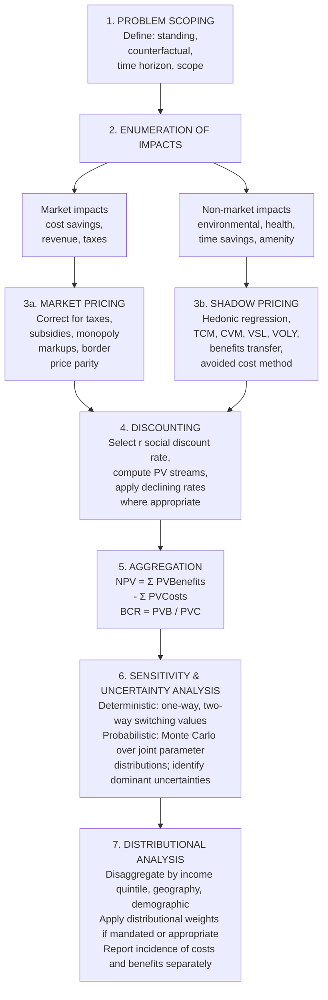

# Lesson 4: Cost-Benefit Analysis, Compensation Principles, Policy Evaluation

## 1. First-Principles Intuition & Invariants

Every public decision is, at its root, a wager on aggregate welfare. A government that widens a highway imposes noise, displacement, and air quality costs on residents adjacent to the corridor while conferring travel-time savings on commuters who may live nowhere near it. A carbon tax raises fuel prices for the rural poor while reducing long-run climate damages that accrue disproportionately to coastal populations in developing nations. The central problem of welfare economics applied to policy is therefore not merely one of enumeration — cataloguing costs and benefits in a spreadsheet — but one of aggregation across incommensurable preferences, across time horizons that span generations, and across individuals whose marginal utility of income is emphatically not identical. Cost-benefit analysis (CBA) is the institutional answer to that problem. Its power and its pathologies both flow from the same source: the attempt to collapse a multidimensional welfare judgment into a single monetary scalar.

The intellectual architecture of modern CBA rests on a foundation laid by two British economists writing in the late 1930s and early 1940s. Nicholas Kaldor and John Hicks, responding to the Paretian impasse — the observation that virtually no real policy change can claim to make everyone better off simultaneously — proposed what became known as the compensation principle. The Kaldor criterion holds that a policy is an improvement if those who gain from it could, in principle, compensate those who lose and still remain better off than before the change. Hicks's complementary formulation inverts the question: the losers must not be able to bribe the gainers into abandoning the change. When both criteria are satisfied simultaneously, the change is said to satisfy the Scitovsky double criterion, named after Tibor Scitovsky who identified that neither condition alone is sufficient to avoid logical reversal. If the Kaldor test is passed for a move from state $A$ to state $B$, it is entirely possible, under certain conditions of non-convexity and income effects, that the same test also passes for a return from $B$ to $A$ — a logical cycle that renders the criterion incoherent unless the Scitovsky refinement is imposed.

The profound practical implication of the Kaldor-Hicks framework is what it permits and what it suppresses. By making compensation hypothetical rather than actual, the criterion licenses policies that impose real and uncompensated losses on identifiable people, justified by the aggregate arithmetic of willingness to pay. This is not an oversight in the theory — it is a deliberate methodological choice grounded in the belief that economists should evaluate efficiency and leave distribution to other policy instruments, most conventionally to tax-and-transfer systems. The normative weight of that choice is enormous. It encodes a particular view of separability: that efficiency can be achieved first and redistribution corrected later, a sequencing that decades of political economy research has shown to be institutionally implausible in most polities. Understanding Kaldor-Hicks therefore demands understanding not just its mechanics but its embedded assumptions about political institutions, lump-sum transferability, and the separability of equity from efficiency.

The formal invariant of the Kaldor-Hicks test is the net present value of aggregate willingness to pay (WTP) and willingness to accept (WTA). Let a policy produce a vector of outcomes affecting $n$ individuals over $T$ periods. Define the compensating variation $CV_i$ for individual $i$ as the amount of money that, if taken from them after the policy change, would leave them exactly as well off as before. For gainers, $CV_i > 0$; for losers, $CV_i < 0$. The Kaldor criterion then requires:

$$\sum_{i=1}^{n} CV_i > 0$$

The equivalent variation $EV_i$ uses the pre-change utility level as the reference point instead, measuring the payment at pre-change prices that would be equivalent in welfare terms to the policy change. For small changes, $CV_i \approx EV_i$, but for large price or income changes — precisely the kind generated by major infrastructure projects, trade liberalization, or climate policy — the two measures can diverge substantially, and the choice between them is not innocuous. Practitioners routinely use consumer surplus triangles as approximations of both, which introduces a further layer of approximation error that should never be forgotten in interpreting results.

Shadow pricing is the mechanism by which costs and benefits that lack observable market prices are translated into the monetary metric required for aggregation. When a dam displaces a wetland, there is no market clearing price for the ecological services lost. When a road project saves 400,000 hours of commuter time annually, those hours have no traded price. Shadow prices are constructed estimates of the social opportunity cost of a good or service — what the economy forgoes, at the margin, by using resources in one way rather than another. In the simplest case of a competitive economy with no distortions, market prices are shadow prices: the wage rate measures the opportunity cost of time, the marginal cost of electricity measures its social cost. Real economies are, of course, riddled with distortions — taxes, subsidies, market power, externalities — and each distortion drives a wedge between market price and social opportunity cost. The analyst's task is to identify which distortions matter for the project under evaluation and to construct corrected shadow prices accordingly. This is not a mechanical exercise; it requires genuine sector knowledge and an understanding of the structural parameters governing behavioral responses.

The concept of the social discount rate sits at the intersection of ethics and positive economics in a way that no other parameter in CBA does. Because public investments produce streams of costs and benefits spread over decades or centuries, the choice of discount rate can dominate all other analytical decisions. At a 10% discount rate, benefits arriving 30 years hence are worth roughly 6 cents on the dollar today; at 3%, they are worth 41 cents. Climate policy, long-run infrastructure, and public health investments are extraordinarily sensitive to this parameter. The two approaches to social discounting — the descriptive and the prescriptive — reflect a genuine philosophical divide. The descriptive approach, associated with market-rate calibration, argues that the social discount rate should equal the observed rate of return on private capital, on the grounds that public investment displaces private investment, and an honest accounting must reflect that opportunity cost. The Ramsey prescriptive approach instead derives the discount rate from first principles of intergenerational ethics, through the Ramsey formula:

$$r = \delta + \eta \cdot g$$

where $\delta$ is the pure rate of time preference (the degree to which future utility is intrinsically discounted relative to present utility), $\eta$ is the elasticity of marginal utility of consumption (capturing how much less a unit of consumption matters as people become richer), and $g$ is the expected growth rate of per-capita consumption. The critical insight is that even a small positive $\delta$ — the view that future generations matter somewhat less simply because they are in the future — compounds dramatically over long horizons and can rationalize near-indifference to catastrophic climate outcomes. Stern's advocacy for $\delta \approx 0$ in his 2006 Review was not primarily an econometric claim but an ethical one, and the debate it triggered between Stern, Nordhaus, and Weitzman is perhaps the most consequential methodological dispute in applied welfare economics of the past three decades.

---

## 2. Core Architecture & Mechanics

The practical execution of a CBA for a major public project follows an architecture that is sequential in structure but highly iterative in practice. The phases are logically distinct — problem scoping, benefit and cost enumeration, shadow pricing, discounting and aggregation, sensitivity analysis, and distributional analysis — but they interact constantly. A revised shadow wage assumption changes the cost stream, which changes the NPV, which may push the project below an internal threshold, which forces a re-scoping of the alternative. Experienced analysts work through this architecture with explicit feedback loops, not as a one-pass calculation.

The logical flow of a full CBA evaluation can be represented as follows:

Each node in this architecture carries its own technical depth. The problem scoping phase is deceptively consequential: defining who has "standing" — whose welfare counts — determines the population over which the aggregation is performed. A national transport authority may by convention exclude foreign visitors from its welfare aggregation; a climate analysis that excludes developing-country damages will produce starkly different NPVs from one that includes them. The counterfactual, often called the "without project" scenario, must be specified carefully because benefits are always measured as the difference between outcomes with and without the intervention. A road rehabilitation project does not create travel time savings relative to zero travel; it creates savings relative to what travel times would be under a deteriorating pavement scenario with normal maintenance.

Shadow pricing methods form the technical core of non-market benefit estimation, and each has a distinct empirical architecture. The hedonic pricing method (HPM) exploits the fact that observable market transactions — primarily housing prices — implicitly bundle together many attributes, including environmental amenities and disamenities. If two houses are identical in all respects except that one faces a highway noise source, the price differential between them, after controlling for all other hedonic attributes, identifies the marginal willingness to pay for noise reduction. The underlying regression specification is:

$$\ln P_i = \alpha + \beta_1 X_i + \beta_2 Z_i + \gamma \cdot \text{Noise}_i + \varepsilon_i$$

where $P_i$ is the sale price of property $i$, $X_i$ is a vector of structural attributes (floor area, bedrooms, age), $Z_i$ is a vector of neighborhood attributes (school quality, proximity to transit), and $\text{Noise}_i$ is the environmental disamenity measure, typically in decibels. The coefficient $\gamma$ gives the semi-elasticity of price with respect to noise, from which a marginal implicit price — a shadow price — can be recovered. The identification challenge is severe: noise contours are not randomly assigned, and neighborhoods that happen to be noisy may differ from quieter neighborhoods along multiple unobserved dimensions. Valid hedonic estimation therefore requires either an instrumental variable strategy, a spatial regression discontinuity design exploiting the edge of a noise contour, or a difference-in-differences approach comparing price trajectories before and after a source change.

The travel cost method (TCM) uses the revealed preference logic that a visit to a recreational site carries an implicit price equal to the travel cost incurred — time cost plus out-of-pocket expenditure. By regressing visit rates on travel costs across a sample of visitors drawn from zones at varying distances from the site, analysts estimate a demand function for site access and recover a consumer surplus estimate. TCM is well-suited for sites with active visitation data but cannot value passive use — the welfare that people derive from knowing a wilderness area exists even if they never visit it. That component, termed existence value or non-use value, requires stated preference methods, most commonly contingent valuation (CVM) or choice experiments.

Contingent valuation presents survey respondents with a hypothetical scenario and elicits willingness to pay for a specified change. The method is controversial because stated preferences can diverge from revealed ones due to hypothetical bias, strategic behavior, and embedding effects, but it remains indispensable for valuing non-use components of environmental goods. The NOAA Blue Ribbon Panel guidelines established after the Exxon Valdez litigation — requiring in-person surveys, conservative single-bounded dichotomous choice elicitation, and explicit scope tests — represent the minimum credibility standard for CVM applications in litigation and regulatory analysis.

The Value of a Statistical Life (VSL) is the shadow price that underpins nearly all mortality risk valuation in regulatory CBA — transportation safety standards, air quality regulations, occupational health rules. It is defined not as the value of a specific identified life but as the aggregate willingness to pay across a population for a small reduction in mortality risk. If a population of 100,000 people each has a marginal WTP of \$70 for a reduction in annual mortality probability of $1/100,000$, the aggregate WTP is $70 \times 100,000 = \$7,000,000$, and this is interpreted as the value of one statistical life. Current U.S. regulatory practice uses a VSL in the range of \$9–\$12 million (2023 dollars), derived from meta-analyses of labor market wage-risk studies. The VSL then enters the analysis as:

$$B_{\text{mortality}} = \Delta r \cdot N \cdot \text{VSL}$$

where $\Delta r$ is the change in annual mortality probability, $N$ is the affected population, and VSL is the central estimate. The implied life-years adjustment, the Value of a Life Year (VOLY) used more commonly in health economics and by bodies like the UK's NICE, corrects for differences in age composition of the affected population by multiplying a per-year value by remaining life expectancy.

Benefit transfer — applying a shadow price estimated in one context to a different policy context — is the workaround used when primary valuation studies are unavailable or infeasible. A transport agency evaluating a rural road might apply VSL estimates from urban labor market studies; an environmental agency might transfer hedonic noise valuations from one city to another. The validity of transfer rests on the degree of similarity between the study site and the policy site in terms of income levels, baseline environmental conditions, and the nature of the good being valued. Income adjustments use a transfer elasticity:

$$\text{WTP}_{\text{policy}} = \text{WTP}_{\text{study}} \times \left( \frac{Y_{\text{policy}}}{Y_{\text{study}}} \right)^{\epsilon}$$

where $\epsilon$ is the income elasticity of WTP for the good in question, typically estimated in the range of 0.4–1.0 for environmental goods. Benefit transfer introduces an additional layer of uncertainty that should be explicitly reflected in the sensitivity analysis.

The formal aggregation of discounted net benefits, the net present value of the project, is expressed as:

$$\text{NPV} = \sum_{t=0}^{T} \frac{B_t - C_t}{(1+r)^t}$$

where $B_t$ and $C_t$ are the nominal benefit and cost streams in period $t$ and $r$ is the social discount rate. The benefit-cost ratio $\text{BCR} = \sum PV(B_t) / \sum PV(C_t)$ provides a scale-independent measure useful for ranking projects under a fixed budget constraint: when funds are limited, the optimal allocation ranks projects by BCR rather than NPV, since BCR measures return per unit of scarce public resource. This distinction matters enormously in infrastructure programming, where budget envelopes are binding and NPV maximization would consistently favor large-scale projects over high-return smaller ones.

Distributional analysis is the step that most standard CBA frameworks treat as optional or supplementary, but which welfare economics proper demands as central. Unweighted aggregation treats a dollar of WTP identically regardless of whether it belongs to a household in the top income decile or the bottom. The theoretical correction is the application of distributional weights that reflect the declining marginal utility of income. If $\eta$ is the elasticity of marginal utility with respect to income, then the distributional weight for an individual with income $y_i$ relative to a reference income $\bar{y}$ is:

$$w_i = \left( \frac{\bar{y}}{y_i} \right)^{\eta}$$

A household at half the mean income receives a weight of $2^\eta$; at twice the mean income, a weight of $(1/2)^\eta$. For $\eta = 1.5$, the household at half the mean income has its welfare weighted approximately 2.8 times as heavily as the reference individual, and the household at double the mean income is weighted at 0.35. The choice of $\eta$ is again both empirical and normative: empirical estimates from consumption behavior typically place it between 1.0 and 2.0, but the analyst's choice within that range encodes a view about the steepness of the social welfare function.

Applying distributional weights to a CBA does not change the physical outcomes of a project, but it can reverse its sign. A toll road that generates large travel time savings for high-income commuters and displaces low-income pedestrian infrastructure may well have a positive unweighted NPV and a negative distributional-weighted NPV. This reversal is not a failure of the method — it is precisely the information a welfare-conscious government needs.

---

## 3. High-Performance Optimization & Failure Modes

Practitioners who work at the frontier of applied CBA confront a set of recurring failure modes that are rarely discussed in textbook treatments but which systematically distort policy decisions in practice. Understanding these failure modes — and the analytical strategies that mitigate them — separates rigorous evaluation from sophisticated-looking advocacy.

The most pervasive failure is optimism bias in cost estimation. Bent Flyvbjerg's empirical work across thousands of infrastructure projects demonstrates that ex-ante cost estimates systematically understate final delivery costs, with average overruns of 44.7% for rail projects, 20.4% for roads, and 33.8% for large building projects in his global sample. The mechanism is not primarily statistical error but strategic misrepresentation incentivized by the appraisal process itself: project proponents know that underestimating costs raises BCRs, which improves competitive ranking against rival projects, which secures funding approval. The standard mitigation is reference class forecasting (RCF), developed by Flyvbjerg and grounded in Kahneman and Tversky's work on the planning fallacy. RCF requires analysts to identify a reference class of past projects of the same type, extract the distribution of cost and time outcomes from that class, position the current project within that distribution, and apply an uplift factor to the internal estimate accordingly. The UK Treasury's Green Book and the Danish government's transport appraisal framework both now require RCF for major capital projects. The practical implication is that an analyst who accepts an internal project team's cost estimate without reference class adjustment is not performing independent appraisal — they are laundering a promotional document with the imprimatur of economic analysis.

Demand forecasting error compounds cost overestimation on the benefit side. The same Flyvbjerg dataset shows that rail projects on average deliver 51.4% fewer passengers than forecast, while road projects deliver 9.5% more traffic than forecast — a directional asymmetry that reflects differences in the political economy of different modes and their associated advocacy communities. Probabilistic demand modeling, using Monte Carlo simulation over the joint distribution of key demand drivers (population growth, income elasticity, mode share, induced travel), produces a distribution of NPV outcomes rather than a point estimate. The expected NPV under uncertainty is not identical to the NPV evaluated at expected parameter values when the NPV function is nonlinear — Jensen's inequality ensures that if the NPV function is concave in a key uncertain parameter, the expected NPV under uncertainty is lower than the NPV at the expected parameter value.

Formally, for a parameter $\theta$ entering the NPV function nonlinearly:

$$\mathbb{E}[\text{NPV}(\theta)] \neq \text{NPV}(\mathbb{E}[\theta])$$

The magnitude of the gap depends on the curvature of the NPV function and the variance of $\theta$. For projects highly sensitive to, say, the carbon price trajectory or the future wage rate (both relevant for transport and energy projects), this Jensen correction can be quantitatively significant and should always be computed in a full probabilistic appraisal.

Switching value analysis is the deterministic analogue: for each key parameter, the analyst computes the value at which the NPV crosses zero or the BCR falls to unity. If the switching value for the carbon price in a renewable energy subsidy analysis is £12/tonne CO₂ and the central estimate from the Social Cost of Carbon literature is £80–£140/tonne, then the project is robust to very large downward revisions in carbon valuation. If the switching value is £95/tonne and there is genuine scientific uncertainty spanning that range, the decision is fragile, and the analysis should flag this explicitly rather than presenting the central-estimate NPV as a reliable verdict.

A subtler but equally serious failure mode is the treatment of externalities under general equilibrium feedback. Standard partial equilibrium CBA assumes that the project being evaluated is small relative to the relevant markets — that it does not shift wages, land prices, or interest rates economy-wide. For genuinely large projects — a major broadband rollout, a transformative trade policy, a national carbon price — this assumption fails. The benefit of a transport investment is not just the direct travel time saving; it may also trigger agglomeration effects as firms relocate to exploit improved connectivity, raising land values, labor productivity, and tax revenues in ways that a partial equilibrium analysis misses entirely. The UK Department for Transport developed Wider Economic Benefits (WEB) methodology to capture agglomeration uplift, estimated via wage-density gradients that proxy for the productivity premium of economic density. The FHWA in the United States has developed comparable guidance under its transportation and economic development framework. These wider effects are real, but they must be counted carefully to avoid double-counting: if agglomeration productivity gains are already reflected in the land value increases captured by a hedonic analysis, adding them again from a WEB calculation produces a spurious inflation of benefits.

Welfare measurement under distortions deserves explicit treatment as a failure mode in its own right. When input or output markets are distorted — by minimum wages, tariffs, commodity subsidies, or regulated prices — using market prices to value resources leads to systematically biased estimates. The classic case is the shadow wage rate in projects operating in economies with large informal sectors and high unemployment. If the market wage is £15/hour but workers hired into the project would otherwise earn £0 in informal sector subsistence, the social opportunity cost of that labor may be close to zero — the economy forgoes almost nothing by putting unemployed workers to work. Using the market wage as the shadow wage grossly overstates the resource cost of labor-intensive projects in high-unemployment contexts. The standard correction, adopted in World Bank and ADB project appraisal guidance, is the shadow wage rate factor (SWRF):

$$\text{Shadow Wage} = w_m \cdot \text{SWRF}$$

where $w_m$ is the market wage and SWRF is a correction factor less than 1.0 in economies with structural unemployment. SWRF values used in operational appraisal range from 0.5 to 0.9 depending on regional labor market conditions. Similarly, when a project uses imported inputs that enter under a tariff, the social cost of those inputs is their border price (CIF), not their domestic market price inclusive of tariff, because the tariff is a transfer payment from domestic consumers to the government treasury — it represents no net resource cost to society.

The formal general framework for welfare measurement under distortions invokes the concept of the second-best optimum. In a first-best world with no pre-existing distortions, the standard Kaldor-Hicks aggregation of WTP and WTA gives an accurate welfare measure. In the real world of second-best, the marginal welfare cost of raising a dollar of tax revenue exceeds one dollar because taxes themselves distort behavior. Harberger's work established the marginal cost of public funds (MCF) — the welfare cost per dollar of government revenue — as a critical adjustment factor for all public investment analysis. If the MCF is 1.3, every dollar of tax revenue used to finance a project costs society \$1.30 in welfare terms, and this must be reflected on the cost side of the ledger. OECD country estimates of MCF range from roughly 1.1 in countries with relatively flat, broad-based tax systems to 1.5 or higher in countries relying heavily on distortionary taxes. Projects financed by user charges rather than general taxation have a lower effective MCF and should be credited accordingly in the appraisal.

The most philosophically deep failure mode is the aggregation problem inherent in the social welfare function. All CBA rests on the implicit assertion that individual welfare gains and losses can be meaningfully summed to produce a measure of social welfare. Arrow's Impossibility Theorem establishes that no aggregation procedure can simultaneously satisfy transitivity, Pareto efficiency, independence of irrelevant alternatives, and non-dictatorship. The Bergson-Samuelson social welfare function sidesteps Arrow's result by treating the social welfare function as an exogenous specification chosen by a benevolent planner, but this merely relocates rather than resolves the normative problem. For the practitioner, the implication is not paralysis but epistemic humility: the NPV of a CBA is not the welfare effect of a policy in the sense of a unique scientific fact. It is the welfare effect as measured by a specific set of normative choices about whose preferences count, how they are weighted, at what rate they are discounted, and which shadow prices are used to represent non-market values. Those choices should be reported transparently and subjected to sensitivity analysis with equal rigor as any empirical parameter.

The best-practice appraisal report does not present a single NPV and a verdict. It presents a distributional breakdown of who gains and loses, a sensitivity table over the key normative parameters ($r$, $\eta$, VSL, shadow wage), a probabilistic range for the NPV reflecting genuine empirical uncertainty, a reference-class-adjusted cost estimate, and a plain-language summary of the conditions under which the project would and would not represent a welfare improvement. That architecture transforms CBA from an exercise in numeric advocacy into what it was always meant to be: a disciplined framework for surfacing the trade-offs that political decision-makers must ultimately own.

The transition from appraisal to evaluation — the retrospective assessment of whether predicted impacts materialized — closes the institutional feedback loop that keeps CBA honest over time. Without systematic ex-post evaluation, the optimism bias and demand forecasting errors documented by Flyvbjerg and others have no correction mechanism. The UK's Evaluation Task Force, the European Commission's ex-post evaluation requirements under its cohesion fund regulations, and the World Bank's Independent Evaluation Group all represent institutional attempts to build that feedback. The practitioner who designs an ex-ante appraisal with explicit, testable, time-stamped predictions — rather than the convenient ambiguity of aggregate NPV estimates — creates the evaluative infrastructure that allows the next generation of analysts to learn from this generation's errors.
