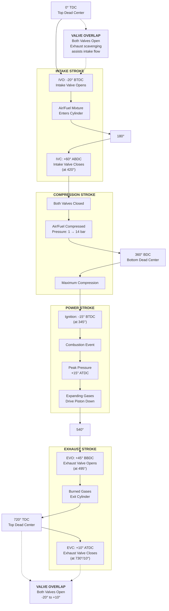

# Lesson 2: Engine Systems

## 1. First-Principles Intuition & Invariants

The internal combustion engine remains the most mechanically complex subsystem within the modern automobile, transforming chemical potential energy stored in hydrocarbon fuel into rotational kinetic energy through a carefully orchestrated sequence of thermodynamic events. At its essence, the four-stroke reciprocating engine executes a repeating Otto or Diesel cycle: intake, compression, power, and exhaust. Each cycle converts approximately twenty to thirty-five percent of the fuel's energy into useful work, with the remainder dissipated as heat through the cooling system, exhaust gases, and friction losses. Understanding engine performance and diagnosing failure modes requires grounding in three fundamental invariants: the relationship between volumetric efficiency and power output, the precise timing of ignition or injection events relative to piston position, and the chemical stoichiometry governing combustion completeness and emission byproducts.

Volumetric efficiency quantifies how effectively the engine fills its cylinders with fresh air-fuel mixture during the intake stroke. A naturally aspirated engine operating at wide-open throttle typically achieves seventy-five to ninety percent volumetric efficiency, constrained by intake manifold pressure drops, valve flow restrictions, and exhaust backpressure. The ideal gas law governs the mass of air trapped in each cylinder: increasing intake air density through forced induction or reducing intake air temperature directly increases the oxygen available for combustion, permitting proportionally greater fuel mass and thus higher torque output. This principle underlies every power enhancement strategy from cold air intakes to turbocharger installations.

Ignition or injection timing establishes when combustion pressure rise occurs relative to crankshaft position. In spark-ignition gasoline engines, the spark must initiate flame kernel propagation sufficiently before top dead center (TDC) that peak cylinder pressure occurs approximately fifteen to twenty degrees after TDC, when the connecting rod angle provides optimal leverage for crankshaft torque multiplication. Advancing timing too far causes knock—destructive detonation arising when end-gas autoignites before the flame front arrives—while excessive retard wastes energy expanding hot gases during the exhaust stroke and elevates exhaust gas temperature. Diesel compression-ignition engines inject fuel near TDC, relying on compressed air temperature exceeding the fuel's autoignition threshold, with injection timing controlling both power output and the rate of pressure rise that governs combustion noise and mechanical stress.

The stoichiometric air-fuel ratio for gasoline (approximately 14.7:1 by mass) represents the chemically complete combustion point where hydrocarbon fuel molecules react fully with atmospheric oxygen to yield carbon dioxide and water vapor. Operating at stoichiometry permits the three-way catalytic converter to simultaneously oxidize unburned hydrocarbons and carbon monoxide while reducing oxides of nitrogen, but maximizing power requires enrichment to approximately 12.5:1, sacrificing fuel economy and elevating hydrocarbon emissions to prevent combustion chamber hotspots that trigger knock. Conversely, lean operation beyond 15:1 improves thermal efficiency but increases combustion temperature, accelerating nitrogen oxide formation and risking lean misfire as flame propagation slows in oxygen-dilute mixtures. Every diagnostic procedure and performance optimization ultimately manipulates these three domains: air mass delivery, combustion phasing, and mixture ratio.

## 2. Core Architecture & Mechanics

The fuel delivery system has evolved through three distinct generations, each progressively increasing injection pressure and control precision. Carbureted systems, now obsolete in production vehicles but prevalent in the repair market for pre-1990 vehicles, rely on Bernoulli's principle: intake airflow through a venturi restriction creates negative pressure that draws fuel from a reservoir through calibrated metering jets. The carburetor's accelerator pump squirts additional fuel during throttle transients to compensate for fuel's slower evaporation rate compared to air acceleration, while the choke enriches cold-start mixtures when fuel vaporization is incomplete. Diagnosing carburetor problems demands mechanical inspection—float level verification using a precision height gauge, jet orifice measurement with numbered drill bits, and accelerator pump stroke volume testing through discharged fuel collection and measurement.

Throttle-body and multi-port fuel injection systems supplanted carburetors by 1995, mounting solenoid-operated injectors either centrally in the throttle body or individually at each intake port. The engine control unit (ECU) pulses injectors open for calibrated durations, with fuel pressure regulated to a constant differential above intake manifold pressure—typically 43.5 psi absolute (three bar)—by a spring-loaded diaphragm regulator referenced to manifold vacuum. Injector pulse width, measured in milliseconds, directly determines fuel mass delivery. A naturally aspirated 2.0-liter four-cylinder engine idling at 800 RPM might command 2.5 ms pulses, increasing to 12 ms at wide-open throttle and 6000 RPM where airflow peaks. The ECU calculates base pulse width from manifold absolute pressure (MAP) or mass airflow (MAF) sensor readings, then trims values using feedback from heated oxygen sensors monitoring exhaust gas composition. Wideband oxygen sensors generate voltage or current proportional to actual air-fuel ratio across a broad range, while traditional narrowband sensors exhibit a sharp voltage transition at stoichiometry—approximately 0.45 V lean to 0.55 V rich—permitting closed-loop correction only near 14.7:1.

Sequential port injection fires each injector once per engine cycle, timed to open during its cylinder's intake stroke, while batch-fire systems pulse multiple injectors simultaneously. Diagnostic procedures begin with fuel pressure verification using a mechanical Bourdon-tube gauge threaded into the rail's Schrader valve test port. Pressure below specification indicates weak pump output, restricted filter, or leaking regulator, while pressure above specification suggests a blocked return line or failed regulator diaphragm. Injector electrical resistance measured with a digital multimeter typically ranges from twelve to sixteen ohms for saturated designs, while low-impedance injectors measure two to four ohms and require ECU current-limiting circuits. Observing injector pulse width with a scan tool during steady-state cruise provides insight into fuel trim corrections: if long-term fuel trim exceeds plus-fifteen percent, the ECU is compensating for an unmeasured air leak or weak fuel pressure by increasing pulse width, whereas negative-fifteen percent trim indicates excess fuel delivery from a leaking injector or failed pressure regulator holding insufficient pressure.

Direct injection systems, now dominant in new production, inject fuel directly into the combustion chamber at pressures ranging from 500 to 2900 psi (35 to 200 bar), atomizing fuel through microscopic nozzle orifices for superior mixture preparation. A camshaft-driven high-pressure pump, supplied by a conventional low-pressure pump in the tank, compresses fuel against a pressure control valve modulated by the ECU. Direct injection permits stratified-charge operation: injecting fuel late in the compression stroke creates a rich zone near the spark plug within a globally lean chamber, improving part-throttle efficiency. However, the absence of intake port fuel wash permits carbon deposit accumulation on intake valve faces, progressively restricting airflow and causing rough idle and misfire. Repair procedures involve walnut shell blasting—abrasive media pneumatically propelled through removed intake manifolds to scour valve deposits—or chemical cleaning with pressurized solvents introduced through intake ports.

Ignition system architecture determines how stored electrical energy transforms into the fifteen to forty kilovolt spark required to ionize the air-fuel mixture gap. Conventional distributor ignition, prevalent through the 1980s, employs a rotating arm to sequentially direct secondary coil voltage to each spark plug through carbon-impregnated rotor and cap contacts. The ignition coil functions as a step-up transformer: the ECU (or points mechanism in earlier systems) interrupts primary current flow through the coil's low-voltage winding, causing magnetic field collapse that induces high voltage in the secondary winding according to the turns ratio—typically one hundred turns secondary per single primary turn. Primary current buildup requires finite time governed by coil inductance, limiting maximum engine speed in distributor systems to approximately 6500 RPM before insufficient dwell time prevents full coil saturation.

Distributorless ignition systems eliminate mechanical distribution through individual coils for each cylinder (coil-on-plug) or paired coils serving two cylinders in wasted-spark configuration. Wasted-spark coils fire two plugs simultaneously—one during its cylinder's power stroke and the companion during exhaust stroke—with the exhaust spark wasted but electrically necessary to complete the circuit. Coil-on-plug designs mount the coil directly atop each spark plug, eliminating all secondary ignition cables and their associated electromagnetic interference and insulation breakdown failure modes. The ECU switches coil primary current using insulated-gate bipolar transistor (IGBT) drivers capable of handling four to eight amperes at dwell times calibrated to coil inductance and battery voltage. Diagnostic oscilloscopes capture secondary voltage waveforms revealing ignition health: the firing spike should reach fifteen to twenty-five kilovolts for healthy modern engines, followed by a spark duration plateau at two to four kilovolts sustained for 0.8 to 1.5 milliseconds, then a damped oscillation as residual coil energy dissipates.

Emission control systems manage three primary combustion byproducts: unburned hydrocarbons resulting from incomplete combustion or flame quenching against cold chamber walls, carbon monoxide from insufficient oxygen, and oxides of nitrogen formed when combustion temperatures exceed 2500°F. The three-way catalytic converter employs precious metal catalysts—platinum, palladium, and rhodium—to simultaneously oxidize hydrocarbons and carbon monoxide while reducing nitrogen oxides, but this narrow operating window exists only within approximately 0.5 air-fuel ratio of stoichiometry. The ECU maintains this window through closed-loop fuel control: upstream oxygen sensors provide feedback that modulates injector pulse width at frequencies near one hertz, creating intentional oscillation around stoichiometry that permits the converter to store and release oxygen, buffering transient excursions.

Evaporative emission controls prevent fuel vapor escape from the tank and fuel system through activated carbon canisters that adsorb vapors during vehicle soak periods. A purge valve, commanded open by the ECU during closed-loop operation, introduces stored vapors into the intake manifold where they burn as supplemental fuel. The ECU compensates for purge flow by reducing injector pulse width proportionally, observable as negative short-term fuel trim during purge events. Onboard diagnostics monitor evaporative system integrity through leak detection pumps or engine-off natural vacuum tests: sealing the system and monitoring pressure decay reveals leaks as small as 0.020 inch diameter, illuminating the malfunction indicator lamp and storing diagnostic trouble codes.

Variable valve timing systems optimize the compromise between low-speed torque, high-speed power, and part-throttle efficiency by adjusting intake and/or exhaust camshaft phasing relative to crankshaft position. The fundamental conflict arises because optimal valve timing varies with engine speed: late intake valve closing improves low-speed volumetric efficiency by preventing reverse flow back into the intake manifold, while early closing benefits high-speed operation where inertia effects supercharge cylinder filling. Cam-phased VVT systems employ a vane-type phaser integrated into the camshaft drive sprocket, with engine oil pressure applied to advance or retard chambers controlled by a solenoid-operated oil control valve. Advancing intake cam timing earlier increases valve overlap—the period when intake and exhaust valves are simultaneously open—which improves high-RPM scavenging as exhaust momentum draws fresh charge into the cylinder.

The ECU commands cam phaser position based on engine speed, load, and operating temperature, with verification through camshaft position sensors measuring actual phaser angle. Phaser response time typically spans 200 to 500 milliseconds, constrained by oil viscosity, pressure, and phaser mass. Diagnostic trouble codes indicating cam timing over-advanced or over-retarded frequently result from oil control valve contamination, low oil level reducing hydraulic pressure, or timing chain stretch permitting excessive crankshaft-to-camshaft phase error. Repair verification requires comparing commanded versus actual cam position using a scan tool capable of graphing parameter IDs in real-time, confirming the phaser tracks commanded position within five degrees across the full authority range—typically forty degrees of adjustability.

Forced induction through turbocharging compresses intake air using exhaust gas energy to spin a radial turbine wheel mechanically coupled to a centrifugal compressor wheel. As exhaust gas velocity increases with engine speed and load, turbine rotational speed climbs from idle speeds near 20,000 RPM to peak speeds approaching 250,000 RPM, with compressor pressure ratio rising proportionally. Boost pressure, measured in psi above atmospheric or bar absolute, directly multiplies volumetric efficiency: fourteen psi of boost (approximately two bar absolute) doubles air density compared to naturally aspirated operation, permitting doubled fuel mass and theoretically doubled torque output. Actual gains diminish due to increased intake air temperature from compression heating—governed by the isentropic compression relationship where temperature rise accompanies pressure rise—necessitating intercoolers to reduce compressed air temperature before cylinder entry.

Turbocharger response characteristics exhibit lag, the time delay between throttle opening and boost pressure buildup, caused by turbine and compressor rotor inertia resisting acceleration and by the time required for exhaust mass flow to accumulate sufficient energy. Small turbine housings reduce lag by increasing exhaust gas velocity for quicker spool-up but limit peak airflow and power, while large housings support high power but suffer extended lag. Variable geometry turbines employ movable vanes that alter the effective turbine housing area, constricting flow at low speed for rapid response and opening at high speed to minimize exhaust backpressure restriction.

The wastegate valve bypasses exhaust gas around the turbine once target boost pressure is reached, preventing overboost damage. Pneumatic wastegate actuators use compressor boost pressure applied against a spring-loaded diaphragm to progressively open the wastegate, with preload adjustment by threaded rod establishing peak boost level. Electronic wastegate control substitutes a stepper motor or servo for the pneumatic actuator, permitting ECU modulation of boost pressure based on engine speed, gear selection, coolant temperature, and knock sensor feedback. Turbocharger failure modes concentrate in three areas: bearing system degradation from oil contamination or starvation causing shaft play and wheel-to-housing contact, turbine wheel erosion from thermal cycling and exhaust particulates, and compressor surge—flow reversal and stall occurring when throttle closure traps compressed air—mitigated by bypass or blow-off valves venting excess pressure.

## 3. High-Performance Optimization & Failure Modes

Engine performance metrics establish quantitative frameworks for comparing output and efficiency across different engine architectures and operating conditions. Brake mean effective pressure (BMEP) normalizes torque output to displacement, expressing the average cylinder pressure during the power stroke that produces observed crankshaft torque. BMEP calculation requires only torque and displacement: BMEP (psi) equals torque (lb-ft) times 150.8 divided by displacement (cubic inches). Naturally aspirated gasoline engines achieve BMEP values from 125 to 145 psi at peak torque, while turbocharged engines reach 180 to 290 psi, and Formula One engines exceed 350 psi through extreme boost pressure and combustion optimization. BMEP provides immediate insight into specific output and relative efficiency, independent of absolute engine size.

Brake-specific fuel consumption (BSFC) quantifies fuel efficiency by expressing fuel mass flow rate per unit power output, typically in pounds per horsepower-hour or grams per kilowatt-hour. Modern gasoline direct injection engines achieve best-point BSFC near 0.40 lb/hp-hr (approximately 243 g/kWh) during cruise operation at stoichiometry, while diesel engines reach 0.34 lb/hp-hr (207 g/kWh) due to higher compression ratios and lean combustion. BSFC mapping across the full speed-load envelope reveals optimal operating zones: operating near peak torque speed at partial throttle minimizes BSFC by reducing pumping losses compared to low-speed high-load or high-speed low-load operation. Continuously variable transmissions and hybrid powertrain strategies exploit this knowledge, constraining engine operation to minimum BSFC islands.

Knock sensor feedback controls constitute the primary defense against destructive detonation in modern spark-ignition engines. Piezoelectric accelerometers threaded into the block convert mechanical vibration into electrical signals, with digital signal processing isolating the six to fifteen kilohertz frequency band characteristic of knock. The ECU analyzes knock intensity and frequency, retarding ignition timing cylinder-individually in one to three-degree decrements when knock is detected. Timing advance resumes gradually—approximately one degree per hundred engine cycles—once knock ceases. Octane rating establishes fuel's resistance to autoignition: the research octane number (RON) measured under mild conditions and motor octane number (MON) measured under severe conditions (higher speed, temperature, and ignition advance) average to yield the anti-knock index posted on fuel pumps as (R+M)/2. Each octane number increment permits approximately two degrees additional ignition advance before knock onset, translating to roughly three to five percent torque increase.

Recalibrating engine management systems for performance modifications requires understanding the ECU's core fuel and spark lookup tables. Base fuel delivery derives from speed-density or mass-airflow algorithms: speed-density systems calculate air mass from manifold pressure, temperature, and engine speed using the ideal gas law, while MAF systems measure airflow directly through heated-element or hot-wire sensors. The ECU indexes volumetric efficiency or airflow tables using engine speed and load as axes, with each table cell containing calibrated values representing expected air mass at that operating point. Modifications increasing airflow—upgraded camshafts, forced induction, or throttle body enlargements—require proportional fuel delivery increases, accomplished through multiplier adjustments to the base fuel table or through altered MAF sensor calibration curves.

Ignition timing tables similarly use speed and load as indices, with timing advance values optimized for minimum BSFC while maintaining adequate knock margin. Higher octane fuel permits uniform timing advance across all cells, while forced induction requires progressive retard at higher boost pressures due to increased cylinder pressure and temperature elevating knock propensity. Target air-fuel ratio tables establish whether the ECU commands stoichiometric, lean, or rich operation at each speed-load combination. Naturally aspirated engines typically maintain stoichiometry except at wide-open throttle where enrichment to 12.0-12.5:1 prevents knock and reduces combustion temperature, while turbocharged engines may enrich progressively with boost pressure, reaching 11.5:1 at peak boost to control detonation.

Datalogging procedures capture real-time sensor and actuator values during test drives, revealing calibration adequacy and component failures. Essential logged parameters include manifold pressure or airflow, throttle position, injector pulse width, ignition timing, knock sensor activity, air-fuel ratio from wideband sensors, coolant and intake air temperatures, and fuel trims. Comparing logged values against theoretical expectations exposes problems: if manifold pressure at wide-open throttle measures only thirteen inches of mercury absolute (inHg-A) when fourteen inHg-A is expected at that altitude, restricted airflow from a clogged filter, collapsed intake duct, or restricted exhaust is indicated. Knock sensor activity correlating with specific cylinders suggests mechanical problems such as carbon deposits elevating compression ratio or uneven fuel distribution.

Combustion chamber carbon accumulation represents the dominant progressive failure mode in direct injection engines, with intake valve deposits reducing effective flow area by five to fifteen percent over sixty thousand miles. The deposits form because direct injection eliminates the fuel wash that cleaned intake valves in port injection systems. Polymerization of crankcase oil vapors recirculated through the positive crankcase ventilation system, combined with exhaust gas recirculation residues, bake onto hot valve surfaces forming hard carbon layers. Symptoms manifest as rough idle from uneven cylinder airflow, hesitation during acceleration as the ECU's fuel trim authority proves insufficient to compensate for flow variations, and eventually misfire codes under load.

Thermal management failures cascade rapidly into catastrophic engine damage when coolant system deficiencies permit localized overheating. Cylinder head gaskets seal combustion pressure and separate coolant passages from oil galleries, with multi-layer steel designs featuring embossed fire rings concentrating sealing force around cylinder bores. Head gasket failure permits combustion gas entry into coolant passages, creating bubbles observable in the radiator during pressure testing, or allows coolant seepage into cylinders causing white exhaust smoke and coolant consumption without external leaks. Repair requires cylinder head removal, surface flatness verification using precision straightedges and feeler gauges (automotive specifications typically demand flatness within 0.002 inch per six inches), and surface grinding if warpage exceeds limits.

Timing chain or belt degradation introduces camshaft phasing errors that desynchronize valve opening relative to piston position, risking mechanical interference between valves and pistons in interference-design engines. Timing chains stretch through wear at pin-bushing interfaces, progressively retarding camshaft position and generating rattling noise during cold starts when oil pressure is insufficient to tension the hydraulic chain tensioner. Excessive chain stretch beyond fifteen to twenty degrees of crankshaft rotation prevents the variable valve timing system from achieving commanded advance limits, storing diagnostic codes. Belt-driven systems require replacement at manufacturer-specified intervals—typically sixty thousand to one hundred thousand miles—because rubber and fiber reinforcement fatigue invisibly, with failure causing instant catastrophic damage as pistons strike open valves.

Diagnosing misfire conditions demands systematic isolation of ignition, fuel, and mechanical causes through component substitution and diagnostic mode tests. Cylinder-specific misfire codes narrow the problem space but don't identify root cause. Swapping spark plugs or ignition coils between cylinders and observing whether the misfire follows the component confirms ignition system fault, while injector swap tests isolate fuel delivery problems. If misfire remains cylinder-specific after component swaps, mechanical issues are implicated: compression testing using a threaded gauge measures cranking pressure, with healthy cylinders producing 140 to 180 psi and variation between cylinders below ten percent. Low compression isolated to one cylinder indicates valve sealing problems or piston ring damage, while uniformly low compression across all cylinders suggests incorrect valve timing from chain/belt failure.

Leak-down testing provides superior diagnostic resolution by pressurizing each cylinder to sixty psi through the spark plug hole while the piston rests at top dead center, then measuring pressure decay rate and listening for air escape locations. Air hissing from the throttle body indicates intake valve leakage, exhaust system noise reveals exhaust valve problems, while bubbles in the radiator demonstrate head gasket failure. Cylinder leakage below five percent represents excellent condition, five to fifteen percent is acceptable, and beyond twenty percent mandates repair. Combining leak-down results with borescope inspection through spark plug holes reveals valve deposit buildup, piston crown erosion, or cylinder wall scoring, guiding repair strategy.

Crankshaft position sensor failures represent the most common no-start condition in modern engines because the ECU disables both fuel injection and ignition without valid crankshaft position input. Hall-effect and variable reluctance sensors generate pulse trains as reluctor wheel teeth or slots pass the sensor tip, with pulse frequency directly proportional to engine speed. The ECU calculates instantaneous crankshaft position and acceleration from pulse timing, synchronizing injection and ignition events. Sensor failure symptoms include extended cranking before starting as the ECU waits for valid synchronization, stalling during deceleration when signal amplitude drops below detection threshold at low RPM, or immediate no-start with no fuel delivery or spark. Oscilloscope verification shows clean square-wave transitions for Hall sensors or sinusoidal waveforms for reluctance sensors, with amplitude proportional to reluctor tooth speed past the sensor.

Forced induction systems operating beyond factory boost levels require supporting modifications across fuel delivery, ignition timing, and mechanical strength domains. Increasing boost from fourteen to twenty psi (two to 2.4 bar absolute) multiplies torque approximately thirty percent but demands proportional fuel system capacity increases. Factory fuel injectors operating at eighty percent duty cycle—pulse width eight milliseconds in a ten-millisecond cycle period—lack additional authority. Upgrading to injectors with forty percent greater flow capacity while recalibrating the ECU's injector constant restores duty cycle margin. Fuel pump capacity must similarly scale, with in-tank pumps rated by volumetric flow at specified pressure: a forty percent power increase requires forty percent additional fuel flow, necessitating either upgraded pump capacity or supplemental pumps.

Ignition timing retard proportional to boost pressure prevents knock at elevated cylinder pressures: typical calibrations subtract one to two degrees of advance per psi of boost beyond factory levels, with exact values depending on fuel octane and combustion chamber design. Detonation at high boost destroys pistons and connecting rods through shock wave pressure spikes exceeding normal combustion by factors of three to five, concentrating force on piston crown edges. Upgrading to forged aluminum pistons with greater compressive strength and adding sodium-filled exhaust valves for enhanced heat dissipation permit sustained high-boost operation.

Exhaust gas temperature monitoring becomes critical in forced induction applications because turbine inlet temperatures approach 1800°F at high load, approaching the thermal limits of turbine wheel alloys. Type-K thermocouples welded into exhaust manifold runners provide ECU feedback for mixture enrichment: if exhaust gas temperature exceeds calibration thresholds during sustained load, the ECU enriches mixture beyond stoichiometry, sacrificing fuel economy to absorb excess heat through fuel vaporization latent heat. Aftermarket engine management systems display exhaust temperature and implement programmable enrichment strategies that balance power output, component durability, and knock margin across the operating envelope.
