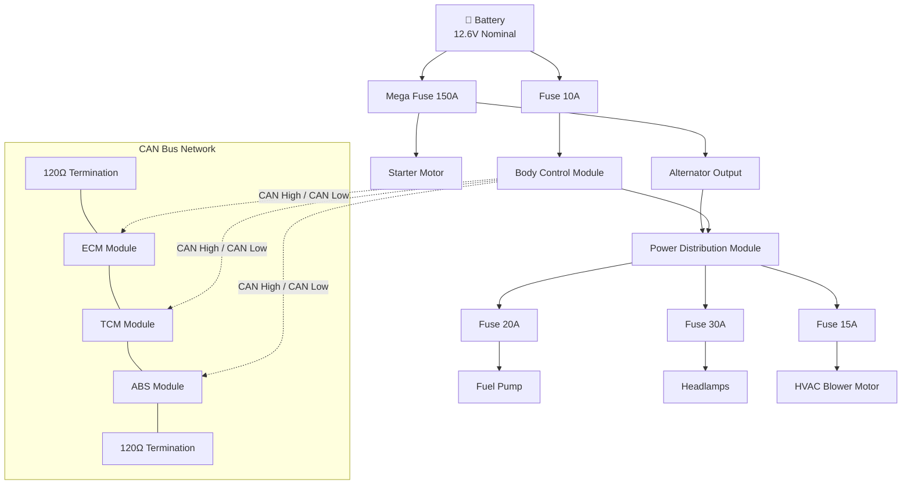

# Lesson 3: Electrical Systems

## 1. First-Principles Intuition & Invariants

The modern automotive electrical system represents a profound departure from the simple six-volt battery-and-generator architectures that powered vehicles through the mid-twentieth century. Where mechanics once diagnosed electrical faults with a test light and a wiring diagram that fit on a single page, today's technician confronts a distributed computing network operating across multiple voltage domains, communicating through high-speed serial buses, and executing millions of control decisions per second. Understanding this transformation requires grounding ourselves in the fundamental electrical principles that govern charge flow, then systematically building upward through circuit analysis, semiconductor physics, and finally into the layered protocols that enable dozens of electronic control units to coordinate as a unified system.

At the foundation lies Ohm's Law, the bedrock relationship stating that voltage equals current multiplied by resistance: $V = IR$. This deceptively simple equation captures the essence of every electrical interaction in a vehicle. When a technician measures 12.6 volts at a battery terminal but observes dim headlamps, Ohm's Law immediately suggests elevated resistance somewhere in the current path—perhaps corroded terminals, fractured strands within a battery cable, or a failing ground connection. The law extends naturally into Kirchhoff's Current Law, which asserts that the algebraic sum of currents entering any junction must equal zero, and Kirchhoff's Voltage Law, declaring that the sum of potential differences around any closed loop equals zero. These conservation principles enable systematic circuit analysis: a voltage drop across an unexpected resistance reveals itself through measurement, and current distribution through parallel paths follows predictable ratios based on the inverse of their resistances.

Power dissipation follows directly from these relationships. Every component carrying current experiences power loss proportional to $P = I^2 R$, which explains why high-current circuits such as starter motor feeds employ thick-gauge conductors with minimal resistance. A starter circuit drawing 200 amperes through a cable with 0.01 ohms of resistance dissipates 400 watts as waste heat—enough to rapidly degrade insulation if sustained. This physical reality drives the automotive industry's obsession with minimizing parasitic resistance through gold-plated terminals, tinned copper strands, and crimped connections that achieve gas-tight molecular contact between conductors.

Reactive components introduce time-domain behavior that complicates DC analysis. Capacitors store energy in electric fields and exhibit impedance inversely proportional to frequency: $Z_C = \frac{1}{j\omega C}$, where $\omega$ represents angular frequency and $j$ denotes the imaginary unit. Inductors store energy in magnetic fields with impedance proportional to frequency: $Z_L = j\omega L$. These frequency-dependent impedances explain why automotive engineers install capacitors across solenoid coils and relay contacts—the capacitor's low impedance at high frequencies shunts voltage transients generated by inductive kickback when current abruptly ceases, protecting sensitive semiconductor junctions from overvoltage destruction. The classic RC time constant $\tau = RC$ governs charge and discharge rates, while the RL time constant $\tau = \frac{L}{R}$ determines how quickly current establishes through an inductor. A fuel injector solenoid with 2 millihenries of inductance and 12 ohms of resistance exhibits a time constant of 167 microseconds, meaning current reaches 63% of its steady-state value in that interval—a critical parameter for precise injection timing.

Semiconductor physics introduces nonlinear behavior that defies simple Ohm's Law analysis. Diodes conduct current freely in the forward direction once the junction barrier voltage (approximately 0.7 volts for silicon) is exceeded, but block reverse current until avalanche breakdown occurs at the peak inverse voltage rating. This asymmetric conductivity enables rectification in alternators, where six diodes arranged in a three-phase bridge convert AC stator output into DC charging current. Transistors—whether bipolar junction transistors (BJTs) or metal-oxide-semiconductor field-effect transistors (MOSFETs)—function as electrically controlled switches, modulating large currents through small control signals. Modern automotive power distribution relies extensively on N-channel MOSFETs configured as low-side switches, where the gate-source threshold voltage (typically 2 to 4 volts) controls drain-source conductivity. When fully enhanced, a MOSFET exhibits drain-source resistance often below 10 milliohms, enabling efficient switching of tens of amperes with minimal heat generation. The gate capacitance, however, demands careful attention: charging this capacitance consumes energy and limits switching speed, which explains why body control modules employ dedicated gate driver circuits capable of sourcing several amperes of peak current to rapidly charge and discharge MOSFET gates during transitions.

Battery chemistry establishes the electrochemical foundation for the entire electrical system. A lead-acid battery stores energy through reversible reduction-oxidation reactions between lead dioxide at the positive plate, sponge lead at the negative plate, and sulfuric acid electrolyte. The open-circuit voltage of a fully charged cell is approximately 2.1 volts, yielding 12.6 volts for a six-cell automotive battery. During discharge, both plates convert to lead sulfate while the electrolyte's specific gravity decreases as sulfuric acid is consumed. This chemical transformation explains why discharged batteries freeze more easily—diluted electrolyte has a higher freezing point than concentrated acid. The capacity of a battery, measured in ampere-hours, represents the total charge available at a specified discharge rate. The industry-standard cold cranking amperage (CCA) rating quantifies the maximum current a battery can deliver for 30 seconds at -18°C (0°F) while maintaining at least 7.2 volts, a specification that directly correlates with a battery's ability to crank an engine in winter conditions when oil viscosity increases and starter motor current demands peak.

Internal resistance within a battery increases with age, sulfation, and low state of charge. This resistance, typically measured in milliohms, manifests as voltage drop under load—a phenomenon exploited by modern battery testers that apply a controlled load while measuring terminal voltage. A healthy battery might exhibit 3 milliohms of internal resistance, dropping only 0.6 volts when supplying 200 amperes to a starter motor. A degraded battery with 15 milliohms of resistance suffers a 3-volt drop under identical load, leaving insufficient voltage to energize the starter solenoid and crank the engine. This principle underpins the difference between static voltage testing, which merely confirms chemical potential, and dynamic load testing, which reveals the battery's ability to deliver power under realistic operating conditions.

The charging system compensates for electrical loads and replenishes the battery through voltage-regulated DC output from the alternator. The fundamental challenge confronting any charging system lies in balancing three competing requirements: maintaining battery state of charge, supplying current for active electrical loads, and avoiding overcharge that would boil electrolyte and corrode positive plates. Modern voltage regulators implement closed-loop control by sensing battery voltage and modulating alternator field current to maintain setpoint voltage—typically 13.8 to 14.4 volts depending on temperature and battery chemistry. The regulator incorporates temperature compensation, reducing target voltage in hot conditions to prevent overcharge and increasing it in cold conditions to overcome elevated internal resistance and ensure complete charging. This temperature coefficient typically ranges from -3 to -5 millivolts per degree Celsius.

Alternator output capability depends fundamentally on rotational speed and field excitation. The three-phase stator windings generate AC voltage proportional to rotor speed and field flux density, with the six-diode rectifier bridge converting this AC into pulsating DC. At idle speeds around 600 RPM with a typical 3:1 pulley ratio, the alternator rotates at 1800 RPM—barely sufficient to generate rated output. As engine speed increases, alternator output rises until reaching the current limit determined by stator winding gauge and thermal dissipation capacity. A 140-ampere alternator cannot sustain full output continuously without overheating; automotive electrical systems are therefore designed such that peak loads rarely coincide and average loads remain well below alternator capacity. The duty cycle of high-current consumers like electric cooling fans, heated seats, and rear window defrosters spreads the load over time, preventing sustained operation at maximum output.

Load management has evolved from passive sizing of alternators and wiring to active load shedding coordinated by the body control module or dedicated power management modules. When battery voltage sags below a critical threshold—indicating that load exceeds charging capacity—the control module systematically disables non-essential loads according to a prioritized hierarchy. Heated seats and rear defrosters drop first, followed by seat ventilation fans, then automatic climate control, preserving critical systems like engine control, headlamps, and power steering assist. This hierarchical load shedding prevents voltage collapse that could trigger widespread module resets or engine stall, particularly important when a failing alternator forces the vehicle to operate on battery reserve.

Multiplex communication networks emerged as the solution to the wiring harness complexity crisis of the 1990s, when luxury vehicles approached the physical limit of what could be packaged within door jambs and under-dash spaces. Traditional point-to-point wiring for every switch, sensor, and actuator had grown into harnesses weighing over 40 kilograms with more than 1,500 individual conductors. The Controller Area Network (CAN) bus protocol, developed by Bosch and standardized as ISO 11898, revolutionized automotive architecture by enabling multiple control modules to share information over a common two-wire bus. Instead of routing dedicated wires from each door switch to the body control module, a door module reads switch states locally and transmits the information as CAN messages. The body control module receives these messages and commands actuators accordingly, all without a single dedicated wire between the switch and the actuator.

CAN operates as a multi-master, message-based protocol with collision detection and arbitration. The bus consists of two wires, CAN High and CAN Low, twisted together to minimize electromagnetic interference. Differential signaling provides noise immunity: a recessive bit (logical 1) maintains both wires near 2.5 volts, while a dominant bit (logical 0) drives CAN High to approximately 3.5 volts and CAN Low to 1.5 volts. The receiver compares the voltage difference between the two lines, rejecting common-mode noise that affects both wires equally. Termination resistors of 120 ohms at each end of the bus ensure proper impedance matching and prevent signal reflections that would corrupt data at high speeds.

The arbitration mechanism resolves bus contention without requiring a central master. Each CAN message begins with an 11-bit identifier (in standard CAN) or 29-bit identifier (in extended CAN) that simultaneously identifies the message content and establishes priority. Lower numerical identifiers have higher priority. When multiple nodes attempt to transmit simultaneously, each monitors the bus while transmitting. If a node transmitting a recessive bit (1) detects a dominant bit (0) on the bus, it recognizes that a higher-priority message is transmitting and immediately ceases, deferring until the bus becomes available. This bitwise arbitration occurs without any frame collisions or retransmission delays, ensuring deterministic latency for high-priority messages like engine control commands.

Data frames in CAN carry up to eight bytes of payload, though many automotive implementations employ the CAN-FD (Flexible Data Rate) extension that supports up to 64 bytes per frame and faster data rates after arbitration completes. The frame structure includes start-of-frame bit, identifier field, control field specifying data length, data payload, cyclic redundancy check (CRC) for error detection, acknowledgment slot, and end-of-frame delimiter. Any node detecting an error immediately transmits an error frame, forcing all nodes to discard the corrupted message and retry transmission. This stringent error detection, combined with automatic retransmission, achieves residual error rates below 10^-11 for properly implemented systems.

CAN networks typically operate at speeds ranging from 125 kilobits per second for body electronics to 500 kilobits per second or even 1 megabit per second for powertrain control, where rapid exchange of engine speed, throttle position, and transmission shift requests demands minimal latency. The physical layer limits cable length inversely with data rate—a 1 Mbps network typically spans no more than 40 meters due to propagation delay constraints, while slower 125 kbps networks can extend beyond 500 meters. Automotive implementations employ multiple CAN buses segregated by function and speed: a high-speed CAN network interconnects the engine control module, transmission control module, antilock brake system, and instrument cluster, while a separate medium-speed CAN network handles body functions like door locks, lighting, and climate control. Gateway modules bridge these networks, translating and forwarding messages while isolating faults so that a failure on the body network cannot disrupt critical powertrain communications.

The Local Interconnect Network (LIN) protocol complements CAN in low-speed, cost-sensitive applications where CAN's complexity and expense are unwarranted. LIN operates as a single-wire, master-slave network at data rates up to 20 kilobits per second, providing sufficient bandwidth for mirror position motors, seat adjustment switches, and interior lighting control. A single master node—often a body control module connected to the high-speed CAN network—polls slave nodes in a time-division multiplexed schedule, requesting data or commanding actuators. Each slave responds with a fixed data frame containing sensor readings or status information. The LIN transceiver imposes minimal cost, requiring only a single-wire interface and simple UART peripheral rather than the dedicated CAN controller needed for CAN communication.

LIN frames begin with a synchronization break: a dominant bit lasting at least 13 bit times, far longer than any valid data pattern. This break uniquely identifies the start of a frame and allows slave nodes to synchronize their internal clocks to the master's timing. Following the break, the master transmits a sync field (0x55, alternating 1s and 0s) that slaves use to measure bit timing precisely, compensating for oscillator tolerance. The protected identifier field specifies which slave should respond and whether the frame carries data from master to slave or slave to master. LIN frames support up to eight bytes of data followed by a checksum for error detection. The relatively slow 20 kbps data rate and single-wire architecture limit LIN to applications tolerant of higher latency and lower reliability compared to CAN, but the dramatic cost savings make it ideal for switches and actuators that change state infrequently.

Sensor-actuator feedback loops close the control system, transforming the vehicle from a collection of independent modules into a coordinated electromechanical system. Consider the electronic throttle control system, which replaced mechanical throttle cables in the early 2000s. The accelerator pedal incorporates dual position sensors—typically potentiometers or Hall-effect sensors—that generate voltage signals proportional to pedal angle. The engine control module continuously reads these sensors, validating that both signals track each other within acceptable tolerances to detect sensor failures. Based on pedal position, engine speed, transmission gear, and numerous other inputs, the engine control module calculates the desired throttle angle and commands the throttle actuator accordingly.

The throttle actuator consists of a DC motor driving the throttle plate through reduction gears, with a position sensor providing feedback to close the control loop. The engine control module compares actual throttle position to desired position, calculating an error term. A proportional-integral-derivative (PID) control algorithm generates a motor drive command that corrects the error: the proportional term provides immediate response proportional to current error, the integral term eliminates steady-state error by accumulating error over time, and the derivative term dampens oscillation by opposing rapid changes in error. The motor driver circuit, typically an H-bridge constructed from four MOSFETs, applies pulse-width modulated voltage to the motor windings. By varying the duty cycle of the PWM signal—the percentage of time voltage is applied versus off—the controller modulates effective motor voltage and thus torque without dissipating power in series resistance.

This closed-loop architecture delivers precise throttle positioning with millisecond response time while enabling sophisticated engine control strategies. The engine control module can reduce throttle opening during upshifts to smooth torque delivery, close the throttle completely during overrun fuel cutoff for maximum fuel economy, and coordinate throttle position with ignition timing and fuel injection to optimize drivability across the entire operating envelope. The redundant pedal sensors provide fault tolerance: if one sensor fails or reports a value inconsistent with the other, the system detects the fault, illuminates a warning indicator, and enters a limp-home mode that limits engine power but allows the vehicle to reach a service facility.

Battery voltage sensing and charging system regulation exemplify another critical feedback loop. The engine control module or voltage regulator continuously monitors battery voltage through a dedicated sense circuit connected directly to the battery positive terminal, bypassing any resistance in the charging circuit that would introduce measurement error. When battery voltage falls below the target setpoint, the regulator increases alternator field current, strengthening the magnetic field and increasing stator output voltage. When battery voltage exceeds the setpoint, the regulator reduces field current, decreasing output. This closed-loop regulation maintains voltage within a narrow band despite widely varying electrical loads and alternator speeds.

Advanced charging systems implement load response control, dynamically adjusting voltage setpoint based on detected electrical load changes. When the operator activates a high-current load like the rear window defroster, the sudden voltage drop triggers the engine control module to momentarily increase idle speed, preventing the engine from stalling as the alternator begins absorbing additional mechanical power. Simultaneously, the voltage regulator receives a signal indicating increased load, allowing it to ramp field current more aggressively and restore voltage quickly. This coordination between engine control and charging system maintains stable voltage and smooth idle despite rapid load transients.

## 2. Core Architecture & Mechanics

Electrical system diagnostics demand systematic analysis of circuit topology, power distribution architecture, and communication network hierarchy. The starting point for any electrical diagnosis is the wiring diagram, but interpreting these diagrams requires understanding the conventions and symbols that represent physical components and connections. Power distribution typically flows from the battery through a series of fuses and relays, branching into multiple circuits that supply control modules, sensors, and actuators. Ground distribution follows a parallel path, with multiple ground points distributed throughout the vehicle to minimize return current path resistance.

Modern vehicles implement a tiered power distribution architecture with three distinct voltage domains. The primary 12-volt domain supplies the majority of loads, fed directly from the battery through high-current fuses and junction blocks. A separate switched 12-volt domain, energized only when the ignition is in the RUN or ACCESSORY positions, powers modules and accessories that should not operate with the vehicle parked. Many modules require continuous power to maintain memory for radio presets, seat positions, and learned adaptive parameters, so they connect to the unswitched 12-volt rail while monitoring the ignition switch status to determine when to enter sleep mode and minimize quiescent current draw. The third voltage domain consists of low-voltage logic supplies—typically 5 volts or 3.3 volts—generated locally within each control module by linear regulators or switching converters that step down the 12-volt input to stable logic-level voltages required by microcontrollers, memory chips, and communication transceivers.

Power distribution modules have replaced traditional fuse boxes with intelligent semiconductor switching combined with conventional fuses for backup protection. These modules contain arrays of MOSFETs controlled by an internal microcontroller, allowing programmable current limits, overcurrent protection, and diagnostic capabilities far beyond what mechanical fuses provide. When a power distribution module detects overcurrent on a protected circuit, it disables the MOSFET, records a diagnostic fault code, and transmits a message on the CAN bus alerting other modules to the fault. The technician retrieves this fault code using a scan tool, immediately identifying the affected circuit without physically inspecting dozens of fuses.

Circuit analysis for DC loads proceeds methodically from source to load, measuring voltage at each connection point to isolate resistive faults. Consider diagnosing dim headlamps. Begin by verifying battery voltage at the battery terminals with the engine running—this should read 13.8 to 14.4 volts. If voltage at the battery is correct but headlamps are dim, measure voltage at the headlamp connector. A significant voltage drop between the battery and the headlamp indicates excessive resistance in the power delivery path. The next step is to systematically probe intermediate connection points: measure voltage at the fuse panel, at the headlamp relay output, and at any inline connectors. The location where voltage drop suddenly increases identifies the source of resistance—perhaps a corroded connector, loose crimp, or damaged wire strands.

Ground-side faults often prove more elusive because voltage measurements alone cannot reveal elevated ground resistance. The proper technique employs voltage drop measurement: with current flowing through the circuit, place the voltmeter leads across the suspected resistance—one probe on the component ground terminal, the other on the battery negative terminal. Any voltage reading indicates resistance in the ground path. A headlamp circuit exhibiting 0.5 volts of ground-side drop has 0.5 ohms of ground resistance, which at 5 amperes of current dissipates 2.5 watts of power as heat and reduces voltage delivered to the bulb by 0.5 volts, significantly dimming output.

Oscilloscope analysis reveals time-domain behavior invisible to multimeters, making it indispensable for diagnosing intermittent faults, switching transients, and signal integrity issues. When probing a fuel injector driver circuit, the oscilloscope waveform shows the precise timing and voltage characteristics of the injector pulse. A healthy injector waveform exhibits an initial voltage spike as the driver transistor switches on and current begins flowing through the injector's inductance, followed by a constant voltage period as current stabilizes, and finally a large negative voltage spike when the driver switches off and the collapsing magnetic field generates inductive kickback. The magnitude and duration of these transients reveal driver circuit health, injector coil condition, and flyback diode functionality. A missing or reduced kickback spike suggests a failing flyback diode, which would normally clamp the inductive spike to a safe level while dissipating the stored energy.

PWM signals controlling motors, solenoids, and LED lighting require oscilloscope analysis to verify frequency, duty cycle, and edge characteristics. A typical PWM signal operates at frequencies from 100 Hz to 25 kHz, depending on application. Low frequencies (100 to 500 Hz) suffice for loads like LED dimming where higher frequencies offer no benefit and only increase switching losses. High frequencies (10 to 25 kHz) are necessary for motor speed control to push switching noise above the audible range and reduce torque ripple. The oscilloscope measurement should confirm that the PWM frequency matches specification, the duty cycle correctly represents the commanded output level, and the edges rise and fall cleanly without excessive ringing or overshoot that could indicate impedance mismatches or insufficient gate drive.

CAN bus diagnostics require specialized tools and techniques because the differential signaling and high data rates exceed the capabilities of standard multimeters and oscilloscopes. A digital storage oscilloscope with at least 10 MHz bandwidth can capture CAN waveforms and verify signal quality, but interpreting the bitstream requires a protocol analyzer or scan tool with CAN decoding capability. When diagnosing CAN communication faults, begin with physical layer verification: measure resistance between CAN High and CAN Low with the network powered off. The reading should be approximately 60 ohms, representing the parallel combination of the two 120-ohm termination resistors. A reading of 120 ohms indicates one missing termination resistor; infinite resistance suggests both terminators are absent or a broken wire exists in the bus.

With the network powered, measure DC voltage on CAN High and CAN Low individually with respect to ground. Both should rest at approximately 2.5 volts in the recessive state, indicating proper bias voltage. Voltages significantly different—for example, CAN High at 5 volts and CAN Low at 0 volts—suggest a short to power or ground. Capture the differential voltage waveform using an oscilloscope in differential mode or with two channels, observing that the differential voltage swings between approximately 0 volts (recessive) and 2 volts (dominant). The recessive-to-dominant and dominant-to-recessive transition times should be sharp, typically completing within 200 nanoseconds for a 500 kbps network. Slow transitions indicate excessive capacitance, often caused by excessively long stub branches from the main bus to individual modules.

CAN fault isolation proceeds by strategically disconnecting modules to segment the network. If communication fails completely, disconnect modules one at a time, checking for restoration of communication after each disconnection. When removing a module restores communication, that module or its associated wiring is the fault source—perhaps a shorted transceiver pulling the bus to ground or a stub wire with broken shield causing reflections. If communication is intermittent, monitor the bus over time with a protocol analyzer that logs errors. CAN frames contain CRC checksums that detect corrupted messages, and any node detecting an error immediately transmits an error frame. High error rates indicate marginal signal quality, often due to missing termination, excessive stub lengths, or electromagnetic interference from nearby high-current circuits.

LIN diagnostics are simpler due to the single-wire, lower-speed architecture. Measure voltage on the LIN wire with the network inactive—it should rest at battery voltage, pulled high by a resistor in the master node. Activate the network by switching on the ignition, and verify that the master node generates periodic break and sync patterns. A missing or corrupted break field indicates a master node fault or wire break. If the master transmits correctly but slaves do not respond, probe individual slave modules by disconnecting them one at a time. A slave with a shorted transceiver will pull the LIN wire to ground, preventing all communication. Unlike CAN, LIN tolerates missing slaves gracefully—the master continues polling according to its schedule, simply receiving no response from the absent node.

Sensor diagnostics require understanding the operating principles and output characteristics of each sensor type. Resistive sensors such as thermistors and potentiometers generate voltage outputs proportional to position or temperature when supplied with a reference voltage. The control module supplies a precision 5-volt reference to one terminal, connects the other terminal to ground, and measures voltage at the wiper. A throttle position sensor might output 0.5 volts at closed throttle and 4.5 volts at wide-open throttle, with voltage varying linearly between these extremes. Diagnosing a failed throttle position sensor begins by verifying the reference voltage and ground connections, then sweeping the throttle manually while monitoring the output voltage. An open sensor produces a reading stuck at either 0 volts or reference voltage, depending on whether the wiper lost connection to the resistive element or to the output pin. A shorted sensor reads 0 volts or reference voltage regardless of position. An intermittent sensor exhibits glitches or dropouts as the wiper traverses corroded or worn regions of the resistive element.

Hall-effect sensors generate digital or analog voltage outputs in response to magnetic field strength, commonly used for crankshaft position, camshaft position, and wheel speed sensing. A typical Hall-effect sensor contains an integrated circuit powered by a 5-volt or 12-volt supply, with the output switching between near-zero volts and supply voltage as the magnetic field exceeds a threshold. When diagnosing a crankshaft position sensor, verify the supply voltage and ground connections first. Then, crank the engine while monitoring the sensor output with an oscilloscope. The waveform should show clean square-wave transitions corresponding to each passing tooth on the crankshaft reluctor wheel. A missing or weak signal indicates a failed sensor, excessive air gap between the sensor and reluctor wheel, or a damaged reluctor wheel with missing teeth.

Inductive sensors generate AC voltage proportional to the rate of change of magnetic flux through a coil, traditionally used for crankshaft and wheel speed sensing before Hall-effect sensors became cost-effective. An inductive sensor requires no external power supply—it generates voltage passively as ferrous teeth pass near the coil, inducing current through electromagnetic induction. The output voltage increases with rotational speed because faster tooth passage produces a higher rate of flux change. Diagnosing an inductive sensor requires measuring the coil resistance, typically 800 to 2000 ohms depending on the design. An open coil reads infinite resistance; a shorted coil reads near-zero resistance. If resistance is correct, crank the engine while monitoring output voltage with an AC voltmeter or oscilloscope. The voltage should increase with engine speed, typically reaching 1 to 5 volts AC at cranking speed.

Actuator diagnostics verify that control modules can successfully command outputs and that actuators respond correctly to those commands. Solenoid actuators—used for transmission shift control, variable valve timing, and evaporative emission purge—are essentially inductors with resistance. Measure DC resistance across the solenoid terminals with power disconnected; values typically range from 10 to 50 ohms. An open coil reads infinite resistance and will not actuate; a shorted coil reads near-zero resistance and will draw excessive current, blowing fuses or triggering overcurrent protection. If resistance is correct, command the solenoid on using a scan tool while measuring voltage at the solenoid connector. Battery voltage should appear when the solenoid is commanded on. If voltage is present but the solenoid does not actuate, verify the ground connection, then apply external power directly to the solenoid to confirm it is mechanically free.

Motor actuators demand more sophisticated diagnosis due to their bidirectional operation and feedback mechanisms. An HVAC blend door actuator contains a DC motor, reduction gears, a position sensor, and control electronics integrated into a single assembly. When the actuator fails to reach the commanded position, determine whether the fault lies in the motor, gears, or position sensor. Command the actuator to full-hot and full-cold positions while listening for motor operation. If the motor runs but the actuator does not reach the commanded position, internal gears may be stripped or jammed. If the motor does not run, measure voltage at the motor terminals while commanding movement. Most blend door actuators use an internal H-bridge to reverse motor polarity, so the voltage polarity should reverse when commanding opposite directions. If voltage and polarity are correct but the motor does not run, the motor itself has failed.

Charging system diagnostics synthesize battery testing, alternator output verification, and voltage regulator operation assessment. Begin by measuring battery voltage with the engine off—12.6 volts indicates a fully charged battery, while 12.4 volts suggests 75% charge and 12.0 volts indicates 25% charge. Start the engine and measure voltage again; it should rise to 13.8 to 14.4 volts, indicating the alternator is charging. If voltage does not rise, the alternator or voltage regulator has failed. Verify the alternator is spinning by observing the serpentine belt, then check for excitation voltage at the alternator field terminal—this should be battery voltage, reduced to approximately 4 volts by regulator duty cycle modulation. No field voltage indicates a failed voltage regulator or an open circuit in the field supply wiring.

If field voltage is present but the alternator does not charge, test alternator output current capacity by loading the electrical system while monitoring battery voltage. Turn on headlamps, HVAC blower, rear defroster, and any other high-current accessories to impose a load of 50 to 80 amperes. A healthy alternator maintains voltage above 13.5 volts under this load. If voltage sags below 13 volts, the alternator cannot supply sufficient current—likely due to failed diodes, shorted stator windings, or worn slip rings that prevent field current from reaching the rotor. Isolate diode failures by measuring AC ripple voltage on the DC output using an oscilloscope or multimeter set to AC volts. Healthy alternators exhibit less than 0.1 volts AC ripple. Ripple exceeding 0.5 volts indicates failed diodes that are not properly rectifying the AC stator output to DC.

Battery load testing quantifies the battery's ability to deliver current under realistic starting loads. A carbon pile load tester applies a variable resistance across the battery terminals while measuring voltage. For testing, apply a load equal to half the battery's cold cranking amperage rating for 15 seconds, then observe the voltage. A healthy battery maintains at least 9.6 volts under this load. If voltage drops below 9.6 volts, the battery has excessive internal resistance due to sulfation, plate degradation, or internal shorts. Modern conductance testers measure battery internal resistance directly by injecting a small AC signal and measuring the current response. The conductance—inverse of resistance—correlates with remaining capacity, allowing rapid estimation of battery health without fully discharging the battery.

Parasitic draw testing identifies electrical loads that remain active with the vehicle parked, draining the battery over time. A healthy vehicle exhibits parasitic draw below 50 milliamperes, predominantly from module quiescent current as microcontrollers maintain memory and monitor for wake-up signals. Parasitic draw exceeding 100 milliamperes will drain a 50-ampere-hour battery in approximately 20 days, rendering the vehicle unstartable. To measure parasitic draw, disconnect the battery negative cable and insert a DC ammeter in series between the negative cable and negative terminal. Wait for all modules to enter sleep mode—this may take several minutes as modules complete shutdown sequences. Once current stabilizes, note the reading. If draw exceeds specification, remove fuses one at a time while monitoring the ammeter. When removing a fuse causes current to drop significantly, the circuit protected by that fuse contains the parasitic load. Consult the wiring diagram to identify modules and accessories powered by that circuit, then isolate individual components until the offending load is located.

The following diagram illustrates a simplified automotive power distribution and CAN network architecture:

This architecture shows power flowing from the battery through fuses to various loads, with the alternator replenishing charge. The CAN bus connects multiple control modules in parallel, with 120-ohm termination resistors at each physical end of the bus ensuring proper impedance matching.

## 3. High-Performance Optimization & Failure Modes

Optimizing electrical system reliability begins with proper wiring practices that minimize resistance, protect against abrasion and corrosion, and ensure adequate current capacity. Wire gauge selection follows American Wire Gauge (AWG) standards, where smaller gauge numbers indicate thicker wire. A 10-gauge wire has a cross-sectional area of 5.26 square millimeters and can safely carry 30 amperes in automotive applications, while 18-gauge wire has 0.82 square millimeters and is limited to 10 amperes. Undersized wire exhibits excessive resistance, generating heat that degrades insulation and eventually causes open circuits or shorts. The National Electrical Code and automotive industry standards specify maximum current capacity based on wire gauge, ambient temperature, and whether the wire operates in free air or bundled within a harness where heat dissipation is restricted.

Voltage drop calculations determine whether a circuit's wire gauge is adequate for the current and length involved. The voltage drop formula $V_{drop} = I \times R$ combines with the wire resistance formula $R = \rho \times \frac{L}{A}$ where $\rho$ is resistivity (approximately 1.72 × 10^-8 ohm-meters for copper), $L$ is wire length in meters, and $A$ is cross-sectional area in square meters. For a 10-ampere load located 5 meters from the power source using 18-gauge wire with resistance of 21 ohms per kilometer, the total circuit length including return path is 10 meters, yielding resistance of 0.21 ohms and voltage drop of 2.1 volts—an unacceptable loss that would reduce available voltage from 12.6 volts to 10.5 volts. Upgrading to 16-gauge wire reduces resistance to 0.13 ohms and voltage drop to 1.3 volts, borderline acceptable. Using 14-gauge wire further reduces voltage drop to 0.8 volts, leaving 11.8 volts at the load—adequate for most applications.

Crimp connections provide more reliable electrical contact than solder joints in automotive environments because they accommodate thermal expansion and vibration without fracturing. A proper crimp compresses the wire strands into the connector barrel with sufficient force to cold-weld the copper, creating a gas-tight molecular bond. Crimping tools must match the connector type and size; improper tools produce incomplete crimps that exhibit high resistance and vibration-induced intermittent faults. Ratcheting crimp tools ensure complete crimping by requiring the operator to fully close the tool before releasing, preventing partial crimps. After crimping, inspect the connection by pulling firmly on the wire—it should not separate from the connector. Measure the crimp resistance if precision is critical; a proper crimp exhibits less than 1 milliohm of resistance, essentially invisible compared to the wire's inherent resistance.

Connector design dramatically impacts long-term reliability. Gold-plated pins resist oxidation and provide stable contact resistance over decades of service, while tin-plated pins corrode in the presence of moisture and dissimilar metals. The spring force in female terminals must maintain pressure against male pins despite thermal cycling and mechanical stress. Inadequate spring tension allows gaps to open, generating resistive heating that further degrades contact quality—a failure mode known as fretting corrosion. Sealed connectors incorporate rubber grommets and weather seals that prevent moisture ingress, essential for connectors exposed to the environment such as engine bay sensors, underbody modules, and trailer connections.

Ground distribution architecture deserves special attention because inadequate grounding causes a disproportionate number of electrical faults. Establishing multiple low-resistance return paths to the battery negative terminal ensures that high-current loads do not impose voltage drops across shared ground conductors. Engine block and chassis connections to the battery negative terminal must use large-gauge cables with crimped ring terminals bolted directly to clean, bare metal surfaces. Paint, undercoating, and corrosion introduce unacceptable resistance; grind these contaminants away before installing ground connections. Star-point grounding—where each module connects directly to a central ground point rather than daisy-chaining grounds—prevents ground loops where current flowing through a shared ground conductor generates voltage differences between modules, corrupting sensor signals and communication buses.

Electromagnetic interference mitigation requires systematic attention to shielding, grounding, and physical separation. High-current switched loads such as fuel pumps, ignition coils, and motor drives generate broadband noise that couples into adjacent wiring through electric and magnetic fields. Routing sensitive low-level sensor signals in separate harnesses, maintaining at least 10 centimeters of physical separation from high-current circuits, reduces capacitive and inductive coupling. Twisted-pair wiring for differential signals like CAN cancels common-mode noise because any interference couples equally into both conductors, and the differential receiver rejects it. Shielded cables provide an electrostatic barrier that intercepts electric fields, but the shield must connect to ground at one end only to avoid ground loops that would conduct current through the shield.

Transient voltage suppression protects semiconductor junctions from overvoltage destruction. Inductive loads such as solenoids, relays, and motors generate voltage spikes when current is interrupted, with magnitudes potentially exceeding 100 volts in unprotected circuits. Flyback diodes clamped across inductive loads provide a current path when the driving transistor switches off, allowing the stored magnetic energy to dissipate gradually through the load's resistance rather than generating a voltage spike. The diode must be rated for the load's current and must tolerate reverse voltage equal to the supply voltage during normal conduction. Schottky diodes offer lower forward voltage drop than standard silicon diodes, reducing power dissipation, but their lower reverse voltage rating limits them to low-voltage applications.

Zener diodes clamp voltage to a specific threshold, protecting against overvoltage from alternator load dump—a transient that occurs when the battery is disconnected while the alternator is generating current. Without a battery to absorb the alternator's output, voltage can spike to 80 volts or more, destroying unprotected modules. Zener diodes rated for 20 to 24 volts provide sufficient margin above normal charging voltage while clamping load dump transients to safe levels. Transient voltage suppressors (TVS diodes) offer faster response and higher energy absorption than zener diodes, making them ideal for protecting communication buses and sensitive inputs.

Battery management strategies extend battery lifespan and prevent unexpected failures. Flooded lead-acid batteries require periodic inspection of electrolyte level and specific gravity measurement to assess state of charge. Low electrolyte levels expose the plate tops to air, accelerating sulfation and capacity loss; adding distilled water restores proper level but cannot reverse existing damage. Specific gravity measured with a hydrometer indicates state of charge: 1.265 corresponds to full charge, 1.225 to 75% charge, and 1.190 to 50% charge. Cells exhibiting significantly different specific gravity values suggest internal faults such as shorted plates or chronic undercharging.

Absorbent glass mat (AGM) batteries eliminate free electrolyte by immobilizing sulfuric acid in fiberglass mats pressed between the plates. This construction offers several advantages: no maintenance required, superior resistance to vibration, ability to operate in any orientation, and faster charge acceptance compared to flooded batteries. AGM batteries demand careful charging to prevent overcharge; the voltage regulator setpoint must not exceed 14.4 volts, and float charging voltage should remain below 13.8 volts. Exceeding these limits dries out the electrolyte by electrolyzing water into hydrogen and oxygen gases that vent from the pressure relief valve, permanently reducing capacity.

Lithium-ion batteries increasingly appear in hybrid and electric vehicles, offering higher energy density and lower weight than lead-acid. Lithium battery management systems monitor individual cell voltages, balance charge distribution across cells, and protect against overcharge, over-discharge, and thermal runaway. Cell voltage must remain between approximately 2.5 and 4.2 volts depending on chemistry; exceeding the upper limit triggers decomposition reactions that generate heat and gas, potentially leading to thermal runaway fires. Battery management systems incorporate charge-balancing circuits that dissipate excess energy from high-voltage cells or transfer charge to low-voltage cells, maintaining uniform state of charge across the entire pack.

Alternator upgrades accommodate increased electrical loads from aftermarket accessories such as high-power audio systems, auxiliary lighting, and inverters. Upgrading the alternator requires consideration of pulley ratios, mounting provisions, and wiring capacity. A larger alternator with increased output current generates more heat under load, demanding adequate airflow for cooling. The serpentine belt must have sufficient width and tensioning to transfer increased torque without slipping, particularly at idle speeds where belt velocity is lowest and alternator output is marginal. Wiring from the alternator to the battery must be upgraded to match the alternator's output capacity; using the original wiring with a high-output alternator introduces excessive voltage drop that limits charging current and overheats the wire.

CAN bus troubleshooting escalates from simple physical layer faults to complex protocol and timing issues. Missing or incorrect termination resistors cause signal reflections that corrupt data at higher speeds or when long stub branches exist. Measuring resistance between CAN High and CAN Low with the network powered off should yield approximately 60 ohms—the parallel combination of two 120-ohm terminators. Readings significantly higher or lower indicate missing terminators, additional unintended terminators, or faults in the bus wiring. Some modules incorporate internal termination that can be enabled or disabled via configuration; verify the intended termination scheme matches the physical network topology.

Differential voltage amplitude problems arise from failed transceivers, incorrect bus wiring, or missing bias resistors. A healthy CAN bus exhibits 2 volts of differential voltage between CAN High and CAN Low during dominant bits. Amplitude below 1.5 volts suggests a failing transceiver driving the bus with insufficient output current, or excessive capacitive loading from long stub branches. Measure the DC voltage on each line individually: CAN High should rest at 2.5 volts and reach 3.5 volts during dominant bits, while CAN Low should rest at 2.5 volts and drop to 1.5 volts during dominant bits. Voltages significantly different from these values indicate shorted traces, incorrect bias resistors, or transceivers damaged by electrostatic discharge.

Timing violations occur when signal propagation delay through long bus lengths or slow edge rates prevent proper arbitration. CAN protocol assumes that each node sees the bus state within a few bit times, but long cables introduce microseconds of propagation delay. At 500 kbps bit rate, each bit lasts 2 microseconds. If the bus extends 50 meters with propagation velocity of 200 meters per microsecond (typical for twisted pair), round-trip propagation delay reaches 0.5 microseconds—significant compared to the bit time. This delay can cause arbitration errors where a node transmitting a recessive bit does not immediately detect a dominant bit from a higher-priority message, leading to collision and retransmission. Reducing bus length or decreasing bit rate resolves timing violations.

Electromagnetic interference corrupting CAN messages manifests as increased error counters and retransmissions. Protocol analyzers and scan tools display error counts accumulated by each node. High error counts concentrated at a specific node suggest that node's transceiver is failing or experiencing local EMI. High error counts across all nodes indicate bus-wide problems such as routing near high-current cables, inadequate shielding, or missing ground connections. Relocating CAN wiring away from ignition coils, fuel injector harnesses, and motor drive circuits often eliminates EMI. Ferrite cores slipped over CAN wiring attenuate high-frequency noise by increasing inductance at frequencies above a few megahertz.

Load shedding strategies prioritize critical systems during low-voltage events, preventing voltage collapse that would trigger widespread module resets and potential engine stall. Body control modules monitor battery voltage continuously and implement hierarchical load shedding when voltage falls below approximately 11.5 volts. Non-critical comfort loads such as heated seats, ventilated seats, and rear window defrosters shed first, reducing load by 20 to 40 amperes. If voltage continues to sag, the system sheds climate control blower motors and heated mirrors. Lighting, engine control, power steering, and braking systems remain active until voltage drops to critically low levels that threaten microcontroller operation. This graduated approach balances occupant comfort against system reliability, ensuring the vehicle remains drivable even with a failing alternator or severely discharged battery.

Fast charging systems for electric and hybrid vehicles impose extreme electrical and thermal stresses. DC fast charging delivers hundreds of kilowatts through cables as thick as a human arm, with current exceeding 500 amperes at voltages reaching 800 volts or more. The battery management system coordinates charge acceptance based on cell temperature, state of charge, and battery health. Cold batteries cannot accept high charge rates without lithium plating—a failure mode where lithium metal deposits on the anode surface rather than intercalating into the carbon structure, reducing capacity and creating internal shorts that lead to thermal runaway. The battery management system reduces charge rate or refuses fast charging entirely until the battery warms above approximately 15°C.

Thermal management of lithium-ion packs circulates coolant through channels integrated into the battery pack structure, maintaining uniform temperature across all cells. Temperature gradients cause cells to age at different rates, degrading pack capacity faster than if all cells aged uniformly. During fast charging, heat generation from internal resistance can exceed cooling capacity, forcing the battery management system to reduce charge rate to prevent overheating. Preconditioning the battery pack while still plugged into AC power—warming it to optimal temperature before initiating fast charging—maximizes charge rate and minimizes charge time.

High-voltage interlocks protect technicians from electric shock during service. Electric and hybrid vehicles incorporate series-connected interlock circuits that disable the high-voltage system when any component is disconnected. Each high-voltage cable connector contains an interlock loop—a small pair of pins that complete a low-voltage circuit only when the connector is fully engaged. Breaking this circuit immediately commands the battery management system to open the main contactors, disconnecting the high-voltage battery from the rest of the vehicle. This failsafe mechanism ensures that accidental disconnection or intentional service work cannot expose technicians to lethal high-voltage potentials.

Insulation resistance testing verifies high-voltage system integrity before reconnecting power after service. An insulation tester applies 500 or 1000 volts DC between the high-voltage bus and chassis ground, measuring leakage current through insulation. Healthy systems exhibit insulation resistance exceeding 100 megohms per volt of system voltage—a 400-volt system should measure at least 40 gigohms. Insulation resistance below specification indicates damaged cables, moisture ingress into connectors, or failing components that pose electric shock hazards. Technicians must never reconnect high-voltage systems with compromised insulation resistance; the fault must be isolated and repaired before restoring power.

The modern automotive electrical system represents a culmination of decades of evolution from simple battery-and-generator architectures to sophisticated distributed computing networks. Mastering electrical diagnostics demands not only understanding of fundamental electrical theory but also practical knowledge of circuit analysis techniques, communication protocols, sensor principles, and failure modes specific to automotive environments. The technician who approaches electrical diagnosis systematically—verifying power and ground distribution, analyzing circuit topology, interpreting sensor signals, and leveraging scan tool data—transforms from a parts replacer into a true diagnostician capable of isolating and repairing faults that confound less experienced practitioners. Electrical system mastery is not an endpoint but a continuous journey as vehicles incorporate ever more sophisticated control systems, sensor fusion algorithms, and electrified powertrains that blend traditional automotive electrical principles with techniques borrowed from aerospace, telecommunications, and industrial automation.
