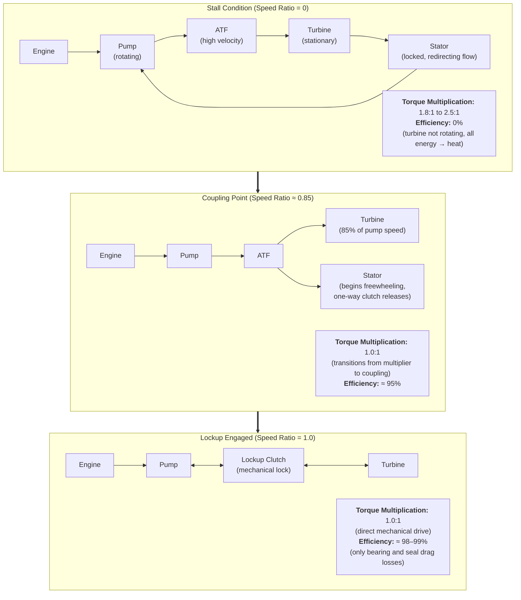

# Lesson 4: Drivetrain Systems

## 1. First-Principles Intuition & Invariants

The drivetrain exists to reconcile an irreconcilable paradox: the internal combustion engine produces peak torque within a narrow band of crankshaft speeds—typically between 1,800 and 5,500 revolutions per minute—yet the wheels of a vehicle must rotate across a vast operating envelope ranging from zero to highway speeds while simultaneously demanding wildly different torque outputs for acceleration, hill climbing, and cruising. The transmission, differential, and associated driveline components form a continuously variable mechanical impedance matcher, transforming high-speed, low-torque engine output into the low-speed, high-torque wheel rotation required for vehicle propulsion. This mechanical transformation obeys strict physical invariants: power (torque multiplied by angular velocity) must remain conserved minus frictional losses, angular momentum must be transferred through mechanical advantage ratios, and torque multiplication always trades rotational speed for output force.

At the heart of automatic transmissions lies the torque converter, a hydrodynamic fluid coupling that replaces the friction clutch of manual gearboxes. The torque converter solves a critical problem: how to permit the engine to idle while the vehicle remains stationary, yet smoothly transmit escalating power as throttle demand increases, all without mechanical contact between engine and transmission input shaft. This device operates on the principle of fluid momentum transfer, employing three primary elements—the pump (driven by the engine crankshaft), the turbine (connected to the transmission input shaft), and the stator (a reaction member mounted on a one-way clutch)—to create a closed hydraulic circuit where automatic transmission fluid (ATF) circulates in a toroidal vortex. When the engine spins the pump, centrifugal force propels ATF outward through curved impeller vanes, striking the turbine blades and imparting rotational force. The fluid exits the turbine at an oblique angle, whereupon the stator redirects this returning flow back into the pump at an angle that augments the pump's input torque, achieving torque multiplication ratios between 1.8:1 and 2.5:1 at stall conditions.

The stator's one-way clutch represents the critical phase-transition element in torque converter operation. At low speed differentials between pump and turbine—such as during initial vehicle launch—the stator remains locked, redirecting fluid to multiply torque. As vehicle speed increases and turbine speed approaches pump speed (typically around 80–90 percent of pump RPM, a condition termed the coupling point), the angle of fluid returning from the turbine reverses direction. At this juncture, the one-way clutch releases, allowing the stator to freewheel and converting the torque converter from a torque multiplier into a simple fluid coupling with minimal slip. Modern converters incorporate a lockup clutch—a friction disc that mechanically locks the pump and turbine together at cruising speeds—eliminating the 2–5 percent slip inherent in hydrodynamic coupling and dramatically improving fuel economy by preventing the conversion of mechanical energy into heat within the ATF.

Behind the torque converter, the planetary gearset architecture provides the fundamental mechanical computing element of the automatic transmission. Unlike the sliding-mesh and constant-mesh gears of manual transmissions, planetary gearsets employ three coaxial elements: a central sun gear, an outer ring gear with internal teeth, and a carrier supporting multiple planet gears that mesh simultaneously with both sun and ring. This concentric arrangement permits any element to serve as input, output, or reaction member, enabling multiple gear ratios within a compact axial package. By selectively holding, releasing, or driving different elements through hydraulically actuated multi-plate clutches and band brakes, the transmission controller can synthesize forward gear ratios ranging from first-gear reductions of 3.5:1 down to overdrive ratios of 0.65:1 in modern eight- and ten-speed automatics. The Simpson compound planetary gearset—employing two planetary sets sharing a common sun gear—became the foundational topology for four-speed automatics, while Ravigneaux and Lepelletier configurations enable the tighter ratio spacing and wider overall spread required for contemporary six-speed and beyond transmissions.

Hydraulic control systems in automatic transmissions function as analog computing machines, solving differential equations in fluid pressure to sequence clutch engagement, modulate shift quality, and regulate line pressure in response to throttle position and vehicle speed. The valve body—a precision-machined aluminum labyrinth containing dozens of spool valves, check balls, and orifices—receives pressure inputs from the transmission pump (driven mechanically by the input shaft) and orchestrates fluid flow to clutch packs and band servos. The governor valve, centrifugally actuated by output shaft speed, generates a road-speed-proportional pressure signal, while the throttle valve (or, in modern systems, an electronic pressure control solenoid) produces a driver-demand signal. These two pressure inputs intersect in the shift valve, a spring-loaded spool that snaps between detent positions to redirect mainline pressure to the appropriate clutch circuits, executing upshifts when governor pressure overcomes throttle pressure plus spring preload, and downshifts when the balance reverses. Electronic transmission control has supplanted many of these analog hydraulic functions with pulse-width modulated solenoids that directly regulate clutch apply pressure, enabling adaptive shift algorithms, clutch slip control during torque phase, and predictive shift scheduling based on accelerometer data, grade sensing, and even GPS-derived route topology.

The differential assembly transforms the transmission's longitudinal torque output into transverse rotation at the drive wheels while simultaneously permitting the left and right wheels to rotate at different speeds during cornering. This speed differentiation remains mandatory because the outer wheel in a turn traces a longer arc than the inner wheel; forcing both to rotate at identical speeds would induce tire scrubbing, increase rolling resistance, and destabilize vehicle dynamics. The bevel-gear open differential accomplishes this through an elegant mechanical solution: the ring gear (driven by the driveshaft pinion) rotates a carrier housing containing two or more spider gears meshed with side gears splined to the left and right axle shafts. When traveling straight, the spider gears remain stationary relative to the carrier, and both axle shafts rotate at identical speeds. During cornering, the spider gears walk around the slower-rotating side gear, adding rotational velocity to the faster outer wheel while subtracting an equal amount from the inner wheel, such that the average of the two axle speeds always equals the carrier speed. This elegant kinematic property becomes a catastrophic liability under traction loss: because the open differential always delivers equal torque to both wheels, any wheel losing grip receives the maximum torque the slipping tire can support, which means the opposite wheel with good traction receives that same meager torque value, often insufficient for vehicle propulsion on split-friction surfaces.

Limited-slip differentials mitigate this equal-torque pathology by introducing a torque bias mechanism that preferentially sends power to the wheel with greater traction. Clutch-type limited-slip units employ multi-plate clutch packs preloaded by Belleville springs or mechanically loaded by the thrust forces generated during torque transmission through helical side gears. These clutches resist differential action between the axle shafts, forcing torque to transfer toward the higher-traction wheel until clutch slip occurs. Torsen (torque-sensing) differentials exploit the self-locking property of worm gears to create a torque bias ratio—typically 3:1 to 5:1—meaning the high-traction wheel can receive three to five times the torque of the slipping wheel without requiring any wear-prone clutches or external actuation. Electronic traction control systems augment or replace mechanical limited-slip functions by monitoring individual wheel speeds via ABS sensors and selectively applying brake pressure to a spinning wheel, artificially loading that wheel and forcing the open differential to redirect torque to the grounded wheel through the equal-torque constraint.

Suspension geometry dictates the kinematic envelope through which the wheels move relative to the chassis, defining camber curves, scrub radius, roll center migration, and anti-dive characteristics that profoundly affect steering response, tire contact patch stability, and ride quality. The MacPherson strut—ubiquitous in front-wheel-drive applications due to its packaging efficiency—employs a coil spring and damper assembly as a structural member, supporting the chassis on a single mounting point while the lower control arm defines the lateral position and fore-aft wheel location through a ball joint. This geometry introduces significant camber change during suspension compression because the upper mounting point remains fixed to the chassis while the lower control arm sweeps through an arc, causing the wheel to tilt toward negative camber in compression and positive camber in extension. Double-wishbone suspensions—featuring upper and lower control arms of unequal length—provide superior geometric control by independently tuning the instantaneous center locations of both arms, permitting near-zero camber change through the suspension travel range while precisely controlling scrub radius (the distance between the steering axis and the tire contact patch centerline) to minimize steering kickback over bumps.

The Ackermann steering geometry principle recognizes that during low-speed cornering, the inner wheel must steer to a tighter radius than the outer wheel because both trace concentric arcs around a common turn center. Pure Ackermann geometry arranges the steering linkage such that extensions of the steering arm axes intersect at the center of the rear axle, ensuring that at full lock, the inner wheel steers more sharply than the outer wheel by an amount that theoretically causes all four wheels to track concentric circles. Modern steering geometries intentionally deviate from pure Ackermann by implementing partial or even anti-Ackermann characteristics at high speeds, where tire slip angles dominate and the front tires generate peak lateral force at slight slip angles that benefit from parallel steer angles. Rack-and-pinion steering mechanisms—where a rotary pinion gear meshes with a linear rack bar connected to the tie rods—provide a direct, low-friction conversion of steering wheel rotation into lateral wheel displacement, with the steering ratio (degrees of wheel rotation per degree of steering angle) determined by the pinion diameter and the leverage ratio of the steering arms.

Brake hydraulic systems exploit Pascal's principle—pressure applied to a confined incompressible fluid transmits undiminished to every portion of the fluid and the walls of the containing vessel—to multiply pedal force and distribute braking torque across all four wheels. The tandem master cylinder contains two independent pressure chambers arranged in series, each feeding a separate hydraulic circuit to ensure that failure of one circuit leaves partial braking capacity intact. Modern vehicles employ diagonal split circuits, where the left front and right rear share one circuit while the right front and left rear share the second, maintaining balanced braking during single-circuit failure. The pressure multiplication ratio—typically 4:1 to 6:1 between pedal force and master cylinder output—combines the mechanical advantage of the pedal lever arm with the hydraulic area ratio between the wheel cylinder (or caliper piston) and the master cylinder bore. Disc brake calipers employ one or more pistons that clamp friction pads against a rotating rotor, generating braking torque proportional to the product of clamp force, pad friction coefficient, and rotor effective radius, while converting kinetic energy into heat that must be dissipated through the rotor's thermal mass and ventilated cooling passages.

Anti-lock braking systems prevent wheel lockup during threshold braking by modulating brake pressure at frequencies between 4 and 15 Hz, maintaining tire slip ratios within the peak friction region (typically 10–20 percent slip). Each wheel's rotational velocity—measured by a magnetic reluctance sensor reading a toothed tone ring—feeds into the ABS control module, which compares wheel deceleration rates to a calculated reference velocity derived from the vehicle's deceleration profile. When a wheel's deceleration exceeds a threshold indicating incipient lockup, the ABS controller commands a three-phase modulation cycle: pressure hold (isolating the brake circuit via solenoid valve), pressure dump (opening a second solenoid to route fluid into a low-pressure accumulator), and pressure reapply (closing the dump valve and allowing the master cylinder to restore pressure). This rapid cycling—audible and palpable as pulsation through the brake pedal—maintains tire slip within the optimal range where lateral and longitudinal grip coexist, preserving steering control during emergency braking.

Electronic stability control extends ABS functionality into the lateral dynamics domain, comparing the driver's intended path (inferred from steering wheel angle and vehicle speed) against the actual yaw rate and lateral acceleration measured by inertial sensors. When understeer occurs—the vehicle's yaw rate falls below the commanded value and the vehicle plows straight despite steering input—the ESC controller applies braking to the inside rear wheel, generating a corrective yaw moment that tightens the vehicle's line. Conversely, during oversteer—excessive yaw rate with the rear sliding outward—the system brakes the outside front wheel to generate a stabilizing moment. These interventions exploit the principle that braking force applied off the vehicle's centerline creates a moment arm about the center of gravity, with the magnitude of the corrective yaw moment equal to the braking force multiplied by the lateral distance from the vehicle centerline to the braked wheel. The ESC system may additionally request engine torque reduction through throttle closure or ignition retard to decelerate the vehicle and reduce the lateral acceleration demand during limit handling.

Traction control systems—often integrated within the ESC control module—prevent excessive driven-wheel slip during acceleration by monitoring the speed differential between driven and non-driven wheels. When a driven wheel accelerates beyond a threshold slip ratio (typically 10–15 percent faster than the average of the non-driven reference wheels), the traction control system intervenes through two parallel strategies: brake application to the spinning wheel (identical in mechanism to ABS pressure modulation, but operating in the opposite direction to add rather than release pressure) and engine torque reduction through throttle closure, ignition timing retard, fuel cut to individual cylinders, or transmission upshift requests. The brake-based intervention exploits the open differential's equal-torque property—loading the spinning wheel artificially forces the differential to send equal torque to the grounded wheel—while the powertrain intervention reduces the total torque available for distribution, allowing the tire's friction circle to accommodate the requested longitudinal force without exceeding the tire's traction limit. Advanced systems implement proportional control algorithms that modulate intervention intensity based on slip error magnitude, using PID (proportional-integral-derivative) feedback loops to maintain the driven wheels at the optimal slip ratio for maximum longitudinal traction while permitting sufficient slip for the tire tread to clear water and debris.

## 2. Core Architecture & Mechanics

The torque converter's internal geometry defines its performance envelope across the full spectrum of speed ratios between pump and turbine. The pump (impeller) bolts directly to the engine's flexplate, forming the torque converter's outer shell and rotating at engine speed under all conditions. Radial vanes machined or stamped into the pump direct ATF outward under centrifugal acceleration, with the fluid exiting the pump's outer radius at high velocity tangent to the rotation direction. These high-velocity jets strike the turbine's curved blades—positioned to intercept the fluid stream at an angle optimized for momentum transfer—imparting torque to the turbine, which connects through a splined hub to the transmission input shaft. The fluid, having surrendered much of its kinetic energy to the turbine, exits at reduced velocity and altered angle, whereupon the stator intercepts this return flow.

The stator's blade geometry represents the key to torque multiplication. Its vanes curve in a direction that redirects the returning low-velocity fluid exiting the turbine, bending the flow path to re-enter the pump in the direction of pump rotation. This redirection requires the stator to exert a reaction force on the fluid, and by Newton's third law, the fluid exerts an equal and opposite force on the stator. The stator mounts on a one-way clutch (sprag or roller type) that permits rotation in one direction only—the same direction as pump and turbine rotation—but locks solid when reverse torque attempts to rotate it backward. At stall and low speed ratios, the fluid exits the turbine at an angle that would naturally drive the stator backward; the one-way clutch locks, the stator becomes a fixed reaction member, and its redirection of the fluid flow adds angular momentum to the pump's input, resulting in the turbine receiving more torque than the pump delivers. The torque multiplication ratio reaches its peak at stall (turbine stationary, pump rotating at idle speed), where K-factors (a measure of the torque converter's torque capacity, defined as engine RPM divided by the square root of engine torque in ft-lbs) typically range from 120 to 200 depending on converter design.

The lockup clutch—a friction disc splined to the turbine hub—faces a machined surface on the inner wall of the pump housing. An apply chamber behind the clutch receives pressurized ATF routed through the transmission input shaft's central passage, while the release chamber in front of the clutch connects to return flow. When the transmission controller commands lockup, a solenoid valve shifts to route high-pressure mainline ATF into the apply chamber while draining the release chamber, creating a differential pressure across the clutch disc that forces it into contact with the pump housing. Modern adaptive lockup strategies employ pulse-width modulation of the lockup solenoid to feather clutch engagement, achieving partial lockup with controlled slip (typically 20–50 RPM differential) that permits torque converter damping to attenuate driveline vibrations while capturing most of the efficiency benefit of full lockup.

Planetary gearset kinematics obey a fundamental speed relationship encoded in their geometry. Designating the sun gear tooth count as S, the ring gear tooth count as R, and defining speed ratios relative to the carrier, the basic speed equation states:

    (R × ω_ring) + (S × ω_sun) = (R + S) × ω_carrier

where ω represents angular velocity. By holding one element stationary (setting its ω to zero) and driving another, this equation yields the output speed of the third element. For example, holding the sun gear stationary (ω_sun = 0) and driving the carrier produces:

    ω_ring / ω_carrier = (R + S) / R

which always yields an overdrive ratio greater than 1.0 because the ring gear rotates faster than the carrier. Conversely, holding the ring gear stationary and driving the sun gear produces:

    ω_carrier / ω_sun = S / (R + S)

a reduction ratio less than 1.0, providing the deep first-gear ratios necessary for vehicle launch. Real-world automatic transmissions cascade multiple planetary sets, using the output of one stage as the input to the next, with intermediate clutch packs and band brakes selectively locking various elements to the transmission case or to each other to synthesize the required forward and reverse gear ratios.

A representative six-speed automatic might employ a Lepelletier configuration: a simple planetary set in front followed by a Ravigneaux compound set (combining two planetary stages with a common carrier). The front simple set provides two speed ranges—direct drive (1:1) when its clutch locks the set solid, or a reduction ratio when a brake holds one element—while the rear Ravigneaux set provides three additional ratio steps. The transmission controller commands six forward gears through specific clutch and brake combinations:

| Gear | Front Clutch | Front Brake | Rear Clutch A | Rear Clutch B | Rear Brake | Typical Ratio |
|------|--------------|-------------|---------------|---------------|------------|---------------|
| 1st  | Released     | Applied     | Applied       | Released      | Released   | 4.70:1        |
| 2nd  | Released     | Applied     | Released      | Applied       | Released   | 2.86:1        |
| 3rd  | Released     | Applied     | Applied       | Applied       | Released   | 1.84:1        |
| 4th  | Applied      | Released    | Applied       | Applied       | Released   | 1.30:1        |
| 5th  | Applied      | Released    | Released      | Applied       | Released   | 1.00:1        |
| 6th  | Applied      | Released    | Released      | Released      | Applied    | 0.74:1        |

Each shift event requires precise choreography: releasing the off-going clutch while simultaneously applying the on-coming clutch. Overlap produces a tie-up condition where multiple elements lock the gearset solid, spiking torque through the driveline and potentially stalling the engine. Insufficient overlap creates a free-wheeling neutral condition where engine RPM flares uncontrollably. The transmission controller manages this through a torque phase and an inertia phase. During the torque phase, the on-coming clutch begins to transmit torque while the off-going clutch still carries load; the controller modulates on-coming clutch pressure (typically through a PWM duty cycle controlling a variable-force solenoid) to ramp torque transfer gradually. The inertia phase begins when the off-going clutch fully releases, allowing the transmission's rotating inertias to accelerate or decelerate to the new gear's speed ratio; the controller adjusts on-coming clutch pressure to achieve target shift time (typically 0.4–0.8 seconds for comfort-oriented calibrations, 0.15–0.3 seconds for performance applications) while limiting jerk (the time derivative of acceleration) to maintain acceptable shift quality.

Hydraulic pressure modulation occurs at surprisingly low frequencies compared to electronic control rates. While the transmission controller samples sensors and calculates outputs at 100–200 Hz, the mechanical response time of clutch packs—driven by fluid flow through orifices, compression of clutch plate Belleville springs, and expulsion of air from the clutch cavity—introduces time constants on the order of 50–150 milliseconds. This inherent damping actually benefits shift quality by preventing abrupt clutch engagement, but complicates closed-loop control because the long lag time between pressure command and torque response can induce instability in aggressive feedback algorithms. Adaptive shift control addresses this by learning shift characteristics over the transmission's life, measuring parameters such as off-going clutch slip time, on-coming clutch fill time, and shift completion RPM, then adjusting clutch pressure curves and timing in EEPROM-stored trim tables to compensate for clutch wear and fluid degradation.

Differential mechanics emerge from the kinematics of the bevel gear spider arrangement. The ring gear—typically hypoid-cut to permit the driveshaft pinion centerline to sit below the ring gear center for lower vehicle floor height—drives a carrier housing. Within this carrier, the differential spider gears (also called pinion gears) mount on a cross-shaft perpendicular to the axle shafts. These spider gears mesh simultaneously with the left and right side gears, which spline directly to the axle shafts. When the vehicle travels straight, friction in the spider gear bearings and mesh contact causes the entire differential assembly to rotate as a solid unit, with the spider gears remaining stationary relative to the carrier (though rotating with it about the axle shaft axis). Both side gears rotate at identical speeds equal to the carrier speed, and the axle shafts transmit equal torque.

During cornering, the kinematic constraint changes. The spider gears must now rotate on their cross-shaft to accommodate the speed difference between inner and outer wheels. Consider a right turn: the left (outer) wheel must rotate faster than the carrier, while the right (inner) wheel rotates slower. The spider gears walk around the slower right side gear, effectively adding rotational speed to the left side gear. Because the spider gears mesh with both side gears, any increment of rotation ΔN in the spider gears subtracts ΔN from one side gear while adding ΔN to the other, maintaining the invariant relationship:

    (N_left + N_right) / 2 = N_carrier

where N represents rotational speed. Torque distribution follows from the spider gear force balance. Each spider gear experiences equal and opposite tooth forces from the left and right side gears, and because the spider gears are in equilibrium (not accelerating angularly relative to the carrier), these forces must be equal in magnitude. Gear tooth force equals torque divided by pitch radius, and since the side gears have identical pitch radii, equal forces demand equal torques. Thus the open differential always delivers identical torque to both axle shafts regardless of speed difference, which explains its disastrous performance on split-friction surfaces where one wheel sits on ice and the other on dry pavement—the maximum torque the differential can deliver equals twice the torque sustainable by the slipping wheel, often insufficient for vehicle propulsion.

Clutch-type limited-slip differentials interrupt this equal-torque condition by introducing friction between the side gears and the differential carrier housing. Multi-plate clutch packs—alternating steel plates splined to the side gear and friction-lined plates splined to the carrier—sit on each side of the differential. Belleville spring washers preload these clutch packs, generating a baseline breakaway torque (typically 20–40 ft-lbs) that resists differential action. Many designs augment this preload through torque-proportional loading: helical side gears generate axial thrust forces when transmitting torque, and this axial force compresses the clutch packs harder, increasing their resistance proportionally to the torque being transmitted. The resulting torque bias ratio (the ratio of torque deliverable to the high-traction wheel versus the low-traction wheel) typically reaches 2.5:1 to 3.5:1. During sustained differential action—such as prolonged operation with one wheel on a slippery surface—the clutch plates slip and generate heat, potentially degrading the friction material and the differential lubricant if thermal capacity is exceeded.

Torsen differentials avoid this friction-element degradation through pure gear mechanics. The Torsen design replaces conventional side gears with worm gears (each axle shaft drives a worm gear), and replaces spider gears with spur gears that mesh with the worm gears and with each other. The critical property emerges from the worm gear's high friction angle: worm gears exhibit a self-locking characteristic where torque applied to the worm gear (attempting to back-drive the worm) experiences enormous mechanical disadvantage due to the steep helix angle. In a Torsen differential, when one wheel loses traction and attempts to over-speed, the corresponding worm gear tries to back-drive through the spur gears, but the self-locking effect resists this motion. The differential can only allow speed differentiation by forcing torque through the worm gear friction, which creates an inherent torque bias. Typical Torsen differentials achieve 3:1 to 5:1 torque bias ratios with zero wear, no clutch degradation, and instant response to traction changes because the torque bias arises from instantaneous gear tooth forces rather than friction element loading.

Electronic traction control exploits the ABS infrastructure—wheel speed sensors and hydraulic modulator—to synthesize limited-slip behavior without mechanical modifications. The traction control algorithm continuously compares driven wheel speeds against non-driven reference wheels (or, in all-wheel-drive systems, compares each wheel against the average of the others). When a driven wheel's speed exceeds the reference by a calibrated threshold (typically corresponding to 10–15 percent slip ratio), the traction control module commands the ABS hydraulic modulator to apply brake pressure specifically to the spinning wheel. This braking force serves two purposes: it directly decelerates the spinning wheel back toward the reference speed, and by loading that wheel through braking torque, it exploits the differential's equal-torque property to redirect drive torque toward the opposite wheel. The module simultaneously requests engine torque reduction by transmitting a CAN bus message to the engine control module, which may respond by closing the throttle (or reducing throttle-by-wire target), retarding ignition timing below MBT (minimum advance for best torque), disabling fuel injection to one or more cylinders, or requesting a transmission upshift. The torque reduction prevents the total available torque from exceeding what the tires' combined friction circle can accommodate, allowing longitudinal traction forces to coexist with lateral forces necessary for directional control.

Suspension geometry analysis begins with the instantaneous center concept: any rigid link constrained by two pivot points rotates about an instantaneous center lying on the line connecting those pivots extended to infinity. For a control arm with an inboard chassis pivot and an outboard ball joint connecting to the upright, the instantaneous center lies on the extension of the line between these two points. In a double-wishbone suspension, the upper and lower control arms each have their own instantaneous centers, and the intersection of lines drawn from these centers through their respective ball joints defines the suspension's roll center—the point about which the sprung mass rotates during body roll in cornering. The height and lateral position of the roll center profoundly affect load transfer during cornering: a high roll center reduces geometric load transfer (weight shift due to centrifugal force acting on the center of gravity creating a moment about the roll center) but increases jacking forces (vertical forces at the tire contact patches that attempt to lift the chassis), while a low roll center increases roll angle but generates more progressive, predictable load transfer characteristics.

Camber change during suspension travel arises from the arc traced by the ball joint as the control arm sweeps through its range of motion. In a MacPherson strut, the upper pivot point remains fixed to the chassis at the strut tower, while the lower ball joint follows the arc defined by the lower control arm's swing. As the suspension compresses (wheel moving upward relative to chassis), the lower ball joint moves inward and upward, causing the line connecting the upper strut mount and lower ball joint—which defines the wheel's orientation—to tilt inward at the top, producing negative camber. The magnitude of this camber change depends on the lower control arm's length and angle: shorter, more steeply angled control arms produce more camber change per unit of suspension travel. Double-wishbone suspensions offer superior control by independently tuning the upper and lower arm lengths and pivot angles. The classic solution employs a shorter upper arm, which causes the upper ball joint to describe a tighter arc than the lower ball joint during suspension travel, tilting the wheel into negative camber during compression—beneficial because body roll in cornering lifts the inside wheel and compresses the outside wheel, and the induced negative camber on the outside wheel helps maintain the tire's contact patch perpendicular to the road surface despite the chassis roll angle.

Scrub radius—the distance between the steering axis (the line connecting the upper strut mount or upper ball joint to the lower ball joint) and the center of the tire contact patch, measured at the road surface—determines steering feedback and stability during braking on split-friction surfaces. Positive scrub radius places the steering axis inboard of the contact patch; during braking on split-friction surfaces where one front wheel encounters higher friction than the other, the higher-friction wheel generates greater braking force, creating a moment arm about the steering axis that tries to pull the steering wheel toward the high-friction side. Zero or slightly negative scrub radius (steering axis intersecting the road surface outboard of the contact patch center) reverses this effect, causing the vehicle to self-center during split-friction braking. Modern vehicles typically run 0–15 mm positive scrub radius as a compromise between stability (favoring negative scrub) and steering feel (positive scrub provides more distinct feedback of road surface irregularities). The steering axis inclination angle (SAI)—the inward tilt of the strut or upper ball joint relative to vertical when viewed from the front—combines with the spindle angle (the outward tilt of the wheel mounting surface) to achieve the target scrub radius while maintaining acceptable kingpin offset (the perpendicular distance from the steering axis to the wheel center plane), which affects steering effort and returnability.

Ackermann steering geometry traditionally arranges the tie rod mounting points (steering arms) such that lines extended through the steering arm pivot and tie rod ball joint converge at the center of the rear axle. At full steering lock, this geometry causes the inside wheel to steer more sharply than the outside wheel by an amount that theoretically makes all four wheels track concentric circles. The inside wheel steer angle δ_i relates to the outside wheel angle δ_o through the Ackermann relationship:

    cot(δ_o) - cot(δ_i) = t/L

where t represents track width and L represents wheelbase. Pure Ackermann geometry works well at parking-lot speeds where tire slip angles remain negligible and geometric path following dominates. At higher speeds, tires generate lateral force by operating at slip angles (the angle between the tire's heading and its actual velocity vector), and the front tires develop peak cornering force at slip angles typically between 3 and 8 degrees depending on tire construction and load. At these slip angles, parallel steer (both front wheels at identical angles) or even anti-Ackermann geometry (outside wheel steering more sharply than inside wheel) can improve corner entry balance by equalizing the slip angles and thus the lateral forces generated by the front tires. Modern steering linkages implement partial Ackermann—achieving perhaps 50–70 percent of theoretical Ackermann angle difference—as a compromise between low-speed maneuverability and high-speed balance.

Rack-and-pinion steering converts rotary motion at the steering wheel into linear motion at the tie rods through a simple gear mesh. The steering column terminates in a pinion gear (typically 8–12 teeth) that meshes with a toothed rack bar running laterally across the vehicle. Rotating the pinion moves the rack laterally; tie rods attached to each end of the rack transmit this motion to the steering arms on the wheel uprights. The steering ratio—degrees of steering wheel rotation per degree of wheel steer—equals the product of the pinion gear ratio and the steering arm leverage ratio. A smaller-diameter pinion (fewer teeth) produces quicker steering (fewer degrees of wheel rotation for a given rack travel) but requires higher steering effort because mechanical advantage decreases. Variable-ratio steering employs a rack with non-constant tooth pitch or a pinion with varying effective radius, achieving quick response near center (for highway lane changes) while maintaining reasonable effort at full lock (for parking maneuvers). Electric power steering (EPS) systems apply assist torque through a motor acting on the steering column, rack, or pinion, with the motor current controlled by an ECU that measures driver torque input via a torsion bar sensor. Modern EPS systems vary assist levels based on vehicle speed—high assist at low speeds for effortless parking, reduced assist at highway speeds for better road feel and stability—and can implement active steering interventions for lane-keeping assistance or emergency evasion by commanding steering angles independent of driver input.

Brake hydraulics scale the modest force a driver can apply to the brake pedal—typically 50–100 lbs maximum—into the several thousand pounds of caliper clamp force required to generate substantial braking torque. The pedal mechanism typically employs a 4:1 to 6:1 lever ratio, converting 100 lbs of pedal force into 400–600 lbs of pushrod force applied to the master cylinder. The master cylinder contains one or two pistons (tandem master cylinders employ two pistons in series, each feeding an independent brake circuit) with bore diameters typically ranging from 22 to 28 mm. Pushing the master cylinder piston generates hydraulic pressure equal to force divided by piston area; a 25 mm bore area equals π × (12.5 mm)² ≈ 491 mm² ≈ 0.76 in². Applying 500 lbs to this piston generates pressure of 500 / 0.76 ≈ 658 psi. This pressure transmits through brake lines to the wheel cylinders or caliper pistons, which have larger areas—a typical front brake caliper might employ 45 mm diameter pistons (total area across multiple pistons of perhaps 6,000 mm² ≈ 9.3 in²). The hydraulic area ratio produces force multiplication: 658 psi × 9.3 in² ≈ 6,120 lbs of caliper clamp force.

Disc brakes convert this clamp force into braking torque through friction between the pad material and rotor. The caliper's pistons squeeze the pads against the rotor with force F_clamp; the pads exert normal force against both sides of the rotor (accounting for the two-pad configuration), generating friction force F_friction = μ × F_clamp where μ represents the coefficient of friction (typically 0.35–0.45 for semi-metallic pads on cast iron rotors under normal operating temperatures). This friction force acts at the effective radius of the pad (the centroid of the pad's contact area, typically 120–150 mm from the rotor center for passenger car applications), producing braking torque T_brake = F_friction × r_effective. A representative calculation: 6,120 lbs clamp force, 0.40 friction coefficient, 130 mm effective radius yields T_brake = 6,120 × 0.40 × 0.13 m × 4.448 N/lb ≈ 1,420 N⋅m ≈ 1,050 ft-lbs of braking torque at one front wheel. With a typical 15-inch wheel and tire combination having a loaded radius of approximately 310 mm, this brake torque produces deceleration force at the contact patch of F_decel = T_brake / r_tire = 1,420 / 0.31 ≈ 4,580 N ≈ 1,030 lbs. Summing all four wheels' contributions yields the total vehicle deceleration force.

The brake proportioning valve—now largely supplanted by electronic ABS systems with proportional braking control—addresses the dynamic weight transfer problem inherent in deceleration. During braking, the vehicle's center of gravity experiences a deceleration force that creates a moment about the tire contact patches, transferring load from the rear axle to the front axle. The magnitude of this transfer equals (deceleration × height of center of gravity) / wheelbase × vehicle mass. On a typical passenger car with CG height of 550 mm and wheelbase of 2,700 mm, braking at 0.8 g transfers (0.8 × 550) / 2,700 ≈ 16% of the vehicle's weight from rear to front. This means the front axle gains load while the rear loses it, and because tire friction force capacity is proportional to vertical load, the rear tires become progressively easier to lock as braking intensity increases. The proportioning valve—a pressure-sensitive device in the rear brake circuit—limits rear brake pressure once a threshold is reached (typically around 400–600 psi), allowing front brake pressure to continue rising while holding rear pressure constant or increasing it at a reduced rate. This mechanical solution prevents premature rear wheel lockup, which would induce dangerous oversteer instability. Modern ABS systems implement proportional braking through dynamic pressure modulation, continuously adjusting the rear brake pressure based on measured deceleration and wheel slip to optimize braking force distribution for current load conditions.

Anti-lock braking systems operate through closed-loop control of wheel slip ratio, defined as:

    slip = (V_vehicle - V_wheel) / V_vehicle

where V_vehicle represents the vehicle's velocity and V_wheel represents the peripheral velocity of the wheel (rotational speed × tire radius). Peak tire friction occurs at slip ratios between 0.10 and 0.20 (10–20% slip), depending on tire construction and road surface. Below this range, the tire operates in the linear elastic deformation region with sub-optimal friction utilization. Above this range, the tire enters sliding friction territory where the friction coefficient drops precipitously and lateral force capacity collapses to near zero (a locked wheel generates substantial longitudinal friction but virtually no lateral force, eliminating steering control). The ABS controller monitors each wheel's speed via magnetic reluctance sensors that read a toothed tone ring (typically 48 or 96 teeth) bolted to the CV joint housing or axle shaft. At highway speeds, these sensors generate several thousand pulses per second, permitting wheel acceleration measurement with resolution sufficient to detect incipient lockup within 50–100 milliseconds.

When the controller detects a wheel decelerating faster than physically plausible (comparing wheel deceleration against a calculated reference deceleration based on the vehicle's longitudinal deceleration measured by the other wheels), it commands a three-phase modulation cycle. First, the inlet solenoid valve for that wheel's brake circuit closes, isolating the wheel cylinder from the master cylinder and holding pressure constant (pressure hold phase). If the wheel continues to decelerate toward lockup, the outlet solenoid opens, routing brake fluid from the wheel cylinder into a low-pressure accumulator—essentially a spring-loaded piston chamber that absorbs fluid volume—causing brake pressure to drop and the wheel to reaccelerate (pressure dump phase). Once the wheel speed recovers to within acceptable slip range, the outlet solenoid closes and the inlet solenoid opens, allowing the master cylinder to restore pressure (pressure reapply phase). This cycle repeats at 4–15 Hz depending on road surface conditions and deceleration intensity. The hydraulic modulator contains a motor-driven pump that returns accumulated fluid from the low-pressure accumulator back to the master cylinder circuit, preventing accumulator saturation during prolonged ABS events.

The reference velocity calculation presents a classic estimation problem: the vehicle's true velocity cannot be directly measured (GPS lacks sufficient update rate and precision for ABS purposes), yet the controller must compare wheel speeds against this unknown velocity to determine slip ratios. The ABS algorithm typically selects the fastest-rotating wheel's speed as the reference, reasoning that the fastest wheel is least likely to be slipping. This reference then decays at a calibrated maximum deceleration rate (typically 1.0–1.2 g) representing the most aggressive physically plausible braking deceleration. Individual wheel speeds are compared against this decaying reference velocity, and wheels decelerating faster than the reference by a threshold amount (corresponding to the target slip ratio) trigger ABS intervention. Refinements include using the average of the non-driven wheels as a reference for driven-wheel traction control, filtering wheel speed signals to reject noise from tone ring eccentricity and bearing play, and adapting thresholds based on detected road surface conditions (ice, gravel, wet pavement, dry asphalt all exhibit different optimal slip ratios and wheel acceleration signatures).

Electronic stability control augments ABS with lateral dynamics control, exploiting the principle that braking force applied off the vehicle centerline generates a yaw moment about the center of gravity. The ESC controller compares the driver's intended path—inferred from steering wheel angle sensor, vehicle speed, and a kinematic bicycle model of expected yaw rate—against the vehicle's actual yaw rate measured by a gyroscopic rate sensor and lateral acceleration measured by an accelerometer (typically both packaged in a single inertial measurement unit mounted at the vehicle's center of gravity). When the actual yaw rate falls below the commanded value (understeer: the vehicle is not turning as sharply as the driver requests), the ESC controller applies braking to the inside rear wheel. This wheel sits behind the CG and inboard of the vehicle centerline, so the braking force generates a yaw moment in the direction of the turn, tightening the vehicle's line. The magnitude of this corrective moment equals:

    M_yaw = F_brake × d_lateral

where F_brake represents the braking force applied to the wheel and d_lateral represents the lateral distance from the vehicle centerline to that wheel (half the track width). During oversteer (actual yaw rate exceeds commanded value: the rear is sliding out), the controller applies braking to the outside front wheel, which sits ahead of the CG and outboard, generating a moment opposing the excessive yaw.

The ESC controller must solve a challenging real-time control problem: determining the magnitude of brake pressure to apply and the duration of intervention to correct the stability error without over-controlling and inducing oscillation or excessively retarding vehicle progress. Most systems implement a hybrid control strategy combining feedforward commands (pressure estimated from the magnitude of yaw rate error) with feedback correction (adjusting pressure based on how quickly the yaw rate error decreases). The controller operates at 100–200 Hz update rates to maintain stability margin, and must account for the hydraulic lag between pressure command and actual wheel brake torque—this lag varies with brake temperature, pad wear, and fluid compliance, requiring adaptive compensation. The system also coordinates with traction control and ABS: if multiple wheels require simultaneous pressure modulation, the controller prioritizes stability interventions over traction optimization, and disables ESC during extreme maneuvers (such as sustained power slides above calibrated lateral acceleration thresholds) to permit advanced drivers to exercise car control at the limits.

## 3. High-Performance Optimization & Failure Modes

Transmission thermal management dictates longevity and consistent shift quality across operating conditions. Automatic transmission fluid serves triple duty: hydraulic working fluid, clutch friction modifier, and lubricant for planetary gearsets and bearings. ATF operates across an enormous temperature range—from -40°C cold starts in Arctic climates to 120°C+ during trailer towing in desert heat—and its viscosity changes dramatically across this span, affecting both hydraulic response and clutch friction characteristics. Cold ATF exhibits high viscosity, increasing pump load and slowing clutch fill times, which manifests as sluggish, delayed shifts until fluid temperature reaches operating range (typically 70–90°C). Conversely, excessive temperature degrades ATF's oxidative stability, causing varnish formation that clogs valve body orifices and clutch pack oil passages, while breaking down friction modifiers that control clutch µ-slip characteristics, leading to shudder during lockup engagement or slurred shifts during gear changes.

The transmission oil cooler—typically integrated into the radiator's outlet tank or mounted as a separate heat exchanger in the airstream—attempts to maintain ATF temperature within the optimal operating window. In most installations, ATF flows from a cooler port on the transmission case through steel lines to the cooler, then returns to the transmission after heat rejection. The cooling circuit relies on the transmission's internal pump to circulate fluid, meaning flow rate scales with engine speed; at idle in traffic, cooling capacity drops precisely when heat generation from clutch slippage and torque converter losses peaks. High-performance and towing packages often incorporate auxiliary transmission coolers with dedicated cooling fans or supplementary plate-and-fin heat exchangers mounted ahead of the radiator. Transmission fluid temperature sensors feed the transmission control module, which can implement protective strategies when temperatures exceed thresholds: locking the torque converter earlier to eliminate hydrodynamic slip losses, inhibiting certain aggressive shift schedules that increase clutch energy dissipation, or commanding upshifts to lower engine RPM and reduce pump speed and heat input. Sustained operation above 130°C degrades ATF rapidly—each 10°C rise above this threshold approximately doubles the oxidation reaction rate—making effective cooling mandatory for severe-duty applications.

Clutch pack wear follows predictable patterns determined by slip energy dissipation. Each shift event requires the on-coming clutch to synchronize the input and output speeds of a gear stage, absorbing kinetic energy equal to the moment of inertia multiplied by the square of the speed change. For a typical transmission with input shaft inertia of 0.05 kg⋅m² and a 2-3 upshift involving a 2,000 RPM speed change (209 rad/s), the energy absorbed equals:

    E = 0.5 × I × (Δω)² = 0.5 × 0.05 × (209)² ≈ 1,090 joules per shift

Over 150,000 miles of typical driving with approximately 500,000 shift events, this single clutch absorbs roughly 545 megajoules—equivalent to 150 kWh of thermal energy. The clutch friction material—typically a paper-based composite impregnated with friction modifiers and bonded to steel core plates—has finite thermal capacity and wear depth (typically 0.5–0.8 mm of friction material). As the material wears, the clutch pack's total thickness decreases, requiring the hydraulic piston to travel farther to close the clearance gap before the clutch begins transmitting torque. This increased travel consumes additional time and fluid volume, manifesting as progressively longer shift times and eventually shift flare (RPM rise during shifts as the clutch slips excessively before engaging). Adaptive transmission control compensates by increasing clutch apply pressure and advancing shift timing, storing these learned corrections in non-volatile memory. When corrections reach their adaptation limits—typically indicated when stored trim values exceed ±25% of nominal—the transmission requires mechanical service: clutch pack replacement, often accompanied by valve body service to restore precise hydraulic control.

Torque converter shudder—a low-frequency (10–20 Hz) vibration felt during lockup clutch engagement—arises from stick-slip instability in the lockup clutch friction interface. The friction coefficient between the clutch disc and the torque converter cover varies with relative velocity; if the friction coefficient decreases with increasing slip speed (a condition termed negative µ-v slope), the interface becomes dynamically unstable. As the lockup clutch engages and slip speed decreases, friction force increases, momentarily pulling the turbine ahead and reducing slip further, which increases friction more—positive feedback that snaps the clutch into full lock. But engine torsional vibrations or driveline resonances then induce slight slip, reducing friction due to the negative µ-v slope, allowing the clutch to slip more, reducing friction further until the lockup disengages completely. The cycle repeats at the natural frequency of the driveline's torsional compliance, creating the characteristic shudder. Fresh ATF contains friction modifiers specifically formulated to maintain positive µ-v slope characteristics (friction decreasing slightly as slip speed increases, providing negative feedback that stabilizes partial lockup). As these additives deplete—either through thermal degradation or absorption into clutch friction material—the µ-v curve flattens or inverts, enabling shudder. Additive restoration through ATF replacement often resolves early-stage shudder; persistent shudder after fluid service indicates friction material degradation requiring torque converter replacement.

Differential bearing failure modes typically announce themselves through gear whine—a modulated tone that varies with vehicle speed and changes pitch during acceleration and deceleration. The ring and pinion gears employ hypoid-cut teeth: the pinion axis sits below the ring gear centerline, creating a offset hypoid geometry that permits lower driveshaft tunnels but induces sliding contact between gear teeth rather than pure rolling contact. This sliding generates substantial heat and requires extreme-pressure (EP) lubricants containing sulfur-phosphorus additives that form sacrificial boundary films on gear tooth surfaces under high contact pressures. The gear set must be installed with precise backlash (typically 0.13–0.18 mm measured at the ring gear teeth), pinion depth (controlled by selective shims behind the pinion head bearing), and bearing preload (controlled by crush sleeves or shim packs). Incorrect pinion depth places the contact pattern too close to the tooth root or tip, concentrating stress and accelerating wear. Insufficient backlash causes binding and overheating; excessive backlash produces clunking during throttle transitions and accelerates tooth wear due to impact loading.

Bearing preload—the interference fit that loads the tapered roller bearings supporting the pinion and differential carrier—critically affects both durability and noise. Tapered roller bearings require preload to eliminate clearance and ensure the rollers remain properly positioned on the races; without preload, the bearing slops around, allowing metal-to-metal impact that quickly destroys the precision-ground surfaces. The pinion bearings typically employ a crush sleeve—a thin-walled steel tube that collapses axially when the pinion nut is torqued, jamming the bearing cones against their respective races. The installer tightens the pinion nut incrementally, checking rotating torque after each increment, until the measured torque-to-rotate falls within specification (typically 1–3 Nm for new bearings, accounting for lubricant drag). Over-tightening increases bearing friction and heat, accelerating wear; under-tightening allows bearing slop and eventual failure. The carrier bearings similarly require preload, adjusted via shims or threaded adjusters on each side of the carrier; these adjusters also control ring gear position relative to the pinion, setting backlash. Differential service demands methodical setup procedures, precision measurement tools (dial indicators with magnetic bases, inch-pound torque wrenches, depth micrometers), and often multiple iterations of shim selection to achieve correct geometry.

Limited-slip differential clutch packs degrade through friction material wear and lubricant contamination. Unlike transmission clutches submerged in ATF, differential clutches operate in gear oil—a much higher viscosity lubricant designed for extreme-pressure gear lubrication rather than clutch friction optimization. Many limited-slip differentials require special friction-modifier additives in the gear oil to prevent chattering during low-speed turns; these modifiers soften the clutch's µ-v curve, trading some torque bias for smooth operation. As clutch packs wear and spring preload diminishes, the differential progressively approaches open-differential behavior, often first noticed as increased inside-wheel spin during aggressive launches or slippery conditions. Bench testing a limited-slip differential requires specialized fixtures that measure the breakaway torque—the torque required to rotate one axle shaft while holding the other stationary. New clutch-type units typically exhibit 40–80 ft-lbs breakaway torque; values below 20 ft-lbs indicate significant wear. Rebuilding requires complete disassembly, clutch pack replacement, and often replacement of the preload springs, which suffer stress relaxation over time and temperature cycles.

Suspension bushing degradation—particularly in the front control arm bushings that absorb steering kickback forces and suspension articulation loads—induces geometry changes that manifest as steering wander, imprecise turn-in, and irregular tire wear. Rubber bushings provide compliance that isolates road noise and small-amplitude vibrations from the chassis, but this compliance permits small movements of the control arm pivot axis, effectively introducing slop into the suspension geometry. As bushings age, the bonded rubber degrades through ozone attack, UV exposure, and thermal cycling, developing cracks and voids that increase compliance and permit larger deflections. Polyurethane bushings offer superior longevity and lower compliance, maintaining tighter geometric control at the cost of increased noise transmission and potentially harsher ride quality. Performance applications often employ spherical rod-end bearings (heim joints) that eliminate compliance entirely, providing absolute geometric precision at the cost of zero isolation and limited service life due to corrosion and contamination exposure.

Wheel alignment—the adjustment of suspension angles to match factory specifications—directly governs tire wear rates, steering precision, and straight-line stability. Camber measures the inward or outward tilt of the wheel when viewed from the front; negative camber (top of wheel tilted inward) concentrates tire load on the inner tread during cornering, improving cornering grip but potentially inducing uneven wear on the inside edge during straight-line driving if excessive. Positive camber has the opposite effect and is rare in modern vehicles. Toe measures whether the wheels point inward (toe-in) or outward (toe-out) when viewed from above; modest toe-in (typically 1–3 mm total toe-in on the front axle) promotes straight-line stability by creating a self-centering effect—any disturbance that steers one wheel generates a restoring force due to the tire slip angle—but excessive toe causes rapid tire scrubbing wear. Caster—the fore-aft tilt of the steering axis—affects steering returnability and straight-line stability: positive caster (steering axis tilted rearward at the top) creates a mechanical trail where the tire contact patch trails behind the steering axis, generating self-centering torque proportional to lateral force. Vehicles typically run 3–7 degrees positive caster; insufficient caster produces vague, non-returning steering, while excessive caster increases steering effort and bump-steer sensitivity.

Alignment procedures require four-wheel alignment equipment that measures all suspension angles simultaneously using optical or camera-based measurement heads attached to each wheel. The vehicle must sit on a level surface at ride height with tires inflated to specification and suspension loaded to operational conditions—often achieved through weight simulators or ballast in the passenger compartment. The technician first measures initial angles to diagnose the misalignment pattern (a clue to the underlying problem: impact damage, worn components, or simple drift from operating loads), then adjusts camber and caster through eccentric bolts, shims, or slotted mounting holes as provided by the vehicle manufacturer. Toe adjustment—always performed last because camber and caster changes affect toe—occurs through threaded adjusters on the tie rods. After adjustment, a test drive verifies steering pull (vehicle drifting left or right on a level road) and steering wheel centering; pull often indicates cross-caster (left and right caster angles differing by more than 0.5 degrees) or cross-camber, while off-center steering wheel despite equal toe settings points to thrust angle misalignment where the rear axle's geometric centerline doesn't parallel the vehicle centerline.

Brake fade—the loss of braking effectiveness during sustained high-intensity braking such as repeated decelerations from high speed or prolonged downhill descent—arises from multiple mechanisms depending on temperature regime. At moderate temperatures (300–400°C rotor surface temperature), pad outgassing becomes significant: the resin binders and friction modifiers in the pad material decompose, releasing volatile gases that create a thin boundary layer between pad and rotor, reducing effective friction coefficient. Better pad formulations employ high-temperature resins and incorporate venting slots that permit gas escape. At higher temperatures (500–600°C), the pad friction material itself begins to decompose and transfer material onto the rotor surface, a process that can either increase friction (beneficial transfer layer formation) or decrease it (glazing), depending on pad composition and rotor surface finish. Beyond 600–700°C, most organic and semi-metallic pads experience catastrophic friction loss as binders pyrolyze completely; racing pads formulated for these temperatures employ ceramic matrices and metallic friction elements that maintain coefficient of friction above 0.40 even at 800°C.

Rotor thermal distortion—warping—manifests as brake pedal pulsation: a rhythmic rise and fall in pedal pressure and vehicle deceleration synchronized with wheel rotation. The traditional explanation—that rotors physically warp due to thermal stress and develop thickness variations—has been challenged by research indicating that the pulsation arises primarily from pad material transfer: localized deposits of pad material transfer onto the rotor surface in patches during high-temperature braking, creating effective thickness variations. These deposits have higher thermal capacity and lower thermal conductivity than the base rotor material, causing localized hot spots that in turn promote additional material transfer in a runaway process. Resurfacing or replacing rotors addresses the deposited material, while preventing recurrence requires ensuring rotors reach operating temperature before hard braking (avoiding severe braking on cold rotors), avoiding prolonged brake application at stops (which holds the pads against hot spots, promoting transfer), and using high-quality pads less prone to uneven decomposition. Rotors must meet minimum thickness specifications—typically stamped on the rotor or listed in service data—because thinner rotors have less thermal mass and reach higher temperatures under identical braking loads, accelerating both pad decomposition and distortion development.

Brake fluid hygroscopicity—its tendency to absorb atmospheric moisture—degrades boiling point and introduces corrosion. DOT 3 and DOT 4 brake fluids are glycol-ether based with dry boiling points around 205°C and 230°C respectively, but after absorbing 3–4% water by weight (achievable within 18–24 months in typical climates), wet boiling points drop to 140°C and 155°C. During severe braking, caliper temperatures can drive brake fluid temperatures well above these wet boiling points, causing vapor formation. Unlike the incompressible liquid phase, vapor compresses significantly under pressure, manifesting as a spongy brake pedal that requires excessive travel and yields weak braking force. Silicone-based DOT 5 fluid avoids hygroscopicity but is incompatible with ABS systems due to its compressibility and tendency to aerate; DOT 5.1 represents a glycol-based formulation with higher boiling points (260°C dry, 180°C wet) offering improved performance without ABS incompatibility. Brake fluid service intervals—typically 2–3 years regardless of mileage—reflect moisture absorption rates rather than fluid consumption; testing requires a brake fluid hygrometer or boiling point tester to measure actual water content or boiling point rather than relying solely on service interval timers.

Traction control intervention strategy must balance maximum acceleration with drivability and component protection. Aggressive traction control that permits higher slip ratios (15–20%) maximizes longitudinal acceleration on loose surfaces like gravel or snow where the tire must dig through the surface layer to reach higher-friction substrate, but produces wheelspin and potentially unstable yaw moments on pavement. Conservative calibrations holding slip ratios below 8% maintain precise driver control and minimize tire wear but limit acceleration on slippery surfaces. Modern systems implement surface-adaptive algorithms that detect road conditions through analysis of wheel acceleration signatures and adjust target slip ratios accordingly: on ice or packed snow, rapid wheel acceleration followed by ABS intervention during braking indicates extremely low µ, prompting the controller to reduce target slip ratios and torque reduction aggressiveness; on dry pavement, smooth wheel acceleration and absence of ABS activity permits higher slip thresholds. Some systems incorporate longitudinal accelerometer data to detect launch conditions versus in-motion traction loss, permitting more slip during standing starts (where driveline compliance absorbs shock loads) while intervening aggressively during mid-corner traction loss (where yaw stability takes priority).

The brake-based traction control intervention generates substantial heat in the braked wheel's components—rotor, caliper, and pads—because the system converts kinetic energy into thermal energy to decelerate the spinning wheel. Extended operation on extremely slippery surfaces or with grossly mismatched tire traction (one wheel on ice, three on pavement) can overheat components beyond their thermal design limits. The traction control module monitors cumulative brake application time and estimates brake temperature through a thermal model integrating brake energy input, ambient cooling, and vehicle speed. When estimated temperature exceeds thresholds (typically calibrated around 300–400°C), the system reduces intervention aggressiveness or disables temporarily with a warning message, preventing rotor distortion and pad degradation. This thermal management necessity explains why traction control cannot substitute for appropriate tires: attempting to drive on ice with summer tires will trigger repeated traction interventions that eventually exceed thermal limits, leaving the driver without assistance precisely when needed most.
