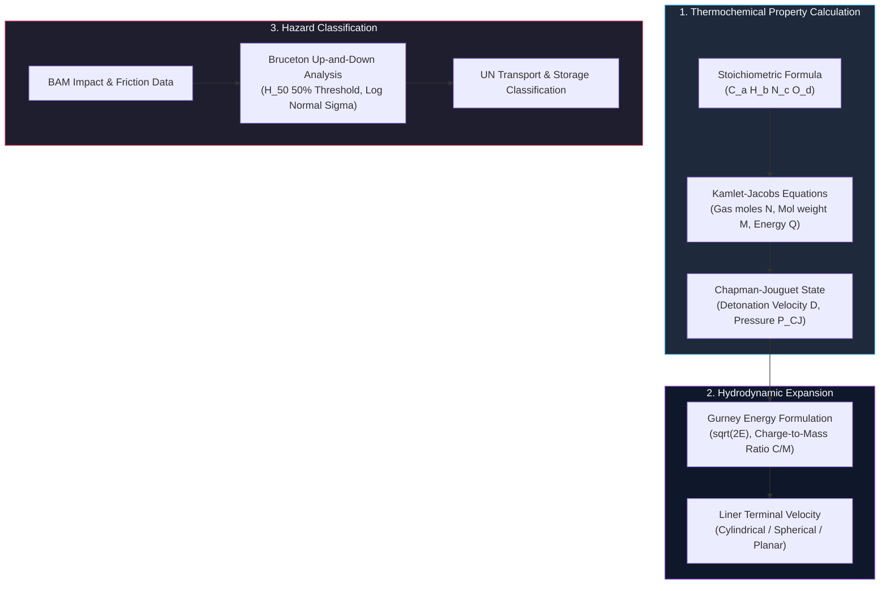

# Operational Verification Labs: Energetic Materials and Chemical Propulsion

## Objective & Operational Lab Setup

The engineering verification of energetic materials, propellants, and pyrotechnic systems requires a disciplined computational and physical chemistry framework. In modern aerospace, mining, and munitions engineering, energetic systems are analyzed, screened, and qualified through computational thermochemistry, hydrocode shock wave modeling, and standardized statistical sensitivity protocols before physical testing occurs.

This laboratory guide establishes computational and data-driven verification procedures for:
1. **Kamlet-Jacobs Thermochemical Modeling**: Computing Chapman-Jouguet detonation velocities ($D$) and peak detonation pressures ($P_{\text{CJ}}$) from elemental stoichiometry and heat of formation.
2. **Gurney Energy & Casing Acceleration Mechanics**: Modeling velocity distributions ($v_0$) for metal liners and fragmentation jackets under explosive expansion.
3. **Statistical Sensitivity Metrology (Bruceton Staircase Method)**: Analyzing empirical drop-weight impact (BAM Fallhammer) and friction threshold data to establish safety baselines ($H_{50}$).

### Analytical Software & Toolchain

The laboratory exercises execute in a scientific Python 3.10+ environment using standard numerical libraries (`numpy`, `scipy`, `pandas`, `matplotlib`):

```bash
# Verify computational chemistry and numerical stack
python3 -c "import numpy as np, scipy as sp, pandas as pd; print('[✔] Numerical Thermochemistry Stack: OK')"
```



---

## Exercise 1: Kamlet-Jacobs Thermochemical Detonation Velocity & Pressure Modeling

The Kamlet-Jacobs empirical equations provide first-order estimates of detonation velocity $D$ (mm/µs or km/s) and detonation pressure $P_{\text{CJ}}$ (GPa) for CHNO energetic compounds without requiring complex hydrocode simulations.

### Step 1.1: The Kamlet-Jacobs Governing Equations

For an energetic compound of formula $\text{C}_a\text{H}_b\text{N}_c\text{O}_d$ with loading density $\rho_0$ ($\text{g/cm}^3$):

$$D = 1.01 \cdot \sqrt{N \cdot \bar{M}^{1/2} \cdot Q^{1/2}} \cdot (1 + 1.30 \cdot \rho_0)$$

$$P_{\text{CJ}} = 1.558 \cdot \rho_0^2 \cdot N \cdot \bar{M}^{1/2} \cdot Q^{1/2}$$

Where:
- $N$ = moles of gaseous detonation products per gram of explosive
- $\bar{M}$ = average molecular weight of detonation product gases ($\text{g/mol}$)
- $Q$ = chemical energy of detonation ($\text{cal/g}$), derived from the heats of formation of the compound and its product species ($\text{H}_2\text{O}, \text{CO}_2, \text{CO}, \text{N}_2, \text{C}_{(\text{s})}$) using the Kistiakowsky-Wilson or Kamlet decomposition hierarchy.

### Step 1.2: Computational Implementation & Verification

Implement the thermochemical estimation pipeline in Python and benchmark against standard baseline compounds (e.g., RDX and TNT):

```python
import numpy as np

def kamlet_jacobs(a, b, c, d, mw, delta_hf, rho_0):
    """
    Computes detonation velocity D and Chapman-Jouguet pressure P_CJ.
    a: Carbon, b: Hydrogen, c: Nitrogen, d: Oxygen atoms.
    mw: Molecular weight (g/mol).
    delta_hf: Heat of formation (kJ/mol).
    rho_0: Crystal/loading density (g/cm^3).
    """
    # Oxygen balance evaluation under Kamlet hierarchy:
    # 1. H forms H2O (up to d/2)
    # 2. Remaining O forms CO with C
    # 3. Remaining O forms CO2
    # 4. Remaining C forms solid carbon C(s)
    # 5. N forms N2
    
    n_h2o = min(b / 2.0, d)
    d_rem = d - n_h2o
    n_co = min(a, d_rem)
    d_rem -= n_co
    n_co2 = min((a - n_co), d_rem)
    n_c_s = a - (n_co + n_co2)
    n_n2 = c / 2.0
    
    # Total moles of gas per mole of explosive
    moles_gas = n_h2o + n_co + n_co2 + n_n2
    N = moles_gas / mw
    
    # Average molecular weight of gaseous products
    mass_gas = (n_h2o * 18.015) + (n_co * 28.01) + (n_co2 * 44.01) + (n_n2 * 28.013)
    M_bar = mass_gas / moles_gas if moles_gas > 0 else 0
    
    # Heat of detonation calculation (Q in cal/g)
    # Standard heats of formation (kJ/mol): H2O(g): -241.8, CO: -110.5, CO2: -393.5, C(s)/N2: 0.0
    delta_hf_products = (n_h2o * -241.8) + (n_co * -110.5) + (n_co2 * -393.5)
    delta_H_rxn_kj = delta_hf - delta_hf_products # kJ/mol
    Q_cal_g = (delta_H_rxn_kj * 1000.0 / mw) / 4.184 # cal/g
    
    phi = N * np.sqrt(M_bar) * np.sqrt(Q_cal_g)
    D = 1.01 * np.sqrt(phi) * (1.0 + 1.30 * rho_0) # km/s
    P_cj = 1.558 * (rho_0 ** 2) * phi # GPa
    
    return D, P_cj, Q_cal_g

# Benchmark: RDX (C3 H6 N6 O6, MW=222.12 g/mol, Hf=+70.3 kJ/mol, rho=1.80 g/cm^3)
d_rdx, p_rdx, q_rdx = kamlet_jacobs(a=3, b=6, c=6, d=6, mw=222.12, delta_hf=70.3, rho_0=1.80)
print(f"RDX Calculated Detonation Velocity (D): {d_rdx:.2f} km/s (Target: 8.75 km/s)")
print(f"RDX Calculated CJ Pressure (P_CJ):      {p_rdx:.2f} GPa  (Target: 34.7 GPa)")
print(f"RDX Chemical Energy of Detonation (Q):   {q_rdx:.1f} cal/g")
```

---

## Exercise 2: Gurney Energy & Explosive Casing Acceleration Mechanics

The Gurney equation models the kinetic energy partitioned from expanding detonation products into surrounding structural inert casings (cylindrical casings, spherical shells, or flat flyer plates).

### Step 2.1: Gurney Velocity Formulation

For an explosive charge with Gurney velocity $\sqrt{2E}$ ($\text{m/s}$), explosive mass $C$, and casing metal mass $M$:

$$\text{Cylindrical Casing}: \quad v_0 = \sqrt{2E} \cdot \left( \frac{M}{C} + \frac{1}{2} \right)^{-1/2}$$

$$\text{Flat Flyer Plate (Symmetric)}: \quad v_0 = \sqrt{2E} \cdot \left( \frac{2M}{C} + \frac{1}{3} \right)^{-1/2}$$

The characteristic Gurney energy $\sqrt{2E}$ is correlated directly with the Kamlet-Jacobs detonation velocity: $\sqrt{2E} \approx 0.297 \cdot D$ (or approximately $2,800\text{ m/s}$ for HMX/RDX-based formulations).

```python
def gurney_cylinder_velocity(gurney_vel, charge_to_mass_ratio):
    """
    Computes initial casing expansion velocity v0 (m/s).
    charge_to_mass_ratio = C / M
    """
    m_over_c = 1.0 / charge_to_mass_ratio
    return gurney_vel / np.sqrt(m_over_c + 0.5)

# Evaluate casing velocity as C/M ratio increases from 0.1 to 2.0
gurney_rdx = 2800.0 # m/s
print(f"{'C/M Ratio':<12} | {'Casing Terminal Velocity (m/s)':<30}")
print("-" * 45)
for cm in [0.2, 0.5, 1.0, 1.5, 2.0]:
    v = gurney_cylinder_velocity(gurney_rdx, cm)
    print(f"{cm:<12.1f} | {v:>28.1f} m/s")
```

---

## Exercise 3: Statistical Hazard Sensitivity Analysis (Bruceton Staircase Method)

Standardized sensitivity testing (MIL-STD-1751A, UN Series 3(a) BAM Fallhammer) determines the 50% drop-height threshold ($H_{50}$) at which an energetic compound has a 50% probability of initiating under drop-weight impact.

### Step 3.1: The Bruceton Up-and-Down Statistical Algorithm

The Bruceton test adjusts the test height $h_{k+1} = h_k \pm d$ based on the outcome of trial $k$ (raise if no reaction $0$, lower if reaction $X$):

$$\bar{X} = X_0 + d \cdot \left( \frac{A}{N} \pm 0.5 \right), \quad H_{50} = 10^{\bar{X}}$$

Where $d$ is the logarithmic step size, $X_0$ is the lowest tested log-height, $N = \sum n_i$, and $A = \sum i \cdot n_i$.

```python
import pandas as pd

def bruceton_h50_analysis(drop_heights_cm, results):
    """
    results: list of binary outcomes (1 = explosion, 0 = no reaction)
    drop_heights_cm: corresponding test heights
    """
    df_trials = pd.DataFrame({'height': drop_heights_cm, 'result': results})
    
    # Determine minority event (reactions vs non-reactions)
    reactions = df_trials[df_trials['result'] == 1]
    non_reactions = df_trials[df_trials['result'] == 0]
    
    use_reactions = len(reactions) <= len(non_reactions)
    target_df = reactions if use_reactions else non_reactions
    
    # Logarithmic height scale analysis
    levels = sorted(df_trials['height'].unique())
    d_log = np.log10(levels[1]) - np.log10(levels[0]) if len(levels) > 1 else 0.1
    x0 = np.log10(levels[0])
    
    counts = target_df['height'].value_index if hasattr(target_df['height'], 'value_index') else target_df['height'].value_counts()
    
    N = len(target_df)
    A = sum(i * counts.get(h, 0) for i, h in enumerate(levels))
    
    sign = 0.5 if use_reactions else -0.5
    log_h50 = x0 + d_log * ((A / N) + sign) if N > 0 else np.log10(levels[0])
    h50_cm = 10 ** log_h50
    
    return h50_cm

# Sample Bruceton test series: 2 kg drop weight
sample_heights = [40, 50, 40, 30, 40, 50, 40, 50, 60, 50, 40, 50, 40, 30, 40]
sample_results = [ 0,  1,  0,  0,  1,  1,  0,  1,  1,  0,  0,  1,  0,  0,  0]

h50 = bruceton_h50_analysis(sample_heights, sample_results)
impact_energy_j = 2.0 * 9.80665 * (h50 / 100.0) # E = m * g * h
print(f"Calculated 50% Initiation Drop Height (H50): {h50:.1f} cm")
print(f"Impact Sensitivity Threshold Energy:        {impact_energy_j:.2f} Joules")
```

---

## Summary & Verification Matrix

| Verification Domain | Governing Formulation | Computational Tool / Method | Target Acceptance Criteria |
|:---|:---|:---|:---|
| **Detonation Velocity** | Kamlet-Jacobs $D$ Equation | Python stoichiometry model | $D \ge 8.0\text{ km/s}$ for high secondary boosters |
| **Detonation Pressure** | Chapman-Jouguet $P_{\text{CJ}}$ | Gaseous expansion equation | $P_{\text{CJ}} \ge 25\text{ GPa}$ for shock wave coupling |
| **Metal Acceleration** | Gurney Velocity $v_0$ | Hydrodynamic energy model | Liner velocity within $\pm 5\%$ of hydrocode |
| **Impact Sensitivity** | Bruceton $H_{50}$ Method | Log-normal staircase model | $H_{50} \ge 35\text{ cm}$ (2 kg drop) for secondary safety |
