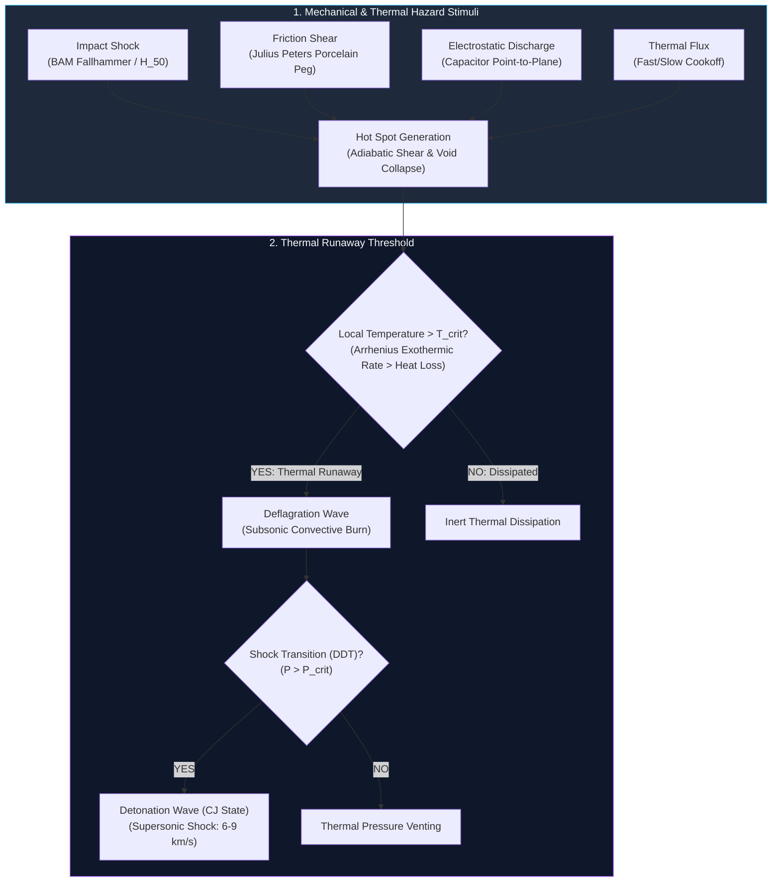
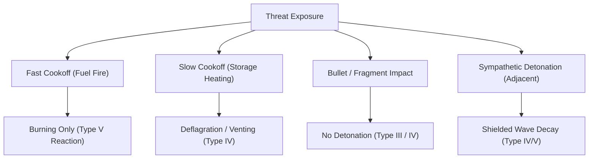

# Lesson 4: Safety Characterization, Hazard Assessment, Engineering Applications

## 1. First-Principles Intuition & Invariants

The transition from synthesizing energetic materials in the laboratory to deploying them in functional pyrotechnic devices, propulsion systems, or munitions demands a rigorous quantitative framework for characterizing their sensitivity to accidental initiation and their thermal stability under operational environments. Unlike conventional chemical processes where reaction kinetics dictate product yield and selectivity, energetic materials exist in a metastable state—poised between chemical equilibrium and catastrophic energy release. The practitioner's central challenge lies in measuring the energy barrier separating safe handling from unintended detonation, then engineering systems that exploit the material's explosive power while maintaining acceptable margins against premature initiation.

Sensitivity testing protocols represent the empirical cornerstone of hazard assessment. These standardized mechanical, thermal, electrostatic, and impact tests quantify the minimum stimulus required to induce deflagration or detonation. The fundamental invariant governing all sensitivity measurements is the concept of the **critical energy fluence**: the spatially integrated energy density that must be deposited into a localized volume of energetic material within a characteristic time scale to overcome endothermic bond-breaking activation barriers and initiate a self-sustaining exothermic decomposition wave. For primary explosives like lead azide or PETN, this critical fluence can be as low as millijoules per square millimeter delivered in microseconds; for secondary explosives such as RDX or HMX, the threshold rises by two to three orders of magnitude, enabling safer handling but necessitating more energetic primary initiators.

Impact sensitivity testing, exemplified by the Bureau of Mines apparatus or the more modern Bruceton up-and-down method, mechanically replicates the shock loading experienced during accidental drops or transportation vibrations. A calibrated mass falls from a predetermined height onto a small sample (typically 35 milligrams) confined between hardened steel anvils. The binary outcome—go or no-go—yields a statistical distribution of impact energies that map to a 50% probability of initiation, denoted as the $H_{50}$ height. This metric encodes the material's ability to dissipate mechanical work through plastic deformation, phonon scattering, and viscous heating before localized hot spots reach the thermal runaway threshold. High-nitrogen heterocycles such as CL-20 exhibit $H_{50}$ values near 12 centimeters, rendering them extraordinarily sensitive compared to insensitive munitions like TATB, which may exceed 300 centimeters.

Friction sensitivity introduces shear stress as the dominant loading mode. The Julius Peters apparatus constrains a sample between a stationary porcelain peg and a moving plate, applying a calibrated normal force while inducing lateral displacement. The transition from elastic deformation to tribochemical decomposition occurs when frictional heating at asperity contacts generates microscale temperatures exceeding 400 to 600 degrees Celsius—sufficient to cleave the weakest bonds in nitro or nitramine functional groups. The resulting gas evolution creates localized pressure spikes that further accelerate decomposition through adiabatic compression. Materials containing metallic fuel particles, such as aluminum-loaded compositions, demonstrate heightened friction sensitivity because the oxide layer on aluminum surfaces catalyzes exothermic oxidation reactions that couple to the primary explosive decomposition.

Electrostatic discharge (ESD) sensitivity measurements address the ignition hazard posed by charge accumulation during powder handling, blending, or pneumatic transport. The spark test employs a high-voltage capacitor discharged through a point-to-plane electrode geometry, delivering energies ranging from 10 microjoules to 1 joule. The minimum ignition energy correlates with the material's electrical conductivity and dielectric breakdown strength. Organic molecular explosives, being electrical insulators, accumulate surface charge readily and exhibit ESD sensitivities in the millijoule range. Metallized compositions or carbon-loaded plastic-bonded explosives dissipate charge more effectively, raising the ignition energy threshold into the tens of joules and vastly reducing handling risk.

---

## 2. Standardized Hazard Characterization & Sensitivity Protocols

Standardized testing according to UN Recommendations on the Transport of Dangerous Goods and MIL-STD-1751A establishes reproducible, quantitative hazard metrics:

### 2.1 The Bruceton Up-and-Down Staircase Method

To determine the 50% drop-height initiation threshold $H_{50}$, the Bruceton staircase protocol adjusts drop height in logarithmic increments $d = \log_{10}(h_{k+1}) - \log_{10}(h_k)$:
- If a sample detonates or flashes (Reaction, $X$), the next drop height is decreased by step $d$.
- If a sample remains inert (No Reaction, $0$), the next drop height is increased by step $d$.

The mean logarithm of the 50% height $\bar{X}$ and its standard deviation $s$ are calculated from the frequencies of the minority event:

$$\bar{X} = X_0 + d \cdot \left( \frac{\sum i \cdot n_i}{\sum n_i} \pm 0.5 \right), \quad H_{50} = 10^{\bar{X}}$$

Where $X_0$ is the lowest log-height tested, $i$ is the level index, and $n_i$ is the count of events at level $i$.

### 2.2 Thermal Stability: Differential Scanning Calorimetry (DSC) and Vacuum Stability

Thermal degradation kinetics govern shelf-life and cookoff resistance:
- **DSC Decomposition Onset ($T_{\text{onset}}$)**: Measures the temperature at which self-heating kinetics surpass heat dissipation under constant heating rates ($10^\circ\text{C/min}$). Secondary explosives must maintain $T_{\text{onset}} \ge 200^\circ\text{C}$.
- **Vacuum Stability Test (VST)**: Measures gas evolution volume per gram of explosive held at $100^\circ\text{C}$ or $120^\circ\text{C}$ for 48 hours under high vacuum. Gas evolution exceeding $2.0\text{ mL/g}$ indicates unacceptable autocatalytic decomposition risk.

---

## 3. Insensitive Munitions (IM) & Qualification Engineering

Modern military and commercial safety standards (STANAG 4439 and MIL-STD-2105D) demand that munitions exhibit minimal violent reaction when exposed to unintended thermal or mechanical threats:

### 3.1 Structural IM Design Strategies

1. **Venting and Thermal Mitigations**: Munitions casings feature eutectic solder release rings or composite wrap overwraps that burn through at $120\text{--}150^\circ\text{C}$, releasing casing confinement before internal propellant or high explosive reaches its thermal runaway threshold.
2. **Shock Wave Attenuation (Gap Tests)**: Large-Scale Gap Tests (LSGT) calibrate the PMMA spacer card barrier thickness required to prevent shock transition between a donor charge and acceptor charge. Formulations like PBXN-109 (64% RDX, 20% Al, 16% HTPB binder) require substantially higher donor shock pressures to initiate than cast Composition B.

---

## 4. Summary & Hazard Assessment Verification Matrix

| Hazard Metric | Standardized Test Protocol | Governing Instrument | Target Acceptance Criteria |
|:---|:---|:---|:---|
| **Impact Threshold** | MIL-STD-1751A Method 1011 | BAM Fallhammer (2 kg / 5 kg) | $H_{50} \ge 30\text{ cm}$ (2 kg) for secondary handling |
| **Friction Threshold** | UN Series 3(b) Test | Julius Peters Friction Apparatus | Peg load $\ge 120\text{ N}$ with zero crackle/flash |
| **Thermal Onset** | ASTM E537 Thermal Analysis | Differential Scanning Calorimetry | $T_{\text{onset}} \ge 205^\circ\text{C}$ at $10^\circ\text{C/min}$ heating rate |
| **Vacuum Stability** | STANAG 4556 Test Procedure | Manometric VST Tube (48h at $100^\circ\text{C}$) | Gas volume $\le 2.0\text{ mL/g}$ over 48-hour soak |
| **Shock Sensitivity** | MIL-STD-1751A Method 1041 | Large-Scale Gap Test (LSGT) | Decoupling barrier $\le 120\text{ cards}$ for IM compliance |
