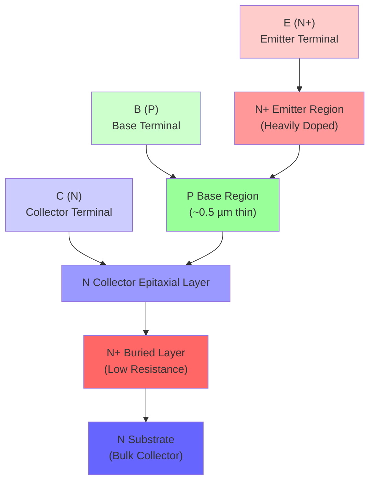

# Lesson 1: Bipolar Junction Transistor Physics

## 1. First-Principles Intuition & Invariants

The bipolar junction transistor stands as one of the most elegant inventions in solid-state electronics, transforming the landscape of amplification and switching through a deceptively simple sandwich of doped semiconductors. Unlike its field-effect cousin, the BJT operates through minority carrier injection—a mechanism where injected charge carriers diffuse across thin neutral base regions, modulating large collector currents through small base currents. This current-controlled current source behavior, combined with exponential transfer characteristics, makes the BJT the workhorse of precision analog circuits, high-frequency RF amplifiers, and ultrafast digital logic families.

At its core, the BJT consists of three alternating semiconductor regions: emitter, base, and collector, arranged in either NPN or PNP configurations. The NPN structure—by far the more common topology due to superior electron mobility—features a heavily doped N-type emitter, a thin lightly doped P-type base, and a moderately doped N-type collector. Two PN junctions define the device: the emitter-base junction (EBJ) and the collector-base junction (CBJ). The magic of transistor action emerges when the EBJ operates under forward bias while the CBJ remains reverse-biased, establishing the forward-active region that enables amplification.

Understanding BJT physics demands rigorous engagement with semiconductor fundamentals. In thermal equilibrium, a PN junction develops a built-in potential barrier as majority carriers diffuse across the metallurgical junction, leaving behind immobile ionized dopants that create a depletion region. For silicon at room temperature (300 K), this built-in voltage typically spans 0.6 to 0.7 volts, arising from the equilibrium condition that aligns Fermi levels across the junction. The width of this space-charge region depends on doping concentrations through the relationship derived from Poisson's equation, balancing charge density against electric field gradients.

When external bias disrupts equilibrium, the diode equation governs current flow. Forward bias lowers the barrier, enabling exponential current growth as carriers surmount the reduced potential hill. The junction current follows the Shockley ideal diode equation: I = I_S (e^(qV/kT) - 1), where I_S represents the reverse saturation current, q the electronic charge (1.602×10^-19 coulombs), k Boltzmann's constant (1.381×10^-23 J/K), and T absolute temperature. At room temperature, the thermal voltage V_T = kT/q equals approximately 26 millivolts, setting the scale for exponential conduction. For every 60 mV increase in forward bias at 300 K, junction current increases tenfold—a logarithmic sensitivity that enables both precision logarithmic amplifiers and voltage-sensitive switching.

The BJT exploits dual junctions in asymmetric fashion. The emitter carries heavy doping (10^19 cm^-3 or higher) to maximize electron injection efficiency into the base. The base region, critically thin (often sub-micron in modern devices) and lightly doped (10^16 to 10^17 cm^-3), must allow injected minority carriers to traverse its width before recombining. This base transit time, typically measured in picoseconds for high-frequency transistors, fundamentally limits switching speed and maximum operating frequency. The collector, moderately doped to support high reverse-bias voltages without avalanche breakdown, absorbs the injected carriers swept across the reverse-biased CBJ by the strong electric field in that junction's depletion region.

Transistor action begins when the EBJ enters forward bias, typically around 0.65 to 0.7 volts for silicon. Electrons flood from the emitter into the base, creating a steep minority carrier concentration gradient. According to Fick's first law of diffusion, this gradient drives diffusive current density proportional to J = -qD(dn/dx), where D represents the diffusion coefficient and dn/dx the carrier concentration gradient. Most injected electrons—ideally over 99% in well-designed transistors—diffuse across the thin base before recombining with holes. Upon reaching the collector-base depletion region, the reverse-bias electric field sweeps these electrons into the collector, establishing collector current I_C.

The base current I_B accounts for two loss mechanisms: recombination of injected electrons with base holes, and reverse injection of holes from base to emitter (an undesirable but unavoidable effect given the EBJ forward bias allows bidirectional carrier flow). The current gain β (or h_FE in hybrid-parameter notation) quantifies transistor efficiency as the ratio I_C/I_B, typically ranging from 50 to 300 for general-purpose silicon BJTs. High β demands heavy emitter doping relative to base doping (maximizing electron injection while suppressing hole back-injection) and minimal base recombination (requiring thin base widths with long minority carrier lifetimes).

The Ebers-Moll model provides the rigorous large-signal DC description that captures all four operating regions. This model represents the BJT as two coupled diodes with controlled current sources, parameterized by forward and reverse saturation currents (I_ES and I_CS), forward and reverse current gains (α_F and α_R), and the two junction voltages (V_BE and V_BC). The transport equations emerge from detailed balance of carrier injection, recombination, and collection:

I_E = I_ES(e^(V_BE/V_T) - 1) - α_R I_CS(e^(V_BC/V_T) - 1)

I_C = α_F I_ES(e^(V_BE/V_T) - 1) - I_CS(e^(V_BC/V_T) - 1)

The common-emitter current I_B follows from Kirchhoff's current law: I_B = I_E - I_C. The forward common-base current gain α_F represents the fraction of emitter current reaching the collector, typically 0.98 to 0.995, while β_F = α_F/(1 - α_F) gives the common-emitter gain. The reverse parameters α_R and β_R describe inverted-mode operation (collector and emitter roles swapped), generally much smaller due to the BJT's structural asymmetry.

Four distinct operating regions emerge from the bias conditions on both junctions. In cutoff, both junctions remain reverse-biased (V_BE < 0.5 V, V_BC < 0 V for NPN), and only picoampere-scale leakage currents flow—the transistor behaves as an open switch. Forward-active mode, the amplification region, maintains EBJ forward bias (V_BE ≈ 0.7 V) and CBJ reverse bias (V_CE > V_CE,sat), yielding collector current I_C ≈ β I_B with output resistance typically exceeding hundreds of kilohms. Reverse-active mode, rarely used except in specialized switching applications, forward-biases the CBJ while reverse-biasing the EBJ, offering poor gain due to structural asymmetry. Saturation occurs when both junctions conduct forward current (V_CE drops to V_CE,sat, typically 0.2 V for silicon), clamping the transistor into a low-resistance on-state ideal for digital switching.

The transition between active and saturation regions defines critical switching behavior. As base drive increases, I_C initially follows β I_B linearly until the collector voltage sags toward the base potential. Once V_CE falls below approximately 0.2 to 0.3 volts, the CBJ enters forward conduction, diverting base current away from useful carrier injection and saturating the transistor. The forced-beta parameter β_forced = I_C/I_B in saturation drops well below the active-region β, often to values of 10 or less. Excess base drive beyond saturation, while ensuring the switch remains fully on against noise and parameter variations, introduces storage delay—minority charge trapped in the base must be removed before the transistor can turn off, limiting switching speed.

The Early effect, named after James Early who characterized it in 1952, describes the finite output resistance observed in the forward-active region. Ideally, collector current should depend only on base-emitter voltage, rendering I_C independent of V_CE once in the active region. Reality proves less ideal: as V_CE increases, the collector-base depletion region widens, effectively narrowing the neutral base width. This base-width modulation reduces the distance minority carriers must diffuse, decreasing transit time and recombination probability, thereby increasing collector current. The Early voltage V_A, typically 50 to 200 volts for discrete BJTs, parameterizes this effect through the relationship I_C = I_S e^(V_BE/V_T) (1 + V_CE/V_A). Output resistance r_o = V_A/I_C emerges directly from differentiating this expression, ranging from tens to hundreds of kilohms depending on bias current.

Temperature profoundly influences BJT behavior through multiple mechanisms. The junction voltage required for a given current decreases approximately -2 mV/°C, arising from the temperature dependence of the thermal voltage V_T and the intrinsic carrier concentration n_i, which increases exponentially with temperature (roughly doubling every 11°C for silicon). This negative temperature coefficient means that at constant base-emitter voltage, collector current increases with temperature—a positive feedback mechanism that can lead to thermal runaway in power circuits unless external stabilization (emitter degeneration resistors) provides negative feedback. The current gain β also varies with temperature, typically increasing 0.5 to 1% per degree Celsius, though this effect remains secondary to the V_BE temperature dependence in most applications.

## 2. Core Architecture & Mechanics

The physical structure of a modern planar BJT emerges from sophisticated fabrication sequences that create precisely controlled doping profiles through multiple ion implantation and diffusion steps. Beginning with a lightly doped N-type silicon substrate (future collector), fabrication proceeds through epitaxial growth of an N-type collector layer, followed by base diffusion (P-type dopants driven in through oxide windows) and emitter diffusion (heavy N-type doping). The resulting vertical structure positions the emitter at the surface, the base immediately below (sub-micron width in modern devices), and the collector extending into the substrate bulk.

Cross-sectional examination reveals critical geometric relationships. The emitter-base junction forms parallel to the silicon surface, with junction depth typically 0.2 to 0.5 micrometers. The base region, defined by the P-type diffusion depth, must remain thin enough (0.1 to 1 micrometer) to minimize recombination yet thick enough to avoid punch-through—a catastrophic condition where the collector-base depletion region extends completely through the base, shorting emitter to collector. The collector depth extends several micrometers, providing breakdown voltage capability through reduced electric field strength. Metallization connects to surface regions via ohmic contacts, with the emitter typically occupying the smallest area (high current density), base forming a ring around the emitter (minimizing base resistance), and collector contacted through the substrate or a buried N+ layer.

Carrier dynamics within this structure determine transistor performance. When forward bias V_BE exceeds the built-in potential (approximately 0.6 to 0.7 V at room temperature), the emitter-base junction injects electrons into the base. The minority carrier concentration at the emitter edge of the base rises exponentially: n_p(0) = n_p0 e^(V_BE/V_T), where n_p0 represents the thermal equilibrium minority concentration. At the collector edge, the reverse-biased CBJ maintains near-zero minority carrier concentration: n_p(W_B) ≈ 0, where W_B denotes the neutral base width. This boundary condition forces a linear concentration gradient across the base (assuming low-level injection where minority carriers remain negligible compared to majority holes).

The diffusion current density flowing across the base follows directly from this gradient:

J_n = q D_n (n_p(0) - n_p(W_B))/W_B = q D_n n_p0 (e^(V_BE/V_T) - 1)/W_B

Multiplying by emitter area A_E yields the collector current, assuming negligible base recombination:

I_C = A_E q D_n n_p0 (e^(V_BE/V_T) - 1)/W_B

This expression reveals the exponential voltage-current relationship fundamental to BJT behavior. The prefactor—often written as the saturation current I_S—depends on physical parameters: diffusion coefficient D_n (approximately 25 cm²/s for electrons in silicon), equilibrium minority concentration n_p0 (proportional to n_i²/N_A, where N_A is base doping), and critically, the base width W_B. Halving the base width doubles the collector current at fixed V_BE, explaining why aggressive scaling improves both gain and speed.

Base recombination, unavoidable in real devices, reduces the fraction of injected carriers reaching the collector. The base transport factor α_T = 1/(1 + W_B²/2L_n²) quantifies this loss, where L_n = √(D_n τ_n) represents the minority carrier diffusion length and τ_n the electron lifetime in the base (typically 10^-7 to 10^-9 seconds). For α_T approaching unity (high gain), the base width must satisfy W_B << L_n, demanding thin bases and long lifetimes. Modern RF transistors achieve α_T > 0.99 through sub-0.3-micrometer base widths and careful process control to minimize recombination centers (metallic impurities and crystal defects that trap carriers).

The emitter injection efficiency γ, the second component of current gain, describes the fraction of emitter-base current carried by electrons (as opposed to holes back-injected from base to emitter). Heavy emitter doping relative to base doping maximizes γ by favoring electron injection over hole injection. Quantitatively:

γ = 1/(1 + (D_p N_A W_B)/(D_n N_D L_E))

where N_D represents emitter doping, N_A base doping, W_B base width, L_E emitter diffusion length, and D_p the hole diffusion coefficient. Emitter doping often exceeds base doping by 100:1 or more, pushing γ above 0.995. The common-base current gain combines both factors: α_F = γ α_T, while the common-emitter gain follows: β_F = α_F/(1 - α_F).

Junction capacitances impose fundamental speed limitations. The depletion capacitance C_j = A√(q ε_s N_A N_D)/(2(N_A + N_D)(V_bi - V)) varies with applied voltage V, where ε_s represents silicon permittivity, V_bi the built-in voltage, and N_A, N_D the doping concentrations on either side of the junction. For the emitter-base junction under forward bias, this capacitance parallels the much larger diffusion capacitance C_d = (q I_C)/(k T) τ_f, where τ_f represents the forward transit time (sum of base transit time, emitter-base space-charge transit time, and collector-base space-charge transit time). At high currents, C_d dominates, often reaching tens to hundreds of picofarads.

The unity-gain frequency f_T, where common-emitter current gain |h_fe| drops to unity, benchmarks high-frequency performance:

f_T = 1/(2π (r_e + r_b) (C_je + C_jc) + τ_f)

Practical f_T values range from hundreds of megahertz for general-purpose transistors to tens of gigahertz for RF-optimized devices. Improving f_T demands reducing parasitic resistances (emitter resistance r_e, base resistance r_b), minimizing junction capacitances through small geometries, and decreasing transit time τ_f via thin bases and high collector doping gradients that create drift fields accelerating carriers.

The Gummel-Poon model extends Ebers-Moll to include high-current effects and improved charge storage dynamics. At high injection levels (where injected minority carriers become comparable to majority carriers), the exponential I_C(V_BE) relationship degrades—current increases more slowly than predicted, effectively reducing gain. The Gummel-Poon model introduces the high-current roll-off factor through a knee current I_K:

I_C = (I_S e^(V_BE/V_T))/(1 + I_S e^(V_BE/V_T)/I_K)

This soft saturation protects against unrealistic current predictions at high drive levels. The model also accounts for base-width modulation (Early effect) through dynamic base charge terms, capturing the interaction between collector voltage and effective base width more accurately than simple linear output resistance.

SPICE simulation relies on these models for circuit analysis. The .MODEL card for a BJT specifies dozens of parameters: IS (saturation current), BF (ideal maximum forward beta), NF (forward emission coefficient), VAF (forward Early voltage), IKF (forward knee current for high-current roll-off), ISE (base-emitter leakage saturation current), NE (base-emitter leakage emission coefficient), BR (ideal maximum reverse beta), VAR (reverse Early voltage), CJE (base-emitter zero-bias depletion capacitance), VJE (base-emitter built-in potential), MJE (base-emitter junction grading coefficient), TF (ideal forward transit time), and numerous others. Extracting these parameters from measured I-V and C-V curves demands systematic characterization across temperature and bias ranges.

Practical transistor selection balances multiple specifications. For switching applications, critical parameters include saturation voltage V_CE,sat (minimize on-state power dissipation), current gain h_FE (ensure adequate base drive), collector-emitter breakdown voltage BV_CEO (withstand off-state voltage stress), switching times t_on and t_off (limit transition losses), and maximum collector current I_C,max (thermal and second-breakdown limits). Analog amplifier design prioritizes low noise figure NF (critical for sensitive front-ends), high f_T (bandwidth), tight h_FE matching (differential pairs), and Early voltage V_A (output impedance for gain stages).

The common-emitter configuration, ubiquitous in amplifier design, grounds the emitter while driving the base and extracting output from the collector. Small-signal analysis linearizes the exponential transfer characteristic around a DC operating point (quiescent current I_CQ, bias voltage V_CEQ). The transconductance g_m = ∂I_C/∂V_BE evaluated at the Q-point equals I_CQ/V_T (approximately 38.5 mA/V per milliamp of collector current at room temperature). Input resistance r_π = β/g_m appears between base and emitter, typically kilohms for moderate currents. Output resistance r_o = V_A/I_CQ models the Early effect. The hybrid-π equivalent circuit combines these elements with junction capacitances C_π (base-emitter) and C_μ (base-collector) to predict frequency response.

Voltage gain A_v = -g_m (R_C || r_o) emerges for a resistively loaded common-emitter stage, where R_C represents the collector load resistor. The negative sign indicates phase inversion. For R_C much less than r_o, gain simplifies to A_v ≈ -g_m R_C = -(I_CQ/V_T) R_C. With I_CQ = 1 mA and R_C = 5 kΩ, gain reaches -193 (45.7 dB)—substantial voltage amplification from a single stage. Bandwidth extends to the frequency where the Miller-multiplied base-collector capacitance C_μ (1 + A_v) resonates with the source and base resistances, typically tens of megahertz for general-purpose transistors.

Emitter degeneration—inserting a resistor R_E in series with the emitter—trades gain for stability and linearity. The degenerated transconductance reduces to g_m/(1 + g_m R_E), flattening gain variations with temperature and process spread. Input impedance rises to approximately β R_E, useful for buffering high-impedance sources. The thermal stabilization effect proves critical in power stages: if temperature increases, V_BE decreases (at constant I_B), but the voltage drop across R_E counteracts this, preventing thermal runaway.

The common-collector (emitter-follower) configuration provides unity voltage gain (A_v ≈ 1) but high current gain and low output impedance (approximately V_T/I_EQ, often sub-ohm). This topology buffers signals, driving low-impedance loads without loading preceding stages. The common-base configuration offers no current gain (A_i ≈ 1) but provides excellent voltage gain, high-frequency response (no Miller effect), and clean isolation between input and output—ideal for cascode stages and RF amplifiers.

## 3. High-Performance Optimization & Failure Modes

Achieving maximum performance from bipolar transistors demands meticulous attention to bias stability, thermal management, high-frequency layout parasitics, and safe operating area boundaries. The interplay between static DC operating point, dynamic signal swings, frequency-dependent impedances, and power dissipation limits defines the difference between textbook designs and production-ready circuits.

Bias stability against temperature and manufacturing tolerances begins with proper DC operating point selection. The four-resistor bias network—ubiquitous in discrete amplifier design—establishes base voltage through a resistive divider (R1 from V_CC to base, R2 from base to ground) while setting emitter current through R_E. The Thevenin equivalent resistance R_TH = R1 || R2 and voltage V_TH = V_CC R2/(R1 + R2) fix the base bias. Applying Kirchhoff's voltage law around the base-emitter loop: V_TH = I_B R_TH + V_BE + I_E R_E. Substituting I_E = (β + 1) I_B and solving for I_E yields the collector current (I_C ≈ I_E for high β).

For temperature-stable operation, the voltage drop across R_E should exceed several V_T (at least 0.2 V, preferably 0.5 V or more) so that variations in V_BE with temperature (approximately -2 mV/°C) cause minimal percentage change in I_E. The criterion V_E > 5 V_T ≈ 130 mV at 300 K ensures that a 20°C temperature swing (±40 mV change in V_BE) produces less than 30% variation in emitter current. The bias divider stiffness ratio R_TH/(β R_E) should remain below 0.1 to minimize dependence on β, which varies both with temperature and part-to-part manufacturing spread.

Practical component selection for a 2N3904 NPN transistor biased at I_CQ = 2 mA with V_CC = 12 V proceeds as follows. Target V_CEQ = 6 V (half-supply for maximum symmetrical swing) and V_E = 1 V (ample margin above 130 mV). Then R_E = V_E/I_E = 1.0 V / 2 mA = 500 Ω (use standard value 470 Ω). The base voltage V_B = V_BE + V_E ≈ 0.7 + 1.0 = 1.7 V. For R_TH = β R_E / 10 ≈ 200 × 0.47 kΩ / 10 ≈ 9.4 kΩ, choose R2 = 10 kΩ. Then R1 = R2 V_CC/(V_B - R2) = 10 kΩ × 12 V / 1.7 V ≈ 70.6 kΩ (use 68 kΩ). Collector resistor R_C sets the gain and DC drop: with V_RC = V_CC - V_CEQ - V_E = 12 - 6 - 1 = 5 V, R_C = 5 V / 2 mA = 2.5 kΩ (use 2.4 kΩ or 2.7 kΩ).

Bypassing the emitter resistor with a large electrolytic capacitor (typically 10 to 100 µF) AC-grounds the emitter, restoring full gain g_m R_C for signal frequencies while maintaining DC degeneration for bias stability. The bypass capacitor value must satisfy C_E >> 1/(2π f_low R_E) where f_low represents the lowest signal frequency of interest. For audio applications (f_low = 20 Hz) and R_E = 470 Ω, C_E > 17 µF; selecting 47 µF provides margin. ESR (equivalent series resistance) of the capacitor should remain negligible compared to the dynamic emitter resistance V_T/I_EQ ≈ 13 Ω at 2 mA.

High-frequency performance optimization targets minimizing parasitic inductances and capacitances while maintaining controlled impedances. Lead inductance in the emitter path—even a few nanohenries—introduces inductive degeneration that reduces gain at high frequencies. Surface-mount transistors in SOT-23 or SOT-89 packages minimize lead length, while proper PCB layout places bypass capacitors within millimeters of the emitter terminal. Ground plane stitching with via arrays reduces return path inductance to sub-nanohenry levels.

The Miller effect—capacitive multiplication of the base-collector capacitance C_μ by the stage gain—dominates high-frequency rolloff in common-emitter amplifiers. Input capacitance C_in = C_π + C_μ (1 + A_v) grows dramatically with gain, forming a low-pass filter with the source resistance R_S. The -3 dB bandwidth f_-3dB = 1/(2π R_S C_in) collapses as gain increases. For a 2N3904 at I_C = 2 mA (g_m ≈ 77 mS), with C_π ≈ 8 pF, C_μ ≈ 4 pF, and gain A_v = -193, Miller-multiplied input capacitance reaches 8 + 4(194) ≈ 784 pF. Driving from a 1 kΩ source yields f_-3dB ≈ 203 kHz—far below the transistor's f_T of 300 MHz.

Cascode topology defeats the Miller effect by inserting a common-base stage above a common-emitter input stage. The common-emitter transistor Q1 provides transconductance g_m while looking into the low impedance (approximately 1/g_m2) of the common-base transistor Q2's emitter. This low load impedance on Q1's collector reduces its voltage gain to near unity, virtually eliminating Miller multiplication. The common-base stage Q2 contributes voltage gain without Miller feedback (C_μ appears from collector to emitter, already at AC ground). The cascade achieves the product g_m1 (R_C || r_o2) voltage gain with bandwidth limited primarily by C_μ/g_m1—often ten times wider than a single common-emitter stage.

Thermal management becomes critical in power transistors dissipating more than a few hundred milliwatts. Power dissipation P_D = V_CE I_C generates heat that raises junction temperature T_J above ambient T_A. The thermal resistance from junction to ambient, θ_JA (units: °C/W), quantifies this temperature rise: T_J = T_A + P_D θ_JA. A TO-92 plastic package exhibits θ_JA ≈ 200°C/W in still air; dissipating 0.5 W raises junction temperature 100°C above ambient. At 25°C ambient, junction temperature reaches 125°C—approaching maximum ratings for silicon devices (typically 150 to 175°C).

Heatsinking reduces thermal resistance dramatically. A TO-220 package bolted to an extruded aluminum heatsink with thermal interface compound can achieve θ_JA < 5°C/W, enabling multi-watt dissipation with junction temperatures below 100°C. Proper heatsink selection involves calculating required thermal resistance: θ_HS = (T_J,max - T_A)/P_D - θ_JC - θ_CS, where θ_JC represents junction-to-case thermal resistance (device datasheet parameter, typically 1 to 5°C/W for power transistors) and θ_CS represents case-to-sink thermal resistance (dominated by interface compound quality, 0.5 to 2°C/W with proper application). For P_D = 10 W, T_J,max = 150°C, T_A = 50°C (worst-case ambient in enclosed equipment), θ_JC = 2°C/W, and θ_CS = 1°C/W, required heatsink thermal resistance becomes θ_HS = (150 - 50)/10 - 2 - 1 = 7°C/W.

Thermal runaway, a catastrophic positive feedback failure mode, occurs when inadequate thermal or electrical stabilization allows junction temperature rise to increase collector current, which further increases power dissipation and temperature. The V_BE temperature coefficient of -2 mV/°C means that at constant base voltage, collector current increases approximately 9% per °C (from the exponential I_C dependence on V_BE/V_T and the +0.3%/°C increase in V_T offset by the -0.2%/°C decrease in V_BE). Without emitter degeneration, this positive feedback can rapidly drive the transistor into thermal destruction.

Emitter ballasting—placing resistors in series with paralleled power transistor emitters—prevents current hogging and thermal runaway in parallel configurations. Since one transistor will inevitably have slightly lower V_BE due to manufacturing tolerances or local heating, it will conduct more current, heat further, and dominate conduction unless degeneration resistors force current sharing. Choosing R_E such that the voltage drop R_E I_E exceeds the V_BE variation (typically 50 to 100 mV spread) ensures balanced current distribution. For I_E = 5 A per transistor, R_E = 0.02 Ω (yielding 100 mV drop) suffices; power dissipation in each resistor reaches 0.5 W, demanding adequate resistor power rating.

Safe operating area (SOA) boundaries define the permissible combinations of voltage, current, and power dissipation that avoid device destruction. The SOA curve, plotted on log-log axes with collector current versus collector-emitter voltage, exhibits multiple limiting regions. At low voltages, maximum current I_C,max limits the curve, set by wire bond fusing or metallization electromigration. At high voltages, breakdown voltage BV_CEO defines the right-hand boundary. In between, constant power hyperbolas (P = V_CE I_C) represent thermal limits for various pulse durations (DC, 1 ms, 100 µs, single pulse). A fourth region, second breakdown, restricts the allowable current at intermediate voltages due to localized current filamentation that can puncture the silicon.

Second breakdown, a particularly insidious failure mechanism, occurs when current concentrates in a small region of the emitter-base junction, creating a hot spot. Local heating reduces V_BE in that region (negative temperature coefficient), attracting more current, which further heats the spot—positive thermal feedback analogous to thermal runaway but spatially localized. Within microseconds, current density and temperature in the filament can exceed silicon melting point (1414°C), physically destroying the device. The second breakdown boundary appears as a negative-resistance region in the SOA plot, typically at V_CE above 30% of BV_CEO and I_C above 10% of I_C,max. Inductive turn-off transients, where L di/dt voltage spikes combine with collector current tails, pose the greatest second breakdown risk.

Snubber networks protect against inductive turn-off failures. A simple RC snubber (resistor and capacitor in series) across the collector-emitter clamps voltage spikes by absorbing inductive energy. Component selection trades switching loss against protection: too small a capacitor provides insufficient energy absorption, while excessive capacitance slows turn-off and increases dissipation in the snubber resistor. For a 1 µH inductive load switching 5 A, the stored energy E = ½ L I² = 12.5 µJ. A 1 nF snubber capacitor charged to 100 V stores E = ½ C V² = 5 µJ, insufficient; increasing to 10 nF raises stored energy to 50 µJ, providing 4× margin. The snubber resistor value balances damping (preventing ringing) against dissipation; critical damping occurs at R = √(L/C) = √(1 µH / 10 nF) ≈ 10 Ω. Power rating must handle the energy per cycle: at 20 kHz switching frequency, P = f E ≈ 20 kHz × 50 µJ = 1 W.

Baker clamp circuits prevent deep saturation in switching applications, reducing storage delay. When a transistor saturates hard, excess base current floods the base with minority charge that must be removed before turn-off. The Baker clamp—a Schottky diode from base to collector—forward-conducts once V_CE drops to approximately 0.4 V (the Schottky forward voltage), diverting excess base current away from the base-emitter junction. This prevents the collector-base junction from conducting significantly, maintaining the transistor at the edge of saturation rather than deep saturation. Storage time decreases from hundreds of nanoseconds to tens of nanoseconds, with minimal impact on saturation voltage (rising by the Schottky drop, 0.3 to 0.4 V).

Noise performance becomes paramount in sensitive analog front-ends such as microphone preamplifiers, photodiode transimpedance amplifiers, and sensor signal conditioning. Shot noise, arising from the discrete nature of carrier flow, generates a white noise current spectral density i_n² = 2 q I_C per root-hertz. For I_C = 1 mA, this yields √(i_n²) = √(2 × 1.6×10⁻¹⁹ × 10⁻³) ≈ 18 pA/√Hz. Thermal noise from base spreading resistance r_bb (typically 10 to 100 Ω in small-signal transistors) contributes voltage noise v_n² = 4 k T r_bb, or √(v_n²) = 1.3 nV/√Hz for r_bb = 100 Ω at 300 K.

The optimum source resistance R_S,opt for minimum noise figure occurs when the voltage noise contribution from source resistance equals the current noise contribution from the transistor. Setting 4 k T R_S,opt = i_n²/f yields R_S,opt = i_n²/(4 k T f). For f_low = 100 Hz and i_n = 18 pA/√Hz, R_S,opt ≈ 20 kΩ. Operating with source resistances near this value minimizes total input-referred noise. Departures in either direction degrade noise figure: lower source resistance allows current noise to dominate, while higher source resistance causes Johnson noise in the source to dominate.

Flicker noise (1/f noise), arising from surface states and bulk traps, dominates at low frequencies (below 1 kHz for BJTs, significantly higher for MOSFETs). The corner frequency f_c where flicker noise equals white shot noise varies widely with device processing, ranging from 10 Hz to several kilohertz. Bipolar transistors generally exhibit superior low-frequency noise compared to MOSFETs due to current conduction through the bulk rather than along surface inversion layers. Chopper stabilization—modulating the signal to a higher frequency, amplifying, and demodulating—can eliminate 1/f noise by translating the signal band above f_c.

Oscillation prevention in high-gain RF amplifiers requires careful attention to feedback paths, parasitic reactances, and stability margins. Unintentional feedback from collector to base through stray capacitance (board traces, device packaging) or supply coupling can create a positive feedback loop at frequencies where phase shift through the amplifier plus the feedback network equals 360 degrees. If loop gain |A β| exceeds unity at this frequency, sustained oscillation occurs. The Barkhausen criterion—loop gain equals one, loop phase shift equals 360° (or 0°)—defines the oscillation condition.

Neutralization techniques counteract unwanted feedback. In RF amplifiers, a neutralizing capacitor from collector to base, fed from an out-of-phase signal (the opposite end of a center-tapped tank inductor), cancels the internal collector-base capacitance feedback. Properly adjusted, the neutralizing current exactly opposes the feedback current, rendering the amplifier unilateral (forward gain only, no reverse transmission). This allows stable operation with large transconductance devices at frequencies approaching f_T.

Unconditional stability—stability for all passive source and load impedances—requires satisfying the Rollett stability factor K > 1 and |Δ| < 1, where K and Δ derive from the transistor's two-port S-parameters. If these conditions fail, resistive loading or lossy feedback networks can enforce stability at the cost of reduced gain. A series resistor at the base (10 to 100 Ω) damps high-frequency oscillations by increasing loss in potential feedback loops, while a small resistor (1 to 10 Ω) in series with the collector suppresses UHF parasitics without significantly affecting performance at lower frequencies.

Electrostatic discharge (ESD) protection proves critical for exposed base terminals. The thin base region and low breakdown voltage of the base-emitter junction (typically 5 to 7 V) render BJTs vulnerable to ESD-induced junction damage. A reverse-biased diode from base to emitter clamps negative transients, while a series resistor (1 to 10 kΩ) between the external base terminal and the actual transistor base limits discharge current. More sophisticated ESD structures embed snapback diodes or silicon-controlled rectifiers within the integrated circuit, clamping transients above 7 to 10 V to safe levels within nanoseconds.

Biasing integrated circuit BJT arrays demands consideration of thermal coupling and matching. Monolithic transistors on the same die track each other's temperature intimately; any heat generated by one device affects its neighbors within microseconds. Differential pairs—the fundamental building block of operational amplifiers and comparators—exploit this thermal coupling by placing matched transistors micrometers apart, ensuring near-perfect V_BE tracking. Input offset voltage, primarily determined by V_BE mismatch, can be reduced below 100 µV through careful layout and large emitter areas that average out local doping variations.

Current mirrors, generating precise current ratios from matched transistors, leverage the exponential I_C(V_BE) relationship. Two transistors Q1 and Q2 with emitters tied together and bases connected share identical V_BE. If their geometries (emitter areas) differ by a ratio n:1, their collector currents follow the same ratio: I_C2/I_C1 = n (assuming equal collector voltages to avoid Early effect errors). A Wilson current mirror—adding a third transistor to bootstrap the reference transistor's collector to the same voltage as the output—reduces output current error from Early effect to second-order (proportional to 1/β² rather than 1/β).

Advanced fabrication processes such as silicon-germanium (SiGe) heterojunction bipolar transistors (HBTs) extend BJT performance into millimeter-wave frequencies. Incorporating germanium into the base region reduces the base bandgap, allowing lower base doping while maintaining adequate base conductivity—the germanium-induced valence band offset confines holes to the base without requiring high doping. Thinner bases with reduced charge result in higher f_T (300 to 500 GHz) and f_max (maximum oscillation frequency, reaching 600 GHz in advanced SiGe HBTs). These devices dominate high-speed mixed-signal applications including 100+ Gbps optical transceiver front-ends, millimeter-wave radar, and 5G phased-array transceivers.

Cryogenic operation—cooling BJTs to liquid nitrogen (77 K) or liquid helium (4.2 K) temperatures—dramatically improves performance for ultra-low-noise applications such as SQUID readout amplifiers and quantum computing control electronics. At 77 K, thermal voltage V_T drops to 6.6 mV (one-quarter the room-temperature value), steepening the exponential I_C(V_BE) characteristic and quadrupling transconductance for fixed collector current. Shot noise current density falls to half (√(T_ratio)) while base spreading resistance decreases by 3× to 5× due to increased carrier mobility. Noise figures below 0.1 dB at microwave frequencies become achievable, enabling detection of signals within picovolts of thermal noise.
