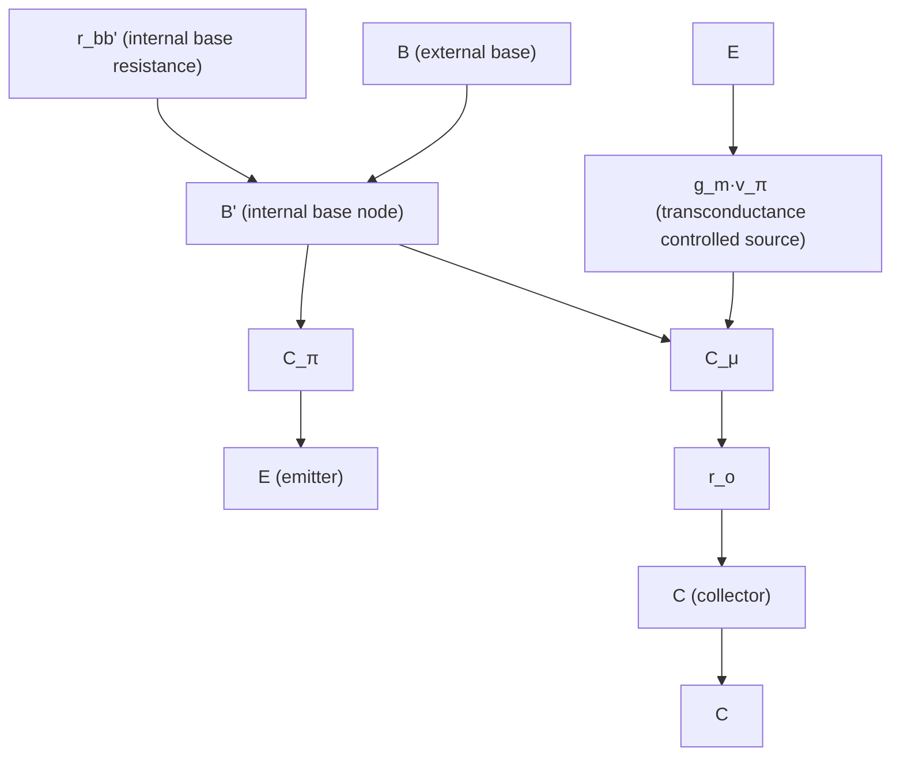

# Lesson 3: Small-Signal Models

## 1. First-Principles Intuition & Invariants

The transition from large-signal DC operating point analysis to small-signal AC behavior represents one of the most powerful conceptual shifts in analog circuit design. When a transistor operates in its active region—biased by DC sources into a stable quiescent point—we can temporarily forget the nonlinear exponential relationships governing diode junctions and channel conductance, replacing them with linear equivalent circuits valid for incremental perturbations around that operating point. This linearization unlocks the full arsenal of linear circuit theory: superposition, Thévenin equivalents, transfer functions, and frequency-domain analysis through phasors and Laplace transforms.

The small-signal approximation rests on a single physical premise: if the AC signal riding atop the DC bias remains sufficiently small compared to the thermal voltage $V_T = kT/q \approx 26\,\text{mV}$ at room temperature, the transistor's transconductance and output conductance become locally constant. Consider a bipolar junction transistor operating in forward-active mode, where collector current follows the Ebers-Moll equation $I_C = I_S e^{V_{BE}/V_T}$. Taking the partial derivative with respect to base-emitter voltage yields the transconductance $g_m = \partial I_C / \partial V_{BE} = I_C / V_T$, a quantity that depends only on the DC bias current, not on the instantaneous signal excursion. This derivative—measured in siemens or millimhos—quantifies how effectively the transistor converts an input voltage perturbation into an output current change, the fundamental mechanism of amplification.

For field-effect transistors, the physical picture differs but the mathematical framework remains identical. In a MOSFET operating in saturation, drain current follows the square-law relationship $I_D = \frac{1}{2} \mu_n C_{ox} \frac{W}{L} (V_{GS} - V_{th})^2$ in long-channel devices. Differentiation yields $g_m = \mu_n C_{ox} \frac{W}{L} (V_{GS} - V_{th})$, proportional to gate overdrive voltage. The output resistance $r_o = (\partial I_D / \partial V_{DS})^{-1}$ captures channel-length modulation—the Early effect analog in FETs—where drain-source voltage modulates the effective channel length, causing a finite slope in the output characteristics rather than the idealized flat current source.

Every small-signal parameter carries dual significance: it describes incremental behavior at the chosen bias point, and it sets fundamental performance limits. Transconductance $g_m$ determines voltage gain in common-emitter and common-source stages. Output resistance $r_o$ governs gain rolloff and sets the maximum achievable open-loop gain $A_v = -g_m r_o$ in a single-transistor amplifier. Input capacitances $C_\pi$ and $C_\mu$ (base-emitter and base-collector in BJTs, gate-source and gate-drain in FETs) define the frequency response, with the $g_m / (2\pi C_\pi)$ ratio yielding the unity-gain frequency $f_T$, the frequency at which the transistor's current gain falls to unity. These parameters form a complete linearized description, allowing us to replace every transistor with a network of resistors, controlled sources, and capacitors—a transformation that collapses hours of nonlinear iteration into minutes of algebraic manipulation.

The validity boundaries of small-signal analysis deserve careful attention. The linearization holds when AC voltage swings remain below approximately $5\,\text{mV}$ to $10\,\text{mV}$ for BJTs, ensuring that $v_{be} \ll V_T$ keeps higher-order terms in the Taylor expansion negligible. For MOSFETs with larger overdrive voltages, the permissible swing scales proportionally, often reaching $50\,\text{mV}$ to $100\,\text{mV}$ before distortion products exceed one percent. Beyond these thresholds, harmonic distortion manifests as spectral components at integer multiples of the input frequency, intermodulation distortion generates sum and difference frequencies when multiple tones coexist, and gain compression causes the amplifier's transfer characteristic to deviate from the linear small-signal prediction. Designers must continuously navigate the tension between maximizing signal swing for dynamic range and maintaining linearity for low distortion—a tradeoff encoded directly in the magnitude of small-signal parameters relative to supply voltages and bias currents.

The historical development of small-signal models parallels the evolution of semiconductor device physics. Early germanium transistors exhibited poorly controlled minority carrier lifetimes and severe temperature sensitivity, making accurate parameter extraction nearly impossible. The Ebers-Moll model, published in 1954, provided the first rigorous large-signal description of BJT behavior, but designers quickly recognized the need for simpler incremental models for routine AC analysis. Giacoletto's hybrid-pi model, introduced in the late 1950s, organized the transconductance, diffusion capacitance, and base resistance into a topologically intuitive network mirroring the physical transistor structure. This topology—still taught universally today—exposes the internal base node, making parasitic resistances explicit and revealing how high-frequency performance degrades as signals traverse the finite base resistance before reaching the active base-emitter junction.

## 2. Core Architecture & Mechanics

The hybrid-pi model decomposes the bipolar junction transistor into a five-element equivalent circuit capturing all first-order behavior from DC through the gigahertz range. Begin with the input port: the base-emitter junction behaves as a nonlinear diode under large-signal conditions, but for small perturbations, it linearizes into a resistance $r_\pi = \partial V_{BE} / \partial I_B = \beta / g_m$, where $\beta$ denotes the DC current gain. This resistance—typically ranging from a few hundred ohms to tens of kilohms depending on bias current—represents the dynamic impedance seen looking into the base terminal. In parallel with $r_\pi$, the diffusion capacitance $C_\pi$ models charge storage in the neutral base region, scaling directly with forward bias current according to $C_\pi = g_m \tau_F$, where $\tau_F$ is the forward transit time, typically $10\,\text{ps}$ to $100\,\text{ps}$ in modern high-speed BJTs.

The output port presents as a current-controlled current source $g_m v_{\pi}$, where $v_\pi$ denotes the small-signal voltage across the base-emitter junction. This controlled source captures the core amplification mechanism: base-emitter voltage modulation causes exponential changes in collector current, linearized here through the transconductance. In parallel with this ideal current source, the output resistance $r_o = V_A / I_C$ accounts for the Early effect, where collector-base voltage modulates the effective base width, causing a slight upward tilt in the output characteristics. The Early voltage $V_A$ typically ranges from $50\,\text{V}$ to $150\,\text{V}$ in small-signal BJTs, yielding output resistances from tens to hundreds of kilohms at milliampere bias currents.

The Miller capacitance $C_\mu$ bridges input and output ports, connecting base to collector. This junction capacitance dominates high-frequency behavior in common-emitter stages through a subtle but devastating mechanism discovered by John Miller in 1919. When voltage gain $A_v$ inverts the signal—negative gain in common-emitter topology—the capacitor experiences a voltage swing $(1 - A_v) v_{in}$ across its terminals, $(1 + |A_v|)$ times larger than the input signal alone. This amplified voltage swing causes the capacitor to draw $(1 + |A_v|)$ times more AC current from the source, effectively multiplying the capacitance by the Miller multiplication factor $(1 + |A_v|)$ as seen from the input. A $1\,\text{pF}$ base-collector capacitance becomes $51\,\text{pF}$ when the stage gain reaches $-50$, collapsing the input pole frequency from gigahertz to megahertz and throttling bandwidth.

The complete hybrid-pi topology, including parasitic resistances, takes this form:

The base spreading resistance $r_{bb'}$—typically $10\,\Omega$ to $100\,\Omega$—represents the distributed resistance of the narrow base region between the external base contact and the active intrinsic base directly under the emitter. This seemingly small resistance profoundly impacts high-frequency gain, as input current must flow through $r_{bb'}$ before developing voltage across $r_\pi$. At frequencies where the $r_{bb'}C_\pi$ time constant becomes significant, a portion of the input signal drops across the parasitic resistance rather than modulating the base-emitter junction, reducing effective transconductance.

Field-effect transistors demand a structurally analogous but physically distinct small-signal model. The MOSFET's voltage-controlled characteristic—drain current responds to gate-source voltage, not gate current—eliminates the input resistance $r_\pi$ seen in BJTs, replacing it with an open circuit (ignoring gate leakage, negligible in modern oxide dielectrics). The gate-source capacitance $C_{gs}$ combines oxide capacitance $C_{ox} W L$ with channel charge modulation effects, while gate-drain capacitance $C_{gd}$ mirrors the BJT's Miller capacitance, suffering identical multiplication in common-source stages. The transconductance $g_m$ appears as a voltage-controlled current source from drain to source, and the output resistance $r_o = (1/\lambda I_D)$ models channel-length modulation, where $\lambda$ is the channel-length modulation parameter, typically $0.01\,\text{V}^{-1}$ to $0.1\,\text{V}^{-1}$ in long-channel devices but much larger in short-channel transistors where drain-induced barrier lowering dominates.

The junction field-effect transistor (JFET) small-signal model occupies a middle ground: like MOSFETs, it exhibits infinite input resistance (gate leakage is merely nanoamperes), but like BJTs, its transconductance derives from a depletion region width modulation rather than inversion layer charge control. The JFET's input capacitance splits between gate-source capacitance $C_{gs}$ and gate-drain capacitance $C_{gd}$, both junction capacitances following the $C_j = C_{j0} / \sqrt{1 - V_R / \phi_B}$ voltage dependence characteristic of reverse-biased pn junctions.

Transconductance extraction from measured or simulated data follows a straightforward procedure. Bias the transistor at the desired operating point, apply a small AC voltage $v_{in}$ at the input (base or gate), and measure the resulting AC output current $i_{out}$ (collector or drain). The ratio $g_m = i_{out} / v_{in}$ yields transconductance directly. For BJTs, verify that $g_m \approx I_C / V_T$ matches the theoretical prediction; deviations indicate incorrect bias current measurement, temperature drift, or operation outside the forward-active region. For MOSFETs, compare the measured $g_m$ against $\mu_n C_{ox} (W/L) (V_{GS} - V_{th})$; discrepancies reveal velocity saturation in short-channel devices, where the linear dependence on gate overdrive saturates to $g_m \approx \mu_n C_{ox} (W/L) v_{sat}$, independent of $V_{GS}$.

Output resistance $r_o$ requires a similar incremental measurement: hold the input terminal at AC ground, apply a small AC voltage $v_{out}$ at the output, and measure the resulting AC current $i_{out}$. The ratio $r_o = v_{out} / i_{out}$ captures the finite output conductance. For BJTs, the Early voltage $V_A = r_o I_C$ should remain constant across different bias currents; if $V_A$ varies significantly, suspect base-width modulation effects or collector-base junction avalanche. For MOSFETs, the channel-length modulation parameter $\lambda = 1 / (r_o I_D)$ should remain roughly constant for a given geometry; strong $\lambda$ variation with $V_{DS}$ signals short-channel effects or substrate current injection.

Capacitance extraction demands either direct measurement with an LCR meter at the bias point or extraction from S-parameter data across frequency. The direct method applies a small AC voltage at the terminal of interest while holding all other terminals at AC ground, measuring the resulting AC current. The ratio $Y = I / V$ yields admittance; extracting the imaginary component $\text{Im}(Y) = \omega C$ gives capacitance at the measurement frequency $\omega / (2\pi)$. The S-parameter method leverages two-port network analysis: measure $S_{11}$, $S_{12}$, $S_{21}$, and $S_{22}$ across frequency, convert to Y-parameters through standard transformations, then fit the frequency-dependent imaginary components to capacitive reactances. This approach automatically captures the Miller effect and parasitic inductances, providing a complete broadband model.

## 3. High-Performance Optimization & Failure Modes

Bandwidth optimization in small-signal amplifiers confronts a fundamental three-way tradeoff encoded in the unity-gain frequency $f_T = g_m / (2\pi C_\pi)$ and maximum oscillation frequency $f_{max} = \sqrt{f_T / (8\pi r_{bb'} C_\mu)}$. Increasing transconductance by raising bias current simultaneously increases diffusion capacitance $C_\pi = g_m \tau_F$, leaving $f_T = 1 / (2\pi \tau_F)$ independent of bias—a startling result revealing that unity-gain frequency depends solely on the transit time, a device fabrication parameter beyond the circuit designer's control. The maximum oscillation frequency $f_{max}$, the frequency at which unilateral power gain falls to unity, degrades further due to base resistance and Miller capacitance, neither of which improve with bias current.

The designer's only recourse lies in device selection and topology. Switching from a general-purpose BJT with $f_T = 300\,\text{MHz}$ to an RF transistor with $f_T = 5\,\text{GHz}$ requires thinner base regions, reducing transit time from $530\,\text{ps}$ to $32\,\text{ps}$, but this comes at the cost of reduced Early voltage, lower breakdown voltages, and increased base resistance. Topology provides another lever: the cascode configuration—a common-emitter stage driving a common-base stage—eliminates Miller multiplication by preventing the common-emitter stage from experiencing voltage gain, its collector voltage remaining nearly constant as the common-base stage provides the voltage swing. The Miller capacitance $C_\mu$ still exists, but the $(1 + |A_v|)$ multiplication factor collapses to unity, and the effective input capacitance seen by the source drops by an order of magnitude.

Neutralization techniques directly cancel Miller capacitance through a fourth element bridging output to input with opposite polarity. By adding a capacitor $C_{neut} \approx C_\mu$ from collector to base through an inverting stage (or from drain to gate in FETs), the feedforward current through $C_\mu$ cancels the feedback current through $C_{neut}$, effectively removing the capacitance from the circuit. This technique, common in RF amplifiers and oscillators, demands precise capacitor matching and phase inversion; mismatches cause instability, while parasitics introduce phase errors that degrade cancellation at the frequency extremes.

High-frequency models incorporate second-order effects invisible in the basic hybrid-pi topology. Base-collector transit time introduces a phase shift in the transconductance, transforming the ideal current source $g_m v_\pi$ into $g_m v_\pi e^{-j\omega \tau_C}$, where $\tau_C$ represents the collector depletion region transit time. This phase lag causes the current gain $\beta = i_c / i_b$ to decrease with frequency according to $\beta(\omega) = \beta_0 / (1 + j\omega / \omega_\beta)$, where $\omega_\beta = 2\pi f_\beta$ is the beta cutoff frequency. The unity-gain frequency $f_T$ occurs where $|\beta(f_T)| = 1$, yielding $f_T \approx \beta_0 f_\beta$ for $\beta_0 \gg 1$.

Parasitic inductances in the emitter lead—typically $1\,\text{nH}$ to $5\,\text{nH}$ in discrete transistors, lower in integrated circuits—introduce inductive degeneration, adding a series impedance $j\omega L_E$ between the internal emitter node and ground. This inductance reduces transconductance by the factor $1 / (1 + j\omega L_E g_m)$, beneficially stabilizing the amplifier against parasitic oscillations but throttling gain at high frequencies. The emitter inductance resonates with base-emitter capacitance $C_\pi$ at $f_{res} = 1 / (2\pi \sqrt{L_E C_\pi})$, creating a sharp impedance peak that can trigger instability if the resonant frequency falls within the amplifier's operating band. Die-level bonding techniques, flip-chip mounting, and integrated circuit layout discipline minimize lead inductances, pushing resonances into the tens of gigahertz.

Collector-substrate capacitance $C_{cs}$—the junction capacitance between the collector and the semiconductor substrate or package ground—shunts high-frequency output current to ground, reducing available signal current into the load. This parasitic becomes dominant in integrated circuits, where the collector sits atop a lightly doped epitaxial layer separated from the substrate by a reverse-biased junction. The substrate capacitance scales with collector area, forcing a tradeoff between current-handling capability (large devices) and high-frequency performance (small devices). Multi-finger layouts distribute the active area across narrow parallel stripes, reducing the capacitance per stripe while maintaining total current capacity, but at the cost of increased base and emitter resistances due to the distributed geometry.

Noise figure degradation at high frequencies stems from the increasing dominance of base resistance $r_{bb'}$ and decreasing input impedance. The noise figure of a common-emitter stage, assuming a source resistance $R_S$, follows approximately $F \approx 1 + (r_{bb'} + r_\pi / \beta) / R_S + (I_C / 2qB) (R_S / V_T)$, where $B$ is the bandwidth and $q$ is the elementary charge. The second term represents thermal noise from base resistances, while the third term captures shot noise from the collector current. Optimizing noise figure requires matching the source resistance to the transistor's noise resistance $R_{opt} \approx \sqrt{r_{bb'} V_T / I_C}$, typically tens of ohms at milliampere bias currents. As frequency increases and input impedance falls due to $C_\pi$ shunting, the mismatch between $R_S$ and $R_{opt}$ worsens, and noise figure rises. Minimum noise figure tracking—continuously adjusting the source impedance to maintain optimal matching across frequency—requires active tuning networks or careful passive filter design.

Stability analysis in multi-stage amplifiers demands Nyquist or Bode criteria applied to the loop gain $A\beta$, where $A$ represents the open-loop gain and $\beta$ the feedback factor. The Miller capacitance, providing a path from output back to input, constitutes unintentional feedback that can drive the amplifier into oscillation when the loop phase shift reaches $180°$ at a frequency where loop gain magnitude exceeds unity. Compensation techniques introduce a dominant pole well below the first parasitic pole, rolling off gain at $20\,\text{dB/decade}$ through the unity-loop-gain frequency, ensuring phase margin exceeds $45°$ for stable operation. The compensation capacitor, typically connected between collector and base in a Miller compensation scheme, multiplies by the stage gain, allowing a physically small capacitor to create a large effective capacitance and thus a low pole frequency.

Temperature sensitivity haunts all small-signal parameters. Transconductance $g_m = I_C / V_T$ scales inversely with absolute temperature through $V_T = kT / q$, dropping approximately $0.3\%$ per degree Celsius. Simultaneously, collector current $I_C$ increases with temperature due to the exponential $e^{V_{BE}/V_T}$ dependence and the temperature coefficient of saturation current $I_S$, rising roughly $9\%$ per degree for constant $V_{BE}$ bias. These opposing effects partially cancel when the bias circuit maintains constant $V_{BE}$, but the net result remains a positive temperature coefficient for $g_m$ of approximately $0.3\%$ per degree. Output resistance $r_o$ exhibits stronger temperature dependence, as the Early voltage $V_A$ decreases with rising temperature due to increased base conductivity modulation, reducing $r_o$ by $0.5\%$ to $1\%$ per degree. Precision amplifiers demand temperature-compensated biasing—bandgap references for voltage, proportional-to-absolute-temperature (PTAT) current sources—to stabilize operating points across the industrial temperature range of $-40°\text{C}$ to $+85°\text{C}$.

Parameter extraction accuracy hinges on bias point stability and measurement bandwidth. When measuring $g_m$ or $r_o$, the AC stimulus frequency must exceed the thermal corner frequency $f_{th} = 1 / (2\pi R_{th} C_{th})$, where $R_{th}$ and $C_{th}$ represent the device's thermal resistance and capacitance. Below $f_{th}$—typically tens to hundreds of hertz in discrete transistors, kilohertz in integrated circuits—the AC signal modulates junction temperature, introducing spurious electrothermal feedback that artificially inflates transconductance and deflates output resistance. Above $f_{th}$, the thermal mass of the device cannot respond to the AC signal, and true isothermal small-signal parameters emerge. Professional parameter analyzers apply stimulus frequencies of $1\,\text{kHz}$ to $10\,\text{kHz}$ to safely exceed thermal corners while remaining low enough to avoid significant capacitive loading effects.

Breakdown and safe operating area constraints impose hard boundaries on small-signal operation. The collector-emitter breakdown voltage $BV_{CEO}$—typically $20\,\text{V}$ to $80\,\text{V}$ in small-signal BJTs, lower in high-speed devices—limits maximum supply voltage when the base is open-circuited. With the base driven from a low-impedance source, the effective breakdown voltage increases to $BV_{CES} = BV_{CEO} \sqrt{1 + \beta}$, but prudent design maintains collector voltage well below $BV_{CEO}$ to avoid avalanche-induced hot-carrier degradation. Secondary breakdown, a catastrophic failure mode where current localizes into a narrow filament, strikes when the power dissipation $P = V_{CE} I_C$ exceeds the device's thermal limit. The safe operating area (SOA) curve traces permissible $(V_{CE}, I_C)$ combinations, bounded by maximum current (wire bonding limit), maximum voltage (breakdown limit), maximum power (thermal limit), and maximum power versus voltage (secondary breakdown limit). High-frequency operation shrinks the SOA due to increased switching losses and reduced thermal time constant, forcing designers to detune performance or select larger, more robust devices.
