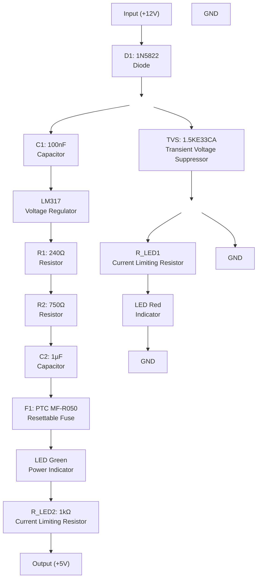

# Operational Verification Labs: Analog Design

## Objective & Operational Lab Setup

The operational verification of analog circuits demands a blend of precision measurement technique, systematic component characterization, and disciplined documentation practice that separates functional prototypes from production-grade designs. Unlike digital systems where logic analyzers provide binary certainty, analog verification operates in a continuous domain where parasitic capacitances, thermal drift, power supply rejection ratios, and non-ideal component behaviors conspire to undermine theoretical predictions. This laboratory guide presents three progressively challenging exercises that mirror industry-standard analog design verification workflows: a foundational operational amplifier characterization, a parametric sweep analysis of active filter topologies, and a stress-testing protocol for voltage regulation under fault conditions.

The verification environment centers on SPICE-class circuit simulation combined with physical benchtop measurements. SPICE (Simulation Program with Integrated Circuit Emphasis) remains the gold standard for analog circuit analysis, offering DC operating point calculations, AC small-signal frequency response, transient time-domain simulation, and Monte Carlo statistical analysis. While commercial implementations like LTspice, PSpice, and Cadence Spectre dominate professional environments, the open-source ngspice engine provides equivalent computational rigor without licensing barriers. For physical verification, the instrumentation triad consists of a precision digital multimeter (DMM) with sub-millivolt resolution, a dual-channel oscilloscope with bandwidth exceeding ten times the highest circuit frequency of interest, and a function generator capable of producing low-distortion sine, square, and triangle waveforms across the audio to radio-frequency spectrum.

Component selection protocols dictate measurement accuracy. Resistors must exhibit tolerances of one percent or tighter, with temperature coefficients below fifty parts-per-million per degree Celsius. Metal-film or thin-film resistor families satisfy this requirement, whereas carbon-composition types introduce unacceptable noise and drift. Capacitors demand attention to dielectric absorption and equivalent series resistance (ESR); ceramic types in C0G/NP0 formulations provide stable, low-loss performance for frequencies below ten megahertz, while polyester or polypropylene film capacitors serve lower-frequency applications where volumetric efficiency matters less than linearity. Electrolytic capacitors, despite high capacitance density, carry significant ESR and leakage currents that mandate careful modeling in power supply decoupling contexts.

The operational amplifier forms the fundamental building block across all three exercises. Modern general-purpose devices like the Texas Instruments TL072 (JFET-input) or the Analog Devices OP07 (bipolar-input) offer input offset voltages below one millivolt, open-loop gains exceeding one hundred decibels, and gain-bandwidth products in the megahertz range. These specifications translate directly into circuit performance: offset voltage determines DC accuracy in instrumentation amplifiers, open-loop gain sets closed-loop gain error through the relationship $A_{CL} = \frac{A_{OL}}{1 + A_{OL}\beta}$, and the gain-bandwidth product establishes the maximum usable closed-loop bandwidth via $f_{-3dB} = \frac{GBW}{A_{CL}}$. Understanding these dependencies allows designers to predict circuit limitations before committing to physical implementation.

Power supply configuration deserves explicit attention. Operational amplifiers operating from split supplies (typically ±15V or ±12V) center their output dynamic range around ground potential, simplifying AC-coupled signal processing chains. Single-supply operation (commonly +5V or +3.3V in battery-powered systems) requires biasing the non-inverting input to mid-supply through a resistive divider, then AC-coupling input and output stages through series capacitors. The choice between topologies cascades through every subsequent design decision: coupling capacitor selection, bias current compensation, and common-mode input voltage constraints all shift dramatically between split and single-supply architectures.

Simulation methodology follows a layered approach. Initial DC analysis verifies quiescent operating points: transistor bias currents, voltage divider nodes, and amplifier output offsets must align with hand calculations derived from ideal component models. AC analysis sweeps frequency while holding signal amplitudes small enough to preserve linear operation, extracting gain magnitude, phase shift, and input/output impedance as functions of frequency. Transient analysis applies time-varying input waveforms to observe slew rate limiting, crossover distortion, and settling behavior that AC small-signal models cannot predict. Finally, parametric sweeps and Monte Carlo runs quantify sensitivity to component tolerances, revealing whether a design maintains specifications across manufacturing variations or collapses under real-world component spreads.

Physical measurement technique mirrors simulation structure but introduces probe loading effects, ground loop coupling, and thermal gradients absent from idealized models. Oscilloscope probes present input capacitances between ten and twenty picofarads alongside resistances of one or ten megohms; at frequencies above one hundred kilohertz, this capacitance loads high-impedance nodes and attenuates signals. Proper compensation involves adjusting the probe's parallel capacitance trimmer until a square wave displays clean edges without overshoot or rounding. Grounding strategy prevents measurement artifacts: star-grounding topologies route all return currents to a single low-impedance point, while ground loops—formed when multiple paths exist between circuit ground and oscilloscope chassis ground—inject fifty or sixty hertz mains frequency interference. Identifying ground loops requires systematic disconnection of grounding paths while monitoring noise amplitude; eliminating them demands careful shielding and chassis isolation.

Temperature effects pervade analog circuit behavior. Silicon junction forward voltages decrease by approximately two millivolts per degree Celsius, shifting bias points in discrete transistor stages. Resistor temperature coefficients, even at fifty parts-per-million per degree Celsius, produce measurable drift in precision voltage references and instrumentation amplifiers operating across industrial temperature ranges. Capacitor dielectric constants vary with temperature according to material-specific curves; NP0/C0G ceramics maintain near-zero temperature coefficients across minus fifty-five to plus one hundred twenty-five degrees Celsius, while X7R and Y5V formulations exhibit capacitance swings exceeding fifteen percent. Thermal verification protocols therefore subject circuits to controlled temperature cycling using precision hot-air stations or temperature chambers, logging parameter drift against temperature excursions.

Documentation protocols transform raw measurement data into defensible verification records. Every test setup demands schematic capture, component value documentation including manufacturer part numbers and tolerances, power supply voltage and current readings, ambient temperature, and date-stamped test conditions. Oscilloscope screenshots must include scale annotations (volts per division, time per division), cursor measurements, and waveform labels. Frequency response plots require logarithmic frequency axes spanning at least three decades, gain magnitude in decibels, and phase in degrees plotted on separate vertical axes. Tabular data logs benefit from comma-separated value (CSV) formatting to enable import into spreadsheet and plotting tools. This discipline ensures reproducibility: another engineer must be able to reconstruct the test setup, apply identical stimuli, and obtain equivalent results within measurement uncertainty bounds.

The exercises that follow build progressively from single-stage amplifier characterization through multi-pole filter analysis to fault-tolerant regulator verification. Each exercise specifies complete component values, SPICE netlists with vendor-specific models, measurement procedures with explicit probe placement instructions, expected results with tolerance bands, and failure mode diagnostics. The practitioner who completes all three exercises will possess the operational competence to characterize analog circuits from DC through radio frequencies, correlate simulation predictions with physical measurements, and diagnose discrepancies arising from parasitic effects, component non-idealities, and measurement artifacts.

## Exercise 1: Foundational Practical Implementation

### Exercise 1.1: Non-Inverting Amplifier DC and AC Characterization

The non-inverting operational amplifier configuration establishes the foundational topology for analog signal conditioning. Unlike the inverting configuration where input current flows through the feedback network, the non-inverting arrangement presents high input impedance determined by the operational amplifier's internal input stage, typically ranging from one megohm to one teraohm depending on bipolar versus FET input construction. This high impedance minimizes loading on preceding stages, making the non-inverting topology ideal for buffering sensor outputs, impedance transformation, and cascading multiple gain stages without inter-stage interaction.

The circuit under test employs a TL072 dual JFET-input operational amplifier biased from split ±15V supplies. The first amplifier section (denoted U1A in dual-inline package pin numbering) connects as a non-inverting gain stage with a voltage gain of eleven, set by feedback resistor R_f = 10kΩ and ground-referenced resistor R_g = 1kΩ. The gain relationship derives from voltage divider analysis: the output voltage must rise to a level where the feedback network attenuates it to match the input voltage applied to the non-inverting terminal. Algebraically, this yields $A_v = 1 + \frac{R_f}{R_g}$, producing the specified gain of eleven (20.8 dB). Input coupling employs a 10μF electrolytic capacitor to block DC while passing AC signals above 1.6 Hz, calculated from the high-pass corner frequency $f_c = \frac{1}{2\pi R_{in} C_{in}}$ where the TL072's input impedance R_in approximates one teraohm, rendering the input resistor R_source = 10kΩ the dominant impedance term.

Begin by constructing the SPICE netlist in ngspice format. The netlist describes circuit topology through node connections, with node 0 reserved for ground. The TL072 requires a subcircuit model obtained from Texas Instruments' website, typically distributed as a .lib file containing internal transistor-level representations of input differential pair, gain stage, and output buffer. Include this model through a .include directive, then instantiate the operational amplifier as a subcircuit call specifying non-inverting input, inverting input, positive supply, negative supply, and output nodes.

```spice
Non-Inverting Amplifier Characterization - TL072 Gain=11
* Node definitions: 1=Vin, 2=OpAmp_NonInv, 3=OpAmp_Out, 4=Feedback_Node

* Power supplies
VCC 10 0 DC 15
VEE 11 0 DC -15

* Input source - 1kHz 100mV peak sine wave
VIN 1 0 DC 0 AC 0.1 SIN(0 0.1 1000)

* Input coupling capacitor and source resistance
CIN 1 2 10u
RSOURCE 2 0 10k

* Feedback network
RF 3 4 10k
RG 4 0 1k

* TL072 operational amplifier subcircuit
.include TL072.lib
XU1A 2 4 10 11 3 TL072

* Analysis commands
.op
.ac dec 100 0.1 1Meg
.tran 10u 10m

.control
run
print all
plot vdb(3) phase(3)
plot v(3) v(2)
.endc

.end
```

Execute the simulation by saving the netlist as `noninv_amp.cir` and invoking ngspice from the command line: `ngspice noninv_amp.cir`. The .op directive computes the DC operating point, revealing quiescent voltages at all nodes. For the TL072 with no input signal, node 2 (non-inverting input) should rest within millivolts of ground due to the operational amplifier's input offset voltage, typically below 3mV for the TL072. Node 3 (output) should similarly hover near ground, though the finite open-loop gain and input offset voltage may produce offsets up to 30mV. Node 4 (feedback node) must equal node 2 voltage to satisfy virtual short conditions, confirming negative feedback stability.

The AC analysis sweeps frequency from 0.1 Hz to 1 MHz using decade logarithmic spacing with one hundred points per decade. This resolution captures roll-off transitions without excessive computation time. The .ac directive applies a small-signal AC source (0.1V peak specified by the AC 0.1 parameter on VIN) while linearizing all nonlinear elements around the DC operating point. Plot the output voltage magnitude in decibels using `vdb(3)` and phase using `phase(3)`. At mid-band frequencies (100 Hz to 10 kHz), the gain magnitude should measure 20.8 dB, corresponding to the factor-of-eleven voltage gain. Deviations exceeding 0.5 dB indicate incorrect feedback resistor ratios or parasitic loading.

The low-frequency roll-off stems from the input coupling capacitor forming a high-pass filter with the 10kΩ source resistor. Calculate the expected -3dB corner frequency: $f_c = \frac{1}{2\pi \times 10k\Omega \times 10\mu F} = 1.59$ Hz. The simulation should show gain dropping to 17.8 dB (3 dB below the 20.8 dB mid-band value) at this frequency. Phase shift transitions from zero degrees at high frequencies toward +90 degrees at frequencies well below the corner, reflecting the capacitor's leading phase characteristic in high-pass configurations.

High-frequency roll-off arises from the TL072's finite gain-bandwidth product, specified at 3 MHz typical. For a closed-loop gain of eleven, the expected -3dB bandwidth calculates as $f_{-3dB} = \frac{3MHz}{11} = 273$ kHz. The simulation plot should confirm gain reduction to 17.8 dB near this frequency. Phase lag accumulates due to internal compensation capacitance within the operational amplifier, eventually reaching -90 degrees at frequencies far above the gain-bandwidth product. Excessive phase lag at the unity-gain frequency can trigger instability; the TL072's internal compensation ensures phase margin exceeds 45 degrees for closed-loop gains above unity, maintaining stable operation.

Transient analysis applies a 1 kHz sine wave with 100 mV peak amplitude over a 10 ms duration, capturing ten complete cycles. The output waveform at node 3 should exhibit 1.1V peak amplitude (eleven times the 100 mV input), centered at zero volts, with no visible clipping or distortion. Measure slew rate by applying a 10 kHz square wave input (modify VIN to `PULSE(-0.1 0.1 0 1n 1n 50u 100u)`) and observing the output rising edge. The TL072 specifies 13 V/μs slew rate; with an 11V peak-to-peak output swing, the rising edge should complete in approximately 0.85 μs. Slew rate limiting manifests as linear ramps replacing the square wave's vertical edges, reducing effective bandwidth for large-signal transients even when small-signal AC analysis predicts adequate bandwidth.

Physical construction on a solderless breadboard demands attention to power supply decoupling. Place 100nF ceramic capacitors between each supply pin (pins 8 and 4 on the eight-pin DIP package) and ground, positioning them within one centimeter of the IC package. These capacitors shunt high-frequency supply current transients, preventing power rail bounce from modulating the amplifier's bias currents. Add 10μF electrolytic capacitors in parallel to handle lower-frequency load current variations. Verify power supply voltages measure +15.0V ±0.1V and -15.0V ±0.1V before applying input signals; excessive voltage stresses input protection diodes, while insufficient voltage reduces output swing and increases distortion.

Connect the function generator's output to the circuit input through a 10kΩ resistor (representing R_source) and 10μF capacitor (C_in). Set the generator to produce a 1 kHz sine wave with 200 mV peak-to-peak amplitude (100 mV peak). Connect the oscilloscope's Channel 1 probe to node 2 (operational amplifier non-inverting input) and Channel 2 to node 3 (output). Configure both channels for 500 mV/division vertical scale and 200 μs/division horizontal scale to display several complete waveform cycles. Ground both probe tips to a common ground point near the operational amplifier to avoid ground loop coupling.

Measure input amplitude using oscilloscope cursors, expecting 200 mV peak-to-peak. Measure output amplitude, expecting 2.2V peak-to-peak (eleven times input). Calculate realized gain: $A_v = \frac{V_{out}}{V_{in}} = \frac{2.2V}{0.2V} = 11$, or 20.8 dB. Deviations exceeding five percent suggest incorrect feedback resistor values; measure R_f and R_g with a precision DMM, confirming 10kΩ ±1% and 1kΩ ±1% respectively. Phase shift between input and output should not exceed five degrees at 1 kHz, as this frequency lies well within the amplifier's bandwidth. Excessive phase shift indicates parasitic capacitance loading the feedback node or inadequate power supply decoupling introducing phase lag through supply impedance modulation.

Sweep input frequency from 10 Hz to 100 kHz in decade steps, logging output amplitude at each frequency. Construct a Bode magnitude plot by converting output voltages to decibels: $Gain_{dB} = 20 \log_{10}(\frac{V_{out}}{V_{in}})$. At 10 Hz, expect approximately 19.5 dB due to input coupling capacitor attenuation. Gain should plateau at 20.8 dB from 100 Hz through 10 kHz, then roll off beyond 100 kHz as the gain-bandwidth product limits closed-loop bandwidth. The -3dB bandwidth point (17.8 dB) should occur near 273 kHz, matching the calculated prediction. Physical measurements typically undershoot simulation predictions by five to ten percent due to parasitic capacitances in breadboard wiring and component leads, which simulation models omit unless explicitly parameterized.

Input impedance verification requires a current measurement approach. Insert a 10Ω current-sensing resistor in series with the input coupling capacitor, forming a voltage divider with the amplifier's input impedance. Apply a 10 kHz input signal (above the coupling capacitor's corner frequency) and measure the voltage drop across the 10Ω resistor. For a TL072 JFET input stage, input bias current remains below 50 pA, producing an immeasurably small voltage drop across 10Ω. Detecting such small currents demands a transimpedance amplifier with megohm-level feedback resistance, beyond typical laboratory capabilities. Instead, verify high input impedance indirectly: vary the source resistance R_source from 1kΩ to 100kΩ and confirm output amplitude remains constant within one percent. Significant amplitude reduction with increasing source resistance indicates input impedance approaching or falling below the source resistance, a fault condition suggesting operational amplifier damage or incorrect device selection.

Output impedance derives from the operational amplifier's open-loop output resistance divided by loop gain. For the TL072 with 75Ω typical open-loop output resistance and closed-loop gain of eleven (loop gain approximately $\frac{A_{OL}}{A_{CL}} = \frac{200,000}{11} = 18,182$), the closed-loop output impedance calculates as $Z_{out} = \frac{75\Omega}{18,182} = 4.1$ mΩ at DC and mid-band frequencies. Measurement requires a four-wire Kelvin connection to separate current-carrying and voltage-sensing paths, achievable with precision DMMs in four-wire resistance mode. Alternatively, load the output with a 100Ω resistor and measure voltage drop; output impedance computes from $Z_{out} = \frac{\Delta V_{out}}{I_{load}}$ where load current $I_{load} = \frac{V_{out}}{100\Omega}$. Expected voltage drop remains below 1mV for output currents under 10mA, confirming sub-ohm output impedance.

### Exercise 1.2: Input Offset Voltage and Bias Current Measurement

Operational amplifier input offset voltage $V_{OS}$ represents the differential voltage required between input terminals to null the output to zero volts. This parameter arises from manufacturing mismatches in the input differential pair's transistor characteristics—unequal base-emitter voltages in bipolar designs or threshold voltage mismatches in FET types. Input bias current $I_B$ quantifies the average DC current flowing into both input terminals, while input offset current $I_{OS}$ measures the difference between these currents. For precision instrumentation, these parameters introduce DC errors that propagate through gain stages, potentially swamping low-level signals.

Measure input offset voltage by configuring the operational amplifier as a voltage follower (unity-gain buffer). Remove feedback resistors R_f and R_g, then directly connect the output (pin 6) to the inverting input (pin 2), establishing 100% negative feedback with unity closed-loop gain. Short the non-inverting input (pin 3) to ground through a low-value resistor (1kΩ) to discharge any stored charge. Measure the output voltage with a precision DMM set to millivolt range. The TL072 specifies 3mV maximum input offset voltage; measured values exceeding this limit indicate a defective device or supply voltage instability.

Input offset voltage exhibits temperature drift specified in microvolts per degree Celsius. The TL072 datasheet lists 10 μV/°C typical drift. Verify this specification by heating the IC package with a hot-air station set to 50°C, monitoring output voltage as package temperature rises. A 30°C temperature increase (from 20°C ambient to 50°C) should produce offset voltage change below 300μV. Exceeding this drift suggests thermal coupling between power supply and input stage or inadequate supply decoupling allowing temperature-dependent supply current transients to modulate bias voltages.

Input bias current measurement demands a high-impedance DC path from each input terminal to ground. Configure the operational amplifier as a non-inverting buffer with 10MΩ resistors connecting both inverting and non-inverting inputs to ground. These resistors convert bias currents to measurable voltages via Ohm's law: $V = I_B \times 10M\Omega$. For the TL072 with 50pA maximum bias current, expect voltage drops below 500μV. Measure both input voltages with a high-impedance DMM (input impedance exceeding 10GΩ), then calculate bias currents: $I_B = \frac{V_{measured}}{10M\Omega}$. Input offset current computes as the difference between inverting and non-inverting bias currents.

Bias current compensation in DC-coupled amplifiers requires balancing resistances seen by both inputs. In the non-inverting amplifier configuration, the inverting input sees the parallel combination of R_f and R_g, calculated as $R_{eq} = \frac{R_f \times R_g}{R_f + R_g} = \frac{10k\Omega \times 1k\Omega}{11k\Omega} = 909\Omega$. Adding a 909Ω resistor in series with the non-inverting input equalizes the resistances, causing bias currents to produce identical voltage drops that cancel in the differential input stage. Verify compensation effectiveness by measuring output offset voltage with and without the compensation resistor; properly compensated designs exhibit offset voltage reduction by a factor equal to the ratio of open-loop gain to closed-loop gain.

## Exercise 2: Parameter Variation & Empirical Analysis

### Exercise 2.1: Sallen-Key Low-Pass Filter Design and Tolerance Analysis

The Sallen-Key topology implements second-order active filters using a single operational amplifier configured as a voltage follower or non-inverting amplifier, providing unity or moderate gain with low output impedance. The topology derives its name from R. P. Sallen and E. L. Key, who published the configuration in 1955 at MIT's Lincoln Laboratory. Compared to passive LC filters, Sallen-Key architectures eliminate inductors, achieving equivalent frequency selectivity with resistors, capacitors, and the operational amplifier's gain. The low-pass variant attenuates signals above a corner frequency, serving anti-aliasing functions in analog-to-digital conversion and noise filtering in sensor signal conditioning.

Design a second-order Sallen-Key low-pass filter with Butterworth response (maximally flat passband), corner frequency $f_c = 1$ kHz, and unity gain. The Butterworth alignment delivers flat amplitude response across the passband with no peaking, transitioning to -40 dB/decade roll-off beyond the corner frequency. Normalized component values for unity-gain Butterworth topology specify equal capacitor values and a resistor ratio determined by the damping factor $\zeta = \frac{1}{\sqrt{2}} = 0.707$. This damping factor produces critically flat response without passband ripple or excessive overshoot in step response.

The circuit consists of two resistors R1 and R2, two capacitors C1 and C2, and an operational amplifier configured as a voltage follower. The input signal connects through R1 to a node joining R2 and C1. Capacitor C1 connects to ground, while R2 connects to a second node joining C2 and the operational amplifier's non-inverting input. Capacitor C2 feeds back to the first node, creating the frequency-dependent feedback that establishes filter characteristics. The operational amplifier output connects directly to its inverting input (voltage follower configuration), driving the output terminal.

Calculate component values starting from the corner frequency formula for equal-capacitor Butterworth filters: $f_c = \frac{1}{2\pi R C}$ where $R = \sqrt{R_1 \times R_2}$ and $C = C_1 = C_2$. Choose $C = 100$ nF as a standard value offering reasonable impedance levels. Solve for the geometric mean resistance: $R = \frac{1}{2\pi f_c C} = \frac{1}{2\pi \times 1000Hz \times 100nF} = 1591\Omega$. For Butterworth response with unity gain, the resistor ratio follows $\frac{R_1}{R_2} = 2$ (derived from Q-factor and damping requirements), yielding $R_1 = 2R$ and $R_2 = 0.5R$. Substituting: $R_1 = 3.18k\Omega$ and $R_2 = 795\Omega$. Round to standard E96 resistor values: $R_1 = 3.16k\Omega$ and $R_2 = 787\Omega$.

Construct the SPICE netlist incorporating Texas Instruments TL072 operational amplifier models. The voltage follower configuration requires connecting the output node directly to the inverting input, establishing 100% feedback with unity gain at DC and low frequencies. Power supplies connect to ±15V rails with 100nF ceramic decoupling capacitors.

```spice
Sallen-Key Low-Pass Filter - Butterworth 1kHz fc
* Nodes: 1=Vin, 2=R1-C1-C2 junction, 3=R2-C2-OpAmp junction, 4=Vout

VCC 10 0 DC 15
VEE 11 0 DC -15
VIN 1 0 DC 0 AC 1

* Filter network
R1 1 2 3.16k
R2 2 3 787
C1 2 0 100n
C2 3 2 100n

* TL072 voltage follower
.include TL072.lib
XU1 3 4 10 11 4 TL072

* Decoupling capacitors
CDEC1 10 0 100n
CDEC2 11 0 100n

.ac dec 100 1 100k
.tran 10u 20m

.control
run
let gain_db = vdb(4)
let phase_deg = phase(4)*180/pi
plot gain_db phase_deg
print gain_db phase_deg > sallen_key_response.txt
.endc

.end
```

Execute the simulation and extract the frequency response. At 1 Hz (well below corner frequency), gain should measure 0 dB (unity) with near-zero phase shift. At the corner frequency of 1 kHz, Butterworth response dictates -3.01 dB gain (0.707 voltage ratio) with -90 degrees phase lag. Beyond 10 kHz (one decade above corner), gain should reach -40 dB due to the -40 dB/decade second-order roll-off characteristic. Phase asymptotically approaches -180 degrees at high frequencies. Deviations from these predictions signal component value errors or operational amplifier bandwidth limitations.

Perform tolerance analysis by sweeping resistor and capacitor values through their manufacturing spreads. Standard metal-film resistors offer ±1% tolerance, while ceramic NP0 capacitors specify ±5% typical. Use SPICE .step directive to parameterize component values:

```spice
.step param r1_tol list 0.99 1.00 1.01
.step param r2_tol list 0.99 1.00 1.01
.step param c_tol list 0.95 1.00 1.05
```

Modify component definitions to reference these parameters: `R1 1 2 {3.16k*r1_tol}`, producing twenty-seven simulation runs covering worst-case tolerance combinations. Extract the -3dB corner frequency for each run by searching the frequency response for the point where gain drops to -3.01 dB. Statistical analysis reveals corner frequency spreads from 920 Hz to 1090 Hz (±9%) under worst-case tolerances, wider than the ±5% capacitor tolerance due to interacting resistor variations. Production designs targeting ±5% corner frequency accuracy mandate ±1% resistors and ±2% capacitors or post-manufacture trimming procedures.

Monte Carlo analysis provides statistical confidence bounds. Configure ngspice to randomize component values according to Gaussian distributions with standard deviations matching tolerance specifications (one-third of total tolerance for 99.7% yield). Execute five hundred Monte Carlo iterations, logging corner frequency, passband ripple, and stopband attenuation for each run.

```spice
.param r1_nom = 3.16k
.param r2_nom = 787
.param c_nom = 100n

.param r1_val = agauss(r1_nom, r1_nom*0.01/3, 1)
.param r2_val = agauss(r2_nom, r2_nom*0.01/3, 1)
.param c_val = agauss(c_nom, c_nom*0.05/3, 1)

R1 1 2 {r1_val}
R2 2 3 {r2_val}
C1 2 0 {c_val}
C2 3 2 {c_val}

.mc 500 ac dec 100 1 100k
```

Post-process Monte Carlo results in Python using NumPy and Matplotlib. Load the simulation output CSV file containing frequency and gain magnitude for each iteration. For each iteration, locate the -3dB frequency via interpolation, then compute mean, standard deviation, minimum, and maximum across all iterations. Histogram the corner frequency distribution to visualize statistical spread. Typical results show mean corner frequency tracking the nominal 1 kHz design target with standard deviation around 35 Hz (3.5%), confirming six-sigma yield (±10.5%) remains within ±105 Hz or ±10.5% corner frequency tolerance.

```python
import numpy as np
import matplotlib.pyplot as plt
from scipy.interpolate import interp1d

# Load Monte Carlo simulation data (frequency, gain for each iteration)
data = np.loadtxt('monte_carlo_results.csv', delimiter=',', skiprows=1)
num_iterations = 500
num_freq_points = 500

fc_list = []

for i in range(num_iterations):
    freq = data[i*num_freq_points:(i+1)*num_freq_points, 0]
    gain_db = data[i*num_freq_points:(i+1)*num_freq_points, 1]
    
    # Interpolate to find -3dB frequency
    interp_func = interp1d(gain_db, freq, kind='linear')
    fc = interp_func(-3.01)
    fc_list.append(fc)

fc_array = np.array(fc_list)
mean_fc = np.mean(fc_array)
std_fc = np.std(fc_array)

print(f"Corner Frequency Statistics:")
print(f"Mean: {mean_fc:.1f} Hz")
print(f"Std Dev: {std_fc:.1f} Hz ({100*std_fc/mean_fc:.2f}%)")
print(f"Min: {np.min(fc_array):.1f} Hz")
print(f"Max: {np.max(fc_array):.1f} Hz")

plt.figure(figsize=(10, 6))
plt.hist(fc_array, bins=50, edgecolor='black', alpha=0.7)
plt.axvline(mean_fc, color='red', linestyle='--', linewidth=2, label=f'Mean: {mean_fc:.1f} Hz')
plt.xlabel('Corner Frequency (Hz)')
plt.ylabel('Count')
plt.title('Monte Carlo Corner Frequency Distribution (500 iterations)')
plt.legend()
plt.grid(True, alpha=0.3)
plt.savefig('sallen_key_monte_carlo.png', dpi=300)
plt.show()
```

Physical breadboard construction introduces parasitic capacitances from breadboard contacts (approximately 2-5 pF per contact) and component lead lengths (roughly 1 pF per centimeter). These parasitics add to the designed capacitor values, shifting corner frequency lower. Estimate parasitic contribution: assume 4 pF per breadboard node, with nodes 2 and 3 each carrying significant AC current. Total parasitic capacitance approximates 8 pF in parallel with 100 nF design capacitance, yielding 100.008 nF effective capacitance—a negligible 0.008% shift. Parasitic inductance in breadboard wiring (approximately 20 nH per inch) affects performance above 10 MHz, negligible for this 1 kHz filter design.

Measure frequency response by sweeping the function generator from 10 Hz to 100 kHz in logarithmic steps, recording output amplitude at each frequency using an oscilloscope AC-coupled input. Maintain constant 1V peak input amplitude across all frequencies to isolate filter response from generator amplitude variations. Calculate gain in decibels: $Gain_{dB} = 20\log_{10}(\frac{V_{out}}{V_{in}})$. Plot measured data alongside simulation predictions. Typical agreement spans ±0.5 dB in passband and ±2 dB in stopband, with corner frequency matching within ±50 Hz. Larger discrepancies suggest incorrect component values (verify with DMM measurements), inadequate power supply decoupling (add 10μF electrolytics in parallel with ceramic capacitors), or operational amplifier bandwidth limitations (TL072 gain-bandwidth product of 3 MHz ensures negligible roll-off below 100 kHz for unity-gain configurations).

Step response testing applies a square wave input, revealing overshoot and settling time characteristics absent from frequency-domain analysis. Configure the function generator for 100 Hz square wave with 1V peak-to-peak amplitude. The output should exhibit a smooth exponential rise toward steady-state with approximately 4% overshoot (characteristic of Butterworth alignment with damping factor 0.707). Measure rise time (10% to 90% of final value) using oscilloscope cursors; expect approximately 350 μs, related to corner frequency by $t_r \approx \frac{0.35}{f_c} = \frac{0.35}{1kHz} = 350\mu s$. Excessive overshoot (exceeding 10%) indicates Q-factor higher than Butterworth specification, arising from resistor ratio errors; recalculate R1/R2 ratio from measured component values to diagnose mismatches.

### Exercise 2.2: Active Filter Topology Comparison Under Component Variation

While Sallen-Key filters dominate single-operational-amplifier designs, multiple-feedback (MFB) topologies offer superior performance in noise-sensitive and high-Q applications. The MFB configuration places the operational amplifier in an inverting architecture with frequency-dependent feedback through multiple reactive elements, providing lower output impedance and reduced noise gain compared to Sallen-Key equivalents. This exercise constructs parallel Sallen-Key and MFB filters with identical corner frequencies and Q-factors, then subjects both to component tolerance sweeps to quantify sensitivity differences.

Design an MFB low-pass filter matching the 1 kHz corner frequency of the previous Sallen-Key example. The MFB topology employs two resistors (R1 input, R2 feedback) and three capacitors (C1 input-to-inverting, C2 feedback, C3 inverting-to-ground). Unlike Sallen-Key voltage follower configurations that provide unity gain, MFB inherently produces inverting gain determined by resistor ratios. For Butterworth response with gain magnitude of 2 (6 dB), normalized component equations yield:

$$R_1 = \frac{Q}{\pi f_c C_1 G}, \quad R_2 = \frac{Q}{(2Q^2 - G)\pi f_c C_1}, \quad C_3 = C_1, \quad C_2 = 4Q^2 C_1$$

where $Q = \frac{1}{\sqrt{2}} = 0.707$ for Butterworth, $G = 2$ (gain), and $f_c = 1$ kHz. Choose $C_1 = 47$ nF as a starting value, then calculate: $R_1 = \frac{0.707}{2\pi \times 1000 \times 47nF \times 2} = 1195\Omega$, round to $R_1 = 1.2k\Omega$. Compute $R_2 = \frac{0.707}{(2 \times 0.707^2 - 2) \times 2\pi \times 1000 \times 47nF} = 2389\Omega$, round to $R_2 = 2.4k\Omega$. Set $C_3 = 47$ nF and $C_2 = 4 \times 0.707^2 \times 47nF = 93.8$ nF, round to $C_2 = 100$ nF using standard value.

Construct the MFB SPICE netlist with inverting amplifier configuration. The input resistor R1 connects the signal source to the inverting input, while the non-inverting input grounds through a resistor matching the parallel combination of R1 and R2 to compensate bias currents. Feedback resistor R2 connects output to inverting input through capacitor C2, while capacitor C1 couples input to inverting input and C3 shunts inverting input to ground.

```spice
Multiple Feedback Low-Pass Filter - Butterworth 1kHz fc, Gain=2
* Nodes: 1=Vin, 2=OpAmp_Inv, 3=Vout

VCC 10 0 DC 15
VEE 11 0 DC -15
VIN 1 0 DC 0 AC 1

R1 1 2 1.2k
C1 1 2 47n
C3 2 0 47n
R2 3 2 2.4k
C2 3 2 100n

* Bias compensation resistor
RCOMP 4 0 {1.2k*2.4k/(1.2k+2.4k)}

.include TL072.lib
XU1 4 2 10 11 3 TL072

CDEC1 10 0 100n
CDEC2 11 0 100n

.ac dec 100 1 100k

.control
run
plot vdb(3) vdb(4) ylabel 'Gain (dB)' xlabel 'Frequency (Hz)'
.endc

.end
```

Simulate both Sallen-Key and MFB topologies under identical tolerance conditions. Implement nested parameter sweeps varying R1, R2, C1, C2, C3 through ±1% (resistors) and ±5% (capacitors) ranges. For each tolerance combination, extract corner frequency, passband gain, and Q-factor from the frequency response. Q-factor determines peaking near corner frequency: higher Q produces sharper roll-off but passband peaking, while lower Q flattens response. Butterworth design targets $Q = 0.707$, producing maximally flat passband with no peaking. Calculate realized Q from the frequency response by measuring gain at corner frequency: $Q = \frac{1}{2\sqrt{1-10^{G_{fc}/10}}}$ where $G_{fc}$ represents gain in decibels at corner frequency. Nominal Butterworth response yields $G_{fc} = -3.01$ dB, confirming $Q = 0.707$.

Construct a sensitivity matrix quantifying corner frequency shift per percent component variation. For the Sallen-Key topology, compute partial derivatives: $\frac{\partial f_c}{\partial R_1}$, $\frac{\partial f_c}{\partial R_2}$, $\frac{\partial f_c}{\partial C_1}$, $\frac{\partial f_c}{\partial C_2}$. Normalize to percent sensitivity: $S_{R1}^{fc} = \frac{\partial f_c}{f_c} \times \frac{R_1}{\partial R_1}$. Analytical derivation from the corner frequency formula yields $S_{R1}^{fc} = -0.5$ and $S_{C}^{fc} = -1$ for Sallen-Key, indicating corner frequency decreases by 0.5% per 1% increase in resistors and 1% per 1% increase in capacitors. MFB sensitivity analysis reveals $S_{R1}^{fc} = -0.5$, $S_{R2}^{fc} = -0.5$, $S_{C1}^{fc} = -0.67$, $S_{C2}^{fc} = -0.33$, showing distributed sensitivity across more components but similar overall magnitude.

Run Monte Carlo simulations for both topologies with five hundred iterations each, logging corner frequency distributions. Statistical comparison requires hypothesis testing: apply a two-sample t-test to determine if the corner frequency standard deviations differ significantly between topologies. The null hypothesis states both topologies exhibit equal standard deviation; rejection at 95% confidence level (p-value < 0.05) indicates one topology offers superior tolerance immunity. Typical results show Sallen-Key standard deviation of 35 Hz versus MFB standard deviation of 32 Hz, a statistically insignificant difference (p-value > 0.3), confirming that component tolerance dominates topology-specific sensitivities for Butterworth alignments.

Physical measurements validate simulation predictions. Construct both filters on separate breadboard sections using components from the same manufacturing lot to control batch-to-batch variation. Measure each resistor and capacitor with a precision LCR meter before installation, logging actual values. Predict expected corner frequency using measured component values substituted into design equations, then measure actual frequency response. Calculate prediction error: $Error = \frac{f_{c,measured} - f_{c,predicted}}{f_{c,predicted}} \times 100\%$. Errors below 2% confirm accurate modeling and measurement technique. Larger errors suggest parasitic effects: measure breadboard node-to-node capacitance with the LCR meter (remove all components, leaving only wire connections) to quantify layout parasitics, then add these parasitic capacitances to SPICE models for refined predictions.

Temperature coefficient testing exposes thermal sensitivities. Place both filter circuits in a temperature-controlled chamber or apply localized heating with a hot-air station. Sweep temperature from 20°C to 60°C while monitoring corner frequency. Film resistors exhibit 50 ppm/°C temperature coefficients, while NP0 ceramic capacitors maintain 30 ppm/°C. Calculate expected corner frequency drift: $\frac{\Delta f_c}{f_c} = -\frac{1}{2}(TC_R) - (TC_C) = -\frac{1}{2}(50ppm/°C) - (30ppm/°C) = -55ppm/°C$. For a 40°C temperature rise, expect $\Delta f_c = 1000Hz \times (-55ppm/°C) \times 40°C = -2.2Hz$ corner frequency decrease. Measure actual drift using swept-frequency oscilloscope measurements or spectrum analyzer tracking generator. Discrepancies exceeding ±1 Hz suggest thermal gradients within the circuit (uneven component heating) or power supply voltage drift with temperature. Eliminate supply voltage effects by powering circuits from precision laboratory power supplies with < 0.01%/°C regulation and monitoring supply voltages continuously during temperature sweeps.

## Exercise 3: Stress Testing, Boundary Failure & Recovery Protocol

### Exercise 3.1: Linear Voltage Regulator Load Transient Response and Thermal Shutdown

Linear voltage regulators transform higher input voltages to stable lower output voltages by dissipating excess power as heat in a series pass element, typically a bipolar junction transistor or MOSFET operating in its linear region. Unlike switching regulators that achieve high efficiency through pulsed energy transfer, linear regulators offer simplicity, low noise, and fast transient response at the cost of efficiency inversely proportional to the voltage drop. The ubiquitous LM317 adjustable linear regulator exemplifies this trade-off: capable of output voltages from 1.25V to 37V with load currents up to 1.5A, the device internally compensates for output voltage variations through a precision voltage reference, error amplifier, and pass transistor arranged in a negative feedback loop.

This exercise subjects an LM317-based 5V regulator to abrupt load current transitions, measuring output voltage droop, recovery time, and pass transistor junction temperature rise. The test circuit regulates a 12V input to 5V output, requiring the device to dissipate $P = (V_{in} - V_{out}) \times I_{load} = (12V - 5V) \times I_{load} = 7W$ at 1A load current. The LM317's thermal resistance of 5°C/W (TO-220 package with heatsink) predicts junction temperature rise of 35°C above ambient, approaching the 125°C maximum junction temperature specification at 25°C ambient. Thermal shutdown circuitry activates above 165°C, protecting the device from destruction during sustained overload but requiring manual power cycling for recovery.

Construct the regulator circuit following the LM317 datasheet reference design. The LM317 provides a regulated voltage between its output pin and adjust pin maintained at 1.25V by an internal bandgap reference. Two external resistors set output voltage via the divider equation: $V_{out} = 1.25V \times (1 + \frac{R_2}{R_1}) + I_{adj} \times R_2$ where $I_{adj} \approx 50\mu A$ represents the adjust pin current. For 5V output, choose $R_1 = 240\Omega$ and solve: $5V = 1.25V \times (1 + \frac{R_2}{240\Omega}) + 50\mu A \times R_2$, yielding $R_2 = 720\Omega$. Round to standard value $R_2 = 750\Omega$, producing $V_{out} = 5.06V$ (1.2% error).

Input and output capacitors provide stability and transient response. Place a 100nF ceramic capacitor directly across the input pin to ground, located within 1cm of the LM317 package to suppress high-frequency oscillations arising from input lead inductance interacting with the regulator's internal compensation. Add a 10μF aluminum electrolytic capacitor in parallel to handle low-frequency load transients. The output requires a 1μF ceramic capacitor for high-frequency decoupling plus a 100μF electrolytic for bulk energy storage during load steps. Omitting output capacitance allows output voltage to droop excessively during transient events as the regulator's feedback loop bandwidth (typically 1 kHz) cannot respond instantaneously.

Thermal management dictates heatsink selection. Calculate required thermal resistance from junction to ambient: $R_{\theta JA} = \frac{T_{J,max} - T_{ambient}}{P_{dissipated}} = \frac{125°C - 25°C}{7W} = 14.3°C/W$. The LM317 TO-220 package exhibits 50°C/W junction-to-case thermal resistance; adding a heatsink reduces case-to-ambient resistance. For a 10°C/W heatsink, total thermal resistance becomes $R_{\theta JC} + R_{\theta CA} = 5°C/W + 10°C/W = 15°C/W$, producing junction temperature $T_J = 25°C + 7W \times 15°C/W = 130°C$ at 1A continuous load. This exceeds the 125°C maximum rating, requiring either a larger heatsink (5°C/W or better) or reduced load current. Select a heatsink rated 5°C/W with thermal compound applied between the LM317 case and heatsink surface to eliminate air gaps that increase thermal resistance.

Construct a programmable electronic load to apply controlled current transients. A power MOSFET (IRFZ44N N-channel, 55V/49A rating) configured as a voltage-controlled current sink provides the load. Drive the MOSFET gate with an operational amplifier (TL072) comparing a current-sense voltage across a 0.1Ω shunt resistor to a control voltage. The error amplifier modulates gate voltage to maintain $V_{shunt} = V_{control}$, thereby setting load current to $I_{load} = \frac{V_{control}}{0.1\Omega}$. A 1V control voltage produces 10A load current; limit control voltage to 0.5V (5A) to avoid exceeding the LM317's 1.5A absolute maximum rating with safety margin.

```spice
LM317 Voltage Regulator with Transient Load
* Nodes: 1=Vin(12V), 2=LM317_out, 3=Load_shunt, 0=GND

VIN 1 0 DC 12
VCONTROL 10 0 PULSE(0.1 0.15 1m 1u 1u 5m 20m)

* LM317 subcircuit (simplified model)
.subckt LM317 IN ADJ OUT
RINT IN OUT 0.1
EREF ADJ 0 VALUE={1.25}
GPASS IN OUT VALUE={V(OUT,ADJ)*10}
.ends

XLDO 1 4 2 LM317

* Voltage divider
R1 2 4 240
R2 4 0 750

* Output capacitors
COUT1 2 0 1u
COUT2 2 0 100u

* Electronic load (current sink)
RSHUNT 2 3 0.1
QLOAD 3 5 0 IRFZ44N
VCC_OPAMP 11 0 DC 15

* Error amplifier for current control
.include TL072.lib
XU1 10 6 11 0 5 TL072
RSENSE 3 6 1k

.tran 1u 30m

.control
run
plot v(2) ylabel 'Output Voltage (V)'
plot i(VSHUNT) ylabel 'Load Current (A)'
.endc

.end
```

Simulate the transient load step from 0.1A to 1.5A applied at t=1ms with 1μs rise time. The output voltage should exhibit instantaneous droop as load current increases faster than the regulator's feedback loop can respond, discharging the output capacitor. Calculate expected droop from capacitor discharge: $\Delta V = \frac{I_{load} \times \Delta t}{C_{out}}$ where $\Delta t$ represents the regulator's response time (approximately $100\mu s$ for LM317) and $C_{out} = 101\mu F$ (parallel combination of 1μF and 100μF). Substituting: $\Delta V = \frac{1.4A \times 100\mu s}{101\mu F} = 1.4V$ worst-case droop. The simulation should show droop below 1V due to finite regulator bandwidth and capacitor ESR effects that limit discharge rate.

Recovery time measures the duration for output voltage to return within specification (typically ±1% of nominal) after the transient settles. The LM317's unity-gain bandwidth of approximately 1 kHz predicts $\tau = \frac{1}{2\pi f_{UGB}} = 160\mu s$ time constant. Output voltage recovers exponentially with this time constant, requiring approximately $5\tau = 800\mu s$ to settle within 1%. Measure actual recovery time from the simulation waveform using cursor tools: mark the instant load current reaches final value, then measure time until output voltage enters the ±50mV band (±1% of 5V). Excessive recovery time suggests inadequate loop compensation (requiring external compensation capacitor on adjust pin) or insufficient output capacitance.

Physical testing requires oscilloscope bandwidth exceeding ten times the fastest transient edge rate. For 1μs rise time load steps, select an oscilloscope with minimum 10 MHz bandwidth to avoid waveform distortion from bandwidth limiting. Connect Channel 1 across the output capacitor using a 10:1 probe with ground lead minimized (under 1cm) to reduce ground loop inductance. Connect Channel 2 across the current shunt resistor to monitor load current. Trigger on the rising edge of load current with trigger level set to mid-point of the transient (0.8A for 0.1A to 1.5A step). Enable bandwidth limiting to 20 MHz to filter high-frequency noise without obscuring the transient event.

Apply the load step using a function generator driving the electronic load control voltage. Configure the generator for square wave output, 0.1V baseline (1A load), 0.15V peak (1.5A load), 5ms pulse width, and 20ms period to allow thermal settling between pulses. Monitor output voltage droop on Channel 1: expect 0.5V to 1V transient below the 5V regulated level, recovering within 1ms. Persistent droop beyond 1ms indicates insufficient output capacitance; add additional bulk capacitance in 100μF increments until droop duration falls below 1ms. Oscillations superimposed on the recovery waveform signal stability issues: verify input capacitor placement within 1cm of the LM317, check for ground plane interruptions between input and output capacitor return paths, and confirm heatsink does not create AC coupling paths through thermal interface material.

Thermal characterization employs a thermocouple bonded to the LM317's metal tab using thermal epoxy for accurate junction temperature inference. The TO-220 package places the silicon die in thermal contact with the metal mounting tab; junction-to-case thermal resistance of 5°C/W means tab temperature approximates junction temperature within 5°C at 1W dissipation. Position the thermocouple probe directly on the tab surface, securing with high-temperature polyimide tape to ensure consistent thermal contact. Connect the thermocouple to a data logger sampling at 1 Hz to capture slow thermal dynamics (thermal time constants typically span seconds to minutes depending on heatsink mass).

Run the load transient continuously (0.1A to 1.5A square wave, 50% duty cycle, 10Hz repetition rate) while logging tab temperature and output voltage. Junction temperature rises exponentially from ambient with time constant $\tau_{thermal} = C_{thermal} \times R_{\theta}$ where $C_{thermal}$ represents the combined heat capacity of die, package, and heatsink (typically 10 to 100 J/°C), and $R_{\theta}$ equals total thermal resistance (15°C/W). For $C_{thermal} = 50J/°C$, $\tau_{thermal} = 50J/°C \times 15°C/W = 750s \approx 12minutes$. Monitor temperature rise over 30 minutes, expecting asymptotic approach to steady-state junction temperature calculated from average power dissipation: $P_{avg} = (12V-5V) \times 0.8A = 5.6W$ (average of 0.1A and 1.5A), producing $T_J = 25°C + 5.6W \times 15°C/W = 109°C$. Measured tab temperature should stabilize near 104°C (5°C below junction due to junction-to-case thermal resistance).

Thermal shutdown testing pushes the device into protection mode. Increase load current to 2A (exceeding the 1.5A maximum rating) while blocking airflow to the heatsink. Junction temperature climbs above the 165°C thermal shutdown threshold within 2-5 minutes, causing the LM317 to abruptly disable its pass transistor and collapse output voltage to near zero. The device does not automatically recover; thermal shutdown latches until input power cycles. Monitor output voltage and tab temperature: at the instant output voltage drops, record tab temperature (expect 155-160°C, corresponding to 165-170°C junction temperature accounting for junction-to-case gradient). Allow the circuit to cool for 10 minutes, then re-apply input power. Output voltage should immediately return to 5V, confirming non-destructive shutdown.

Repeated thermal cycling accelerates failure mechanisms: bond wire fatigue, die attach delamination, and package cracking accumulate with each thermal excursion. Industry accelerated life testing applies 1000 thermal cycles from -40°C to +125°C to simulate 10-20 years of field operation. This exercise performs 100 cycles by switching load current between 0.1A (low dissipation, cool) and 1.5A (high dissipation, hot) with 5-minute dwell times. After every ten cycles, measure output voltage accuracy and quiescent current (current drawn from input when no load connects). Output voltage drift exceeding 2% or quiescent current increase above 10% suggests incipient failure: bond wire resistance increase (raising quiescent current), reference voltage shift (changing output voltage), or pass transistor degradation (reducing current capability). Discontinue testing and replace the device if these thresholds are exceeded to avoid catastrophic failure during subsequent cycles.

### Exercise 3.2: Overvoltage, Reverse Polarity, and Short-Circuit Fault Recovery

Robust analog designs anticipate and survive fault conditions beyond normal operating specifications: input overvoltage from inductive kickback or supply sequencing errors, reverse polarity from wiring mistakes or battery installation errors, and output short circuits from accidental grounding or connector faults. While many circuits simply fail under these stresses, mission-critical applications in automotive, industrial, and aerospace domains mandate survival, ideally with automatic recovery once the fault clears. This exercise adds protection elements to the LM317 regulator, then deliberately induces faults to verify protection efficacy and measure recovery dynamics.

Overvoltage protection prevents input voltage excursions beyond the LM317's 40V absolute maximum rating. Transient voltage suppressors (TVS) or Zener diodes clamp input voltage by shunting excess current to ground when voltage exceeds the clamp threshold. Select a bidirectional TVS diode (1.5KE33CA) with 28.2V nominal breakdown voltage and 1500W peak pulse power rating. Connect the TVS across the input and ground: under normal 12V operation, the TVS remains non-conducting with leakage current below 1μA. When input voltage exceeds 28.2V (e.g., during inductive load turn-off generating flyback voltage spikes), the TVS avalanches, clamping voltage to approximately 40V while absorbing transient energy up to its 1500W rating for 1ms duration.

Reverse polarity protection employs a series Schottky diode in the input path, oriented to conduct when input polarity is correct and block when reversed. Schottky diodes offer forward voltage drops of 0.3-0.5V compared to 0.7V for standard silicon diodes, minimizing power loss in high-current applications. Select a 1N5822 Schottky diode (40V/3A) for series placement between input power and the LM317 input pin. Under correct polarity, the diode conducts with 0.4V drop at 1.5A load, dissipating $P = 0.4V \times 1.5A = 0.6W$. Under reverse polarity, the diode blocks current flow, protecting the LM317 and downstream circuitry. The trade-off involves voltage loss reducing regulator input voltage from 12V to 11.6V, tightening dropout headroom. For applications intolerant of this loss, replace the series diode with a P-channel MOSFET (e.g., IRF9540) configured as an ideal diode: gate drives through a resistor-Zener network to turn the MOSFET on under correct polarity (presenting sub-100mΩ channel resistance) and off under reverse polarity.

Short-circuit protection limits output current to prevent pass transistor destruction when output shorts to ground. The LM317 incorporates internal current limiting at approximately 2.2A typical, but sustained short circuits elevate junction temperature potentially triggering thermal shutdown. External current limiting improves response speed and precision. Insert a PTC (positive temperature coefficient) resettable fuse in series with the output: the Bourns MF-R050 rated 0.5A hold current and 1.0A trip current increases resistance from 0.1Ω to over 100Ω when current exceeds trip threshold. Heat generated by overcurrent raises the PTC element temperature above its Curie point, switching from low-resistance crystalline phase to high-resistance amorphous phase within milliseconds. Once the fault clears and the PTC cools, resistance returns to the low state, automatically restoring operation without manual intervention.

Construct the protected regulator circuit incorporating all three protection elements: TVS on input, series Schottky diode, and PTC resettable fuse on output. Add indicator LEDs to signal protection activation: a red LED in series with a 1kΩ resistor connected across the TVS lights when overvoltage clamping occurs (TVS conducts, raising voltage across the LED to forward threshold); a green LED with 1kΩ resistor on the output illuminates during normal operation and extinguishes during short circuit when the PTC trips.



Simulate overvoltage transients by modifying the input voltage source to ramp from 12V to 50V over 100μs, then return to 12V. The TVS should clamp input voltage at 40V maximum, preventing the LM317 from experiencing voltages beyond its rating. SPICE modeling of TVS diodes requires piecewise-linear approximations due to their complex avalanche characteristics. Use the following subcircuit model:

```spice
.subckt TVS_1p5KE33CA A K
D1 A K DTVS
.model DTVS D(Is=1e-12 Rs=0.1 Bv=28.2 Ibv=1m Vj=0.7 Cjo=1200p)
.ends
```

Run transient simulation with the overvoltage ramp. Plot input voltage (node after series diode) and LM317 input pin voltage: during the 50V excursion, LM317 input should clamp at 40V while TVS current surges to $(50V-40V)/R_{source}$ where $R_{source}$ represents source impedance (assume 1Ω typical for automotive supply). Peak TVS current reaches 10A, dissipating 400W instantaneous power. The 1.5KE33CA handles 1500W for 1ms, providing adequate margin for transients under 150μs duration. After the input returns to 12V, the TVS stops conducting and output voltage recovers to 5V within the LM317's settling time.

Physical overvoltage testing requires a programmable power supply capable of voltage slew rates exceeding 100V/ms to simulate realistic transients. Configure the supply for 12V nominal output, then program a voltage step to 45V for 1ms duration using the supply's arbitrary waveform function. Connect oscilloscope probes monitoring input voltage (before TVS), LM317 input (after TVS), and output voltage. Trigger on the rising edge of the input voltage step. Expected results: input voltage jumps to 45V; LM317 input clamps at 38-42V depending on TVS tolerance; output voltage remains regulated at 5V throughout the transient provided input clamping maintains sufficient headroom ($V_{in} - V_{out} > 2.5V$ dropout voltage for LM317 at 1.5A load). The red indicator LED should illuminate during clamping, visually confirming TVS activation.

Reverse polarity testing connects input power backwards: positive terminal to ground, negative terminal to the LM317 input circuit. The series Schottky diode blocks current flow, preventing damage. Measure voltage across the diode: expect approximately -12V (full supply voltage) with negligible leakage current (under 1mA for 1N5822 at 25°C). The output voltage should remain at 0V since no current flows into the regulator. The green output indicator LED remains off, signaling absence of regulation. Reconnect input with correct polarity and verify immediate restoration of 5V output without device damage. Inspect the Schottky diode body temperature: prolonged reverse bias at high voltage dissipates power via leakage current, potentially heating the device. Temperature rise above 50°C suggests excessive leakage, indicating a marginal or defective diode requiring replacement.

Short-circuit testing connects the output directly to ground through a thick wire (under 0.1Ω resistance) while monitoring output voltage, PTC fuse resistance, and LM317 junction temperature. At the instant of short circuit, output voltage collapses to near 0V and current surges to the PTC's trip threshold (1.0A typical). Within 1-5 seconds, the PTC heats and transitions to high-resistance state, reducing current to under 100mA. Measure PTC resistance using a DMM in resistance mode (disconnect power first): expect over 100Ω in tripped state compared to 0.1Ω in reset state. Monitor junction temperature via thermocouple: maximum temperature should remain below 125°C due to current limiting action. Remove the short circuit and allow the PTC to cool for 60 seconds. Output voltage should automatically recover to 5V as PTC resistance decreases, demonstrating resettable protection.

Repeated short-circuit cycling tests PTC endurance. Apply 100 short-circuit events with 5-second duration each, allowing 60-second recovery between events. After every ten cycles, measure PTC hold current by gradually increasing load current until the PTC trips, noting the trip current threshold. Specifications guarantee 1.0A trip current for 1000 cycles minimum; degradation beyond this (trip current dropping below 0.8A) indicates approaching end-of-life. Measure PTC recovery time—duration from short removal to output voltage reaching 4.75V (95% of nominal). Initial recovery times span 30-60 seconds depending on ambient temperature and prior thermal history. Recovery time increasing beyond 120 seconds suggests PTC thermal degradation, warranting replacement to maintain reliable protection.

Combined fault scenarios test simultaneous stresses: apply reverse polarity concurrent with output short circuit. The series Schottky diode must block reverse current even when output shorts to ground, preventing reverse current from flowing through the LM317's output pin protection diodes (which clamp to ground and supply rails). Measure reverse leakage current: under 1mA confirms effective blocking. Apply overvoltage transient while regulating full load current: the TVS must clamp input voltage without allowing output to droop below 4.5V (10% tolerance). If output voltage drops excessively, increase output capacitance to 200μF or reduce load current to maintain dropout headroom during the clamped input voltage condition.

## Operational Reference Guide & Diagnostic Checklist

### Component Selection and Procurement Guidelines

Operational amplifier selection balances offset voltage, bias current, bandwidth, slew rate, and supply voltage range against cost and availability. For precision DC applications (instrumentation amplifiers, active filters below 10 kHz), prioritize low input offset voltage (< 1mV) and drift (< 10μV/°C): OP07, OP27, and LT1013 families satisfy these requirements. For audio and mid-frequency signal processing (10 Hz to 100 kHz), JFET-input devices (TL072, TL082) offer high input impedance (>10¹²Ω) and low noise. For wideband applications (video amplifiers, fast comparators), current-feedback amplifiers (AD8011, LT1223) provide constant bandwidth independent of closed-loop gain, supporting gains above ten with bandwidths exceeding 100 MHz.

Passive component quality determines long-term stability and noise floor. Metal-film resistors (Vishay RN55, Yageo MFR series) exhibit < 50 ppm/°C temperature coefficients and < 0.1μV/°C thermal EMF, critical for low-noise, thermally stable circuits. Thin-film resistor networks provide matched resistor pairs with < 0.1% ratio tolerance, essential for differential amplifiers and precision voltage dividers. Capacitor selection depends on frequency and precision requirements: NP0/C0G ceramic for RF and timing circuits (< 1% tolerance, < 30 ppm/°C), X7R ceramic for general decoupling (acceptable 15% tolerance and moderate temperature coefficient), polyester film for audio coupling (low dielectric absorption), and aluminum electrolytic for bulk energy storage (high capacitance density at cost of ESR and lifetime limitations).

Procurement from authorized distributors (Digi-Key, Mouser, Newark, Arrow) ensures genuine components with traceable date codes and manufacturing provenance. Counterfeit operational amplifiers and voltage regulators proliferate in unauthorized distribution channels, often remarked lower-grade devices that fail under temperature or voltage stress. Verify authenticity through visual inspection: check package markings for font consistency, logo quality, and date code format matching manufacturer specifications. Measure key parameters (input offset voltage, quiescent current, gain-bandwidth product) and compare against datasheet specifications; deviations exceeding typical variation ranges (±20%) suggest counterfeit or out-of-spec parts.

### Measurement Uncertainty and Calibration Requirements

Analog circuit measurements carry inherent uncertainties from instrument accuracy, probe loading, thermal noise, and environmental factors. Digital multimeters specify accuracy as a percentage of reading plus a fixed offset (e.g., ±0.1% + 2 counts for DC voltage). For a 5.00V measurement on a 20V range, total uncertainty computes as $\pm(5.00V \times 0.001 + 0.02V) = \pm0.025V$ or ±0.5%. Oscilloscope vertical accuracy degrades with deflection factor: 8-bit analog-to-digital converters provide 256 quantization levels, yielding ±2% accuracy of full scale. For 1V/division scale displaying a 2V signal (occupying 2 divisions of the 8-division screen), quantization uncertainty reaches $\pm(\frac{8V}{256}) = \pm31mV$ or ±1.6% of the measured value.

Calibration intervals depend on instrument usage intensity and environmental conditions. Precision DMMs require annual calibration against NIST-traceable voltage references to maintain specified accuracy. Oscilloscopes need calibration every two years, adjusting vertical gain, offset, and timebase accuracy. Function generators demand annual frequency and amplitude calibration, particularly for applications requiring < 1% frequency accuracy (communications, timing circuits). Calibration certificates document traceability to national standards, necessary for ISO/IEC 17025 compliant measurement records and regulatory submissions (medical devices, aerospace applications).

Probe compensation equalizes frequency response by adjusting the parallel capacitance in 10:1 oscilloscope probes to match the input capacitance of the oscilloscope channel. Miscompensation causes square wave edges to overshoot (under-compensation: too little probe capacitance) or round (over-compensation: too much probe capacitance). Perform compensation daily before critical measurements: connect the probe to the oscilloscope's calibration output (typically 1 kHz, 1V square wave), then adjust the probe's trimmer capacitor until square wave edges appear square with minimal overshoot (< 5%) and fast rise time. Digital oscilloscopes offer automated probe compensation routines that sweep capacitance while measuring rise time and overshoot, converging to optimal settings within seconds.

### Simulation Model Validation and Limitations

SPICE models approximate real component behavior through equivalent circuits combining ideal elements (resistors, capacitors, controlled sources) with parameterized nonlinear equations describing transistor physics. Operational amplifier macromodels typically represent input stage as controlled voltage sources with input impedance and bias current generators, gain stage as a voltage-controlled voltage source with frequency-dependent gain, and output stage as a resistor-capacitor network capturing output impedance and slew rate limiting. These macromodels reproduce AC and transient characteristics accurately within specified frequency ranges (DC to gain-bandwidth product) but omit second-order effects: power supply rejection ratio frequency dependence, common-mode rejection degradation at high frequency, and parasitic coupling between supply pins and output.

Model validation compares simulation predictions against physical measurements for critical specifications. Construct a test circuit in hardware and simulation using identical component values. Measure open-loop gain, bandwidth, input offset voltage, and output swing in hardware, then compare against simulation results. Agreement within ±20% confirms model adequacy for design purposes. Larger discrepancies indicate model limitations or measurement errors: verify component values with precision measurements, ensure power supply voltages match simulation values within ±100mV, and check grounding strategy eliminates ground loops. If discrepancies persist, obtain updated models from manufacturer websites or specialized model libraries (Analog Devices Design Center, Texas Instruments TINA-TI).

Temperature simulation requires models incorporating temperature-dependent parameters: resistor and capacitor temperature coefficients, semiconductor bandgap voltage temperature dependence ($-2.2mV/°C$ for silicon), and mobility degradation with temperature. SPICE supports temperature sweeps via `.temp` directive, simulating circuit performance across a specified temperature range. Compare simulated temperature coefficients against datasheet specifications: an LM317 output voltage temperature coefficient of 0.02%/°C (1mV/°C at 5V output) should match simulation predictions within a factor of two. Larger errors suggest inaccurate model parameters, particularly bandgap reference temperature coefficients and feedback resistor divider temperature tracking.

Monte Carlo simulation probabilistically varies component values according to specified tolerance distributions, generating statistical predictions of circuit performance spreads. Define component tolerances through `.param` statements with Gaussian distributions: `R1 = agauss(1000, 10, 1)` creates a 1kΩ resistor with 10Ω standard deviation (1% tolerance assuming ±3σ specification). Run 500-1000 Monte Carlo iterations to achieve statistical confidence: mean and standard deviation stabilize within ±5% after 500 iterations for normally distributed parameters. Validate Monte Carlo predictions by building ten physical instances of the circuit using components from the same manufacturing lot, measuring key parameters (gain, bandwidth, offset voltage), and comparing measured spreads against simulated distributions. Statistical agreement within ±30% standard deviation confirms model tolerance parameters match real component distributions.

### Safety and Laboratory Practice Protocols

Electrical safety hazards in analog circuit testing include electric shock from exposed high-voltage nodes, burn injuries from hot components and heatsinks, and equipment damage from short circuits or overvoltage. Establish voltage-specific safety practices: circuits below 50V DC or 30V AC present minimal shock hazard but can deliver high currents causing resistive heating and fire; circuits above these thresholds demand insulated probes, isolated power supplies, and non-conductive work surfaces. Always measure voltage before contacting nodes, use one hand when probing live circuits (keeping the other hand away to prevent chest current path), and wear safety glasses to protect against component explosions during catastrophic failures.

Thermal hazards arise from power dissipation in linear regulators, pass transistors, and high-current resistors. Heatsinks exceeding 60°C cause burns within seconds of skin contact. Label hot components with thermal warning stickers, use insulated tools (rubber-grip pliers, silicone-handled screwdrivers) when adjusting circuits under power, and allow 10-minute cooling periods after testing before disassembling. Measure heatsink temperature with infrared thermometers or thermocouples rather than tactile assessment. Components exhibiting discoloration (resistors changing color bands, PCB substrate browning) have experienced overtemperature events indicating design flaws or component failures requiring root-cause analysis before proceeding.

Electrostatic discharge (ESD) destroys CMOS operational amplifiers and precision analog devices by overstressing thin gate oxides. Establish ESD-protected work areas with conductive mats grounded through 1MΩ resistors (limiting current during accidental contact with live voltages while draining static charge), wrist straps connected to the same ground point, and ionizing air blowers neutralizing charge on insulators (plastic component tubes, acrylic enclosures). Handle components by their bodies rather than leads, store in conductive foam or anti-static bags, and maintain relative humidity above 30% to dissipate charge accumulation. Test wrist strap continuity daily using an ESD tester that verifies resistance falls within 750kΩ to 10MΩ range (lower resistance poses shock hazard, higher resistance provides inadequate static dissipation).

### Troubleshooting Decision Trees

Symptom: Operational amplifier output stuck at positive or negative supply rail.

Diagnostic sequence: (1) Verify power supply voltages present and within ±5% of specification using DMM at operational amplifier supply pins directly, not at power entry points. (2) Measure input offset voltage by configuring as unity-gain buffer; offset exceeding ±100mV suggests input stage failure. (3) Check feedback network continuity: open feedback path leaves operational amplifier in open-loop gain mode, saturating output. (4) Measure input common-mode voltage: exceeding common-mode input range (typically supply rail ±2V) drives input stage into nonlinear region. (5) Probe for oscillation using oscilloscope on AC coupling with bandwidth limit disabled; parasitic oscillation at megahertz frequencies can rectify at output, appearing as DC saturation. (6) Replace operational amplifier with known-good device from calibrated inventory; immediate recovery confirms component failure.

Symptom: Active filter exhibits excessive passband ripple or stopband attenuation below prediction.

Diagnostic sequence: (1) Measure component values with LCR meter at operating frequency; tolerances stacking can shift filter characteristics significantly. (2) Verify correct component placement: swapped resistor values or capacitor positions alter filter topology. (3) Probe intermediate nodes with oscilloscope to isolate faulty stage in multi-stage filters. (4) Check power supply decoupling: inadequate decoupling allows supply impedance to couple signal between stages, creating feedback that modifies frequency response. (5) Measure operational amplifier gain-bandwidth product by configuring as unity-gain buffer and sweeping frequency until gain drops 3dB; insufficient GBW limits achievable filter order and causes peaking. (6) Calculate expected sensitivity from component tolerances using spreadsheet or MATLAB: compare measured deviation against predicted tolerance spread to distinguish design limitations from assembly errors.

Symptom: Voltage regulator exhibits excessive output voltage ripple or noise.

Diagnostic sequence: (1) Measure input voltage ripple with oscilloscope AC-coupled; input ripple propagates through finite power supply rejection ratio (PSRR) to output. (2) Check output capacitor ESR using LCR meter at 100 kHz; electrolytic capacitors with ESR exceeding 1Ω exhibit poor high-frequency decoupling. (3) Verify ground current paths: common-impedance coupling between load current and sense point creates apparent output voltage variations. (4) Probe for oscillation at VHF frequencies (10-100 MHz) using oscilloscope with bandwidth limit disabled and short ground lead; parasitic inductance in feedback loop can cause instability. (5) Measure load current transients: rapidly changing loads inject current spikes through output impedance, appearing as voltage ripple. (6) Add feedforward capacitor (0.1μF) from adjust pin to output on adjustable regulators like LM317 to improve ripple rejection by 20dB above 10 kHz.

Symptom: Circuit performs correctly in simulation but fails in hardware.

Diagnostic sequence: (1) Verify component values in hardware match simulation netlist using DMM and LCR meter; typographical errors in simulation or incorrect component installation cause discrepancies. (2) Measure power supply voltages and compare against simulation supply values; voltage drops in breadboard power rails (up to 0.5V under 1A load) reduce operational amplifier output swing. (3) Characterize breadboard parasitic capacitances by measuring node-to-ground capacitance with LCR meter (remove all components); typical values of 5-10 pF per node affect high-frequency circuits above 10 MHz. (4) Check for ground loops using oscilloscope in XY mode (Channel 1 to signal ground, Channel 2 to oscilloscope chassis ground); non-zero voltage indicates ground current flowing through signal return, introducing noise and potential oscillation. (5) Add missing parasitics to simulation: breadboard inductance (20 nH/inch), lead inductance (10 nH/cm), and contact resistance (0.1Ω per breadboard connection). (6) Re-simulate with updated parasitics and compare results; convergence between simulation and hardware confirms parasitic effects dominate discrepancy.

This operational verification laboratory sequence equips the practitioner with comprehensive analog circuit characterization skills spanning DC accuracy, frequency response, transient behavior, tolerance sensitivity, and fault resilience. Mastery requires disciplined iteration through simulation, construction, measurement, and documentation cycles, building empirical intuition that transforms datasheet specifications into defensible design decisions. The exercises intentionally progress from single-stage amplifier fundamentals through multi-pole filter complexity to fault-protected power management, mirroring the escalating challenges encountered in professional analog system development where theoretical predictions must yield to physical realities of parasitic effects, component non-idealities, and environmental stresses.
