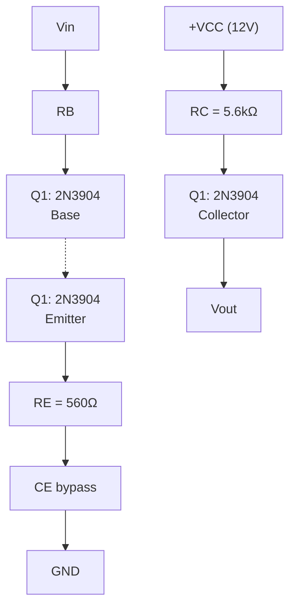
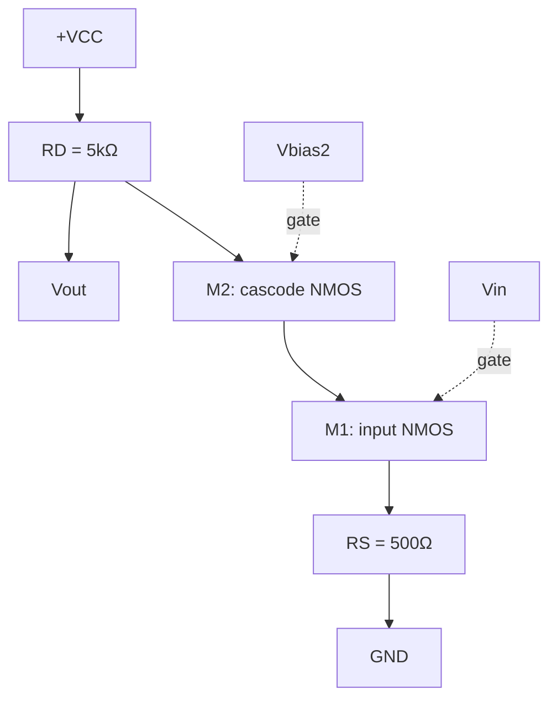
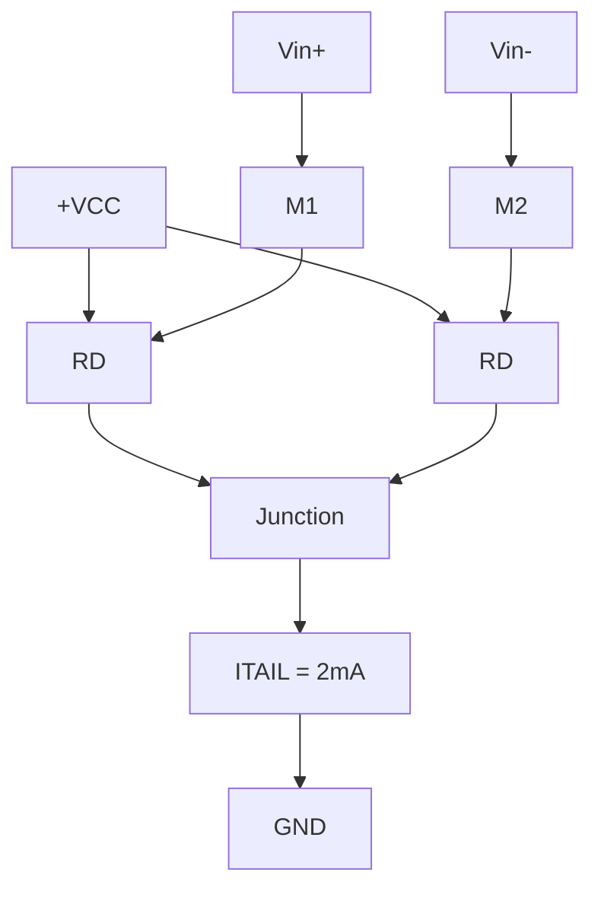

# Lesson 2: Single-Stage Amplifier Topologies

## 1. First-Principles Intuition & Invariants

Every amplifier, regardless of its complexity, is ultimately a controlled current source wrapped in a network of impedances. Strip away the feedback loops, the bias networks, the matching networks, and the decoupling capacitors, and what remains at the heart of every gain stage is a three-terminal device — a transistor — whose collector or drain current is modulated by a small signal at its base or gate. The entire art of single-stage amplifier design is the art of making that modulation efficient, predictable, and stable across frequency, temperature, and process variation.

The small-signal transconductance, $g_m$, is the invariant at the center of everything. For a bipolar junction transistor (BJT) biased at a quiescent collector current $I_C$, the transconductance is:

$$g_m = \frac{I_C}{V_T}$$

where $V_T = kT/q \approx 26\,\text{mV}$ at room temperature. For a MOSFET biased in saturation, the relationship is:

$$g_m = \sqrt{2 \mu_n C_{ox} \frac{W}{L} I_D} = \frac{2 I_D}{V_{GS} - V_{th}}$$

These are not incidental formulas — they encode a fundamental constraint. The BJT's $g_m$ is determined entirely by bias current and temperature, which makes it exquisitely predictable but also exquisitely sensitive to thermal drift. The MOSFET's $g_m$ depends on bias current and device geometry, giving the designer an additional tuning knob in the form of the width-to-length ratio $W/L$, but at the cost of a square-root relationship that makes $g_m$ grow slowly with current. At low bias currents, a BJT will almost always deliver higher $g_m$ per milliamp than a MOSFET, which is why bipolar input stages dominate precision, low-noise instrumentation amplifiers, while MOSFETs dominate high-frequency RF and digital-compatible analog design.

Before touching a single circuit topology, the practitioner must internalize three invariants that govern every single-stage amplifier without exception.

The first invariant is the gain-bandwidth product (GBW). No single-stage amplifier can simultaneously maximize voltage gain and bandwidth. The Miller effect, which we will examine in detail, multiplies the feedback capacitance between input and output by a factor of $(1 + A_v)$, loading the input node with an effective capacitance that grows directly with gain. Every decibel of gain you add compresses the bandwidth by an equal logarithmic amount, and the product of the two remains roughly constant for a given device and bias point. The cascode topology is the primary architectural weapon against this constraint.

The second invariant is the impedance duality between input and output. A topology with high input impedance tends to have high output impedance, and vice versa. The common-emitter and common-source configurations offer high input impedance and high output impedance. The common-collector (emitter follower) and common-drain (source follower) offer high input impedance but low output impedance. The common-base and common-gate present low input impedance but high output impedance. These are not independent design choices — the topology fixes the impedance character of the stage, and fighting that character with external networks always costs bandwidth, noise, or dynamic range.

The third invariant is the noise-gain-power triangle. For a fixed device at a fixed frequency, lowering the noise floor requires increasing bias current, which increases power dissipation and may push the device into a regime where its $f_T$ degrades from self-heating. Every single-stage design is a negotiation among these three quantities, and the practitioner who understands the triangle can make deliberate, reasoned trade-offs rather than iterating empirically through SPICE.

---

## 2. Core Architecture & Mechanics

### The Common-Emitter and Common-Source Amplifier

The common-emitter (CE) amplifier is the workhorse of bipolar analog design. Its MOSFET counterpart, the common-source (CS) amplifier, is structurally identical in its small-signal behavior, so the two are best understood in parallel. In both cases, the signal enters at the control terminal (base or gate), the output is taken at the high-impedance terminal (collector or drain), and the reference terminal (emitter or source) is tied to AC ground through a bypass capacitor.

Consider a CE stage built around an NPN transistor — the 2N3904 is a convenient and widely available device — biased for a quiescent collector current of $I_C = 1\,\text{mA}$.

At $I_C = 1\,\text{mA}$, the transconductance is $g_m = 1\,\text{mA} / 26\,\text{mV} \approx 38.5\,\text{mA/V}$. The intrinsic base-emitter resistance is $r_\pi = \beta / g_m$, and for a typical $\beta = 150$, this gives $r_\pi \approx 3.9\,\text{k}\Omega$. With a collector resistor $R_C = 5.6\,\text{k}\Omega$ and the emitter fully bypassed, the mid-band voltage gain is:

$$A_v = -g_m R_C = -(38.5\,\text{mA/V})(5.6\,\text{k}\Omega) \approx -215.6\,\text{V/V} \approx 46.7\,\text{dB}$$

The negative sign reflects the phase inversion that is the topological signature of the CE configuration: the collector current increases when the base voltage rises, pulling the collector node toward ground through $R_C$ and thereby inverting the output.

The input impedance looking into the base is $Z_{in} = r_\pi \| R_B$, where $R_B$ represents the Thevenin equivalent of the bias divider. With $r_\pi = 3.9\,\text{k}\Omega$, this input impedance is modest by modern standards and can significantly load a preceding stage unless that stage has comparably low output impedance. This is one of several reasons why cascading CE stages demands careful impedance budgeting.

The CS MOSFET amplifier presents a theoretically infinite gate impedance at DC, since the gate draws no current. This simplifies bias network design enormously. However, the MOSFET's gate presents a pure capacitance ($C_{gs}$ and $C_{gd}$) to AC signals, and at high frequencies these capacitances become the dominant loading mechanism. For a typical small-signal MOSFET like the 2N7002 biased at $I_D = 1\,\text{mA}$ with $V_{GS} - V_{th} = 0.4\,\text{V}$, $g_m = 2I_D / (V_{GS} - V_{th}) = 5\,\text{mA/V}$ — notably lower than the BJT at the same current. For frequency-critical designs, this lower $g_m$ translates directly into lower gain for the same load resistance and, all else equal, a noisier stage.

The frequency response of the CE/CS stage is shaped primarily by two pole-forming mechanisms. The first is the low-frequency roll-off set by the emitter bypass capacitor and the input coupling capacitor, which establish high-pass corners that must be pushed well below the signal band. For a bypass capacitor $C_E$ bypassing an emitter resistor of $R_E = 560\,\Omega$ in parallel with $1/g_m = 26\,\Omega$, the low-frequency pole is approximately:

$$f_{3dB,low} = \frac{1}{2\pi C_E (R_E \| \frac{1}{g_m})} \approx \frac{1}{2\pi C_E \cdot 25\,\Omega}$$

A $100\,\mu\text{F}$ bypass capacitor places this pole at approximately $63.7\,\text{Hz}$, low enough for audio-band work. For a stage intended to amplify signals down to $20\,\text{Hz}$, the capacitor must be sized even more generously.

The high-frequency roll-off is governed by the Miller effect. The collector-base capacitance $C_\mu$ of the BJT (also called $C_{cb}$ or the reverse-bias junction capacitance) is typically in the range of $2\text{–}8\,\text{pF}$ for small-signal devices. This capacitance bridges the high-gain inverting amplifier from collector to base, and by Miller's theorem it appears at the input as an effective capacitance of:

$$C_{Miller} = C_\mu (1 + |A_v|)$$

For our stage with $|A_v| = 215.6$ and $C_\mu = 4\,\text{pF}$, the Miller capacitance is approximately $870\,\text{pF}$ — over two hundred times the physical capacitance of the device. This enormous effective input capacitance, in combination with the source resistance driving the base, forms the dominant high-frequency pole:

$$f_{3dB,high} = \frac{1}{2\pi R_S C_{Miller}}$$

With a $50\,\Omega$ source resistance, this pole sits at approximately $3.65\,\text{MHz}$. With a $1\,\text{k}\Omega$ source, it collapses to $183\,\text{kHz}$. The Miller effect does not merely attenuate — it also introduces a right-half-plane zero through the forward transmission path of $C_\mu$, which begins to contribute phase lead at frequencies above $f_T / (2\pi)$ of the device. In practice, this zero is usually far above the useful bandwidth of the stage and can be ignored in first-order analysis, but it matters in stability analysis of feedback amplifiers using CE stages.

### The Cascode Amplifier

The cascode is the single most important topological refinement in high-frequency analog design. It solves the Miller effect problem at its source by eliminating the voltage swing at the collector of the input transistor, thereby preventing the Miller multiplication of $C_\mu$.

The cascode topology stacks a second transistor — a common-base (CB) configuration for BJTs, or a common-gate (CG) configuration for MOSFETs — on top of the common-emitter or common-source input device. The input device converts the input voltage into a current in the usual way, but instead of delivering that current into a high-impedance load (which would create a large voltage swing and trigger Miller multiplication), it delivers it into the low-impedance emitter (or source) of the cascode device. The cascode device then passes that current upward into the actual load, creating the output voltage swing at its collector (or drain), which is a node that has no capacitive feedback path to the input.

The voltage at the drain of M1 (which is the source of M2) is a low-impedance virtual ground, clamped by the gate bias of M2. Because this node barely moves, the effective drain-source voltage swing at M1 is nearly zero, and the Miller-multiplied $C_{gd}$ of M1 is reduced to approximately $C_{gd1}(1 + g_{m1}/g_{m2}) \approx 2C_{gd1}$ — a dramatic reduction from the full Miller term. The output pole now appears at the high-impedance drain of M2, where the output capacitance $C_{db2}$ combines with the load resistance, but this pole is not Miller-multiplied because there is no feedback path from drain of M2 to gate of M1.

The output impedance of the cascode is substantially higher than that of a simple CE or CS stage. Looking into the drain of M2, the output impedance is approximately:

$$r_{out,cascode} \approx g_{m2} r_{o2} r_{o1}$$

where $r_{o1}$ and $r_{o2}$ are the channel-length modulation resistances (or Early resistances in BJT terminology) of the two devices. This can be tens to hundreds of kilohms for typical devices, which is valuable when driving high-impedance loads or when used as a transconductance stage inside an op-amp.

The cascode does have costs. It consumes additional headroom — the second transistor requires its own $V_{DS}$ (or $V_{CE}$) of typically $200\text{–}400\,\text{mV}$ above saturation, which reduces the available output voltage swing and can be a critical constraint in low-supply designs. For a $3.3\,\text{V}$ supply, stacking two devices in cascode leaves very little room for the output swing before one device enters the linear (triode) region. The designer must therefore budget the quiescent operating points carefully, and in low-voltage designs the folded cascode — where the cascode device is of opposite polarity and pulls current sideways rather than stacking vertically — becomes the preferred alternative.

### The Differential Pair

If the common-source amplifier is the atom of analog design, the differential pair is the molecule. It is the input topology of virtually every operational amplifier, instrumentation amplifier, and comparator ever built, and its fundamental operating principle is the rejection of common-mode signals through the symmetry of its current-steering mechanism.

A differential pair consists of two matched transistors sharing a common tail current source. When the input voltages applied to the two gates (or bases) are equal, the tail current splits equally between the two devices, and the output voltages at their drains (or collectors) are equal. When the inputs differ by a small differential voltage $v_{id}$, the current steers preferentially toward the device with the higher input voltage, and the two output voltages diverge in a push-pull manner.

The small-signal differential gain of this topology, taking the output as the difference between the two drain voltages, is:

$$A_{vd} = -g_m R_D$$

which is identical to the gain of a single-ended CS stage. What the differential pair adds — and what makes it indispensable — is common-mode rejection. Any voltage that appears identically on both inputs, such as power supply noise, ground bounce, or electromagnetic interference coupled equally onto a differential signal line, produces equal current changes in both branches. These equal changes cancel perfectly in the differential output, producing zero differential output voltage. The tail current source, which ideally presents infinite impedance, ensures that the total current through the pair is fixed regardless of common-mode input variations. In practice, the finite output impedance of the tail current source $r_{tail}$ limits the common-mode rejection ratio (CMRR):

$$\text{CMRR} = \frac{A_{vd}}{A_{vcm}} \approx 2 g_m r_{tail}$$

A good tail current source, implemented as a cascode current mirror with $r_{tail}$ in the range of $100\,\text{M}\Omega$, can achieve CMRR values exceeding $100\,\text{dB}$. A simple tail resistor, with $r_{tail}$ limited to perhaps $10\,\text{k}\Omega$, yields CMRR of around $60\,\text{dB}$ — adequate for audio but marginal for precision measurement.

The input impedance of a differential pair depends on the device type. A BJT differential pair presents $2r_\pi$ differentially (each device contributes $r_\pi$ in series from the differential input's perspective). A MOSFET differential pair presents nearly infinite differential input impedance at DC, with the input capacitance $C_{gs1} + C_{gs2}$ dominating at high frequencies.

The frequency response of the differential pair exhibits two critical poles. The first pole, at the output nodes, is set by the load resistance $R_D$ and the output capacitance (the drain capacitance of the active device plus any load capacitance). The second, often less obvious, is associated with the tail current source. The parasitic capacitance at the common-source node $C_{tail}$ allows common-mode signals to steer current at high frequencies even when the tail impedance is high at low frequencies. This creates a high-frequency degradation of CMRR that can be significant in circuits operating above a few megahertz.

Offset voltage is the differential pair's most important static imperfection. Even with carefully matched devices, process variation introduces small differences in threshold voltage, $g_m$, and $V_{DS}$ that result in a nonzero output voltage when both inputs are grounded. For a matched MOSFET pair in a modern CMOS process, offset voltages of $1\text{–}5\,\text{mV}$ are typical without trimming. BJT pairs can achieve $50\text{–}200\,\mu\text{V}$ offset in well-matched processes. Layout is paramount: devices must be placed in a common-centroid pattern, interdigitated to cancel first-order process gradients across the die, with identical metal routing on each signal path to avoid thermoelectric gradients.

---

## 3. High-Performance Optimization & Failure Modes

### Biasing for Stability and Maximum Dynamic Range

The single most common failure mode in single-stage amplifier design is not a component failure — it is a biasing failure. A transistor biased too close to cutoff clips on the negative half of the input signal; biased too close to saturation (or the triode region for MOSFETs), it clips on the positive half. The optimal quiescent operating point for maximum symmetric output swing is the midpoint of the AC load line, not the midpoint of the supply voltage. These are equivalent only when the AC load equals the DC load, which is rarely true in practice once you account for coupling capacitors and the impedance of the subsequent stage.

For a CE amplifier with $R_C = 5.6\,\text{k}\Omega$ driving a following stage with an input impedance of $10\,\text{k}\Omega$, the AC load resistance is $R_C \| 10\,\text{k}\Omega = 3.59\,\text{k}\Omega$. The maximum output swing before clipping is therefore $V_{CE,Q} - V_{CE,sat}$ in one direction and $(V_{CC} - V_{CE,Q} - I_C R_C)$ in the other. Setting these equal for maximum symmetric swing requires:

$$V_{CE,Q} = \frac{V_{CC} + I_C(R_C - R_{AC})}{2}$$

Solving this for a $12\,\text{V}$ supply, $I_C = 1\,\text{mA}$, $R_C = 5.6\,\text{k}\Omega$, and $R_{AC} = 3.59\,\text{k}\Omega$ places the optimal quiescent point at approximately $6.4\,\text{V}$, not at $6\,\text{V}$.

Thermal stability demands that the bias network be stiff enough to hold $V_{BE}$ (or $V_{GS}$) constant as temperature changes. For a BJT, $V_{BE}$ decreases at approximately $-2\,\text{mV}/°C$, which means an uncompensated fixed-base-bias circuit will see its quiescent current drift by a factor of three or more across a $0°C$ to $70°C$ industrial temperature range. The voltage divider bias scheme, where the Thevenin resistance of the divider is made much smaller than $\beta R_E$, suppresses this drift by making the base voltage a low-impedance node that overwhelms the temperature-dependent $V_{BE}$ variation. A rule of thumb is to design the divider current as at least ten times the base current, ensuring the divider voltage changes by less than 10% due to base loading.

MOSFET bias is more stable against temperature in the saturation region, since the negative temperature coefficient of $V_{th}$ partially compensates the positive temperature coefficient of mobility, but MOSFETs are more sensitive to process variation in $V_{th}$ (which can vary by $\pm 50\,\text{mV}$ or more across a process run). Self-bias using a source degeneration resistor — analogous to emitter degeneration — provides first-order stabilization against both temperature and process variation at the cost of gain.

### Gain-Bandwidth Optimization and the Role of Degeneration

Emitter (or source) degeneration is a tool with two faces. When the emitter resistor is not bypassed, the effective transconductance of the stage is reduced:

$$G_m = \frac{g_m}{1 + g_m R_E}$$

This reduces the gain from $-g_m R_C$ to approximately $-R_C / R_E$ for $g_m R_E \gg 1$, which is a substantial penalty. However, the degeneration simultaneously raises the input impedance from $r_\pi$ to $r_\pi + (\beta + 1)R_E$, linearizes the stage (reducing harmonic distortion by the same factor that it reduces gain), and extends the bandwidth by reducing the effective Miller capacitance. For wideband amplifiers where linearity and bandwidth are paramount and gain can be recovered by cascading stages, degeneration is a net benefit. For high-gain narrow-band amplifiers where every decibel counts, the bypass capacitor restores full $g_m$ across the signal band while still providing DC biasing stability.

The relationship between gain and bandwidth for a CS amplifier with a resistive load can be written explicitly. The gain-bandwidth product is:

$$\text{GBW} = \frac{g_m}{2\pi C_{gs}}$$

which is exactly $f_T / (2\pi)$ of the device at that bias point, where $f_T$ is the unity-current-gain frequency. For a 2N7002 at $I_D = 5\,\text{mA}$, $f_T$ is approximately $200\,\text{MHz}$, setting the fundamental upper limit on what a single stage built around this device can achieve. To push beyond this limit, the designer must either select a faster device, increase the bias current (which raises $g_m$ and $f_T$), or move to a distributed amplifier topology where the input and output capacitances are absorbed into transmission line elements. For discrete work below $500\,\text{MHz}$, however, careful cascode design with modern RF transistors routinely achieves gain-bandwidth products of several gigahertz.

### Load Impedance Considerations and Output Matching

The output impedance of a CE or CS stage is approximately $r_o \| R_C$ (or $r_o \| R_D$), which is dominated by $R_C$ when $r_o \gg R_C$, as is typically the case at low to moderate bias currents. When driving a reactive load — a cable with significant capacitance, a piezoelectric transducer, or the input of a subsequent stage — the load capacitance $C_L$ interacts with the output impedance to form a pole at:

$$f_{pole,out} = \frac{1}{2\pi (R_C \| r_o) C_L}$$

For $R_C = 5.6\,\text{k}\Omega$ driving $50\,\text{pF}$ of load (a few centimeters of PCB trace and the input capacitance of a following buffer), this pole falls at approximately $568\,\text{kHz}$. This is often the bandwidth-limiting mechanism in discrete CE designs, not the Miller effect. The cure is to reduce $R_C$, which reduces gain but extends bandwidth. If the application demands both high gain and wide bandwidth into a capacitive load, the standard solution is to follow the CE gain stage with an emitter follower buffer whose output impedance is $1/g_m \approx 26\,\Omega$ at $1\,\text{mA}$, reducing the RC time constant by over two orders of magnitude.

For RF work where the load is a matched transmission line system (typically $50\,\Omega$), neither the CE nor CS stage delivers its natural output impedance of several kilohms to the load efficiently. The power gain collapses because the stage is driving a resistor far below its output impedance. The correct approach is conjugate impedance matching using a reactive network — an L-network, $\pi$-network, or transformer — that transforms the $50\,\Omega$ load to the optimal source impedance for the transistor at the operating frequency. This is the domain of S-parameter design, where the transistor is characterized by its scattering matrix rather than its small-signal hybrid-$\pi$ model, and the matching network is designed from the $S_{11}$ and $S_{22}$ data to simultaneously achieve input matching and output matching, trading them off against noise figure through the constant-gain and constant-noise-figure circles on the Smith chart.

### Practical Failure Modes and Their Diagnostic Signatures

The most insidious failure mode in a CE or CS amplifier is subtle distortion from insufficient bias margin. When the transistor's operating point drifts toward the edge of the active region, the transconductance becomes nonlinear. The output waveform shows asymmetric clipping on a sinusoidal input: clean on one polarity, compressed on the other. On a spectrum analyzer, this appears as a sudden rise in odd-order harmonics ($3f_0$, $5f_0$), which are characteristic of soft compression near a knee. The diagnostic procedure is to reduce the input amplitude by $20\,\text{dB}$ and observe whether the harmonics drop by $60\,\text{dB}$ as expected for third-order nonlinearity; if they drop by less, the stage is operating in a regime of strong nonlinearity that cannot be explained by simple third-order expansion, and the bias point must be corrected before proceeding.

Oscillation is a failure mode that surprises practitioners who have not internalized the role of parasitic inductance. A CE or CS amplifier with a bypass capacitor on its emitter (or source) resistor can oscillate at VHF frequencies when the bypass capacitor's self-resonant frequency falls within the loop-gain bandwidth of the stage. Below the capacitor's self-resonance, it presents a low impedance as intended. Above the self-resonance, the capacitor's series inductance — typically $1\text{–}5\,\text{nH}$ for a surface-mount ceramic capacitor — causes the bypass impedance to rise again, effectively removing the bypass and creating a frequency-dependent feedback path around the stage. The fix is a parallel combination of a large bypass capacitor (for low-frequency bypassing) in parallel with a small ($1\text{–}10\,\text{nF}$) low-inductance ceramic capacitor (for high-frequency bypassing), ensuring that the bypass impedance remains low across the entire frequency range of interest.

Ground plane integrity is a related concern that becomes critical above a few megahertz. A single-stage CS amplifier that works perfectly in SPICE can oscillate on the bench if the source return path shares copper with the input signal return path, creating a common-impedance ground loop. Even $1\,\text{nH}$ of shared inductance in the ground path creates a feedback voltage of $v_{feedback} = L\,di/dt = L \cdot g_m \cdot (dv_{in}/dt)$, which grows with frequency and can destabilize the stage. The cure is a star-ground topology at the board level, where every return current flows directly to a single low-impedance ground reference point without sharing copper with other signal paths.

Finally, the differential pair's most dangerous failure mode is a broken tail current source. If the tail current source fails open, the common-mode operating point drifts upward and both transistors saturate; if it fails short, both transistors shut off. Either mode masquerades as a failed device but is actually a bias network failure. The diagnostic signature is a common-mode DC output that is pinned near $V_{CC}$ or ground rather than at the expected quiescent point, with zero differential gain. A simple ohmmeter check across the tail current source (powered down) distinguishes a shorted tail from a functional high-impedance source. On a live circuit, measuring the common-mode voltage at both collector outputs simultaneously with a dual-channel oscilloscope and verifying that it is constant while the differential output swings is the definitive check that the tail current source is functioning correctly and the CMRR is preserved at the operating frequency.
