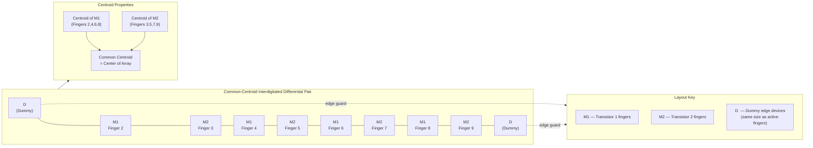
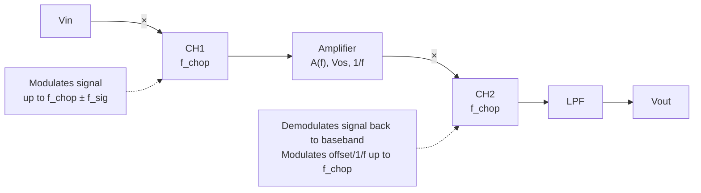
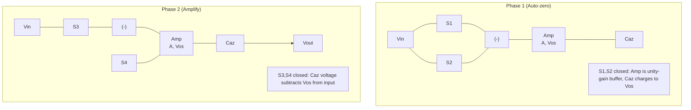

# Lesson 4: Noise, Mismatch, and Offset Mechanisms

## 1. First-Principles Intuition & Invariants

Every analog designer eventually confronts the same uncomfortable reality: the signals we process are immersed in a bath of thermal and flicker noise, and the transistors we so carefully size and bias disagree with one another at the millivolt level before we even apply a signal. The floor of performance in any analog circuit — whether a 22-bit delta-sigma ADC front end, a nanopower biomedical LNA, or a 40-Gb/s serial receiver equalizer — is set not by the ideal gain equations we derive by hand, but by the statistical physics of charge carriers and the lithographic imperfections of the fabrication process. Understanding noise and mismatch at the device level is what separates a designer who can simulate from one who can ship silicon.

Thermal noise, first characterized by John Bertrand Johnson and theoretically explained by Harry Nyquist in 1928, arises from the random Brownian motion of charge carriers in any conductor at temperatures above absolute zero. A resistor of value $R$ at temperature $T$ produces an open-circuit noise voltage with a power spectral density that is flat across all frequencies of practical interest:

$$S_v(f) = 4kTR \quad [\text{V}^2/\text{Hz}]$$

where $k = 1.38 \times 10^{-23}$ J/K is Boltzmann's constant. At room temperature ($T = 300$ K), a 1 kΩ resistor produces $\sqrt{4kTR} = \sqrt{4 \times 1.38 \times 10^{-23} \times 300 \times 1000} \approx 4.07$ nV/√Hz. A 50 Ω resistor — the canonical RF system impedance — produces 0.89 nV/√Hz. These numbers are immutable physical constants of the component, not design parameters you can optimize away. You can lower thermal noise only by reducing resistance, lowering temperature, or narrowing bandwidth. The first two are circuit-design decisions; the third is a filtering decision that trades signal bandwidth for noise bandwidth.

In a MOS transistor operating in saturation, the channel acts as a resistor whose effective conductance is set by the transconductance $g_m$. The drain current noise is:

$$S_{i_d}(f) = 4kT\gamma g_m \quad [\text{A}^2/\text{Hz}]$$

where $\gamma$ (the excess noise factor) equals $2/3$ for a long-channel device in strong inversion and can rise to 1.0–2.0 in short-channel devices due to velocity saturation and hot-carrier effects. This drain current noise, when referred back to the gate as an equivalent input voltage noise, becomes $S_{v_g} = 4kT\gamma / g_m$. The immediate design implication is that increasing $g_m$ — by sizing wider, increasing bias current, or moving toward stronger inversion — directly reduces the input-referred thermal noise of a transistor. A device with $g_m = 500$ μS at room temperature contributes $\sqrt{4kT \times (2/3) / 500\text{μS}} \approx 4.7$ nV/√Hz of equivalent input noise. Doubling $g_m$ to 1 mS drops this to 3.3 nV/√Hz, a 3 dB improvement that costs twice the current.

Flicker noise, or $1/f$ noise, is a fundamentally different phenomenon. Rather than thermal agitation, it stems from the trapping and release of carriers at the Si–SiO₂ interface and within oxide trap states near the channel. Each trap event produces a random telegraph signal (RTS) — a carrier is immobilized for a random duration, slightly modulating the channel current. The superposition of many such traps with a distribution of time constants produces the characteristic $1/f$ spectrum. The input-referred flicker noise voltage PSD of a MOS transistor is:

$$S_{v,f}(f) = \frac{K_f}{C_{ox} W L \cdot f} \quad [\text{V}^2/\text{Hz}]$$

where $K_f$ is a process-dependent constant (typically $10^{-25}$ to $10^{-26}$ V²·F for NMOS and 3–5× lower for PMOS), $C_{ox}$ is the oxide capacitance per unit area, and $W \times L$ is the gate area. The critical insight here is that flicker noise is inversely proportional to gate area: a larger transistor traps more carriers, but the trap density per unit area is fixed, so the relative fluctuation shrinks as $1/\sqrt{WL}$. For a 0.18 μm process with $C_{ox} = 8.6$ fF/μm² and $K_f = 5 \times 10^{-25}$ V²·F, a transistor with $W/L = 100/1$ μm produces an input-referred flicker noise of $\sqrt{5 \times 10^{-25} / (8.6 \times 10^{-15} \times 100 \times 10^{-12} \times f)} = \sqrt{5.81 \times 10^{-13}/f}$ V/√Hz, which evaluates to 762 nV/√Hz at 1 Hz, 24.1 nV/√Hz at 1 kHz, and 2.41 nV/√Hz at 100 kHz.

The **corner frequency** $f_c$ is the point where the flicker noise PSD equals the thermal noise floor, marking the boundary between the $1/f$-dominated and white-noise-dominated regimes. For our example transistor with $g_m = 500$ μS, the corner is $f_c = K_f g_m / (4kT\gamma C_{ox} WL) \approx 26$ kHz. Below 26 kHz, flicker noise dominates; above it, thermal noise sets the floor. For precision applications operating from DC to a few hundred kilohertz — instrumentation amplifiers, sensor interfaces, bio-potential front ends — the $1/f$ noise is the dominant degradation mechanism and must be attacked through either device sizing or circuit-level cancellation techniques.

The concept of **input-referred noise** is the analytical scaffolding that lets us compare different topologies on equal footing. The procedure is to compute the total output noise power spectral density, then divide by the square of the transfer function from the input to the output, yielding an equivalent noise source at the input that, when applied to the noiseless circuit, would produce the same output noise. For a voltage-input amplifier with gain $A_v(f)$:

$$S_{v,\text{in}}(f) = \frac{S_{v,\text{out}}(f)}{|A_v(f)|^2}$$

This single number — typically expressed in nV/√Hz — encapsulates the noise performance of the entire circuit and is the figure of merit used to compare designs. A low-noise audio preamplifier might target 1 nV/√Hz at 1 kHz, while a precision instrumentation amplifier might need 5 nV/√Hz integrated from 0.1 Hz to 10 Hz, and a wideband optical receiver might require 3 pA/√Hz of input-referred current noise at 1 GHz.

**Noise figure** (NF) generalizes input-referred noise to RF systems by expressing it as a degradation of signal-to-noise ratio. Defined as $NF = 10\log_{10}(SNR_\text{in}/SNR_\text{out})$, it measures how much the device worsens the SNR that was available from the source. A noiseless amplifier has NF = 0 dB; a typical RF LNA targets 1.5–3 dB. The power of the NF framework lies in the Friis cascade formula, which reveals that the noise figure of the first stage in a receiver chain overwhelmingly determines the system noise figure:

$$F_\text{total} = F_1 + \frac{F_2 - 1}{G_1} + \frac{F_3 - 1}{G_1 G_2} + \cdots$$

where $F_n$ are linear noise factors (not dB) and $G_n$ are linear power gains. If the first stage has 15 dB of gain and 2 dB NF, a second stage with 10 dB NF contributes only $0.003$ to the total noise factor — negligible compared to the first stage's contribution of $1.585$. This is why the LNA sits at the top of every receiver block diagram: it must provide enough gain to bury the noise of everything downstream, while contributing as little noise as possible itself.

**Mismatch** is the second great adversary of precision analog design. While noise is a dynamic, time-varying disturbance, mismatch is a static, frozen-in-silicon difference between identically designed devices. Two transistors drawn with identical layout, placed side by side on the same die, will have different threshold voltages, different mobilities, different channel lengths. These differences produce a **static offset** that is constant for the life of the chip but varies randomly from chip to chip. The Pelgrom model, introduced by Marcel Pelgrom in 1989, provides the quantitative backbone for matching analysis:

$$\sigma^2(\Delta P) = \frac{A_P^2}{WL} + S_P^2 D^2$$

where $\Delta P$ is the difference in parameter $P$ (threshold voltage $V_t$, current factor $\beta = \mu C_{ox} W/L$) between two identically designed devices, $A_P$ is the area matching constant, $WL$ is the gate area, $S_P$ is the spacing mismatch coefficient, and $D$ is the separation distance. For a 0.18 μm process, $A_{V_t} \approx 5$ mV·μm for NMOS and 4 mV·μm for PMOS, while $A_\beta \approx 2\%\cdot\mu$m. The first term dominates for closely spaced devices; the second becomes significant when devices are placed far apart on the die.

The input-referred offset of a differential pair with current-mirror load has contributions from four sources: the threshold voltage mismatch of the input pair, the current factor mismatch of the input pair, the threshold voltage mismatch of the mirror pair (referred through the transconductance ratio), and the current factor mismatch of the mirror pair. For a concrete example using our 0.18 μm process, consider a differential pair M1/M2 with $W/L = 100/1$ μm biased at 100 μA per side ($g_m = 500$ μS, overdrive $V_{ov} = 200$ mV) and a PMOS current mirror M3/M4 with $W/L = 50/1$ μm ($g_m = 250$ μS). The RMS input offset is:

$$\sigma(V_{os}) = \sqrt{\frac{2A_{V_t}^2}{(WL)_\text{input}} + \frac{V_{ov}^2}{4} \cdot \frac{2A_\beta^2}{(WL)_\text{input}} + \left(\frac{g_{m,\text{mirror}}}{g_{m,\text{input}}}\right)^2 \left(\frac{2A_{V_t}^2}{(WL)_\text{mirror}} + \frac{V_{ov,m}^2}{4} \cdot \frac{2A_\beta^2}{(WL)_\text{mirror}}\right)}$$

Plugging in the numbers: $2 \times 25 / 100 = 0.5$ mV² from input-pair $V_t$ mismatch, $(0.2/2)^2 \times 2 \times 0.0004 / 100 = 0.08$ mV² from input-pair $\beta$ mismatch, $(0.5)^2 \times 2 \times 25 / 50 = 0.25$ mV² from mirror $V_t$ mismatch, and $(0.5)^2 \times (0.2/2)^2 \times 2 \times 0.0004 / 50 = 0.02$ mV² from mirror $\beta$ mismatch. The total is $\sigma(V_{os}) = \sqrt{0.5 + 0.08 + 0.25 + 0.02} = \sqrt{0.85} \approx 0.92$ mV. For a 3σ design margin, this amplifier will exhibit offset up to 2.76 mV, which in a 12-bit ADC with a 1.8 V reference (LSB = 0.44 mV) corresponds to an error of over 6 LSB — unacceptable without correction.

## 2. Core Architecture & Mechanics

### Noise Analysis of a Two-Stage Miller OTA

To make the noise analysis concrete, consider a two-stage Miller-compensated operational transconductance amplifier in our reference 0.18 μm process. The first stage is an NMOS differential pair (M1, M2) with a PMOS current mirror load (M3, M4). The second stage is a common-source amplifier (M6) with a PMOS current source load (M7). The compensation capacitor $C_c$ connects from the first-stage output to the final output.

| Device | W/L (μm/μm) | Bias Current | $g_m$ | Purpose |
|--------|-------------|---------------|-------|---------|
| M1, M2 | 100/1 | 100 μA | 500 μS | Input differential pair |
| M3, M4 | 50/1 | 100 μA | 250 μS | PMOS mirror load |
| M5 | 200/1 | 200 μA | 1 mS | Tail current source |
| M6 | 200/1 | 200 μA | 1 mS | Second-stage CS amp |
| M7 | 100/1 | 200 μA | 500 μS | PMOS load for M6 |
| $C_c$ | — | — | — | 2 pF Miller compensation |

The dominant noise contributors are the input pair and the mirror load. The tail current source M5 contributes common-mode noise that is largely rejected by the differential pair's CMRR, and the second-stage transistors M6/M7 are attenuated by the first-stage gain squared, making their contribution negligible. The input-referred thermal noise is:

$$\overline{v_n^2} = \frac{8kT\gamma}{g_{m1}}\left(1 + \frac{g_{m3}}{g_{m1}}\right) = \frac{8 \times 4.14 \times 10^{-21} \times (2/3)}{500 \times 10^{-6}} \times (1 + 0.5)$$

which yields $S_v = 6.63 \times 10^{-17}$ V²/Hz, or $\sqrt{S_v} = 8.14$ nV/√Hz. The factor $(1 + g_{m3}/g_{m1})$ is the critical noise contribution factor: the mirror load adds noise proportional to its transconductance ratio. Reducing the mirror $g_m$ (by sizing M3/M4 smaller) helps noise but degrades the gain and speed of the first stage.

The input-referred flicker noise at frequency $f$ is:

$$S_{v,f}(f) = \frac{2K_{f,n}}{C_{ox}(WL)_1 \cdot f} + \frac{2K_{f,p}}{C_{ox}(WL)_3 \cdot f} \cdot \left(\frac{g_{m3}}{g_{m1}}\right)^2$$

Using $K_{f,n} = 5 \times 10^{-25}$ V²·F, $K_{f,p} = 1 \times 10^{-25}$ V²·F, and $C_{ox} = 8.6$ fF/μm²:

$$S_{v,f}(f) = \frac{1.16 \times 10^{-12}}{f} + \frac{5.81 \times 10^{-13}}{f} = \frac{1.74 \times 10^{-12}}{f} \quad [\text{V}^2/\text{Hz}]$$

At 1 kHz, this gives $\sqrt{S_{v,f}} = 41.8$ nV/√Hz, and the total noise (thermal + flicker) is $\sqrt{8.14^2 + 41.8^2} = 42.6$ nV/√Hz. At 100 kHz, above the 26 kHz corner, the total drops to $\sqrt{8.14^2 + 4.18^2} = 9.15$ nV/√Hz, confirming that the white noise floor of 8.14 nV/√Hz dominates at high frequencies.

The integrated noise over a 10 Hz to 10 MHz bandwidth, relevant for a broadband ADC driver, is found by splitting the integration at the corner frequency:

$$v_{n,\text{int}} = \sqrt{S_{v,\text{th}} \cdot (f_2 - f_1) + S_{v,f,0} \cdot \ln\left(\frac{f_2}{f_1}\right)}$$

where $S_{v,f,0} = 1.74 \times 10^{-12}$ V²·Hz is the flicker noise coefficient (the numerator of the $1/f$ expression). The thermal integral gives $8.14^2 \times 10^7 \times 10^{-18} \approx 6.63 \times 10^{-10}$ V², and the flicker integral gives $1.74 \times 10^{-12} \times \ln(10^6) = 2.4 \times 10^{-11}$ V². The total integrated noise is $\sqrt{6.63 \times 10^{-10} + 2.4 \times 10^{-11}} = 26.4$ μV. In a 16-bit ADC with 1.8 V full scale (LSB = 27.5 μV), this noise alone exceeds one LSB, confirming that a simple two-stage OTA is inadequate for high-resolution conversion without noise filtering or averaging.

### Noise Figure in a Cascaded RF Receiver

To ground the noise figure concept in a practical RF design, consider a 2.4 GHz receiver front end consisting of three stages: an LNA with 15 dB gain and 2 dB NF, a passive downconversion mixer with 6 dB conversion loss and 7 dB NF, and an IF VGA with 20 dB gain and 10 dB NF. Converting to linear units: $G_1 = 31.6$, $F_1 = 1.585$; $G_2 = 0.25$, $F_2 = 5.01$; $G_3 = 100$, $F_3 = 10$. The Friis formula gives:

$$F_\text{total} = 1.585 + \frac{5.01 - 1}{31.6} + \frac{10 - 1}{31.6 \times 0.25} = 1.585 + 0.127 + 1.139 = 2.85$$

The system NF is $10\log_{10}(2.85) = 4.55$ dB. The LNA contributes $1.585/2.85 = 55.6\%$ of the total noise factor, the mixer contributes $0.127/2.85 = 4.5\%$, and the VGA contributes $1.139/2.85 = 40\%$. The surprise here is that the VGA, despite having the worst NF (10 dB), is not the dominant contributor because the LNA's 15 dB gain suppresses the mixer's noise. However, the 6 dB loss in the passive mixer is problematic: it attenuates the signal by a factor of 4 while adding its own noise, which is why the VGA's noise still breaks through. If the LNA gain were increased to 20 dB ($G_1 = 100$), the total NF would drop to $1.585 + 0.04 + 0.36 = 1.985$, or 2.98 dB — a 1.6 dB improvement from just 5 dB more gain in the first stage.

### Device Matching: Layout Architecture

The physical mechanics of matching revolve around one principle: identically designed devices that see identical fabrication conditions will have identical electrical parameters. The enemy of matching is gradient — across-chip variation in implant dose, oxide thickness, temperature, and stress. The two principal layout techniques that combat gradients are **common-centroid** and **interdigitation**.

A common-centroid layout places the centroids of two matched devices at the same physical location on the die by interleaving their sub-units symmetrically. For two matched transistors A and B, each split into four fingers, the pattern `A B B A | A B B A` (the cross-coupled quad) places both centroids at the midpoint. Any linear gradient — whether in doping concentration, oxide thickness, or mechanical stress — affects A and B equally, canceling first-order systematic mismatch. The residual mismatch comes from second-order gradients (quadratic variation across the die) and from random per-device variation, which is addressed purely by increasing area.

Interdigitation extends this concept to devices that need not share a centroid but still benefit from spatial averaging. For a differential pair M1 and M2, each with 8 fingers, an interdigitated layout places fingers in the sequence `D M1 M2 M1 M2 M1 M2 M1 M2 D` where `D` represents dummy gate fingers. The dummies are essential: the etch rate and lithographic exposure at the edge of a finger array differ from the interior because the proximity effect of neighboring structures changes the effective pattern density. Without dummies, the outermost real fingers see a different fabrication environment than the inner ones, introducing a systematic mismatch that can be larger than the random component. The dummy fingers are poly gates tied to the same potential as the source (or to ground) and carry no current — they exist purely to make the fabrication environment uniform.

The spacing-dependent term in the Pelgrom model, $S_P^2 D^2$, becomes significant when matched devices are separated by more than a few hundred micrometers. For threshold voltage, $S_{V_t} \approx 0.03$ μm·mV/μm in a typical 0.18 μm process, meaning two devices separated by 500 μm have an additional $\sigma(\Delta V_t) = 0.03 \times 500 = 15$ μV of mismatch from the spacing term alone. For sub-millivolt precision, the interdigitated pair must be kept within 100 μm of each other.

Guard rings surrounding the matched pair serve two purposes. First, they provide a low-impedance substrate tie that prevents substrate noise coupling from adjacent digital circuitry. Second, they create a uniform mechanical stress boundary, because the lattice stress introduced by the heavily doped guard ring is identical on all sides, avoiding stress asymmetry that would shift threshold voltages through the piezoresistive effect. A P+ guard ring tied to ground, placed at minimum spacing from the NMOS matched pair, typically reduces substrate noise injection by 30–40 dB.

### Systematic Offset: Circuit Asymmetries

Systematic offset is the portion of offset that is deterministic — the same on every die — and arises from topological asymmetries in the circuit. The most common source is a drain-source voltage mismatch in a current mirror. In the two-stage OTA above, the PMOS mirror M3/M4 mirrors the reference current into the differential pair. If M3 has $V_{DS3} = |V_{DS4}|$ (both at the same drain-source voltage), the mirror is perfectly matched. In practice, M3's drain sits at the first-stage output node, which is at a different potential than M4's drain (connected to M2's drain and M6's gate). This $V_{DS}$ mismatch causes a current mismatch through channel-length modulation:

$$\Delta I = g_{m3} \cdot \Delta V_t \cdot \lambda \cdot \Delta V_{DS}$$

More precisely, the current error is $\Delta I / I = \lambda \cdot \Delta V_{DS}$, where $\lambda$ is the channel-length modulation coefficient (approximately 0.1 V⁻¹ for $L = 1$ μm in 0.18 μm). If $\Delta V_{DS} = 200$ mV, the current mismatch is 2%, which referred to the input as an offset voltage is $\Delta V_{DS} \times \lambda \times I / g_{m1} = 0.2 \times 0.1 \times 100\text{μA} / 500\text{μS} = 4$ mV. This is a systematic error — it does not improve with larger area — and must be eliminated by circuit design, not layout. The standard fix is a cascode mirror (M3/M4 with cascode devices M3c/M4c) that forces $V_{DS3} = V_{DS4}$, reducing the systematic offset to below 0.1 mV.

Another source of systematic offset is the body effect. If the input pair M1/M2 have their sources at different potentials (which happens in a folded-cascode topology where the sources are not at a common node), the body effect introduces a threshold voltage difference. Keeping the input pair in a common-source configuration where both sources connect to the tail current node eliminates this. When this is not possible (as in a folded cascode), the body effect must be accounted for in the offset budget.

### Chopping: Modulation-Domain Offset and Flicker Noise Cancellation

Chopping is a continuous-time technique that moves the amplifier's offset and flicker noise away from DC by modulating the signal, amplifying it, and then demodulating it back to baseband. The offset and flicker noise, which originate inside the amplifier and are not modulated, end up at the chop frequency after the output demodulator and are removed by a low-pass filter.

The input chopper CH1 is a set of CMOS switches (typically transmission gates or NMOS-only pass-transistor pairs) driven by a non-overlapping two-phase clock at frequency $f_\text{chop}$. The signal is multiplied by a square wave $s(t) = \text{sgn}(\cos(2\pi f_\text{chop} t))$, which translates the baseband signal to odd harmonics of $f_\text{chop}$. The amplifier processes this upconverted signal with its full gain $A(f)$. The output chopper CH2 demodulates the amplified signal back to baseband, while the amplifier's own offset and flicker noise — which entered the amplifier after CH1 and were never upconverted — are modulated up to $f_\text{chop}$ and its odd harmonics. A low-pass filter (which can be the amplifier's own bandwidth if $f_\text{chop}$ is well above the signal band) removes these spectral images.

The choice of chop frequency is a critical design decision. It must be well above the amplifier's $1/f$ corner frequency to ensure that the flicker noise is fully removed, and well above the signal bandwidth so that the residual chop artifacts fall outside the band of interest. For our example OTA with $f_c = 26$ kHz and a signal bandwidth of 10 kHz, a chop frequency of 100 kHz is appropriate. The residual offset after chopping comes from the mismatch in charge injection between the chopper switches. Each switch, when it opens, releases its channel charge into the signal path. For an NMOS switch with $W/L = 5/0.18$ μm and an overdrive of 0.3 V, the channel charge is $Q_\text{ch} = WLC_{ox}V_{ov} = 5 \times 0.18 \times 8.6 \times 0.3 = 2.32$ fC. If the complementary switches in the chopper have a 1% charge injection mismatch, the differential charge error is $\Delta Q = 23$ aC. This creates a residual input offset of $\Delta V = \Delta Q / C_\text{in}$, where $C_\text{in}$ is the total input capacitance seen by the chopper. For $C_\text{in} = 1$ pF (the amplifier's input capacitance plus routing parasitics), the residual offset is 23 μV. Increasing $C_\text{in}$ to 10 pF (by adding explicit input capacitors) reduces this to 2.3 μV but loads the signal source and reduces bandwidth.

### Auto-Zeroing: Sampled Offset Cancellation

Auto-zeroing is a discrete-time technique that samples the amplifier's offset during a calibration phase and subtracts it during the amplification phase. Unlike chopping, which is continuous-time, auto-zeroing requires the amplifier to be taken offline during the calibration phase, making it inherently suited to switched-capacitor circuits, comparators, and pipelined or cyclic ADCs where the amplifier is not continuously processing a signal.

During Phase 1, switches S1 and S2 close, connecting the amplifier as a unity-gain buffer with its input shorted. The offset $V_{os}$ is amplified and appears at the output, where it charges the auto-zero capacitor $C_{az}$ to $V_{az} = V_{os} \times A/(1+A) \approx V_{os}$ (for loop gain $A \gg 1$). During Phase 2, S1 and S2 open, S3 and S4 close, and the real input signal $V_{in}$ is applied. The capacitor $C_{az}$ now holds a voltage approximately equal to $V_{os}$, which is subtracted from the input. The residual offset is $V_{os,\text{res}} = V_{os}/(1+A)$, which for a typical open-loop gain of $A = 80$ dB (10,000×) gives a residual of $V_{os}/10^4 \approx 0.1$ μV — far below the noise floor.

The dominant limitation of auto-zeroing is the charge injection from the switch that disconnects $C_{az}$ at the end of Phase 1. When S2 opens, it injects a charge $\Delta Q = \frac{1}{2} W L C_{ox} (V_{DD} - V_{th} - V_{GS})$ into the capacitor. For a switch with $W/L = 5/0.18$ μm operating at $V_{DD} = 1.8$ V with $V_{th} = 0.5$ V and $V_{GS} = 0.8$ V, the injected charge is $\Delta Q = \frac{1}{2} \times 5 \times 0.18 \times 8.6 \times (1.8 - 0.5 - 0.8) = 2.44$ fC. The resulting voltage error on $C_{az}$ is $\Delta V = \Delta Q / C_{az}$. For $C_{az} = 1$ pF, this is 2.44 mV — larger than the original offset we were trying to cancel. The standard mitigations are: (a) increase $C_{az}$ to 10 pF, reducing the error to 0.244 mV; (b) use a dummy switch (a half-sized transistor clocked on the opposite phase) that absorbs half the injected charge, cutting the error by roughly 2×; (c) use bottom-plate sampling, where the switch at the capacitor's bottom plate opens before the top-plate switch, making the charge injection signal-independent rather than signal-dependent; and (d) use low-duty-cycle auto-zeroing, where the calibration phase is a small fraction of the total period, minimizing the kT/C noise aliasing.

The **kT/C noise** of the auto-zero capacitor is a fundamental limit. During Phase 1, $C_{az}$ is connected to the amplifier output through a switch with on-resistance $R_{on}$. The thermal noise of $R_{on}$ is integrated over the RC bandwidth $1/(2\pi R_{on} C_{az})$, giving a total noise voltage of $\sqrt{kT/C_{az}}$. For $C_{az} = 1$ pF at 300 K, this is $\sqrt{4.14 \times 10^{-21} / 10^{-12}} = 64.3$ μV. This noise is sampled and frozen on the capacitor, then subtracted along with the offset in Phase 2. Because it is uncorrelated between the two phases, it adds directly to the input-referred noise: the total sampled noise contribution is $\sqrt{kT/C_{az}}$. For $C_{az} = 10$ pF, this drops to 20.3 μV; for 100 pF, 6.4 μV. The trade-off is capacitor area: 100 pF occupies roughly 10,000 μm² in a 0.18 μm process, a significant die area penalty.

### Correlated Double Sampling (CDS)

Correlated double sampling is the technique of choice for reducing both offset and flicker noise in switched-capacitor circuits, particularly in image sensor readout and precision SC integrators. The principle exploits the temporal correlation of flicker noise and offset: if the offset and low-frequency noise are approximately constant between two closely spaced sampling instants, subtracting the two samples cancels both.

In a switched-capacitor integrator with CDS, the operation proceeds in two phases per clock period. In the first phase, the offset and flicker noise (but not the signal) are sampled onto a holding capacitor. In the second phase, the signal is sampled and the previously stored offset/noise is subtracted. The output is the signal minus the correlated offset and low-frequency noise. The cancellation is perfect only for noise components with a correlation time longer than the sampling period. For flicker noise with a corner at 26 kHz and a sampling rate of 1 MHz, the noise at frequencies below $f_s/2 = 500$ kHz is highly correlated between adjacent samples, so the cancellation is effective. The thermal noise, being white (uncorrelated between samples), is not cancelled and in fact doubles: the two uncorrelated noise samples add in power, giving $2 \times kT/C$ instead of $kT/C$.

The transfer function of CDS for the noise is:

$$H_\text{CDS}(f) = 1 - e^{-j2\pi f T_s}$$

where $T_s$ is the sampling period. The magnitude is $|H_\text{CDS}(f)| = 2|\sin(\pi f T_s)|$, which has a null at DC ($f = 0$) and at all multiples of the sampling frequency. The offset (DC component) is perfectly cancelled, and the low-frequency flicker noise is strongly attenuated. At $f = f_s/10$, $|H_\text{CDS}| = 2\sin(\pi/10) = 0.618$, so the flicker noise at one-tenth the sampling rate is reduced by 36%. At $f = f_s/100$, the reduction is 96% (a factor of 25). This makes CDS most effective when the sampling rate is much higher than the $1/f$ corner frequency.

## 3. High-Performance Optimization & Failure Modes

### Noise Optimization: The $g_m/I_D$ Design Space

The input-referred thermal noise of a MOS transistor is $4kT\gamma/g_m$, so maximizing $g_m$ is the direct path to low noise. But $g_m$ is not a free parameter — it is set by the bias current and the inversion level, and the relationship between $g_m$, current $I_D$, and device sizing is captured by the $g_m/I_D$ ratio, which serves as the single most useful design knob in modern analog design. In strong inversion, $g_m/I_D = 2/V_{ov}$, so a 200 mV overdrive gives $g_m/I_D = 10$ S/A. In moderate inversion, $g_m/I_D$ peaks at roughly $20$–$25$ S/A (depending on the process), and in weak inversion it approaches $1/(nV_T) \approx 25$ S/A at 300 K (where $n \approx 1.3$ is the subthreshold slope factor and $V_T = 26$ mV is the thermal voltage). Operating in moderate inversion maximizes $g_m$ per unit of current, which is the optimal point for noise-limited, power-constrained designs.

For a target input-referred noise of 5 nV/√Hz, the required $g_m$ is $4kT\gamma / (5 \times 10^{-9})^2 = 4 \times 4.14 \times 10^{-21} \times (2/3) / 2.5 \times 10^{-17} = 442$ μS. At $g_m/I_D = 15$ S/A (moderate inversion), this requires $I_D = 442/15 = 29.5$ μA per transistor. The transistor size is determined by the required $g_m$ and the inversion level: in moderate inversion, $I_D = (g_m/I_D)^{-1} \times g_m$ is not directly useful for sizing; instead, the width is chosen from $g_m = \sqrt{2\mu C_{ox}(W/L) I_D}$ in strong inversion or $g_m = I_D/(nV_T)$ in weak inversion. For our 0.18 μm process with $\mu_n C_{ox} = 290$ μA/V², in strong inversion with $L = 1$ μm and $I_D = 29.5$ μA: $g_m = \sqrt{2 \times 290 \times 10^{-6} \times (W/L) \times 29.5 \times 10^{-6}}$. Setting $g_m = 442$ μS gives $W/L = (442 \times 10^{-6})^2 / (2 \times 290 \times 10^{-6} \times 29.5 \times 10^{-6}) = 1.95 \times 10^{-7} / 1.71 \times 10^{-8} = 11.4$, so $W = 11.4$ μm. The resulting transistor has $WL = 11.4$ μm², which gives a flicker noise corner of $f_c = K_f g_m / (4kT\gamma C_{ox} WL) = 5 \times 10^{-25} \times 442 \times 10^{-6} / (1.656 \times 10^{-20} \times 0.667 \times 8.6 \times 10^{-15} \times 11.4 \times 10^{-12}) = 2.21 \times 10^{-28} / 1.14 \times 10^{-25} = 1.94$ kHz — substantially lower than the 26 kHz corner of the larger, higher-current design, because the noise target is less aggressive and the device area is still reasonable.

The failure mode in noise optimization is the temptation to simply increase bias current without regard for the inversion level. Doubling current in strong inversion increases $g_m$ by only $\sqrt{2}$ (a 3 dB noise improvement), while doubling current in weak inversion increases $g_m$ by 2× (a 6 dB improvement). A designer who blindly increases current in strong inversion pays a 2× power penalty for only 3 dB of noise reduction, while moving to moderate inversion could achieve the same 3 dB at no additional power. The $g_m/I_D$ curve is the map that prevents this waste.

### Chopping Failure Modes: Ripple and Residual Offset

The most visible artifact of chopping is the **output ripple** at the chop frequency. This ripple is the amplified and demodulated offset and flicker noise, appearing as a signal at $f_\text{chop}$ at the amplifier output. For an amplifier with offset $V_{os} = 1$ mV and DC gain $A = 100$ dB (10⁵), the ripple amplitude at the output (before filtering) is $V_{os} \times A = 100$ V — obviously not achievable, but this illustrates that the ripple is enormous relative to the signal. In practice, the ripple is limited by the amplifier's bandwidth: if the amplifier has a bandwidth of 1 MHz and the chop frequency is 100 kHz, the gain at the chop frequency is still close to the DC gain, and the ripple is $V_{os} \times A \times |H(f_\text{chop})|$, where $|H(f_\text{chop})|$ is the amplifier's frequency response at the chop frequency. For a single-pole amplifier with $f_p = 1$ MHz, $|H(100\text{kHz})| = 1/\sqrt{1 + (0.1)^2} = 0.995$, so the ripple is barely attenuated.

The solutions to the ripple problem fall into three categories. First, a **tracking low-pass filter** after the output chopper, with a bandwidth just above the signal band, removes the ripple at the cost of additional poles and potential phase margin degradation. Second, a **notch filter** at $f_\text{chop}$ can be implemented as a switched-capacitor biquad or as an LC trap, providing narrowband attenuation without affecting the signal band. Third, the most elegant solution is **nested chopping**, where a second, lower-frequency chopper pair modulates the residual ripple (which is at the first chop frequency) down to a frequency where it can be filtered by the amplifier's own bandwidth. The outer chop frequency is chosen to be low enough that the amplifier's natural roll-off attenuates it, while the inner chop frequency handles the $1/f$ noise. For example, an inner chop at 500 kHz removes flicker noise, and an outer chop at 10 kHz (below the amplifier's first pole at 100 kHz) ensures that the residual ripple at 500 kHz is attenuated by the amplifier's frequency response before reaching the output.

The **residual offset** from charge injection mismatch is a second failure mode. As calculated above, it is $\Delta Q / C_\text{in}$, and it scales inversely with input capacitance. A designer who uses minimum-size switches (to minimize clock feedthrough parasitics) and minimum input capacitance (to maximize bandwidth) will have a residual offset of several millivolts, completely negating the benefit of chopping. The fix is to use larger input capacitors (10–50 pF), which simultaneously reduces charge injection error and improves the chopper's charge transfer accuracy, at the cost of input bandwidth and increased clock driver power.

A third failure mode is **clock feedthrough coupling** from the chopper switches into the signal path. The clock transitions have fast edges (typically 1 ns for a 1.8 V supply, giving $dV/dt = 1.8 \times 10^9$ V/s), and any parasitic capacitance from the clock line to the signal path injects a spike. For a parasitic overlap capacitance of $C_{ov} = 0.5$ fF (typical for a minimum-size switch), the coupled charge is $\Delta Q = C_{ov} \times \Delta V = 0.5 \times 10^{-15} \times 1.8 = 0.9$ fC. If the two chopper switches have a 5% capacitance mismatch, the differential charge is 45 aC, producing an input-referred offset of 45 μV for $C_\text{in} = 1$ pF. Careful symmetrical layout of the chopper switches, with identical routing lengths for the complementary clock lines, is the primary mitigation.

### Auto-Zeroing Failure Modes: Noise Folding and Signal Aliasing

The most insidious failure mode of auto-zeroing is **noise folding** — the aliasing of wideband noise into the signal band. During the auto-zero phase, the amplifier's broadband noise is sampled onto $C_{az}$. The noise is white up to the amplifier's bandwidth $f_{BW}$, but sampling at rate $f_s$ folds all noise above $f_s/2$ back into the baseband. The total folded noise is:

$$v_{n,\text{folded}} = \sqrt{\frac{kT}{C_{az}} + \frac{S_{v,\text{th}} \times f_{BW}}{f_s}}$$

The first term is the kT/C noise of the sampling capacitor; the second is the folded thermal noise of the amplifier. For our example OTA with $S_{v,\text{th}} = 6.63 \times 10^{-17}$ V²/Hz, $f_{BW} = 10$ MHz, and $f_s = 100$ kHz, the folded noise is $\sqrt{6.63 \times 10^{-17} \times 10^7 / 10^5} = \sqrt{6.63 \times 10^{-15}} = 81.4$ μV. This is larger than the kT/C noise for $C_{az} = 1$ pF (64.3 μV) and completely dominates the noise budget for $C_{az} = 10$ pF (20.3 μV). The mitigation is to band-limit the amplifier's noise before the auto-zero sampling, either by adding a capacitor across the feedback path during the auto-zero phase or by using a lower-bandwidth auxiliary amplifier for the auto-zero loop. Many production designs use a dedicated low-bandwidth, low-noise auxiliary amplifier that performs the auto-zeroing while the main amplifier remains in the signal path — this is the architecture of precision amplifiers like the ADA4522 from Analog Devices, which achieves 5.8 nV/√Hz and 5 μV offset through a combination of auto-zeroing and chopping.

A second failure mode is **signal aliasing**. During the auto-zero phase, the amplifier input is disconnected from the signal source (or shorted), but the input switches have parasitic capacitance that couples the input signal into the auto-zero loop. If the input signal has frequency content above $f_s/2$, it aliases into the baseband during the amplification phase. The attenuation depends on the switch capacitance and the driving impedance. For a switch $C_{ov} = 1$ fF and a source impedance $R_s = 1$ kΩ, the coupling is $20\log_{10}(2\pi f_s R_s C_{ov}) = 20\log_{10}(2\pi \times 10^5 \times 10^3 \times 10^{-15}) = 20\log_{10}(6.28 \times 10^{-7}) = -124$ dB. This is adequate for most applications but becomes problematic in high-impedance sensor interfaces where $R_s$ can be 10 MΩ or more, degrading the isolation to -84 dB.

### CDS Failure Modes: kT/C Doubling and Settling Residual

The **doubled kT/C noise** of CDS is the price of the two-sample subtraction. The total noise at the CDS output is $\sqrt{2kT/C_s}$, where $C_s$ is the sampling capacitor. For a 16-bit ADC with 1.8 V full scale and a target noise of 0.5 LSB (13.75 μV), the required $C_s$ is $2kT / (13.75 \times 10^{-6})^2 = 2 \times 4.14 \times 10^{-21} / 1.89 \times 10^{-10} = 4.38$ pF. This is manageable in area (roughly 400 μm² in 0.18 μm) but sets a floor on the capacitor size, which in turn sets the maximum sampling rate (because the switch must charge $C_s$ within the sampling period with an $R_{on} C_s$ time constant less than $T_s/5$ for 0.1% settling).

The **settling residual** is the error left when the amplifier does not fully settle during the sampling phase. If the amplifier has a single-pole response with time constant $\tau = 1/(2\pi f_{BW})$, the settling error after time $T_s$ is $e^{-T_s/\tau}$. For CDS to work, both the offset sample and the signal sample must settle to the same final value (minus the signal difference), so the settling error cancels if it is identical in both phases. However, if the signal changes between the two phases (which it does, since the signal is what we are measuring), the settling error is different in the two phases, leaving a residual that appears as gain error, not offset. For a full-scale step input, the residual is $\Delta V \times e^{-T_s/\tau}$, where $\Delta V$ is the signal change. For $\Delta V = 1.8$ V, $T_s = 1$ μs, and $\tau = 50$ ns ($f_{BW} = 3.18$ MHz), the residual is $1.8 \times e^{-20} = 1.8 \times 2 \times 10^{-9} = 3.6$ nV — negligible. But if the bandwidth is reduced to 500 kHz ($\tau = 318$ ns), the residual is $1.8 \times e^{-3.14} = 1.8 \times 0.043 = 78$ mV, a catastrophic error. The bandwidth must be at least $5/T_s$ for adequate CDS settling, which for a 1 MHz sampling rate requires 5 MHz amplifier bandwidth.

### Bench Measurement: Verifying Noise and Offset on the Workbench

Measuring input-referred noise on the bench requires careful attention to the measurement chain's own noise floor. The standard setup uses a low-noise preamplifier (such as the Stanford Research SR560, with 4 nV/√Hz input noise at 1 kHz) followed by a spectrum analyzer or FFT analyzer (such as the SR760, with a noise floor of approximately -120 dBV/√Hz). The procedure is to short the amplifier's input to ground through a 50 Ω resistor, set the amplifier to its operating gain, connect the output through the preamplifier to the spectrum analyzer, and measure the output noise spectral density in a 1 Hz resolution bandwidth. The input-referred noise is the measured output noise divided by the amplifier gain, with the preamplifier noise subtracted in quadrature:

$$v_{n,\text{in}} = \frac{1}{G_{amp}} \sqrt{v_{n,\text{meas}}^2 - v_{n,\text{preamp}}^2}$$

For a typical measurement of our example OTA at 1 kHz with $G_{amp} = 100$ (40 dB), $v_{n,\text{meas}} = 4.3$ μV/√Hz (after preamp gain of 100×), and $v_{n,\text{preamp}} = 0.4$ μV/√Hz (referred to the preamp input), the input-referred noise is $\sqrt{4300^2 - 400^2}/100 = \sqrt{1.849 \times 10^7 - 1.6 \times 10^5}/100 = \sqrt{1.833 \times 10^7}/100 = 4282/100 = 42.8$ nV/√Hz, matching the calculated 42.6 nV/√Hz.

Measuring offset is simpler but requires attention to thermoelectric EMFs at junctions of dissimilar metals. Copper-kovar connections at the package pins generate 10–40 μV/°C of thermoelectric voltage, and a 1°C temperature gradient across the test board can produce 40 μV of apparent offset. The mitigation is to use copper-only signal paths, enclose the device under test (DUT) in a thermally isolated chamber, and allow the board to reach thermal equilibrium before measurement. For sub-millivolt offset measurements, the standard technique is to measure the offset, reverse the input polarity (swap the two input leads), and measure again. The true offset is the average of the two readings, because the thermoelectric EMF reverses sign with the input polarity while the amplifier's intrinsic offset does not:

$$V_{os} = \frac{V_{\text{meas},+} + V_{\text{meas},-}}{2}$$

For chopper and auto-zero amplifiers, the residual offset and ripple are measured by connecting the input to ground, observing the output on an oscilloscope with AC coupling and maximum bandwidth, and measuring the peak-to-peak ripple at the chop frequency. The residual offset is the DC component (measured with a DVM or the oscilloscope's DC measurement function), and the ripple is the AC component at $f_\text{chop}$. A spectrum analyzer provides a more sensitive measurement of the ripple, showing both the fundamental at $f_\text{chop}$ and its odd harmonics.

The ultimate verification of a noise- and mismatch-optimized design is the measurement of the complete transfer function: apply a known input signal, measure the output, and compute the SNR and THD over the signal bandwidth. The noise floor visible in this measurement — combined with the measured offset — tells the complete story of whether the design meets its specification. When it does not, the techniques in this lesson — larger devices for matching, higher $g_m$ for thermal noise, chopping for $1/f$ noise, auto-zeroing for offset, and CDS for both — are the tools that close the gap between simulation and silicon.
