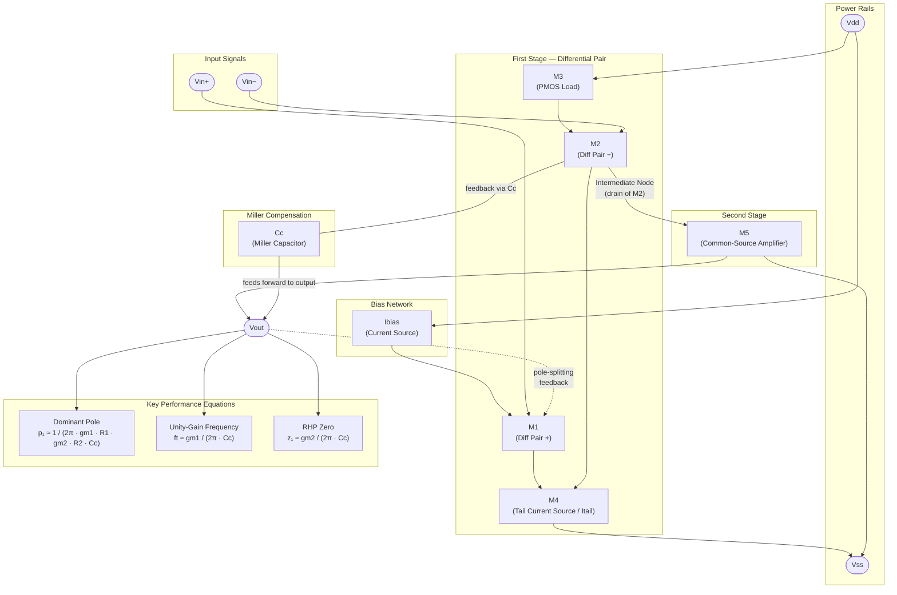
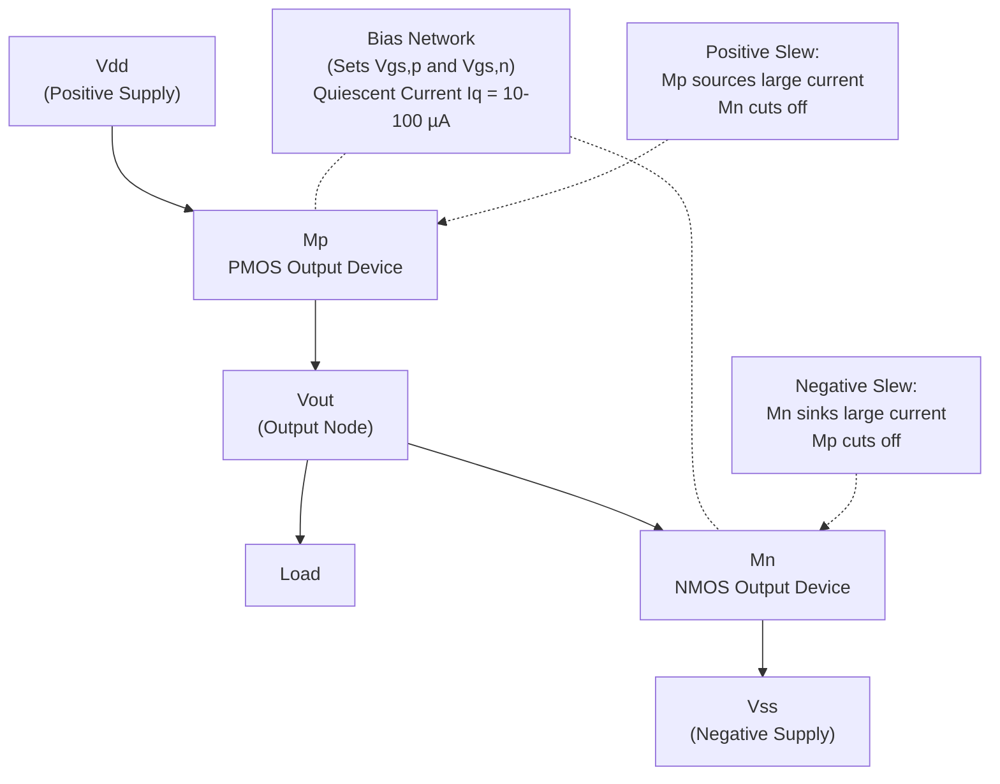

# Lesson 5: Operational Amplifier Architectures

## 1. First-Principles Intuition & Invariants

The operational amplifier stands as one of the most ubiquitous building blocks in analog circuit design, yet its internal architecture reveals a sophisticated interplay of differential pairs, current mirrors, compensation networks, and output stages that demand deep understanding for high-performance implementation. While the ideal op-amp abstraction—infinite gain, infinite input impedance, zero output impedance, infinite bandwidth—serves well for system-level analysis, the practicing analog designer must confront the physical realities of silicon: finite transistor transconductance, parasitic capacitances at every node, supply voltage headroom constraints, and the fundamental tradeoff between gain, bandwidth, and stability.

At its core, every operational amplifier architecture seeks to solve a deceptively simple problem: amplify the voltage difference between two input terminals while rejecting common-mode signals, delivering this amplified differential signal to a low-impedance output capable of driving resistive and capacitive loads without oscillation. The challenge lies in achieving this across a wide frequency range, under varying load conditions, with minimal distortion, and while consuming acceptable power from limited supply rails. Modern CMOS processes have shifted the traditional bipolar design paradigms, forcing designers to reconsider input stage architectures, compensation strategies, and output stage topologies to accommodate the characteristics of MOS transistors: lower transconductance per unit current compared to bipolars, square-law current-voltage relationships in saturation, and gate capacitances that dominate high-frequency behavior.

The fundamental figure of merit for any op-amp topology is its open-loop gain, typically denoted $A_{v0}$, which determines how closely the closed-loop circuit approaches ideal negative feedback behavior. For a non-inverting amplifier with feedback factor $\beta = R_1/(R_1 + R_2)$, the closed-loop gain error is approximately $1/(1 + A_{v0}\beta)$, revealing that DC gain directly translates to precision in signal processing applications. Yet gain alone proves insufficient; the gain-bandwidth product (GBW or $f_t$) establishes the usable frequency range, while phase margin dictates stability under capacitive loading. A classic single-stage amplifier might achieve 40 dB of gain but struggles to exceed 60 dB without multi-stage cascading, and this cascading introduces additional poles that threaten stability unless carefully compensated.

The input stage of any op-amp architecture must establish the differential transconductance $g_m$ that converts input voltage differences into current signals. In CMOS designs, a differential pair with tail current $I_{tail}$ biased in strong inversion provides $g_m = \sqrt{2\mu_n C_{ox}(W/L)I_{tail}}$ for NMOS devices, where the square-root relationship immediately reveals a critical design choice: large aspect ratios and high bias currents increase transconductance and thus bandwidth, but at the cost of power consumption and input-referred noise. The input pair also defines the common-mode input range (CMIR), bounded by the requirement that both input transistors remain in saturation; for an NMOS differential pair with PMOS active loads, the lower CMIR limit sits approximately one overdrive voltage above the negative rail, while the upper limit is constrained by the headroom needed for the tail current source to remain in saturation.

Common-mode rejection ratio (CMRR) and power supply rejection ratio (PSRR) emerge as critical performance metrics that separate mediocre amplifier designs from exceptional ones. CMRR quantifies the op-amp's ability to reject signals that appear identically on both inputs, mathematically expressed as $20\log_{10}(A_d/A_{cm})$ where $A_d$ is differential gain and $A_{cm}$ is common-mode gain. Perfect matching between the differential pair transistors would yield infinite CMRR, but real silicon introduces threshold voltage mismatches, mobility variations, and geometric asymmetries that limit practical CMRR to 80–120 dB range. The tail current source plays a pivotal role here: its output impedance directly determines how well the differential pair rejects common-mode signals, since any variation in tail current due to common-mode input changes modulates the bias point. A simple current mirror tail source might provide 40–50 dB CMRR, but cascoding the tail source—adding a second transistor in series to boost output impedance—can push CMRR beyond 100 dB.

PSRR addresses the amplifier's immunity to power supply noise, particularly crucial in mixed-signal systems where digital switching transients couple onto supply rails. Positive PSRR ($PSRR^+$) measures rejection of noise on $V_{DD}$, while negative PSRR ($PSRR^-$) captures rejection from $V_{SS}$ or ground. The input differential pair contributes to $PSRR^-$ through its tail current source impedance, while the load stage and subsequent gain stages dominate $PSRR^+$. Cascoded loads significantly improve PSRR by increasing the impedance between the supply rail and the signal path, effectively creating a high-impedance voltage divider that attenuates supply noise before it reaches the gain nodes.

Slew rate, often overlooked in small-signal AC analysis, emerges as the large-signal speed limitation that dominates transient response in practical circuits. Defined as the maximum rate of change of the output voltage, slew rate is fundamentally limited by the maximum current available to charge and discharge the compensation capacitor. For a classic Miller-compensated two-stage amplifier with compensation capacitor $C_c$ and tail current $I_{tail}$, the slew rate is approximately $I_{tail}/C_c$ for positive-going transitions and $I_{tail}/C_c$ for negative-going transitions when the output stage can source or sink sufficient current. This hard current limit means that even an amplifier with gigahertz unity-gain frequency will slew-rate limit on large transients, producing the characteristic flat-topped, linearly-rising output waveform rather than an exponential approach to the final value. Slew-induced distortion plagues audio amplifiers and high-speed data converters, where large input steps instantaneously demand output current exceeding the bias point, temporarily disabling feedback and allowing the output to ramp at the slew-limited rate rather than the bandwidth-limited rate.

The compensation network represents perhaps the most intellectually demanding aspect of op-amp design, requiring simultaneous consideration of stability, bandwidth, noise, and transient response. Every additional gain stage introduces a pole in the open-loop transfer function, and poles beyond the first—particularly those near or below the unity-gain frequency—consume phase margin and threaten oscillation. Miller compensation, named for John Miller who identified the multiplication effect of feedback capacitance, deliberately introduces a dominant pole far below the natural first pole frequency, pushing this dominant pole to low frequency where phase shift remains minimal while simultaneously splitting the second pole to higher frequency through the Miller multiplication effect. The compensation capacitor $C_c$ connected from the output of the first stage to the output of the second stage sees an effective impedance of $(1 + g_{m2}R_{out})$ at the first stage output, where $g_{m2}$ is the transconductance of the second stage and $R_{out}$ is the output resistance, creating a pole at $f_p = 1/(2\pi g_{m1}R_1C_c)$ where $g_{m1}$ and $R_1$ are the transconductance and load resistance of the input stage.

## 2. Core Architecture & Mechanics

The two-stage operational amplifier topology represents the workhorse architecture for general-purpose analog design, balancing gain, bandwidth, and design complexity in a structure that has remained conceptually unchanged since the 1960s despite radical shifts in process technology. The first stage comprises a differential pair with active loads, generating high voltage gain through the product of the input transconductance and the parallel combination of the input stage output resistance and the second stage input resistance. This first stage also establishes the input offset voltage, input bias current, and noise performance that propagate directly to the system level. The second stage, traditionally a common-source or common-emitter amplifier, provides additional gain and, critically, the low output impedance required to drive resistive loads and maintain closed-loop stability under capacitive loading.

In a canonical CMOS two-stage topology, an NMOS differential input pair with PMOS active loads feeds into a common-source second stage, itself loaded by an NMOS or PMOS current source depending on whether the design optimizes for PSRR from the positive or negative rail. The differential pair converts the input voltage difference into a pair of drain currents that mirror through the PMOS active loads, one branch proceeding to the gate of the second-stage amplifier while the other mirrors to a dummy branch to maintain symmetry. The voltage gain of the first stage approaches $g_{m1}(r_{o1}\|r_{o3})$ where $g_{m1}$ is the input pair transconductance, $r_{o1}$ is the output resistance of the input NMOS device, and $r_{o3}$ is the output resistance of the PMOS load, typically yielding 30–40 dB in modern short-channel processes where channel-length modulation severely degrades output resistance.

The second stage amplifies the first stage output voltage swing into rail-to-rail output swings—or as close to rail-to-rail as the output stage topology permits. A simple common-source stage with resistive or current-source load provides another 20–30 dB of gain, though its output impedance remains high, unsuitable for driving low-impedance loads or long cable capacitances. The gain-bandwidth product of this two-stage topology is set primarily by the transconductance of the input stage and the Miller compensation capacitor: $GBW \approx g_{m1}/(2\pi C_c)$, revealing the fundamental tradeoff where increasing $C_c$ for stability directly reduces bandwidth.

Miller compensation stabilizes the two-stage amplifier by creating a dominant pole far below the first natural pole of the circuit, ensuring that the open-loop gain crosses 0 dB with sufficient phase margin to prevent oscillation. The compensation capacitor $C_c$ is connected from the output of the first stage (node $V_1$) to the output of the second stage (node $V_{out}$), creating a feedback path that multiplies the effective capacitance seen at $V_1$ by the Miller multiplication factor $(1 + g_{m2}R_2)$, where $g_{m2}$ is the transconductance of the second stage and $R_2$ is its load resistance. This multiplication pushes the dominant pole to very low frequency, approximately $f_{p1} \approx 1/(2\pi g_{m1}R_1 g_{m2}R_2 C_c)$ for well-separated poles, while the second pole is pushed to higher frequency through the splitting action, landing near $f_{p2} \approx g_{m2}/(2\pi C_L)$ where $C_L$ is the load capacitance.

A critical subtlety arises in the right-half-plane zero introduced by the feedforward current path through $C_c$, which creates a zero at $z_1 = g_{m2}/(2\pi C_c)$. This RHP zero contributes phase lag rather than phase lead, consuming phase margin and potentially causing peaking in the frequency response or even instability if it falls near the unity-gain frequency. Several compensation strategies address this: nulling resistor compensation places a resistor $R_z = 1/g_{m2}$ in series with $C_c$ to cancel the zero, though this creates a sensitivity to process variation in $g_{m2}$; damping-factor compensation accepts the zero but sizes $C_c$ large enough to push the zero well beyond the unity-gain frequency; and current-buffer compensation inserts a voltage buffer in the compensation path to eliminate the feedforward current entirely.

The folded-cascode topology addresses several limitations of the two-stage architecture by achieving high gain in a single stage, eliminating the need for dominant-pole compensation and its associated bandwidth reduction. In a folded-cascode, the differential input pair sits near one supply rail while the output swings near the opposite rail, with the signal current "folding" through cascoded current mirrors to reach the output nodes. An NMOS differential pair with PMOS cascoded loads creates a structure where the input pair sources current to the folding mirrors, which then sink current through NMOS cascode devices to establish high-impedance output nodes. The voltage gain of a folded-cascode can reach 80–100 dB even in modern processes, approaching $g_{m,in}(g_{m,casc}r_{o}^2)$ where the cascode multiplication squares the output resistance.

The folded-cascode's single-stage architecture places the dominant pole at the high-impedance output node, where the large output resistance and relatively small capacitance (sum of drain capacitances and load capacitance) create a pole typically in the 10–100 kHz range for microamp-level bias currents. No compensation capacitor is needed for unity-gain stability since the dominant pole naturally rolls off the gain before phase shift from higher-frequency poles becomes problematic. However, the folded-cascode sacrifices output swing compared to two-stage designs: the output must stay sufficiently far from both rails to keep all cascode devices in saturation, typically losing 3–4 overdrive voltages from each rail. In a 1.8 V supply environment with 200 mV overdrives, this reduces usable output swing to perhaps ±0.5 V around the common-mode level, problematic for low-voltage applications requiring maximum signal swing.

Telescopic cascode amplifiers push voltage gain even higher by stacking cascode devices in series from rail to rail without the folding action, achieving gains approaching 100–120 dB. The differential input pair sits at the bottom, loaded by NMOS cascode devices, which in turn are loaded by PMOS cascode devices extending to the positive rail. The gain expression becomes $g_{m,in}(g_{m,n}r_{o,n}^2)(g_{m,p}r_{o,p}^2)$, the product of input transconductance and the squared output resistances of both NMOS and PMOS cascodes. This extreme gain comes at severe cost in voltage headroom: the signal path must accommodate five or six transistor $V_{ds,sat}$ drops between rails, rendering the telescopic cascode impractical below 3.3 V supplies and nearly impossible in modern 1.2–1.8 V digital processes. Furthermore, the input common-mode range collapses to a narrow window, and the output can only swing within a small region around mid-supply. Telescopic cascodes find application in high-supply, low-noise designs where maximum gain per stage is paramount, such as sensor interfaces and precision instrumentation amplifiers.

Rail-to-rail input stages address the limited common-mode range of simple differential pairs by deploying complementary NMOS and PMOS differential pairs in parallel, switching or blending between them as the input common-mode voltage sweeps from rail to rail. When the input common-mode sits near the negative rail, the NMOS pair turns off (gates below sources by more than threshold voltage) while the PMOS pair remains active; conversely, near the positive rail, the PMOS pair turns off while the NMOS pair conducts. In the mid-range, both pairs operate simultaneously, ideally doubling the transconductance but introducing a "hump" in the $g_m$ curve that produces distortion unless carefully linearized. Constant-$g_m$ techniques employ adaptive biasing circuits that sense the input common-mode voltage and dynamically adjust tail currents to maintain constant total transconductance across the input range, typically using summing circuits that boost one tail current while reducing the other to compensate for the varying number of active pairs.

Rail-to-rail output stages, equally critical in low-voltage designs, must provide push-pull current sourcing and sinking capability to swing the output voltage to within millivolts of each rail. Class-AB output stages achieve this by biasing complementary NMOS and PMOS output devices just above their threshold voltages, allowing both to conduct modest quiescent current yet capable of delivering large transient currents when the output needs to slew. The challenge lies in the quiescent bias circuit: too little bias current, and crossover distortion appears as both devices momentarily turn off during zero-crossing transitions; too much, and static power consumption becomes unacceptable. Biasing circuits employ matched diode-connected devices or translinear loops to establish a well-controlled $V_{GS}$ for the output pair, typically using a small replica of the output stage to sense and servo the bias point.

A typical class-AB biasing scheme uses a translinear loop where the sum of gate-source voltages around the loop remains constant. The PMOS output device gate is driven by the amplifier's gain stage, while its source connects to $V_{DD}$; the NMOS output device gate is also driven by the gain stage while its source connects to $V_{SS}$ or ground through a small sense resistor. A biasing circuit comprising matched PMOS and NMOS devices in a diode-connected configuration establishes the quiescent $V_{GS}$ values. As the gain stage output voltage swings, one output device is driven harder into conduction while the other begins to cut off, providing the push-pull action. The design must account for the non-constant $g_m$ of the output devices as they transition from weak to strong inversion, which introduces gain variation and potential distortion in the closed-loop transfer function.

Slew rate in two-stage amplifiers is fundamentally limited by the tail current of the input differential pair and the size of the compensation capacitor. When a large input step demands rapid output change, the input pair steers all of its tail current to one branch, charging or discharging $C_c$ at the maximum rate $SR = I_{tail}/C_c$. This creates the familiar tradeoff: increasing tail current improves slew rate but increases power consumption and input-referred noise current; decreasing $C_c$ improves slew rate but reduces phase margin and may cause instability. Practical designs target slew rates of 1–100 V/µs depending on application, with audio amplifiers at the lower end and high-speed buffer amplifiers at the upper end.

Slew-rate enhancement circuits address this limitation by temporarily boosting the current available to charge $C_c$ during large transients. A simple enhancement uses a pair of auxiliary differential pairs that sense large differential voltages across the input stage and inject additional current into the compensation capacitor, effectively bypassing the tail current limitation during slewing while maintaining the nominal bias point for small-signal operation. More sophisticated designs employ adaptive biasing that monitors the rate of change at the output and dynamically adjusts bias currents to provide more slewing capability on demand, returning to low quiescent current during steady-state operation to minimize power consumption.

## 3. High-Performance Optimization & Failure Modes

Achieving exceptional CMRR and PSRR in real silicon demands meticulous attention to layout, matching, and circuit topology beyond the idealized schematics. Layout techniques for differential pairs must ensure that the two input devices experience identical process gradients, gate oxide thickness variations, and temperature profiles. Common-centroid layout places the two devices in interdigitated geometry, with the centroid of each device coinciding so that any linear gradient affects both identically. For a four-finger layout, the finger sequence M1A-M2A-M2B-M1B ensures both transistors see the same average position and gradient. Dummy devices on the periphery absorb etch and implant edge effects that would otherwise introduce systematic mismatches.

Temperature gradients, often overlooked, can degrade CMRR by 20–30 dB in high-power mixed-signal ICs where digital blocks generate localized heating. A 1°C temperature difference between the two input devices shifts their threshold voltages by approximately 1–2 mV in typical CMOS processes, creating an effective input offset that couples common-mode signals into differential signals. Thermal coupling analysis during layout must identify heat sources—output drivers, voltage regulators, power transistors—and route sensitive differential pairs away from these regions. Thermal symmetry, achieved by balancing power dissipation around the input stage or using thermal shielding structures, can recover 10–20 dB of CMRR lost to thermal effects.

Cascoding the tail current source transforms CMRR performance by increasing its output impedance from $r_o$ to approximately $g_m r_o^2$, reducing common-mode gain by the same factor. A simple current mirror tail source might provide 1 MΩ output impedance at microamp bias levels, yielding CMRR around 60 dB; cascoding this to 100 MΩ pushes CMRR beyond 100 dB. The cascode device requires sufficient headroom: its drain must sit at least one overdrive voltage above its source to remain in saturation, consuming 150–300 mV of the already limited input common-mode range. In low-voltage designs, this headroom cost forces a choice between wide input common-mode range and high CMRR, unless rail-to-rail input stages with separate NMOS and PMOS pairs are deployed, each with its own cascoded tail source.

PSRR optimization follows a different path, targeting the supply coupling mechanisms rather than matching. Positive supply rejection depends on the impedance between $V_{DD}$ and the signal path, dominated by the active load devices in typical CMOS designs. A simple PMOS current mirror load couples $V_{DD}$ noise directly to the drain nodes of the differential pair through the finite output impedance of the PMOS devices. Cascoding the PMOS loads increases this impedance dramatically, attenuating supply noise by the cascode gain factor. The improvement is frequency-dependent: at low frequencies, the cascode output impedance is very high and PSRR excellent; as frequency increases, parasitic capacitances at the cascode node begin to bypass the high impedance, degrading PSRR. Compensation requires careful attention to the cascode pole formed by the gate-drain capacitance $C_{gd}$ and the impedance at the cascode gate node, often addressed by AC-coupling the cascode gate bias through a low-pass filter to ground.

Negative supply rejection, dominated by the tail current source impedance, similarly benefits from cascoding but suffers from a different high-frequency limitation. The bulk-to-source capacitance $C_{bs}$ of the tail device provides a direct path for $V_{SS}$ or ground noise to couple into the sources of the differential pair, bypassing the tail source impedance entirely at high frequencies. Shielding the bulk connection by surrounding the tail devices with a guard ring tied to a quiet bias voltage, or using triple-well processes to isolate the bulk from the substrate, reduces this coupling. Decoupling capacitors placed directly at the tail node can shunt high-frequency noise to the supplies before it modulates the tail current, though this capacitor must be sized carefully to avoid creating a low-frequency pole that degrades phase margin.

Frequency compensation strategies beyond simple Miller compensation address specific performance bottlenecks in multi-stage designs. Nested Miller compensation, used in three-stage amplifiers, employs two compensation capacitors: $C_{c1}$ from the output of the first stage to the output of the second stage, and $C_{c2}$ from the second stage output to the third stage output. This nested structure creates a dominant pole at the first stage output while splitting the second and third stage poles to higher frequencies through the Miller multiplication effect operating in both compensation paths. The design procedure requires careful pole-zero placement to ensure that no poles or zeros fall near the unity-gain frequency where they would consume phase margin.

Multipath nested Miller compensation adds feedforward paths that bypass one or more stages, injecting signal current directly to later stages to cancel the phase lag introduced by the main signal path through the intermediate stages. In a three-stage amplifier, a feedforward transconductance stage $g_{mf}$ from the first stage output to the third stage output can create a left-half-plane zero that cancels one of the intermediate poles, extending bandwidth without sacrificing stability. The feedforward path must be carefully weighted: too little feedforward gain, and the zero has minimal effect; too much, and the zero moves into the right-half plane, causing instability. The optimum feedforward transconductance is typically $g_{mf} \approx g_{m2}C_{c1}/C_{c2}$ where $g_{m2}$ is the transconductance of the second stage.

Damping-factor compensation techniques size the compensation capacitor not just for pole splitting but to control the $Q$ factor of complex pole pairs that emerge in heavily loaded amplifiers. When the load capacitance $C_L$ is comparable to or larger than the compensation capacitor $C_c$, the second pole and the output pole can form a complex conjugate pair rather than remaining real and separated. This complex pair exhibits peaking in the frequency response, manifesting as ringing in the time-domain step response and potential instability under worst-case load conditions. Increasing $C_c$ damps the complex pair, trading bandwidth for improved transient response and robustness. The design target is often a maximally flat (Butterworth) or slightly underdamped (Chebyshev) response with damping factor $\zeta \approx 0.7$ to balance settling time and overshoot.

Load capacitance variation presents a particularly insidious stability challenge in general-purpose op-amps intended for printed circuit board use, where the designer cannot predict the exact load capacitance the amplifier will drive. Datasheets specify a "stable load range" such as 0–1000 pF, but achieving stability across this range requires compensation that accounts for worst-case phase margin at both extremes. Light loads (small $C_L$) push the output pole to high frequency where it may interact with higher-order parasitics; heavy loads pull the output pole down toward the unity-gain frequency, consuming phase margin. The compensation design must ensure at least 45° phase margin at unity-gain frequency across the entire load range, often requiring $C_c$ to be larger than the minimum value needed for nominal load capacitance.

Slew-rate asymmetry, where the positive-going and negative-going slew rates differ, arises from imbalances in the current available to charge versus discharge the compensation capacitor. In a two-stage amplifier with NMOS input pair and PMOS second stage, the positive slew rate is limited by the tail current $I_{tail}$ sourcing current to charge $C_c$ through the PMOS load, while the negative slew rate is limited by the same $I_{tail}$ but sinking current through the NMOS input device. If the second stage has asymmetric sourcing and sinking capability—common in simple current-source-loaded designs—this asymmetry propagates to the output. Class-AB output stages with balanced push-pull current capability mitigate this, but only if the second stage itself can slew symmetrically.

Slew-induced distortion in closed-loop configurations creates a particularly troublesome form of nonlinearity that is difficult to characterize with traditional harmonic distortion measurements. When an amplifier slews, negative feedback is momentarily disabled because the output cannot follow the input at the demanded rate, causing the error signal (input minus feedback signal) to saturate the input stage. During this saturation period, the output slews linearly rather than exponentially, and the feedback loop is effectively open. After slewing completes and the output approaches the target value, feedback re-engages, but the amplifier must now recover from the non-linear initial condition imposed by the slewing transient. This recovery process introduces settling tails, overshoot, and ringing that depend on the slewing magnitude and duration, producing distortion that increases with input signal amplitude and frequency.

Two-tone intermodulation distortion (IMD) testing reveals slew-induced nonlinearity more sensitively than single-tone harmonic distortion measurements. Two closely spaced tones at frequencies $f_1$ and $f_2$ create sum and difference frequencies $(f_2 - f_1)$ and $(f_2 + f_1)$, as well as higher-order products at $2f_1 - f_2$ and $2f_2 - f_1$. Slew-rate limitation causes the amplifier to momentarily lose control of the output when the instantaneous sum of the two tones exceeds the slew-limited rate of change, generating these intermodulation products even when neither individual tone would cause slewing. The IMD ratio, typically expressed in dBc (decibels below carrier), degrades as the tone amplitudes increase or as the tone frequencies spread further apart, directly correlating with the probability of exceeding the slew rate.

Input offset voltage, the DC voltage that must be applied between the inputs to null the output, arises from threshold voltage mismatches, mobility differences, and geometric asymmetries in the differential pair. A 5 mV mismatch in threshold voltage between the two input devices, typical in unmatched layouts, produces 5 mV of input offset directly. Autozeroing and chopper stabilization techniques can reduce offset to microvolts, but these come with complexity costs. Autozeroing samples the offset during a nulling phase and stores a correction voltage on a capacitor, which is then applied during the amplification phase to cancel the offset. The correction is only accurate until leakage currents discharge the storage capacitor or until temperature drift changes the offset, requiring periodic re-nulling. Chopper stabilization modulates the input signal at a chopping frequency, AC-couples it through the amplifier where DC offset becomes an AC signal that can be filtered, then demodulates the amplified signal back to baseband while the offset modulates to the chopping frequency where it is rejected by the system bandwidth.

Input bias current, necessary to bias the gates of MOS input devices or the bases of bipolar input transistors, flows from the input terminals and creates voltage drops across source impedances. MOS amplifiers enjoy much lower input bias current than bipolar designs—typically picoamperes versus nanoamperes—but even picoampere-level gate leakage can produce millivolt-level errors across megohm source impedances. Bias current cancellation circuits inject a correction current equal and opposite to the natural bias current, typically derived from a replica of the input stage, reducing net bias current to femtoampere levels limited only by matching accuracy. Input bias current also exhibits strong temperature dependence, increasing exponentially with temperature in subthreshold leakage mechanisms, requiring careful thermal management in precision applications.

Noise performance in operational amplifiers is dominated by the input differential pair at low frequencies and by higher-stage contributions at frequencies above the input-referred corner. The input-referred noise voltage spectral density, expressed in nV/√Hz, combines the thermal noise of the input devices ($4kTγ/g_m$ for MOS devices in saturation, where $γ \approx 2/3$ for long-channel devices and increases toward 1 in short-channel devices) with flicker noise ($K_f/(C_{ox}WLf)$ where $K_f$ is a process-dependent flicker noise coefficient) that dominates at low frequencies. The flicker noise corner frequency, where thermal and flicker noise contributions are equal, typically falls in the 10 Hz to 10 kHz range for standard CMOS processes but can be reduced to ~1 Hz by using PMOS input devices instead of NMOS, exploiting the lower flicker noise of holes versus electrons in silicon-silicon dioxide interfaces.

Chopper stabilization not only reduces offset but also dramatically reduces low-frequency noise by modulating it to the chopping frequency where it is filtered. The input signal is chopped at frequency $f_{chop}$ (typically 10 kHz to 1 MHz), amplified with its low-frequency flicker noise intact, then chopped again to restore the signal to baseband while modulating the noise to odd harmonics of $f_{chop}$. A low-pass filter following the second chopper rejects the upconverted noise, leaving only the thermal noise floor folded down from the high-frequency region. Chopping trades off increased circuit complexity and potential clock feedthrough for decade-level reductions in low-frequency noise, enabling precision op-amps with sub-microvolt offset and sub-10 nV/√Hz noise at 1 Hz.

Output impedance in closed-loop configurations is reduced from the open-loop output impedance $R_{out}$ by the loop gain $A\beta$, approaching $R_{out}/(A\beta)$ at frequencies well below the unity-gain frequency. This negative feedback action creates a "stiff" voltage source at the output, capable of maintaining the output voltage against load current changes. However, as frequency increases toward and beyond the unity-gain frequency, loop gain decreases and eventually falls below unity, at which point the output impedance rises back toward the open-loop value. Inductive loads or long cables with non-negligible inductance can create resonances with the amplifier's output capacitance, producing peaking and ringing in the closed-loop frequency response. Stability analysis must account for the phase shift introduced by the complex load impedance, often requiring series output resistance (isolation resistor) to damp the resonance at the cost of increased output impedance.

Paralleling multiple operational amplifiers to increase output current capability introduces new stability concerns because the individual amplifiers' outputs must remain synchronized. Small differences in offset voltage or phase response between the paralleled amplifiers can cause circulating currents where one amplifier sources current that another sinks, wasting power and potentially causing thermal runaway if positive feedback develops. Current-sharing resistors placed in series with each amplifier output balance the load current, though these resistors increase output impedance and reduce voltage swing. Active current balancing uses feedback loops that sense the current in each output and adjust the individual amplifiers' gains or bias points to equalize currents, maintaining tight current sharing across temperature and process variation.

High-frequency stability analysis must account for parasitic capacitances and inductances that are negligible at low frequencies but dominate behavior at tens or hundreds of megahertz. Bond wire inductance in packaged ICs, typically 1–5 nH per millimeter of wire length, creates inductive supply impedance that couples high-frequency output currents back into the supply rails, potentially causing oscillation if the amplifier's PSRR degrades at these frequencies. On-chip bypass capacitors placed within micrometers of the amplifier's supply pins reduce this impedance, but these capacitors must be sized large enough to provide low impedance at the frequency of concern without introducing low-frequency poles that degrade PSRR at audio frequencies. Multi-layer bypass strategies use small, low-inductance capacitors (1–10 pF) for VHF decoupling in parallel with larger capacitors (100 pF to 1 nF) for HF/VHF decoupling and much larger capacitors (10–100 nF) for LF/HF decoupling, creating a broadband low-impedance supply.

Layout-induced oscillation, often manifesting as 100–500 MHz ringing visible on oscilloscope traces despite proper compensation for lower-frequency stability, arises from the distributed nature of on-chip interconnect. A long metal trace connecting the compensation capacitor to the output node possesses non-negligible inductance and resistance, forming a transmission line that can resonate with the capacitance at either end. Minimizing trace length, using wide metal for reduced resistance and inductance, and placing the compensation capacitor as close as possible to the active devices mitigates this. In extreme cases, distributed compensation using multiple smaller capacitors placed at strategic nodes can damp the distributed resonance more effectively than a single lumped capacitor.

Electrostatic discharge (ESD) protection circuitry on the input pins introduces capacitance that degrades high-frequency performance and can create additional poles in the input impedance that interact with source impedances. A typical dual-diode ESD clamp to the supply rails adds 2–5 pF of capacitance at each input, reducing the input impedance at high frequencies and creating a common-mode pole with the source resistance. For precision applications where this capacitance is intolerable, off-chip ESD protection using discrete diodes or specialized low-capacitance devices may be necessary, though this shifts the ESD vulnerability from the IC to the PCB assembly.

Power dissipation optimization in low-voltage op-amps must balance quiescent current, slew rate, bandwidth, and noise. The fundamental GBW relationship $GBW = g_m/(2\pi C_c)$ ties bandwidth directly to transconductance, which in turn depends on bias current. Doubling the bias current increases $g_m$ by $\sqrt{2}$ in square-law saturation, improving bandwidth by only 41% while doubling power. This square-root relationship makes power-bandwidth optimization particularly challenging: achieving decade-level bandwidth improvements requires hundred-fold current increases, impractical in battery-powered systems. Subthreshold biasing, where transistors operate with gate-source voltages below threshold, provides exponential transconductance dependence on bias current, dramatically improving the $g_m/I_D$ ratio at the cost of reduced speed and increased sensitivity to temperature and process variation.

Class-AB output stage quiescent current must be carefully controlled to minimize power while avoiding crossover distortion. A quiescent current of 10–100 µA ensures both output devices remain in strong inversion during zero-crossing transitions, yet this current level allows the output stage to source or sink amperes during large-signal transients through the exponential relationship between gate-source voltage and drain current. Thermal feedback can destabilize the quiescent current: as power dissipation heats the die, threshold voltages decrease and bias currents increase, further increasing power dissipation in a positive feedback loop that can lead to thermal runaway. Bias circuits with negative temperature coefficient, often implemented using bandgap references or complementary-to-absolute-temperature (CTAT) voltage sources, compensate for this thermal drift by reducing bias voltage as temperature rises.

Production testing of operational amplifiers must verify not only DC parameters like offset, bias current, and open-loop gain but also dynamic specifications that require specialized measurement techniques. CMRR testing applies a common-mode signal to both inputs while measuring the differential output, requiring the test system to maintain precise balance between the input signals to avoid corrupting the measurement with differential components. PSRR testing sweeps the supply voltage while holding the inputs at a fixed common-mode level, measuring the output change referenced back to the input to compute rejection ratio across frequency. These tests become increasingly difficult at high frequencies where probe loading and signal path impedances influence the measurement, often requiring specialized test fixtures with controlled impedance, minimal parasitics, and carefully calibrated de-embedding to separate the device-under-test response from the fixture response.
