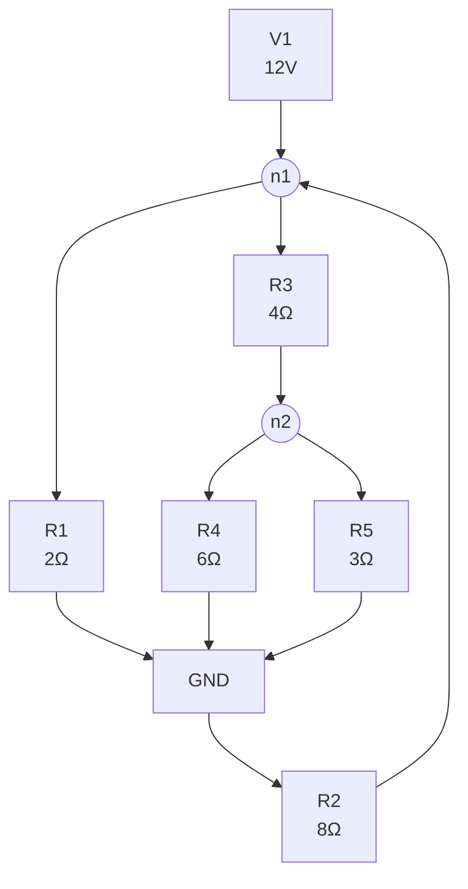

# Lesson 1: Foundational Laws, Resistive Networks, Topology

## 1. First-Principles Intuition & Invariants

Circuit theory exists as the mathematical formalism that governs the behavior of electrical networks, transforming the continuous electromagnetic field equations of Maxwell into discrete algebraic relationships between voltages and currents. While electromagnetic theory describes fields propagating through space at the speed of light, circuit theory makes a profound simplifying assumption: that the physical dimensions of our networks are sufficiently small compared to the wavelength of the signals we analyze that field propagation delays become negligible. This lumped-element approximation allows us to collapse distributed electromagnetic phenomena into discrete components—resistors, capacitors, inductors—connected by ideal conductors that instantly communicate potential differences.

The foundational invariants of circuit theory rest on conservation principles borrowed directly from physics. Kirchhoff's Current Law (KCL) emerges from the conservation of electric charge, asserting that charge cannot accumulate at a node in steady-state or quasi-static conditions. Every coulomb entering a junction must exit through some path, making the algebraic sum of currents at any node exactly zero. Kirchhoff's Voltage Law (KVL) derives from the conservative nature of the electrostatic field, guaranteeing that the line integral of electric field around any closed path vanishes. When we traverse a closed loop in a circuit, summing voltage rises and drops, we must return to our starting potential—the algebraic sum must be zero.

Ohm's Law, the constitutive relation for resistive elements, provides the bridge between these topological constraints and the material properties of conductors. Georg Ohm's 1827 empirical discovery that current through a metallic conductor varies linearly with applied voltage revolutionized electrical science by providing a simple algebraic relationship: voltage equals current multiplied by resistance, or $V = IR$. This linear relationship, valid for ohmic materials operating within their thermal limits, enables us to transform circuit analysis from differential equations into linear algebra. The resistance parameter $R$, measured in ohms (Ω), encapsulates the microscopic scattering of charge carriers within the conductor's crystal lattice, elevated to a macroscopic circuit parameter.

The principle of superposition follows directly from linearity. In networks containing only linear elements—resistors, independent sources, and later, linear capacitors and inductors—the response to multiple simultaneous excitations equals the sum of responses to each excitation applied individually. This additivity property allows us to decompose complex multi-source circuits into simpler single-source problems, solve each independently, then algebraically combine results. Superposition fails catastrophically in nonlinear circuits containing diodes, transistors, or any element whose constitutive relation involves higher powers of voltage or current, a limitation we must always verify before applying this technique.

The linearity of resistive networks also ensures that voltage and current division follow simple algebraic ratios. When resistors connect in series, forcing identical current through each element, the total voltage distributes proportionally to resistance values. When resistors connect in parallel, constraining all elements to share a common voltage, the total current divides in inverse proportion to resistance—more current flows through lower resistance paths. These division principles become intuitive pattern-recognition tools, enabling rapid mental calculation of circuit behavior without formal equation systems.

Graph theory provides the topological foundation for systematic circuit analysis. A circuit graph consists of nodes (vertices representing connection points) and branches (edges representing two-terminal elements). The distinction between a tree and a cotree proves essential: a tree is a connected subgraph containing all nodes but no closed loops, while the cotree comprises all remaining branches. The fundamental theorem of circuit topology states that a graph with $n$ nodes and $b$ branches possesses exactly $n-1$ tree branches and $b-n+1$ cotree branches, called links. These links define the independent loops for mesh analysis, while tree branches define the independent node-pair voltages for nodal analysis.

## 2. Core Architecture & Mechanics

The architecture of resistive network analysis begins with the identification of essential nodes and the assignment of a reference node, traditionally called ground, assigned zero potential. Essential nodes are connection points where three or more branches meet; nodes connected by ideal wires without intervening elements collapse into a single electrical node. Labeling the remaining $n-1$ essential node voltages relative to ground establishes our nodal voltage variables. The choice of ground node is mathematically arbitrary but practically significant—selecting a node with many connections, especially to voltage sources, simplifies the resulting equation system.

Nodal analysis applies KCL at each essential node, expressing branch currents in terms of node voltages using Ohm's Law. Consider a node with voltage $V_1$ connected to ground through resistor $R_1$, to node $V_2$ through resistor $R_2$, and to node $V_3$ through resistor $R_3$. The current flowing from node $V_1$ toward ground equals $(V_1 - 0)/R_1$, toward node $V_2$ equals $(V_1 - V_2)/R_2$, and toward node $V_3$ equals $(V_1 - V_3)/R_3$. The KCL equation becomes $(V_1 - 0)/R_1 + (V_1 - V_2)/R_2 + (V_1 - V_3)/R_3 = 0$ if no current source connects to node $V_1$. Collecting terms yields $V_1(1/R_1 + 1/R_2 + 1/R_3) - V_2/R_2 - V_3/R_3 = 0$. This systematic procedure generates one equation per unknown node voltage, producing a square system of linear equations solvable by Gaussian elimination, matrix inversion, or Cramer's rule.

Conductance notation $G = 1/R$, measured in siemens (S), often clarifies nodal equations. Rewriting the previous equation as $V_1(G_1 + G_2 + G_3) - V_2 G_2 - V_3 G_3 = 0$ reveals an elegant pattern: the coefficient of $V_1$ equals the sum of all conductances connected to node 1, while the coefficients of other node voltages equal the negative of the conductance connecting those nodes to node 1. This pattern extends to the entire nodal admittance matrix, where diagonal entries contain the sum of conductances meeting at each node, and off-diagonal entry $(i,j)$ contains the negative of the conductance directly connecting nodes $i$ and $j$.

Mesh analysis applies KVL around independent loops, expressing branch voltages in terms of loop currents using Ohm's Law. For planar circuits—those drawable on a plane without crossing branches—we identify meshes as the minimal closed loops that enclose no other loops. Assigning a circulating mesh current to each mesh, we traverse each mesh boundary summing voltage drops. A resistor shared between two meshes carries the algebraic difference of the two mesh currents. Consider a mesh with current $I_1$ containing resistors $R_1$, $R_2$, and $R_3$, where $R_2$ is shared with mesh $I_2$. Traversing clockwise, if the voltage source $V_s$ provides a voltage rise, the KVL equation becomes $-V_s + I_1 R_1 + (I_1 - I_2)R_2 + I_1 R_3 = 0$. Collecting terms yields $I_1(R_1 + R_2 + R_3) - I_2 R_2 = V_s$.

The mesh impedance matrix exhibits symmetry analogous to the nodal admittance matrix: diagonal entries contain the sum of resistances around each mesh, while off-diagonal entry $(i,j)$ contains the negative of resistance shared between meshes $i$ and $j$, provided the mesh currents flow in the same direction through that resistor. This structural pattern enables rapid equation formulation by inspection, bypassing tedious algebraic manipulation.

Series and parallel reduction techniques exploit the additive properties of resistances and conductances. Resistors in series carry identical current, so voltage drops add: $V_{total} = I(R_1 + R_2 + \cdots + R_n)$, making the equivalent resistance $R_{eq} = R_1 + R_2 + \cdots + R_n$. Resistors in parallel share common voltage, so currents add: $I_{total} = V(G_1 + G_2 + \cdots + G_n)$, making the equivalent conductance $G_{eq} = G_1 + G_2 + \cdots + G_n$, or equivalently $1/R_{eq} = 1/R_1 + 1/R_2 + \cdots + 1/R_n$. For two parallel resistors, this simplifies to the product-over-sum formula $R_{eq} = R_1 R_2/(R_1 + R_2)$.

Voltage division formalizes the intuition that series resistors partition voltage proportionally. For two resistors $R_1$ and $R_2$ in series with total voltage $V_s$, the voltage across $R_1$ equals $V_1 = V_s \cdot R_1/(R_1 + R_2)$. Current division formalizes the inverse relationship for parallel resistors. For two resistors $R_1$ and $R_2$ in parallel with total current $I_s$, the current through $R_1$ equals $I_1 = I_s \cdot R_2/(R_1 + R_2)$, noting that current flows inversely with resistance.

Superposition analysis proceeds by considering one independent source at a time while zeroing all others. Zeroing a voltage source replaces it with a short circuit (zero voltage, arbitrary current), while zeroing a current source replaces it with an open circuit (zero current, arbitrary voltage). Dependent sources remain active since they respond to circuit variables rather than providing independent excitation. After solving the simplified circuit for each source individually, we algebraically sum the partial responses to obtain the total response. This technique particularly simplifies circuits where symmetry or reduction techniques apply more readily to single-source configurations.

The following ASCII diagram illustrates a resistive network amenable to multiple analysis techniques:

For nodal analysis, designate ground at the bottom rail and label node $n1$ (top-left junction) and node $n2$ (right junction). The voltage source directly defines $V_{n1} = 12\,\text{V}$ relative to ground, eliminating one unknown. At node $n2$, apply KCL: $(V_{n2} - V_{n1})/R_3 + (V_{n2} - 0)/R_4 + (V_{n2} - 0)/R_5 = 0$. Substituting values: $(V_{n2} - 12)/4 + V_{n2}/6 + V_{n2}/3 = 0$. Multiplying by 12: $3(V_{n2} - 12) + 2V_{n2} + 4V_{n2} = 0$, yielding $9V_{n2} = 36$, so $V_{n2} = 4\,\text{V}$.

For mesh analysis, define mesh $I_1$ circulating clockwise through $V_1$, $R_1$, $R_3$, and $R_2$, and mesh $I_2$ circulating clockwise through $R_3$, $R_4$, and $R_5$. The KVL equations become: $-12 + 2I_1 + 4(I_1 - I_2) + 8I_1 = 0$ for mesh 1, simplifying to $14I_1 - 4I_2 = 12$, and $4(I_2 - I_1) + 6I_2 + 3I_2 = 0$ for mesh 2, simplifying to $-4I_1 + 13I_2 = 0$. Solving yields $I_1 = 1.2\,\text{A}$ and $I_2 = 0.369\,\text{A}$, from which all branch currents and voltages follow.

## 3. High-Performance Optimization & Failure Modes

Optimization of circuit analysis begins with intelligent choice of analysis technique. Nodal analysis scales efficiently for circuits with many series elements and few nodes, since series elements reduce to equivalent resistances without introducing additional node equations. Mesh analysis excels for circuits with many parallel elements and few meshes, since parallel elements reduce to equivalent resistances without introducing additional mesh equations. A circuit with $n$ essential nodes and $m$ independent meshes requires $n-1$ nodal equations but only $m$ mesh equations—selecting the smaller set minimizes computational effort.

Supernodes and supermeshes extend the basic techniques to handle voltage sources and current sources elegantly. A voltage source connected between two non-reference nodes creates a supernode: rather than writing separate KCL equations for each node, we write a single KCL equation summing currents into both nodes, supplemented by the constraint equation that the voltage difference equals the source voltage. Similarly, a current source shared by two meshes creates a supermesh: we write a single KVL equation around the combined perimeter, supplemented by the constraint that the difference in mesh currents equals the source current. These techniques avoid introducing unknown source currents or voltages as additional variables.

Dependent sources require careful treatment since they create coupling between circuit variables. A voltage-controlled voltage source (VCVS) with gain $\mu$, for instance, establishes a linear constraint $V_{out} = \mu V_{in}$ that must be incorporated into the equation system. In nodal analysis, this might eliminate one node voltage in terms of another; in mesh analysis, it creates a relationship between mesh currents. Dependent sources never zero during superposition since they respond to circuit excitation rather than providing independent input.

Numerical conditioning of the equation system affects solution accuracy, particularly when resistance values span multiple orders of magnitude. Consider a node connected to ground through $1\,\text{Ω}$ and to another node through $1\,\text{M}\Omega$. The nodal equation coefficients differ by a factor of $10^6$, creating an ill-conditioned matrix susceptible to round-off error. Normalizing resistances to dimensionless quantities on the order of unity—scaling by the smallest or geometric mean resistance—improves numerical stability in computer implementations. Hand calculations benefit from selecting convenient resistance values or working symbolically until the final substitution.

Graph-theoretic insights reveal structural properties that guide analysis strategy. A circuit separable into decoupled subcircuits by cutting a single branch simplifies into independent problems solvable in isolation. A circuit with high connectivity (many parallel paths) benefits from nodal analysis, while a circuit with high loop complexity benefits from mesh analysis. The circuit's genus—the number of independent loops, equal to $b - n + 1$ for $b$ branches and $n$ nodes—bounds the minimum mesh count for planar circuits.

Failure modes in resistive circuit analysis typically stem from violations of the lumped-element assumption rather than mathematical error. When signal frequencies increase such that wavelengths become comparable to circuit dimensions, transmission-line effects emerge: voltage and current lose their instantaneous relationship, propagation delays matter, and KVL violations appear due to non-negligible magnetic flux linkage. For a $30\,\text{cm}$ wire, this occurs above approximately $300\,\text{MHz}$ where $\lambda = c/f \approx 1\,\text{m}$. At such frequencies, distributed analysis using transmission-line equations replaces lumped circuit theory.

Thermal effects impose practical limits on resistor power dissipation. Every resistor carrying current $I$ dissipates power $P = I^2 R$, generating heat that must conduct to the environment. Exceeding the resistor's power rating—typically $\frac{1}{4}\,\text{W}$ for through-hole carbon film resistors, $\frac{1}{10}\,\text{W}$ for 0805 surface-mount resistors—causes thermal runaway: temperature rise increases resistance, increasing power dissipation, accelerating temperature rise until catastrophic failure. Derating by $50\%$ for reliability, or selecting resistors with adequate wattage headroom, prevents this failure mode.

Parasitic resistances in practical circuits introduce errors absent in ideal analysis. Every wire segment possesses finite resistance, typically $0.02\,\Omega$ per meter for 22 AWG copper wire. In high-current power distribution circuits where $10\,\text{A}$ flows through $1\,\text{m}$ of wire, the $0.02\,\Omega$ resistance drops $0.2\,\text{V}$ and dissipates $2\,\text{W}$, potentially overwhelming the intended load. Kelvin (four-wire) sensing techniques, where separate high-impedance sense wires measure voltage directly at the load terminals, eliminate wire drop errors in precision measurement applications.

Contact resistance at mechanical junctions—screw terminals, breadboard contacts, connector pins—introduces milliohm-level series resistance that accumulates through multiple connections. Oxidation of exposed metal surfaces exacerbates this effect, particularly in low-current signal paths where insufficient current fails to break through oxide layers. Gold plating on connectors, or periodic cleaning with contact cleaner, maintains low contact resistance in critical applications.

The superposition principle's restriction to linear circuits demands verification. A circuit containing a thermistor—a temperature-sensitive resistor with nonlinear $R(T)$ characteristic—violates linearity since resistance depends on self-heating, which depends nonlinearly on current squared. Attempting superposition yields incorrect results because the thermistor's operating point shifts between single-source and multi-source configurations. Similarly, circuits containing semiconductor junctions (diodes, transistors) exhibit exponential $I$-$V$ characteristics that render superposition invalid.

Nodal analysis degenerates when a floating voltage source—one connected between two non-reference nodes with no ground path—appears in the circuit. The absolute node potentials become undefined, though their difference remains constrained. The solution involves introducing a supernode as described earlier, or alternatively, artificially grounding one terminal through a large resistance (e.g., $1\,\text{G}\Omega$) to define the floating source's common-mode potential without significantly affecting circuit behavior.

Mesh analysis degenerates for non-planar circuits, where no drawing in the plane avoids branch crossings. The complete graph $K_5$ (five nodes, all pairs connected) and the complete bipartite graph $K_{3,3}$ (two three-node sets, all cross-connections) are the minimal non-planar graphs. For such circuits, modified nodal analysis or generalized mesh analysis using cycle basis from graph theory replaces classical mesh analysis. In practice, most physical circuits are planar since components occupy three-dimensional space and crossings resolve into over/under routing on multi-layer PCBs.

The computational complexity of circuit analysis scales with equation system size. Direct solution via Gaussian elimination requires $O(n^3)$ operations for $n$ equations. Sparse matrix techniques exploit the structure of circuit equations—each node couples only to its neighbors—to reduce complexity to approximately $O(n^{1.5})$ for typical circuit topologies. Iterative methods like Gauss-Seidel or successive over-relaxation converge in $O(n^2)$ operations but require careful tuning of relaxation parameters. For very large circuits exceeding $10^5$ nodes, such as full-chip SPICE simulations, hierarchical decomposition and domain-specific solvers become essential.

Verification of circuit solutions employs dimensional analysis and sanity checks. Every voltage must carry units of volts, every current amperes, every resistance ohms. Power flows from sources to loads, never the reverse in passive circuits. Node voltages should lie between the most negative and most positive source voltages; violations indicate algebraic error. Current through a resistor should align with Ohm's Law: $I = V/R$. The sum of power delivered by sources should equal the sum of power dissipated in resistors, confirming conservation of energy within numerical precision.

Benchmark problems provide calibration for analytical skill development. The canonical resistor cube—twelve $1\,\Omega$ resistors forming the edges of a cube with current injected at one vertex and extracted at the opposite vertex—yields resistance $\frac{5}{6}\,\Omega$ between opposite corners via symmetry arguments, $\frac{3}{4}\,\Omega$ between adjacent corners. The infinite resistor ladder—infinite series-parallel repetition of two resistor values—exhibits input resistance solvable via self-similarity: the infinite ladder's input resistance equals the input resistance of a single stage with the infinite ladder as load. Such problems hone intuition and pattern recognition, skills that accelerate practical circuit analysis far beyond mechanical equation grinding.
