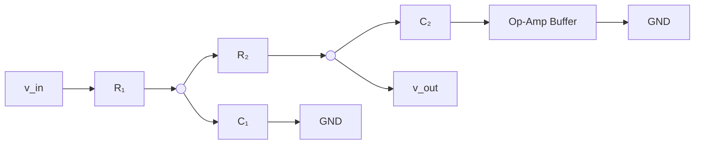

# Lesson 5: Frequency Response, Resonance, Filter Design

## 1. First-Principles Intuition & Invariants

The distinction between time-domain and frequency-domain analysis represents one of the most profound conceptual shifts in electrical engineering practice. While engineers intuitively understand resistive voltage division and Kirchhoff's current laws in the time domain, the behavior of reactive components—capacitors and inductors—becomes vastly more tractable when analyzed through the lens of sinusoidal steady-state frequency response. This transformation, rooted in the complex exponential representation pioneered by Steinmetz at the turn of the twentieth century, allows us to replace differential equations with algebraic impedance relationships, unlocking design methodologies for filters, resonant tanks, and matching networks that would be intractable in pure time-domain formulations.

At the heart of frequency-domain analysis lies the **transfer function**, a ratio of output to input phasors expressed as a function of angular frequency ω or complex frequency s = σ + jω. For a linear time-invariant system driven by a sinusoidal source at frequency ω, the steady-state output will also be sinusoidal at the same frequency, differing only in amplitude and phase. The transfer function H(jω) = V_out(jω) / V_in(jω) encapsulates both the magnitude scaling |H(jω)| and phase shift ∠H(jω) imposed by the circuit. This decomposition into magnitude and phase forms the foundation for Bode plot analysis, a logarithmic graphical technique that reveals pole and zero locations, asymptotic roll-off rates, and phase margins with unmatched clarity.

Reactive components introduce frequency-dependent impedances that fundamentally alter circuit behavior across the spectrum. A capacitor's impedance Z_C = 1/(jωC) decreases with frequency, approaching a short circuit as ω → ∞ while behaving as an open circuit at DC (ω = 0). Conversely, an inductor's impedance Z_L = jωL increases linearly with frequency, blocking high-frequency signals while passing DC unimpeded. These complementary frequency dependencies enable the construction of frequency-selective networks: lowpass filters that attenuate high frequencies, highpass filters that block DC and low-frequency content, bandpass filters that isolate a narrow frequency band, and bandstop (notch) filters that reject specific interference tones.

The phenomenon of **resonance** emerges when inductive and capacitive reactances cancel at a specific frequency, producing a purely resistive impedance at the terminals. In a series RLC circuit, the resonant frequency ω₀ = 1/√(LC) marks the point where X_L = ω₀L equals X_C = 1/(ω₀C), causing the imaginary components to annihilate and leaving only the resistance R. At resonance, the circuit's impedance magnitude reaches a minimum Z_min = R, and the current amplitude peaks for a given applied voltage. The sharpness of this resonant peak is quantified by the **quality factor** Q = ω₀L/R = 1/(ω₀CR), a dimensionless parameter expressing the ratio of energy stored to energy dissipated per cycle. High-Q circuits exhibit narrow, sharply peaked frequency responses ideal for radio tuning and crystal oscillator stabilization, while low-Q circuits provide broadband coupling with damped transient responses.

Parallel RLC circuits exhibit dual behavior: at resonance, the parallel combination of inductive and capacitive susceptances cancels, yielding an impedance maximum Z_max = R rather than a minimum. The quality factor for parallel tanks takes the form Q = R/(ω₀L) = ω₀CR, inverted relative to the series case due to the interchange of voltage and current roles. This duality extends throughout filter theory: series elements in lowpass ladder topologies correspond to shunt elements in highpass configurations, and element value transformations follow predictable impedance and frequency scaling laws.

The **bandwidth** of a resonant circuit or filter defines the range of frequencies over which the response remains within 3 dB (a factor of 1/√2 ≈ 0.707 in voltage magnitude) of its peak value. For a series RLC bandpass filter centered at ω₀, the bandwidth BW = ω₀/Q relates directly to the quality factor: high-Q circuits produce narrow bandwidths, while low-Q circuits yield broad, gently sloped responses. The lower and upper half-power frequencies ω₁ and ω₂ satisfy |H(jω₁)| = |H(jω₂)| = |H(jω₀)|/√2, and their geometric mean √(ω₁ω₂) equals the center frequency ω₀, a relationship stemming from the symmetry of the conjugate pole pair in the complex s-plane.

Passive filter synthesis, the art of realizing a desired transfer function using only resistors, capacitors, and inductors, rests on approximation theory and network realization techniques developed throughout the mid-twentieth century. Butterworth filters maximize passband flatness at the expense of slow roll-off, exhibiting monotonic magnitude responses with no ripple. Chebyshev filters trade passband ripple for steeper roll-off rates, concentrating poles closer to the jω axis to achieve superior stopband attenuation within a given filter order. Bessel filters prioritize linear phase response to minimize group delay distortion, preserving pulse shape integrity in time-domain applications like instrumentation and audio. The choice among these approximations hinges on application-specific tradeoffs: communication systems demand sharp skirt selectivity (Chebyshev or elliptic), while data acquisition systems require phase linearity (Bessel).

Frequency and impedance scaling laws provide powerful design flexibility, allowing normalized prototype filters—typically designed for 1-radian-per-second cutoff and 1-ohm termination—to be transformed into practical realizations at arbitrary frequencies and impedance levels. Frequency scaling by a factor k_f multiplies all capacitor values by 1/k_f and divides all inductor values by k_f, shifting the entire frequency response rightward by k_f on a logarithmic axis. Impedance scaling by k_z multiplies all resistor and inductor values by k_z while dividing capacitor values by k_z, leaving frequency response unchanged but adapting terminal impedances to match source and load requirements. These transformations commute, enabling a two-step design process: synthesize a normalized prototype, then scale to the target frequency and impedance in either order.

## 2. Core Architecture & Mechanics

The foundation of frequency-domain circuit analysis rests on the **phasor transformation**, which converts sinusoidal time-domain voltages and currents into complex-valued amplitudes. For a sinusoidal voltage v(t) = V_m cos(ωt + φ), the corresponding phasor representation takes the form **V** = V_m e^(jφ), suppressing the common factor e^(jωt) that appears in every term of a steady-state AC analysis. Time-domain differentiation d/dt transforms into multiplication by jω in the phasor domain, converting the capacitor's constitutive relation i_C(t) = C dv_C/dt into the algebraic impedance relationship **I**_C = jωC **V**_C, or equivalently **V**_C = **I**_C / (jωC). This transformation reduces linear differential equations to linear algebraic equations solvable via nodal analysis, mesh analysis, or Thévenin/Norton equivalents.

Consider a first-order RC lowpass filter consisting of a series resistor R and shunt capacitor C driven by a voltage source v_in(t). Voltage division in the phasor domain yields the transfer function:

H(jω) = V_out / V_in = (1/jωC) / (R + 1/jωC) = 1 / (1 + jωRC)

Rationalizing the denominator by multiplying numerator and denominator by the complex conjugate produces:

H(jω) = 1 / (1 + jωRC) = (1 - jωRC) / (1 + (ωRC)²)

The magnitude and phase then follow as:

|H(jω)| = 1 / √(1 + (ωRC)²)
∠H(jω) = -arctan(ωRC)

At DC (ω = 0), the magnitude equals unity and phase equals zero: the capacitor acts as an open circuit, and the output voltage follows the input without attenuation. As frequency increases, the magnitude rolls off asymptotically as 1/(ωRC), corresponding to a -20 dB/decade slope on a logarithmic Bode magnitude plot. The **cutoff frequency** ω_c = 1/(RC) marks the half-power point where |H(jω_c)| = 1/√2 ≈ 0.707, representing a -3.01 dB attenuation. At this frequency, the phase shift reaches -45°, midway between the DC asymptote of 0° and the high-frequency asymptote of -90°.

Bode plot construction exploits the logarithmic properties of magnitude multiplication and phase addition. Express the transfer function in factored pole-zero form:

H(s) = K (s - z₁)(s - z₂)... / (s - p₁)(s - p₂)...

Substitute s = jω and take the logarithm base 10 of the magnitude:

20 log₁₀|H(jω)| = 20 log₁₀|K| + 20 log₁₀|jω - z₁| + ... - 20 log₁₀|jω - p₁| - ...

Each zero contributes a rising slope starting at its corner frequency, while each pole contributes a falling slope. Real poles and zeros located at s = -a produce corner frequencies ω = a, where the asymptotic slope changes by ±20 dB/decade. Complex conjugate pole pairs introduce resonant peaking and phase transitions that require more careful graphical construction.

For the RC lowpass filter, the single pole at s = -1/(RC) corresponds to a corner frequency ω_c = 1/(RC). The Bode magnitude plot consists of two straight-line asymptotes: a horizontal line at 0 dB for ω ≪ ω_c, and a -20 dB/decade descending line for ω ≫ ω_c. The true response deviates from these asymptotes near the corner frequency, drooping by exactly -3 dB at ω = ω_c. The phase plot transitions smoothly from 0° at low frequencies through -45° at ω_c to -90° at high frequencies, with most of the phase change concentrated within one decade below and one decade above the corner frequency.

Second-order RLC circuits introduce resonant behavior and complex pole pairs that dominate the frequency response of practical filters. Consider a series RLC circuit driven by a voltage source v_in(t), with the output voltage taken across the capacitor. The impedance of the series combination equals:

Z_total(jω) = R + jωL + 1/(jωC) = R + j(ωL - 1/(ωC))

The transfer function from input voltage to capacitor voltage follows from voltage division:

H(jω) = (1/jωC) / (R + jωL + 1/jωC) = 1 / (1 - ω²LC + jωRC)

Normalizing by defining ω₀ = 1/√(LC) and Q = ω₀L/R = 1/(ω₀CR) yields the standard second-order lowpass form:

H(jω) = 1 / (1 - (ω/ω₀)² + j(ω/ω₀)/Q)

At resonance (ω = ω₀), the real part of the denominator vanishes, leaving H(jω₀) = Q, a magnitude response that scales directly with the quality factor. High-Q circuits exhibit pronounced resonant peaks, with the peak magnitude approaching Q when Q ≫ 1. The phase transition at resonance is abrupt: for high-Q systems, the phase swings rapidly from nearly 0° just below ω₀ to nearly -180° just above ω₀, passing through -90° exactly at resonance.

The quality factor Q also governs the damping ratio ζ = 1/(2Q), linking frequency-domain resonance to time-domain transient response. Overdamped systems (ζ > 1, Q < 0.5) have two distinct real poles and exhibit no resonant peaking, producing monotonic step responses without overshoot. Critically damped systems (ζ = 1, Q = 0.5) balance speed and overshoot, reaching steady state in minimum time without oscillation. Underdamped systems (ζ < 1, Q > 0.5) have complex conjugate poles and display resonant peaks in the frequency domain, corresponding to oscillatory ringing in step responses with overshoot magnitude and settling time determined by Q.

The **bandwidth** BW of a second-order bandpass filter relates to Q through BW = ω₀/Q, defining the span between the lower and upper half-power frequencies ω₁ and ω₂ where |H(jω)| drops to 1/√2 of its peak value. For a series RLC bandpass filter with output taken across the resistor, the transfer function becomes:

H(jω) = jωRC / (1 - ω²LC + jωRC) = j(ω/ω₀)/Q / (1 - (ω/ω₀)² + j(ω/ω₀)/Q)

At resonance, H(jω₀) = 1, representing maximum power transfer to the resistor. The half-power frequencies satisfy:

|H(jω₁)|² = |H(jω₂)|² = 0.5

Solving the resulting quadratic equation in ω² yields:

ω₁ = ω₀(-1/(2Q) + √(1 + 1/(4Q²)))
ω₂ = ω₀(1/(2Q) + √(1 + 1/(4Q²)))

For high-Q circuits where Q ≫ 1, these expressions simplify to:

ω₁ ≈ ω₀(1 - 1/(2Q))
ω₂ ≈ ω₀(1 + 1/(2Q))
BW = ω₂ - ω₁ ≈ ω₀/Q

The geometric mean √(ω₁ω₂) = ω₀ holds exactly regardless of Q, reflecting the symmetry of the conjugate pole pair about the jω axis in the s-plane. This logarithmic symmetry means the bandwidth appears symmetric when plotted on a logarithmic frequency axis, even though ω₂ - ω₁ is asymmetric on a linear axis.

Passive filter synthesis begins with the selection of an approximation function—Butterworth, Chebyshev, Bessel, or elliptic—that balances competing requirements for passband flatness, stopband attenuation, and phase linearity. Butterworth filters, characterized by maximally flat magnitude response in the passband, exhibit no ripple and a magnitude-squared function of the form:

|H(jω)|² = 1 / (1 + (ω/ω_c)^(2n))

where n denotes the filter order (number of poles). At the cutoff frequency ω_c, the magnitude equals 1/√2 (−3 dB) regardless of order. The roll-off rate in the stopband equals -20n dB/decade, so a third-order Butterworth filter achieves -60 dB/decade asymptotic slope. The poles of an n-th order Butterworth filter lie uniformly spaced on a semicircle of radius ω_c in the left half of the s-plane, located at angles θ_k = (2k + n - 1)π / (2n) for k = 1, 2, ..., n.

Chebyshev Type I filters introduce equiripple passband magnitude response to achieve steeper stopband roll-off for a given filter order. The magnitude-squared function involves Chebyshev polynomials T_n(x):

|H(jω)|² = 1 / (1 + ε² T_n²(ω/ω_c))

where ε controls the ripple amplitude. The passband ripple in dB equals 10 log₁₀(1 + ε²). Chebyshev poles lie on an ellipse in the s-plane rather than a circle, clustering closer to the jω axis to produce the sharper transition from passband to stopband. This tighter pole spacing corresponds to higher effective Q factors, necessitating tighter component tolerances in physical realizations.

Bessel filters, also called Thomson filters, maximize phase linearity by approximating a constant group delay τ_g = -dφ/dω across the passband. The transfer function approximates H(s) ≈ e^(-sτ_g), an ideal delay with linear phase φ(ω) = -ωτ_g. Bessel poles lie on a roughly circular arc but shifted farther left into the s-plane compared to Butterworth poles of the same order, resulting in more gradual roll-off but superior preservation of pulse shape. Instrumentation systems, oscilloscopes, and audio equipment favor Bessel responses when transient fidelity outweighs frequency selectivity.

Ladder network topologies provide the canonical realization for passive LC filters, exploiting the alternating series and shunt structure to distribute reactive elements for optimal sensitivity performance. A lowpass ladder begins with a series inductor or shunt capacitor at the source, alternates L and C elements along the signal path, and terminates in the load resistance. For a normalized Butterworth lowpass prototype with 1 rad/s cutoff and 1 Ω terminations, the element values follow from tables based on filter order n and are symmetric for even-order filters.

Consider a third-order Butterworth lowpass ladder normalized to 1 rad/s and 1 Ω:

```text
       L₁          L₃
v_in ----LLLL--------LLLL---- v_out
              |          |
              C₂         R_L
              |          |
             GND        GND

L₁ = 1.0 H
C₂ = 2.0 F
L₃ = 1.0 H
R_L = 1.0 Ω
```

This normalized prototype exhibits -3 dB attenuation at ω = 1 rad/s and -60 dB/decade asymptotic roll-off. To scale this filter to a practical cutoff frequency f_c = 1 kHz (ω_c = 2π × 10³ rad/s) and 50 Ω termination, apply frequency scaling k_f = 2π × 10³ and impedance scaling k_z = 50:

L₁' = L₁ × k_z / k_f = 1.0 × 50 / (2π × 10³) ≈ 7.96 mH
C₂' = C₂ / (k_z × k_f) = 2.0 / (50 × 2π × 10³) ≈ 6.37 µF
L₃' = L₃ × k_z / k_f = 1.0 × 50 / (2π × 10³) ≈ 7.96 mH

The scaled filter maintains the same -3 dB point at 1 kHz and -60 dB/decade roll-off but now matches 50 Ω source and load impedances typical of RF systems.

Highpass filters emerge from lowpass prototypes via the impedance transformation s → ω₀²/s, which maps lowpass poles at s = -σ_k to highpass poles at s = -ω₀²/σ_k. This transformation interchanges inductors and capacitors: a series inductor L in the lowpass ladder becomes a series capacitor C_HP = 1/(ω₀²L) in the highpass ladder, while a shunt capacitor C becomes a shunt inductor L_HP = 1/(ω₀²C). The third-order Butterworth lowpass ladder above transforms into:

```text
       C₁          C₃
v_in ----||||--------||||---- v_out
              |          |
              L₂         R_L
              |          |
             GND        GND

C₁ = 1/(ω₀² L₁)
L₂ = 1/(ω₀² C₂)
C₃ = 1/(ω₀² L₃)
```

Bandpass and bandstop filters require higher-order realizations because each lowpass pole must be transformed into a pair of complex conjugate poles via the mapping s → Q_BP(s/ω₀ + ω₀/s). A second-order lowpass prototype yields a fourth-order bandpass filter, with each series inductor L replaced by a series LC resonator (L_BP in series with C_BP = 1/(ω₀²L_BP)) tuned to ω₀, and each shunt capacitor C replaced by a parallel LC resonator (L_BP = 1/(ω₀²C_BP) in parallel with C_BP) also tuned to ω₀. The Q factor of each resonator must match the desired bandwidth: Q_BP = ω₀/BW.

Active filter realizations using operational amplifiers overcome the limitations of passive LC designs, particularly the requirement for bulky, expensive, high-Q inductors at audio and low RF frequencies. The Sallen-Key topology implements second-order lowpass, highpass, and bandpass functions using a single op-amp, two resistors, and two capacitors. For a unity-gain lowpass Sallen-Key filter:



The transfer function takes the standard second-order form with ω₀ = 1/√(R₁R₂C₁C₂) and damping determined by the component ratios. Setting R₁ = R₂ = R and C₁ = C₂ = C yields ω₀ = 1/(RC) and Q = 0.5 (Butterworth response). Higher Q values require unequal component ratios, increasing sensitivity to component tolerances.

Multiple feedback (MFB) topologies position the op-amp in an inverting configuration, sacrificing unity gain for improved high-frequency performance and lower sensitivity. State-variable filters use three or four op-amps to simultaneously synthesize lowpass, highpass, and bandpass outputs from a single input, enabling voltage-controlled tuning via variable transconductance elements. Switched-capacitor filters replace resistors with clocked capacitor networks, integrating entire filter functions onto silicon at the cost of aliasing and clock feedthrough artifacts that limit dynamic range.

## 3. High-Performance Optimization & Failure Modes

Practical filter design confronts component non-idealities, parasitic reactances, and tolerance sensitivities that degrade theoretical performance. Real capacitors exhibit equivalent series resistance (ESR) and equivalent series inductance (ESL) that become significant at high frequencies, transforming a pure capacitance into a series RLC resonator. Ceramic dielectric capacitors experience voltage-dependent capacitance shifts (piezoelectric effects), while electrolytic capacitors display large ESR and limited high-frequency performance. Film capacitors—polypropylene, polyester, or polycarbonate—offer superior stability and low loss tangent (tan δ = ESR × ωC) at the cost of larger physical size and higher expense.

Inductors suffer even more severe limitations: winding resistance introduces loss, inter-turn capacitance creates self-resonance, and core saturation in ferrite or powdered-iron materials causes permeability collapse at high current or flux density. Air-core inductors eliminate saturation but require many turns for practical inductance values, increasing resistance and physical dimensions. Toroidal cores contain magnetic flux within the core geometry, minimizing radiated interference and enabling compact designs, but demand careful impedance matching to avoid insertion loss. For high-Q applications like RF bandpass filters, hand-wound silver-plated copper wire on low-loss ceramic or phenolic forms achieve Q factors exceeding 200, while chip inductors rarely surpass Q = 50.

Component tolerance accumulation degrades filter performance through cutoff frequency shifts, passband ripple distortion, and stopband notch misalignment. A ±5% tolerance on all capacitors and inductors in a third-order Chebyshev filter can shift the cutoff frequency by ±7%, broaden the passband ripple amplitude by ±2 dB, and reduce stopband attenuation by 10 dB or more. Sensitivity analysis quantifies these effects via partial derivatives:

S_ω₀^C = (C/ω₀)(∂ω₀/∂C) = -1/2

indicating that a 1% increase in capacitance produces a 0.5% decrease in resonant frequency. Ladder network topologies exhibit inherently low sensitivity because energy storage distributes across multiple reactive elements, whereas single-resonator designs concentrate sensitivity in a few critical components.

Temperature coefficients couple ambient thermal variations to frequency drift, particularly problematic in precision oscillator and filter applications. Polystyrene capacitors offer near-zero temperature coefficient (±50 ppm/°C), while NPO/C0G ceramic dielectrics provide ±30 ppm/°C stability. Inductors wound with copper wire exhibit +3900 ppm/°C resistance drift due to copper's positive temperature coefficient, necessitating thermal compensation networks or oven-controlled environments for frequency references. The fractional frequency shift of an LC resonator follows:

(Δω₀/ω₀) ≈ -(1/2)[(ΔL/L) + (ΔC/C)]

requiring matched temperature coefficients (one positive, one negative) to achieve near-zero tempco.

Parasitic coupling between filter stages and PCB trace inductance/capacitance inject unintended feedback paths and resonances that corrupt the desired frequency response. Ground plane impedance shared between stages causes common-mode coupling, where high-frequency currents in one stage modulate the reference potential of another. Star grounding topologies isolate stage ground returns to a single low-impedance point, minimizing shared impedance, while differential signaling rejects common-mode interference through balanced propagation. Shielding metal enclosures around sensitive RF stages attenuate radiated coupling, but ground loops formed by multiple chassis-to-ground connections create antenna-like current paths that re-radiate interference.

Impedance matching between source, filter, and load becomes critical at RF frequencies where transmission line effects dominate. A 50 Ω filter driven by a 75 Ω source experiences -1.76 dB insertion loss purely from reflection, with reflected power wasted as dissipation in the source impedance or radiated as standing waves on the transmission line. Smith chart analysis visualizes impedance transformations through cascaded two-port networks, mapping load impedances through series and shunt reactive elements to achieve conjugate matching (Z_in = Z_source*) for maximum power transfer. LC matching networks, typically L-section or π-section topologies, transform arbitrary complex load impedances to 50 Ω across narrow bandwidths, enabling efficient power transfer in transmitter output stages and low-noise amplifier inputs.

Nonlinearity in reactive components generates harmonic distortion and intermodulation products that degrade filter selectivity. Ferrite-core inductors exhibit hysteresis and saturation-induced harmonic generation, while varactor diodes used for voltage-controlled tuning produce second- and third-order intermodulation due to their exponential capacitance-voltage characteristic. Two-tone intermodulation testing drives the filter with two equal-amplitude tones f₁ and f₂ separated by a few kilohertz, then measures the amplitude of third-order products at 2f₁ - f₂ and 2f₂ - f₁. A third-order intercept point (IP3) of +20 dBm indicates that third-order intermod products reach the same level as the fundamental tones at an extrapolated input power of +20 dBm, far beyond the linear operating range.

Group delay distortion, the frequency derivative of phase shift τ_g(ω) = -dφ/dω, causes pulse spreading and intersymbol interference in digital communication systems. Ideal linear-phase filters exhibit constant group delay across the passband, delivering all frequency components with identical time delay and preserving pulse shape. Butterworth and Chebyshev filters display significant group delay variation near the cutoff frequency, with ripple-based designs suffering worse distortion. Bessel filters minimize group delay variation by construction, achieving ±5% group delay flatness across 70% of the passband for fifth-order and higher designs. Allpass filters, which pass all frequencies with unity magnitude but variable phase, cascade with magnitude-selective filters to flatten group delay via phase equalization, trading additional insertion loss for improved transient response.

Active filter instability arises from finite op-amp gain-bandwidth product (GBW), slew rate limitations, and output impedance interacting with load capacitance. A unity-gain buffer with GBW = 1 MHz develops 45° phase lag at 1 MHz, reducing phase margin in feedback loops and causing ringing or oscillation. Multiple-feedback topologies suffer more severe stability problems because the op-amp sits inside the signal path with higher closed-loop gain, exacerbating the phase shift from finite GBW. Compensation capacitors across feedback resistors introduce intentional lead compensation, restoring phase margin at the cost of reduced high-frequency gain. Slew rate limiting clips large-signal transients, injecting harmonic distortion into the output spectrum: a 10 V peak-to-peak sinusoid at 100 kHz requires a minimum slew rate SR = πfV_pp = π × 10⁵ × 10 ≈ 3.14 V/µs, exceeding the capability of many general-purpose op-amps.

Power supply bypassing and decoupling prevent supply rail impedance from coupling noise between filter stages. High-frequency ceramic capacitors (0.1 µF or 0.01 µF) placed directly at op-amp supply pins provide low-impedance current reservoirs during slew-limited transients, while bulk electrolytic capacitors (10 µF to 100 µF) maintain DC supply regulation against low-frequency load variations. The parallel combination of multiple capacitor values creates a low-impedance path across a broad frequency range, with each capacitor dominating the impedance in the frequency band where its reactance equals or falls below the next larger capacitor's. Trace inductance between the decoupling capacitor and the IC supply pin creates a series resonance with the capacitor, potentially amplifying noise at the resonant frequency rather than suppressing it. Via stitching through the ground plane reduces return path inductance, while placing capacitors within 5 mm of supply pins minimizes loop area.

Electromagnetic interference (EMI) and electromagnetic compatibility (EMC) requirements impose spectral masks and radiated emission limits that constrain filter design freedom. Conducted emissions propagate along power supply lines, requiring differential-mode and common-mode filtering at the AC input. Differential-mode filters use series inductors and shunt capacitors in a ladder topology to attenuate switching noise injected by power converters, while common-mode chokes wind both supply lines in the same direction around a high-permeability core, presenting high impedance to common-mode currents (both lines switching together) while passing differential-mode currents (opposite phases) unimpeded. Radiated emissions couple to enclosure seams, cable shields, and PCB trace antennas, requiring gaskets, ferrite beads on cable shields, and careful routing to minimize loop area. Military and aerospace standards (MIL-STD-461, DO-160) specify stringent emission and susceptibility limits, often necessitating shielded enclosures, filtered connectors, and transient suppression at every external interface.

Failure mode analysis for filters includes component aging, moisture ingress, and catastrophic overvoltage. Film capacitors age via dielectric absorption, gradually increasing dissipation factor and reducing effective capacitance by 1% to 3% over decades. Electrolytic capacitors dry out as the liquid electrolyte evaporates through the rubber seal, increasing ESR and reducing capacitance until the part fails open. Moisture penetration through conformal coating cracks or PCB edge connectors causes metal migration, forming conductive dendrites that short adjacent traces or create leakage paths to ground. Overvoltage transients—lightning strikes on antenna systems, inductive kickback from relay coils, or electrostatic discharge—puncture capacitor dielectrics, arc through air gaps, and vaporize inductor windings. Transient voltage suppressors (TVS diodes, metal-oxide varistors, gas discharge tubes) clamp voltage excursions to safe levels, absorbing transient energy while presenting high impedance during normal operation. Series resistance limits peak current during clamping, preventing TVS failure from excessive dissipation.

Thermal management becomes critical in power filters handling kilowatts of RF energy, where even 1% dissipation corresponds to tens of watts. Copper or brass inductors brazed to aluminum heat sinks conduct winding I²R losses into forced-air or liquid cooling systems, maintaining junction temperatures below the Curie point of ferrite cores or the melting point of solder joints. High-current capacitors use multiple paralleled devices to distribute RMS current among packages, reducing per-device dissipation P = I_RMS² × ESR. Thermal simulation tools (finite element analysis) predict hot-spot temperatures based on component placement, PCB copper weight, and airflow velocity, guiding layout optimization to avoid thermal runaway.

Automated network analysis using vector network analyzers (VNAs) sweeps the frequency domain from DC to tens of gigahertz, measuring complex S-parameters S₁₁ (input reflection), S₂₁ (forward transmission), S₁₂ (reverse transmission), and S₂₂ (output reflection) with sub-degree phase accuracy. Calibration procedures—short-open-load-thru (SOLT) or thru-reflect-line (TRL)—characterize systematic errors in the test setup, enabling de-embedding of fixture parasitics and cable losses to reveal the bare device-under-test performance. Time-domain gating transforms frequency-domain S-parameters into time-domain impulse responses, isolating reflections from specific discontinuities like connector transitions or impedance steps. This technique diagnoses manufacturing defects, such as cold solder joints or trace delamination, by localizing the physical position of impedance anomalies along the signal path.
