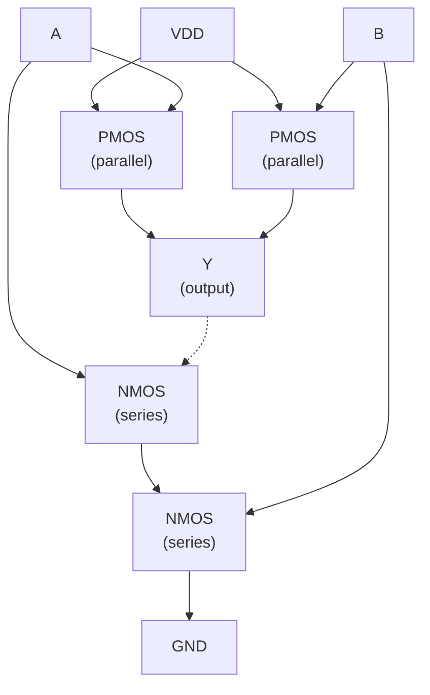

# Lesson 1: Boolean Algebra, Logic Gates, Universal Gate Sets

## 1. First-Principles Intuition & Invariants

Digital logic exists because electrical circuits can occupy only two stable voltage states. A transistor gate either conducts or blocks current; a transmission line either holds high voltage or bleeds to ground; a capacitor either stores enough charge to register as logical high or discharges below the recognition threshold. This binary nature mirrors the mathematical structure of Boolean algebra, where propositions evaluate to true or false, where set membership is absolute, and where operations collapse infinite analog continuums into discrete symbolic manipulation.

George Boole formalized this algebraic framework in 1854, decades before anyone conceived of electronic computation. His system defined three fundamental operations: conjunction (AND), disjunction (OR), and negation (NOT). These operations obey a compact set of axioms that govern all manipulations within the algebra. The identity elements establish that ANDing with TRUE leaves a variable unchanged, while ORing with FALSE preserves the original state. The null elements dictate that ANDing with FALSE yields FALSE regardless of the other operand, while ORing with TRUE forces the result to TRUE. The idempotent laws confirm that ANDing or ORing a variable with itself returns that variable unchanged. Complementation laws state that ANDing a variable with its negation produces FALSE, while ORing a variable with its complement produces TRUE.

Beyond these foundational axioms, Boolean algebra obeys commutative, associative, and distributive properties. Commutativity permits operand reordering without consequence: A AND B equals B AND A, and A OR B equals B OR A. Associativity allows regrouping of parentheses in chains of identical operations, so (A AND B) AND C equals A AND (B AND C). Distributivity connects AND and OR through structural identities, establishing that A AND (B OR C) equals (A AND B) OR (A AND C), and dually that A OR (B AND C) equals (A OR B) AND (A OR C). This second distributive law has no direct analog in arithmetic algebra, where multiplication distributes over addition but addition does not distribute over multiplication. Boolean algebra's perfect duality between AND and OR operations reflects a fundamental symmetry in the logical structure.

The principle of duality emerges as a metatheoretical invariant. Every valid Boolean identity remains valid when AND operations swap with OR operations, TRUE swaps with FALSE, and the statement structure otherwise remains intact. De Morgan's laws exploit this duality to convert between conjunctive and disjunctive forms. The first De Morgan law states that the negation of a conjunction equals the disjunction of the negations: NOT(A AND B) equals (NOT A) OR (NOT B). The second law provides the symmetric transformation: NOT(A OR B) equals (NOT A) AND (NOT B). These laws permit the conversion of any Boolean expression into alternate forms that may reduce gate count, minimize propagation delay, or match available integrated circuit primitives.

Physical realization of Boolean functions requires mapping abstract logical operations onto voltage-domain circuit elements. The earliest digital computers used electromechanical relays, where coil energization physically closed or opened contact switches to route current. Vacuum tube circuits replaced relays with thermionic emission, where heated cathodes released electrons that could be steered by grid voltages to control plate current. Transistor-transistor logic (TTL) emerged in the 1960s, using bipolar junction transistors in totem-pole output stages to source and sink current into following logic stages. Complementary metal-oxide-semiconductor (CMOS) technology replaced TTL in modern integrated circuits, pairing N-channel and P-channel MOSFETs to construct gates that draw minimal static current and switch rapidly under capacitive loads.

In CMOS implementations, an NMOS transistor conducts when its gate voltage exceeds the source voltage by more than the threshold voltage, typically connecting the output node toward ground potential. A PMOS transistor exhibits complementary behavior, conducting when its gate voltage falls below the source by more than its threshold magnitude, pulling the output toward the positive supply rail. By arranging NMOS transistors in series or parallel configurations that mirror complementary PMOS networks, designers construct gates that present high impedance in both output states except during brief transition intervals. This topology eliminates the static power dissipation that plagued TTL logic and enables billion-transistor systems-on-chip that operate within thermal envelopes measured in tens of watts.

The fundamental logic gates implement Boolean primitives directly. An AND gate produces logical high only when all inputs simultaneously present high voltage. An OR gate asserts high output whenever any input reaches the high threshold. A NOT gate inverts its single input, converting high to low and low to high. These three gates suffice to implement any Boolean function through systematic expansion, but practical circuit design incorporates derived gates that combine multiple primitive operations into single physical structures.

A NAND gate negates the AND function, producing low output only when all inputs hold high. A NOR gate negates the OR function, yielding high output only when all inputs present low voltage. An XOR gate implements exclusive disjunction, asserting high when an odd number of inputs are high, which for two-input gates reduces to the condition that inputs differ. An XNOR gate complements the XOR function, producing high output when inputs match. Each of these compound gates corresponds to distinct transistor network topologies that often require fewer transistors than cascading primitive gates would demand.

Universal gate sets possess the critical property that any Boolean function can be constructed using only gates from that set. The combination of AND, OR, and NOT gates forms a universal set by definition, since Boolean algebra axioms directly define completeness. More remarkably, both NAND alone and NOR alone constitute universal sets. This universality emerges from the ability to synthesize NOT, AND, and OR operations using only NAND gates or only NOR gates through specific connection patterns.

Constructing a NOT gate from a NAND gate requires tying all inputs together or connecting unused inputs to logical high. When both inputs of a two-input NAND gate receive the same signal A, the gate computes NOT(A AND A), which idempotent laws reduce to NOT A. Building an AND gate from NAND gates requires inverting the NAND output, which means cascading two NAND gates where the first computes the NAND function and the second operates as an inverter. Constructing an OR gate from NAND gates exploits De Morgan's law: A OR B equals NOT(NOT A AND NOT B). This identity translates to a circuit topology where individual NAND gates invert each input, then a final NAND gate combines the inverted signals.

NOR gates exhibit symmetric universality through dual transformations. A NOT gate emerges from a NOR gate by tying inputs together, yielding NOT(A OR A) which reduces to NOT A. An OR gate requires two NOR gates in cascade, where the second stage inverts the first NOR output. An AND gate construction applies De Morgan's dual law: A AND B equals NOT(NOT A OR NOT B), requiring individual NOR inversions of each input followed by a final NOR combination.

The universality of NAND and NOR gates carries profound implications for integrated circuit manufacturing. Fabrication processes optimize transistor geometries, doping profiles, and interconnect metallization for a single gate type, achieving superior performance characteristics compared to libraries containing diverse gate primitives. Historical NAND gate dominance in commodity logic families stems from the structural efficiency of NMOS pull-down networks in series configurations. Contemporary standard cell libraries for application-specific integrated circuits (ASICs) still feature NAND gates as area-efficient primitives, though NOR gates find favor in certain dynamic logic styles and in structured ASIC methodologies.

Truth tables provide exhaustive enumeration of Boolean function behavior. For a function accepting N binary inputs, the truth table contains 2^N rows, each corresponding to one possible input combination. Output columns specify the function value for each input state. Truth table construction follows lexicographic ordering of input combinations, conventionally listing binary sequences from all zeros through all ones in ascending numerical order. This canonical ordering ensures consistent interpretation across engineering documentation and enables mechanical comparison of Boolean functions.

Deriving gate-level implementations from truth tables proceeds through sum-of-products or product-of-sums canonical forms. The sum-of-products expansion identifies all truth table rows where the output equals one, then constructs a minterm for each such row by ANDing together input literals that match the row's input values, complementing variables that appear as zero. The complete function emerges by ORing all minterms together. This expansion directly translates to a two-level circuit: a first level of AND gates computing minterms, and a second level consisting of a single OR gate combining the minterms.

Product-of-sums expansion operates dually, identifying rows where the output equals zero and constructing maxterms by ORing together literals, complementing variables that appear as one. The function emerges by ANDing all maxterms. The resulting circuit inverts the sum-of-products topology: a first level of OR gates followed by a single AND gate. The choice between sum-of-products and product-of-sums forms depends on output polarity, gate availability, and the density of ones versus zeros in the truth table.

Karnaugh maps provide graphical minimization of Boolean functions by exploiting adjacency relationships among minterms. The map arranges truth table rows into a rectangular grid where horizontally or vertically adjacent cells differ in exactly one variable, reflecting the Gray code ordering principle. Visual inspection reveals rectangular clusters of cells containing ones, where each cluster corresponds to a product term that omits variables whose values vary within the cluster. Optimal minimization selects the minimal set of maximum-sized clusters that cover all ones in the map without redundancy, though practical optimization often accepts slight redundancy to simplify circuit topology or reduce propagation delay.

Quine-McCluskey tabular minimization extends Karnaugh map principles to arbitrary input dimensions through algorithmic enumeration of prime implicants. The procedure groups minterms by the number of ones in their binary representations, then systematically combines minterms differing in a single bit position to generate implicants with one fewer literal. Repeated application produces all prime implicants, which are then subjected to covering analysis to extract the minimal set. This algorithmic approach scales to functions with dozens of inputs, where graphical methods become intractable, and forms the basis of electronic design automation tools for logic synthesis.

## 2. Core Architecture & Mechanics

The structural mechanics of logic gates emerge from transistor network topology in CMOS technology. Each gate comprises a pull-up network built from PMOS transistors connected between the positive supply rail and the output node, and a pull-down network built from NMOS transistors connected between the output node and ground. These networks exhibit complementary behavior: exactly one network conducts for any valid input combination, establishing the output voltage near either supply rail while the opposite network remains in cutoff.

A two-input NAND gate instantiates this pattern with elegant simplicity. The pull-down network places two NMOS transistors in series between the output and ground, with each transistor gate driven by one input signal. Both transistors must conduct simultaneously to discharge the output node to ground potential, which occurs only when both inputs present logical high. The pull-up network arranges two PMOS transistors in parallel between the supply rail and the output. Either PMOS transistor conducting suffices to charge the output node high, which happens whenever either input falls to logical low. This complementary topology ensures that when both inputs are high, the series NMOS chain conducts while both PMOS transistors remain cut off, pulling the output low. For all other input combinations, at least one NMOS transistor blocks the pull-down path while at least one PMOS transistor activates the pull-up path, driving the output high.



NOR gate topology inverts this arrangement. The pull-down network positions NMOS transistors in parallel, so that any input going high provides a conduction path to ground. The pull-up network places PMOS transistors in series, requiring all inputs to be low before the series chain conducts and charges the output high. This duality between NAND and NOR gate structures reflects the broader duality principle in Boolean algebra and manifests physically in the swapping of series and parallel transistor configurations between pull-up and pull-down networks.

An inverter represents the simplest gate, containing a single NMOS transistor pulling to ground and a single PMOS transistor pulling to VDD. When the input goes high, the NMOS conducts and the PMOS cuts off, discharging the output. When the input goes low, the PMOS conducts and the NMOS blocks, charging the output. The ratio of PMOS to NMOS transistor widths determines the switching threshold voltage and the symmetry of rise versus fall times. Conventional designs size the PMOS approximately twice the width of the NMOS to compensate for the lower hole mobility in silicon, achieving balanced rise and fall times and positioning the switching threshold near the midpoint of the supply voltage range.

Propagation delay through a logic gate arises from the time required to charge or discharge the output node capacitance through the finite on-resistance of conducting transistors. The output node presents capacitive loading from the gate input capacitances of downstream logic stages, from the drain junction capacitance of the gate's own transistors, and from interconnect parasitic capacitance. The on-resistance of a MOSFET operating in the linear region depends on gate overdrive voltage, channel length, channel width, and carrier mobility. Reducing channel length or increasing width decreases resistance, speeding transitions but enlarging transistor area and increasing input capacitance.

The relationship between resistance and capacitance creates an RC time constant that governs exponential approach to the final voltage. For a step input, the output voltage evolves as V_out(t) = V_final × (1 - exp(-t / RC)) during charging or V_out(t) = V_initial × exp(-t / RC) during discharging. Logic families conventionally define propagation delay as the time interval from the 50% crossing of the input transition to the 50% crossing of the output transition. Rise time and fall time measure the interval for the output to traverse from 10% to 90% or from 90% to 10% of the voltage swing, characterizing the transition sharpness.

Cascading multiple gate stages introduces cumulative delay along signal paths. The critical path through a combinational logic network determines the maximum clock frequency in synchronous systems, since data must propagate through the longest chain and stabilize before the next clock edge samples the result. Optimization targets critical path delay reduction through gate sizing, buffer insertion, and logic restructuring. Gate sizing enlarges transistors in critical stages to reduce their output resistance, though this increases input capacitance and may slow down the preceding stage. Buffer insertion introduces additional inverter or buffer stages to partition long interconnect runs, restoring signal slew rates and reducing effective capacitive loading.

Logic restructuring exploits Boolean equivalence transformations to reduce gate count or depth. Associative regrouping flattens chains of identical operations, converting cascaded two-input gates into single multi-input gates with reduced propagation delay. Distributive factoring extracts common subexpressions, reducing redundant computation. De Morgan transformations swap AND/OR operations to exploit available gate types or achieve more balanced network topology. These transformations preserve logical equivalence while altering physical implementation characteristics.

The synthesis of arbitrary Boolean functions from universal gate sets proceeds through systematic reduction. Given a truth table or Boolean expression, the designer first expands the function into sum-of-products canonical form, yielding an expression composed of AND, OR, and NOT operations. Conversion to NAND-only implementation applies a two-step transformation. First, the output OR gate transforms into a NAND gate preceded by inverters on all inputs, exploiting the identity that OR equals NAND-of-inverted-inputs via De Morgan's law. Second, each NOT gate merges with the preceding AND gate by converting the AND-followed-by-NOT pattern into a single NAND gate. The resulting circuit contains only NAND gates, though it may require additional inverters if input signals arrive in uncomplemented form only.

```text
Original sum-of-products: Y = AB + CD

Transform OR to NAND:     Y = NAND(NOT(AB), NOT(CD))

Replace NOT-of-AND:       Y = NAND(NAND(A,B), NAND(C,D))
```

NOR-only synthesis follows dual transformations. The sum-of-products form converts to product-of-sums through inversion and De Morgan application. The AND gate becomes NOR-of-inverted-inputs, and NOT gates merge with preceding OR gates. The resulting topology consists exclusively of NOR gates, maintaining logical equivalence while restricting the gate vocabulary.

Multi-level logic synthesis extends two-level minimization by permitting arbitrary gate depth. While two-level circuits guarantee short propagation delay, they may require exponentially many gates for complex functions. Multi-level synthesis applies factoring, decomposition, and substitution to reduce transistor count at the expense of added levels. Technology mapping takes the optimized multi-level network and covers it with cells from a standard library, selecting gate implementations that minimize area, delay, or power according to optimization objectives.

Timing analysis verifies that all signal paths meet setup and hold time constraints at sequential elements. Static timing analysis traverses the logic network, computing arrival times at each node by summing gate delays along paths from primary inputs. Comparison of arrival times against required times at primary outputs or register inputs identifies timing violations. Critical path optimization focuses synthesis effort on the slowest paths, accepting less aggressive optimization on non-critical paths to reduce overall area or power.

Power dissipation in CMOS logic splits between dynamic and static components. Dynamic power arises from charging and discharging node capacitances during transitions, proportional to capacitance, supply voltage squared, and switching frequency. Static power stems from subthreshold leakage current in nominally off transistors and gate oxide tunneling current, both of which increase exponentially with temperature and linearly with transistor count. Low-power design techniques reduce supply voltage, minimize parasitic capacitance, employ clock gating to suppress transitions in idle logic, and use high-threshold transistors in non-critical paths to curtail leakage.

## 3. High-Performance Optimization & Failure Modes

Performance optimization in combinational logic balances competing objectives of speed, area, and power. Speed optimization targets critical path delay reduction through aggressive gate sizing, strategic buffer insertion, and logic depth minimization. Area optimization minimizes transistor count and interconnect length through maximal logic sharing, technology remapping to dense cell variants, and multi-level factoring. Power optimization reduces dynamic switching activity through clock gating, operand isolation, and glitch reduction, while curtailing static leakage through transistor stacking, power gating, and adaptive body biasing.

Gate sizing represents the most direct speed optimization lever. Enlarging transistors reduces their on-resistance, decreasing output node RC time constants and accelerating transitions. The optimal sizing balances the delay reduction in the current gate against the increased input capacitance loading the previous stage. Uniform upsizing of all gates in a path yields diminishing returns because early stages drive progressively heavier loads. Logical effort methodology formalizes this tradeoff, computing the optimal tapering ratio between successive stages to minimize path delay under a given load capacitance constraint.

The logical effort of a gate quantifies its current-driving capability relative to an inverter. An inverter possesses unit logical effort by definition. Multi-input gates exhibit logical effort greater than one because their internal transistor stacks present higher resistance than a single transistor. A two-input NAND gate has logical effort approximately 4/3, meaning it delivers 3/4 the current drive of an equally sized inverter. A two-input NOR gate shows logical effort around 5/3 due to the lower mobility of holes in PMOS transistors. Designers compute path logical effort by multiplying individual gate efforts, then determine the optimal stage effort that minimizes delay by taking the Nth root of the path logical effort, where N represents the number of stages.

Buffer insertion segments long interconnect wires to prevent RC delay degradation. Wire resistance increases linearly with length, while capacitance also grows linearly, yielding quadratic delay growth for unbuffered wires. Inserting buffers at regular intervals breaks the wire into segments, each presenting RC delay that grows quadratically with segment length but linearly with the number of segments. Optimal buffer spacing minimizes total delay, typically placing buffers when wire delay matches intrinsic buffer delay. Modern place-and-route tools automate buffer insertion, analyzing extracted parasitic resistance and capacitance to determine buffering requirements.

Logic restructuring transforms Boolean expressions to reduce delay or gate count while preserving functionality. Associative tree balancing converts linear chains of associative operations into balanced trees, reducing maximum fan-in and cutting critical path depth from N to log₂(N) for N-input operations. This transformation trades gate count for speed by introducing additional internal nodes. Distributive factoring extracts common subexpressions, reducing gate count by sharing logic between multiple outputs or internal nodes. The transformation A·C + B·C factors into (A + B)·C, replacing two AND gates and one OR gate with one OR gate and one AND gate, saving area at potential cost of increased delay if C lies on the critical path.

De Morgan transformations swap AND/OR operations to match available gate types or achieve favorable topology. Converting Y = A + B·C to Y = NOT(NOT(A) · NOT(B·C)) enables NAND-only implementation but introduces inversions. Bubble pushing systematically moves inversions through the network, annihilating inverter pairs and merging inversions into adjacent gates to convert between positive and negative logic representations. The final implementation may exploit native NAND or NOR gates without separate inverter stages.

Technology mapping matches optimized logic networks to standard cell libraries, selecting gate implementations from available variants with different drive strengths, threshold voltages, and functionality. The mapping phase considers gate delay as a function of load capacitance, gate input slew rates, and process-voltage-temperature (PVT) corners. Libraries provide high-VT cells for non-critical paths to reduce leakage, low-VT cells for critical paths to improve speed, and multi-VT optimization blends cell types to meet timing constraints while minimizing power.

Clock gating eliminates dynamic power in idle functional units by blocking clock distribution to registers whose inputs will not change. A clock gating cell combines an AND or integrated clock gate (ICG) that enables the local clock only when logic activates a control signal. This technique cuts dynamic power proportionally to idle time but introduces gating control logic and requires careful timing verification to prevent setup/hold violations. Hierarchical clock gating applies the technique at multiple granularities, from individual register files to entire processor cores, with fine-grained gating offering greater power reduction at the cost of increased control complexity.

Glitch power arises from spurious transitions in combinational logic due to mismatched arrival times at gate inputs. When a gate's inputs change at slightly different times, the output may momentarily evaluate an intermediate state before settling to the final value. Each glitch charges and discharges parasitic capacitance, dissipating energy without performing useful computation. Glitch reduction balances path delays through gate sizing and buffer insertion to synchronize signal arrivals, minimizing spurious transitions. Some synthesis flows employ delay padding to deliberately equalize path delays, trading slight speed degradation for significant power reduction in glitch-prone networks.

Timing closure addresses violations where signal paths fail to meet setup or hold time requirements at sequential elements. Setup violations occur when data arrives too late at a register input relative to the capturing clock edge, risking metastability or incorrect sampling. Hold violations arise when data changes too soon after the clock edge, potentially corrupting the captured value before the register's internal feedback loop latches the state. Setup violations require speeding up the data path through gate upsizing, buffer insertion, or logic restructuring. Hold violations demand slowing down the data path or delaying the clock, often accomplished through buffer insertion on the data path or clock skew adjustments.

Process-voltage-temperature (PVT) corners account for manufacturing variations, supply voltage fluctuations, and operating temperature ranges that affect transistor performance. Fast process corners feature thin gate oxides and high carrier mobility, reducing delay but increasing leakage. Slow corners exhibit thick oxides and low mobility, increasing delay while decreasing leakage. Timing verification must pass at slow corners to guarantee functionality under worst-case conditions, while leakage and dynamic power budgets must hold at fast corners where transistors switch rapidly and leak aggressively. Multi-corner optimization explores this space to meet all constraints simultaneously.

Metastability threatens synchronous systems when asynchronous inputs violate setup or hold time requirements at register inputs. If a register samples an input during its aperture window—the brief interval around the clock edge when the input must remain stable—the internal cross-coupled inverters may enter a metastable state where the output hovers near the switching threshold for an extended duration before eventually resolving to a valid logic level. The resolution time follows an exponential distribution, so extending the time allowed for resolution exponentially reduces the probability of failure. Synchronizer chains insert multiple register stages between asynchronous domains, allowing metastability to resolve in early stages before data propagates to logic that assumes valid levels.

Hazards represent transient output glitches in combinational logic that violate the assumption of monotonic transitions. Static hazards occur when a single input change momentarily causes the output to glitch to the opposite polarity before returning to the original state. Dynamic hazards involve multiple transitions during a single input change. Hazards arise from unequal delay paths that cause intermediate states to propagate through gates. Hazard elimination inserts redundant logic to mask glitching paths or employs delay matching to prevent intermediate states from reaching gate inputs simultaneously. In asynchronous circuits, where glitches can cause state machine malfunction, hazard-free design becomes mandatory.

Electromagnetic interference (EMI) and crosstalk impose physical constraints on logic implementation. Simultaneous switching of many outputs generates current surges in supply rails, inducing voltage droop that can violate noise margins. Power distribution networks must present low impedance at all frequencies through decoupling capacitors at multiple scales, from on-die trench capacitors to board-level bulk capacitors. Crosstalk between adjacent signal traces couples noise through capacitive and inductive mechanisms, corrupting logic levels on victim nets when aggressor nets switch. Physical design rules enforce minimum spacing, route critical signals on isolated layers, and employ differential signaling for noise immunity.

Design for testability (DFT) techniques enable manufacturing test and field diagnostics. Scan chain insertion replaces sequential elements with scan flip-flops that allow shifting test vectors into registers and observing results without relying on functional logic paths. Automatic test pattern generation (ATPG) computes test vectors that detect stuck-at faults, transition faults, and bridging faults, achieving high fault coverage essential for automotive and aerospace applications. Built-in self-test (BIST) embeds pattern generators and signature analyzers on-chip, enabling autonomous testing without external equipment, critical for systems where physical test access is limited or expensive.

Formal verification proves correctness of logic implementations without exhaustive simulation. Equivalence checking confirms that synthesized netlists match RTL specifications by constructing Boolean functions for corresponding outputs and proving functional equivalence through satisfiability (SAT) solving or binary decision diagrams (BDDs). Model checking verifies temporal properties expressed in linear temporal logic (LTL) or computation tree logic (CTL), exhaustively exploring the state space to confirm that assertions hold under all reachable conditions. Formal methods provide guarantees impossible through simulation-based verification, catching corner cases that might escape traditional testbenches, though they face scalability challenges on designs with large state spaces.

The progression from Boolean algebra through gate-level synthesis to physical implementation illustrates the layered abstraction essential to digital design. Mathematical identities enable reasoning about correctness independent of physical realization. Universal gate sets provide implementation flexibility, allowing optimization for area, speed, or power within fabrication process constraints. Careful analysis of timing, power, and noise ensures robust operation across environmental conditions and manufacturing variations. Mastery of these principles equips the practitioner to navigate tradeoffs, diagnose failures, and extract maximum performance from silicon implementations of logical functions.
