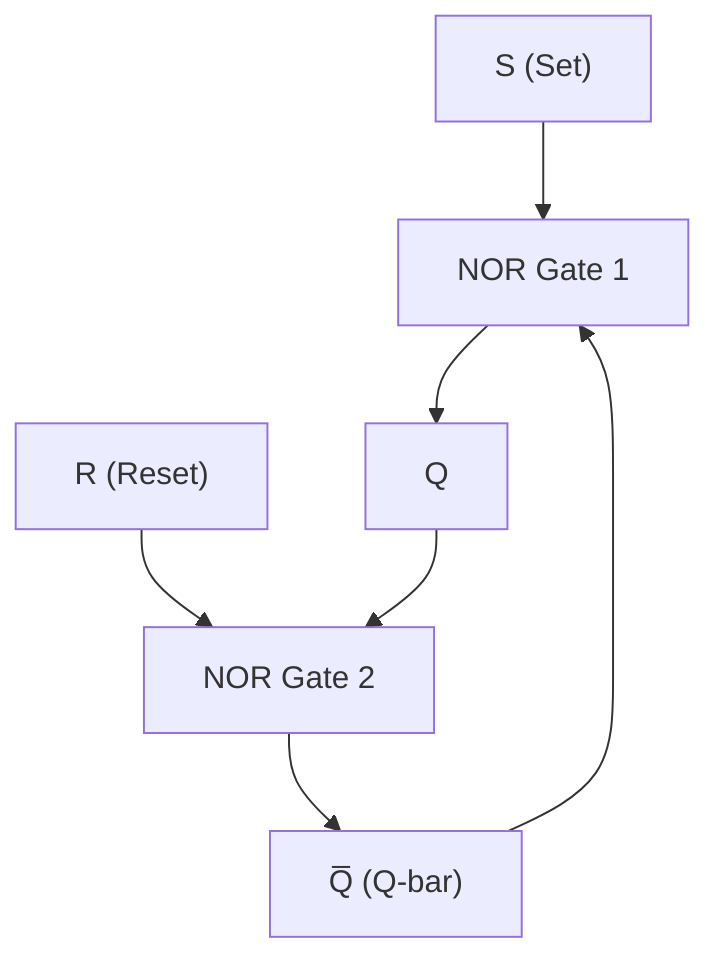
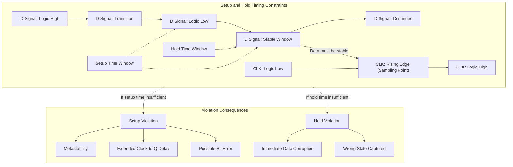
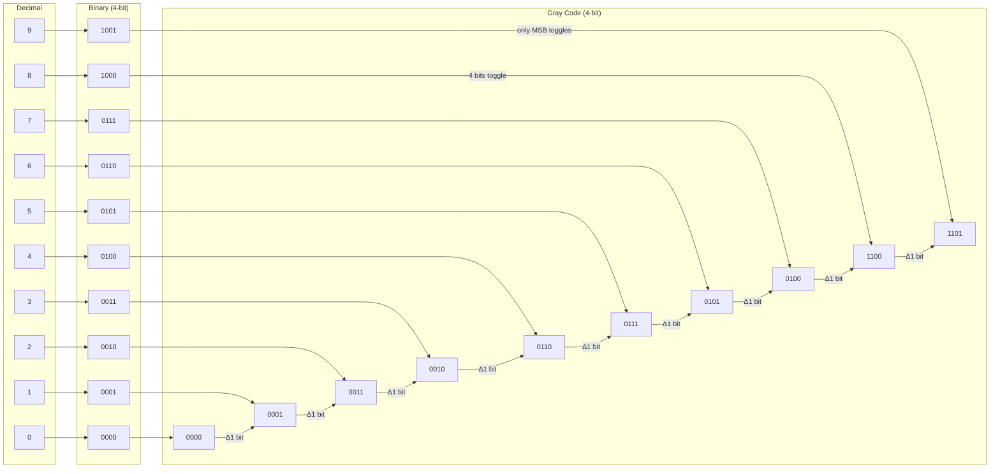

# Lesson 3: Sequential Logic, Latches, Flip-Flops, Registers

## 1. First-Principles Intuition & Invariants

Combinational logic circuits compute their outputs as pure functions of current inputs, with no awareness of history or time. A two-input NAND gate evaluates its Boolean function instantaneously, modulo gate propagation delay, and forgets the outcome the moment inputs change. This memoryless property makes combinational logic elegant for arithmetic units and decoders, but fundamentally insufficient for any system requiring state retention: counters that track events, shift registers that serialize data streams, or control sequencers that orchestrate multi-step protocols. The transition from combinational to sequential logic represents the conceptual leap from stateless Boolean algebra to time-aware finite state machines, and it hinges on a single architectural innovation: controlled positive feedback.

Sequential circuits introduce memory by deliberately violating the acyclic constraint of combinational design. Where combinational topologies prohibit output-to-input loops to avoid oscillation and metastability, sequential elements embrace feedback under strict regulatory conditions. The fundamental building block, the SR latch, routes its own output back to its input through cross-coupled NOR or NAND gates, creating a bistable circuit with two stable equilibrium states. Once set into one state, the latch remains there indefinitely, even after the input stimulus is removed, because the feedback path continuously reinforces the current output. This self-sustaining behavior transforms transient electrical signals into persistent memory cells.

The critical insight governing all sequential logic is that feedback alone produces chaos without synchronization. An uncontrolled feedback loop in a gate network can oscillate at unpredictable frequencies, settle into metastable voltage plateaus between logic high and low, or race between competing propagation paths. Sequential design therefore imposes a dual mandate: feedback must be topologically constrained to ensure bistability, and state transitions must be temporally regulated through clock signals or enable strobes. The SR latch satisfies the first requirement through its cross-coupled topology, where each gate's output reinforces the other's input in a mutually stabilizing configuration. The second requirement, synchronization, motivates the evolution from level-sensitive latches to edge-triggered flip-flops, which sample inputs only on rising or falling clock edges, not continuously.

Timing closure emerges as the paramount constraint in sequential circuit design. Unlike combinational paths, where worst-case propagation delay simply determines maximum clock frequency, sequential loops must satisfy setup and hold time constraints relative to clock edges. Setup time defines the minimum interval before a clock transition during which input data must remain stable; hold time specifies the minimum interval after the clock edge. Violating either constraint injects metastability, a state where the flip-flop's internal nodes hover near the switching threshold voltage, delaying the output transition by unbounded time intervals or even producing erroneous logic levels. This quantum-mechanical phenomenon, rooted in thermal noise and insufficient gate gain, cannot be eliminated, only statistically bounded through careful timing margin allocation.

The architectural progression from simple SR latches to complex synchronous counters and shift registers reflects an escalating abstraction hierarchy. At the foundation, the SR latch provides set and reset control but suffers from a forbidden input combination where both set and reset are asserted simultaneously, leaving the next state undefined. The D latch eliminates this hazard by accepting a single data input and an enable strobe, guaranteeing predictable state transitions. Elevating the D latch to an edge-triggered D flip-flop introduces master-slave cascading or transmission-gate pulsing, confining input sampling to infinitesimally brief clock edges rather than level durations. This edge-triggering discipline synchronizes an entire digital system to a common clock reference, enabling multi-stage pipelines where each register stage captures the previous stage's output on the same clock edge without race conditions.

Registers, built from parallel arrays of flip-flops sharing a common clock, become the workhorse storage elements in microprocessors, FPGAs, and ASICs. A 32-bit register comprises 32 individual D flip-flops, all clocked simultaneously, capturing a 32-bit data bus on every rising edge. Shift registers extend this concept by chaining flip-flop outputs to subsequent inputs, creating serial-to-parallel or parallel-to-serial converters essential for UART communication, LED matrix drivers, and cryptographic linear feedback shift registers. Counters implement finite state machines with arithmetic progression, incrementing or decrementing their state on each clock cycle, and find application in timekeeping, frequency division, address generation for memory scans, and event tallying in sensor instrumentation.

The invariant underlying all sequential logic is that time becomes a first-class design parameter, not an incidental parasitic. Gate delays cease to be mere performance limitations and become the fundamental mechanism enforcing causality in state transitions. Clock period, jitter, skew, and duty cycle propagate through timing budgets with the same rigor that resistance, capacitance, and inductance govern analog signal integrity. A flip-flop's metastability window, typically in the low picosecond range for modern CMOS processes, dictates the statistical failure rate of synchronizers crossing clock domains. The designer's task is not to eliminate timing constraints, which physics renders impossible, but to architect systems where worst-case timing scenarios remain within specified margins across process, voltage, and temperature corners.

## 2. Core Architecture & Mechanics

The SR latch, constructed from two cross-coupled NOR gates, represents the minimal bistable memory element in digital logic. In the NOR-gate implementation, each gate's output feeds back to the other gate's input, creating a symmetric topology where asserting the Set input forces the Q output high, and asserting the Reset input forces Q low. When both Set and Reset return to logic zero, the latch retains its previous state indefinitely, as the feedback path sustains the output voltage through regenerative action. The forbidden condition arises when both Set and Reset are asserted simultaneously, driving both NOR gate outputs low and leaving the next state ambiguous once the inputs release. This race condition, dependent on minute manufacturing variations in gate threshold voltages and load capacitances, makes the SR latch unsuitable for automated synthesis in modern ASIC flows, though it remains a valuable teaching artifact for understanding feedback dynamics.



The NAND-gate SR latch inverts the active polarity, requiring active-low inputs for set and reset operations. In CMOS technology, NAND gates consume lower transistor counts than NOR gates, making the NAND latch marginally more area-efficient in integrated circuits. The topology remains identical, with outputs cross-coupled to inputs, but the truth table reflects complementary logic levels. When both inputs rest at logic high, the latch holds its state; asserting Set low drives Q high; asserting Reset low drives Q low. The forbidden state now occurs with both inputs low, producing both outputs high—a logically inconsistent condition that again leads to race-dependent behavior upon input release.

The gated SR latch introduces an enable control that synchronizes state changes to external timing signals. By placing AND gates in series with the Set and Reset inputs and tying both AND gates' second inputs to a common Enable strobe, the latch ignores Set and Reset transitions while Enable remains low. Only when Enable asserts high do the input signals propagate through to the cross-coupled NOR or NAND core. This gating mechanism provides rudimentary synchronization, preventing spurious state changes during input signal glitches, but remains level-sensitive: the latch continuously tracks input changes for the entire duration that Enable stays high. This level-sensitive behavior creates timing hazards in pipelined systems, where a single clock phase might span multiple gate delays, allowing input transitions to ripple through multiple latch stages within one clock period.

The D latch eliminates the SR latch's forbidden state by accepting a single data input and internally generating complementary set and reset signals. The circuit places an inverter between the D input and the Reset gate input, ensuring that Set and Reset always drive opposite logic levels. When the Enable strobe is high, the Q output transparently follows the D input: D high sets Q high, D low resets Q low. When Enable falls low, the latch freezes, retaining the last D value sampled before the enable transition. This transparency property, where output tracks input during the enable window, classifies the D latch as level-sensitive or transparent, distinguishing it from the edge-triggered flip-flop.

```text
D Latch Internal Structure:

              ┌─── D
              │
              ├───┬─── AND ─── S ───┐
              │   │                  │
        EN ───┼───┤              NOR Latch ─── Q
              │   │                  │
              │   └─── AND ─── R ───┘
              │         │
              └─── INV ─┘

Timing Diagram:
        
EN  ────┐       ┌───────┐       ┌───
        └───────┘       └───────┘
        
D   ──────┐   ┐   ┌─────────┐   ┌──
          └───┘   └─┘         └───┘
          
Q   ──────┐       ┌───────────────
          └───────┘           (holds)
          
     ← transparent →  ← hold →
```

The master-slave flip-flop architecture cascades two D latches in series to achieve edge-triggered behavior. The first stage, the master latch, enables on clock high, sampling the D input and updating its internal state. The second stage, the slave latch, enables on clock low, capturing the master's output only after the clock falls. This two-stage pipelining ensures that the slave output Q updates precisely at the falling clock edge, and critically, that the input D cannot influence Q during the clock high phase, because the slave remains opaque while the master is transparent. The master-slave configuration effectively samples the input at one clock edge (rising or falling, depending on inverter placement) and propagates the sampled value to the output on the opposite edge, achieving edge-sensitive behavior.

Modern CMOS flip-flops typically implement edge-triggering through transmission-gate pulsing rather than master-slave topologies, reducing transistor count and power consumption. A transmission gate, constructed from parallel NMOS and PMOS transistors with complementary gate drives, acts as a bidirectional analog switch with near-zero on-resistance when enabled. By pulsing the transmission gate's enable signal with a narrow clock-derived strobe, the flip-flop samples the input during a brief window centered on the clock edge, then latches the result in a feedback inverter pair. This pulsed-latch approach achieves functionally identical edge-triggering to the master-slave design while consuming half the transistor count and exhibiting lower clock-to-Q propagation delay.

Setup and hold times emerge from the physics of charge redistribution in the flip-flop's internal nodes. During the setup interval before the clock edge, the input data must drive the transmission gate's storage node to a voltage level that unambiguously resolves to logic high or low after the transmission gate opens. If the input transitions too close to the clock edge, the storage node voltage may settle in the metastable region near the CMOS inverter's switching threshold, where both PMOS and PMOS transistors conduct simultaneously, leaving the output voltage indeterminate. The hold time requirement ensures that input data remains stable after the clock edge long enough for internal feedback paths to latch the sampled value, preventing subsequent input transitions from corrupting the stored state before the transmission gate fully closes.



The JK flip-flop extends D flip-flop functionality by introducing toggle capability. With J and K inputs both low, the flip-flop holds its current state. J high and K low sets the output; J low and K high resets the output. The unique behavior emerges when both J and K assert high: the flip-flop toggles, complementing its previous state on each clock edge. This toggle mode enables binary counters and frequency dividers, where a chain of JK flip-flops in toggle configuration divides the input clock frequency by successive powers of two. Internally, the JK flip-flop implements a D flip-flop with combinational feedback logic: the D input derives from `D = J·Q̅ + K̅·Q`, ensuring that the next state either sets, resets, holds, or toggles based on the J, K, and current Q values.

The T flip-flop simplifies the JK flip-flop by providing a single toggle input. When T is low, the flip-flop holds its state; when T is high, it toggles on each clock edge. This two-input device (T and clock) serves as the fundamental building block for ripple counters and frequency dividers. A single T flip-flop with T tied high divides the input clock by two, producing a square wave at half the input frequency. Cascading multiple T flip-flops in series, where each flip-flop's output clocks the next stage, creates a ripple counter that increments asynchronously, with each bit's transition propagating through subsequent stages sequentially rather than simultaneously.

Synchronous counters improve on ripple counter timing by clocking all flip-flops simultaneously and generating the next state through combinational logic. A 4-bit synchronous binary counter uses four D or JK flip-flops sharing a common clock, with each flip-flop's D input computed as `D[i] = Q[i] ⊕ (Q[i-1] · Q[i-2] · ... · Q[0])`, implementing the binary increment function. This parallel state transition eliminates the cumulative propagation delay of ripple counters, where a transition in the least significant bit must sequentially ripple through all higher bits, limiting maximum counting frequency. Synchronous design also simplifies timing analysis, as all flip-flop transitions occur within a single clock period, bounded by worst-case combinational logic delay plus flip-flop setup time.

```text
4-Bit Synchronous Binary Counter:

        ┌───────┐  ┌───────┐  ┌───────┐  ┌───────┐
D[3] ───┤D    Q├──┤D    Q├──┤D    Q├──┤D    Q├─── Q[3:0]
        │  FF  │  │  FF  │  │  FF  │  │  FF  │
CLK ────┤>    │  │>    │  │>    │  │>    │
        └───────┘  └───────┘  └───────┘  └───────┘
            │          │          │          │
            └──────────┴──────────┴──────────┘
                       │
                [Increment Logic]
                
D[0] = Q[0] ⊕ 1         (always toggle)
D[1] = Q[1] ⊕ Q[0]      (toggle if Q[0]=1)
D[2] = Q[2] ⊕ (Q[1]·Q[0])
D[3] = Q[3] ⊕ (Q[2]·Q[1]·Q[0])
```

Shift registers serialize or deserialize parallel data by chaining flip-flops where each stage's output connects to the next stage's input. A serial-in, parallel-out shift register loads data one bit per clock cycle through a single input, shifting previously loaded bits down the chain until all stages hold valid data, at which point the parallel outputs present the complete word. Conversely, a parallel-in, serial-out register loads all bits simultaneously through parallel inputs, then shifts the data out one bit per clock cycle through a single serial output. Bidirectional shift registers incorporate multiplexers at each flip-flop input, selecting between the left neighbor's output (shift right), the right neighbor's output (shift left), or parallel load data based on control signals.

Linear feedback shift registers (LFSRs) introduce XOR feedback taps from selected flip-flop outputs back to the input, creating pseudo-random bit sequences. A maximal-length LFSR configured with primitive polynomial feedback traverses all 2^n - 1 possible states (excluding all-zeros) before repeating, making it invaluable for built-in self-test (BIST) pattern generation, cryptographic stream ciphers, and CRC checksums. The Fibonacci LFSR configuration places XOR gates in series with the shift chain at tap positions corresponding to polynomial coefficients, while the Galois configuration distributes XOR operations across parallel feedback paths, reducing the critical timing path at the cost of increased gate count.

## 3. High-Performance Optimization & Failure Modes

Clock domain crossing represents the most treacherous failure mode in sequential logic systems, where data transfers between clock domains operating at different frequencies or with arbitrary phase relationships. A flip-flop clocked by domain A cannot safely capture data from domain B unless synchronization circuitry ensures that setup and hold times are satisfied relative to domain A's clock. The simplest synchronizer, a two-stage flip-flop chain, re-samples the incoming signal on two successive clock edges, statistically bounding metastability propagation. The first flip-flop may enter metastability if the input violates setup/hold constraints, but the second flip-flop samples the first's output after a full clock period, allowing metastability to resolve with exponentially decreasing failure probability.

Metastability failure rates scale exponentially with the resolving time budget allocated between flip-flop stages. The mean time between failures (MTBF) for a synchronizer follows the exponential relationship `MTBF = e^(t_r / τ) / (f_c · f_d)`, where `t_r` denotes the resolving time (clock period minus setup time minus clock-to-Q delay), `τ` represents the flip-flop's metastability time constant (typically 20-100 picoseconds in modern CMOS), `f_c` is the capturing clock frequency, and `f_d` is the data transition frequency. Doubling the resolving time squares the MTBF; conversely, doubling the clock frequency halves it. Mission-critical systems may cascade three or more synchronizer stages to achieve MTBF exceeding the product's operational lifetime, trading latency for reliability.

Gray code sequencing in multi-bit counter transitions eliminates the glitch hazards inherent in binary counting across clock domain boundaries. A binary counter transitioning from `0111` (7) to `1000` (8) temporarily produces spurious intermediate values like `0110`, `0100`, or `1100` as different bits switch at slightly different times due to routing skew and gate delay mismatches. If an asynchronous receiving circuit samples the counter during this glitch window, it captures a transient incorrect value. Gray code counters modify the state encoding such that only one bit changes per increment, guaranteeing that even if the sample instant falls during a bit transition, the captured value is either the previous or next state, never a spurious intermediate.



Clock skew, the spatial variation in clock arrival times across a chip due to routing parasitics and buffer delays, directly subtracts from setup and hold timing margins. In a synchronous system where all flip-flops nominally clock simultaneously, a 100-picosecond skew between the source flip-flop's clock and the destination flip-flop's clock effectively reduces the combinational logic budget by 100 picoseconds, as the destination samples earlier relative to the source's launch edge. Modern SoCs mitigate skew through hierarchical clock tree synthesis, where H-tree or X-tree topologies balance routing lengths to minimize skew, and through clock mesh networks that distribute the clock via a fine-grained grid, allowing local currents to average out spatial variations.

Retiming transformations optimize pipelined datapaths by repositioning registers along combinational paths to balance stage delays without altering functional behavior. A pipeline with stages taking 10 nanoseconds, 5 nanoseconds, and 15 nanoseconds limits system frequency to 66.7 MHz, determined by the slowest stage. Retiming algorithms analyze the combinational logic network and move flip-flops forward or backward through logic gates, redistributing delay across stages to equalize worst-case paths. After retiming, the same circuit might achieve three 10-nanosecond stages, increasing frequency to 100 MHz. Commercial synthesis tools automate retiming during optimization, subject to constraints preventing register movement across I/O boundaries or asynchronous control signals.

Dynamic frequency scaling and clock gating reduce power consumption in sequential circuits by selectively disabling clock distribution to idle register banks. A clock gating cell inserts an AND or OR gate in series with the clock tree, allowing control logic to inhibit clock edges from reaching downstream flip-flops when the data they store is not actively required. This eliminates toggle power, which dominates dynamic power consumption in CMOS flip-flops, as each clock edge transitions internal nodes even when the data input does not change. Fine-grained clock gating at the register-file or functional-unit level can reduce chip power by 20-40% in typical microprocessor workloads, though it introduces additional clock skew and requires careful integration with scan chains for design-for-test.

Scan chain insertion converts flip-flops into scannable elements for manufacturing test and debug. A scan flip-flop multiplexes between its functional D input and a serial scan input, controlled by a global scan enable signal. In scan mode, all flip-flops chain serially, allowing external test equipment to shift arbitrary bit patterns into the chip, execute one clock cycle in functional mode, then shift out captured results. This structural test approach achieves near 100% fault coverage for stuck-at and transition faults, detecting manufacturing defects that cause internal nodes to remain fixed at logic high or low. The scan chain also provides invaluable debug visibility, capturing internal state snapshots during silicon bring-up when logic analyzer probing is impractical.

Glitch filtering on asynchronous inputs prevents spurious register state changes caused by mechanical switch bounce or transmission line reflections. A hardware debouncer integrates the input signal over a time window, requiring the input to remain stable for a minimum duration before accepting the transition as valid. A simple implementation uses a counter clocked at high frequency: the counter increments when the input is high and decrements when low, wrapping at maximum and minimum thresholds. Only when the counter saturates at the high threshold does the output transition high; similarly, saturation at zero drives the output low. This digital low-pass filter suppresses glitches shorter than the counter's integration period, which typically ranges from 1 millisecond for mechanical switches to 10 microseconds for signal integrity issues.

Multi-bit synchronizer pathologies arise when attempting to synchronize parallel buses across clock domains without handshake protocols. Sampling a 16-bit address bus transitioning from `0x1234` to `0x5678` through a two-stage synchronizer chain does not guarantee that all 16 bits resolve coherently—some bits may still reflect the old value while others capture the new value, producing transient garbage addresses like `0x1678` or `0x5234`. Robust clock domain crossing for multi-bit data requires either Gray code sequencing for counter-style transitions, or full handshake synchronization using request/acknowledge signals and a dual-clock FIFO with independent read and write pointers synchronized via Gray counters.

Asynchronous reset distribution poses its own timing challenges, as reset assertion is inherently asynchronous but reset deassertion must be synchronized to avoid violating recovery time constraints. The recovery time, analogous to setup time, specifies the minimum interval before a clock edge during which an asynchronous reset must deassert to guarantee predictable flip-flop initialization. A globally distributed reset signal reaching different flip-flops with nanosecond-scale skew may deassert relative to the clock edge within the recovery window at some flip-flops but not others, creating initialization metastability. The industry-standard solution employs asynchronous assertion with synchronous deassertion: the reset signal directly forces all flip-flops into a known state, but deassertion routes through a two-stage synchronizer clocked by the system clock, ensuring that the reset release propagates cleanly relative to the clock edge across the entire chip.

Hold time violations manifest when combinational logic delays between flip-flops are too short, allowing data transitions launched by one flip-flop to propagate through to the input of a subsequent flip-flop before that flip-flop's hold time expires. Unlike setup violations, which reduce maximum operating frequency but often do not cause functional failure at lower speeds, hold violations represent absolute timing faults that corrupt data regardless of clock frequency. Synthesis tools automatically insert delay buffers in critically short paths to satisfy hold time constraints, but careless manual layout or post-synthesis ECOs can inadvertently create hold violations. Timing sign-off verification must analyze both setup and hold across all process, voltage, and temperature corners, as fast process corners that improve setup margins simultaneously degrade hold margins.
