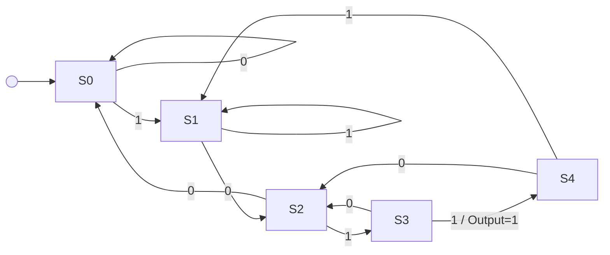
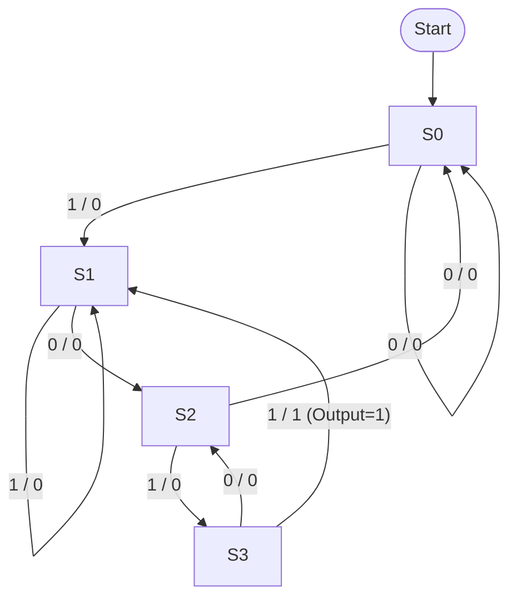

# Lesson 4: Finite State Machines, Memory Architectures, Timing Analysis

## 1. First-Principles Intuition & Invariants

Combinational logic is memoryless. A network of AND, OR, and NOT gates evaluates inputs and drives outputs within a propagation delay window, but the moment the inputs change, the outputs are destinied to follow. This statelessness is insufficient for any computation that requires history, sequence, or control flow. To build a processor, a bus controller, or a signal demodulator, we require a mechanism to preserve information across clock cycles. This is the domain of sequential logic, where the Finite State Machine (FSM) serves as the foundational abstraction.

An FSM is defined by five primitives: a finite set of states, a finite set of inputs, a finite set of outputs, a state transition function, and an output function. The transition function dictates the next state based on the current state and current inputs. The output function dictates the machine's output. The distinction between the two canonical FSM models, Mealy and Moore, lies entirely in the inputs to the output function.

In a Moore machine, the output function depends solely on the current state. This decouples the output from the asynchronous input transitions, meaning outputs only change at clock edges, making them inherently glitch-free relative to the clock domain. However, this separation often requires additional states to represent output conditions. In a Mealy machine, the output function depends on both the current state and the current inputs. This makes Mealy machines typically more compact in terms of state count, but it exposes the outputs to asynchronous input changes, which can generate transient glitches if the inputs are not tightly synchronized to the clock.

Regardless of the model, the physical implementation of an FSM relies on a state register, a block of flip-flops that stores the current state vector. The stability of this register is governed by the invariants of digital timing: setup time ($t_{su}$), hold time ($t_{h}$), and clock-to-Q propagation delay ($t_{c-q}$). These parameters form the critical path equation that dictates the maximum operating frequency of the machine. If the timing analyzer cannot prove that the data arrives at the input of the state register at least $t_{su}$ before the clock edge and remains stable for at least $t_{h}$ after it, the register enters a metastable state, and the deterministic execution of the FSM collapses.

## 2. Core Architecture & Mechanics

To ground these concepts, consider the design of a sequence detector that asserts a high output when it identifies the serial bitstream "1011". This is a classic boundary condition between Mealy and Moore implementations because it allows overlapping sequences (the final '1' can be the first '1' of the next pattern).

### Mealy vs. Moore State Diagrams

For the Moore machine, the output is tied to the state. We need five states to detect "1011" and assert the output.



State `S0` is the reset state (Output=0). `S1` indicates we have seen a '1'. `S2` indicates '10'. `S3` indicates '101'. `S4` indicates '1011', and is the only state where the output is high.

For the Mealy machine, the output is associated with the transition. We only need four states (`S0` through `S3`), and the output asserts on the transition from `S3` to `S1` when the input is '1'.



### State Encoding and Logic Synthesis

With the state diagram established, we must encode the abstract states into binary vectors. The choice of encoding—binary, Gray code, or one-hot—drastically impacts the complexity of the next-state logic and the routing resources required.

For the Moore machine requiring five states, a binary encoding needs 3 bits. A one-hot encoding needs 5 bits. While one-hot consumes more flip-flops, it reduces the decode logic to a minimum, often resulting in faster clock frequencies in FPGA architectures where look-up tables (LUTs) are abundant but wide fan-in logic is expensive.

Consider the one-hot encoded state table for the Moore machine:

| Current State | Encoding | Input=0 | Input=1 | Output |
|---------------|----------|---------|---------|--------|
| S0            | 00001    | S0      | S1      | 0      |
| S1            | 00010    | S2      | S1      | 0      |
| S2            | 00100    | S0      | S3      | 0      |
| S3            | 01000    | S2      | S4      | 0      |
| S4            | 10000    | S2      | S1      | 1      |

From this table, we derive the next-state logic equations for each state bit ($D_n$) and the output equation. Using Karnaugh maps or Boolean algebra minimization, we find:

$D_{S0} = S_0 \cdot \overline{in}$
$D_{S1} = S_0 \cdot in + S_1 \cdot in + S_4 \cdot in$
$D_{S2} = S_1 \cdot \overline{in} + S_3 \cdot \overline{in} + S_4 \cdot \overline{in}$
$D_{S3} = S_2 \cdot in$
$D_{S4} = S_3 \cdot in$
$Output = S_4$

This logic can be directly translated into a hardware description language. The following Verilog implements the Moore machine using a standard three-block architectural pattern, separating the state register, the next-state logic, and the output logic for clarity and maintainability.

```verilog
module moore_seq_detect (
    input  wire clk,
    input  wire rst_n,  // Active-low asynchronous reset
    input  wire din,    // Serial data input
    output reg  dout    // Detection output
);

    // One-hot state encoding
    localparam S0 = 5'b00001;
    localparam S1 = 5'b00010;
    localparam S2 = 5'b00100;
    localparam S3 = 5'b01000;
    localparam S4 = 5'b10000;

    reg [4:0] state, next_state;

    // State Register Block
    always @(posedge clk or negedge rst_n) begin
        if (!rst_n) state <= S0;
        else state <= next_state;
    end

    // Next State Logic Block
    always @(*) begin
        case (state)
            S0: next_state = din ? S1 : S0;
            S1: next_state = din ? S1 : S2;
            S2: next_state = din ? S3 : S0;
            S3: next_state = din ? S4 : S2;
            S4: next_state = din ? S1 : S2;
            default: next_state = S0;
        endcase
    end

    // Output Logic Block (Moore)
    always @(*) begin
        if (state == S4) dout = 1'b1;
        else dout = 1'b0;
    end

endmodule
```

### Memory-Based FSM Implementation: The ROM Microcode Approach

When FSMs become large, discrete gate logic becomes unwieldy. Instead, we can implement the machine using a memory array, typically a ROM. In this architecture, the state register feeds the most significant bits of the ROM address, and the external inputs feed the least significant bits. The ROM data output provides the next state and the FSM outputs. This is the essence of microcode.

For a Moore machine with 5 states and 1 input, we need a 3-bit state vector and a 1-bit input, totaling 4 address bits. The ROM requires $2^4 = 16$ locations. The data width must accommodate the 3-bit next state and any output bits. If we use binary state encoding, the ROM content for the "1011" detector maps directly from the state transition table.

| Address (State[2:0], In) | Data (NextState[2:0], Out) |
|-------------------------|---------------------------|
| 0000 (S0, 0)           | 000, 0                    |
| 0001 (S0, 1)           | 001, 0                    |
| 0010 (S1, 0)           | 010, 0                    |
| 0011 (S1, 1)           | 001, 0                    |
| 0100 (S2, 0)           | 000, 0                    |
| 0101 (S2, 1)           | 011, 0                    |
| 0110 (S3, 0)           | 010, 0                    |
| 0111 (S3, 1)           | 100, 0                    |
| 1000 (S4, 0)           | 000, 0                    |
| 1001 (S4, 1)           | 001, 0                    |
| 1010 (X)               | 000, 0                    |
| ...                     | ...                       |

This ROM-based approach scales efficiently for complex controllers, trading combinational logic density for memory density.

## 3. High-Performance Optimization & Failure Modes

As clock frequencies scale upward, the physical realities of the silicon substrate dominate the design process. High-performance FSM design requires managing logic depth, mitigating glitches, and preventing metastability.

### One-Hot Encoding for High-Speed FPGAs

In FPGA architectures built on 4-input or 6-input LUTs, wide input gates require multiple cascaded LUTs, adding logic depth and propagation delay. One-hot encoding mitigates this. Because only one bit is high at any time, the next-state logic for any given state bit $D_n$ is simply the logical OR of the incoming transition conditions. For instance, in the one-hot Moore machine, $D_{S1} = S_0 \cdot in + S_1 \cdot in + S_4 \cdot in$. This requires a 3-input OR gate, which fits neatly into a single 6-input LUT. Binary encoding would require decoding the 3-bit state vector first, adding a layer of logic depth. The trade-off is register utilization, but modern FPGAs are register-rich, making one-hot the default optimization for state machines with fewer than 32 states.

### Static and Dynamic Hazards

Hazards are transient glitches in combinational outputs caused by unequal propagation delays in parallel signal paths. In a Mealy machine, because the output depends directly on the input, a change in the input can cause the output to glitch even if the state has not changed.

Consider a Mealy output logic equation $Z = S_1 \cdot in + S_2 \cdot \overline{in}$. If the input `in` changes from 1 to 0, and the inverter delay ($t_{p}$) is significant, there is a brief moment where both $in$ and $\overline{in}$ are logic 0. This creates a static-1 hazard, a momentary dip to 0 in the output. If this output drives an asynchronous input of another block (like a counter enable), it will cause a spurious count.

The solution is either to use a Moore machine (registering the output) or to add a redundant consensus term to the Boolean equation. By Karnaugh map analysis, the consensus term for the above equation is $S_1 \cdot S_2$. The hazard-free equation becomes $Z = S_1 \cdot in + S_2 \cdot \overline{in} + S_1 \cdot S_2$. This ensures that during the input transition, if both $in$ and $\overline{in}$ are 0, the $S_1 \cdot S_2$ term keeps the output high, assuming the machine is transitioning between those states.

### Metastability and Clock Domain Crossing

The most catastrophic failure mode in sequential logic is metastability. It occurs when a flip-flop's setup or hold time is violated, typically when sampling an asynchronous external signal or a signal from a different clock domain.

Physically, a D flip-flop uses a pair of cross-coupled inverters to store data. When the clock edge closes the latch, the internal voltage is driven toward either $V_{DD}$ or $0V$. If the input data changes exactly at the clock edge, the internal capacitor may charge to a voltage near the metastable point, typically $V_{DD}/2$. In this state, the cross-coupled inverters are trapped in a high-gain, unstable equilibrium. Thermal noise will eventually knock the node out of this state, but the resolution time is indeterminate and follows an exponential distribution.

If this metastable value propagates to combinational logic before it resolves, different gates will interpret the voltage differently, leading to data corruption or catastrophic state machine lockup.

The standard mitigation is a two-stage synchronizer. The asynchronous signal is passed through two flip-flops in series, both clocked by the destination domain clock. The first flip-flop has a high probability of entering metastability, but it has a full clock period ($T_{clk}$) to resolve before the second flip-flop samples it. The Mean Time Between Failures (MTBF) for a two-stage synchronizer is given by:

$MTBF = \frac{e^{T_{met}/\tau}}{f_{clk} \cdot f_{data} \cdot W}$

Where $T_{met}$ is the time allowed for metastability to resolve (roughly $T_{clk} - t_{su}$), $\tau$ is the resolution time constant of the flip-flop (a silicon-level parameter, often around 50-100 ps), $f_{clk}$ is the clock frequency, $f_{data}$ is the data transition rate, and $W$ is a constant dependent on the technology node.

If the MTBF is insufficient (e.g., less than 10,000 years for a critical system), a three-stage synchronizer is employed, doubling the resolution time $T_{met}$ and squaring the exponential term, dramatically increasing the MTBF. For high-speed buses crossing domains, simple synchronizers are insufficient; one must employ asynchronous FIFOs built from dual-port RAMs with Gray-code read/write pointers to ensure that multi-bit signals cross domains safely without bit-skew errors.
