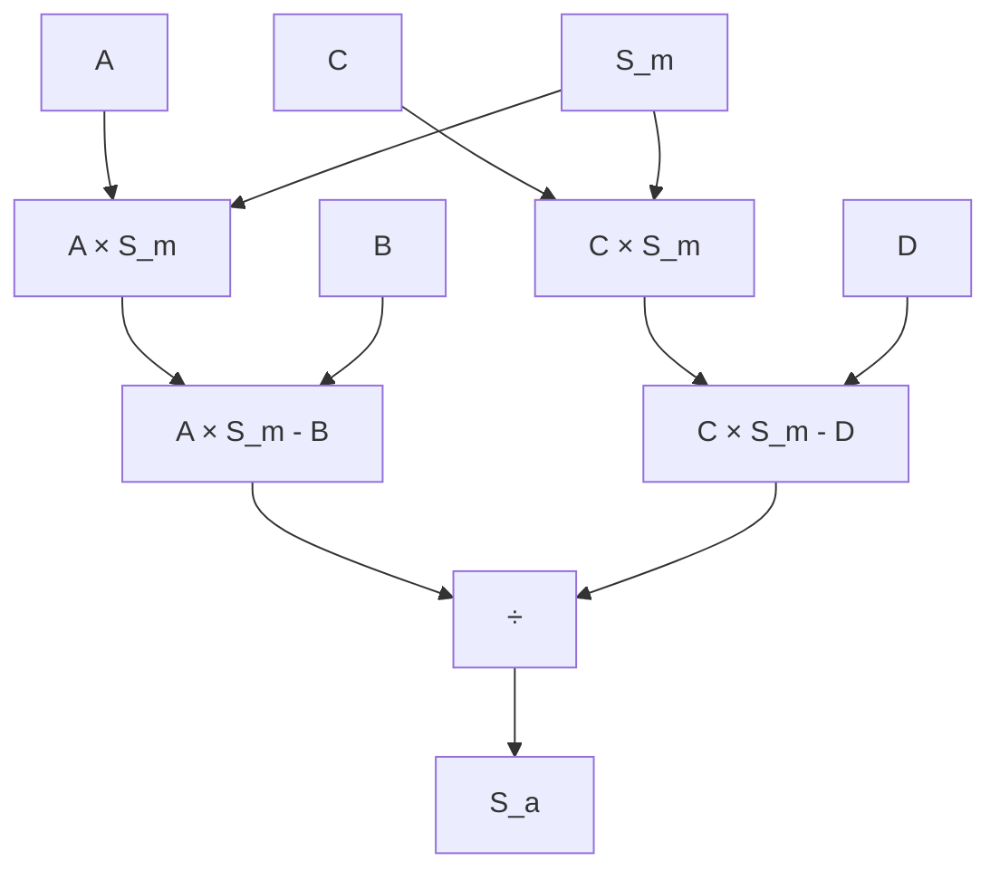

# Lesson 5: Microwave Passive Components

## 1. First-Principles Intuition & Invariants

The discipline of microwave engineering diverges fundamentally from classical circuit theory at the moment distributed electromagnetic effects dominate lumped element approximations. When signal wavelengths approach or fall below the physical dimensions of circuit components—typically above 1 GHz where free-space wavelengths compress below 30 centimeters—the very notion of voltage and current as scalar quantities collapses. Kirchhoff's voltage and current laws, those bedrock foundations of low-frequency analysis, fail catastrophically because phase accumulation along transmission lines becomes non-negligible. A resistor at 10 GHz is no longer a simple dissipative element; it becomes a distributed structure with parasitic inductance in its leads and capacitance across its body, transforming into a resonant tank circuit at frequencies its designer never anticipated.

This transition forces a paradigm shift in how we characterize components. At DC and low frequencies, we measure open-circuit voltage and short-circuit current to extract impedance through Ohm's law. But at microwave frequencies, creating true short or open circuits becomes physically impossible—stray inductance prevents perfect shorts, and fringing fields prevent perfect opens. Moreover, directly measuring voltage and current requires invasive probes that perturb the very fields we seek to observe, introducing measurement uncertainty that scales with frequency. The solution, developed at Bell Laboratories and MIT Radiation Laboratory during World War II radar programs, was to abandon voltage and current altogether in favor of traveling wave amplitudes and scattering parameters.

Scattering parameters, universally abbreviated as S-parameters, describe how electromagnetic waves scatter when encountering a network. Instead of measuring standing wave patterns of voltage and current, we launch traveling waves into ports and measure reflected and transmitted wave amplitudes. This framework proves natural at microwave frequencies because traveling waves are the fundamental eigenmodes of transmission line structures—the TEM modes in coaxial cables, the TE and TM modes in rectangular waveguides. A two-port network characterized by its 2×2 S-parameter matrix captures all linear behavior: $S_{11}$ quantifies input reflection when the output is matched, $S_{21}$ describes forward transmission gain or loss, $S_{12}$ captures reverse isolation, and $S_{22}$ measures output reflection with the input matched.

The mathematical elegance of S-parameters extends beyond mere convenience. They possess direct physical interpretability—magnitudes represent power ratios on a decibel scale, while phases encode electrical length and group delay. Unlike Z-parameters or Y-parameters, which can exhibit numerical instability for high-impedance or low-impedance networks, S-parameters remain bounded between zero and unity for passive networks, ensuring numerical stability in computer-aided design tools. Furthermore, S-parameters reference characteristic impedance (typically 50 Ω in RF systems or 75 Ω in video systems) rather than absolute ground potential, making them immune to ground loop corruption and directly compatible with vector network analyzer measurements.

The conservation of energy in passive, lossless microwave networks imposes strict mathematical constraints on S-parameter matrices. Reciprocity, valid for any linear network composed of reciprocal materials (essentially everything except ferrites and magnetized plasmas), demands that the S-matrix equal its transpose: $S_{ij} = S_{ji}$. This symmetry condition reduces the degrees of freedom in a reciprocal two-port from four complex parameters to three. Losslessness further constrains the S-matrix to be unitary, meaning $S^\dagger S = I$, where the dagger denotes conjugate transpose and $I$ represents the identity matrix. For a two-port lossless reciprocal network, these constraints combine to enforce $|S_{11}|^2 + |S_{21}|^2 = 1$, expressing the fundamental truth that incident power must either reflect or transmit—there exists no third path.

Passive microwave components exploit these mathematical constraints to manipulate electromagnetic power flow with exquisite precision. Directional couplers extract a precise fraction of forward-traveling power while rejecting reverse-traveling waves, enabling bidirectional monitoring without insertion loss penalties. Power dividers split signals with controlled amplitude and phase relationships, maintaining isolation between output ports to prevent load mismatch on one branch from corrupting another. Circulators and isolators break time-reversal symmetry through ferrite materials exhibiting gyromagnetic resonance, allowing signals to flow in preferred directions while absorbing reverse-traveling waves. Filters synthesize frequency-selective transfer functions through coupled resonators, transforming lowpass prototypes into bandpass responses through impedance and frequency scaling. Phase shifters impart controllable electrical length, enabling beam steering in phased arrays and group delay equalization in wideband systems.

The design of these components rests on transmission line theory, waveguide mode analysis, and coupled-mode perturbation methods. Microstrip and stripline transmission lines, fabricated through photolithographic patterning of copper cladding on dielectric substrates, provide the fundamental building blocks for planar microwave circuits. The characteristic impedance of a microstrip line emerges from solving Maxwell's equations for the quasi-TEM mode supported by the inhomogeneous dielectric environment—air above the strip, substrate below. Empirical formulas derived from conformal mapping techniques, such as those by Wheeler and Hammerstad, provide closed-form approximations accurate to within a few percent for typical substrate geometries. A 50 Ω microstrip on FR-4 substrate with $\epsilon_r = 4.4$ and thickness $h = 1.6$ mm requires a trace width approximately $w \approx 3$ mm, establishing the geometric scale that determines component dimensions.

Waveguides, by contrast, confine electromagnetic energy through metallic boundaries, supporting discrete TE and TM modes with cutoff frequencies determined by transverse dimensions. Rectangular waveguide operating in the dominant TE₁₀ mode exhibits zero DC response—the cutoff frequency $f_c = c/(2a)$, where $a$ denotes the broad wall dimension, prevents propagation below this threshold. This high-pass characteristic makes waveguide immune to low-frequency noise and DC ground loops but restricts operation to frequencies sufficiently above cutoff to avoid evanescent decay. Standard WR-90 waveguide, with inner dimensions $a = 0.9$ inches and $b = 0.4$ inches, operates from 8.2 to 12.4 GHz, spanning X-band radar and satellite communication frequencies.

The coupling between adjacent transmission lines or resonators forms the foundation for numerous passive components. When two parallel microstrip lines approach within a wavelength, their electromagnetic fields overlap, enabling power exchange through mutual inductance and capacitance. Coupled-mode theory, developed by Pierce and Miller in the 1950s, describes this interaction through differential equations for forward and backward traveling wave amplitudes. The coupling coefficient $\kappa$, typically expressed in terms of even and odd mode impedances $Z_{0e}$ and $Z_{0o}$, quantifies interaction strength. A quarter-wave coupled section with coupling coefficient $\kappa$ produces a directional coupler with coupling factor $C = -20\log_{10}(\kappa)$ dB, enabling power sampling without significant insertion loss.

Ferrimagnetic materials, particularly yttrium iron garnet (YIG) and various spinel ferrites, enable non-reciprocal components by breaking time-reversal symmetry. When subjected to an external DC magnetic field, the ferrite's magnetic dipoles precess at the Larmor frequency, introducing gyromagnetic coupling between circularly polarized electromagnetic waves. Right-hand circularly polarized (RHCP) waves experience different effective permeability than left-hand circularly polarized (LHCP) waves, splitting the propagation constants for these modes. This Faraday rotation effect, exploited in circulators and isolators, allows forward transmission while absorbing or reflecting reverse-traveling waves. The center frequency of operation is determined by the applied magnetic field strength through the gyromagnetic ratio, with typical bias fields ranging from 1000 to 4000 Gauss for X-band devices.

Filter synthesis techniques transform idealized lowpass prototype responses—Butterworth for maximally flat passband, Chebyshev for equiripple passband with sharper rolloff, or elliptic for transmission zeros in the stopband—into realizable microwave structures. The process begins with a normalized lowpass prototype defined by element values (inductors and capacitors) referenced to source and load impedances of 1 Ω. Frequency and impedance scaling transforms these normalized values into actual component values for the desired center frequency and system impedance. For distributed filters at microwave frequencies, lumped elements are replaced by transmission line sections: series inductors become high-impedance lines, shunt capacitors become low-impedance stubs. Richard's transformation $\Omega = \tan(\beta \ell)$ maps lumped reactive elements onto commensurate-length transmission line stubs, while Kuroda identities enable impedance transformations that improve realizability.

The physical implementation of these synthesis procedures demands intimate knowledge of fabrication tolerances, substrate properties, and electromagnetic simulation tools. Modern microwave computer-aided design environments such as Keysight ADS or Ansys HFSS employ method-of-moments, finite element, or finite-difference time-domain solvers to predict S-parameters from three-dimensional geometry. However, simulation accuracy depends critically on material characterization—dielectric constant and loss tangent of substrates, conductivity and surface roughness of metallization, and electromagnetic boundary conditions at enclosure walls. Measured S-parameters inevitably deviate from simulation due to fabrication variations, requiring iterative tuning of physical dimensions to achieve target performance. This design-fabricate-measure-tune cycle, fundamental to microwave engineering practice, distinguishes the discipline from lower-frequency analog design where SPICE models provide near-perfect predictive accuracy.

## 2. Core Architecture & Mechanics

The vector network analyzer (VNA) serves as the central instrument for microwave component characterization, sweeping frequency while measuring complex reflection and transmission coefficients. Modern VNAs integrate four key subsystems: a synthesized RF source providing the stimulus signal, directional couplers or bridges extracting incident and reflected waves at each test port, downconverting receivers measuring amplitude and phase, and calibration algorithms removing systematic errors. The raw measured quantities are actually ratios of received signal voltages: $b_1/a_1$ for reflection at port 1, $b_2/a_1$ for transmission from port 1 to port 2, where $a_n$ represents the incident traveling wave amplitude and $b_n$ the emerging wave amplitude at port $n$.

Systematic errors corrupt these raw measurements through multiple mechanisms. Directivity error arises from imperfect isolation in the VNA's internal directional couplers—a fraction of the incident wave leaks directly to the reflection receiver, appearing as spurious reflected signal. Source match error occurs when reflections from the device under test (DUT) re-reflect off the VNA's non-ideal 50 Ω source impedance, creating multiple bounces that corrupt the measured reflection coefficient. Load match error similarly affects transmission measurements when the receiving port impedance deviates from 50 Ω. Frequency response errors emerge from cable losses, connector mismatches, and receiver gain variations across the swept bandwidth.

Calibration procedures remove these systematic errors through mathematical error correction models. The most rigorous approach, full two-port SOLT (Short-Open-Load-Thru) calibration, requires measuring three known reflection standards (short, open, 50 Ω load) and one transmission standard (direct thru connection) at each port. These twelve measurements (three reflections and one transmission at each of two ports, plus the reciprocal measurements) overdetermine the error model coefficients, enabling least-squares fitting. The error correction transforms raw measured S-parameters $S_m$ into corrected values $S_a$ (actual) through matrix operations:

where matrices $[A]$, $[B]$, $[C]$, and $[D]$ contain the extracted error terms. Modern VNAs perform these corrections in real-time during the frequency sweep, displaying corrected S-parameters directly. Calibration quality can be verified by measuring a precision airline or verification kit with known S-parameters, confirming that systematic errors have been reduced below the VNA's noise floor.

Directional couplers exploit quarter-wave coupling between parallel transmission lines to achieve directivity—strong coupling to forward-traveling waves but deep nulls for reverse-traveling waves. Consider two parallel microstrip lines of length $L = \lambda/4$ at the center frequency, coupled through a gap of width $s$. Power launched into port 1 splits between the through port 2 and the coupled port 3, with coupling factor determined by the even and odd mode impedances. The isolated port 4, terminated in 50 Ω, receives negligible power at the design frequency due to destructive interference between two coupling paths.

The physical mechanism underlying this directivity emerges from phase relationships. Forward power couples into the parallel line at both the input and output ends, accumulating 90° phase shift over the quarter-wave length. At the coupled port, these two contributions arrive in phase and add constructively. Reverse power also couples at both ends, but the geometric path length difference causes the contributions to arrive 180° out of phase, canceling destructively. This cancellation proves frequency-sensitive—directivity degrades as frequency deviates from the quarter-wave condition, limiting fractional bandwidth to approximately 20% for 20 dB directivity.

The design equations for a single-section coupled-line coupler relate coupling factor $C$ (in dB) to the required impedance ratio:

$$Z_{0e} / Z_{0o} = \sqrt{\frac{1 + 10^{-C/20}}{1 - 10^{-C/20}}}$$

For a -20 dB coupler ($C = 20$ dB, implying 1% of input power coupled), this ratio equals approximately 2.0. The even and odd mode impedances relate to physical dimensions through quasi-static formulas or electromagnetic simulation. On FR-4 substrate with $h = 1.6$ mm, achieving $Z_{0e} = 80$ Ω and $Z_{0o} = 40$ Ω requires a trace width around 1.5 mm and gap spacing near 0.3 mm—dimensions comfortably within standard PCB fabrication tolerances.

Multi-section couplers extend bandwidth by cascading multiple quarter-wave stages with progressively varying coupling coefficients, analogous to multi-section impedance transformers. A three-section Chebyshev coupler achieves 30% bandwidth with ripple in the coupling factor below 0.5 dB, compared to the 20% bandwidth of a single section. The coupling coefficients for each section derive from Chebyshev polynomial optimization, requiring electromagnetic optimization tools to synthesize the impedance profiles.

Branch-line couplers offer an alternative topology using four quarter-wave transmission lines arranged in a square configuration. Port 1 connects to port 2 through a $Z_0/\sqrt{2}$ line and to port 3 through a $Z_0$ line, with port 4 isolated. This structure provides inherent 90° phase difference between output ports 2 and 3, enabling quadrature hybrid operation essential for image-reject mixers and IQ modulators. The branch-line's planar geometry consumes more substrate area than coupled-line couplers but offers simpler fabrication since all lines are independent—no tight coupled gaps requiring precision etching.

The rat-race coupler, also called a hybrid ring, employs a circular transmission line with circumference $3\lambda/2$ and four ports spaced strategically around the ring. Ports 1 and 2 sit 90° apart, port 3 sits 180° opposite port 1, and port 4 sits 90° beyond port 3. A signal entering port 1 splits into two paths traveling clockwise and counterclockwise around the ring. At port 2, these paths differ by $\lambda/4$ (90° electrical), producing a -3 dB signal with +90° phase. At port 3, the path difference equals $\lambda/2$ (180°), creating in-phase addition for a -3 dB signal. Port 4 receives destructive interference—the clockwise path travels $3\lambda/4$ while the counterclockwise path travels $\lambda/4$, differing by $\lambda/2$ for perfect cancellation.

This geometry naturally implements a 180° hybrid or "magic-T" function in planar form. Modern rat-race couplers miniaturize the ring circumference using slow-wave structures—meandered lines or high-dielectric-constant substrates—reducing footprint without sacrificing performance. The electrical length remains $3\lambda/2$, but physical length contracts proportionally to the effective dielectric constant.

Wilkinson power dividers achieve the remarkable feat of providing impedance matching at all three ports simultaneously while maintaining isolation between output ports. The basic topology places two quarter-wave transmission lines in parallel, each with characteristic impedance $Z_0 \sqrt{2}$ (approximately 70.7 Ω for 50 Ω systems), connecting input port 1 to output ports 2 and 3. Crucially, a resistor of value $2Z_0$ (100 Ω) bridges directly between the two output ports. This resistor, counterintuitively placed where signals are intended to flow, provides the isolation mechanism.

When both output ports are matched, symmetric excitation produces no voltage difference across the isolation resistor, drawing zero current and dissipating no power—the device operates with zero insertion loss. However, if port 2 reflects power due to load mismatch, half of this reflected power returns to the input while the other half travels toward port 3. The resistor absorbs this imbalance, preventing the reflected signal from corrupting port 3. This elegant solution simultaneously achieves three goals: equal power division, all-port matching, and output isolation—properties that classical three-port network theory proves impossible without dissipative elements.

Multi-way Wilkinson dividers extend this concept to split power among $N$ outputs by cascading binary stages or using a radial topology. An eight-way divider might employ three binary stages ($2 \times 2 \times 2$), or a single-stage radial splitter with eight quarter-wave lines of impedance $Z_0 \sqrt{8}$ and isolation resistors between all output pairs. The radial approach minimizes insertion loss (one stage versus three) but requires ${N \choose 2}$ isolation resistors—28 resistors for an eight-way divider—creating layout complexity.

Circulators and isolators rely on gyromagnetic resonance in ferrite materials to achieve non-reciprocal transmission. The junction circulator, most common at microwave frequencies, consists of a disk or triangle of ferrite material metallized on top and bottom, with three or four microstrip or stripline ports arranged symmetrically around the periphery. A permanent magnet or electromagnet applies a DC magnetic field perpendicular to the ferrite disk, biasing the material into magnetic saturation.

The physics governing circulation involves the interaction between the applied DC field and the RF magnetic field components of the propagating waves. The DC bias field $H_0$ causes the ferrite's magnetic dipoles to precess at the Larmor frequency $f_0 = \gamma H_0$, where $\gamma = 2.8$ MHz/Oe denotes the gyromagnetic ratio. When the RF signal frequency matches or approaches this resonance, the ferrite's effective permeability becomes anisotropic—different for RHCP and LHCP waves. This breaks the symmetry of Maxwell's equations, enabling preferential transmission paths.

In a three-port junction circulator, power entering port 1 exits port 2 with minimal loss (typically 0.5 dB insertion loss), while port 3 receives negligible power (isolation exceeding 20 dB). Similarly, power entering port 2 exits port 3, and power entering port 3 exits port 1, completing the cycle. The circulation sense depends on the DC magnetic field polarity—reversing the magnet direction reverses the circulation. An isolator results from terminating one port (typically port 3) in a matched 50 Ω load. Forward power from port 1 to port 2 passes with minimal insertion loss, but reverse power from port 2 travels to the terminated port 3, where it dissipates as heat.

The bandwidth and insertion loss of circulators depend critically on the ferrite material properties and the magnetic bias field uniformity. YIG (yttrium iron garnet) exhibits low magnetic losses and narrow resonance linewidth, enabling octave bandwidths with insertion loss below 0.3 dB. However, YIG requires precise temperature stabilization since its magnetic properties drift with temperature. Garnet ferrites substitute aluminum, gallium, or indium for iron, tuning the saturation magnetization and Curie temperature to match application requirements. Hexagonal ferrites offer self-biasing operation through remnant magnetization, eliminating the external magnet at the cost of narrower bandwidth and higher insertion loss.

The design of a junction circulator begins with selecting the ferrite material and calculating the required bias field for resonance at the center frequency. The ferrite disk diameter determines the mode structure—typically operating in the first azimuthal mode—while the disk thickness trades off bandwidth against insertion loss. Electromagnetic simulation solves for the S-parameter matrix given the material properties, dimensions, and bias field distribution. Practical designs require iterative optimization, adjusting the port positions, matching transformer sections, and bias field strength to achieve target specifications.

Microwave filters implement frequency-selective transfer functions through resonant structures coupled to input and output transmission lines. The synthesis procedure begins with an idealized lowpass prototype—a ladder network of normalized inductors and capacitors producing the desired amplitude response. Butterworth filters exhibit maximally flat passband response, with all derivatives of $|S_{21}|^2$ equal to zero at DC up to order $2N-1$ for an $N$th-order filter. This yields a smooth passband but gradual rolloff in the transition band. The 3 dB cutoff frequency occurs at $\omega = 1$ rad/s in the normalized prototype, and element values follow the formula:

$$L_k = 2\sin\left(\frac{2k-1}{2N}\pi\right), \quad C_k = 2\sin\left(\frac{2k-1}{2N}\pi\right)$$

where $k = 1, 2, \ldots, N$ indexes the filter order. A fifth-order Butterworth prototype yields element values $L_1 = C_1 = 0.618$, $L_2 = C_2 = 1.618$, and $L_3 = C_3 = 2.000$, all normalized to 1 Ω source and load impedances.

Chebyshev filters trade passband flatness for sharper stopband rolloff by allowing equiripple variations in the passband. The ripple amplitude $\epsilon$ defines the maximum passband deviation: $|S_{21}|^2 = 1/(1 + \epsilon^2)$ at ripple peaks. Common choices include 0.5 dB ripple ($\epsilon = 0.349$) for modest improvement or 3 dB ripple ($\epsilon = 1.0$) for aggressive rolloff. The element values depend on the ripple factor and follow recursive formulas involving Chebyshev polynomials. A 0.5 dB ripple fifth-order Chebyshev filter yields element values $L_1 = C_1 = 1.706$, $L_2 = C_2 = 1.230$, $L_3 = C_3 = 2.541$, normalized to 1 Ω terminations.

Frequency and impedance scaling transform these normalized prototypes into realizable designs. Frequency scaling multiplies all reactive elements by the ratio of the prototype cutoff frequency (1 rad/s) to the desired cutoff frequency $\omega_c$: $L_{actual} = L_{norm}/\omega_c$ and $C_{actual} = C_{norm}/\omega_c$. Impedance scaling multiplies inductors by the system impedance $Z_0$ and divides capacitors by $Z_0$: $L_{final} = L_{actual} \cdot Z_0$ and $C_{final} = C_{actual}/Z_0$. For a 50 Ω system with 2 GHz cutoff, the first inductor becomes $L_1 = 1.706/(2\pi \times 2 \times 10^9) \times 50 = 6.8$ nH.

Lumped element filters constructed from discrete inductors and capacitors function adequately below 2 GHz, where component dimensions remain small relative to wavelength. Above this threshold, parasitic effects dominate—inductor self-resonance frequencies fall within the passband, and capacitor lead inductance introduces unwanted transmission zeros. Distributed implementations replace lumped elements with transmission line structures: series inductors become short high-impedance line sections, while shunt capacitors transform into open-circuited stubs.

Richard's transformation $\Omega = \tan(\beta \ell)$ maps frequency into electrical length, converting a lumped inductor $j\omega L$ into a transmission line of impedance $Z_L$ and length $\ell$: $Z_{in} = jZ_L\tan(\beta\ell)$. At the center frequency, all lines exhibit equal electrical length $\theta = \pi/2$ (quarter-wavelength), simplifying layout. However, this commensurate-line restriction limits design freedom. Kuroda identities enable impedance transformations through added quarter-wave unit elements (UEs), converting awkward impedance ratios into realizable values.

A typical microstrip bandpass filter employs coupled resonators—parallel half-wavelength lines spaced to provide capacitive or inductive coupling. The inter-resonator coupling coefficient $k_{ij}$ and external quality factor $Q_e$ determine the filter bandwidth and insertion loss. Synthesis proceeds by mapping the normalized lowpass prototype element values onto coupling matrix entries, then extracting the required physical spacing from electromagnetic simulation or empirical coupling coefficient curves. A fifth-order Chebyshev filter might use five half-wave resonators with progressively decreasing coupling gaps: $s_{12} = 0.3$ mm, $s_{23} = 0.5$ mm, $s_{34} = 0.5$ mm, $s_{45} = 0.3$ mm, exhibiting the symmetric structure expected from reciprocity.

Hairpin and interdigital topologies fold the resonators into compact geometries, reducing filter footprint by 50% or more. Hairpin filters bend each half-wave resonator into a U-shape, allowing tighter packing. Interdigital filters orient the resonators parallel and ground one end alternately, creating capacitive coupling along their entire length. These geometries complicate the coupling coefficient extraction since the resonators interact over distributed regions rather than discrete gaps, necessitating full-wave simulation for accurate synthesis.

Cavity filters at microwave frequencies achieve far higher Q-factors than planar designs, with unloaded Q exceeding 5000 in silver-plated aluminum enclosures. The fundamental resonance of a rectangular cavity occurs when the cavity dimensions equal half-wavelengths in each coordinate direction. A cubic cavity of side $a = \lambda/2$ resonates at frequency $f_0 = c/(2a)$, with energy stored in standing wave patterns oscillating between electric and magnetic field configurations. Irises or apertures in the cavity walls provide coupling to input and output transmission lines, with the iris size controlling the external Q-factor.

Evanescent-mode filters exploit waveguide sections operating below cutoff, where electromagnetic waves decay exponentially rather than propagate. Capacitive or inductive posts inserted into the waveguide at half-wavelength intervals create resonances despite the evanescent fields. These filters achieve compact size since the resonator length depends on the effective wavelength in the evanescent region, which can be shortened arbitrarily by increasing the cutoff frequency ratio. The tradeoff comes in higher insertion loss due to the finite Q of the loaded posts and resistive losses in the evanescent waveguide walls.

Phase shifters impart controllable electrical length without altering amplitude, essential for phased array beam steering and group delay equalization. Switched-line phase shifters employ PIN diodes or MEMS switches to select between transmission lines of different physical length, with the length difference corresponding to the desired phase shift. A 3-bit phase shifter cascades 45°, 90°, and 180° switched-line sections, providing 360° coverage in 45° steps. The PIN diodes operate as voltage-controlled resistors: forward-biased diodes exhibit low resistance (typically 1–3 Ω), presenting near-short circuits to RF signals, while reverse-biased diodes exhibit high capacitance (0.1–0.3 pF), behaving as open circuits at gigahertz frequencies.

Reflection-type phase shifters terminate a hybrid coupler with varactor-tuned resonators, reflecting incident power with phase determined by the resonator reactance. A 90° hybrid couples input power to two varactor-loaded stubs; varying the varactor bias voltage shifts the stub reactance, changing the reflection phase. The reflected waves recombine at the output port with phase shift proportional to the reactance change. This topology provides continuous phase control but suffers from amplitude ripple as the impedance match varies with phase state.

Loaded-line phase shifters periodically load a transmission line with switchable reactive elements, altering the effective phase velocity. When shunt inductors are switched in, the line's phase velocity decreases, increasing electrical length. Switching to shunt capacitors increases phase velocity, decreasing electrical length. This distributed loading permits broader bandwidth than lumped switched-line sections since the loading elements remain small relative to wavelength even at the upper frequency band edge.

## 3. High-Performance Optimization & Failure Modes

The pursuit of microwave component performance confronts fundamental tradeoffs between insertion loss, bandwidth, size, and cost. Designers navigate this multidimensional space by prioritizing specifications appropriate to the application—a satellite transponder demands minimal insertion loss to preserve link margin, while a handheld radar detector prioritizes compactness and manufacturing cost. Understanding the physical limits and failure modes enables informed optimization decisions rather than blind parameter sweeps.

Insertion loss in passive components arises from three mechanisms: conductor loss in metal traces or waveguide walls, dielectric loss in substrates, and radiation loss from discontinuities. Conductor loss scales with surface resistance $R_s = \sqrt{\pi f \mu_0 / \sigma}$, increasing as the square root of frequency. At 10 GHz, copper ($\sigma = 5.8 \times 10^7$ S/m) exhibits surface resistance $R_s \approx 26$ m$\Omega$/square. A microstrip line with width $w = 3$ mm and length $L = 50$ mm dissipates approximately $\alpha_c \approx R_s/(2Z_0 w) \approx 0.12$ dB attenuation. Gold or silver plating reduces conductor loss by 20–30% relative to bare copper but adds process complexity and cost.

Dielectric loss dominates in high-impedance lines where most electromagnetic energy resides in the substrate rather than conductor. The dielectric loss tangent $\tan\delta$ quantifies energy dissipation per cycle, with low-loss materials exhibiting $\tan\delta < 0.001$. FR-4 glass-epoxy laminates, ubiquitous in commercial PCB fabrication, suffer $\tan\delta \approx 0.020$, acceptable below 3 GHz but prohibitive at millimeter-wave frequencies. Rogers RO4003C, a widely adopted alternative, achieves $\tan\delta = 0.0027$ with tightly controlled dielectric constant $\epsilon_r = 3.55 \pm 0.05$, enabling precision microstrip filter designs. PTFE-based substrates (Teflon) push dielectric loss below $\tan\delta = 0.0005$ but demand specialized fabrication processes incompatible with standard PCB manufacturing.

Radiation loss emerges from discontinuities where transmission line geometry changes abruptly—open-circuited stubs, right-angle bends, T-junctions. These discontinuities excite higher-order modes and surface waves that propagate along the substrate-air interface, carrying energy away from the intended signal path. Chamfered corners mitigate bend radiation by smoothing the geometry transition. Microstrip T-junctions benefit from compensating notches that cancel parasitic capacitance, reducing both reflection and radiation. Grounded coplanar waveguide (GCPW) suppresses radiation more effectively than microstrip by confining fields between adjacent ground planes, at the cost of increased fabrication complexity.

Spurious resonances plague microwave components when physical dimensions coincide with unintended resonant modes. A rectangular enclosure housing a microstrip filter exhibits cavity modes at frequencies $f_{mnp} = (c/2)\sqrt{(m/a)^2 + (n/b)^2 + (p/d)^2}$, where $a$, $b$, and $d$ denote enclosure dimensions and $m$, $n$, $p$ are integer mode indices. If a cavity resonance falls within the filter passband, the component performance degrades catastrophically—oscillations, notches in transmission, or even instability in active circuits. Absorber materials placed strategically on enclosure walls dissipate cavity modes without affecting the desired microstrip propagation, at the cost of added complexity and reduced heat dissipation.

Harmonic generation in components assumed to be linear arises from metal-to-metal contact nonlinearities at connectors and solder joints. Even passive structures exhibit weak third-order intermodulation distortion (IMD3) when subjected to high power levels. A directional coupler handling +40 dBm (10 watts) might generate IMD3 products at -60 dBc, barely detectable but sufficient to corrupt sensitive receivers. This passive intermodulation (PIM) phenomenon depends critically on surface cleanliness, contact pressure, and the presence of ferromagnetic contaminants. Aerospace and cellular base station applications specify PIM performance rigorously, demanding laboratory testing with specialized high-power two-tone sources and spectrum analyzers capable of resolving -150 dBm spurious signals in the presence of +43 dBm carriers.

Temperature stability challenges microwave filters whose resonant frequencies drift with substrate dielectric constant variations. Most materials exhibit negative temperature coefficients: $\epsilon_r$ decreases with increasing temperature, shifting the resonance upward in frequency. Rogers RO4003C drifts approximately -200 ppm/°C, causing a 2 GHz filter to shift by 4 MHz over a 100°C temperature excursion. Compensation techniques include using mixed substrates with opposing temperature coefficients, or mechanically tuning the filter with temperature-sensitive screws that adjust cavity dimensions to counteract dielectric drift.

Power handling limits the maximum signal level passive components can withstand before damage or performance degradation. Dielectric breakdown in substrates occurs when the electric field exceeds the material's breakdown strength, typically 10–50 kV/mm for microwave laminates. A 50 Ω microstrip line carrying 100 watts at 10 GHz develops voltage amplitude $V_0 = \sqrt{2 P Z_0} \approx 100$ V peak. If the substrate thickness is 1.6 mm, the electric field approaches 60 V/mm—far below breakdown but sufficient to stress the material over prolonged periods. Thermal failure precedes dielectric breakdown in most cases: $I^2 R$ heating in conductors raises the substrate temperature, softening the dielectric and causing delamination or warping.

Multipactor breakdown, a vacuum electronics phenomenon, affects waveguide and cavity components operating in evacuated environments such as satellites. When RF electric fields exceed a threshold (typically 1–10 kV/mm), electrons liberated from metal surfaces accelerate across the gap, striking the opposite wall and releasing secondary electrons. Under resonant conditions, these secondary electrons oscillate in phase with the RF field, building into an avalanche discharge that absorbs power and generates noise. Satellite waveguide components mitigate multipactor through surface treatments (gold plating, titanium nitride coatings) that reduce secondary emission coefficients, and by avoiding parallel-plate geometries where resonant conditions readily establish.

Circulators and isolators face unique thermal management challenges because dissipated power heats the ferrite material, shifting its magnetic resonance frequency. A circulator dissipating 2 watts (40% of 5 watts input power in a poorly designed unit) might heat 50°C above ambient, shifting the center frequency by several hundred megahertz. Thermal runaway occurs when this frequency shift increases insertion loss, causing more power dissipation and further heating. High-power circulators require active cooling—forced air or liquid cooling—and thermal modeling to ensure the ferrite temperature remains within stable operating range.

Manufacturing tolerances translate into performance variations that must be accommodated through statistical design techniques. A microstrip coupled-line coupler designed for -20 dB coupling with ±0.5 dB tolerance requires tighter dimensional control as the coupling becomes stronger. Photolithographic etching achieves ±25 μm linewidth tolerance in standard PCB processes, adequate for -10 dB couplers but marginal for -30 dB designs. High-precision applications demand laser direct imaging or electron-beam lithography, increasing unit cost by an order of magnitude.

Yield optimization balances performance targets against fabrication realities through Monte Carlo simulation. A statistical model assigns Gaussian distributions to each dimension based on process tolerances, then simulates thousands of virtual units to predict the performance distribution. If 95% of simulated units meet specifications with tolerances tightened by 10%, the design is considered robust. Conversely, if only 70% pass, the design requires de-tuning to relax critical dimensions or adding tuning elements (screws, trimmers) to enable post-fabrication adjustment.

Measurement de-embedding removes the effects of test fixtures and transitions from raw VNA data, recovering the actual device S-parameters. Thru-Reflect-Line (TRL) calibration, preferred at millimeter-wave frequencies where coaxial standards become unreliable, defines the reference plane at the device ports through measurements of a direct connection (thru), a reflective termination (short or open), and a precision length of transmission line. The line standard must exhibit electrical length between 20° and 160° at the measurement frequency, typically realized as a half-wavelength section. TRL calibration provides superior accuracy compared to SOLT because it does not require known load impedance—only the line characteristic impedance, which can be precisely controlled through fabrication.

Time-domain gating applies inverse Fourier transform to VNA data, windowing the impulse response to isolate reflections from specific physical locations, then transforming back to frequency domain. This technique separates the DUT response from connector discontinuities that appear as distinct time-domain peaks. A rectangular time window effectively high-pass filters the frequency response, introducing ripple through the Gibbs phenomenon, but this artifact can be minimized through Kaiser or Blackman-Harris windowing functions that trade time resolution for frequency domain smoothness.

Electromagnetic simulation accuracy depends critically on meshing density, boundary conditions, and material model fidelity. Method-of-moments solvers subdivide metal surfaces into triangular patches small enough to accurately represent surface current distributions—typically ten patches per wavelength at the highest frequency. Finite element solvers mesh the entire computational volume, demanding higher memory and CPU time but enabling arbitrary material anisotropy and nonlinearity. Finite-difference time-domain methods discretize both space and time, requiring Courant stability conditions that limit the time step to a fraction of the spatial cell transit time.

Port de-embedding in simulation tools defines the reference planes where S-parameters are extracted. Wave port excitation, appropriate for single-mode transmission lines, launches the fundamental mode and absorbs reflections at the port boundary. Lumped port excitation, suitable for coaxial feeds, applies voltage between two conductors but introduces modeling errors if the feed structure supports multiple modes. Calibrating simulated S-parameters against measured data reveals systematic errors—typically 0.1–0.3 dB insertion loss discrepancy due to conductor surface roughness not captured in the simulation, and 5–10° phase error from substrate dielectric constant variations.

Spurious feed radiation from patch antenna arrays introduces pattern distortions that degrade sidelobe levels and reduce gain. The corporate feed network distributing power to array elements radiates from discontinuities—bends, T-junctions, crossovers—creating unintended secondary lobes. Buried stripline construction confines radiation within the substrate stack, eliminating feed radiation at the cost of increased fabrication complexity and reduced thermal dissipation. Alternatively, absorber materials placed between feed layers and radiating elements attenuate spurious coupling.

Phased array beam steering demands phase shifters with precise amplitude and phase tracking across all control states. Amplitude imbalance between array elements introduces sidelobe asymmetry, while phase errors increase peak sidelobe level. A 32-element array requires phase accuracy better than ±5° and amplitude balance within ±0.5 dB to achieve -20 dB sidelobe suppression. Loaded-line phase shifters achieve superior tracking compared to switched-line designs because the RF path remains continuous, avoiding the impedance discontinuities inherent in switch junctions.

Self-heating in PIN diode switches limits switching speed and power handling. Forward-biased PIN diodes dissipate $I_{bias} \times V_{diode} \approx 10 \text{ mA} \times 0.8 \text{ V} = 8$ mW per diode in typical designs. A 3-bit phase shifter with six diodes might dissipate 50 mW continuously, requiring heat spreading through substrate vias to prevent localized hot spots. Pulsed operation duty-cycles the heating, enabling higher instantaneous current at the cost of settling time—forward recovery time requires several carrier lifetimes, typically 10–100 nanoseconds for standard PIN diodes.

Component aging degrades performance through multiple mechanisms. Solder joints undergo thermal fatigue from repeated expansion and contraction cycles, increasing series resistance and introducing nonlinearity. Ferrite circulators depolarize over decades as magnetic domain structures randomize, reducing isolation and increasing insertion loss. Connector plating corrodes in humid environments, creating oxides that increase contact resistance and generate PIM distortion. Hermetic sealing in nitrogen-filled enclosures mitigates these aging effects but adds substantial cost, justifiable only in military and space applications demanding 20-year service life.

Radiation hardening for space applications requires ferrite materials immune to ionizing radiation, which disrupts magnetic ordering and creates paramagnetic centers. Single-crystal YIG exhibits superior radiation tolerance compared to polycrystalline ferrites, maintaining performance after exposure to 100 krad total ionizing dose. Semiconductor-based phase shifters (GaAs MMIC) suffer threshold voltage shifts and carrier mobility degradation under radiation, necessitating silicon-on-insulator (SOI) or GaN technologies with inherent radiation hardness.

The practical realization of microwave passive components demands intimate collaboration between electromagnetic simulation, precision fabrication, and iterative measurement-based tuning. No simulation perfectly predicts reality—material properties vary within tolerances, fabrication introduces dimensional errors, and assembly adds parasitic reactances. Successful designs incorporate tuning elements where critical: adjustable screws in cavity filters, trimmable capacitors in matching networks, movable short-circuit plungers in waveguide components. The final product emerges not from a single design pass but through disciplined iteration, measuring fabricated prototypes, diagnosing deviations from simulation, and refining the model to capture missing physics. This measurement-informed design cycle, repeated until the measured performance converges with specifications, distinguishes proficient microwave engineering practice from abstract circuit theory. The components themselves—directional couplers splitting power with logarithmic precision, circulators enforcing asymmetric transmission through quantum gyromagnetic effects, filters sculpting frequency response through distributed resonance—stand as physical manifestations of Maxwell's equations, each copper trace and ferrite disk encoding solutions to boundary value problems that govern electromagnetic wave propagation at gigahertz frequencies.
