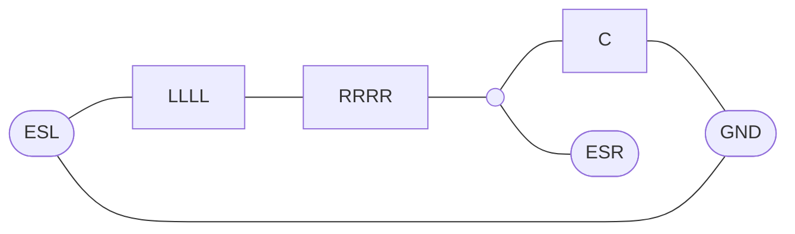

# Lesson 2: Capacitors — Electrostatics, Dielectrics, Frequency Response

## 1. First-Principles Intuition & Invariants

The capacitor is, in its most elementary conception, a structure that stores energy in an electric field. Where the resistor dissipates energy and the inductor stores it magnetically, the capacitor accumulates separated charge on two conducting surfaces and maintains the resulting electrostatic tension between them. Understanding *why* it behaves this way — not merely that it does — is the foundation upon which every practical design decision in analog and power electronics rests.

### Gauss's Law and the Origin of Capacitance

To arrive at capacitance from first principles, begin with Gauss's law in integral form:

$$\oint_S \vec{D} \cdot d\vec{A} = Q_{enc}$$

where $\vec{D}$ is the electric flux density (displacement field), $d\vec{A}$ is the outward-pointing area element, and $Q_{enc}$ is the total free charge enclosed by the Gaussian surface $S$. For a parallel-plate geometry with plate area $A$ separated by distance $d$, choosing a Gaussian pillbox that straddles one conductor plate immediately yields:

$$D = \frac{Q}{A} = \sigma_f$$

where $\sigma_f$ is the surface charge density of free charges. Because $\vec{D} = \varepsilon \vec{E}$ in a linear, isotropic dielectric (where $\varepsilon = \varepsilon_r \varepsilon_0$ is the absolute permittivity), the electric field between the plates becomes:

$$E = \frac{\sigma_f}{\varepsilon} = \frac{Q}{\varepsilon A}$$

The voltage across the gap is simply the line integral of this uniform field over the separation distance:

$$V = E \cdot d = \frac{Qd}{\varepsilon A}$$

Rearranging, the fundamental capacitance relation emerges:

$$C = \frac{Q}{V} = \frac{\varepsilon_r \varepsilon_0 A}{d}$$

This result, clean and exact for the ideal parallel-plate case, tells you everything about what a capacitor designer can tune: plate area $A$, electrode separation $d$, and the relative permittivity $\varepsilon_r$ of the material between them. The practical implication is that doubling the plate area doubles capacitance, halving the dielectric thickness doubles it again, and selecting a high-$\varepsilon_r$ ceramic dielectric over air can multiply capacitance by a factor of thousands in the same physical volume. Every miniaturization trend in capacitor technology — from Class I NP0 ceramics to multilayer ceramic capacitors (MLCCs) with sub-micron dielectric layers — flows from this single equation.

### Dielectric Polarization Mechanisms

The term $\varepsilon_r$ conceals a rich landscape of physical phenomena, and a practitioner who treats it as a fixed scalar will make costly errors. The relative permittivity of a dielectric material is frequency-dependent, temperature-dependent, and in many practical materials, voltage-dependent. These dependencies arise directly from the microscopic polarization mechanisms by which a dielectric material responds to an applied electric field.

Four distinct mechanisms contribute to the total polarization $\vec{P}$ of a dielectric:

**Electronic polarization** is the fastest and most universal mechanism. Under an applied field, the electron cloud of each atom displaces slightly from the nucleus, creating an atomic dipole. Because electrons have negligible mass, this response persists up to optical frequencies ($\sim 10^{15}$ Hz). It is the dominant mechanism in non-polar materials like silicon dioxide, sapphire, and hydrocarbon-based polymers, and it contributes an $\varepsilon_r$ increment that is relatively temperature-stable and frequency-flat well into the microwave band.

**Ionic polarization** operates in materials with ionic crystal lattices — think aluminum oxide ($\text{Al}_2\text{O}_3$) or barium titanate ($\text{BaTiO}_3$). The applied field drives positive and negative ions in opposite directions within the lattice. This mechanism is heavier and slower than electronic polarization, cutting off in the infrared range ($\sim 10^{13}$ Hz). It contributes a moderate $\varepsilon_r$ increment and remains largely temperature-stable in simple ionic materials.

**Orientational (dipolar) polarization** arises in materials containing permanent molecular dipoles — water being the canonical example, but ferroelectric ceramics like BaTiO₃ exhibit a structurally analogous domain-rotation mechanism. The applied field torques these dipoles toward alignment, but the process is thermally activated and therefore strongly temperature-dependent, and it relaxes through a characteristic Debye relaxation time $\tau = 1/(2\pi f_c)$ that sets the high-frequency cutoff. When the driving frequency exceeds $f_c$, the dipoles can no longer follow, $\varepsilon_r$ drops, and dielectric loss peaks — a phenomenon visible as the loss tangent ($\tan \delta$) maximum in a Cole-Cole plot. This is why Class II and Class III ceramic capacitors (X5R, Y5V, etc.) exhibit dramatic capacitance drop with both frequency and applied DC bias: they rely on ferroelectric domain alignment, and that mechanism responds to both electric field magnitude and thermal agitation.

**Space charge (interfacial) polarization** is the slowest mechanism, occurring at material interfaces where charge carriers accumulate because they cannot freely cross a phase boundary. It is relevant primarily at low frequencies (below a few kilohertz) and in composites or electrolytic capacitors where the oxide layer interfaces with the electrolyte.

The total permittivity is thus a sum over these mechanisms, each of which falls off at its characteristic relaxation frequency. This frequency dispersion is formalized by the Kramers-Kronig relations, which link the real part $\varepsilon'(\omega)$ (storing energy) to the imaginary part $\varepsilon''(\omega)$ (dissipating energy) through Hilbert transform pairs — a constraint that is a direct consequence of causality, not an empirical observation. The loss tangent is defined as:

$$\tan \delta = \frac{\varepsilon''}{\varepsilon'}$$

For NP0/C0G ceramics, $\tan \delta$ is typically below $0.001$ across the audio and RF bands, making them nearly ideal. For X5R or X7R materials, $\tan \delta$ can reach $0.02$–$0.05$ at a few megahertz, and for aluminum electrolytic capacitors, it exceeds $0.1$ at high frequencies — a critical engineering constraint in switching power supply output filter design.

### Energy Storage and the Electrostatic Potential Well

The energy stored in a capacitor is not abstract bookkeeping; it is a physical energy density distributed throughout the dielectric volume. Starting from the work required to move an incremental charge $dq$ against the existing potential $V = q/C$:

$$dW = V \, dq = \frac{q}{C} \, dq$$

Integrating from zero to final charge $Q$ yields the familiar result:

$$W = \frac{1}{2} \frac{Q^2}{C} = \frac{1}{2} C V^2 = \frac{1}{2} Q V$$

Expressed as a volumetric energy density in the dielectric:

$$u = \frac{1}{2} \varepsilon E^2 \quad \left[\text{J/m}^3\right]$$

This is a critical result for high-voltage capacitor design. The energy density scales as $E^2$, so maximizing stored energy density pushes the field strength toward the dielectric breakdown limit $E_{bd}$. For high-$\varepsilon_r$ ceramics, the dielectric breakdown field is typically $5$–$20$ MV/m; for polypropylene film, it ranges $400$–$650$ MV/m — which is why film capacitors dominate pulsed-power and high-voltage AC filter applications despite their lower $\varepsilon_r$, while ceramics dominate decoupling applications where voltage ratings are modest and size is paramount.

---

## 2. Core Architecture & Mechanics

### The Real Capacitor: ESR, ESL, and the Parasitics Model

No physical capacitor behaves as the ideal $C = \varepsilon_r \varepsilon_0 A/d$ element above a few hundred kilohertz. The practitioner's model must include three elements: the ideal capacitance $C$, the equivalent series resistance $\text{ESR}$, and the equivalent series inductance $\text{ESL}$, all in a series RLC string. A shunt leakage resistance $R_{leak}$ completes the model for DC behavior, but its effect is negligible in most AC circuit analysis.



The origins of each parasitic element are distinct and each calls for a different mitigation strategy.

**ESR** arises from multiple contributors in series: the bulk resistance of the electrode metallization, the contact resistance at terminations, and — in electrolytic and tantalum capacitors — the ionic conductivity resistance of the electrolyte or solid electrolyte material. For aluminum electrolytic capacitors, the electrolyte itself is the dominant ESR term, and it increases sharply at low temperatures because ionic mobility falls. A 100 µF/16 V aluminum electrolytic might show ESR of 200 mΩ at 25 °C but 2 Ω at −40 °C, which is catastrophic for a switch-mode power supply that must start in a cold environment. For MLCCs, ESR is dominated by termination and electrode resistance and typically falls in the range of 10–50 mΩ, relatively temperature-stable.

**ESL** originates from the magnetic flux enclosed by current paths through the capacitor's internal structure. In leaded through-hole capacitors, the leads themselves contribute roughly 1 nH per millimeter of lead length, which is why a 1 µF through-hole capacitor with 5 mm leads behaves inductively above a few megahertz. MLCC technology dramatically reduces ESL by interleaving opposing electrode layers, which causes the opposing current directions to cancel magnetically — a geometry that yields ESL values in the range of 0.5–2 nH for 0402 and 0603 packages, and below 100 pH for reverse-geometry and low-inductance array packages specifically designed for power distribution network decoupling.

**Self-Resonant Frequency** is the single most important frequency characteristic of a real capacitor. At the series resonance between $C$ and $\text{ESL}$:

$$f_{SRF} = \frac{1}{2\pi\sqrt{\text{ESL} \cdot C}}$$

Below $f_{SRF}$, the capacitor's impedance is dominated by $1/(\omega C)$ and decreases with frequency — the capacitor behaves capacitively. At $f_{SRF}$, impedance reaches its minimum value of $\text{ESR}$ alone — this is actually the optimal operating frequency for a decoupling capacitor. Above $f_{SRF}$, $\omega \cdot \text{ESL}$ dominates and impedance increases with frequency — the capacitor behaves *inductively*. A practitioner who places a 10 µF electrolytic capacitor expecting it to decouple a 100 MHz signal has built an inductor, not a filter.

This frequency behavior is captured by the full impedance expression for the series RLC model:

$$Z(j\omega) = \text{ESR} + j\left(\omega \cdot \text{ESL} - \frac{1}{\omega C}\right)$$

The magnitude $|Z(\omega)|$ forms a characteristic V-curve on a log-log plot: falling steeply with $1/(\omega C)$ slope below resonance, touching the ESR floor at $f_{SRF}$, then rising with $\omega \cdot \text{ESL}$ slope above it. Measuring this curve on a vector network analyzer (VNA) or precision impedance analyzer (such as the Keysight E4990A or Wayne Kerr 6500B series) is the primary characterization step before selecting a decoupling capacitor for a specific power distribution node.

### Series and Parallel Combinations

Combining capacitors follows directly from the charge-voltage definition $C = Q/V$. When capacitors are placed in series, the same charge $Q$ must reside on each capacitor (since the junction node between them is isolated — no charge can enter or leave it from an external source), so the voltages add:

$$V_{total} = \sum_i \frac{Q}{C_i} = Q \sum_i \frac{1}{C_i}$$

Therefore:

$$\frac{1}{C_{series}} = \sum_i \frac{1}{C_i}$$

The series combination reduces total capacitance but raises the total voltage rating and reduces the effective ESL if the ESL elements are small and comparable. Series connection is used deliberately in high-voltage pulse discharge banks, where individual capacitor voltage ratings are insufficient for the full bank voltage, and in some RF matching networks where a precise, low-capacitance value is needed that is not available as a standard component.

For parallel capacitors, each plate pair shares the same voltage $V$, so charges accumulate independently:

$$Q_{total} = \sum_i C_i V \implies C_{parallel} = \sum_i C_i$$

Parallel combination increases total capacitance, lowers ESR (resistances in parallel), but *increases* ESL (inductances in parallel). The key insight for power distribution network design is that combining a large-value capacitor with a small-value capacitor in parallel creates a combined impedance profile that covers a broader frequency band than either component alone — exploiting the fact that the smaller component has higher $f_{SRF}$ and therefore remains capacitive in a frequency band where the larger component has become inductive.

### Dielectric Absorption: The Memory Effect

Dielectric absorption (DA) is a polarization hysteresis effect that the simple RLC model completely misses, yet it is a critical failure mechanism in precision sample-and-hold circuits, integrators, and ADC front ends. After a capacitor is charged to a voltage $V_0$ and then quickly discharged to 0 V, the dielectric polarization does not instantly relax. Over time constants ranging from milliseconds to seconds, bound charges that were immobilized during polarization gradually release, causing a voltage to reappear spontaneously on the capacitor terminals — a "voltage soakback" that can be several millivolts for a capacitor that was previously charged to tens of volts.

The extended circuit model for DA adds one or more parallel RC networks in series with the ideal capacitor, each representing a polarization mechanism with its own relaxation time constant $\tau_i = R_i C_i$. The dielectric absorption coefficient $D_A$ is defined as the percentage voltage recovery after a standardized charge-hold-discharge-recover cycle (typically the MIL-C-19978 test method): a 1 µF polystyrene capacitor might show $D_A < 0.02\%$, while a 10 µF X7R MLCC might show $D_A$ of $2\%$–$5\%$, and a tantalum electrolytic can exceed $10\%$.

For practitioners designing precision integrators or 16-bit+ SAR ADC sample-and-hold circuits, the capacitor dielectric choice is non-negotiable: polystyrene, polypropylene (PP), and C0G/NP0 ceramic are the only practical dielectric families with $D_A$ low enough for high-resolution signal acquisition. Electrolytic and standard X5R/X7R ceramic capacitors must be avoided in these positions regardless of their capacitance density advantage.

### Breakdown Voltage and Voltage Coefficient

The dielectric breakdown field $E_{bd}$ sets the absolute maximum voltage across a capacitor. When the applied field exceeds $E_{bd}$, impact ionization in the dielectric initiates an avalanche process that creates a conductive path, destroying the component irreversibly. For ceramic dielectrics, this is typically a catastrophic short-circuit failure. For aluminum electrolytic, overvoltage causes the oxide layer to dissolve locally, also resulting in a short, often followed by venting or case rupture as the electrolyte decomposes.

The design margin convention in aerospace and high-reliability applications is typically to derate capacitor voltage to 50% of rated working voltage (WVDC) for ceramics and 70% for electrolytic types. This is not conservatism for its own sake: capacitor failure rates under long-term DC bias follow an Inverse Power Law with voltage, often expressed as $\lambda \propto V^n$ where $n$ typically ranges from 3 to 7 for MLCC dielectrics. Operating at 50% of rated voltage can extend mean time to failure by a factor of $2^5 = 32$ to $2^7 = 128$ compared to operation at rated voltage.

Equally important for Class II ceramics is the **DC voltage coefficient** — the reduction in effective capacitance as DC bias is applied. A nominally 10 µF X5R MLCC in a 0402 package rated at 10 V might retain only 2–3 µF at 9 V of DC bias because ferroelectric domain rotation saturates under strong DC field, reducing the differential permittivity. This effect is well documented in manufacturer characterization data and must be verified before using high-capacitance-density MLCCs in power supply filter designs where the capacitor sits under a DC rail voltage close to its rating.

---

## 3. High-Performance Optimization & Failure Modes

### Capacitor Selection for Power Distribution Network Decoupling

Designing the decoupling network for a high-speed digital power distribution network (PDN) is an exercise in managing impedance across a wide frequency band, typically from DC to several hundred megahertz for FPGA and processor cores with sub-nanosecond transient current demands. The target is to hold the PDN impedance below the target impedance $Z_{target}$ across the entire frequency band of interest:

$$Z_{target} = \frac{\Delta V_{allowed}}{I_{transient}} = \frac{0.05 \times V_{rail}}{I_{max} \cdot k}$$

where the numerator is the allowable voltage ripple (typically 5% of the rail voltage) and the denominator is the peak transient load current scaled by an appropriate ripple allocation factor $k$.

The practical PDN decoupling strategy layers three classes of capacitors, each owning a portion of the frequency band. Large bulk electrolytic or polymer capacitors (100–1000 µF) handle the low-frequency band from DC to roughly 100 kHz, supplying charge for slow load transients and covering the frequency range where the VRM (voltage regulator module) loop gain falls off. Mid-range MLCCs (1–10 µF, typically 0805 or 0603 X5R) cover the 100 kHz to 10 MHz band. High-frequency decoupling MLCCs (10–100 nF, 0402 or 0201 C0G) push the impedance down through the 10–100 MHz range.

The critical practical constraint is that the capacitors must be placed as physically close as possible to the load — specifically, the loop area formed by the current path from VDD pad through the capacitor to GND pad must be minimized to reduce the loop inductance, which is the primary PDN impedance at high frequencies. A 100 nF MLCC in a 0402 package directly under a BGA has a mounting inductance of roughly 0.3–0.5 nH; the same capacitor placed 5 mm away and connected through 50 µm wide PCB traces can see an effective inductance exceeding 2–3 nH, which shifts $f_{SRF}$ down by a factor of two to three and defeats the purpose of the placement.

### Measuring Capacitor Parasitics on the Bench

The definitive bench characterization of a capacitor's impedance-versus-frequency profile requires a vector network analyzer configured in one-port reflection mode or a dedicated precision impedance analyzer. The VNA approach is the more accessible method for practitioners who already own an instrument like the NanoVNA V2 (adequate to 3 GHz for relative comparison) or a Keysight E5063A.

The measurement fixture matters enormously. A direct SMA-to-component adapter introduces a fixed inductance of roughly 3–5 nH in its own right, which must be calibrated out. The proper approach is to perform a full one-port OSL (open-short-load) calibration at the reference plane immediately adjacent to the component pads, then measure the DUT. The short-circuit calibration fixture should be a zero-ohm chip resistor of the same package size as the DUT, mounted on the same pad geometry, to replicate the parasitic environment as accurately as possible.

Once the $|Z(f)|$ curve is captured, $f_{SRF}$ is identified as the frequency of minimum impedance. ESL is extracted from the inductive slope above $f_{SRF}$:

$$\text{ESL} = \frac{|Z(f)|}{2\pi f} \quad \text{(in the inductive region)}$$

ESR is read directly at $f_{SRF}$ where the reactive terms cancel. Capacitance is extracted from the $1/(\omega C)$ slope below resonance:

$$C = \frac{1}{\omega |Z(f)|} \quad \text{(in the capacitive region)}$$

This three-parameter extraction allows the practitioner to build an accurate SPICE subcircuit model: a series L–R–C with the extracted values, which will reproduce the impedance profile of the physical component to within a few percent across two to three decades of frequency.

### Failure Mode Analysis: Aging, Cracking, and Thermal Runaway

Ceramic capacitors are brittle and mechanically vulnerable in a way that electrolytic types are not. The dominant physical failure mode in MLCC capacitors in production electronics is **flex cracking**: a crack initiated by mechanical stress — PCB bending during depanelization, thermal cycling through the solder joint, or handling — propagates through the ceramic dielectric and creates either an open circuit or, more dangerously, a leakage path that behaves initially as a high resistance but worsens with voltage stress over time, eventually shorting. The insidious nature of flex cracking is that the initial leakage current is too small to be caught by standard ICT functional testing, yet the damaged capacitor fails in the field under normal operating voltage after weeks or months of use.

Mitigation strategies are well established. Soft-termination MLCC variants replace the standard pure-copper termination with a polymer-buffered or multi-layer termination that absorbs PCB flex strain before it reaches the ceramic body — typically extending flex endurance by a factor of five to ten. For capacitors placed near PCB board edges, breakout tabs, or high-flex points near connectors, the soft-termination specification should be a mandatory BOM constraint, not an optional upgrade.

Electrolytic capacitors fail through a different set of mechanisms. The dominant long-term failure mode in aluminum electrolytic types is **electrolyte evaporation**: the liquid electrolyte gradually escapes through the rubber seal at the base of the can, increasing ESR over time. The rate of electrolyte loss follows an Arrhenius relationship, roughly doubling for every 10 °C increase in core temperature — the classic rule of thumb that every 10 °C rise halves capacitor life. A 2000-hour rated capacitor operating at 10 °C above its test temperature has an effective field life of only 1000 hours. For industrial and automotive designs, this mandates either low-operating-temperature electrolytic selection (105 °C rated rather than 85 °C), replacement with polymer or OS-CON solid electrolytic variants (which eliminate the evaporation failure mode entirely), or design of the thermal environment to keep the capacitor body temperature within rating.

**Thermal runaway** in aluminum electrolytic capacitors is a catastrophic failure mode triggered by operating the capacitor above its rated ripple current. The ripple current heats the capacitor internally through $I^2 \cdot \text{ESR}$ power dissipation. As temperature rises, the electrolyte viscosity decreases, lowering ESR slightly — but the oxide layer also begins to reform reactively with the electrolyte, consuming the electrolyte at an accelerating rate. If the heat generation exceeds the capacitor's thermal dissipation to ambient, temperature rises monotonically, ESR drops, the electrolyte vaporizes, internal pressure builds, and the vent disk at the top of the can ruptures. In the worst case, without a vent (or if the vent is blocked), the can can explode with considerable force.

The ripple current rating given on a datasheet is a thermal limit, not a charge-storage limit. Exceeding it even by 20% in a poorly ventilated enclosure where ambient temperature is already elevated is a recognized field failure mechanism. Verification requires calculating the actual RMS ripple current in the application, adding the thermal resistance of the board and enclosure to the capacitor's self-heating model, and confirming that the resulting core temperature stays below the derated operating point with appropriate margin.

### Precision Circuit Applications: Integrators and Sample-and-Hold

An operational amplifier integrator built around a capacitor in the feedback path accumulates the error introduced by dielectric absorption at every sample period. Consider a classic charge-redistribution successive-approximation ADC: at the end of each conversion cycle, the DAC capacitor array is discharged to reset the sampling node. If the sampling capacitors are X7R ceramic, a fraction of the charge from the previous sample is "remembered" by the dielectric and re-injects itself into the summing node at the start of the next conversion, creating a sample-dependent offset error that manifests as nonlinearity in the ADC transfer function — an effect indistinguishable from integral nonlinearity (INL) in production testing but far more insidious because it correlates with signal history rather than absolute voltage.

For a 16-bit SAR ADC with a 5 V reference, the LSB voltage is $5\text{V}/2^{16} \approx 76\text{ µV}$. A sampling capacitor with $D_A = 2\%$ previously charged to 2.5 V full-scale will re-inject $0.02 \times 2.5\text{ V} = 50\text{ mV}$ of error voltage — roughly 650 LSBs of corruption — into the next conversion if the acquisition time is insufficient to allow the error to dissipate. Even with extended acquisition time, the residual dielectric absorption error after a 10 µs discharge may still be several LSBs, completely defeating 16-bit performance.

The engineering resolution is unambiguous: polypropylene film capacitors with $D_A < 0.01\%$ or C0G MLCCs with $D_A < 0.1\%$ must be used in any precision sampling application. The capacitance density penalty compared to X7R is significant — a C0G capacitor of equivalent capacitance requires a larger physical package — but there is no workaround. The physics of ferroelectric polarization hysteresis in Class II ceramics is not negotiable, and no amount of timing margin can fully eliminate the dielectric absorption error that Class II materials introduce.

### Bench Workflow: Measuring Dielectric Absorption

Measuring $D_A$ quantitatively on the bench requires only a precision electrometer-class input voltmeter (input impedance $> 1\text{ T}\Omega$, such as the Keithley 6514), a known voltage source, and careful switching. The standard procedure follows these steps:

1. Connect the capacitor to the voltage source $V_0$ and hold for a time $t_1$ sufficient to fully polarize the dielectric. For values below 1 µF, use a minimum of 60 seconds at $V_0$; for larger values, up to 10 minutes may be needed.

2. Discharge the capacitor through a low-resistance path ($< 1\text{ Ω}$) for a precisely timed interval $t_2 = 1$–$5$ seconds to collapse the free charge on the electrodes without significantly relaxing the bound dielectric polarization.

3. Disconnect the discharge path and immediately connect the electrometer across the capacitor terminals. Record the recovering voltage $V_{rec}$ at $t_3 = 60$ seconds after disconnecting the discharge path.

4. Calculate the absorption coefficient: $D_A = V_{rec}(t_3) / V_0 \times 100\%$.

This measurement is acutely sensitive to contact cleanliness, probe leakage, and electrostatic shielding. The capacitor leads must be cleaned of flux residue, the bench must be electrostatic-shield enclosed if ambient fields are strong, and the electrometer probes must be verified against a known low-$D_A$ reference capacitor (a polypropylene standard) before trusting the results on an unknown dielectric.

### SPICE Modeling and the Augmented Capacitor Subcircuit

A production-grade SPICE model for a real capacitor should capture all three major parasitics. The following LTspice-compatible subcircuit implements the full model including one dielectric absorption RC branch, appropriate for simulation of precision analog and switching converter circuits:

```spice
.subckt CAP_REAL plus minus PARAMS:
+  C=10u ESR=50m ESL=2n Rleak=1Meg
+  Cda1=0.01u Rda1=10k

* ESL and ESR in series path
LESL  plus    n1    {ESL}
RESR  n1      n2    {ESR}

* Ideal capacitor
Cideal n2 minus {C}

* Leakage resistance across ideal C
Rleak n2 minus {Rleak}

* Dielectric absorption branch (1st order Voigt element)
Rda1 n2  nda1  {Rda1}
Cda1 nda1 minus {Cda1}

.ends CAP_REAL
```

This subcircuit is instantiated in a switching converter output stage simulation by replacing the ideal capacitor `.C` directive with an `X` call referencing the subcircuit, allowing the simulator to reflect the ESR-driven ripple heating, the ESL-driven high-frequency impedance rise, and the dielectric absorption reinjection error — all within a single schematic placement. For higher-accuracy DA modeling, two or three Voigt branches with geometrically spaced time constants ($\tau$, $10\tau$, $100\tau$) provide a good fit to the multi-decade relaxation observed in real ferroelectric and electrolytic dielectrics.

The discipline of treating a capacitor as the extended model — not the ideal $C$ element — is not academic fastidiousness. It is the difference between a simulation that correctly predicts output voltage ripple and load transient response in a switching converter, and one that is optimistic by a factor of two to five. The gap between ideal-capacitor simulation results and bench measurements is almost always explained by ESR, ESL, and in precision circuits, dielectric absorption. Building the habit of always populating the full parasitic model from datasheet specifications, and verifying those parameters with direct bench impedance measurements, is the mark of a practitioner who ships hardware that works the first time.
