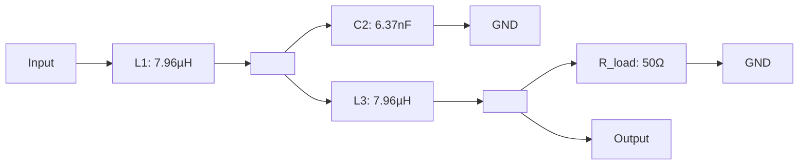

# Lesson 4: Passive Networks — Impedance Analysis, Filters, Resonance

## 1. First-Principles Intuition & Invariants

Every passive network, no matter how elaborate, reduces to a single question: how does a sinusoidal stimulus interact with components that store energy in electric and magnetic fields? A resistor dissipates energy irreversibly as heat. A capacitor stores energy in its electric field, with the current through it leading the voltage across it by ninety degrees. An inductor stores energy in its magnetic field, with the current lagging the voltage by the same ninety degrees. When these three element types combine in a network, their phase relationships create a rich landscape of frequency-dependent behavior that underpins every analog and RF system ever built.

The formalism that unifies these behaviors is complex impedance. For a sinusoidal excitation at angular frequency $\omega = 2\pi f$, the impedance of each element becomes a complex number on the Argand plane: the resistor maps to the real axis, while the capacitor and inductor map to the imaginary axis with opposite signs. The capacitor's impedance $Z_C = 1/(j\omega C)$ decreases with frequency and carries a negative imaginary component. The inductor's impedance $Z_L = j\omega L$ increases with frequency and carries a positive imaginary component. The resistor's impedance $Z_R = R$ is purely real and independent of frequency. When these elements appear in series, their impedances add as complex numbers, producing a resultant impedance whose magnitude and angle describe both the amplitude scaling and the phase shift that the network imposes on the signal.

This complex impedance formalism is not merely a mathematical convenience. It encodes physical reality: the real part of any network impedance represents energy dissipation, while the imaginary part represents energy storage that oscillates between the source and the reactive elements. The ratio of stored to dissipated energy at a given frequency defines the quality factor $Q$, which governs bandwidth, ringing, and the sharpness of resonant peaks. A network with high $Q$ stores large amounts of energy relative to what it dissipates per cycle, producing narrow bandwidth and prolonged transient ringing. A network with low $Q$ dissipates energy rapidly, producing broad response and fast settling.

The transfer function formalism extends impedance analysis to input-output behavior. By treating a passive network as a voltage divider whose legs are complex impedances, we obtain $H(j\omega) = V_{out}/V_{in}$, a complex-valued function of frequency whose magnitude gives the gain and whose argument gives the phase shift. For linear time-invariant networks of lumped components, this transfer function is always a rational function: a ratio of polynomials in $j\omega$. The roots of the numerator polynomial are the zeros, frequencies where the transfer function vanishes. The roots of the denominator polynomial are the poles, frequencies where the transfer function becomes unbounded (in the ideal lossless case) or reaches a maximum (in practice, where losses damp the response). The pole-zero plot on the complex plane is the complete characterization of a linear network's frequency response, and the placement of those poles and zeros along the real and imaginary axes determines whether the circuit acts as a low-pass, high-pass, band-pass, or band-stop filter.

The invariant that ties all of this together is Kirchhoff's laws applied in the phasor domain. In a network driven by a single sinusoidal source at frequency $\omega$, every node voltage and branch current is a sinusoid at that same frequency, differing only in amplitude and phase. Complex impedance captures both in a single algebraic quantity, reducing differential equations to algebraic equations. This is the foundational simplification that makes frequency-domain analysis tractable: instead of solving coupled ODEs in the time domain, we solve a system of linear algebraic equations in the complex frequency domain, then convert back to the time domain if needed.

## 2. Core Architecture & Mechanics

### 2.1 Complex Impedance and the Phasor Domain

Consider a series RLC circuit driven by a sinusoidal voltage source $V_s$ at angular frequency $\omega$. The total series impedance is:

$$Z_{total} = R + j\omega L + \frac{1}{j\omega C} = R + j\left(\omega L - \frac{1}{\omega C}\right)$$

The imaginary term in parentheses is the net reactance $X(\omega) = \omega L - 1/(\omega C)$. At low frequencies, the capacitive term dominates and $X$ is negative (capacitive). At high frequencies, the inductive term dominates and $X$ is positive (inductive). At exactly one frequency, the two reactances cancel and the impedance is purely resistive:

$$\omega_0 = \frac{1}{\sqrt{LC}}$$

This is the resonant frequency, and at this frequency the current through the series circuit reaches its maximum value $I_{max} = V_s / R$, limited only by the resistance. The phase angle of the impedance is $\arctan(X/R)$, which swings from $-90°$ at DC (purely capacitive) through $0°$ at resonance (purely resistive) to $+90°$ at high frequency (purely inductive).

For a practical benchtop measurement, consider the following concrete circuit: a series RLC network with $L = 10\,\mu\text{H}$, $C = 100\,\text{pF}$, and $R = 50\,\Omega$, driven by a function generator with 50Ω output impedance. The resonant frequency is:

$$f_0 = \frac{1}{2\pi\sqrt{10 \times 10^{-6} \times 100 \times 10^{-12}}} = \frac{1}{2\pi\sqrt{10^{-15}}} \approx 5.03\,\text{MHz}$$

To measure this on an oscilloscope, connect the function generator across the full series RLC circuit. Probe the voltage across the resistor with a 10× passive probe on Channel 1, and probe the source voltage with Channel 2. Sweep the generator frequency from 1 MHz to 10 MHz while watching the resistor voltage. At resonance, the resistor voltage will peak because the series impedance is at its minimum $Z = R$. The peak occurs at 5.03 MHz. The bandwidth between the two frequencies where the resistor voltage drops to $1/\sqrt{2}$ of its peak (the -3 dB points) gives the bandwidth $BW = f_0 / Q$, where $Q = \omega_0 L / R = (2\pi \times 5.03 \times 10^6)(10 \times 10^{-6})/50 \approx 6.32$. The expected -3 dB bandwidth is $5.03/6.32 \approx 0.80$ MHz, placing the half-power points at roughly 4.63 MHz and 5.43 MHz.

### 2.2 Series Resonance — Voltage Magnification

The defining characteristic of series resonance is voltage magnification across the reactive elements. At resonance, the current through all elements is $I = V_s / R$. The voltage across the inductor is $V_L = I \times j\omega_0 L = (V_s/R) \times j\omega_0 L$, which has magnitude $V_s \times Q$. The voltage across the capacitor has the same magnitude but opposite phase. Both reactive elements carry a voltage $Q$ times larger than the source voltage, while the source only supplies $V_s$.

For the circuit above with $Q \approx 6.32$ and a source of 1 V RMS at resonance, the inductor and capacitor each see approximately 6.32 V RMS. This is why series resonance circuits appear in voltage multiplier topologies and why a capacitor rated for only the supply voltage will fail catastrophically in a high-Q series resonant circuit. Always rate the reactive components for $V_s \times Q$, not for $V_s$.

### 2.3 Parallel Resonance — Current Magnification

The dual of series resonance is parallel resonance, where an inductor and capacitor are connected in parallel and driven by a current source (or a voltage source through a large series resistance). At resonance, the parallel impedance reaches its maximum value, and the circulating current between L and C is $Q$ times larger than the source current. The parallel resonant frequency, neglecting losses, is the same $\omega_0 = 1/\sqrt{LC}$. With losses included, the parallel resonant frequency of a practical tank circuit with inductor series resistance $R_L$ shifts slightly:

$$\omega_{0,parallel} = \omega_0 \sqrt{1 - \frac{R_L^2 C}{L}} = \omega_0 \sqrt{1 - \frac{1}{Q^2}}$$

For high-Q circuits ($Q > 10$), this shift is negligible. For $Q = 2$, the parallel resonant frequency drops to $0.866\,\omega_0$, a 13.4% deviation. This matters in IF transformer design for superheterodyne receivers, where the loaded Q of the tank circuit is intentionally kept moderate (8 to 12), and the exact resonant frequency must account for winding resistance.

A practical parallel resonant tank: $L = 22\,\mu\text{H}$ with an equivalent series resistance of $2.8\,\Omega$ (measured), $C = 47\,\text{pF}$. The unloaded Q is $Q = \omega_0 L / R_L$ where $f_0 = 1/(2\pi\sqrt{22\mu\text{H} \times 47\text{pF}}) \approx 4.95\,\text{MHz}$. This gives $Q = (2\pi \times 4.95 \times 10^6)(22 \times 10^{-6})/2.8 \approx 24.4$. The parallel impedance at resonance is $Z_{max} = L/(C \times R_L) = (22 \times 10^{-6})/(47 \times 10^{-12} \times 2.8) \approx 167\,\text{k}\Omega$. This high impedance is useful as a collector or drain load in RF amplifiers, where it provides high gain at resonance without dissipating DC power.

### 2.4 Q-Factor — Loaded vs. Unloaded

The distinction between loaded and unloaded Q is one of the most practically important concepts in passive network design. The unloaded Q $Q_u$ is determined by the component's own losses. The loaded Q $Q_L$ is determined by the total circuit including the source and load resistances. For a series resonant circuit with source resistance $R_s$ and load resistance $R_L$ both in series with the LC:

$$\frac{1}{Q_L} = \frac{1}{Q_u} + \frac{R_s + R_L}{\omega_0 L}$$

For a parallel resonant circuit with source and load resistances $R_s$ and $R_L$ both in parallel with the LC:

$$\frac{1}{Q_L} = \frac{1}{Q_u} + \frac{\omega_0 L}{R_s} + \frac{\omega_0 L}{R_L}$$

A concrete example: a parallel LC tank with $L = 1\,\mu\text{H}$ ($Q_u = 80$ at 10 MHz, so $R_L = \omega_0 L / Q_u = 0.785\,\Omega$ series), $C = 253\,\text{pF}$, resonant at 10 MHz. If this tank is loaded by $R_s = 1000\,\Omega$ and $R_L = 1000\,\Omega$ (equivalent parallel load of 500Ω), the loaded Q becomes:

$$Q_L = \frac{R_{load,parallel}}{\omega_0 L} = \frac{500}{2\pi \times 10^7 \times 10^{-6}} = \frac{500}{62.83} \approx 7.96$$

The bandwidth is $BW = f_0 / Q_L = 10/7.96 \approx 1.26$ MHz. This is the bandwidth you would measure by sweeping the frequency and observing the -3 dB points on a spectrum analyzer or oscilloscope. The insertion loss (the unavoidable power dissipated in the tank's own resistance) is $IL = 20\log_{10}(Q_L/Q_u) = 20\log_{10}(7.96/80) \approx -20$ dB, which means the tank passes about 1% of the power at resonance due to its own losses. This is a critical design constraint: loading a tank to low Q for wide bandwidth also increases insertion loss.

### 2.5 RLC Transient Response — The Time Domain View

When the driving source changes abruptly (a step or pulse), the RLC network's response is governed by a second-order differential equation whose character depends on the damping ratio $\zeta = R/(2\sqrt{L/C})$ for a series RLC circuit (or $\zeta = 1/(2R\sqrt{C/L})$ for a parallel RLC with shunt resistance R). The three regimes are:

**Overdamped ($\zeta > 1$):** The resistance is large relative to the reactive impedance, and the transient decays exponentially without oscillation. The step response rises monotonically to its final value. The two real poles are at $s = -\omega_0(\zeta \pm \sqrt{\zeta^2 - 1})$.

**Critically damped ($\zeta = 1$):** The fastest non-oscillatory response. The two poles coincide at $s = -\omega_0$. The step response reaches steady state in the shortest time without overshoot. This is the design target for many control systems and pulse-shaping networks.

**Underdamped ($\zeta < 1$):** The resistance is small, and the transient oscillates at the damped natural frequency $\omega_d = \omega_0\sqrt{1 - \zeta^2}$ with exponentially decaying amplitude. The poles are complex conjugates at $s = -\zeta\omega_0 \pm j\omega_d$. The envelope of oscillation decays as $e^{-\zeta\omega_0 t}$.

The relationship to Q is direct: $Q = 1/(2\zeta)$, so $Q = 0.5$ gives critical damping, $Q < 0.5$ gives overdamping, and $Q > 0.5$ gives underdamping. A Q of 5 ($\zeta = 0.1$) produces a step response that rings for about 5 cycles before settling to within 2% of the final value. This is observable on the bench: build a series RLC with $L = 1\,\text{mH}$, $C = 100\,\text{nF}$, and $R = 100\,\Omega$. The resonant frequency is $f_0 = 1/(2\pi\sqrt{1\text{mH} \times 100\text{nF}}) \approx 15.9\,\text{kHz}$. The characteristic impedance is $\sqrt{L/C} = \sqrt{10^{-3}/10^{-7}} = 100\,\Omega$, so $\zeta = R/(2\sqrt{L/C}) = 100/200 = 0.5$, giving critical damping. Replacing $R$ with $10\,\Omega$ gives $\zeta = 0.05$ ($Q = 10$), and a step input will produce a decaying sinusoid at approximately 15.9 kHz visible on the oscilloscope, with the ring-down envelope following $e^{-316t}$ (since $\zeta\omega_0 = 0.05 \times 2\pi \times 15900 \approx 5000$ rad/s — wait, let me recalculate: $\omega_0 = 1/\sqrt{LC} = 1/\sqrt{10^{-3} \times 10^{-7}} = 1/\sqrt{10^{-10}} = 10^5$ rad/s, so $\zeta\omega_0 = 0.05 \times 10^5 = 5000$ rad/s, and the time constant of decay is $1/5000 = 200\,\mu\text{s}$, meaning the ringing is visible for roughly 1 ms before it settles).

### 2.6 Ladder Networks and Transfer Functions

Passive filters are built as ladder networks: alternating series and shunt elements cascaded from input to output. The topology determines the filter type. A ladder of series inductors and shunt capacitors implements a low-pass filter. Swapping L and C positions (series capacitors, shunt inductors) implements a high-pass filter. Replacing each element with a parallel or series resonant circuit implements a band-pass or band-stop filter.

The analysis of a ladder network proceeds by computing the transfer function from the LC values. For a low-pass prototype normalized to 1 rad/s cutoff and 1Ω impedance, the element values are tabulated for each filter type (Butterworth, Chebyshev, etc.). Frequency scaling replaces each L with $L \times R_0/\omega_c$ and each C with $C/(\omega_c \times R_0)$, where $R_0$ is the desired impedance level and $\omega_c$ is the desired cutoff frequency. Impedance scaling preserves the frequency response because both the series reactances and the shunt reactances scale by the same factor.

Consider a 3rd-order Butterworth low-pass filter with 1 MHz cutoff and 50Ω impedance. The normalized Butterworth element values for order 3 are:

| Element (from source) | Normalized Value |
|---|---|
| g1 (series L) | 1.000 |
| g2 (shunt C) | 2.000 |
| g3 (series L) | 1.000 |
| g4 (load R) | 1.000 |

To scale to $f_c = 1\,\text{MHz}$ ($\omega_c = 2\pi \times 10^6$ rad/s) and $R_0 = 50\,\Omega$:

$$L_1 = L_3 = \frac{g_1 \times R_0}{\omega_c} = \frac{1.0 \times 50}{2\pi \times 10^6} = 7.96\,\mu\text{H}$$

$$C_2 = \frac{g_2}{\omega_c \times R_0} = \frac{2.0}{2\pi \times 10^6 \times 50} = 6.37\,\text{nF}$$

The load resistance is $R_0 = 50\,\Omega$ (the g4 value of 1.0 times the impedance level). The schematic is:

The Butterworth response gives maximally flat passband behavior, with the gain decreasing monotonically from DC. At the cutoff frequency, the gain is -3 dB (0.707). Beyond cutoff, the attenuation increases at 60 dB/decade (18 dB/octave) for this 3rd-order filter. The phase response is non-linear, with group delay peaking near the cutoff frequency, which causes transient ringing in pulse applications.

### 2.7 Chebyshev Filter Topology — Trading Flatness for Sharpness

The Chebyshev filter trades passband ripple for steeper rolloff. Instead of maximally flat passband response, the Chebyshev response oscillates between 0 dB and $-R_p$ dB (the ripple depth) within the passband, with all the ripple energy concentrated at the cutoff edge. This allows the stopband attenuation to begin more aggressively.

For a 3rd-order Chebyshev low-pass with 0.5 dB ripple and 1 MHz cutoff at 50Ω, the normalized element values are:

| Element (from source) | Normalized Value |
|---|---|
| g1 (series L) | 1.5963 |
| g2 (shunt C) | 1.0967 |
| g3 (series L) | 1.5963 |
| g4 (load R) | 1.0000 |

Note that for odd-order Chebyshev filters, the load impedance equals the source impedance (g4 = 1.0), which is a practical advantage over even-order Chebyshev filters where the load impedance differs from the source. Scaling these values:

$$L_1 = L_3 = \frac{1.5963 \times 50}{2\pi \times 10^6} = 12.71\,\mu\text{H}$$

$$C_2 = \frac{1.0967}{2\pi \times 10^6 \times 50} = 3.49\,\text{nF}$$

The 0.5 dB ripple means the passband gain oscillates between 0 dB and -0.5 dB as frequency increases from DC to 1 MHz. At 1 MHz, the gain is at a ripple minimum of -0.5 dB (not -3 dB as in Butterworth). The -3 dB point occurs slightly above the cutoff, at approximately 1.05 MHz for this design. The stopband attenuation at 2 MHz (one octave above cutoff) is approximately 25 dB, compared to 18 dB for the Butterworth. At 10 MHz (one decade above), the Chebyshev provides about 63 dB attenuation versus 60 dB for Butterworth. The advantage grows with filter order.

The practical cost of the Chebyshev response is twofold. First, the passband ripple may be unacceptable for applications requiring flat amplitude response (communications receivers, precision measurement). Second, the group delay variation near cutoff is significantly worse than Butterworth, leading to greater pulse distortion. For a 3rd-order 0.5 dB Chebyshev at 1 MHz, the group delay at DC is about 0.4 µs, but it peaks at roughly 1.1 µs near 0.9 MHz before dropping. This 2.75× variation in group delay causes significant dispersion of wideband signals.

### 2.8 Impedance Matching — L-Networks and Pi-Networks

Maximum power transfer between a source and load requires complex conjugate impedance matching: $Z_{source} = Z_{load}^*$. When the source and load are purely resistive but unequal, an L-network of two reactive elements can match them at a single frequency. The L-network derives its name from the shape: one series element and one shunt element, forming an L.

For matching a resistance $R_{low}$ to a resistance $R_{high}$ (where $R_{high} > R_{low}$) at frequency $\omega$, the series element is placed on the high-impedance side and the shunt element on the low-impedance side. The design equations are:

$$Q = \sqrt{\frac{R_{high}}{R_{low}} - 1}$$

$$X_{series} = Q \times R_{low} \quad (\text{inductive for low-pass, capacitive for high-pass})$$

$$X_{shunt} = \frac{R_{high}}{Q} \quad (\text{capacitive for low-pass, inductive for high-pass})$$

A concrete design: match a 50Ω antenna to a 200Ω IF port at 7 MHz. Here $R_{high} = 200$, $R_{low} = 50$.

$$Q = \sqrt{200/50 - 1} = \sqrt{3} = 1.732$$

For a low-pass L-network (series L, shunt C):

$$X_L = Q \times R_{low} = 1.732 \times 50 = 86.6\,\Omega \implies L = 86.6/(2\pi \times 7 \times 10^6) = 1.97\,\mu\text{H}$$

$$X_C = R_{high}/Q = 200/1.732 = 115.5\,\Omega \implies C = 1/(2\pi \times 7 \times 10^6 \times 115.5) = 197\,\text{pF}$$

The series inductor goes on the 200Ω side, the shunt capacitor goes on the 50Ω side. The resulting network has a Q of 1.732, which means the -3 dB bandwidth of the match is $f_0/Q = 7/1.732 \approx 4.04$ MHz. This is a wideband match, suitable for HF communications where a few MHz of bandwidth is needed.

For narrowband applications requiring higher Q, a pi-network or T-network provides an additional degree of freedom: independent control of Q and therefore bandwidth. A pi-network consists of two shunt elements and one series element. It can transform between any two resistances while allowing the designer to set the loaded Q independently. The pi-network is the standard output matching network in RF power amplifiers because it also provides harmonic rejection: the shunt capacitors attenuate harmonics by presenting low impedance at harmonic frequencies while the series inductor presents high impedance.

A pi-network matching 50Ω to 50Ω at 7 MHz with a loaded Q of 10:

$$X_{C1} = X_{C2} = R_{load}/Q = 50/10 = 5\,\Omega$$

$$C_1 = C_2 = 1/(2\pi \times 7 \times 10^6 \times 5) = 4.55\,\text{nF}$$

$$X_{L} = R_{load} \times Q = 50 \times 10 = 500\,\Omega \quad \text{(but this is the value for the equivalent circuit)}$$

The actual series element in a pi-network with equal source and load resistances is:

$$X_L = \frac{R_{load} \times Q}{1 + Q^2} \times (Q^2 + 1) / Q = R_{load} \times Q$$

Wait, let me re-derive this properly. For a symmetric pi-network with equal source and load R, the design equations are:

$$X_{C1} = X_{C2} = \frac{R}{Q_{loaded}}$$

$$X_{L} = \frac{R \times Q_{loaded}}{1 + \frac{R^2}{X_{C1}^2}} = \frac{R \times Q_{loaded}}{Q_{loaded}^2 + 1} \times Q_{loaded}^2 + 1$$

Actually, for a symmetric pi-network where the virtual impedance at the midpoint is $R_{mid} = R/(1+Q^2)$ and the series element sees impedance $R$ on each side:

$$X_L = R \times Q \quad \text{(when } Q \gg 1\text{, the series L reactance is } \approx R \times Q\text{)}$$

More precisely, for a pi-network matching $R_{source}$ to $R_{load}$:

$$X_{C1} = \frac{R_{source}}{Q}$$

$$X_{C2} = \frac{R_{load}}{Q \sqrt{R_{load}/R_{source} - 1/Q^2}}$$

$$X_L = \frac{Q \times R_{source}}{Q^2 + 1} \left(1 + \frac{R_{load}}{X_{C2}}\right)$$

For the symmetric case ($R_{source} = R_{load} = R$) with $Q = 10$:

$$X_{C1} = X_{C2} = R/Q = 50/10 = 5\,\Omega$$

$$C_1 = C_2 = 1/(2\pi \times 7\,\text{MHz} \times 5) = 4547\,\text{pF} \approx 4.55\,\text{nF}$$

$$X_L = \frac{R(Q^2 + 1)}{Q} = \frac{50 \times 101}{10} = 505\,\Omega$$

$$L = 505/(2\pi \times 7 \times 10^6) = 11.5\,\mu\text{H}$$

The bandwidth of this match is $f_0/Q = 7/10 = 0.7$ MHz, narrow enough to provide significant harmonic rejection. At 14 MHz (the second harmonic), the shunt capacitors present 2.5Ω (half of 5Ω) and the series inductor presents 1010Ω (double of 505Ω), giving roughly 52 dB of harmonic attenuation.

### 2.9 Reactive Power and Power Factor

In any AC network containing reactive elements, the apparent power $S = V_{rms} \times I_{rms}$ (in VA) exceeds the real power $P = V_{rms} \times I_{rms} \times \cos\phi$ (in watts), where $\phi$ is the phase angle between voltage and current. The difference is the reactive power $Q_{react} = V_{rms} \times I_{rms} \times \sin\phi$ (in VAR). The relationship is $S^2 = P^2 + Q_{react}^2$, forming the power triangle.

The power factor $\cos\phi$ represents the fraction of apparent power that does useful work. A purely resistive load has $\cos\phi = 1$ (unity power factor). A purely reactive load has $\cos\phi = 0$ (zero real power, all energy oscillates between source and load). Practical loads are typically inductive with power factors between 0.7 and 0.9.

Power factor correction adds a parallel capacitor across an inductive load to supply the reactive current locally, reducing the current drawn from the source. For a load drawing real power P at power factor $\cos\phi_1$, to correct to $\cos\phi_2$:

$$C = \frac{P(\tan\phi_1 - \tan\phi_2)}{2\pi f \times V_{rms}^2}$$

A concrete example: a 5 kW motor load at 240 V, 50 Hz, with power factor 0.75 lagging. To correct to 0.95:

$$\phi_1 = \arccos(0.75) = 41.4°, \quad \tan\phi_1 = 0.882$$

$$\phi_2 = \arccos(0.95) = 18.2°, \quad \tan\phi_2 = 0.329$$

$$C = \frac{5000 \times (0.882 - 0.329)}{2\pi \times 50 \times 240^2} = \frac{2765}{18.1 \times 10^6} = 153\,\mu\text{F}$$

The capacitor must be rated for the reactive power it handles: $Q_C = P(\tan\phi_1 - \tan\phi_2) = 5000 \times 0.553 = 2765$ VAR. A 240 VAC-rated motor-run capacitor rated for at least 2800 VAR (about 150 µF at 240 V, which is $2\pi f C V^2 = 2\pi \times 50 \times 153\mu\text{F} \times 240^2 = 2765$ VAR) is the correct choice. In practice, a 160 µF, 370 VAC motor-run capacitor provides margin.

## 3. High-Performance Optimization & Failure Modes

### 3.1 Parasitic Effects and Self-Resonance

Every real passive component carries parasitic elements that limit its useful frequency range. A real inductor has series resistance (the DCR, from wire resistance) and parallel capacitance (inter-winding capacitance). A real capacitor has series resistance (ESR, from dielectric and lead losses) and series inductance (ESL, from lead and plate geometry). These parasitics create self-resonant frequencies (SRF) above which the component behavior inverts: an inductor above its SRF behaves as a capacitor, and a capacitor above its SRF behaves as an inductor.

A wirewound inductor with $L = 10\,\mu\text{H}$ and inter-winding capacitance $C_p = 5\,\text{pF}$ has a self-resonant frequency of $f_{SRF} = 1/(2\pi\sqrt{L \times C_p}) = 1/(2\pi\sqrt{10^{-5} \times 5 \times 10^{-12}}) \approx 22.5\,\text{MHz}$. Below this frequency, the inductor behaves as an inductor. Above it, the parallel capacitance dominates and the component presents a decreasing impedance, acting as a capacitor. The usable frequency range for an inductor in a filter or matching network is typically limited to about 1/3 of the SRF, where the impedance is still dominantly inductive and the effective inductance has increased by about 10% from the nominal value.

For capacitors, the SRF is set by the ESL. A 100 nF multilayer ceramic capacitor (MLCC) in an 0805 package has an ESL of approximately 1.5 nH, giving $f_{SRF} = 1/(2\pi\sqrt{10^{-7} \times 1.5 \times 10^{-9}}) \approx 13\,\text{MHz}$. Above this frequency, the capacitor's impedance increases with frequency (inductive behavior). For RF bypass applications at 100 MHz, a 100 nF capacitor is useless above its SRF. The correct choice is a smaller capacitance value with higher SRF, such as a 100 pF NP0 ceramic in 0402 package with ESL of about 0.5 nH, giving $f_{SRF} \approx 712\,\text{MHz}$. At 100 MHz, this 100 pF capacitor presents $X_C = 1/(2\pi \times 100\,\text{MHz} \times 100\,\text{pF}) \approx 16\,\Omega$, which is well below the SRF and purely capacitive.

The practical guidance: for bypass and coupling applications, select a capacitor whose SRF is at least 3× the operating frequency. For resonant tank applications, select an inductor whose SRF is at least 10× the operating frequency to ensure the parasitic capacitance does not alter the resonant point significantly.

### 3.2 Component Tolerance and Temperature Effects

Filter response depends on the accuracy and stability of the L and C values. Capacitor dielectrics vary widely in temperature coefficient (TC):

| Dielectric | TC (ppm/°C) | Typical Use |
|---|---|
| NP0/C0G (Class 1) | 0 ± 30 | Filters, oscillators, resonant circuits |
| X7R (Class 2) | ± 15% over -55 to +125°C | Bypass, coupling, general purpose |
| Z5U (Class 2) | +22% / -56% over +10 to +85°C | Bulk bypass only |
| Y5V (Class 2) | +22% / -82% over -30 to +85°C | Avoid for signal path |

For a 1 MHz Butterworth low-pass filter built with X7R capacitors, the capacitance can shift by 15% over temperature, moving the cutoff frequency by 7.5% (since $f_c \propto 1/\sqrt{C}$). This means a filter designed for 1.00 MHz at 25°C could have its cutoff anywhere from 925 kHz to 1.08 MHz across the operating temperature range. For a channel filter in a communications system, this drift may be unacceptable. NP0 capacitors reduce this to 0.03% over the same range.

Inductor temperature behavior is dominated by the core material. Air-core inductors have negligible TC. Ferrite-core inductors have a permeability that drops with temperature, typically losing 10-20% of inductance from 25°C to 85°C. Powdered iron cores are more stable, with 2-5% variation. For a resonant circuit requiring frequency stability, air-core or powdered iron cores are preferred over ferrite.

### 3.3 Failure Modes in Resonant Circuits

High-Q resonant circuits concentrate energy, and the concentration can destroy components. In a series resonant circuit at resonance, the voltage across the capacitor is $Q \times V_{source}$. A 100 V source driving a circuit with $Q = 50$ places 5000 V across the capacitor. If the capacitor is rated for 50 VDC, it will fail by dielectric breakdown, creating a short circuit. The inductor will then carry the full source current without the capacitor's reactance to limit it, potentially overheating and failing open.

In parallel resonant circuits, the failure mode is current magnification. The circulating current between L and C is $Q \times I_{source}$. A parallel tank carrying 1 mA from the source at $Q = 100$ has 100 mA circulating between L and C. The inductor wire must be sized for the circulating current, not the source current. In RF power amplifier tank circuits, this circulating current can reach tens of amperes, requiring copper tubing or Litz wire for the inductor winding.

Thermal runaway is a failure mode unique to high-Q circuits with marginal component ratings. As the capacitor dissipates power (due to finite ESR or dielectric loss), its temperature rises. For Class 2 ceramic dielectrics (X7R, Z5U), rising temperature increases the dissipation factor, which increases power dissipation, which raises temperature further. This positive feedback loop can destroy the capacitor within seconds if the initial power dissipation exceeds a few hundred milliwatts in a small package. The mitigation is to use NP0/C0G dielectrics for any capacitor in a high-Q resonant circuit, or to derate Class 2 capacitors to less than 10% of their rated voltage in resonant applications.

### 3.4 Layout and Parasitic Management

At frequencies above a few MHz, the PCB layout becomes part of the circuit. Trace inductance is approximately 1 nH per millimeter of trace length for a 0.2 mm wide trace on standard FR-4. A 20 mm trace connecting a capacitor to ground adds 20 nH of series inductance, creating a self-resonant frequency of $1/(2\pi\sqrt{C \times 20\,\text{nH}})$. For a 100 nF bypass capacitor, this gives $f_{SRF} = 1/(2\pi\sqrt{10^{-7} \times 2 \times 10^{-8}}) \approx 3.56\,\text{MHz}$, rendering the bypass ineffective above a few MHz despite the capacitor's own SRF being much higher.

The mitigation is to minimize the loop area between the capacitor and the bypassed component. A via-in-pad design with the capacitor placed directly adjacent to the power pin, with the ground via immediately on the other side of the capacitor, reduces the loop inductance to about 0.5 nH. For the same 100 nF capacitor, this gives $f_{SRF} = 1/(2\pi\sqrt{10^{-7} \times 5 \times 10^{-10}}) \approx 22.5\,\text{MHz}$, a six-fold improvement. For frequencies above 100 MHz, use multiple smaller capacitors in parallel (e.g., three 33 pF NP0 in 0201 packages) rather than one large capacitor, because the parallel inductance of multiple small packages is lower than the inductance of one large package.

Ground plane discontinuities are another common failure mode. A return current flowing under a signal trace follows the path of least inductance, which is directly beneath the trace on the ground plane. If a slot or via fence interrupts this path, the return current must detour, increasing the loop area and the inductance. A 10 mm detour adds about 10 nH of unwanted inductance in series with the signal, causing ringing and EMI. In filter layouts, ensure that the ground plane is uninterrupted beneath all filter components, and that each component's ground connection uses its own via directly at the component pad.

### 3.5 Verification and Measurement Procedures

The first measurement to perform on any passive network is a swept frequency response using a network analyzer or a tracking generator with a spectrum analyzer. Connect the tracking generator output to the filter input and the spectrum analyzer input to the filter output. Set the sweep to cover at least one decade above and below the expected passband. Verify the following:

**Passband ripple:** Measure the maximum and minimum gain within the passband. For a 0.5 dB Chebyshev, the ripple should not exceed 0.5 dB. If it does, the component values have drifted from design values. Measure each inductor and capacitor with an LCR meter at the operating frequency (or as close to it as the meter supports) to identify the culprit.

**Insertion loss:** The minimum loss in the passband, measured at the ripple minimum. For a lossless filter, this should be 0 dB. Real filters show 0.2 to 1.0 dB of insertion loss depending on component Q. If insertion loss exceeds 1 dB, check for low-Q inductors (measured Q should be > 50 at the operating frequency for reasonable filter performance) or excessive capacitor ESR.

**Stopband attenuation:** Verify that the attenuation at the first harmonic of the cutoff reaches the design value. For a 3rd-order Butterworth at 1 MHz, the attenuation at 2 MHz should be about 18 dB. If it is significantly less, suspect parasitic coupling: radiation from the inductors, capacitive coupling between input and output traces, or ground plane impedance. Shielding the filter in a metal enclosure and using separate ground vias for input and output typically resolves parasitic coupling issues.

**Return loss (VSWR):** Measure with the S11 port of a vector network analyzer. The return loss in the passband should be better than 10 dB (VSWR < 2:1) for a well-designed filter. Poor return loss indicates impedance mismatch, usually from incorrect component values or insufficient attention to impedance scaling. The Smith chart display on the VNA will show whether the mismatch is inductive or capacitive, guiding component value adjustment.

For resonant circuits, measure Q directly using the 3 dB bandwidth method: find the resonant frequency $f_0$, then find the two frequencies $f_1$ and $f_2$ where the response is 3 dB below the peak. $Q = f_0 / (f_2 - f_1)$. For high-Q circuits (> 100), the 3 dB bandwidth may be too narrow to resolve with a standard spectrum analyzer. In this case, use the ring-down method: excite the resonant circuit with a pulse, capture the decaying oscillation on an oscilloscope, and measure the time constant $\tau$ of the envelope. The loaded Q is $Q_L = \pi f_0 \tau$. For example, a 10 MHz resonator whose ring-down envelope decays with $\tau = 32\,\mu\text{s}$ has $Q_L = \pi \times 10^7 \times 32 \times 10^{-6} \approx 1005$.

These measurement procedures, combined with the design equations and parasitic awareness described above, form the complete workflow for designing, building, and verifying passive networks. The key insight that separates competent practice from theoretical exercise is that every passive component is a compromise between ideal behavior and physical reality. The inductor with high Q also has inter-winding capacitance that limits its frequency range. The capacitor with tight tolerance also has voltage-dependent capacitance (Class 2 dielectrics) that distorts the signal. The resistor at high frequencies has parasitic inductance and capacitance that make it frequency-dependent. Designing passive networks that work in practice requires accounting for these parasitics from the start, not discovering them on the benchtop after the circuit fails to meet specifications.
