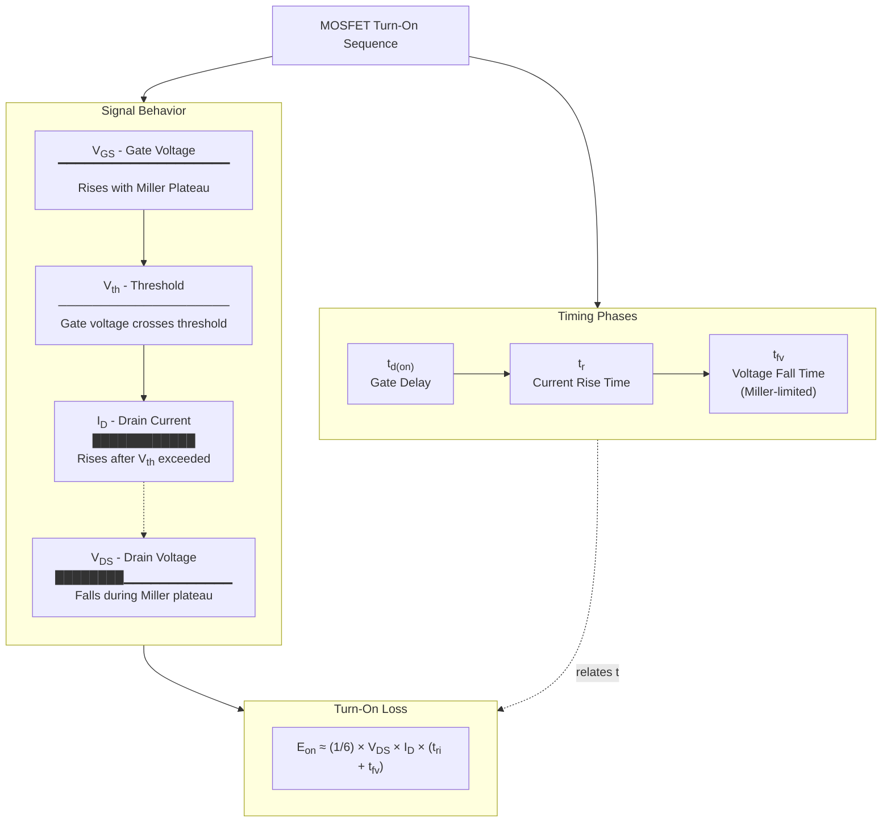

# Lesson 1: Semiconductor Switching Devices

## 1. First-Principles Intuition & Invariants

Power electronics exists at the intersection of solid-state physics and electrical machinery, where semiconductor devices act as gatekeepers controlling kilowatts to megawatts of energy flow with microsecond precision. Unlike their small-signal counterparts in analog amplifiers or digital logic gates, power semiconductor devices operate in a fundamentally different regime: they spend minimal time in linear operation and instead transition rapidly between two states—fully conducting and fully blocking. This hard-switching behavior, while seemingly binary, reveals extraordinary complexity when examined through the lens of carrier physics, parasitic capacitances, and thermal dynamics.

At the heart of every power converter—whether a laptop charger, industrial motor drive, or grid-tied photovoltaic inverter—lies a collection of semiconductor switches orchestrating energy transfer between sources and loads. The economic and technical success of these systems hinges entirely on switch selection, a process that demands fluency in device physics, application constraints, and failure mechanisms. A poorly chosen MOSFET might exhibit acceptable conduction losses but catastrophic switching losses at high frequencies. An IGBT optimized for 50 Hz industrial drives will exhibit unacceptable tail currents in a 100 kHz resonant converter. A silicon carbide diode might eliminate reverse recovery entirely but introduce common-mode EMI through its aggressive switching transients.

The fundamental invariant governing all power semiconductors is the relationship between voltage blocking capability and on-state resistance. This tradeoff emerges directly from the depletion region physics in reverse-biased PN junctions. When a diode or transistor blocks voltage, it does so by establishing a charge-depleted region within the semiconductor bulk—a zone stripped of mobile carriers where an electric field sustains the voltage drop. The width of this depletion region scales with the square root of the applied voltage, meaning a device rated for 1200 V requires a depletion region four times wider than a 300 V device. Since current must traverse this resistive bulk material when the device conducts, on-state resistance increases dramatically with voltage rating. Silicon exhibits a theoretical limit where specific on-resistance (resistance normalized to die area) scales as the blocking voltage raised to approximately the 2.5 power. This relationship, known as the silicon limit, explains why 10 kV power devices remain large, expensive, and lossy compared to their low-voltage counterparts.

Wide-bandgap semiconductors—silicon carbide and gallium nitride—shift this fundamental tradeoff by roughly two orders of magnitude, permitting higher blocking voltages in smaller die areas with lower conduction losses. The critical material parameter is the breakdown electric field strength. Silicon reaches avalanche breakdown at approximately 300 kV/cm, while silicon carbide sustains 2.5 MV/cm and gallium nitride approaches 3.5 MV/cm. A thinner drift region can therefore support the same voltage, reducing resistive losses and shrinking device capacitances. This material advantage cascades through every performance metric: faster switching, higher operating temperatures, and reduced cooling requirements.

Beyond the voltage-resistance tradeoff, a second invariant governs dynamic behavior: the displacement of stored charge during switching transitions. Every semiconductor junction stores minority carriers during forward conduction, and these carriers must be removed before the device can block reverse voltage. In diodes, this manifests as reverse recovery—a brief interval where the diode conducts backward, injecting current into the circuit until the stored charge depletes. In bipolar transistors (BJTs and IGBTs), stored base or gate charge must be swept out to turn the device off, creating tail currents that extend switching losses. Even majority-carrier devices like MOSFETs and Schottky diodes store charge in their nonlinear parasitic capacitances, which must be charged or discharged through the circuit impedance during transitions.

The third invariant is thermal: every watt dissipated in a semiconductor junction must traverse a thermal resistance path to ambient. Junction temperatures rise according to the product of power dissipation and thermal resistance, and once the junction exceeds its maximum rated temperature—typically 150°C for silicon, 175°C for advanced silicon, and 200°C for silicon carbide—device degradation accelerates exponentially. Thermal resistance itself comprises multiple components in series: junction-to-case resistance inherent to the die and package construction, case-to-heatsink interface resistance dominated by thermal interface materials and mounting pressure, and heatsink-to-ambient resistance determined by fin geometry and airflow. Managing this thermal cascade defines the practical current rating of any power device, often more stringently than electrical specifications.

These three invariants—voltage-resistance tradeoff, charge storage dynamics, and thermal constraints—form the coordinate system within which all power semiconductor selection occurs. A designer must balance conduction losses (proportional to on-state resistance and RMS current squared), switching losses (proportional to voltage-current overlap time and switching frequency), and thermal management costs. The optimal device for a 10 kHz hard-switched buck converter operating from 400 V DC differs entirely from the optimal choice for a 100 kHz resonant LLC topology or a 50 Hz line-frequency rectifier. Mastery of power electronics demands not only understanding these invariants but recognizing how device physics, circuit topology, and thermal design interact to define feasible operating regions.

## 2. Core Architecture & Mechanics

The simplest power semiconductor, the PN junction diode, reveals the fundamental architecture underlying all more complex devices. A diode consists of P-type silicon (doped with acceptor atoms like boron, creating an excess of holes) joined to N-type silicon (doped with donor atoms like phosphorus, creating an excess of electrons). At the metallurgical junction, holes diffuse from the P region into the N region while electrons diffuse in the opposite direction, establishing a depletion region depleted of mobile carriers. Fixed ionized dopant atoms remain, creating a built-in electric field that opposes further diffusion. At equilibrium, this field balances the diffusion gradient, establishing a potential barrier of approximately 0.7 V for silicon at room temperature.

When forward-biased—P-side positive relative to N-side—the external voltage reduces the depletion width and lowers the potential barrier, allowing majority carriers to flood across the junction. Holes injected from P into N become minority carriers in the N region, where they diffuse and recombine with electrons. Similarly, electrons injected from N into P recombine with holes. This bipolar conduction mechanism exhibits an exponential voltage-current relationship described by the Shockley equation, but practical power diodes operate at sufficiently high current densities that the voltage drop becomes approximately constant at 0.8 to 1.2 V, dominated by bulk resistance rather than junction physics.

The critical architectural distinction between signal diodes and power diodes lies in the drift region—a lightly doped N-type layer inserted between the heavily doped N+ substrate and the P+ anode. This drift region provides voltage blocking capability when reverse-biased, supporting the depletion region that shields the junction from high electric fields. The doping concentration and thickness of the drift region determine the breakdown voltage. For a 600 V diode, the drift region might span 50 to 70 microns with a doping density of 10^14 atoms per cubic centimeter. For a 1200 V device, the drift region extends to 100 microns or more, and the doping decreases proportionally. This architectural necessity—trading thickness for voltage rating—directly manifests the silicon limit, as the thicker, more lightly doped drift region exhibits higher resistivity during forward conduction.

Reverse recovery introduces the most consequential dynamic behavior in power diodes. During forward conduction, the drift region fills with minority carriers—holes stored in the N-type drift layer. When the diode experiences a reverse voltage transient, these stored holes cannot vanish instantaneously. Instead, the diode continues conducting in reverse while the stored charge depletes through recombination and reverse current flow. The reverse current initially equals the forward current, then decays as stored charge diminishes. When the charge fully depletes, the current snaps off abruptly, creating a high di/dt event that generates voltage spikes through parasitic inductances. The reverse recovery charge, measured in nanocoulombs, quantifies this stored charge, while the reverse recovery time—typically 30 to 500 nanoseconds for fast recovery diodes—measures the duration.

```mermaid
flowchart TD
    subgraph phases ["Reverse Recovery Sequence"]
        direction LR
        A["Forward Conduction"] --> B["Reverse Transient"]
        B --> C["Reverse Recovery"]
        C --> D["Voltage Blocking"]
    end

    subgraph waveforms ["Associated Waveforms"]
        direction LR
        E["I_F — Forward Current\n\n  ↑\n  │████████\n  └────────→\n     Time"]
        F["I_R — Reverse Current\n\n  ↑  ╱╲\n  │ ╱  ╲___\n  │╱    ▔▔▔▔▔\n  ╱\n  └────────→\n     Time\n\n  t_rr ◄────►\n  Q_rr = ∫I_R dt"]
        G["V_R — Reverse Voltage\n\n  ↑\n  │████████\n  └────────→\n     Time"]
    end

    subgraph notes ["Key Relationships"]
        H["Stored minority carriers must be swept out before blocking occurs."]
        I["Abrupt current snap-off di/dt induces voltage spike:\nV_spike = L × di/dt"]
    end

    phases --> waveforms
    waveforms --> notes
```

Ultra-fast recovery diodes mitigate reverse recovery through lifetime killing—introducing recombination centers (gold or platinum doping) that accelerate minority carrier recombination. This reduces stored charge and recovery time but increases forward voltage drop, trading conduction losses for switching losses. Schottky diodes eliminate reverse recovery entirely by replacing the PN junction with a metal-semiconductor junction, which conducts through majority carriers only. However, Schottky diodes exhibit higher leakage currents and limited voltage ratings—typically 200 V maximum in silicon—because the metal-semiconductor barrier cannot sustain large depletion widths.

Silicon carbide Schottky diodes extend the Schottky architecture to 1200 V and 1700 V ratings by exploiting SiC's ten-fold higher breakdown field strength. The absence of stored charge makes SiC Schottky diodes ideal for high-frequency applications, eliminating the dominant loss mechanism in hard-switched converters. The tradeoff manifests as higher cost per ampere and a positive temperature coefficient of forward voltage drop, which actually aids parallel operation by naturally balancing current between devices.

The metal-oxide-semiconductor field-effect transistor (MOSFET) introduces voltage-controlled switching through capacitive coupling rather than current injection. A MOSFET comprises a lightly doped N-type drift region (for N-channel devices) contacted on one end by a heavily doped N+ source and on the other by an N+ drain. On the surface, between source and drain, sits a P-type body region covered by a thin insulating oxide layer, above which lies the metal (or polysilicon) gate electrode. In the off state, the P-body region forms a PN junction with the N-drift region, blocking current flow between source and drain.

Applying a positive gate voltage (relative to source) attracts electrons to the oxide-semiconductor interface, forming a conductive N-type channel that bridges the source and drain. This channel operates in ohmic mode when the drain voltage is small, exhibiting a resistance R_DS(on) determined by channel geometry, doping profiles, and drift region resistivity. As drain voltage increases, the channel pinches off at the drain end, and the device enters saturation mode where current becomes approximately independent of drain voltage. Power MOSFETs operate almost exclusively in the ohmic region, acting as voltage-controlled resistors with on-resistances ranging from milliohms to hundreds of milliohms depending on voltage rating and die size.

The MOSFET's gate structure introduces three critical parasitic capacitances: gate-to-source capacitance C_gs, gate-to-drain capacitance C_gd (also called Miller capacitance), and drain-to-source capacitance C_ds. These capacitances are highly nonlinear, varying with applied voltages. During turn-on, the gate driver must first charge C_gs to reach the threshold voltage V_th, typically 2 to 4 V for silicon MOSFETs. Further charging increases gate voltage toward the driver voltage V_GS, but as drain current begins flowing and drain voltage starts falling, the Miller capacitance C_gd presents a feedback path that diverts gate current to maintain dV_ds/dt. This Miller plateau region dominates switching time, as the gate driver must supply sufficient current to charge C_gd while the drain voltage transitions from blocking voltage to near zero.

Turn-off reverses this sequence, but with a critical difference: the gate driver must now sink current to discharge the gate capacitance. If the gate driver source resistance is too high, the MOSFET may turn off slowly, extending switching losses and potentially inducing thermal runaway. External gate resistors tailor the switching speed by limiting gate current, trading faster switching (lower losses) against increased dV/dt and dI/dt that can trigger EMI or false turn-on of adjacent devices through parasitic inductances.

The insulated-gate bipolar transistor (IGBT) hybridizes MOSFET and BJT architectures to achieve lower on-state losses than MOSFETs in high-voltage applications while retaining voltage-controlled switching. An IGBT resembles a vertical power MOSFET, but the N+ drain contact is replaced with a P+ collector contact. This structural modification injects holes from the collector into the N-drift region during conduction, creating conductivity modulation—the drift region fills with electron-hole pairs, drastically reducing effective resistance. A 1200 V IGBT might exhibit a forward voltage drop of 1.5 to 2.5 V at rated current, whereas a comparable MOSFET would drop 5 to 10 V or more.

The penalty for conductivity modulation appears during turn-off. The stored charge in the drift region—now filled with minority carriers—must be removed before the device can block voltage. This creates a tail current that persists for microseconds after the gate voltage falls below threshold, extending switching losses significantly compared to MOSFETs. Modern trench-gate and field-stop IGBTs mitigate tail current through refined doping profiles and buffer layers, but the fundamental tradeoff remains: IGBTs excel in low-frequency, high-power applications (motor drives, traction inverters, grid converters operating below 20 kHz), while MOSFETs dominate high-frequency, moderate-power applications (switch-mode power supplies, solar inverters, onboard chargers operating above 50 kHz).

Thyristors—SCRs (silicon-controlled rectifiers), GTOs (gate turn-off thyristors), and their derivatives—extend bipolar conduction to four-layer PNPN structures that latch into conduction once triggered. An SCR remains off until a gate pulse injects current into the P-base, forward-biasing the central PN junction and initiating regenerative feedback between the internal PNP and NPN transistor structures. Once latched, the gate loses control, and the device continues conducting until the anode current falls below the holding current, typically by external circuit action (natural commutation in AC circuits or forced commutation in DC circuits). SCRs handle extreme power levels—thousands of amperes and kilovolts—in line-frequency applications like HVDC transmission and large motor soft-starters, but their inability to turn off via gate control limits their use in high-frequency converters.

Gate turn-off thyristors (GTOs) restore turn-off capability by designing the gate structure to extract sufficient base current to break the regenerative latch. However, GTOs require large negative gate currents—often 20% to 30% of anode current—making gate drive circuits complex and power-hungry. Integrated gate-commutated thyristors (IGCTs) improve on GTOs through tighter integration of the gate drive and optimized doping profiles, achieving faster turn-off and lower losses, but remain confined to high-power, medium-frequency industrial drives.

## 3. High-Performance Optimization & Failure Modes

Optimizing power semiconductor selection begins with calculating conduction and switching losses under realistic operating conditions, then iterating to balance electrical performance, thermal management, and cost. Conduction losses in a diode or IGBT follow P_cond = V_F × I_avg, where V_F is the forward voltage drop and I_avg is the average current. For resistive devices like MOSFETs, conduction loss scales as P_cond = I_rms² × R_DS(on), where I_rms is the root-mean-square current accounting for all harmonic content. A buck converter MOSFET conducting with duty cycle D carries RMS current I_rms = I_out × √D, while the freewheeling diode carries I_rms = I_out × √(1-D). On-resistance exhibits strong temperature dependence, typically increasing by 50% to 100% between 25°C and 150°C junction temperature, so calculations must use datasheet curves at the expected operating temperature.

Switching losses require modeling the voltage-current overlap during transitions. During turn-on, drain voltage falls from blocking voltage V_DS to near zero while drain current rises from zero to load current I_D. The instantaneous power dissipation during this transition is v_DS(t) × i_D(t), and the energy dissipated per switching event integrates this product over the transition time. A first-order approximation yields E_on ≈ (1/6) × V_DS × I_D × t_on, where t_on combines the current rise time and voltage fall time. Similarly, turn-off energy is E_off ≈ (1/6) × V_DS × I_D × t_off. Multiplying by switching frequency gives average switching loss: P_sw = (E_on + E_off) × f_sw. For a 600 V, 20 A MOSFET switching at 100 kHz with 50 ns total transition time, switching loss would be approximately (1/6) × 600 × 20 × 50×10^-9 × 100×10^3 = 10 W.

Datasheet switching energy curves, measured in a standardized clamped-inductive-load test circuit, provide more accurate estimates but require careful interpretation. These tests typically use a resistive gate drive with specified gate resistance R_G, source voltage, and junction temperature. Real-world circuits may have different gate drive characteristics, parasitic inductances, and operating points, so direct application of datasheet values introduces error. Advanced designers simulate switching transitions using SPICE models that include nonlinear capacitances, gate charge profiles, and package parasitics to predict losses under actual circuit conditions.

Paralleling devices to increase current capacity or distribute losses demands attention to both static and dynamic current sharing. Static sharing during conduction depends on matching on-state voltages. For MOSFETs, devices with similar R_DS(on) naturally share current proportionally, and the positive temperature coefficient (resistance increases with temperature) provides negative feedback: a device carrying excess current heats up, increasing its resistance and redirecting current to cooler devices. IGBTs and diodes exhibit negative temperature coefficients (forward voltage decreases with temperature), creating positive feedback where a device carrying excess current heats up, drops less voltage, and attracts even more current until thermal runaway occurs. Paralleling IGBTs or diodes therefore requires tight V_F matching (within 50 mV) and forced current sharing through series gate resistors or coupled inductors.

Dynamic current sharing during switching events depends on minimizing differences in parasitic inductance and gate drive timing. A device with lower parasitic inductance switches faster, briefly carrying all transient current and incurring higher switching losses. Symmetric PCB layouts with equal trace lengths, shared gate drives with low source impedance, and Kelvin-connected gate and source pins mitigate dynamic imbalance. For MOSFETs in high-current applications, common-source inductance—the inductance shared between drain current and gate drive return path—introduces negative feedback that stabilizes switching: as drain current rises, the voltage drop across common-source inductance subtracts from gate voltage, slowing further current increase. However, excessive common-source inductance slows switching unacceptably, increasing losses.

Failure modes in power semiconductors cluster around electrical overstress, thermal runaway, and parametric drift. Avalanche breakdown occurs when the electric field in the depletion region exceeds the critical field strength, triggering impact ionization where accelerated carriers collide with lattice atoms, creating additional carriers in a runaway process. Datasheets specify maximum avalanche energy—typically tens to hundreds of millijoules for power MOSFETs—beyond which the device suffers permanent damage through localized heating and metallization melting. Unclamped inductive switching, where the device must absorb energy stored in circuit inductances during turn-off, is the most common cause of avalanche failure. Snubbers, MOV clamps, or RCD networks limit peak voltage to prevent avalanche.

Second breakdown, a bipolar-specific failure mode affecting IGBTs and BJTs, occurs when localized current constriction creates a hot spot that further reduces local resistance, concentrating current and forming a thermal runaway channel that destroys the device. Second breakdown manifests as a sudden collapse in blocking voltage during turn-off, often below the rated voltage. Modern trench-gate IGBTs and field-stop designs improve second breakdown robustness, but margin must still be maintained by limiting peak current and junction temperature.

Gate oxide rupture in MOSFETs results from exceeding the dielectric strength of the thin oxide layer—typically 20 to 30 V for silicon MOSFETs, 15 to 20 V for SiC MOSFETs. Transient voltage spikes coupled through drain-gate capacitance during fast switching can stress the oxide even when steady-state gate voltage remains within limits. Zener clamps between gate and source protect against overvoltage, but the Zener breakdown voltage must be chosen carefully to avoid clamping during normal high-current switching when Miller current can briefly push gate voltage toward the positive rail.

Thermal runaway in diodes and IGBTs stems from the negative temperature coefficient creating a positive feedback loop. As junction temperature rises, forward voltage drop decreases, increasing current and further raising temperature. Paralleled devices self-sort into conduction by forward voltage, and the device with lowest V_F eventually carries all current until it fails. Forced current sharing or active thermal balancing through independent temperature monitoring prevents this failure mode in critical applications.

Cosmic ray-induced single-event burnout (SEB) and single-event gate rupture (SEGR) affect high-voltage silicon carbide MOSFETs, where energetic particles striking the drift region can trigger localized avalanche or inject charge into the gate oxide. SEB resembles second breakdown, creating a conductive filament that shorts the device. SEGR ruptures the gate oxide through transient charge injection. These failure modes, previously confined to aerospace applications, now appear in terrestrial SiC power devices operating above 1200 V. Manufacturers address SEB/SEGR through refined doping profiles, thicker gate oxides, and screening processes, but users must still derate voltage or implement redundancy in critical applications.

Practical device selection synthesizes these loss mechanisms, failure modes, and thermal constraints into a multi-dimensional optimization. For a 400 V input, 12 V output synchronous buck converter operating at 500 kHz, the high-side switch must block 400 V and conduct with duty cycle D = 12/400 = 3%. The low RMS current (√0.03 ≈ 17% of load current) suggests that conduction losses are modest, and a 500 V or 600 V MOSFET with moderate R_DS(on) suffices. Switching losses dominate, favoring low Q_g (total gate charge) and low output capacitance C_oss to minimize hard-switching losses. A 500 V superjunction MOSFET, with Q_g around 50 nC and C_oss of 200 pF, might dissipate 5 to 10 W at 500 kHz, manageable with a modest heatsink.

The low-side synchronous rectifier conducts for 97% of the period, making conduction loss dominant. A low-voltage (60 V or 100 V) MOSFET with R_DS(on) below 5 mΩ minimizes conduction losses, even though switching losses are negligible at such low duty cycles. The thermal design must accommodate both devices' dissipation, ensuring junction temperatures remain below 125°C with margin for transient overloads and ambient temperature variation.

In contrast, a 480 VAC three-phase motor drive operating at 4 kHz requires 1200 V or 1700 V IGBTs for the inverter switches. Switching losses scale with voltage and current, so modern field-stop IGBTs with tail currents below 100 ns minimize E_off. Freewheeling diodes must be co-packaged or discrete SiC Schottky diodes to eliminate reverse recovery losses, as PN diodes would induce unacceptable switching losses in the IGBTs during turn-on. Gate drive must supply peak currents exceeding 10 A to switch 100+ nC gate charge in under 200 ns, demanding dedicated gate driver ICs with bootstrap supplies and short-circuit protection.

Thermal design for such high-power modules involves liquid cooling or large forced-air heatsinks with thermal resistances below 0.05 °C/W. Junction-to-case resistance, specified in datasheets, typically ranges from 0.1 to 0.2 °C/W for a 100 A IGBT module. A thermal interface material (TIM) with low thermal resistance—silicone-free gap pads or phase-change materials—connects the module baseplate to the heatsink, adding 0.02 to 0.05 °C/W. The heatsink itself, dimensioned by fin density, airflow velocity, and surface area, completes the thermal path. For a 200 W dissipation target and 65°C ambient, achieving 125°C junction temperature allows 60°C temperature rise across a total thermal resistance of 0.3 °C/W—easily achievable with modern cooling solutions but requiring careful attention to mounting pressure, TIM coverage, and airflow obstruction.

Device selection tables distill this complexity into actionable heuristics. For hard-switched topologies (buck, boost, forward converters) below 100 kHz and 600 V, silicon superjunction MOSFETs balance cost and performance. Above 100 kHz, SiC MOSFETs reduce switching losses by 50% to 80%, permitting higher frequencies and smaller magnetics despite higher device cost. For high-power, low-frequency applications (grid-tied inverters, motor drives below 20 kHz), IGBTs with SiC diodes dominate. Thyristors remain unmatched for megawatt-scale line-frequency rectifiers and phase-control applications where turn-off time is noncritical.

Emerging devices—gallium nitride HEMTs, hybrid MOS-gated thyristors, SiC BJTs—continually shift these boundaries, but the fundamental principles endure: understand the voltage-resistance tradeoff, quantify conduction and switching losses, model thermal paths, and match device characteristics to circuit requirements. Mastery of power semiconductor selection is not memorizing datasheets but internalizing the physics that constrains device performance and recognizing how circuit topology, modulation scheme, and thermal design interact to define the feasible operating envelope. The practitioner who can calculate junction temperatures, predict failure modes, and optimize gate drive parameters holds the keys to high-efficiency, reliable power conversion across every application domain from milliwatts to megawatts.
