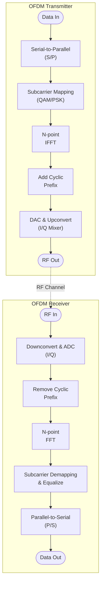

# Lesson 5: Mixers, Modulation, Demodulation

## 1. First-Principles Intuition & Invariants

The art of radio frequency engineering pivots on a deceptively simple mathematical identity: the product of two sinusoids generates sum and difference frequencies. When we multiply a carrier wave at frequency $f_c$ by a local oscillator at frequency $f_{LO}$, the resulting spectrum contains components at $f_c + f_{LO}$ and $f_c - f_{LO}$. This multiplicative operation, realized in hardware through nonlinear circuit elements, forms the cornerstone of every superheterodyne receiver, frequency synthesizer, and modern software-defined radio transceiver. The mixer—whether constructed from passive diodes, active transistors, or specialized Gilbert cell topologies—transforms spectral content from one frequency band to another, enabling us to process high-frequency signals using lower-frequency electronics where amplification, filtering, and analog-to-digital conversion become tractable.

The fundamental invariant governing all mixer operation derives from trigonometric product-to-sum identities. Consider two sinusoidal signals: a radio frequency input $V_{RF}(t) = A_{RF} \cos(2\pi f_{RF} t)$ and a local oscillator $V_{LO}(t) = A_{LO} \cos(2\pi f_{LO} t)$. Their product expands through the trigonometric identity $\cos(\alpha)\cos(\beta) = \frac{1}{2}[\cos(\alpha - \beta) + \cos(\alpha + \beta)]$, yielding an output containing both the difference frequency (intermediate frequency, or IF) and the sum frequency. In mathematical form:

$$V_{out}(t) = k \cdot A_{RF} A_{LO} \left[ \cos(2\pi(f_{RF} - f_{LO})t) + \cos(2\pi(f_{RF} + f_{LO})t) \right]$$

where $k$ represents the mixer's conversion gain or loss factor. Practical superheterodyne receivers exploit the difference frequency component, filtering away the sum frequency with a lowpass or bandpass filter to isolate the desired intermediate frequency. This downconversion operation translates a high-frequency signal—perhaps a 2.4 GHz WiFi carrier—to a manageable IF such as 10.7 MHz or 455 kHz, where fixed-frequency crystal filters provide sharp selectivity and gain stages achieve high dynamic range without the instability plaguing tunable high-frequency amplifiers.

The converse operation, upconversion, drives transmitter architectures. A baseband modulation signal centered near DC mixes with a high-frequency local oscillator to generate the transmitted RF carrier. Single-sideband (SSB) transmitters deliberately suppress one sideband and the carrier to maximize spectral efficiency, while conventional amplitude modulation retains both sidebands and the carrier for simpler envelope detection in legacy receivers. The mathematical symmetry between upconversion and downconversion reflects a deeper physical truth: time-domain multiplication corresponds to frequency-domain convolution, and the mixer performs this convolution through controlled nonlinearity.

However, real-world mixers deviate from idealized multipliers. Practical circuits generate not only the desired sum and difference frequencies but also a cascade of spurious products arising from higher-order nonlinearities and harmonic distortion. When strong interfering signals enter the mixer, third-order intermodulation products—frequencies of the form $2f_1 - f_2$ and $2f_2 - f_1$—fall in-band and corrupt the desired signal. The mixer's linearity, quantified by the third-order intercept point (IP3), determines the system's susceptibility to intermodulation distortion. Similarly, even-order nonlinearities produce second-harmonic and DC offset components that plague direct-conversion (zero-IF) receiver architectures, necessitating careful DC offset cancellation in the analog or digital domain.

Port isolation constitutes another critical mixer invariant. Ideally, the local oscillator signal should not leak through to the RF or IF ports, and conversely, the RF signal should not appear at the LO port. Poor port isolation allows the local oscillator to radiate from the antenna, violating regulatory emission masks and providing an easily detectable signature for spectrum monitoring. Balanced and double-balanced mixer topologies exploit symmetry and differential signaling to achieve 30–50 dB of port-to-port isolation, suppressing unwanted feedthrough paths. The image frequency—a spectral component located symmetrically opposite the desired signal relative to the local oscillator—poses an insidious threat in superheterodyne receivers. Without adequate image rejection, a spurious signal at $f_{LO} + f_{IF}$ downconverts to the same intermediate frequency as the desired signal at $f_{LO} - f_{IF}$, creating indistinguishable interference. Image-reject mixers, employing quadrature hybrid couplers and summing networks, cancel image responses through phase relationships, achieving 40–60 dB of image suppression.

The transition from analog mixing to digital modulation schemes introduces In-Phase and Quadrature (I/Q) signal processing, a paradigm that represents complex-valued signals as orthogonal components. A quadrature mixer generates two intermediate frequency outputs: the I channel (mixed with $\cos(2\pi f_{LO} t)$) and the Q channel (mixed with $\sin(2\pi f_{LO} t)$, phase-shifted 90 degrees). This orthogonal decomposition preserves both amplitude and phase information, enabling demodulation of advanced modulation formats such as Quadrature Amplitude Modulation (QAM), Phase Shift Keying (PSK), and Orthogonal Frequency Division Multiplexing (OFDM). The I/Q representation maps naturally to complex exponential notation: $s(t) = I(t) + jQ(t) = A(t)e^{j\phi(t)}$, where $A(t)$ represents the envelope and $\phi(t)$ the instantaneous phase. Modern software-defined radios digitize I and Q channels independently, performing subsequent filtering, equalization, and demodulation in the digital domain where reconfigurability and precision surpass analog implementations.

Modulation schemes encode information onto a carrier through controlled variation of amplitude, frequency, or phase. Amplitude Modulation (AM), the historical foundation of broadcasting, multiplies a baseband message signal $m(t)$ by a carrier: $s(t) = [1 + m_a m(t)] A_c \cos(2\pi f_c t)$, where $m_a$ denotes the modulation index. AM exhibits simplicity in both modulation and demodulation—envelope detection with a diode and lowpass filter suffices—but squanders two-thirds of transmitted power in the carrier component, which conveys no information. Single-Sideband Suppressed Carrier (SSB-SC) modulation eliminates this inefficiency by filtering out the carrier and one sideband, concentrating all power in the information-bearing sideband. However, SSB demodulation requires precise frequency synchronization; any local oscillator offset introduces audible distortion in voice communications.

Frequency Modulation (FM) and Phase Modulation (PM) belong to the angle modulation family, varying the instantaneous frequency or phase in proportion to the message signal. FM, expressed as $s(t) = A_c \cos(2\pi f_c t + 2\pi k_f \int m(\tau) d\tau)$, exhibits constant envelope and therefore immunity to amplitude-varying noise and nonlinear amplifier distortion. This robustness enabled FM broadcasting to deliver high-fidelity audio in the presence of atmospheric noise and ignition interference that plagued AM radio. The frequency deviation $\Delta f = k_f \max|m(t)|$ and baseband bandwidth $W$ determine the modulation index $\beta = \Delta f / W$ and, through Carson's rule, the occupied bandwidth: $B_T \approx 2(\Delta f + W)$. Wideband FM, with $\beta \gg 1$, trades expanded spectrum for improved signal-to-noise ratio, a fundamental exchange codified in Shannon's channel capacity theorem.

Digital modulation extends these analog techniques into the discrete symbol domain. Binary Phase Shift Keying (BPSK) toggles the carrier phase between 0 and 180 degrees to represent binary ones and zeros, achieving robust performance in noisy channels at the cost of modest spectral efficiency. Quadrature Phase Shift Keying (QPSK) encodes two bits per symbol by selecting among four phase states (0°, 90°, 180°, 270°), doubling the bit rate within the same bandwidth. Higher-order schemes such as 16-QAM and 64-QAM encode four or six bits per symbol by varying both amplitude and phase, constructing a two-dimensional constellation where each point represents a unique symbol. The Euclidean distance between constellation points governs error probability; as modulation order increases, points crowd closer together, raising the required signal-to-noise ratio for reliable detection.

Orthogonal Frequency Division Multiplexing (OFDM) partitions a wideband channel into thousands of narrowband subcarriers, each individually modulated with QPSK or QAM. The subcarrier spacing equals the inverse of the symbol period, ensuring orthogonality and eliminating inter-carrier interference despite spectral overlap. OFDM transforms frequency-selective fading channels into parallel flat-fading subchannels, simplifying equalization and enabling efficient spectral utilization. The Fast Fourier Transform (FFT) provides computationally efficient modulation and demodulation, mapping frequency-domain subcarrier data to time-domain samples and vice versa. OFDM underpins WiFi (IEEE 802.11), LTE, 5G NR, and digital video broadcasting standards, demonstrating its versatility across diverse propagation environments and data rate requirements.

## 2. Core Architecture & Mechanics

Mixer topologies span a hierarchy from passive diode rings to active transistor-based designs, each offering distinct tradeoffs in conversion loss, port isolation, linearity, and noise figure. The simplest passive mixer employs a single diode whose exponential current-voltage characteristic provides the necessary nonlinearity for frequency translation. When a large-amplitude local oscillator drives the diode into its nonlinear region, the diode behaves as a time-varying conductance, alternately switching between low and high resistance states at the LO frequency. This time-varying resistance multiplies the RF input signal by an approximate square wave, generating sum and difference frequencies alongside odd harmonics of the local oscillator. Single-diode mixers suffer from poor port isolation, typically 10–20 dB, allowing substantial LO leakage to the RF port and permitting RF signals to contaminate the LO path. Conversion loss—the ratio of available RF power to extracted IF power—ranges from 5 to 7 dB, representing the inefficiency of driving the diode and the power dissipated in harmonic products.

The single-balanced mixer improves upon the unbalanced topology by incorporating a 180-degree hybrid (balun) to create differential signals. Four diodes arranged in a ring configuration, driven by complementary LO phases, conduct alternately to steer the RF current into the IF port during positive and negative LO half-cycles. This balanced structure cancels even-order distortion products and suppresses LO-to-RF leakage, achieving 30–40 dB of LO-to-RF isolation. The RF signal, applied single-ended or differentially to the center tap of an RF transformer, experiences time-varying current steering controlled by the diode ring. During the positive LO phase, two diagonally opposite diodes conduct, directing RF current through one path; during the negative phase, the alternate diode pair conducts, reversing the current direction. This polarity reversal at the LO rate multiplies the RF signal by a switching function approximating a square wave, producing strong mixing products at odd harmonics of the LO as well as the desired $f_{RF} \pm f_{LO}$ terms. Filtering removes unwanted harmonics, isolating the intermediate frequency.

Double-balanced mixers extend the symmetry principle by employing dual baluns on both the RF and LO ports, feeding a ring of four (or eight) diodes arranged in a bridge configuration. This topology achieves exceptional port-to-port isolation—often exceeding 40 dB LO-to-RF and 30 dB LO-to-IF—by exploiting complete differential symmetry. The RF signal, balanced across a transformer center tap, drives two diode pairs simultaneously. The LO signal, also balanced, switches the diode pairs on and off in quadrature fashion, steering the RF current bidirectionally through the IF load. The double-balanced architecture suppresses both even-order distortion and fundamental LO/RF feedthrough, leaving only the desired mixing products and odd-harmonic spurious responses. Commercial double-balanced mixers, such as the Mini-Circuits ADE-series or Marki Microwave products, deliver conversion loss as low as 5 dB with LO drive levels of +7 to +17 dBm. The required LO power represents a significant system design constraint; maintaining consistent conversion gain across frequency and temperature demands a stable, high-power local oscillator source, often derived from a voltage-controlled oscillator (VCO) followed by a buffer amplifier.

Active mixers replace passive diodes with transistors, enabling conversion gain rather than loss and reducing the required LO drive power. The Gilbert cell, invented by Barrie Gilbert in 1968, constitutes the canonical active mixer topology for integrated circuits. A Gilbert cell comprises three differential pairs stacked vertically: a lower transconductance stage converting input voltage to current, a middle switching quad multiplying the RF current by the LO switching function, and upper current-mirror loads converting differential currents back to voltages. The RF input signal, applied to the base terminals of the lower differential pair (typically bipolar junction transistors or MOSFETs), generates a tail current proportional to the RF voltage. This tail current feeds the middle quad, where the LO signal—applied to the bases of the switching transistors—steers the current between two output branches at the LO rate. The result is a current-domain multiplication of the RF and LO waveforms, producing sum and difference frequencies with conversion gain ranging from 0 to +10 dB.

The Gilbert cell's performance hinges on the transconductance linearity of the input stage and the switching speed of the LO quad. For optimal linearity, the input differential pair operates in the linear (small-signal) region where transconductance $g_m = I_C / V_T$ (for BJTs, where $V_T \approx 26$ mV at room temperature) remains constant. Large RF input swings drive the transistors toward saturation or cutoff, compressing the output and generating intermodulation distortion. The third-order intercept point (IIP3), a figure of merit for linearity, typically reaches +5 to +15 dBm in well-designed Gilbert cells, though this degrades with increasing frequency as transistor parasitics introduce phase errors and reduce effective transconductance. The LO switching quad operates in a large-signal regime, driven hard to ensure complete current steering. An LO amplitude of several hundred millivolts peak-to-peak suffices to toggle the switching transistors fully on and off, sharply reducing the required LO power compared to passive mixers.

Spurious responses plague all mixer architectures due to higher-order nonlinearities and harmonic mixing. In addition to the desired $f_{IF} = |f_{RF} - f_{LO}|$ product, practical mixers generate spurious outputs at $mf_{RF} \pm nf_{LO}$ for integer multiples $m$ and $n$. The spur-free dynamic range (SFDR) quantifies the usable signal range before spurious products rise to the noise floor, limiting the system's ability to detect weak signals in the presence of strong interferers. Third-order intermodulation products, arising from two strong interferers at $f_1$ and $f_2$, appear at $2f_1 - f_2$ and $2f_2 - f_1$. When these products fall within the IF passband, they corrupt the desired signal indistinguishably from in-band interference. The two-tone third-order intercept point (IP3), measured by applying two equal-power tones at the input and extrapolating the IM3 product growth rate, predicts the onset of intermodulation distortion. A mixer with +10 dBm IIP3 can tolerate two interferers at -10 dBm each (20 dB below the intercept point) before IM3 products reach the noise floor, assuming a 100 Hz bandwidth and -140 dBm noise floor.

Image frequency rejection demands careful attention in superheterodyne receiver design. When the RF input at $f_{RF} = f_{LO} - f_{IF}$ downconverts to the intermediate frequency, a spurious signal at the image frequency $f_{image} = f_{LO} + f_{IF}$ also downconverts to the same IF, creating indistinguishable interference. For a receiver with $f_{LO} = 1000$ MHz and $f_{IF} = 100$ MHz, the desired signal at 900 MHz and the image at 1100 MHz both produce 100 MHz outputs. Preselection filtering before the mixer attenuates the image, but achieving 60 dB of image rejection at frequencies separated by $2f_{IF} = 200$ MHz challenges filter realizability. Image-reject mixers overcome this limitation by employing quadrature hybrids and phase-matched signal paths to cancel the image through destructive interference while constructively combining the desired signal.

The canonical image-reject mixer architecture employs two double-balanced mixers driven by quadrature LO phases (0° and 90°). The RF input splits equally into both mixers, generating in-phase and quadrature IF outputs. A subsequent IF quadrature hybrid recombines these signals with proper phasing to cancel the image component. Mathematically, the desired signal at $f_{RF}$ produces I and Q components that add in-phase at the output, while the image at $f_{image}$ generates I and Q components that destructively interfere due to the phase inversion introduced by the IF hybrid. Practical implementations achieve 40–50 dB of image rejection, limited by amplitude and phase imbalances in the LO quadrature network and IF signal paths. Integrated circuit designs compensate for these imbalances through calibration algorithms that adjust I/Q gain and phase digitally.

Quadrature modulation and demodulation extend the image-reject principle to complex signal processing. A quadrature modulator combines two orthogonal baseband signals—the in-phase (I) and quadrature (Q) components—with 0° and 90° carrier phases, generating a complex-valued RF signal. The modulated output $s(t) = I(t)\cos(2\pi f_c t) - Q(t)\sin(2\pi f_c t)$ encodes information in both amplitude and phase, supporting advanced modulation schemes like QAM and OFDM. The corresponding quadrature demodulator employs two mixers driven by $\cos(2\pi f_{LO} t)$ and $\sin(2\pi f_{LO} t)$, recovering the I and Q baseband signals through lowpass filtering. Any I/Q phase imbalance—deviation from the ideal 90° quadrature relationship—causes crosstalk between the I and Q channels, degrading error vector magnitude (EVM) and constellation distortion in digital communications.

The hardware realization of precise quadrature phases challenges RF circuit designers. Passive polyphase networks, constructed from cascaded RC sections, generate approximate quadrature outputs over modest fractional bandwidths (20–30%). Each RC section introduces a frequency-dependent phase shift; by cascading multiple sections and adjusting component values, the phase difference between two outputs approaches 90° over a desired band. However, component tolerances (typically ±1% for resistors and ±5% for capacitors) degrade phase accuracy, necessitating careful Monte Carlo analysis and, in production, factory calibration. Active quadrature generation employs divide-by-two frequency dividers fed by a 2× LO source. A toggle flip-flop, clocked at $2f_{LO}$, inherently produces quadrature square waves at $f_{LO}$ with deterministic 90° phasing, independent of component tolerances. This technique, ubiquitous in modern transceivers, shifts the design challenge to generating the doubled frequency, often accomplished through a phase-locked loop (PLL) frequency synthesizer with a ×2 prescaler.

Amplitude modulation, the earliest modulation scheme, encodes information by varying the carrier amplitude in proportion to the baseband message. The transmitted AM signal $s(t) = A_c[1 + m_a m(t)]\cos(2\pi f_c t)$, where $m_a \leq 1$ represents the modulation index and $m(t)$ the normalized message signal ($|m(t)| \leq 1$), expands to:

$$s(t) = A_c\cos(2\pi f_c t) + A_c m_a m(t)\cos(2\pi f_c t)$$

The first term is the unmodulated carrier; the second term, the product of $m(t)$ and the carrier, generates upper and lower sidebands at $f_c \pm f_m$ for each message frequency component $f_m$. The power distribution in AM reveals its inefficiency: the carrier, proportional to $A_c^2$, contains no information yet consumes most of the transmitted power. For 100% modulation ($m_a = 1$), the sidebands carry only one-third of total power, with two-thirds wasted in the carrier. Single-sideband suppressed carrier (SSB-SC) modulation eliminates both the carrier and one sideband, transmitting only the information-bearing sideband. This requires a sharp sideband filter with minimal passband ripple and steep skirts, historically realized with crystal or mechanical filters. Modern software-defined radios generate SSB through the Weaver or phasing methods, using I/Q processing to cancel the unwanted sideband digitally before upconversion.

Frequency modulation varies the instantaneous carrier frequency in proportion to the message signal: $s(t) = A_c\cos[2\pi f_c t + 2\pi k_f \int m(\tau)d\tau]$, where $k_f$ is the frequency deviation constant in Hz per volt. The instantaneous frequency $f_i(t) = f_c + k_f m(t)$ swings around the carrier frequency, producing a spectrum that broadens with increasing modulation index $\beta = \Delta f / W$, where $\Delta f = k_f \max|m(t)|$ is the peak frequency deviation and $W$ is the baseband bandwidth. Narrowband FM ($\beta < 0.3$) occupies approximately the same bandwidth as AM and offers modest noise improvement. Wideband FM ($\beta \gg 1$), employed in FM broadcasting with $\beta \approx 5$, exchanges bandwidth for dramatic signal-to-noise enhancement. Carson's rule estimates the occupied bandwidth as $B_T \approx 2(\Delta f + W)$, balancing spectral efficiency against noise performance.

FM demodulation converts frequency variations back to amplitude variations, traditionally accomplished with discriminators or phase-locked loops. A frequency discriminator, such as a Foster-Seeley or ratio detector, employs resonant circuits whose amplitude response varies with frequency. As the FM signal sweeps across the discriminator's slope, amplitude variations emerge proportional to the instantaneous frequency deviation. The phase-locked loop (PLL) demodulator locks a voltage-controlled oscillator (VCO) to the FM carrier; the VCO control voltage, driven by the phase detector error signal, tracks the carrier's frequency variations, directly recovering the modulated waveform. Modern digital FM demodulation differentiates the phase trajectory extracted from I/Q samples: $m(t) \propto \frac{d}{dt}\arctan\left(\frac{Q(t)}{I(t)}\right)$, offering robustness and eliminating alignment-sensitive analog discriminator circuits.

Digital modulation schemes encode discrete symbols onto the carrier, enabling error detection, correction, and efficient spectrum utilization. Binary Phase Shift Keying (BPSK) maps binary data to two antipodal carrier phases, 0° and 180°:

$$s(t) = \begin{cases} A_c\cos(2\pi f_c t) & \text{for bit 1} \\ -A_c\cos(2\pi f_c t) & \text{for bit 0} \end{cases}$$

The Euclidean distance between constellation points equals $2A_c$, providing maximum separation for the given signal energy. BPSK achieves robust performance in additive white Gaussian noise (AWGN), requiring approximately 9.6 dB SNR for a bit error rate (BER) of $10^{-5}$. Quadrature Phase Shift Keying (QPSK) encodes two bits per symbol by selecting among four phase states: 0°, 90°, 180°, 270°. This doubles the bit rate for the same bandwidth and symbol rate, though constellation points move closer together, increasing susceptibility to noise. The symbol error probability for QPSK in AWGN matches BPSK because the minimum distance between adjacent constellation points remains $\sqrt{2}A_c$, but each symbol error may corrupt two bits.

Quadrature Amplitude Modulation (QAM) generalizes phase modulation by varying both carrier amplitude and phase, constructing rectangular constellations with $M = 2^k$ points for $k$ bits per symbol. Common schemes include 16-QAM (4 bits/symbol), 64-QAM (6 bits/symbol), and 256-QAM (8 bits/symbol). A 64-QAM constellation arranges 64 points in an 8×8 grid in the complex I-Q plane, with each point representing a unique 6-bit pattern. The average power and peak-to-average power ratio (PAPR) increase with modulation order, necessitating linear power amplifiers to avoid constellation distortion. Higher-order QAM achieves impressive spectral efficiency—256-QAM delivers 8 bits per second per Hz—but demands stringent SNR requirements. At a BER of $10^{-5}$, 256-QAM requires approximately 28 dB SNR, compared to QPSK's 14 dB, illustrating the SNR-bandwidth tradeoff codified in Shannon capacity.

Orthogonal Frequency Division Multiplexing (OFDM) partitions a wideband channel into $N$ narrowband subcarriers, each individually modulated with BPSK, QPSK, or QAM. Subcarrier spacing $\Delta f = 1/T_s$, where $T_s$ is the symbol duration, ensures orthogonality despite spectral overlap: when integrated over a symbol period, cross-correlation between any two subcarriers vanishes. The OFDM modulator maps data symbols to frequency-domain subcarriers, applies the inverse Fast Fourier Transform (IFFT) to generate time-domain samples, and prepends a cyclic prefix (CP) to mitigate inter-symbol interference (ISI) from multipath propagation. The cyclic prefix, a copy of the last portion of the OFDM symbol, absorbs delayed multipath replicas, preserving orthogonality as long as the delay spread remains shorter than the CP duration.

The FFT length $N$ and subcarrier spacing $\Delta f$ determine the OFDM symbol duration $T_s = N / B$, where $B$ is the total bandwidth. WiFi's 802.11a/g standard employs 64 subcarriers (48 data, 4 pilots, 12 null) with $\Delta f = 312.5$ kHz, yielding $T_s = 3.2$ μs. The cyclic prefix, typically one-quarter of the symbol duration (0.8 μs), tolerates delay spreads up to 800 ns, sufficient for most indoor environments. LTE extends OFDM to mobile channels with variable FFT sizes (128, 256, 512, 1024, 2048) and subcarrier spacings (15 kHz or 7.5 kHz), adapting to diverse propagation conditions. The OFDM receiver performs FFT after removing the cyclic prefix, transforming the time-domain signal back to frequency-domain subcarriers. Single-tap frequency-domain equalization corrects each subcarrier's amplitude and phase distortion independently, an elegant simplification compared to time-domain equalization's complexity.

OFDM's primary challenge is the high peak-to-average power ratio (PAPR), arising from constructive interference when multiple subcarriers align in phase. The PAPR, defined as the ratio of peak instantaneous power to average power, reaches 10–13 dB for large $N$, forcing power amplifiers to operate with substantial backoff to avoid clipping. Clipping generates out-of-band emissions and in-band distortion, degrading adjacent channel leakage ratio (ACLR) and error vector magnitude. Techniques to reduce PAPR include selective mapping (SLM), partial transmit sequences (PTS), and clipping with spectral shaping, though all introduce overhead or computational complexity. Modern transmitters employ digital predistortion (DPD) to linearize the power amplifier, measuring output distortion and pre-compensating the input signal to cancel nonlinearity.

## 3. High-Performance Optimization & Failure Modes

Achieving optimal mixer performance across temperature, frequency, and signal amplitude demands meticulous attention to component selection, impedance matching, and thermal management. The local oscillator drive level exerts profound influence on conversion gain, port isolation, and linearity. Passive diode mixers require 7–17 dBm LO power to fully switch the diodes, ensuring minimal conversion loss and maximum port isolation. Insufficient LO drive leaves the diodes in the gradual transition region, increasing conversion loss by 2–4 dB and degrading LO-to-RF isolation by 10–15 dB. Conversely, excessive LO power risks diode burnout and generates strong harmonic content that contaminates the IF port. Active Gilbert cell mixers tolerate lower LO levels, typically -10 to 0 dBm, but demand precisely controlled DC bias currents to maintain transconductance linearity. Temperature variations shift transistor $V_{BE}$ and $V_{TH}$ thresholds, drifting bias points and degrading IP3 by 3–5 dB over automotive temperature ranges (-40°C to +125°C). Compensation techniques include bandgap voltage references for bias generation and proportional-to-absolute-temperature (PTAT) current sources that track thermal drift.

Impedance matching networks between the mixer ports and surrounding circuitry critically affect conversion gain and noise figure. Mixers exhibit frequency-dependent port impedances, typically 50 Ω at the RF input but presenting complex impedances at the IF port that vary with LO frequency and signal level. Designing broadband matching networks over multiple octaves requires distributed element techniques: quarter-wave transformers, tapered transmission lines, and coupled-line baluns. At millimeter-wave frequencies above 30 GHz, bond wire inductance and package parasitics dominate, necessitating flip-chip assembly and on-chip matching structures. The IF port matching network must provide adequate termination for all spurious products and harmonics, preventing reflections that regenerate through the nonlinear mixer junction and fold back into the desired IF band. Absorptive diplexers, combining lowpass and highpass sections with resistive terminations, dissipate harmonic energy while passing the IF band to the subsequent amplifier stage.

Spurious response management extends beyond the mixer itself to encompass preselection filtering, LO phase noise, and reference clock quality. High-Q preselectors—often realized with combline or cavity filters at UHF/microwave frequencies—attenuate out-of-band interferers by 40–60 dB before they reach the mixer, preventing desensitization and intermodulation distortion. The preselector bandwidth trades selectivity against loss; a 1% fractional bandwidth cavity filter achieves 1 dB insertion loss and 70 dB ultimate rejection but rejects desired signals only 0.5% away from center frequency. Tunable preselectors, employing voltage-controlled capacitors (varactors) or switched capacitor banks, adapt to wideband frequency-agile receivers at the cost of increased complexity and control circuitry. Local oscillator phase noise, quantified as the single-sideband (SSB) noise power spectral density at a given offset from the carrier (dBc/Hz), downconverts to the IF along with the desired signal, raising the receiver noise floor and reciprocally mixing with strong adjacent-channel interferers. A phase-locked loop synthesizer with -100 dBc/Hz phase noise at 100 kHz offset, mixing with a blocker 100 kHz away, degrades the effective IF SNR by 100 dB. Ultra-low phase noise oscillators, such as dielectric resonator oscillators (DROs) or ovenized crystal oscillators (OCXOs), provide reference sources with phase noise below -160 dBc/Hz at far-from-carrier offsets, essential for detecting weak signals in crowded spectral environments.

Image rejection in superheterodyne receivers depends critically on the IF frequency selection and image filter order. Low IF frequencies (455 kHz, 10.7 MHz) place the image far from the desired signal, easing preselector requirements but complicating subsequent filtering and IF amplification. High IF frequencies (70 MHz, 140 MHz) relax IF filter specifications and enable direct digital sampling of the IF without excessive ADC clock rates, but the image moves closer to the desired signal, demanding sharper image rejection filters. Dual-conversion receivers cascade two mixing stages with different IF frequencies, distributing selectivity across multiple filter stages and improving image rejection through cumulative filtering. A first IF at 70 MHz might employ a surface acoustic wave (SAW) filter with 60 dB shape factor (60 dB bandwidth / 3 dB bandwidth ratio), followed by downconversion to a second IF at 455 kHz for narrow-band crystal filtering. Each conversion stage introduces additional mixing spurs and noise degradation, so the trade-off between selectivity and sensitivity governs the optimal architecture choice.

Quadrature I/Q imbalances—amplitude and phase errors between the in-phase and quadrature signal paths—limit achievable image rejection and degrade modulation quality. Ideally, the I and Q channels exhibit identical gain and a precise 90° phase relationship. Practical implementations suffer from component tolerances, PCB layout asymmetries, and transistor mismatch, yielding amplitude imbalances of ±0.5 dB and phase errors of ±2°. These imperfections cause incomplete cancellation of the image frequency, limiting image rejection ratio (IRR) to 30–40 dB in analog implementations. Digital calibration algorithms measure and compensate for I/Q imbalances by applying correction coefficients in the baseband signal processing chain. A two-tone calibration injects test signals at the image frequency and desired frequency, measures the residual image leakage, and iteratively adjusts I/Q gain and phase until image suppression exceeds 60 dB. Production calibration, performed during factory testing, stores correction coefficients in non-volatile memory, recalled and applied during receiver operation.

DC offset in direct-conversion (zero-IF) receivers arises from LO leakage to the RF port, self-mixing to produce a DC component at the IF output. Even modest LO leakage of -30 dBm, when mixed with itself, generates a DC offset of -60 dBm, saturating subsequent baseband amplifiers and corrupting the detected signal. AC-coupling capacitors block DC but also remove low-frequency signal content, rendering direct-conversion unsuitable for demodulating signals with spectral energy near DC, such as AM or certain OFDM configurations. Adaptive DC offset cancellation loops measure the DC component at the IF output and inject an opposing correction signal, maintaining the DC level near zero. Digital implementations estimate the DC offset by averaging I and Q samples over time, subtracting the mean from subsequent samples. This approach fails when the desired signal contains a DC component or exhibits slow fading; more sophisticated algorithms distinguish between static DC offset and slow signal variations through high-pass filtering with corner frequencies below the modulation bandwidth.

Flicker noise (1/f noise) in transistor-based mixers and IF amplifiers elevates the noise floor at low offset frequencies, degrading phase noise and baseband SNR. Bipolar junction transistors exhibit 1/f corner frequencies of 1–10 kHz, while MOSFETs suffer higher corner frequencies (10–100 kHz) due to charge trapping at the silicon-oxide interface. The 1/f noise power spectral density follows $S_f = K/f$, where $K$ depends on device geometry and bias current. At a 10 kHz offset, 1/f noise may exceed thermal noise by 10–20 dB, dominating close-in phase noise and IF noise figure. Chopper stabilization, a technique borrowed from precision instrumentation amplifiers, modulates the baseband signal up to a carrier frequency above the 1/f corner, performs amplification in the white noise region, then demodulates back to baseband. The 1/f noise modulates to the carrier but is filtered out, leaving only thermal noise. This technique, employed in low-noise IF amplifiers for direct-conversion receivers, achieves sub-nanovolt noise floors at DC.

Modulation quality metrics—error vector magnitude (EVM), adjacent channel power ratio (ACPR), and constellation error—quantify transmitter and receiver impairments in digital communication systems. EVM measures the RMS deviation of measured constellation points from their ideal locations, normalized to the average symbol power, expressed as a percentage:

$$\text{EVM} = \sqrt{\frac{\sum_{i=1}^{N}|s_i - \hat{s}_i|^2}{\sum_{i=1}^{N}|s_i|^2}} \times 100\%$$

where $s_i$ represents the ideal symbol vector and $\hat{s}_i$ the measured vector. LTE specifications mandate EVM below 8% for 64-QAM and 3.5% for 256-QAM, constraining tolerable phase noise, I/Q imbalance, and amplifier nonlinearity. Achieving 3.5% EVM demands IF amplifier IP3 exceeding +40 dBm, local oscillator phase noise below -110 dBc/Hz at 100 kHz offset, and I/Q gain balance within 0.2 dB. The ACPR quantifies spectral regrowth in adjacent channels due to transmitter nonlinearity, measured as the ratio of power in the adjacent channel to power in the main channel. Regulatory bodies (FCC, ETSI) specify ACPR limits to prevent interference; for example, LTE base stations must achieve -45 dBc ACPR to avoid desensitizing co-sited receivers.

Orthogonal Frequency Division Multiplexing systems confront unique synchronization and equalization challenges. Carrier frequency offset (CFO), arising from oscillator mismatch between transmitter and receiver, rotates the OFDM constellation and introduces inter-carrier interference (ICI) as subcarriers lose orthogonality. A CFO of $\Delta f$ relative to subcarrier spacing $\Delta f_s$ produces an SNR degradation proportional to $(\Delta f / \Delta f_s)^2$. For WiFi with 312.5 kHz subcarrier spacing, a 10 kHz CFO (3% error) degrades SNR by 30 dB, rendering the link inoperable. Coarse frequency estimation exploits the cyclic prefix structure: correlating the received signal with a delayed version by $T_s$ reveals the phase rotation over one OFDM symbol, estimating CFO to within ±$\Delta f_s / 2$. Fine frequency tracking uses pilot subcarriers embedded in the OFDM symbol, measuring phase rotation between consecutive symbols and adjusting the receiver's LO via a feedback loop.

Sampling clock offset (SCO), the difference between transmitter and receiver sampling rates, causes inter-symbol interference as the FFT window drifts relative to the cyclic prefix boundaries. A 100 parts-per-million (ppm) clock error in a 20 MHz bandwidth system accumulates 2 μs of timing drift over a 1 ms frame, exceeding the 0.8 μs cyclic prefix and destroying orthogonality. Symbol timing synchronization algorithms cross-correlate the received signal with known preamble sequences, identifying the start of the OFDM frame to sample-level accuracy. Fine timing tracking measures the energy distribution within the cyclic prefix and the trailing guard interval, adjusting the FFT window position to maximize the portion of the cyclic prefix captured while minimizing ISI from the previous symbol.

Channel equalization in OFDM simplifies to single-tap frequency-domain multiplication due to the narrow subcarrier bandwidth relative to the channel coherence bandwidth. Each subcarrier experiences flat fading, allowing compensation with a complex gain $H_k = G_k e^{j\phi_k}$. The equalizer computes the inverse $1/H_k$, scaling and phase-rotating each subcarrier to cancel channel distortion. Channel estimation inserts pilot subcarriers at known positions and amplitudes, allowing the receiver to measure $H_k$ at pilot locations and interpolate across data subcarriers. LTE employs scattered pilots in time and frequency, enabling 2D interpolation to track fast-fading channels at mobile velocities up to 350 km/h. The interpolation filter must balance noise suppression against Doppler tracking: wide interpolation windows average over more pilots, reducing estimation variance but lagging rapid channel changes.

Power amplifier linearization techniques extend OFDM dynamic range and relax amplifier efficiency constraints. Digital predistortion (DPD) characterizes the amplifier's AM-AM (amplitude-to-amplitude) and AM-PM (amplitude-to-phase) distortion curves, inverting them in the digital baseband to pre-distort the input signal such that the amplifier output emerges linear. A memory polynomial DPD model captures both instantaneous nonlinearity and memory effects:

$$y(n) = \sum_{k=0}^{K-1}\sum_{m=0}^{M-1} a_{km} |x(n-m)|^k x(n-m)$$

where $x(n)$ is the input, $y(n)$ the output, $K$ the polynomial order, and $M$ the memory depth. The coefficients $a_{km}$, extracted through least-squares adaptation using a feedback observation path, update continuously to track temperature and supply voltage variations. Implementing DPD requires a high-speed observation receiver sampling the PA output, time-aligning it with the input signal, and computing coefficient updates in real time. Commercial DPD implementations achieve -50 dBc ACPR, enabling power amplifiers to operate 5–6 dB closer to compression while meeting regulatory spectral masks.

Thermal management of high-power mixers and amplifiers prevents junction temperature runaway and ensures long-term reliability. RF power transistors dissipate 60–70% of DC input power as heat; a 10 W amplifier at 40% efficiency produces 15 W of waste heat concentrated in a 2 mm × 2 mm die. Without adequate heatsinking, junction temperature exceeds 150°C, degrading gain, shifting bias points, and triggering thermal runaway. The thermal resistance from junction to ambient, $R_{\theta JA}$, dictates the steady-state temperature rise: $T_J = T_A + P_D R_{\theta JA}$. A typical RF transistor package exhibits $R_{\theta JC}$ (junction-to-case) of 2°C/W and requires a heatsink with $R_{\theta CA}$ below 5°C/W to maintain $T_J < 100°C$ at 25°C ambient. Forced-air cooling, liquid cold plates, and direct-bonded copper (DBC) substrates reduce thermal resistance in high-power applications, enabling multi-kilowatt transmitters to operate continuously.

Mixer and modulator testing demands calibrated signal generators, spectrum analyzers, vector signal analyzers (VSAs), and network analyzers. Measuring conversion gain requires injecting a known RF signal, sweeping frequency across the desired band, and recording IF output power. The conversion gain $G_c = P_{IF} / P_{RF}$ (often expressed in dB) varies with frequency due to impedance mismatch and dispersive IF filtering. Measuring port isolation involves applying a signal to one port and measuring leakage at other ports with the remaining port terminated. LO-to-RF isolation testing applies the LO signal, terminates the RF port, and measures LO leakage at the IF port, typically 30–50 dB below the LO level in double-balanced mixers. Third-order intercept point (IP3) testing applies two equal-power tones spaced 1–10 MHz apart, measures the third-order intermodulation products, and extrapolates to the intercept point where IM3 power equals fundamental power. The two-tone spacing must fall within the IF bandwidth to avoid filtering out the IM3 products.

Modulation quality testing employs a vector signal analyzer to demodulate the transmitted signal, reconstruct the constellation, and compute EVM. The VSA downconverts the RF signal, digitizes I and Q at baseband, performs symbol timing and carrier frequency synchronization, equalizes the channel, and compares measured symbol locations to ideal positions. The EVM measurement integrates errors from amplitude imbalance, quadrature skew, phase noise, thermal noise, and nonlinear distortion, providing a single figure of merit for transmitter performance. Time-domain measurements reveal pulse shaping filter overshoot, symbol timing jitter, and transient distortion during burst on/off events. Spectral measurements quantify adjacent channel power, spurious emissions, and occupied bandwidth, ensuring compliance with regulatory masks.

Failure modes in mixer-based systems manifest as loss of conversion gain, degraded port isolation, spurious responses, and image breakthrough. Diode mixers suffer from diode junction degradation due to electrostatic discharge (ESD), excessive LO power, or reverse-bias overvoltage. A damaged diode exhibits increased series resistance and reduced reverse breakdown voltage, elevating conversion loss by 3–5 dB and generating strong even-order harmonics. Active Gilbert cell mixers fail through transistor oxide breakdown, excessive power dissipation, or bias network failures. Oxide breakdown, triggered by transient voltage spikes or ESD events, permanently shorts gate to source/drain, disabling the mixer entirely. Thermal runaway occurs when inadequate heatsinking allows junction temperature to exceed 125°C, accelerating leakage current, increasing power dissipation in a positive feedback loop until the device self-destructs.

Debugging spurious responses requires systematic spectrum analysis, identifying the frequencies and amplitudes of undesired mixing products. Spurious outputs at $mf_{RF} \pm nf_{LO}$ indicate harmonic mixing due to insufficient LO drive or excessive nonlinearity. Strong second-harmonic content ($2f_{LO}$, $2f_{RF}$) suggests even-order distortion from single-ended topologies or imbalanced differential circuits. Image breakthrough, where the image signal appears at the IF output with insufficient attenuation, points to inadequate preselection filtering or I/Q imbalance in image-reject architectures. Testing image rejection involves injecting a strong signal at the image frequency and measuring its residual power at the IF output; achieving >50 dB IRR demands amplitude balance better than 0.3 dB and phase balance within 1°.

Mitigating phase noise and reciprocal mixing demands ultra-low noise oscillators and narrow-band IF filtering. A dielectric resonator oscillator (DRO), stabilized by a high-Q ceramic resonator, achieves phase noise below -130 dBc/Hz at 10 kHz offset, suitable for spectral purity in sensitive receivers. Coupling the DRO to a frequency synthesizer PLL provides both tunability and low phase noise, though the PLL loop bandwidth must balance noise suppression (wide loop suppresses VCO noise) against reference spur attenuation (narrow loop filters reference feedthrough). IF filtering with crystal, SAW, or BAW (bulk acoustic wave) filters provides adjacent channel rejection exceeding 60 dB, preventing strong blockers from desensitizing the receiver through reciprocal mixing or intermodulation. The IF filter passband must accommodate Doppler shift, frequency offset, and modulation bandwidth while rejecting adjacent channels; for LTE with 20 MHz bandwidth, the IF filter exhibits 25 MHz passband and 80 MHz stopband, achieving 50 dB rejection at ±40 MHz offset.

In conclusion, the mixer serves as the frequency-translating heart of RF systems, transforming high-frequency signals to manageable intermediate frequencies through controlled nonlinear multiplication. Mastery of mixer topologies—passive diode rings, active Gilbert cells, and image-reject architectures—combined with rigorous attention to spurious responses, port isolation, and quadrature accuracy, enables the design of high-performance receivers and transmitters. Modulation schemes from legacy AM/FM through modern OFDM and QAM encode information onto carriers, exploiting the SNR-bandwidth tradeoff inherent in Shannon's capacity theorem. The practical realization of these systems demands comprehensive understanding of circuit-level nonlinearities, system-level synchronization, and algorithmic compensation for hardware imperfections, bridging analog RF design and digital signal processing into cohesive, functional communication links.
