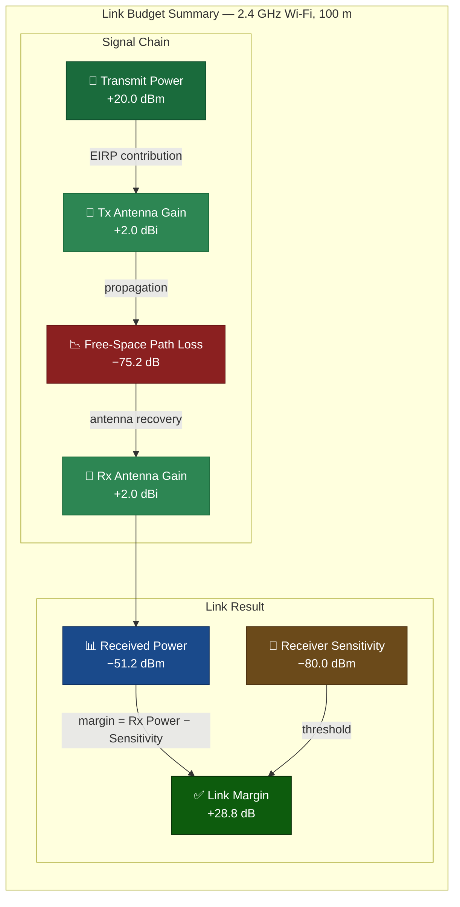

# Lesson 6: RF System Architecture, Link Budgets, Propagation

## 1. First-Principles Intuition & Invariants

Radio frequency engineering is fundamentally an exercise in managing exponential signal attenuation across space while wrestling with thermal noise floors that set absolute limits on receiver sensitivity. Unlike digital systems where signal integrity can be restored through retransmission and error correction, RF links operate in an analog domain where every decibel of path loss translates directly into reduced range, data rate, or reliability. The central challenge in RF system architecture is establishing and maintaining a link budget—a power accounting ledger that tracks every gain and loss from transmitter output stage through propagation channel to receiver input stage—while simultaneously managing spectral purity, dynamic range, and noise contributions from cascaded amplifier and mixer stages.

The Friis transmission equation provides the foundational invariant governing all wireless communication systems. In its most accessible form, the equation relates received power to transmitted power through the lens of antenna gains and free-space path loss. Specifically, the received power $P_r$ is given by $P_r = P_t G_t G_r \left(\frac{\lambda}{4\pi d}\right)^2$, where $P_t$ is transmitted power, $G_t$ and $G_r$ are transmit and receive antenna gains (as power ratios, not dBi), $\lambda$ is wavelength, and $d$ is separation distance. The term $\left(\frac{\lambda}{4\pi d}\right)^2$ encapsulates free-space path loss and reveals a critical invariant: received power falls with the square of distance, creating a 20 dB per decade roll-off that dominates link budget calculations. Converting to decibel notation yields $P_r(\text{dBm}) = P_t(\text{dBm}) + G_t(\text{dBi}) + G_r(\text{dBi}) - 20\log_{10}(d) - 20\log_{10}(f) - 32.45$, where distance $d$ is in kilometers and frequency $f$ is in megahertz. This logarithmic form makes explicit the harsh reality that doubling frequency costs 6 dB of link margin, while doubling distance costs another 6 dB.

Free-space path loss represents an idealized scenario valid only in vacuum or unobstructed line-of-sight conditions. Real-world propagation environments introduce multipath fading, shadowing from terrain and structures, and frequency-dependent absorption from atmospheric gases and precipitation. The Hata model, derived empirically from measurements in urban and suburban Tokyo during the 1960s, extends the Friis equation with correction factors accounting for base station antenna height, mobile antenna height, and terrain clutter. For urban environments at frequencies between 150 MHz and 1500 MHz, the Hata path loss in decibels becomes $L_{\text{Hata}} = 69.55 + 26.16\log_{10}(f) - 13.82\log_{10}(h_b) - a(h_m) + (44.9 - 6.55\log_{10}(h_b))\log_{10}(d)$, where $f$ is frequency in megahertz, $h_b$ is base station height in meters, $h_m$ is mobile height in meters, $a(h_m)$ is a mobile antenna height correction factor, and $d$ is distance in kilometers. The COST-231 extension adapts Hata for frequencies up to 2 GHz and introduces an additional 3 dB penalty for metropolitan areas, making it applicable to GSM, UMTS, and early LTE deployments.

Propagation models reveal a fundamental tension in RF system design: higher carrier frequencies enable smaller antennas and wider bandwidths but suffer increased path loss and reduced diffraction around obstacles. A millimeter-wave 28 GHz 5G link experiences roughly 29 dB more path loss than a 900 MHz GSM link over the same distance, forcing deployment of dense small-cell networks with beamforming to recover link margin. Conversely, sub-GHz ISM bands like 433 MHz and 915 MHz offer superior building penetration and non-line-of-sight coverage at the cost of antenna size and spectrum congestion. The RF system architect must balance these propagation invariants against regulatory constraints, antenna form factors, and power budgets to select an operating frequency that meets range and reliability targets.

Antenna fundamentals provide the other half of the link budget equation. An antenna is fundamentally an impedance transformer between the guided-wave regime of transmission lines and the free-space wave impedance of 377 ohms. Antenna gain quantifies how effectively the antenna concentrates radiated power into a preferred direction relative to an isotropic radiator. A half-wave dipole exhibits 2.15 dBi gain in its broadside direction, while high-gain Yagi-Uda arrays can achieve 12 to 18 dBi through parasitic director and reflector elements. Gain and directivity are inextricably linked to beamwidth: a narrower beam concentrates energy spatially but requires precise pointing. The relationship is governed by the antenna aperture, where effective aperture $A_e = G\lambda^2 / 4\pi$ connects gain $G$ to the physical capture area. Patch antennas commonly used in Wi-Fi and cellular devices achieve 6 to 9 dBi gain with half-power beamwidths of 60 to 90 degrees, balancing directionality with coverage.

Voltage standing wave ratio (VSWR) quantifies impedance mismatch between antenna and transmission line. An ideal antenna presents a purely resistive 50-ohm load across its operating bandwidth, but real antennas exhibit frequency-dependent reactance that creates reflections. VSWR is defined as the ratio of maximum to minimum voltage amplitude along the transmission line: $\text{VSWR} = (1 + |\Gamma|)/(1 - |\Gamma|)$, where $\Gamma$ is the voltage reflection coefficient. A VSWR of 1:1 indicates perfect matching with zero reflected power, while 2:1 corresponds to 11% reflected power and is generally acceptable for broadband systems. VSWR above 3:1 triggers significant insertion loss and can damage power amplifiers through reflected energy. Network analyzers measure VSWR by injecting a swept frequency signal and comparing incident to reflected power, yielding Smith chart plots that reveal resonant frequencies and matching network requirements.

Radiation patterns describe antenna gain as a function of azimuth and elevation angle. A dipole exhibits a toroidal pattern with maximum gain perpendicular to the element and nulls along the axis. Monopoles over ground planes create hemispherical patterns suitable for omnidirectional coverage. Phased arrays electronically steer beams by controlling phase relationships between elements, enabling rapid scanning without mechanical gimbals. Pattern nulls and sidelobes carry critical implications for interference mitigation: a null pointed toward an interferer can provide 20 to 30 dB of spatial isolation, while high sidelobes leak energy into unintended directions. Antenna pattern measurements require anechoic chambers or outdoor far-field ranges where the test distance satisfies $d > 2D^2/\lambda$, ensuring planar wavefront illumination of the device under test.

## 2. Core Architecture & Mechanics

Receiver architecture determines sensitivity, selectivity, and spurious performance through the choice of mixing scheme, local oscillator plan, and filtering strategy. Three dominant architectures shape modern RF system design: the superheterodyne receiver, direct conversion (zero-IF), and low-IF. Each embodies distinct tradeoffs between complexity, image rejection, DC offset handling, and dynamic range.

The superheterodyne receiver, invented by Edwin Armstrong in 1918, down-converts the RF signal through one or more intermediate frequency (IF) stages before demodulation. A typical single-conversion superheterodyne for a 900 MHz GSM signal uses a first local oscillator (LO) at 855 MHz to produce a 45 MHz IF, where a high-Q ceramic or surface acoustic wave (SAW) filter provides adjacent-channel rejection. The image frequency—located at $f_{\text{RF}} + 2f_{\text{IF}}$—sits at 990 MHz and must be suppressed by an RF bandpass filter ahead of the mixer. Image rejection ratios of 60 dB or better are achievable with careful filtering, but the image filter occupies board space and introduces insertion loss that degrades noise figure. Dual-conversion architectures add a second mixing stage, trading increased complexity for improved image rejection and IF filter performance. The superheterodyne dominates high-performance applications like spectrum analyzers, satellite receivers, and military radios where selectivity and large-signal handling are paramount.

Direct conversion receivers eliminate the IF stage entirely by mixing the RF signal directly to baseband using an LO at the carrier frequency. This zero-IF architecture requires a quadrature mixer with in-phase (I) and quadrature (Q) LO signals separated by 90 degrees to preserve both amplitude and phase information. Direct conversion eliminates the image problem and allows integration of the entire signal path onto a single silicon die, but introduces new challenges. DC offsets from LO leakage and mixer self-mixing can saturate the baseband amplifier unless removed by high-pass filtering or calibration loops. Flicker noise (1/f noise) from transistor traps degrades sensitivity at low offset frequencies, forcing modulation schemes to avoid DC and near-DC spectral content. I/Q imbalance from gain and phase mismatches between I and Q paths creates image spurs that limit effective dynamic range. Despite these issues, direct conversion has become the architecture of choice for cost-sensitive consumer devices like Wi-Fi, Bluetooth, and smartphone radios, where digital signal processing can compensate for analog impairments.

Low-IF receivers split the difference by down-converting to a non-zero intermediate frequency low enough for economical analog-to-digital conversion but high enough to avoid DC offset and flicker noise. A typical low-IF implementation places the IF at one to several channel spacings—perhaps 2 MHz for a 200 kHz channel—allowing high-pass filtering to remove DC while keeping the signal within the first Nyquist zone of a modest-speed ADC. Polyphase filters implemented as RC networks or active circuits provide image rejection by exploiting the 90-degree phase relationship between I and Q signals. Image rejection ratios of 30 to 40 dB are common, sufficient for many applications without external SAW filters. Low-IF architectures appear in software-defined radios, DVB-T tuners, and integrated transceivers where single-chip integration and programmability outweigh the ultimate selectivity of superheterodyne designs.

Noise figure cascading governs the overall sensitivity of a receiver chain. The Friis noise figure formula states that the total noise factor of a cascaded system is $F_{\text{total}} = F_1 + \frac{F_2 - 1}{G_1} + \frac{F_3 - 1}{G_1 G_2} + \cdots$, where $F_n$ and $G_n$ are the noise factor and gain of the $n$-th stage. This equation reveals a critical architectural principle: the first stage dominates overall noise performance, while later stages contribute noise divided by the accumulated gain preceding them. A low-noise amplifier (LNA) with 15 dB gain and 1.5 dB noise figure placed at the receiver front-end reduces the effective contribution of a subsequent mixer with 8 dB noise figure from 8 dB to $(8-1)/31.6 + 1 = 1.22$ dB. The input-referred noise floor of the receiver in dBm is given by $N_{\text{floor}} = -174 + 10\log_{10}(B) + F_{\text{total}}$, where $B$ is bandwidth in hertz and $-174$ dBm/Hz is the thermal noise density at room temperature (290 K). For a 200 kHz GSM channel with 6 dB total noise figure, the noise floor sits at $-174 + 53 + 6 = -115$ dBm.

Dynamic range quantifies the ratio between the largest and smallest signals a receiver can simultaneously process. The lower bound is set by the noise floor, while the upper bound is determined by compression, intermodulation, or analog-to-digital converter (ADC) clipping. The 1 dB compression point (P1dB) marks the input power where gain drops by 1 dB from its small-signal value, typically occurring when amplifier transistors enter nonlinear regions. The third-order intercept point (IP3) characterizes intermodulation distortion: when two strong interferers at frequencies $f_1$ and $f_2$ enter a nonlinear stage, third-order intermodulation products appear at $2f_1 - f_2$ and $2f_2 - f_1$, potentially landing in-band and corrupting desired signals. IP3 is defined as the hypothetical input power where the third-order intermodulation product power equals the fundamental signal power. For a receiver with input-referred IP3 (IIP3) of +5 dBm, two $-20$ dBm interferers spaced 1 MHz apart generate intermodulation products at $-20 - 2(5 - (-20)) = -70$ dBm.

Spurious-free dynamic range (SFDR) combines noise floor and intermodulation constraints to define the range over which signals can be detected without spurious corruption. The two-tone SFDR is given by $\text{SFDR} = \frac{2}{3}(\text{IIP3} - N_{\text{floor}})$, expressed in dB. A receiver with $-110$ dBm noise floor and $+5$ dBm IIP3 achieves $\text{SFDR} = \frac{2}{3}(5 - (-110)) = 76.7$ dB. Improving SFDR requires either lowering noise figure or raising IP3, both challenging in integrated silicon. External SAW filters ahead of the LNA provide adjacent-channel rejection without contributing intermodulation distortion, effectively raising the SFDR by attenuating out-of-band blockers before they reach nonlinear mixer stages.

The local oscillator subsystem generates the frequency references required for mixing and sets phase noise performance. A phase-locked loop (PLL) synthesizer locks a voltage-controlled oscillator (VCO) to a stable crystal reference using a phase detector, loop filter, and feedback divider. Fractional-N PLLs employ a multi-modulus divider and delta-sigma modulator to achieve fine frequency resolution—often less than 1 kHz step size—without degrading lock time. Phase noise, measured in dBc/Hz at specified offset frequencies, determines reciprocal mixing performance: LO phase noise skirts down-convert strong adjacent-channel signals into the desired channel. A cellular base station receiver might specify $-140$ dBc/Hz at 1 MHz offset to tolerate nearby transmitters without reciprocal mixing degradation. Ultra-low-noise PLLs employ oven-controlled crystal oscillators (OCXOs), high-Q LC tank VCOs, and optimized loop bandwidths to minimize integrated phase noise.

A representative link budget calculation for a 2.4 GHz Wi-Fi link over 100 meters illustrates the interplay of propagation, antenna gain, and receiver sensitivity. The transmitter outputs $+20$ dBm through a chip antenna with $+2$ dBi gain. Free-space path loss at 2.4 GHz over 100 meters is $20\log_{10}(100) + 20\log_{10}(2400) - 32.45 = 40 + 67.6 - 32.45 = 75.15$ dB. The receiver antenna provides $+2$ dBi gain, and the receiver requires a minimum $-80$ dBm signal for a 54 Mbps OFDM data rate. The link margin becomes $P_r = 20 + 2 - 75.15 + 2 = -51.15$ dBm, yielding $-51.15 - (-80) = 28.85$ dB of margin to absorb multipath fading, body loss, and interference.

## 3. High-Performance Optimization & Failure Modes

Optimizing RF system performance demands meticulous attention to noise figure allocation, filtering strategy, and spurious management across the entire signal chain. The front-end LNA represents the single most critical component: every tenth of a decibel in LNA noise figure translates directly to reduced receiver sensitivity and shorter range. Silicon CMOS LNAs achieve 2 to 3 dB noise figure with 12 to 15 dB gain in the 1 to 6 GHz range, while GaAs pHEMT and GaN technologies push noise figures below 1 dB for satellite and radar applications. Careful impedance matching between antenna, LNA input, and subsequent mixer stages minimizes reflection loss and maximizes power transfer. Smith chart analysis guides the design of matching networks, typically implemented as lumped LC elements below 3 GHz or microstrip stubs at millimeter-wave frequencies.

Filtering strategy balances selectivity, insertion loss, and board real estate. SAW filters dominate cellular and Wi-Fi front-ends, offering 40 to 50 dB out-of-band rejection with 2 to 3 dB insertion loss in compact surface-mount packages. Bulk acoustic wave (BAW) filters extend to higher frequencies and higher power handling, making them suitable for transmit paths where SAW devices would fail from thermal stress. Discrete LC ladder filters provide modest rejection at lower cost but occupy significant board area and suffer from component tolerances. Integrated active filters in the baseband or low-IF path offer programmable bandwidth and gain but contribute noise and intermodulation distortion. The optimal filtering architecture places high-Q passive filters at RF and IF frequencies where selectivity is paramount, while relegating active filters to baseband where dynamic range requirements are relaxed.

Spurious performance depends critically on local oscillator purity and mixer linearity. Fractional-N PLL synthesizers generate quantization noise from the delta-sigma modulator that appears as close-in phase noise and discrete spurs at divider update rates. Spur reduction techniques include dithering the fractional modulus, increasing PLL loop bandwidth to suppress in-band spurs, and employing multi-stage fractional dividers with prime-number ratios. Mixer spurs arise from device nonlinearity and finite LO-to-RF isolation: strong LO harmonics mixing with RF signals create products at $mf_{\text{LO}} \pm nf_{\text{RF}}$ for integer $m$ and $n$. Double-balanced Gilbert cell mixers with high LO drive levels suppress even-order products and improve LO-to-RF isolation beyond 40 dB, reducing self-mixing and DC offset.

Dynamic range optimization requires balancing gain distribution across the receiver chain to avoid compressing early stages while maintaining adequate signal levels for later stages. Variable gain amplifiers (VGAs) or digitally controlled attenuators adjust receiver gain to accommodate input signals ranging from near-sensitivity up to $-20$ dBm or higher. Automatic gain control (AGC) loops monitor the signal level—typically via ADC output or RSSI detector—and adjust VGA gain to keep the signal within the ADC input range. AGC attack and decay time constants must be fast enough to track fading but slow enough to avoid gain pumping on modulated signals. A representative AGC settling time of 10 to 50 microseconds suits burst-mode systems like Wi-Fi and Bluetooth, while continuous-mode systems like GPS tolerate slower AGC response.

Antenna placement and PCB layout govern real-world receiver performance in ways that often overshadow component-level optimization. Placing the antenna near switching power supplies, digital clocks, or USB interfaces invites broadband noise coupling that raises the effective noise floor by 10 dB or more. Guard rings, ground plane stitching, and differential signaling reduce crosstalk between high-power digital sections and sensitive RF traces. Transmission line discontinuities—vias, bends, connectors—create impedance mismatches that degrade return loss and VSWR. Time-domain reflectometry (TDR) measurements identify discontinuities by launching a fast edge and observing reflections, revealing stub lengths and via inductances that simulation tools often underestimate.

Failure modes in RF systems manifest as reduced range, intermittent connectivity, elevated bit error rates, or complete link outage. A common pathology is desensitization from strong out-of-band interferers that drive the LNA or mixer into compression. A nearby FM broadcast transmitter at 100 MHz radiating 50 kW can inject $-20$ dBm into a cellular receiver through inadequate front-end filtering, compressing gain by 3 dB and degrading sensitivity by a corresponding amount. Harmonic and intermodulation products from the transmit chain in a full-duplex transceiver leak into the receive band despite duplexer isolation, creating self-interference. Transmit phase noise sidebands at offsets matching the duplex spacing appear as elevated noise floors in the receiver. Measuring spurious emissions requires a spectrum analyzer with low phase noise and sufficient dynamic range, often necessitating external attenuators and band-reject filters to protect the analyzer input.

Receiver sensitivity testing follows a standardized procedure. A calibrated signal generator injects a modulated carrier at the antenna port through a known attenuation path. The generator power is swept downward until the receiver's bit error rate (BER) or packet error rate (PER) exceeds a threshold—typically $10^{-3}$ for voice or $10^{-2}$ for data services. The generator power at this threshold, corrected for cable loss, defines the sensitivity. A Wi-Fi receiver claiming $-82$ dBm sensitivity at 54 Mbps must demonstrate less than 10% PER when presented with a $-82$ dBm 802.11a OFDM signal. Conducted testing eliminates antenna pattern and chamber reflections, providing repeatable results traceable to national standards. Radiated testing in an anechoic chamber incorporates antenna efficiency and polarization mismatch, yielding total radiated sensitivity (TRS) figures that better represent real-world performance.

Intermodulation testing requires two or more signal generators combined through low-distortion hybrids or directional couplers to create a multi-tone stimulus. The two tones are placed at frequencies such that third-order products fall in-band, and the generator levels are adjusted to drive the receiver into its intermodulation-limited regime. A receiver with $-40$ dBm IIP3 begins showing significant intermodulation when interferer levels exceed $-60$ dBm each. Measuring IIP3 involves sweeping interferer power and plotting the resulting in-band spur level, then extrapolating the third-order slope to find the intercept point. Spectrum analyzers with tracking generators simplify this measurement, though external amplifiers and filters may be needed to generate sufficiently strong interferers without saturating the analyzer input.

Phase noise measurement of local oscillators employs either direct spectrum analysis or phase detector techniques. Direct methods connect the LO output to a low-phase-noise spectrum analyzer and measure the noise power density at specified offsets from the carrier. Phase detector methods mix the device under test with an ultra-low-noise reference oscillator and measure the baseband noise, providing superior sensitivity for close-in offsets. Cross-correlation techniques average multiple measurements to reduce the analyzer's noise floor, revealing phase noise below $-170$ dBc/Hz. Modern signal source analyzers integrate phase noise measurement with automated offset sweeps and data logging, generating phase noise plots spanning 1 Hz to 10 MHz offsets.

Propagation measurements in real-world environments validate path loss models and uncover site-specific anomalies. Drive testing with calibrated receivers and GPS-synchronized transmitters yields received signal strength indication (RSSI) data as a function of position. Post-processing correlates RSSI with distance, terrain elevation from GIS databases, and building outlines to fit empirical path loss exponents. Urban environments typically exhibit path loss exponents of 3.5 to 4.5 compared to the free-space exponent of 2, reflecting scattering from buildings and ground reflections. Indoor propagation suffers additional attenuation of 10 to 20 dB per floor from concrete and steel structural elements, driving the need for distributed antenna systems (DAS) in large buildings.

Fade margin allocation protects against multipath fading and shadowing. Rayleigh fading, characteristic of non-line-of-sight mobile channels, causes instantaneous signal variations of 20 dB or more over distances of half a wavelength. A 99% availability target for a Rayleigh channel requires approximately 20 dB of fade margin beyond the median path loss. Log-normal shadowing from terrain and clutter adds a second layer of variation with standard deviations of 6 to 10 dB. Combining these effects in a link budget demands statistical analysis: the link margin must exceed the sum of median path loss, Rayleigh fade margin, and shadow margin multiplied by the number of standard deviations corresponding to the desired reliability. A carrier-to-noise ratio (CNR) of 10 dB might suffice for demodulation, but ensuring 99% coverage requires a transmit power yielding median CNR of 30 dB or higher.

Antenna diversity mitigates fading by providing multiple spatially separated receive paths. Selection diversity switches between antennas to choose the strongest instantaneous signal, while maximal-ratio combining coherently adds the signals with weights proportional to their SNR. Diversity gain of 6 to 10 dB is common in terrestrial mobile systems with two antennas spaced by several wavelengths. MIMO (multiple-input multiple-output) systems exploit diversity and spatial multiplexing to increase data rates in rich scattering environments, but the underlying physics still obey the Friis equation and path loss models developed for single-antenna links.

Ultimately, RF system architecture is an exercise in disciplined bookkeeping: every decibel of transmitted power, antenna gain, path loss, and receiver noise figure must be accounted for with margin sufficient to absorb fading, interference, and component tolerances. Success demands cross-domain fluency spanning electromagnetics, semiconductor physics, digital signal processing, and information theory, synthesized into hardware and firmware that delivers reliable communication across hostile propagation channels. The tools are oscilloscopes, spectrum analyzers, network analyzers, and anechoic chambers; the craft is iterative measurement, analysis, and refinement until link budgets close and bit errors vanish.
