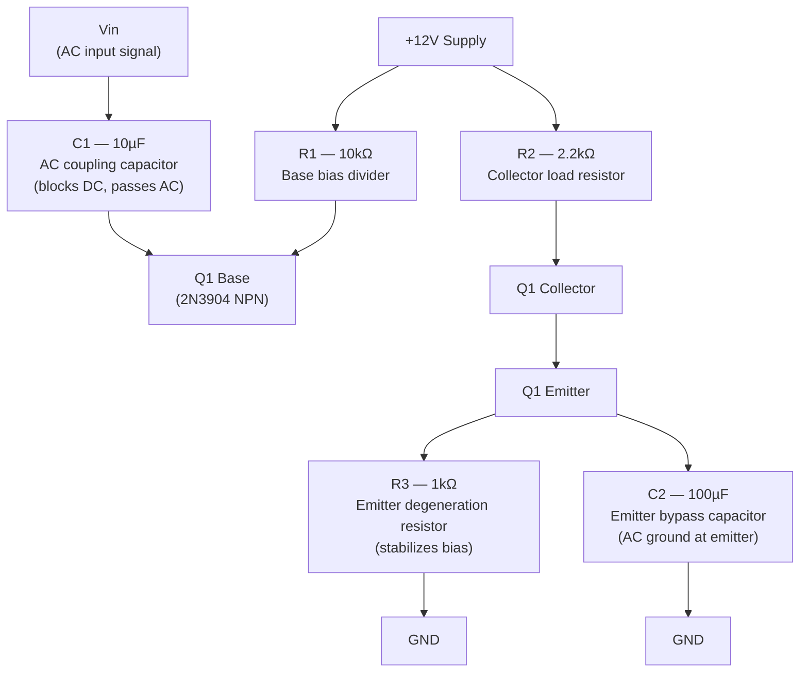

# Lesson 2: Passive-Active Component Representation

## 1. First-Principles Intuition & Invariants

The discipline of circuit design begins not with equations but with the establishment of a universal symbolic language—a lexicon of graphical tokens that encode the physical behavior of electrons through materials, semiconductor junctions, and electromagnetic fields. Schematic representation transforms the three-dimensional chaos of soldered copper traces, encapsulated silicon dies, and wound ferrite cores into a two-dimensional abstraction where topology, not geometry, dictates function. This abstraction is not merely convenient; it is foundational. A schematic diagram is a contract between the designer's intent and the physical reality that will emerge on the workbench, and every symbol carries with it a constellation of implicit assumptions about voltage-current relationships, frequency response, power dissipation, and failure modes.

At the heart of this symbolic system lies a fundamental dichotomy: passive versus active components. Passive components—resistors, capacitors, and inductors—obey linear or quasi-linear constitutive relations and cannot, under any circumstances, inject net energy into a circuit over a complete cycle. They are the dissipative and reactive elements that shape waveforms, filter noise, divide voltages, and store electromagnetic energy temporarily. Active components—diodes, bipolar junction transistors, field-effect transistors, operational amplifiers, and integrated circuits—exhibit nonlinear voltage-current characteristics and, when properly biased, can amplify signals, switch currents, or regulate voltages by drawing energy from external power supplies. The schematic distinction between these two families is not arbitrary; it reflects deep physical differences in how charge carriers behave within crystalline lattices, doped semiconductor junctions, and metal-oxide interfaces.

Understanding passive component representation begins with the resistor, the most elemental two-terminal device. The resistor symbol—a zigzag line in American notation or a rectangular box in European IEC standards—encodes Ohm's law: voltage equals current multiplied by resistance, $V = IR$. This relationship is instantaneous, memoryless, and frequency-independent across the ideal domain. In practice, real resistors exhibit parasitic inductance at high frequencies due to lead geometry and parasitic capacitance due to adjacent conductor spacing, but the schematic symbol deliberately omits these second-order effects unless explicitly modeled with lumped-element equivalents. The power dissipated in a resistor, $P = I^2 R = \frac{V^2}{R}$, manifests as heat, and this thermal energy must be evacuated through conduction, convection, or radiation to prevent catastrophic failure. Schematic annotations typically specify resistance in ohms (Ω), power rating in watts, and tolerance in percentage, but the symbol itself remains invariant across contexts—a visual anchor for the designer's mental model of energy dissipation.

Capacitors introduce time-dependence through charge storage. The capacitor symbol—two parallel plates separated by a gap, with one plate optionally curved for polarized electrolytics—represents the relationship $I = C \frac{dV}{dt}$, where current flow is proportional to the rate of voltage change. This derivative relationship means capacitors block DC steady-state signals while passing AC transients, making them indispensable for coupling, decoupling, filtering, and timing applications. The physical mechanism underlying capacitance is the separation of charge across a dielectric insulator, creating an electric field that stores energy $E = \frac{1}{2} C V^2$. Non-polarized ceramic and film capacitors permit bidirectional voltage swings, while aluminum and tantalum electrolytic capacitors require strict polarity enforcement—reverse biasing an electrolytic capacitor produces gas evolution, dielectric breakdown, and often explosive venting. Schematic convention marks the positive terminal of polarized capacitors with a curved plate symbol or explicit plus sign, a critical visual cue that prevents catastrophic assembly errors.

Inductors complete the passive trinity by storing energy in magnetic fields. The inductor symbol—a series of loops or coils—encodes the voltage-current relationship $V = L \frac{dI}{dt}$, the electromagnetic dual of the capacitor equation. Where capacitors resist voltage changes, inductors resist current changes, and this inertia arises from Lenz's law: a time-varying current generates a magnetic flux that, in turn, induces a back-EMF opposing the original change. Real inductors constructed from enameled copper wire wound around ferrite or powdered-iron cores exhibit DC resistance (DCR), self-resonant frequencies due to interwinding capacitance, and saturation effects when core flux density exceeds material limits. Schematic annotations specify inductance in henries (H), saturation current, and DC resistance, but the symbol abstracts away the three-dimensional geometry of winding pitch, core permeability, and air-gap reluctance.

The transition from passive to active components marks a shift from linear to nonlinear behavior, from energy storage and dissipation to energy amplification and control. The semiconductor diode, the simplest active device, exhibits an exponential voltage-current characteristic $I = I_S \left( e^{\frac{V}{nV_T}} - 1 \right)$, where $I_S$ is saturation current, $n$ is the ideality factor, and $V_T = \frac{kT}{q}$ is the thermal voltage (approximately 26 mV at room temperature). The diode schematic symbol—a triangle abutting a vertical bar—encodes unidirectional conduction: current flows from anode to cathode when forward-biased, and the cathode bar marks the polarity boundary. Specialized diode variants inherit this base topology while adding semantic annotations: Zener diodes show bent cathode bars to indicate avalanche breakdown regulation, Schottky diodes add an S-shaped cathode for low forward voltage, light-emitting diodes (LEDs) add outward-pointing arrows for photon emission, and photodiodes add inward-pointing arrows for photocurrent generation.

Bipolar junction transistors (BJTs) extend the diode's nonlinearity into three-terminal amplification. The NPN and PNP BJT symbols—a horizontal base line with emitter and collector arrows indicating current flow direction—encode the fundamental operating principle: base-emitter current controls a larger collector-emitter current through minority carrier injection and diffusion. The emitter arrow direction distinguishes device polarity: NPN transistors show the arrow pointing outward (mnemonic: "Not Pointing iN"), while PNP transistors show the arrow pointing inward. The physical mechanism underlying BJT operation involves forward-biasing the base-emitter junction to inject minority carriers into the base region, where they diffuse across the narrow base width and are swept into the collector by the reverse-biased base-collector junction. The current gain parameter $\beta$ or $h_{FE}$, typically ranging from 50 to 300, quantifies the ratio of collector current to base current in the active region, but this parameter exhibits wide manufacturing variation and strong temperature dependence, necessitating careful bias design.

Field-effect transistors (FETs) replace current-controlled amplification with voltage-controlled channel modulation. The MOSFET symbol—a vertical gate electrode separated from a substrate by a thin dielectric, with source and drain terminals—encodes capacitive control: gate-source voltage modulates the conductivity of the inversion channel beneath the gate oxide. N-channel MOSFETs (NMOS) show the substrate arrow pointing inward toward the channel, while P-channel MOSFETs (PMOS) show the arrow pointing outward. Enhancement-mode devices require a gate-source voltage exceeding a threshold $V_{TH}$ to form a conductive channel, while depletion-mode devices conduct at zero gate voltage and require reverse bias to pinch off the channel. The MOSFET's gate input impedance is extraordinarily high (gigaohms in DC steady-state), but gate-source and gate-drain capacitances dominate switching behavior, creating the familiar resistor-capacitor time constants that limit switching speed and contribute to power dissipation during transitions.

Power supply and ground conventions form the invisible scaffolding upon which every schematic depends. Voltage sources appear as circles enclosing a polarity sign, with the positive terminal marked explicitly. In complex systems involving multiple supply rails—analog $V_{DDA}$, digital $V_{DD}$, input/output $V_{DDIO}$, and negative rails $V_{SS}$ or $V_{EE}$—schematic symbols often collapse into labeled net names rather than explicit battery symbols to reduce visual clutter. Ground serves as the universal voltage reference, the zero-potential node against which all other voltages are measured, but the schematic representation of ground carries subtle semantic distinctions. Earth ground, depicted as a trio of descending horizontal bars or a filled triangle, indicates connection to the planet's conductive mass through a ground rod or water pipe, establishing safety and EMI mitigation. Chassis ground, shown as a zigzag line or unfilled triangle, connects to the metal enclosure of the equipment but may float relative to earth. Signal ground, often represented by a single horizontal bar, establishes the local reference for analog or digital signal return paths. The critical insight is that ground is not a single equipotential surface but a distributed impedance network—at high frequencies, inductance and resistance along ground traces create voltage differentials that couple noise between circuits. Star-grounding topologies route all ground returns to a single point to minimize these differentials, while split analog-digital ground planes use ferrite beads or single-point connections to isolate noise domains.

Polarity indicators permeate schematic notation, serving as visual guardrails against assembly errors and biasing mistakes. Electrolytic capacitors mark their positive terminals with curved plates or plus signs; diodes mark cathodes with bars; BJTs encode emitter polarity through arrow direction; polarized connectors show pin-one designators; integrated circuits annotate supply pins with explicit voltage labels. These indicators are not decorative—they encode physical asymmetries in semiconductor doping, dielectric formation, and terminal geometry. Reversing polarity on an aluminum electrolytic capacitor dissolves the oxide dielectric and releases hydrogen gas; reverse-biasing an LED produces no light and risks junction damage; swapping emitter and collector on a BJT collapses current gain and destroys amplification. The schematic symbol's polarity markings translate directly into physical component orientation on printed circuit boards, where silkscreen legends, solder mask shapes, and footprint asymmetries guide assembly.

## 2. Core Architecture & Mechanics

The architecture of passive and active component representation in schematics rests upon standardized symbol libraries codified by IEEE 315 (United States), IEC 60617 (international), and proprietary conventions maintained by electronic design automation (EDA) software vendors. These standards ensure that a resistor drawn in Altium Designer, KiCad, OrCAD, or hand-sketched on graph paper communicates the same functional intent across continents and decades. The mechanical implementation of schematic capture involves placing symbols from libraries, wiring nets between component pins, annotating reference designators and component values, and generating netlists that drive PCB layout tools and SPICE simulation engines.

Resistor topology begins with series and parallel combinations, the algebraic foundation of voltage dividers, current splitters, and impedance matching networks. Series resistances sum directly: $R_{total} = R_1 + R_2 + \cdots + R_n$. Parallel resistances sum reciprocally: $\frac{1}{R_{total}} = \frac{1}{R_1} + \frac{1}{R_2} + \cdots + \frac{1}{R_n}$. For two resistors in parallel, the product-over-sum shortcut $R_{total} = \frac{R_1 R_2}{R_1 + R_2}$ accelerates mental calculation. The voltage divider rule extracts a fractional voltage from a series chain: $V_{out} = V_{in} \frac{R_2}{R_1 + R_2}$. The current divider rule distributes current across parallel branches: $I_1 = I_{total} \frac{R_2}{R_1 + R_2}$. These topological manipulations extend to complex impedance networks involving frequency-dependent capacitive and inductive reactances, where resistors are replaced by generalized impedances $Z = R + jX$ and all algebraic rules remain valid in the complex domain.

Capacitor representation distinguishes between non-polarized and polarized types through symbol variation. Non-polarized ceramic, film, and mica capacitors use two straight parallel lines, indicating bidirectional voltage tolerance. Polarized aluminum electrolytic and tantalum capacitors use one straight and one curved line, with the curved line marking the negative terminal. Variable capacitors, such as trimmer caps and varactor diodes, add an arrow through the symbol to indicate adjustability. Series capacitances combine reciprocally: $\frac{1}{C_{total}} = \frac{1}{C_1} + \frac{1}{C_2} + \cdots + \frac{1}{C_n}$. Parallel capacitances sum directly: $C_{total} = C_1 + C_2 + \cdots + C_n$. The impedance of a capacitor in the frequency domain is $Z_C = \frac{1}{j \omega C}$, where $\omega = 2 \pi f$ is angular frequency. This inverse relationship means capacitors present high impedance at low frequencies (open circuits at DC) and low impedance at high frequencies (short circuits at infinite frequency). Decoupling capacitors exploit this frequency-dependent behavior by shunting high-frequency supply noise to ground while maintaining DC bias, and schematic placement reflects this intent—decoupling capacitors appear physically adjacent to integrated circuit supply pins, minimizing parasitic inductance in the bypass loop.

Inductor representation follows similar duality. Air-core inductors appear as simple coil symbols, ferrite-core inductors add a dashed line through the coil, and iron-core inductors add a solid line. Coupled inductors, such as transformers and common-mode chokes, show multiple coils aligned vertically with dot notation indicating winding polarity. Series inductances sum directly: $L_{total} = L_1 + L_2 + \cdots + L_n$. Parallel inductances sum reciprocally, assuming no mutual coupling: $\frac{1}{L_{total}} = \frac{1}{L_1} + \frac{1}{L_2} + \cdots + \frac{1}{L_n}$. The impedance of an inductor in the frequency domain is $Z_L = j \omega L$, a linear function of frequency. Inductors block high-frequency signals and pass low-frequency signals, the electromagnetic dual of capacitor behavior. Power supply filtering exploits this complementarity: LC filters combine series inductors and shunt capacitors to form low-pass structures that attenuate switching noise, while RLC networks introduce damping to suppress resonant peaking.

Semiconductor symbol architecture encodes device physics through terminal arrangement and arrow direction. The diode's triangle points in the direction of conventional current flow during forward bias, anode to cathode. The Shockley diode equation governs conduction: $I = I_S \left( e^{\frac{V}{nV_T}} - 1 \right)$, where $I_S$ ranges from picoamperes to nanoamperes depending on junction area and temperature. Forward voltage drop $V_F$ varies by semiconductor material: silicon diodes exhibit 0.6–0.7 V, Schottky diodes 0.2–0.4 V, and wide-bandgap silicon carbide or gallium nitride diodes 1.5–3 V. Reverse breakdown voltage $V_{BR}$ establishes the maximum allowable reverse bias before avalanche multiplication triggers catastrophic current runaway. Zener diodes intentionally operate in reverse breakdown, exploiting avalanche or tunneling effects to clamp voltage to a stable reference value $V_Z$. Schematic notation places the Zener diode with cathode toward the higher voltage rail and anode toward ground, regulating the cathode voltage to $V_Z$ above ground.

Bipolar junction transistor symbols encode doping polarity and current flow direction through arrow orientation. NPN transistors conduct when base voltage exceeds emitter voltage by approximately 0.6–0.7 V, injecting electrons from the emitter into the base and collecting them at the collector. The Ebers-Moll model captures this behavior through coupled diode equations and current-controlled current sources. PNP transistors operate symmetrically with reversed polarities, conducting when emitter voltage exceeds base voltage. Schematic conventions show the collector at the top, emitter at the bottom, and base entering from the left, establishing a consistent spatial metaphor for signal flow. Biasing networks—resistive dividers, emitter degeneration resistors, collector load resistors—appear as peripheral components surrounding the transistor symbol, and their values determine the DC operating point (Q-point) that positions the transistor in the active region for linear amplification.

Field-effect transistor symbols distinguish between enhancement and depletion modes, N-channel and P-channel polarities, and MOSFET versus JFET architectures. Enhancement-mode MOSFETs, the dominant topology in modern CMOS logic and power switching, show a broken channel between source and drain, indicating that no conductive path exists until gate voltage exceeds threshold. Depletion-mode MOSFETs show a solid channel, indicating conductivity at zero gate bias. The body diode, an intrinsic parasitic arising from the substrate-drain junction in power MOSFETs, appears explicitly in some schematic conventions as a diode symbol between source and drain. Gate drive circuitry—resistors limiting inrush current, gate-source Zener diodes protecting against overvoltage—appears adjacent to the gate terminal, reflecting the fragility of the thin gate oxide layer, which can be destroyed by electrostatic discharge voltages as low as 50 V.

Power supply notation collapses repetitive battery symbols into labeled net names. A microcontroller schematic might show $V_{DD}$, $V_{SS}$, $3V3$, $5V0$, and $GND$ labels attached to IC pins without drawing explicit voltage sources. This abstraction trusts the reader to infer that $V_{DD}$ connects to a regulated 3.3 V or 5 V supply rail and $GND$ connects to the zero-potential reference. Split supply operational amplifier circuits show $V_{CC+}$ and $V_{CC-}$ labels, indicating positive and negative rails of equal magnitude (e.g., ±15 V). Mixed-signal systems separate analog and digital grounds—$AGND$ and $DGND$—to prevent digital switching transients from corrupting analog signal integrity, and schematic notation shows these ground nets either isolated completely or connected at a single star point through a ferrite bead.

Ground symbol conventions encode isolation and safety intent. Earth ground symbols, with three descending bars, indicate connection to building ground rods or utility neutral wires, providing a path for fault currents and lightning transients. Chassis ground symbols connect equipment enclosures to safety ground but may float relative to signal ground to break ground loops in audio or instrumentation systems. Signal ground, the local zero-volt reference for circuits, may connect to chassis ground through a resistor-capacitor damper or ferrite bead to provide high-frequency coupling while maintaining DC isolation. Automotive and aerospace schematics introduce battery-negative and chassis ground symbols separately, reflecting the negative-ground convention where vehicle chassis serves as the current return path but is not connected to earth.

Polarity indicators extend beyond component symbols into connector pinouts, test point markings, and mounting hole designations. Polarized barrel jack connectors show center-positive or center-negative configurations with explicit symbols: a circle containing a dot (center) connected to a plus or minus sign. USB connectors annotate $V_{BUS}$, $D+$, $D-$, and $GND$ pins with functional labels. Differential pair signals—UART TX/RX, I2C SDA/SCL, CAN_H/CAN_L—appear as adjacent nets with complementary naming, and schematic conventions route them in parallel with matched lengths to preserve timing skew. Mounting holes, though non-electrical, appear in schematics when they provide chassis grounding, and their symbols show explicit connection to the ground net.

The following ASCII schematic fragment illustrates passive-active component integration in a common-emitter NPN amplifier with biasing network, AC coupling, and emitter degeneration:

This topology demonstrates the hierarchical layering of passive and active components: resistors establish DC bias points, capacitors couple AC signals while blocking DC offsets, and the transistor amplifies the AC-coupled input signal.

## 3. High-Performance Optimization & Failure Modes

Optimizing schematic representation for high-performance circuit design demands attention to parasitic effects, thermal management, electromagnetic compatibility, and supply decoupling. The schematic diagram, as an idealized abstraction, cannot capture every physical nuance, but experienced designers annotate symbols with pragmatic notes that guide layout and assembly: "Keep X7R ceramic capacitor within 5 mm of IC pin," "Route differential pair with 100Ω controlled impedance," "Maintain 6 mm creepage distance for 240 VAC isolation." These annotations bridge the gap between symbolic intent and physical realization.

Resistor failure modes manifest as open circuits, resistance drift, or catastrophic thermal runaway. Exceeding the power dissipation rating causes internal heating, accelerating resistance drift and eventually vaporizing the resistive element. Surface-mount resistors exhibit size-dependent power ratings: 0201 packages handle 0.05 W, 0402 handle 0.063 W, 0603 handle 0.1 W, and 1206 handle 0.25 W. High-power applications demand wirewound or thick-film resistors with thermal management via heatsinking or forced airflow. Inductive parasitic effects become significant in wirewound resistors at megahertz frequencies, while the parallel capacitance between adjacent resistor elements creates high-frequency bypass paths. Metal-film resistors offer superior noise performance, with lower 1/f (flicker) noise than carbon-composition types, critical in precision instrumentation amplifiers and ADC reference networks.

Capacitor failure modes span dielectric breakdown, electrolyte dry-out, and equivalent series resistance (ESR) degradation. Exceeding the rated voltage impresses excessive electric field strength across the dielectric, triggering charge tunneling, treeing, or explosive rupture. Aluminum electrolytic capacitors age through electrolyte evaporation, increasing ESR and reducing capacitance over time—this degradation accelerates exponentially with temperature, halving operational lifetime for every 10°C rise per the Arrhenius equation. Ceramic capacitors exhibit voltage-dependent capacitance: high-K dielectrics like X5R and X7R lose 50–80% of nominal capacitance at rated voltage due to ferroelectric saturation. Schematic optimization demands derating: specify capacitors with voltage ratings 2× the maximum circuit voltage and select C0G/NP0 dielectrics for timing-critical applications where capacitance stability is paramount. Decoupling networks benefit from parallel combinations of bulk electrolytics (10–100 µF) for low-frequency impedance and ceramic capacitors (0.1–10 µF) for high-frequency transient absorption, with schematic placement reflecting the frequency domain hierarchy.

Inductor failure modes include core saturation, DCR heating, and self-resonance. Saturation occurs when magnetic flux density exceeds the core material's limit, collapsing inductance and allowing uncontrolled current rise. Ferrite cores saturate around 0.3–0.5 T, while powdered-iron cores tolerate higher flux densities but exhibit greater core losses. Schematic annotations specify saturation current $I_{SAT}$ alongside inductance value, and designers must verify that peak current remains below this threshold. DC resistance dissipates power as $P = I^2 R_{DC}$, and high-current inductors demand thick wire gauges to minimize DCR. Self-resonant frequency (SRF), arising from interwinding capacitance, defines the upper frequency limit where the inductor behaves capacitively rather than inductively—operating beyond SRF inverts the impedance characteristic, defeating the design intent. High-frequency inductor selection requires SRF at least 5–10× the operating frequency.

Semiconductor diode optimization focuses on forward voltage drop, reverse recovery time, and thermal impedance. Schottky diodes, with metal-semiconductor junctions rather than PN junctions, exhibit lower forward voltage (0.2–0.4 V) and negligible reverse recovery, making them ideal for high-frequency rectification and flyback catch diodes in switching converters. However, Schottky diodes suffer from higher reverse leakage current, which increases exponentially with temperature and degrades efficiency in hot environments. Silicon carbide Schottky diodes extend the performance envelope to 600–1200 V blocking voltages with minimal reverse recovery, enabling efficient power factor correction and bridgeless totem-pole topologies. Schematic selection criteria annotate diodes with peak repetitive reverse voltage (VRRM), average forward current (IF(AV)), and junction-to-ambient thermal resistance (θJA), ensuring the device operates within safe operating area (SOA) boundaries under worst-case thermal and electrical stress.

Bipolar junction transistor optimization addresses beta variation, thermal runaway, and secondary breakdown. Current gain β varies ±50% across manufacturing lots and degrades with temperature and collector current, so robust biasing networks use emitter degeneration resistors to establish negative feedback that stabilizes the Q-point despite β variation. Thermal runaway arises from the positive temperature coefficient of base-emitter voltage: as junction temperature rises, VBE decreases, increasing collector current, which increases power dissipation, further raising temperature in a regenerative loop. Emitter degeneration provides negative feedback that counteracts this instability. Secondary breakdown, a localized thermal hotspot that collapses collector-emitter voltage, destroys the transistor if collector current exceeds safe limits during inductive turn-off transients. Schematic design enforces current limiting and snubber networks—resistor-capacitor-diode clamps—to absorb inductive energy and clamp voltage spikes below the transistor's breakdown rating.

MOSFET optimization navigates gate charge, on-resistance, and body diode recovery. Gate charge Qg, measured in nanocoulombs, quantifies the total charge required to transition the gate voltage from zero to the full drive level, determining switching speed and gate drive power dissipation. High-side gate drivers must supply sufficient current to charge the gate capacitance within the desired rise time: $I_{drive} = \frac{Q_g}{t_{rise}}$. On-resistance RDS(on), the drain-source resistance in full enhancement, governs conduction losses $P = I^2 R_{DS(on)}$ and exhibits strong temperature dependence, typically doubling from 25°C to 150°C. Parallel MOSFET configurations reduce effective RDS(on) but introduce current-sharing challenges—schematic designs include small source resistors (10–100 mΩ) to balance current distribution. The body diode, intrinsic to MOSFET construction, exhibits slow reverse recovery compared to discrete Schottky diodes, and hard-switching topologies benefit from external Schottky diodes placed antiparallel to the MOSFET to bypass the body diode during commutation.

Power supply decoupling represents the most critical schematic optimization for mixed-signal and high-speed digital systems. Every integrated circuit switching event draws a transient current pulse from the supply rail, and the parasitic inductance of PCB traces and bond wires causes voltage droop $\Delta V = L \frac{dI}{dt}$. Insufficient decoupling allows this droop to propagate across the supply net, injecting noise into analog circuits and causing digital logic glitches. Schematic decoupling hierarchies place bulk capacitance (10–100 µF tantalum or aluminum electrolytic) at the board power entry point to buffer low-frequency load transients, intermediate capacitance (1–10 µF ceramic) at each functional block to absorb mid-frequency switching noise, and local high-frequency capacitance (0.01–0.1 µF ceramic) at each IC power pin to suppress fast switching edges. The physical placement encoded by schematic adjacency matters: decoupling capacitors must sit within 5–10 mm of the IC pin with minimal via count in the current return path to minimize loop inductance.

Ground integrity failures manifest as ground bounce, cross-talk, and EMI radiation. Single-point grounding topologies, where all ground returns converge at a star node, minimize circulating ground currents and are preferred in low-frequency analog systems. Multi-point grounding topologies, where ground planes provide distributed low-impedance return paths, are mandatory in high-frequency digital and RF systems to minimize loop area and inductive coupling. Split ground planes, separating analog and digital domains, connect at a single bridge point to prevent digital switching transients from polluting analog signal references. Schematic annotations specify the ground plane strategy—"AGND and DGND join at star point beneath ADC"—guiding the layout engineer's plane partitioning decisions.

Polarity reversal protection appears in battery-powered and automotive schematics as series diodes, MOSFET-based ideal diode controllers, or bridge rectifiers. A series Schottky diode provides simple reverse-polarity protection at the cost of forward voltage drop and power dissipation. P-channel MOSFET high-side switches, controlled by a gate driver that senses input polarity, provide near-zero voltage drop in forward bias and open-circuit in reverse bias, maximizing efficiency. Bridge rectifier topologies, four diodes in a full-wave configuration, produce the same output polarity regardless of input polarity but consume two diode drops in forward voltage.

The schematic diagram, when annotated with performance constraints, failure mode mitigations, and layout guidance, transcends its role as a mere circuit map and becomes a comprehensive design specification. Each resistor value implies a power rating, each capacitor implies an ESR and voltage derating, each transistor implies a thermal dissipation strategy, and each ground symbol implies a low-impedance return path topology. Mastery of passive-active component representation demands fluency not only in symbol syntax but in the unwritten pragmatics that connect two-dimensional abstraction to three-dimensional hardware that must survive temperature extremes, vibration, electrostatic discharge, and the relentless entropy of semiconductor aging.
