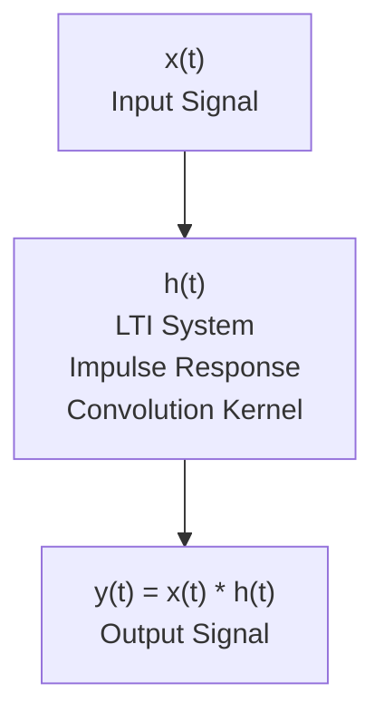
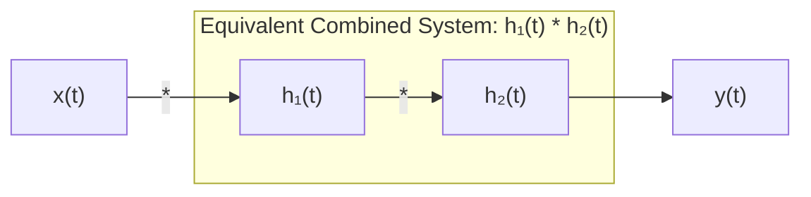
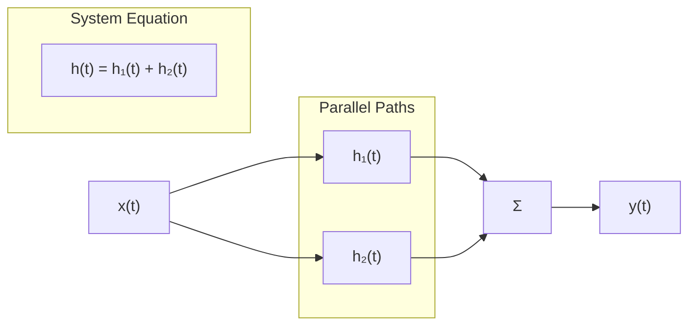

# Lesson 1: Continuous-Time Signals, Systems, Convolution

## 1. First-Principles Intuition & Invariants

The continuous-time signal stands as the foundational abstraction through which we model the physical phenomena coursing through electrical circuits—voltage waveforms rippling across transmission lines, current densities modulating through semiconductor junctions, electromagnetic field intensities radiating from antenna apertures. Unlike the discrete samples captured by analog-to-digital converters, continuous-time signals exist as mathematical functions defined over the entire real line, mapping every instant $t \in \mathbb{R}$ to an amplitude value $x(t)$. This distinction carries profound engineering consequences: while digital systems operate on finite-precision snapshots, analog circuits must grapple with the infinitesimal calculus of derivatives and integrals, the parasitic capacitances that blur sharp edges into exponential charging curves, and the bandwidth limitations imposed by reactive components.

At the heart of signal processing theory lies the concept of the linear time-invariant (LTI) system, a mathematical idealization that captures the essence of countless physical devices—operational amplifier circuits, passive RC filters, transmission line segments, loudspeaker diaphragms responding to electrical excitation. An LTI system obeys two fundamental principles that vastly simplify analysis. Linearity demands that the system response to a weighted sum of inputs equals the same weighted sum applied to the individual responses, a consequence of superposition that holds whenever the governing differential equations contain no quadratic or higher-order terms in the signal variables. Time-invariance asserts that shifting an input waveform forward or backward in time produces an identically shifted output, reflecting the absence of explicit time dependence in the system's physical parameters—resistors whose values remain constant rather than drifting with temperature, capacitors free from dielectric aging effects, transmission lines whose characteristic impedance stays fixed regardless of when the signal arrives.

These two properties—linearity and time-invariance—together yield a stunningly powerful result: the complete input-output behavior of any LTI system can be characterized by a single function, the impulse response $h(t)$, which describes how the system reacts to an idealized instantaneous excitation, the Dirac delta function $\delta(t)$. The delta function, though not a function in the classical sense but rather a distribution or generalized function, serves as the continuous-time equivalent of a unit sample—an infinitely narrow spike containing unit area, vanishing everywhere except at the origin where it achieves infinite amplitude. Physically, we approximate the delta function using short-duration pulses: narrow voltage spikes generated by mercury-wetted relay contacts closing for nanoseconds, sharp current transients from tunnel diode snap-back transitions, or femtosecond laser pulses illuminating photodetectors. When such an impulse enters an LTI system, the output waveform $h(t)$ encodes everything about the system's dynamics—its resonant frequencies, damping coefficients, delay characteristics, and bandwidth limitations.

The impulse response provides the kernel for convolution, the mathematical operation that transforms arbitrary input signals into corresponding outputs through weighted, time-shifted superposition. Convolution formalizes the intuitive notion that a system's output at any instant depends not only on the present input value but also on the entire history of past inputs, weighted by how recently they occurred and modulated by the system's memory embodied in $h(t)$. For causal systems—those respecting the arrow of time by producing outputs that depend only on present and past inputs, never future ones—the impulse response vanishes for negative time arguments, $h(t) = 0$ for $t < 0$, ensuring that the convolution integral need only integrate over the historical record. Non-causal systems, while mathematically permissible and occasionally useful as idealized approximations (zero-phase filters in offline processing), cannot be realized in physical hardware governed by relativistic causality constraints.

Signal classification taxonomies partition the universe of continuous-time waveforms according to properties that dictate appropriate analysis techniques and circuit design strategies. Periodic signals repeat their pattern at regular intervals, characterized by a fundamental period $T_0$ such that $x(t + T_0) = x(t)$ for all $t$, enabling Fourier series decomposition into discrete harmonic components—a fact exploited in narrow-band amplifier tuning, where resonant LC tanks select specific frequency components while rejecting harmonics. Aperiodic signals lack such regularity but may still exhibit deterministic structure, like the exponentially decaying voltage across a capacitor discharging through a resistor, described by $v(t) = V_0 e^{-t/RC} u(t)$ where $u(t)$ denotes the unit step function enforcing causality. Energy signals possess finite total energy $E = \int_{-\infty}^{\infty} |x(t)|^2 \, dt < \infty$, representing transient phenomena like damped oscillations in RLC circuits or pulse-modulated radar returns. Power signals sustain non-zero average power $P = \lim_{T \to \infty} \frac{1}{2T} \int_{-T}^{T} |x(t)|^2 \, dt < \infty$ over infinite duration, exemplified by sinusoidal carriers in continuous-wave radio transmitters or white noise generators driving thermal agitation in resistive terminations.

The distinction between deterministic and random signals reflects whether future values can be predicted from past observations through an explicit functional relationship or require probabilistic description through correlation functions and power spectral densities. Deterministic signals—square waves from astable multivibrators, sawtooth ramps from integrator circuits fed constant current—permit exact mathematical specification, while random signals like shot noise from photon-counting detectors or thermal noise from Nyquist-Johnson fluctuations in resistive loads demand statistical characterization. Engineers must recognize when deterministic models suffice, avoiding the computational burden of stochastic analysis, and when randomness dominates, necessitating ensemble averaging and ergodicity assumptions.

Bounded signals satisfy $|x(t)| \leq M < \infty$ for all time, ensuring that signal amplitudes never exceed finite limits—a critical property for preventing component damage, avoiding saturation in active devices, and maintaining linear operating regions. Unbounded signals pose theoretical curiosities (pure sinusoids extending to infinite past and future) but must be windowed or truncated in practical implementations, where power supplies impose voltage rails and transistor breakdown voltages establish hard clipping thresholds. The very concept of a continuous-time signal presupposes infinite time resolution and amplitude precision, idealizations that real circuits approximate but never achieve exactly due to thermal noise floors, quantization effects in analog multipliers, and the discrete charge carrier nature of current flow.

## 2. Core Architecture & Mechanics

The convolution integral stands as the central computational engine relating input signals $x(t)$ to output signals $y(t)$ through the system's impulse response $h(t)$, expressed mathematically as:

$$y(t) = x(t) * h(t) = \int_{-\infty}^{\infty} x(\tau) h(t - \tau) \, d\tau = \int_{-\infty}^{\infty} h(\tau) x(t - \tau) \, d\tau$$

The symmetry between the two integral forms reflects convolution's commutativity, allowing us to choose whichever representation simplifies calculation. To build intuition for this operation, consider the integrand $x(\tau) h(t - \tau)$ as a pointwise product of two functions: the input signal $x(\tau)$ indexed by the dummy variable $\tau$, and a time-reversed, shifted copy of the impulse response $h(t - \tau)$. The reversal operation $h(-\tau)$ flips the impulse response about the vertical axis, transforming causal tails extending rightward into anticipatory tails extending leftward. The subsequent shift $h(t - \tau)$ slides this reversed function horizontally by amount $t$, positioning its peak or centroid at the evaluation time. As $t$ varies, the shifted function sweeps across the input waveform, with the integral accumulating weighted overlap between the two functions at each instant.

This geometric interpretation illuminates the mechanics of filtering. When the impulse response represents a low-pass filter with long, smooth tails extending over duration $\Delta t$, the convolution integral averages the input signal over intervals approximately $\Delta t$ wide, attenuating rapid fluctuations while preserving slow trends. Sharp, narrow impulse responses approaching delta-function character pass signals with minimal distortion, while broad, slowly decaying responses impose heavy smoothing. The impulse response duration directly correlates with system memory—how far into the past the system "remembers" previous inputs when computing the present output. RC circuits exhibit exponential impulse responses $h(t) = \frac{1}{RC} e^{-t/RC} u(t)$ with effective memory depth of several time constants $RC$, beyond which past inputs contribute negligibly to current outputs.

For causal systems where $h(t) = 0$ for $t < 0$, the convolution integral simplifies by restricting the integration range. Since $h(t - \tau)$ vanishes whenever $t - \tau < 0$, equivalently $\tau > t$, we obtain:

$$y(t) = \int_{-\infty}^{t} x(\tau) h(t - \tau) \, d\tau$$

This form explicitly shows that the output at time $t$ depends only on input values $x(\tau)$ for $\tau \leq t$, consistent with causal constraints. If the input signal itself is causal, vanishing for $t < 0$, both factors in the integrand vanish outside the interval $[0, t]$, further reducing the integration domain:

$$y(t) = \int_{0}^{t} x(\tau) h(t - \tau) \, d\tau \quad \text{for causal } x(t), h(t)$$

This bilateral truncation proves invaluable when evaluating convolutions by hand or implementing them in analog hardware using delay lines and multipliers.

Consider a concrete example: computing the response of a first-order RC low-pass filter to a rectangular pulse input. The filter's impulse response is $h(t) = \frac{1}{RC} e^{-t/RC} u(t)$, and the input signal is $x(t) = V_0 [u(t) - u(t - T)]$, representing a voltage pulse of amplitude $V_0$ and duration $T$. During the interval $0 \leq t < T$ while the pulse remains active, the convolution integral becomes:

$$y(t) = \int_{0}^{t} V_0 \cdot \frac{1}{RC} e^{-(t - \tau)/RC} \, d\tau = \frac{V_0}{RC} e^{-t/RC} \int_{0}^{t} e^{\tau/RC} \, d\tau$$

Evaluating the integral yields:

$$y(t) = \frac{V_0}{RC} e^{-t/RC} \cdot RC [e^{t/RC} - 1] = V_0 (1 - e^{-t/RC})$$

This result describes the familiar exponential rise of capacitor voltage during charging, asymptotically approaching the input amplitude $V_0$ with time constant $RC$. After the pulse terminates at $t = T$, the integration domain splits into two regions: $[0, T]$ where the input was active, and $[T, t]$ where it vanishes. The surviving integral over $[0, T]$ yields:

$$y(t) = \frac{V_0}{RC} e^{-t/RC} \int_{0}^{T} e^{\tau/RC} \, d\tau = V_0 (e^{-t/RC} - e^{-(t - T)/RC}) e^{T/RC}$$

which simplifies to:

$$y(t) = V_0 e^{-(t - T)/RC} (1 - e^{-T/RC})$$

representing exponential decay from the peak value reached at $t = T$. The output waveform smoothly interpolates between exponential rise and decay, with the transition governed by the ratio $T/RC$. Short pulses ($T \ll RC$) never charge the capacitor fully, producing small-amplitude, heavily smoothed outputs, while long pulses ($T \gg RC$) allow near-complete charging followed by slow discharge.

The block diagram representation of an LTI system abstracts these mathematical operations into a signal flow graph:

In this representation, the system box labeled with $h(t)$ symbolizes the entire convolution operation, transforming every input sample into a weighted superposition of time-shifted impulse responses. Series cascades of LTI systems compose through convolution of their individual impulse responses:

Parallel combinations sum their outputs, with overall impulse response given by the sum of component impulse responses:

These composition rules enable hierarchical system decomposition, where complex filter networks break down into cascaded stages—perhaps an input buffering stage with impulse response dominated by parasitic capacitance charging, followed by a gain stage with operational amplifier dynamics, and a final output filter rolling off high-frequency noise.

Stability analysis for LTI systems reduces to examining whether bounded inputs produce bounded outputs, the BIBO (Bounded-Input Bounded-Output) stability criterion. Mathematically, a system is BIBO stable if and only if its impulse response is absolutely integrable:

$$\int_{-\infty}^{\infty} |h(t)| \, dt < \infty$$

This condition ensures that convolving any bounded input $|x(t)| \leq M$ yields a bounded output, since:

$$|y(t)| = \left| \int_{-\infty}^{\infty} x(\tau) h(t - \tau) \, d\tau \right| \leq \int_{-\infty}^{\infty} |x(\tau)| \cdot |h(t - \tau)| \, d\tau \leq M \int_{-\infty}^{\infty} |h(\tau)| \, d\tau$$

The final integral being finite guarantees $|y(t)|$ remains bounded. Physically, absolute integrability demands that the impulse response decay sufficiently fast as $t \to \infty$, preventing infinite accumulation of past inputs. Exponentially decaying impulse responses like $h(t) = e^{-\alpha t} u(t)$ with $\alpha > 0$ satisfy this criterion trivially, as do damped sinusoids and finite-duration responses. Conversely, impulse responses containing undamped sinusoidal components or polynomial growth violate stability, producing unbounded oscillations or divergence in response to sustained inputs.

Memory characterization distinguishes systems that depend only on instantaneous input values (memoryless) from those retaining historical information. A system possesses memory if its output at time $t$ depends on input values at times other than $t$. Mathematically, memoryless systems satisfy $y(t) = G[x(t)]$ for some function $G$, while systems with memory require dependence on $x(t')$ for $t' \neq t$. The impulse response provides immediate memory classification: memoryless LTI systems exhibit impulse responses proportional to delta functions, $h(t) = K \delta(t)$, representing instantaneous gain scaling. Any impulse response spreading over non-zero duration necessarily implies memory, with the effective memory depth approximated by the response's decay time constant or support width.

Causality, already mentioned, imposes the physical constraint that outputs cannot precede inputs. For LTI systems, causality equivalently requires $h(t) = 0$ for all $t < 0$. Non-causal systems, though unphysical for real-time processing, arise legitimately in offline scenarios where entire signal records undergo symmetric filtering—applying zero-phase filters that preserve waveform shape without introducing group delay distortion, a technique common in seismic data processing and post-production audio mastering.

## 3. High-Performance Optimization & Failure Modes

The direct evaluation of convolution integrals through numerical integration incurs computational costs scaling as $O(N^2)$ for $N$ sample points, as each output sample requires integrating across the entire input history. For long signals or impulse responses spanning thousands of samples, this quadratic complexity becomes prohibitive. Transform-domain methods circumvent this bottleneck by exploiting the convolution theorem: convolution in the time domain corresponds to multiplication in the frequency domain. Specifically, if $X(f)$ and $H(f)$ denote the Fourier transforms of $x(t)$ and $h(t)$, then:

$$y(t) = x(t) * h(t) \quad \Longleftrightarrow \quad Y(f) = X(f) \cdot H(f)$$

This relationship reduces convolution to three steps: transform the input and impulse response to frequency domain using Fast Fourier Transform (FFT) algorithms running in $O(N \log N)$ time, perform pointwise multiplication of the resulting spectra, and inverse-transform back to time domain. The total complexity remains $O(N \log N)$, achieving orders-of-magnitude speedup for large $N$. Digital signal processors (DSPs) and field-programmable gate arrays (FPGAs) leverage this approach, implementing radix-2 or radix-4 FFT butterflies in hardware with dedicated multiply-accumulate (MAC) units clocked at hundreds of megahertz.

Analog implementations of convolution require different strategies, as continuous-time circuits cannot directly store and sum weighted history samples. Tapped delay line filters approximate convolution by sampling the input signal at discrete points along a lumped-element or distributed transmission line delay structure. Surface acoustic wave (SAW) filters epitomize this technique: interdigital transducers (IDTs) spaced along a piezoelectric substrate convert input electrical signals into acoustic waves propagating at velocities around 3000 m/s. The IDT tap spacings and electrode geometries encode the desired impulse response, with the acoustic wave accumulating weighted contributions as it propagates. At the output transducer, the mechanical displacement reconverts to electrical voltage, producing the convolution of the input with the spatial impulse response pattern. SAW filters achieve fractional bandwidths exceeding 50% with insertion losses below 2 dB, operating at center frequencies from tens of megahertz to several gigahertz—critical components in cellular base station duplexers and radar pulse compression receivers.

Charge-coupled device (CCD) transversal filters implement discrete-time convolution in the analog domain by clocking signal samples through a chain of potential wells, tapping each well with weighted capacitive coupling to a summing node. The weights, set by capacitor ratios, define the filter coefficients, while the clocking rate establishes the sampling frequency. CCD filters process video-rate signals with tap counts reaching hundreds, finding application in broadcast television ghost cancellation and adaptive equalization of wireline modems. However, charge transfer inefficiency and dark current leakage limit dynamic range to approximately 60 dB, and the need for multi-phase clocking complicates timing design.

Operational amplifier integrator circuits synthesize analog filtering through continuous-time integration rather than explicit convolution. A simple RC integrator with voltage feedback realizes a first-order low-pass transfer function $H(s) = \frac{1}{1 + sRC}$, where $s = j\omega$ represents the complex frequency variable. Cascading multiple integrator stages constructs higher-order filters with sharper rolloff characteristics, as in the Sallen-Key topology or state-variable configurations. The integrator's impulse response emerges from the inverse Laplace transform of $H(s)$, yielding the exponential decay $h(t) = \frac{1}{RC} e^{-t/RC} u(t)$ for the first-order case. Engineers tune cutoff frequencies by adjusting resistor and capacitor values, navigating tradeoffs between rolloff steepness, passband flatness (Butterworth, Chebyshev, or elliptic responses), and sensitivity to component tolerances.

Switched-capacitor filters eliminate resistors entirely, replacing them with capacitors and CMOS switches clocked at frequencies much higher than the signal bandwidth. The effective resistance equals $1/(fC)$ where $f$ denotes the switching frequency and $C$ the capacitance value. This technique permits fully integrated filters on CMOS dies without laser-trimmed resistors, critical for analog front-ends in mixed-signal systems-on-chip (SoCs). The anti-aliasing requirement demands that the switching frequency exceed twice the highest signal frequency to avoid spectral folding, while charge injection from switch parasitics limits dynamic range and introduces harmonic distortion at high signal amplitudes.

Failure modes in continuous-time signal processing stem from violations of linearity assumptions, bandwidth limitations, and noise accumulation. Nonlinear distortion arises when active devices operate outside their small-signal regions—transistors entering cutoff or saturation, diodes exhibiting exponential I-V characteristics, op-amps rail-limiting at power supply voltages. Harmonic distortion metrics quantify this effect, with total harmonic distortion (THD) measuring the ratio of harmonic power to fundamental power, typically expressed in decibels. High-performance audio circuits achieve THD below -100 dB (0.001%) through careful bias point selection, local negative feedback, and balanced differential topologies canceling even-order harmonics.

Bandwidth limitations manifest as frequency-dependent attenuation and phase shift, distorting signal waveforms by disproportionately affecting different spectral components. The gain-bandwidth product of operational amplifiers imposes a fundamental tradeoff: increasing closed-loop gain reduces achievable bandwidth, with the product remaining constant at the op-amp's unity-gain frequency $f_T$. For instance, an LM358 op-amp with $f_T = 1$ MHz configured for 100 V/V gain exhibits -3 dB bandwidth of only 10 kHz, insufficient for high-fidelity audio reproduction. Selecting op-amps with higher $f_T$, employing current-feedback architectures, or distributing gain across multiple stages alleviates this constraint.

Noise accumulation arises from fundamental physical processes—thermal noise in resistors governed by $v_n^2 = 4kTR\Delta f$ where $k$ denotes Boltzmann's constant, $T$ absolute temperature, $R$ resistance, and $\Delta f$ measurement bandwidth; shot noise in semiconductor junctions from discrete electron transport; flicker noise in active devices with $1/f$ spectral density dominating at low frequencies. Cascaded amplifier stages add uncorrelated noise powers, degrading signal-to-noise ratio (SNR) at each stage. The first stage exerts disproportionate influence, as its noise amplifies through subsequent stages along with the signal. Minimizing first-stage noise figure—the ratio of output SNR to input SNR—maximizes overall system sensitivity, driving the use of low-noise junction field-effect transistors (JFETs) or cryogenically cooled high-electron-mobility transistors (HEMTs) in radio astronomy and deep-space communication receivers.

Parasitic effects impose practical limits on achievable performance. Circuit board trace capacitance couples high-frequency signals into adjacent conductors, producing crosstalk that corrupts weak signals with strong interferers. Inductive bond wire impedance in integrated circuit packages creates supply voltage transients during rapid current switching, momentarily starving internal logic gates or biasing analog stages into nonlinear regions. Careful PCB layout—ground plane segmentation, differential trace routing, Kelvin sensing connections at high-current nodes—mitigates these effects but never eliminates them entirely. At frequencies exceeding 1 GHz, distributed effects dominate: transmission line reflections from impedance discontinuities, skin effect increasing conductor resistance, dielectric losses in substrates. Microwave engineers resort to S-parameter models, Smith charts, and electromagnetic simulation tools like ANSYS HFSS or Keysight ADS to predict and optimize performance.

Temperature sensitivity plagues analog circuits, as resistor temperature coefficients of 50-200 ppm/°C and diode forward voltage shifts of -2 mV/°C cause gain drift and offset errors over the operating temperature range. Precision instrumentation addresses this through oven-controlled oscillators maintaining quartz resonators at 75°C, or algorithmic compensation using on-chip temperature sensors feeding correction terms into digital calibration routines. Chopper-stabilized op-amps cancel offset drift by modulating the input signal to higher frequency, amplifying the modulated signal where flicker noise vanishes, then demodulating back to baseband—achieving offset voltages below 1 μV and drift under 10 nV/°C.

Real-time constraints in continuous-time systems manifest as latency and throughput limitations. Analog filters introduce group delay determined by the impulse response duration, delaying signal propagation by intervals ranging from nanoseconds in simple RC stages to microseconds in high-order elliptic filters. Feedback control loops tolerate only finite delay before instability arises, as excessive phase lag rotates the Nyquist plot to encircle the critical point. Compensating networks—lead-lag filters, proportional-integral-derivative (PID) controllers—restore stability margins at the cost of reduced bandwidth. In mixed-signal systems combining analog front-ends with digital processing, the aggregate latency sums contributions from anti-aliasing filters, ADC conversion time, algorithmic delay through FIR or IIR filters, DAC reconstruction, and output smoothing filters. Meeting hard real-time deadlines in control applications—servo motor positioning, active vibration damping, power converter regulation—demands careful budgeting of each latency component and selection of components with minimal conversion delays.

Precision limitations ultimately stem from quantum mechanical noise floors and thermodynamic entropy production. Heisenberg's uncertainty principle imposes fundamental limits on simultaneous time-frequency resolution, manifesting in the Gabor limit for signal representations. Thermal noise sets an absolute floor on achievable SNR, approximately -174 dBm/Hz at room temperature in 50 Ω systems, establishing sensitivity limits for receivers and detectors. Overcoming these quantum and thermal barriers requires cooling to cryogenic temperatures, using superconducting devices with near-zero resistance, or employing quantum-limited amplifiers like Josephson parametric amplifiers approaching the standard quantum limit.
