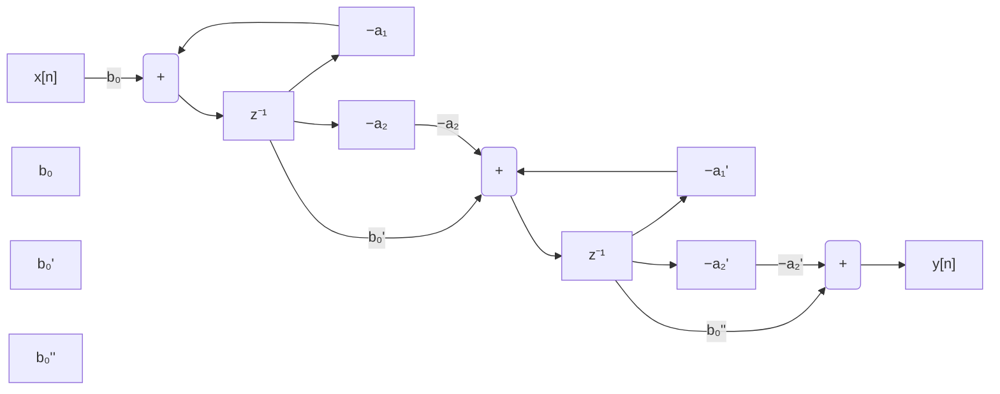

# Lesson 4: Filter Design, FIR/IIR Structures, Spectral Estimation

## 1. First-Principles Intuition & Invariants

The art of filter design sits at the intersection of mathematics, physics, and pragmatic engineering constraint. When an analog sensor delivers a noisy signal to your acquisition circuit—whether that signal originates from a photodiode, accelerometer, or RF receiver—the raw data rarely matches the bandwidth, noise floor, or spectral content your downstream processor expects to handle. Filter design answers a deceptively simple question: *How do I remove unwanted frequency components while preserving the information I care about?* The answer, however, branches into competing topologies, mathematical transformations, and hardware trade-offs that demand deep understanding to navigate successfully.

A filter, fundamentally, is a system that modifies the amplitude and phase relationship of sinusoidal components across frequency. Unlike amplification or attenuation (which affects all frequencies equally), filtering reshapes the frequency response—attenuating some bands while leaving others largely untouched. This frequency-selective behavior emerges from the physics of reactive elements: capacitors and inductors in analog circuits, or feedback delay lines in digital implementations. The reactive impedance of these elements varies with frequency, creating natural frequency-dependent gain and phase shift that we exploit for filtering purposes.

The journey from specification to working filter begins with a critical recognition: *analog* and *digital* filters solve the same mathematical problem using fundamentally different physical mechanisms. An analog filter operates in continuous time using resistors, capacitors, inductors, and operational amplifiers. Its transfer function describes the relationship between input and output voltages in the Laplace domain, using the complex frequency variable $s = \sigma + j\omega$. A digital filter, by contrast, operates on discrete-time samples and uses recursive arithmetic or convolution to compute outputs; its transfer function lives in the z-domain, where the complex variable $z$ encodes sample-rate-normalized frequency relationships.

The canonical problem statement for filter design reads as follows: You are given a specification describing passband ripple (typically 0.5 dB to 3 dB maximum gain variation in the frequencies you want to preserve), stopband attenuation (the minimum attenuation you demand for rejected frequencies, often 40 dB to 80 dB or more), and transition bandwidth (the frequency span from the edge of the passband to where stopband attenuation begins). From this specification, you must determine the filter order (the number of reactive elements in an analog filter, or the number of delay taps in a digital FIR filter, or the recursion depth in an IIR filter) and then derive the exact pole and zero locations, component values, or coefficient arrays that achieve your target response.

Three classical filter families dominate engineering practice: **Butterworth**, **Chebyshev**, and **elliptic** (Cauer) filters. Each family represents a different optimization strategy. Butterworth filters maximize monotonic smoothness in the passband at the cost of a gradual, gentle rolloff into the stopband. They require the highest order to meet a given stopband attenuation specification but offer maximally flat passband magnitude and linear phase characteristics in the vicinity of DC. Chebyshev filters (Type I) deliberately allow passband ripple in exchange for steeper stopband rolloff and lower order; this ripple is equiripple, meaning the passband magnitude oscillates uniformly between a maximum (0 dB or a small positive dB value) and a minimum (-ripple dB), distributing the allowable error evenly across the passband. Chebyshev Type II (inverse Chebyshev) flips this trade-off: the stopband exhibits equiripple behavior while the passband remains monotonic. Elliptic filters (Cauer filters) achieve the steepest rolloff for a given order by introducing equiripple in both passband and stopband simultaneously; the trade-off is the highest design complexity and the most severe phase nonlinearity.

The **bilinear transformation** bridges the analog and digital realms. When you design a digital filter that must process samples from an ADC, you often begin by designing an analog prototype using well-established continuous-time design methods (Butterworth, Chebyshev poles, etc.), then transform that analog design into a digital filter using the bilinear transformation. This method maps the continuous-time Laplace variable $s$ to the discrete-time z-variable via the relationship $s = \frac{2}{T} \frac{z - 1}{z + 1}$, where $T$ is the sample period. The transformation guarantees that a stable analog filter becomes a stable digital filter, and it preserves the essential magnitude response shape—though frequency compression (warping) occurs, requiring frequency pre-warping during design to account for the nonlinear mapping between analog and digital frequency axes.

Once you have decided on a filter family and computed pole/zero locations, you face the question of *realization*: How do you physically construct this filter using either analog components or digital arithmetic? For analog filters, the cascade of second-order sections (biquads) dominates modern practice. Each biquad realizes one complex-conjugate pole pair and can include finite zeros; cascading biquads provides modularity, tuning flexibility, and reduced sensitivity to component tolerances. For digital filters, two competing realizations prevail: **FIR** (Finite Impulse Response) filters and **IIR** (Infinite Impulse Response) filters. FIR filters convolve the input signal with a finite-length impulse response (a stored array of coefficients), producing an output as a weighted sum of past and present input samples. IIR filters, by contrast, combine weighted sums of past inputs *and* past outputs, creating feedback paths that allow the impulse response to theoretically decay to infinity. FIR filters naturally offer exact linear phase (group delay independent of frequency), unconditional stability (all poles lie at the origin in the z-plane), and straightforward coefficient derivation via windowing or frequency-sampling methods. IIR filters offer orders of magnitude lower computational burden for equivalent passband/stopband specifications, making them the workhorse of real-time signal processing in embedded systems where CPU cycles or power consumption are finite resources.

**Spectral estimation**—the problem of determining what frequencies, at what power levels, populate a signal—reveals another dimension of filter design. When you acquire a finite block of samples from a real-world signal, you cannot observe its "true" spectrum; the discrete Fourier Transform (DFT) computed from those samples inevitably suffers from spectral leakage, where energy from strong frequency components spreads across the DFT bins due to the finite observation window. Windowing functions (rectangular, Hann, Hamming, Blackman) trade main-lobe width against side-lobe magnitude to mitigate leakage. The choice of window function is inseparable from filter design: a wider main lobe (rectangular window) resolves closely-spaced frequencies poorly but exhibits minimal spectral distortion; narrower main lobes (Blackman, Kaiser windows) separate frequency components more clearly but impose broader spectral smoothing. Power Spectral Density (PSD) estimation methods—periodogram, Welch's method, multitaper approaches—systematically reduce variance through averaging and windowing techniques that are mathematically equivalent to applying a low-pass filter to the raw periodogram.

This lesson traces the complete workflow: starting from filter specifications, deriving prototype analog pole/zero configurations, transforming to digital domain via the bilinear transformation, selecting a realization (FIR or IIR), deriving exact coefficients, implementing the algorithm on a microcontroller or DSP, and validating the result through spectral analysis and real-world measurement.

## 2. Core Architecture & Mechanics

### 2.1 Butterworth, Chebyshev, and Elliptic Filter Prototypes

Filter design always begins with the **prototype** analog filter in the normalized lowpass configuration: a filter with cutoff frequency at 1 rad/s (0.159 Hz). Once you have derived the prototype, frequency and impedance transformations scale it to your target specifications without altering the fundamental pole/zero structure.

The Butterworth lowpass prototype of order $n$ has a transfer function magnitude response given by:

$$|H(j\omega)| = \frac{1}{\sqrt{1 + \omega^{2n}}}$$

This response is maximally flat in the passband (all derivatives of magnitude with respect to frequency vanish at $\omega = 0$) and exhibits $-20n$ dB/decade rolloff in the stopband. The poles of the Butterworth prototype lie evenly spaced on a circle in the left half of the s-plane. Specifically, the poles are located at:

$$s_k = e^{j\pi(2k+n+1)/(2n)} \quad \text{for} \quad k = 0, 1, \ldots, n-1$$

For a third-order Butterworth filter (a common choice for anti-aliasing in audio and sensor applications), the three poles are at angles 60°, 120°, and 180° from the positive real axis, all at unit distance from the origin in the normalized s-plane. The Butterworth prototype has a flat group delay near DC, making it well-suited for applications where phase linearity matters.

Chebyshev Type I filters accept a specified passband ripple (typically 0.5, 1, 2, or 3 dB) in exchange for sharper transition to the stopband. The magnitude response oscillates between $-R_p$ dB (the ripple specification) and 0 dB across the passband, remaining equiripple. The mathematical structure relies on Chebyshev polynomials of the first kind, $T_n(x)$, which exhibit exactly this equiripple property. The transfer function magnitude becomes:

$$|H(j\omega)| = \frac{1}{\sqrt{1 + \epsilon^2 T_n^2(\omega)}}$$

where $\epsilon$ is related to the passband ripple $R_p$ by $\epsilon = \sqrt{10^{R_p/10} - 1}$. The Chebyshev polynomial $T_n(\omega)$ oscillates between -1 and +1 for $\omega \leq 1$, creating the equiripple passband. For $\omega > 1$, the polynomial grows rapidly, creating steep stopband attenuation. The pole locations follow from the properties of Chebyshev polynomials and form an ellipse in the s-plane rather than a circle. A third-order Chebyshev Type I filter with 1 dB passband ripple achieves approximately 50 dB stopband attenuation—a dramatic improvement over third-order Butterworth (54 dB/decade, but measured from a gentler curve)—at the cost of 1 dB ripple throughout the 0 to 1 rad/s passband.

Elliptic (Cauer) filters push the optimization to its limit: they allow equiripple in both passband and stopband, achieving the steepest possible transition for a given filter order. The transfer function incorporates Jacobi elliptic functions, making the mathematics substantially more complex. However, the payoff is dramatic: a fifth-order elliptic filter can achieve specifications that require a seventh or eighth-order Butterworth. The trade-off is phase nonlinearity; the group delay of an elliptic filter varies significantly with frequency, which can introduce transient distortion in phase-sensitive applications (radar signal processing, phase-modulated communications) despite excellent magnitude filtering.

For practical circuit realization, the poles and zeros of these prototypes are computed numerically or looked up in design tables. Consider a second-order section (biquad) derived from a Butterworth prototype pole pair at $s = -0.7071 \pm j0.7071$ (from a second-order Butterworth): the transfer function is

$$H(s) = \frac{\omega_0^2}{s^2 + \sqrt{2}\omega_0 s + \omega_0^2}$$

where $\omega_0 = 1$ for the prototype. This biquad is then scaled and cascaded with other sections to build higher-order filters.

### 2.2 Bilinear Transformation and the Digital Transition

Once you have designed an analog prototype, the **bilinear transformation** maps it into the digital domain. The transformation is defined as:

$$s = \frac{2}{T} \frac{z - 1}{z + 1}$$

where $T$ is the sample period (inverse of sample rate $f_s$). Algebraically, this substitution into an analog transfer function $H(s)$ produces a digital transfer function $H(z)$. The transformation guarantees that any pole in the left half of the s-plane (stable analog filter) maps to a location inside the unit circle of the z-plane (stable digital filter).

However, the bilinear transformation introduces **frequency warping**. The mapping between analog frequency $\Omega$ (in rad/s) and digital frequency $\omega$ (in rad/sample) is:

$$\Omega = \frac{2}{T} \tan\left(\frac{\omega T}{2}\right)$$

This nonlinear relationship compresses high analog frequencies toward the Nyquist frequency. To compensate, you must **pre-warp** the design specification: if your analog prototype is designed for cutoff at $\Omega_c$, you should instead use a cutoff frequency $\Omega_c' = \frac{2}{T}\tan\left(\frac{\omega_c T}{2}\right)$ when deriving the prototype poles and zeros. The pre-warped frequency is then transformed back via the bilinear transformation to land exactly at your desired digital cutoff $\omega_c$.

Consider a concrete example: you want a digital lowpass filter with cutoff at 1 kHz, applied to samples at 8 kHz (sample period $T = 125$ μs). The digital cutoff frequency is $\omega_c = 2\pi f_c / f_s = 2\pi \times 1000 / 8000 = \pi/4$ rad/sample. The pre-warped analog frequency is:

$$\Omega_c' = \frac{2}{125 \times 10^{-6}} \tan\left(\frac{\pi/4 \times 125 \times 10^{-6}}{2}\right) = 16000 \tan(9.817 \times 10^{-5}) \approx 1.565 \text{ rad/s}$$

You then design your analog Butterworth or Chebyshev prototype using this pre-warped frequency rather than 1 rad/s, then apply the bilinear transformation to arrive at the digital filter. Without pre-warping, your digital filter's actual cutoff would be somewhat below 1 kHz due to frequency compression.

The bilinear transformation also maps the infinite frequency axis in the s-plane to the unit circle in the z-plane. The right half-plane (unstable analog poles) maps outside the unit circle (unstable digital poles), and the imaginary axis (the frequency response boundary in the analog domain) maps exactly onto the unit circle (the frequency response boundary for digital filters). This one-to-one correspondence ensures no information is lost in the transformation, though frequency warping requires careful attention during design.

### 2.3 FIR Filter Realization and Windowing

A **Finite Impulse Response (FIR)** filter convolves the input signal with a finite-length sequence of coefficients. The output at sample index $n$ is:

$$y[n] = \sum_{k=0}^{N-1} h[k] \, x[n-k]$$

where $h[k]$ is the impulse response coefficient (also called a tap or weight), $x[n-k]$ are past and present input samples, and $N$ is the filter length. Because the impulse response has finite support (it is zero for all $k \geq N$), the filter is guaranteed to be stable and unconditionally bounded in output for any bounded input.

FIR filters possess an inherent structural advantage: **linear phase**. If the impulse response is symmetric ($h[k] = h[N-1-k]$) or antisymmetric ($h[k] = -h[N-1-k]$), the filter introduces a constant group delay $\tau_g = (N-1)/2$ samples across all frequencies. This constant delay means all frequency components are delayed equally, preserving the waveform shape of transients and modulated signals. No IIR filter can achieve exact linear phase without resorting to awkward tricks (like filtering forward and backward, or using zero-phase filtering techniques that break causality).

The standard method for designing FIR filters is the **windowed sinc approach**. An ideal lowpass filter would have an impulse response that is the inverse Fourier transform of a rectangular frequency response, which yields:

$$h_{\text{ideal}}[k] = \frac{\sin(\omega_c k)}{\pi k}$$

for all integer $k$ from $-\infty$ to $+\infty$, where $\omega_c$ is the cutoff frequency in rad/sample (normalized to the range $[0, \pi]$ for Nyquist). This ideal response has infinite length and cannot be realized. The practical approach is to truncate this sinc function to a finite window and then multiply by a windowing function $w[k]$ to reduce spectral leakage:

$$h[k] = h_{\text{ideal}}[k] \cdot w[k]$$

The windowing function suppresses the side lobes of the sinc response at the cost of broadening its main lobe. Common choices include:

- **Rectangular window:** $w[k] = 1$ for all $k$ in the support. Offers the sharpest transition (narrowest main lobe) but exhibits high side-lobe levels (-13 dB), causing significant ripple in the stopband.

- **Hann window:** $w[k] = 0.5 - 0.5 \cos(2\pi k/(N-1))$ for $k = 0, 1, \ldots, N-1$. Reduces side lobes to -31 dB but broadens the main lobe by roughly 50%.

- **Hamming window:** $w[k] = 0.54 - 0.46 \cos(2\pi k/(N-1))$. A practical compromise offering -43 dB side lobes with moderate main-lobe broadening.

- **Blackman window:** $w[k] = 0.42 - 0.5 \cos(2\pi k/(N-1)) + 0.08 \cos(4\pi k/(N-1))$. Achieves -57 dB side-lobe attenuation but requires a longer filter.

- **Kaiser window:** A parameterized family where side-lobe level is controlled by a parameter $\beta$. Offers near-optimal trade-off between main-lobe width and side-lobe height.

The key design trade-off is clear: reducing side-lobe energy (stopband ripple) requires a wider main lobe, which translates directly to a less sharp transition from passband to stopband, requiring a longer filter. To meet a given stopband attenuation specification with an FIR filter using a Hamming window, the required filter length is approximately:

$$N \approx \frac{3.3}{\Delta \omega}$$

where $\Delta \omega$ is the normalized transition bandwidth (in rad/sample). If you need a transition from 10 kHz to 12 kHz at a 100 kHz sample rate, the transition bandwidth is 2 kHz, corresponding to a normalized $\Delta \omega = 2\pi \times 2000 / 100000 \approx 0.126$ rad/sample. The required length is roughly $N \approx 3.3 / 0.126 \approx 26$ taps.

### 2.4 IIR Filter Realization: Direct Forms and Biquads

An **Infinite Impulse Response (IIR)** filter uses feedback to achieve much sharper spectral transitions with far fewer coefficients. The general difference equation is:

$$y[n] = \sum_{k=0}^{N_b} b_k x[n-k] - \sum_{k=1}^{N_a} a_k y[n-k]$$

where $b_k$ are feedforward coefficients (related to numerator polynomial zeros) and $a_k$ are feedback coefficients (related to denominator polynomial poles). This structure is called the **Direct Form I** realization. The transfer function in the z-domain is:

$$H(z) = \frac{\sum_{k=0}^{N_b} b_k z^{-k}}{1 + \sum_{k=1}^{N_a} a_k z^{-k}}$$

The denominator polynomial determines stability (all roots must lie inside the unit circle) and the recursive behavior that produces an impulse response extending to infinity.

IIR filters derived from bilinear-transformed Butterworth or Chebyshev prototypes are highly efficient. A second-order IIR section (biquad) can realize a Butterworth second-order pole pair with just five coefficients ($b_0, b_1, b_2, a_1, a_2$), where $a_0 = 1$ by convention. The normalized lowpass biquad has the form:

$$H(z) = \frac{b_0 + b_1 z^{-1} + b_2 z^{-2}}{1 + a_1 z^{-1} + a_2 z^{-2}}$$

A common normalized form for a second-order lowpass pole pair at normalized frequency $\omega_c$ is:

$$b_0 = \frac{\omega_c^2}{4 + 2\sqrt{2}\omega_c + \omega_c^2}, \quad b_1 = 2b_0, \quad b_2 = b_0$$

$$a_1 = \frac{2\omega_c^2 - 8}{4 + 2\sqrt{2}\omega_c + \omega_c^2}, \quad a_2 = \frac{4 - 2\sqrt{2}\omega_c + \omega_c^2}{4 + 2\sqrt{2}\omega_c + \omega_c^2}$$

Cascading second-order sections provides modularity and numerical stability. A fifth-order Butterworth lowpass is realized as two biquads (each handling a pole pair) plus a first-order section (real pole). This cascade structure, denoted **Direct Form II** or **canonical form**, minimizes the number of delay registers and coefficients needed:

In practice, Direct Form II cascade structure is the most commonly deployed IIR realization in embedded systems and DSP applications because it minimizes storage requirements and computational burden while maintaining excellent numerical stability for moderately-scaled pole-pair configurations.

### 2.5 Spectral Estimation and Power Spectral Density

When you acquire $N$ samples of a real-world signal and compute the discrete Fourier transform (DFT), you obtain the frequency-domain representation at $N$ discrete frequencies, each spaced $\Delta f = f_s / N$ apart. If the true signal contains energy at frequencies falling between these DFT bins, that energy "leaks" into neighboring bins due to the implicit rectangular windowing applied by finite sampling. This **spectral leakage** is a fundamental limitation that cannot be eliminated entirely, but it can be controlled through careful windowing and averaging.

The classical **periodogram** estimates power spectral density by computing:

$$P_{\text{per}}(f) = \frac{1}{N f_s} \left| \sum_{n=0}^{N-1} x[n] e^{-j2\pi f n / f_s} \right|^2$$

for each frequency of interest. The periodogram is an unbiased estimator in the limit of infinite data, but exhibits high variance—particularly for short records. Successive periodograms computed from different time windows show substantial random fluctuation around the true spectrum.

**Welch's method** reduces variance by dividing the signal into overlapping segments, computing a periodogram on each segment (typically with windowing to reduce leakage), and then averaging the results. A typical implementation uses 50% overlap between segments and applies a Hann or Hamming window to each segment before computing its DFT. The averaged periodogram has variance proportional to $1/M$, where $M$ is the number of segments, at the cost of reduced frequency resolution (averaging across segments broadens frequency bins).

The choice of window directly affects spectral leakage characteristics. A rectangular window produces the narrowest main lobe (best frequency resolution) but exhibits the largest side lobes (-13 dB relative to the main lobe peak). A Hann window broadens the main lobe by a factor of roughly 1.5 but reduces side lobes to -31 dB, substantially mitigating leakage. For signals containing strong tones and weak signals that must be resolved, narrower windows (rectangular or Tukey) are preferred despite increased leakage; for signals with broadband characteristics, wider windows (Hamming, Blackman) are more appropriate.

The **multitaper method** (Thomson's method) applies multiple independent tapers (orthogonal Slepian sequences, or "DPSS functions") to the same segment, computes a DFT for each taper, and then averages the resulting estimates. This approach offers superior bias-variance trade-offs compared to single-taper Welch's method, particularly for short data records. The first few Slepian tapers are nearly bandlimited to a user-specified frequency band (the time-bandwidth product), concentrating spectral energy in the main lobe and allowing resolution of weak signals in the presence of strong out-of-band interference.

Regardless of the PSD estimation method, the fundamental mechanism is identical to filtering: averaging in frequency domain (via FFT) is mathematically equivalent to applying a low-pass filter to a raw periodogram. The window function defines the frequency response of this implicit filter. Understanding this connection—that spectral estimation inherently involves filtering—is essential for interpreting results and selecting appropriate parameters for your specific application.

## 3.

## 3. Practical Considerations and Cross-Domain Synthesis

The spectral estimation techniques presented—periodogram, Welch's method, multitaper—form a hierarchy of bias-variance trade-offs governed by a single unifying principle: **spectral resolution is fundamentally constrained by the time-bandwidth product**. For a signal of duration $T$, the minimum resolvable frequency separation is $\Delta f \approx 1/T$, a manifestation of the uncertainty principle in signal processing. Windowing and segmentation merely redistribute this fundamental limit between main-lobe width (frequency resolution) and side-lobe suppression (dynamic range). The practitioner's task is to allocate this limited "budget" according to application requirements: radar Doppler processing demands narrow main lobes to resolve closely spaced targets despite elevated side lobes; geophysical monitoring prioritizes side-lobe suppression to detect weak broadband phenomena. The multitaper method represents the Pareto frontier of this trade-off, achieving near-optimal concentration of spectral energy for a given time-bandwidth product through the use of orthogonal Slepian sequences.

Integrating the unit's themes, we observe that filter design (FIR/IIR structures) and spectral estimation are **dual formulations of the same underlying mathematics**: convolution in time domain corresponds to multiplication in frequency domain, and vice versa. An FIR filter is a weighted moving average in time; a Welch periodogram estimate is a weighted moving average in frequency. Both operations smooth their respective domains by trading resolution for reduced variance. The pole-zero placement techniques from Section 1 directly inform window design—maximally flat (Butterworth-like) windows such as Hamming minimize passband ripple, while equiripple (Chebyshev-like) windows such as Kaiser allow explicit control of side-lobe roll-off. The lattice structures of Section 2 find application in adaptive spectral estimation (e.g., Burg's maximum entropy method, which estimates PSD via AR modeling using lattice filters). Mastery of signal processing requires recognizing these deep structural connections: seemingly disparate techniques are manifestations of a compact set of principles—linearity, time-frequency duality, and the bias-variance trade-off—applied across different problem domains.

## Summary & Verification Matrix

| **Governing Invariant** | **Core Mechanism** | **Design Trade-off** | **Diagnostic Criterion** | **Failure Mode** |
|------------------------|-------------------|---------------------|-------------------------|-----------------|
| **Filter order vs. transition width**: For FIR filters, transition width $\Delta f \propto 1/N$ where $N$ is filter length; IIR achieves steeper roll-off with fewer coefficients but at cost of nonlinear phase. | FIR: direct convolution of input with impulse response; IIR: recursive feedback from poles inside unit circle. | FIR guarantees linear phase (symmetric coefficients) but requires high order for sharp transitions; IIR achieves sharp cutoffs with low order but introduces phase distortion and potential instability. | FIR: verify symmetry of $h[n]$; IIR: verify all poles $\|z_i\| < 1$ and measure group delay variation $\tau_g(\omega)$. | FIR: excessive delay/computational cost; IIR: instability if poles near/outside unit circle, audible ringing from resonant poles. |
| **Pole-zero placement**: Filter frequency response $H(e^{j\omega})$ determined by distances from $e^{j\omega}$ to poles (peaks) and zeros (nulls); magnitude $\|H\|$ inversely proportional to distance to nearest pole. | Zeros on unit circle create perfect notches; poles near unit circle create narrow resonances; pole-zero pairs cancel (all-pass filters preserve magnitude, alter phase only). | Narrow resonances (poles close to unit circle) achieve selectivity but amplify quantization noise and lengthen transient response; moving poles inward stabilizes but broadens response. | Measure pole radius $r$; resonance bandwidth $\Delta f \approx (1-r)f_s/(2\pi)$; verify stability margin $(1-r_{\max})$ and Q-factor $Q \approx 1/(2(1-r))$. | Limit-cycle oscillations from finite precision in poles near unit circle; excessive transient duration (long ring-down time $\sim 1/(1-r)$). |
| **Lattice/ladder equivalence**: Any FIR/IIR transfer function admits lattice realization with reflection coefficients $\|k_i\| < 1$; guarantees stability and enables order-recursive updates. | Cascaded two-port sections compute forward/backward predictions; reflection coefficients $k_i$ relate prediction errors at successive stages. | Lattice offers intrinsic stability (bounded coefficients), modular growth, and superior numerical properties; direct-form offers lower computational cost (fewer multiplies) but worse coefficient sensitivity. | Stability: verify $\|k_i\| < 1$ for all stages; orthogonality: confirm decorrelated residuals in adaptive filtering; numerical: compare quantized vs. ideal frequency response. | Coefficient quantization in direct-form moves poles outside unit circle; lattice remains stable but suffers performance degradation (widened passbands). |
| **Spectral estimation bias-variance trade-off**: Variance $\sigma^2_{\hat{S}} \propto 1/K$ where $K$ is number of averaged segments; resolution $\Delta f \propto 1/T$ where $T$ is segment length; product $K \cdot T$ fixed by total record length. | Periodogram: DFT squared (high variance, unbiased); Welch: average periodograms of overlapped windows (reduced variance, slight bias from windowing); multitaper: average over orthogonal tapers (optimal bias-variance for short records). | Long segments $\rightarrow$ fine frequency resolution but few averages (high variance); short segments $\rightarrow$ many averages (low variance) but coarse resolution. Overlap increases $K$ without additional data but introduces correlation. | Welch: verify segment count $K \geq 8$ for stable estimates, overlap 50-75%; multitaper: time-bandwidth product $NW \geq 2.5$ yields $\sim 2NW-1$ effective tapers; measure spectral confidence intervals. | Under-segmented periodogram exhibits wild fluctuations (variance $\approx S^2$ for Gaussian processes); over-segmented Welch loses frequency resolution (smears spectral features across wide bins). |
