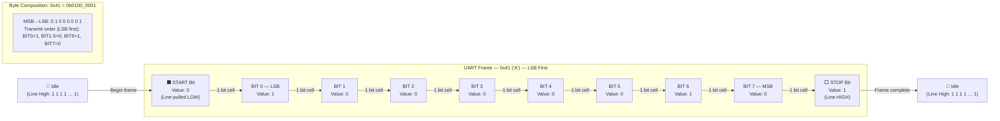
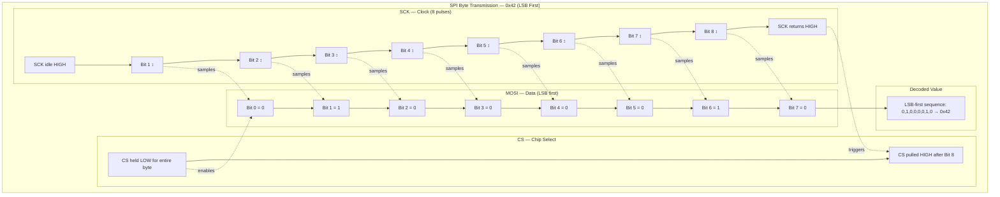

# Lesson 4: Communication Protocols

## 1. First-Principles Intuition & Invariants

The modern embedded system is not a monolithic computational island. It exists within an ecosystem of sensors, actuators, memory peripherals, network interfaces, and peer processors. Communication protocols form the nervous system through which these disparate components coordinate action, exchange state, and synchronize behavior across electrical boundaries that would otherwise remain silent. Understanding these protocols is not merely an academic exercise in standards compliance; it is the difference between a system that fails mysteriously under thermal stress, corruption, or asynchronous contention and one that operates with predictable reliability under real-world electrical chaos.

At the deepest level, every communication protocol solves a fundamentally hard problem: how do two or more electrical domains establish mutual agreement about the meaning and timing of voltage transitions when those domains may operate at different clock rates, experience different ground potentials, and endure electromagnetic interference from switching power supplies, motor drives, and radio transmitters? The answer lies in layering abstraction: at the physical layer, raw electrical signaling establishes a medium; at the data link layer, framing and error detection transform unreliable bit streams into discrete, validated messages; at higher layers, sequence numbers, retransmission policies, and state machines transform individual messages into reliable request-response conversations.

The taxonomy of embedded communication protocols divides naturally along dimensional lines. *Synchronous* protocols like SPI and parallel buses tie data transitions to a clock signal, allowing tight timing guarantees but at the cost of a dedicated clock line and deterministic latency. *Asynchronous* protocols like UART rely on agreed-upon baud rates and bit-cell timing rather than a shared clock, freeing a pin but introducing timing tolerance budgets and inter-device clock skew issues. *Arbitrated* protocols like I2C and CAN-bus use open-drain or differential signaling to allow multiple masters to contend for the medium, introducing collision resolution mechanisms but enabling true multidrop communication. *Packetized* protocols like USB and Ethernet structure communication into discrete frames with headers, checksums, and retransmission logic, enabling complex transaction types but adding protocol overhead and implementation complexity.

The physical layer—the voltage levels, impedance characteristics, and signal integrity requirements—forms the bedrock upon which all higher layers rest. A UART signal is simply a voltage swing between two levels (typically 0V and 3.3V or 5V) at a rate determined by the chosen baud rate. An SPI interface is a series of synchronous bit transfers where data and clock edges align within nanosecond tolerances. An I2C bus is a pair of open-drain lines (SCL and SDA) pulled to logic high through resistors, with devices sinking current to drive them low. A CAN-bus is a pair of differential lines (CAN_H and CAN_L) whose voltage difference encodes bit state. Each of these physical implementations introduces constraints, failure modes, and optimization opportunities that ripple upward through the protocol stack.

Error detection and correction form the second invariant across all practical protocols. In UART, a parity bit or two stop bits guard against single-bit corruption. In SPI, no inherent protection exists; integrity relies on application-level checksums or framing protocols layered atop. In I2C, clock stretching and repeated START conditions provide flow control but not error recovery. In CAN-bus, a 15-bit cyclic redundancy check (CRC) protects every frame, and nodes that detect errors transition to a fault-confinement state to prevent cascade failures. The choice of error mechanism—parity, checksum, CRC, or Hamming codes—reflects a tradeoff between detection capability, correction ability, and hardware or computational cost.

Timing and synchronization form the third invariant. Even in nominally synchronous protocols like SPI, the setup time (data valid before clock edge), hold time (data valid after clock edge), and propagation delay across PCB traces introduce constraints on maximum clock frequency and minimum chip-select timing. In asynchronous protocols, baud rate tolerance budgets accumulate across multiple bit cells: a 3% clock error on the transmitter and 3% on the receiver can compound to 6%, which over 10 bit cells of a typical UART frame consumes most of the available eye margin. In multi-master protocols like I2C and CAN, metastability (the possibility that a slave or receiver samples a signal in transition) becomes a silent failure mode that manifests only under specific timing conditions—a classic race condition that testing may never expose.

The state machine perspective reveals that every protocol, at some level, is a deterministic state machine transitioning between defined states based on external events (clock edges, data transitions, timeout expiration) and generating predictable outputs (voltage changes, interrupt signals, state register updates). An SPI master controller in "sending byte" state transitions to "byte complete" state when 8 clock pulses have elapsed. An I2C slave in "address matching" state transitions to "data transmission" state when its address is recognized. A CAN-bus node in "bus-off" state transitions back to "error-active" state only after correctly receiving 128 consecutive recessive bits. This state machine formalism allows rigorous analysis of protocol behavior, systematic debugging via state trace capture, and formal verification of protocol implementations.

## 2. Core Architecture & Mechanics

### 2.1 UART: Asynchronous Serial Foundations

The Universal Asynchronous Receiver-Transmitter represents the oldest and simplest practical serial protocol, yet remains ubiquitous in embedded systems for low-bandwidth debugging, bootloader communication, and legacy hardware integration. The word "asynchronous" is precise: there is no clock line. Instead, both transmitter and receiver maintain independent oscillators tuned to a common baud rate (bits per second), and the receiver exploits the rising or falling edge of the START bit to synchronize its internal sampling clock.

Consider the electrical picture. A UART transmitter drives a single line (TX) between two voltage levels: idle high (marking), and active low (spacing) during transmission. The receiver listens on its RX line. The simplest frame consists of one START bit (spacing, or zero), eight data bits (LSB first or MSB first, depending on convention), and one STOP bit (marking, or one). The receiver's job is to sample the RX line at approximately the center of each bit cell, accumulate eight samples into a received byte, validate the STOP bit, and deliver the byte to the application.

Here is the critical timing constraint: if the receiver's oscillator runs 3% slower than the transmitter's, then over the course of 10 bit times (1 START + 8 data + 1 STOP), the receiver's sampling clock drifts by 0.3 bit periods. Sampling at 3% error in the first bit produces acceptable uncertainty; but at bit 10, the receiver is sampling 30% into or out of the expected bit window. Most UART implementations allow ±2% to ±3% clock tolerance to guard against this drift. This is why baud rate selection matters: 9600 baud allows wider timing windows and greater tolerance for oscillator inaccuracy, while 115200 baud or higher demands tighter clock stability.

The receiver's architecture typically consists of a shift register, a baud-rate generator (dividing the system clock to produce sampling ticks at 8× or 16× the baud rate), and a state machine. Upon detecting a START bit (RX line goes low), the receiver initializes a counter and begins sampling on each clock tick. After 8 or 16 samples (depending on whether the implementation over-samples for noise immunity), the receiver asserts the bit value of the majority sample and shifts it into the receive shift register. After 8 data bits, it checks for the STOP bit. If the STOP bit is not detected at the expected time, a framing error is asserted.



The transmitter's task is the inverse: load a byte into the shift register, drive START low for one bit cell, shift out the 8 data bits (often LSB first for historical reasons stemming from telegraph technology), then drive STOP high for at least one bit cell. On many microcontroller UARTs, configurable options exist: 7 or 8 data bits, even/odd/no parity, 1 or 2 STOP bits. A parity bit, when enabled, is inserted between the data bits and STOP bit; it toggles so that the total number of ones across the byte plus parity is even (even parity) or odd (odd parity). Parity provides single-bit error *detection* only—if two bits flip, parity remains correct but the byte is corrupted.

The practical mechanics of UART integration into a microcontroller involve memory-mapped hardware registers. A typical UART peripheral occupies 4–8 32-bit registers. The data register (at offset 0x00) is written to transmit and read to receive. The status register (at offset 0x04) contains flags: TX_EMPTY (transmit buffer is empty and ready for new data), RX_FULL (receive buffer contains new data), TX_BUSY (transmitter is actively shifting out a frame), RX_BUSY (receiver is collecting bits), and error flags (FRAMING_ERROR, PARITY_ERROR, OVERFLOW). The baud rate register (at offset 0x08) holds the divisor that divides the system clock. On an STM32L476 running at 80 MHz wanting 115200 baud, the divisor is 80,000,000 / 115,200 ≈ 694 (0x2B6). The control register (at offset 0x0C) enables TX and RX, selects parity mode, configures interrupt generation, and enables the UART peripheral.

Here is a minimal C routine to initialize a UART peripheral and transmit a byte:

```c
// STM32L476 UART initialization at 115200 baud, 8N1 (8 data, no parity, 1 stop)
// Assume UART1 base address 0x40013800, system clock 80 MHz

#define UART1_BASE      0x40013800
#define UART_DR         (*(volatile uint32_t *)(UART1_BASE + 0x00))
#define UART_SR         (*(volatile uint32_t *)(UART1_BASE + 0x04))
#define UART_BRR        (*(volatile uint32_t *)(UART1_BASE + 0x08))
#define UART_CR1        (*(volatile uint32_t *)(UART1_BASE + 0x0C))

#define SR_TXNE         (1 << 7)  // Transmit data register not empty
#define SR_RXNE         (1 << 5)  // Receive data register not empty
#define SR_TC           (1 << 6)  // Transmission complete
#define CR1_TE          (1 << 3)  // Transmitter enable
#define CR1_RE          (1 << 2)  // Receiver enable
#define CR1_UE          (1 << 0)  // UART enable

void uart_init(void) {
    // Set baud rate to 115200: BRR = 80,000,000 / 115,200 = 694
    UART_BRR = 694;
    
    // Enable TX and RX, enable UART
    UART_CR1 |= (CR1_TE | CR1_RE | CR1_UE);
}

void uart_tx_byte(uint8_t byte) {
    // Wait until transmit register is empty
    while (!(UART_SR & SR_TXNE)) {
        // Spin until ready
    }
    // Write byte to data register; hardware shifts it out
    UART_DR = byte;
}

uint8_t uart_rx_byte(void) {
    // Wait until receive register has data
    while (!(UART_SR & SR_RXNE)) {
        // Spin until data arrives
    }
    // Read data register; hardware auto-advances to next byte
    return UART_DR;
}
```

In production code, spinning indefinitely is dangerous; a timeout mechanism prevents a crashed transmitter from deadlocking the receiver. More sophisticated implementations use interrupts: the UART peripheral asserts an interrupt when data arrives or transmit completes, allowing the processor to handle other work while the UART operates asynchronously.

### 2.2 SPI: Synchronous Bit Transfers and Clock Polarity

The Serial Peripheral Interface (SPI) is fundamentally a synchronous protocol: data transitions are coordinated with a shared clock signal (SCK). Unlike UART, SPI requires a dedicated clock line, but this synchronization allows much higher speeds (10 MHz to 100+ MHz on modern microcontrollers) with zero baud rate tolerance issues. SPI is the dominant protocol for high-speed memory access (flash chips, SD cards), sensor readout, and low-latency chip-to-chip communication.

The physical layer of SPI consists of four signals: SCK (serial clock), MOSI (master out, slave in—data from master to slave), MISO (master in, slave out—data from slave to master), and CS (chip select, active low, per-slave). The master controls the clock; on each SCK edge, a bit is transferred. The frame is typically 8 bits, but some protocols use 16 or 32 bits. The master drives MOSI and CS; slaves listen on MOSI and drive MISO as open-drain or push-pull outputs. When multiple slaves share a bus, only the slave with CS asserted drives MISO; all others tri-state their outputs to avoid contention.

The critical specification is the clock phase and polarity (CPOL and CPHA). These two bits define the exact timing at which data is sampled and shifted.

- **CPOL = 0**: SCK idles at logic 0 (low).
- **CPOL = 1**: SCK idles at logic 1 (high).
- **CPHA = 0**: Data is sampled on the leading (first) clock edge and shifted on the trailing (second) edge.
- **CPHA = 1**: Data is shifted on the leading edge and sampled on the trailing edge.

This produces four SPI modes (CPOL, CPHA): Mode 0 (0,0), Mode 1 (0,1), Mode 2 (1,0), Mode 3 (1,1). Both master and slave must agree on the mode or communication fails silently. Consider Mode 0 (CPOL=0, CPHA=0): SCK idles low. On the rising edge of SCK, the slave samples the MOSI line (reading one bit from the master) and the master samples the MISO line (reading one bit from the slave simultaneously). The data is shifted internally on the falling edge, preparing new data for the next rising edge. After 8 rising edges, one complete byte has been exchanged.

Here is a timing diagram for SPI Mode 0, transmitting 0x42 (0b01000010) from master to slave:



SPI has no inherent flow control or error detection. If the slave is busy and cannot serve data, the master has no way to know; it reads stale data. If electromagnetic noise flips a bit, neither master nor slave detects it. Therefore, protocols layered atop SPI often include application-level checksums (CRC) and request-acknowledgment patterns. For example, when reading a sensor register, the master may send a "read register 0x10" command, the slave responds with the register value plus a CRC, and the master validates the CRC before using the value.

The practical implementation on a microcontroller involves an SPI controller peripheral. The STM32L476 has multiple SPI ports; here is a minimal initialization and byte-exchange routine for SPI1 in Mode 0:

```c
#define SPI1_BASE       0x40013000
#define SPI_CR1         (*(volatile uint32_t *)(SPI1_BASE + 0x00))
#define SPI_CR2         (*(volatile uint32_t *)(SPI1_BASE + 0x04))
#define SPI_SR          (*(volatile uint32_t *)(SPI1_BASE + 0x08))
#define SPI_DR          (*(volatile uint32_t *)(SPI1_BASE + 0x0C))

#define CR1_CPOL        (1 << 1)   // Clock polarity
#define CR1_CPHA        (1 << 0)   // Clock phase
#define CR1_SPE         (1 << 6)   // SPI enable
#define CR1_MSTR        (1 << 2)   // Master mode
#define CR1_BR_SHIFT    3          // Baud rate bits [5:3]
#define SR_RXNE         (1 << 0)   // Receive not empty
#define SR_TXNE         (1 << 1)   // Transmit not empty
#define SR_BSY          (1 << 7)   // Bus busy

void spi_init(void) {
    // Configure SPI1 for Mode 0 (CPOL=0, CPHA=0), master, 80MHz/4 = 20MHz clock
    // BR bits [5:3] = 001 means divide by 4
    SPI_CR1 = (1 << CR1_BR_SHIFT) | CR1_MSTR | CR1_SPE;
    // (CPOL and CPHA default to 0)
}

uint8_t spi_exchange_byte(uint8_t tx_byte) {
    // Wait for TX buffer ready
    while (!(SPI_SR & SR_TXNE)) {
        // Spin
    }
    // Write byte; transmission begins immediately (slave simultaneously sends)
    SPI_DR = tx_byte;
    
    // Wait for RX buffer ready
    while (!(SPI_SR & SR_RXNE)) {
        // Spin
    }
    // Read received byte
    uint8_t rx_byte = SPI_DR;
    
    // Optionally wait for bus idle
    while (SPI_SR & SR_BSY) {
        // Spin
    }
    
    return rx_byte;
}

// Example: read 0x10 bytes of data from flash chip at address 0x000000
void flash_read_data(uint32_t address, uint8_t *buffer, uint16_t length) {
    // Assert chip select (CS) low - assume GPIO control
    CS_LOW();
    
    // Send read command (0x03) + 24-bit address
    spi_exchange_byte(0x03);  // Read instruction
    spi_exchange_byte((address >> 16) & 0xFF);
    spi_exchange_byte((address >> 8) & 0xFF);
    spi_exchange_byte(address & 0xFF);
    
    // Read 'length' bytes of data
    for (uint16_t i = 0; i < length; i++) {
        buffer[i] = spi_exchange_byte(0x00);  // Dummy byte; slave provides data
    }
    
    // De-assert chip select (CS) high
    CS_HIGH();
}
```

### 2.3 I2C: Open-Drain Arbitration and Clock Stretching

The Inter-Integrated Circuit (I2C) bus represents a departure from dedicated point-to-point links. Multiple devices (masters and slaves) share a single pair of wires: SCL (serial clock line) and SDA (serial data line). Both lines are open-drain outputs pulled to VCC through 4.7kΩ resistors (typical; 1–10 kΩ is common). Any device can pull a line low; all devices collectively determine the line state through wire-AND logic. When a device releases a line (tri-states its output), the pull-up resistor returns the line to high. This architecture enables collision detection and arbitration.

The I2C protocol operates at standardized clock rates: 100 kHz (standard mode), 400 kHz (fast mode), 1 MHz (fast mode plus), and 3.4 MHz (high speed). The master generates the clock by pulling SCL low, holding it for a time constant (defined by the bus capacitance and pull-up resistor), then releasing it and allowing the pull-up to return it high. A low SCL period might be 5 microseconds at 100 kHz, and a high period might also be 5 microseconds (50% duty cycle).

Data is transmitted LSB-first with one bit per clock cycle. The master pulls SDA low or high while SCL is low (data setup time is guaranteed), then releases SCL to allow it to go high. All devices (master and slaves) sample SDA while SCL is high (read window). After the sample window, SCL goes low again, and the transmitter (master or slave) changes SDA for the next bit. This scheme is called "level-triggered" sampling: the bit value is determined by the SDA level during the high period of SCK, not by an edge transition.

The **START condition** is a special signal: SDA transitions from high to low while SCL is high (violating the normal protocol rule that data changes only when SCL is low). This de-synchronizes all devices and prepares them to listen for an address. The **STOP condition** is SDA transitioning from low to high while SCL is high, ending the transaction.

After a START, the master transmits a 7-bit slave address followed by a read/write bit (R/W = 1 for read, R/W = 0 for write). Slaves compare this address to their own; if it matches, the slave acknowledges by pulling SDA low for one clock cycle (ACK). If the address does not match, the slave releases SDA (non-acknowledgment, NACK). After the address and R/W bit, the master or slave (depending on R/W) transmits data bytes. After each byte, the non-transmitting device acknowledges or NACs. This request-response symmetry makes I2C flexible: a master can write multiple bytes to a slave, or read multiple bytes from a slave, or perform a "repeated START"—a START condition without a preceding STOP—to switch direction without releasing the bus.

Here is a high-level state diagram for an I2C bus cycle:

```text
┌─────────────────┐
│  START Condition│  SDA: High→Low while SCL=High
└────────┬────────┘
         │
         ↓
┌─────────────────────────┐
│  7-bit Address (LSB 0)  │  Master transmits address; slave compares
└────────┬────────────────┘
         │
         ↓
┌─────────────────────────────┐
│ R/W Bit + Slave ACK/NAC     │  Slave pulls SDA low if address matched
└────────┬────────────────────┘
         │
         ├─────────────────────────────┐
         │                             │
         ↓ (if R/W=0, write)      ↓ (if R/W=1, read)
    ┌─────────────┐          ┌──────────────┐
    │Master sends │          │Slave sends   │
    │ data bytes  │          │ data bytes   │
    └────┬────────┘          └───────┬──────┘
         │                           │
         ↓                           ↓
    ┌─────────────┐          ┌──────────────┐
    │Slave ACKs   │          │Master ACKs   │
    │or NACs      │          │or NACs last  │
    └────┬────────┘          │byte (NAC to  │
         │                   │signal end)   │
         └─────────┬──────────┘
                   │
                   ↓
         ┌─────────────────┐
         │ STOP Condition  │  SDA: Low→High while SCL=High
         └─────────────────┘
```

Clock stretching is a powerful but often-overlooked I2C feature.

If the addressed slave cannot respond within the expected time—perhaps it is waiting for an internal operation to complete, or reading from slow non-volatile memory—it can hold SCL low after the master releases it, effectively pausing the transaction. The master must wait until the slave releases SCL before continuing. This mechanism allows slow peripherals to participate in I2C networks without requiring the master to know their internal timing characteristics in advance. However, clock stretching is not universally supported; some bit-banged implementations and certain I2C controllers do not honor it, leading to subtle failures when interfacing with slaves that rely on this feature. Engineers must verify hardware support and consult slave datasheets to determine whether clock stretching is necessary.

I2C's robustness stems from its START/STOP framing, address arbitration, and explicit acknowledgment protocol, but these same features impose overhead: every byte requires nine clock cycles (eight data bits plus one ACK/NACK), and bus capacitance limits practical speeds to 400 kHz in most embedded systems, with 3.4 MHz (high-speed mode) achievable only with careful PCB design and compatible devices. Multi-master arbitration—where two masters simultaneously transmit START conditions and compare transmitted bits—adds further complexity, though it is rarely used in practice. For applications requiring higher throughput or longer distances, SPI or differential protocols (CAN, RS-485) are more appropriate. I2C excels in moderate-speed, multi-drop sensor networks where simplicity, address-based selection, and two-wire topology outweigh speed constraints.

## Summary & Verification Matrix

| **Protocol** | **Core Invariant** | **Key Mechanism** | **Diagnostic Criteria** | **Failure Mode** |
|--------------|-------------------|-------------------|------------------------|------------------|
| **UART** | Each frame is independent; no clock synchronization beyond start bit edge detection. | Baud rate agreement (±2–5% tolerance); start bit (0) triggers 1× sampling at bit center; stop bit (1) re-arms receiver. | Oscilloscope: verify bit timing matches baud period; check idle-high, start-low, stop-high sequence. Logic analyzer: decode frames, verify parity. | Baud mismatch → framing errors (stop bit read as 0). Noise during start → false triggers. Clock drift → sampling skew, parity/framing errors. |
| **SPI** | Master generates clock; data sampled on one edge, shifted on the other. No inherent addressing—CS asserts target slave. | Four-wire (MOSI, MISO, SCK, CS); full-duplex; mode (CPOL/CPHA) defines clock polarity and phase. Multi-slave via separate CS lines or daisy-chain. | Oscilloscope: CS low → SCK toggles; MOSI/MISO transitions align with clock edges per mode. Logic analyzer: verify CPOL/CPHA, decode bytes, check CS setup/hold. | Mode mismatch → data sampled on wrong edge, corrupted reads. CS glitch → slave resets mid-transaction. Clock rate exceeds slave spec → setup/hold violations. |
| **I2C** | Bus is idle when both SDA and SCL are high (pull-up). START (SDA↓ while SCL high) claims bus; STOP (SDA↑ while SCL high) releases it. | Open-drain + pull-ups; 7-bit address + R/W bit; slave ACK (SDA low during 9th clock); clock stretching (slave holds SCL low to pause master). | Oscilloscope: verify START/STOP conditions, ACK (SDA low on 9th SCL pulse). Logic analyzer: decode address, check ACK/NACK, measure clock stretch duration. | Missing pull-ups → bus stuck low. Address conflict → multiple slaves ACK. No ACK → wrong address, slave offline, or clock stretch not honored. Fast rise time without series resistors → ringing, false edges. |
| **CAN** | Differential signaling (CAN_H, CAN_L); dominant (0) overrides recessive (1). Arbitration by ID: lowest ID wins without collision. | Bit stuffing (insert opposite bit after five identical); CRC + ACK + error frames. Termination resistors (120Ω) at both ends. | Oscilloscope: differential voltage ~2V (dominant), ~0V (recessive). CAN analyzer: verify bit rate, check stuffing, decode frames, monitor error counters. | Missing/incorrect termination → reflections, bit errors. Dominant stuck (short) → bus-off. Recessive stuck (open) → frame errors. Bit rate mismatch → ACK errors, error frames. |
