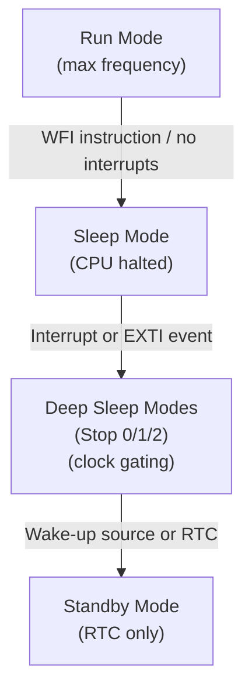

# Lesson 6: Power Management, Watchdog Timers, Safety-Critical Certification

## 1. First-Principles Intuition & Invariants

Power management in embedded firmware sits at the intersection of physics, electrical engineering, and real-time systems design. Unlike server-class computing where power is abundant and cooling is engineered infrastructure, embedded systems operate under harsh constraints: battery budgets measured in milliamp-hours, thermal envelopes constrained by package geometry and ambient conditions, and supply voltage margins that narrow as silicon geometries shrink. The watchdog timer—seemingly a simple peripheral—functions as a system-level sentinel against firmware pathology: infinite loops, memory corruption, or priority inversion that paralyzes the real-time kernel. Together, power management and fault detection form the backbone of reliable embedded systems, particularly in safety-critical domains where firmware failure cascades into physical harm.

The fundamental challenge is this: a microcontroller consuming active-mode current while performing useful work cannot simultaneously achieve the battery longevity demanded by remote IoT sensors, wearable devices, or unattended industrial monitors. The physics dictates a power consumption model:

$$P_{\text{active}} = C_{\text{eff}} \cdot V^2 \cdot f + I_{\text{leak}} \cdot V$$

where $C_{\text{eff}}$ is effective switched capacitance, $V$ is supply voltage, $f$ is clock frequency, and $I_{\text{leak}}$ is leakage current. This relationship reveals two orthogonal control levers: frequency and voltage scaling (dynamic power management) and clock gating or power domain shutdown (static power management). Modern embedded SoCs exploit both, creating power states ranging from full-clock execution to sub-threshold leakage-only retention modes.

The watchdog timer introduces a complementary concern: how does firmware prove liveness without explicit external probes? In real-time systems, a watchdog timer becomes the hardware oracle of software health. When firmware hangs—trapped in an infinite loop, deadlocked on a semaphore, or corrupted by a buffer overflow—only the watchdog timer can trigger deterministic recovery. The elegance lies in its simplicity: a counter that decrements on every system clock tick, triggering a system reset when it underflows to zero. Firmware must periodically "kick" (reload) the watchdog counter, proving forward progress. If the firmware cannot prove liveness, the system resets and recovers.

Safety-critical certification standards—DO-178C for avionics, IEC 61508 for industrial control, ISO 26262 for automotive—demand rigorous demonstration that firmware health monitoring and power transitions do not introduce failure modes. This lesson integrates all three threads: engineering the power state machine, implementing watchdog monitors that prove firmware liveness without false positives, and architecting firmware to survive certification audit.

---

## 2. Core Architecture & Mechanics

### 2.1 Power State Topologies and Hardware Mechanisms

Modern ARM Cortex-M microcontrollers expose power management through the ARM Power State Coordination Interface (PSCI) or simpler register-based state machines. The STMicroelectronics STM32 family exemplifies this design pattern. A typical power state hierarchy includes the following:

**Run Mode** represents active CPU execution at rated frequency and voltage. The ARM Cortex-M core fetches and executes instructions from flash or RAM, peripheral clocks are enabled, and the system consumes maximum active current (typically 10–50 mA for modern MCUs). Interrupt handling remains fully responsive; ISRs execute at their configured priority levels and return the CPU to Run mode.

**Sleep Mode** (also called Idle or Light Sleep) disables the CPU clock while keeping the system clock and peripheral clocks running. On ARM Cortex-M devices, the Sleep instruction (commonly exposed as `__WFI()` or "Wait For Interrupt") halts the CPU pipeline but leaves memory controllers and interrupt logic active. The CPU wakes on any unmasked interrupt, resuming execution at the instruction following the Sleep call. Current consumption drops by 50–70% compared to Run mode because the CPU's dynamic switching activity ceases, though peripheral clocks continue driving leakage. Wake latency is microseconds.

**Deep Sleep Mode** extends clock gating to the entire system clock domain. The high-speed oscillator (HSE) may shut down, the PLL powers off, and the core regulator voltage may scale down. Some microcontroller families support multiple deep sleep substates—for example, STM32H7 offers Sleep, Stop 0, Stop 1, and Stop 2 modes with escalating clock shutdown and voltage scaling. Current consumption in deep sleep can drop to 10–100 µA range. Waking requires oscillator startup delay (milliseconds) and PLL lock time, making this mode suitable for infrequent periodic tasks or event-driven systems.

**Standby Mode** (or Hibernate) retains only a small low-power oscillator (typically 32 kHz) and a battery-backed RAM island. The main CPU, flash memory, and most peripherals are powered down; only the real-time clock (RTC) continues ticking. Current consumption approaches leakage-only levels (1–10 µA). Wake latency is seconds due to oscillator startup and PLL relock. This mode is ideal for multi-day standby periods where the device must preserve state but consume minimal power.

The hardware state machine transitions between these modes through a combination of direct register writes and interrupt-driven events. Consider the STM32H745 dual-core MCU power state diagram:



Each transition involves precise register manipulation. For an STM32H7 device entering Stop 1 mode, firmware must:

1. Clear the Wake-up Pin Enable bits in the Power Control Register 1 (PWR_CR1) to disable external wake-up pins if not needed.
2. Set the Standby mode bits (LPDS, LPR, SVOS) in PWR_CR1 to configure voltage scaling and low-power regulator behavior.
3. Clear interrupt masks in the NVIC or configure External Interrupt Controller (EXTI) to define which events trigger wake-up.
4. Execute `SCB->SCR |= SCB_SCR_SLEEPDEEP_Msk` to signal the ARM core to enter deep sleep rather than light sleep.
5. Execute `__WFI()` to halt the CPU and allow the power management controller to initiate the mode transition.

Upon wake-up, the CPU resumes execution following the `__WFI()` instruction. The firmware must account for oscillator startup delay and re-initialize any peripheral clocks that were gated during sleep.

### 2.2 Voltage Scaling and Brownout Detection

Dynamic voltage and frequency scaling (DVFS) is a cornerstone of modern power management. The supply voltage and CPU frequency are coupled: lower frequencies tolerate lower voltages (within silicon physics constraints), and this relationship determines achievable power savings. The fundamental tradeoff is expressed through voltage-frequency operating points, or "corners":

$$f_{\max} = k \cdot (V - V_t)^2 / V$$

where $k$ is a process-dependent constant, $V$ is supply voltage, and $V_t$ is transistor threshold voltage. At 1.8V, an MCU might support 48 MHz; at 3.3V, the same silicon achieves 180 MHz. Firmware can dynamically reduce frequency—and simultaneously scale the regulator voltage down—to meet real-time deadlines while minimizing energy consumption during low-utilization periods.

The challenge emerges when supply voltage fluctuates due to load transients, battery discharge, or environmental stress. Brownout detection (BOD) is a comparator-based circuit that monitors the supply rail and signals when voltage drops below a programmable threshold. If firmware does not intervene, a continued voltage sag can cause logic glitches, bit flips in memory, or CPU pipeline corruption—catastrophic failure modes in safety-critical systems.

STM32H7 microcontrollers integrate a Programmable Voltage Detector (PVD) that allows firmware to set a detection level between 1.95V and 3.6V (in 100 mV steps). When the supply crosses the threshold, the PVD raises an interrupt, allowing firmware to:

1. Reduce CPU frequency and voltage scaling to lower power consumption and reduce transient load on the regulator.
2. Suspend non-critical tasks and shut down peripherals to reduce switching activity.
3. Log fault telemetry for post-mortem analysis.
4. If voltage continues falling, enter safe shutdown or initiate controlled firmware state preservation.

A typical brownout handler on ARM Cortex-M might look like this:

```c
#include "stm32h745xx.h"

volatile uint32_t brownout_events = 0;

void PVD_IRQHandler(void)
{
    /* Read the PVD Status Register to confirm interrupt source */
    if (PWR->SR2 & PWR_SR2_PVDO) {
        /* Voltage has crossed below the PVD threshold */
        brownout_events++;
        
        /* Immediately reduce CPU frequency to lower power draw */
        RCC->CFGR &= ~RCC_CFGR_SW_Msk;
        RCC->CFGR |= RCC_CFGR_SW_HSI;  /* Switch to HSI (16 MHz) */
        while ((RCC->CFGR & RCC_CFGR_SWS_Msk) != RCC_CFGR_SWS_HSI);
        
        /* Scale down core voltage */
        PWR->CR1 &= ~PWR_CR1_SVOS_Msk;
        PWR->CR1 |= (0x1U << PWR_CR1_SVOS_Pos);  /* SVOS = 1 (lower voltage) */
        
        /* Signal application-level power management */
        g_system_flags |= SYS_FLAG_BROWNOUT_DETECTED;
    }
    
    PWR->CR2 |= PWR_CR2_PVDC;  /* Clear interrupt flag */
}

void init_brownout_detection(void)
{
    /* Enable PWR clock */
    RCC->APB1LENR |= RCC_APB1LENR_PWREN;
    
    /* Configure PVD level: 3.0V threshold (mid-range) */
    PWR->CR2 &= ~PWR_CR2_PVD_Msk;
    PWR->CR2 |= (0x3U << PWR_CR2_PVD_Pos);  /* PVD_LEV = 3 */
    
    /* Enable PVD interrupt */
    PWR->CR2 |= PWR_CR2_PVDE;
    
    /* Configure and enable NVIC */
    NVIC_SetPriority(PVD_IRQn, 1);  /* High priority */
    NVIC_EnableIRQ(PVD_IRQn);
}
```

The interrupt must execute with high priority to prevent lower-priority tasks from consuming current during voltage stress. After recovery, firmware can gradually restore frequency and voltage as the supply stabilizes.

### 2.3 Watchdog Timer Fundamentals and Liveness Proofs

The watchdog timer is a decrementing counter clocked by a low-frequency oscillator (often the LSI, 32 kHz, independent of main system clocks). Firmware periodically reloads the counter via a register write; if the counter reaches zero without being reloaded, the watchdog asserts a system reset signal. The elegance is architectural: the watchdog cannot be disabled once enabled (on most safety-critical MCUs), forcing firmware to prove liveness periodically.

Consider a typical STM32 Independent Watchdog (IWDG) configuration:

```c
#include "stm32h745xx.h"

/* IWDG timeout constants */
#define IWDG_TIMEOUT_MS  1000  /* 1 second watchdog period */
#define LSI_FREQ_HZ      32000 /* LSI oscillator frequency */

void init_independent_watchdog(void)
{
    /* Unlock IWDG Key Register for configuration */
    IWDG->KR = IWDG_KEY_ENABLE;  /* 0xCCCC */
    
    /* Set prescaler: IWDG_PR = 2 (divider = 4) */
    /* Counter frequency = 32000 / 4 = 8000 Hz */
    IWDG->PR = 0x1U;  /* PR[2:0] = 001 means divider of 4 */
    
    /* Calculate reload value for 1-second timeout */
    /* Reload = (timeout_ms * freq_hz) / (1000 * prescaler) */
    /* Reload = (1000 * 8000) / 1000 = 8000 */
    uint16_t reload_value = (IWDG_TIMEOUT_MS * (LSI_FREQ_HZ / 4)) / 1000;
    IWDG->RLR = reload_value;  /* Write reload register */
    
    /* Lock IWDG registers */
    IWDG->KR = IWDG_KEY_RELOAD;  /* 0xAAAA */
    
    /* Enable watchdog */
    IWDG->KR = IWDG_KEY_ENABLE;  /* Write enable key again */
}

void kick_watchdog(void)
{
    /* Reload the counter to prevent reset */
    IWDG->KR = IWDG_KEY_RELOAD;  /* 0xAAAA */
}
```

The watchdog timeout is fixed at initialization and cannot be changed without a full system reset. This immutability is intentional: it prevents firmware bugs from disabling the watchdog under stress conditions. The reload value must be chosen to balance two competing demands: long enough that normal tasks can complete without timeout, but short enough to detect genuine hangs within acceptable recovery time.

A common mistake is kicking the watchdog too frequently, which masks stalls in lower-priority tasks. The correct pattern is to kick the watchdog only at predictable checkpoints in the main scheduler loop or from a periodic interrupt handler that ensures the entire system is responsive:

```c
void main_scheduler(void)
{
    while (1) {
        /* Execute critical real-time task */
        execute_safety_critical_task();
        
        /* Check if all required tasks executed */
        if (system_health_check_passed()) {
            kick_watchdog();  /* Only kick if all checks pass */
        } else {
            /* Do not kick; allow watchdog to reset */
            while (1);  /* Hang and wait for reset */
        }
    }
}
```

The watchdog ISR (if enabled as an interrupt rather than a reset) provides a final opportunity for controlled shutdown:

```c
void IWDG_IRQHandler(void)
{
    /* Log watchdog event to persistent memory */
    fault_log_entry_t entry;
    entry.fault_type = FAULT_WATCHDOG_TIMEOUT;
    entry.timestamp = get_system_time();
    entry.stack_pointer = __get_MSP();
    persist_fault_log(&entry);
    
    /* Initiate controlled shutdown sequence */
    disable_all_peripherals();
    shutdown_power_domains();
    
    /* Enter standby waiting for external reset */
    __WFI();
}
```

### 2.4 Clock Gating and Power Domain Isolation

Beyond CPU sleep modes, embedded systems achieve power efficiency through fine-grained clock gating: selectively disabling clocks to unused peripheral modules. An ARM Cortex-M4 MCU might integrate an ADC, multiple UARTs, SPI controllers, timers, and crypto accelerators. If the application uses only UART0 and Timer2, clocks to the ADC, SPI, crypto, and unused UARTs can be gated, eliminating their switching power contribution.

Gating peripheral clocks in STM32 devices is accomplished through the Reset and Clock Controller (RCC) enable registers. For example, to gate the ADC1 clock on an STM32H7:

```c
/* Disable ADC1 clock in AHB2 domain */
RCC->AHB2ENR &= ~RCC_AHB2ENR_ADC12EN;
```

The peripheral remains in reset state and consumes only leakage current. To re-enable the peripheral, firmware must release the reset:

```c
/* Enable ADC1 clock */
RCC->AHB2ENR |= RCC_AHB2ENR_ADC12EN;

/* Release ADC from reset */
RCC->AHB2RSTR |= RCC_AHB2RSTR_ADC12RST;
RCC->AHB2RSTR &= ~RCC_AHB2RSTR_ADC12RST;

/* Reinitialize ADC configuration registers */
init_adc1();
```

Power domain isolation extends clock gating further: on heterogeneous SoCs (multi-core or mixed-signal MCUs), independent power domains can be powered down entirely, removing leakage current. ARM Cortex-M52 and newer cores support this through the ARM Power State Coordination Interface (PSCI). A domain power-down sequence typically involves:

1. Flushing caches if applicable (ensure coherency).
2. Disabling the domain clock.
3. Asserting the domain power-down request to the power controller.
4. Waiting for the domain to reach the target power state (status register poll or interrupt).

Once a domain is powered down, any memory within that domain becomes inaccessible; firmware must ensure no code or data references exist within the powered-down region.

---

## 3. High-Performance Optimization, Failure Modes, and Safety-Critical Certification

### 3.1 Watchdog Timeout Boundary Conditions and False Positives

Selecting the watchdog timeout is a complex optimization problem. If the timeout is too aggressive (e.g., 100 ms), legitimate system congestion during high interrupt load or cache thrashing can trigger spurious resets, making the watchdog counterproductive. If the timeout is too lenient (e.g., 10 seconds), genuine firmware hangs persist for unacceptable durations, violating real-time safety requirements.

The solution involves profiling the worst-case latency of the scheduler tick. In a real-time kernel, the main loop should complete at a predictable rate—for example, a 1 kHz tick in a robotics controller or a 10 Hz tick in an industrial PLC. Firmware should kick the watchdog only after the tick completes successfully. If the tick takes longer than the watchdog period, the watchdog will fire.

To calculate the required timeout, measure the maximum latency from one scheduler invocation to the next under full system load. Capture this using a GPIO toggle and oscilloscope:

```c
void scheduler_tick_hook(void)
{
    GPIO_PIN_HIGH(DEBUG_WATCHDOG_PIN);  /* Toggle at tick start */
    
    /* Execute all periodic tasks */
    for (task_index = 0; task_index < NUM_TASKS; task_index++) {
        execute_task(task_index);
    }
    
    /* Check health */
    if (all_tasks_completed && no_priorities_inverted()) {
        kick_watchdog();
    }
    
    GPIO_PIN_LOW(DEBUG_WATCHDOG_PIN);   /* Toggle at tick end */
}
```

Measure the GPIO duty cycle under worst-case load (all tasks active, peak interrupt rate). Add a safety margin—typically 10–20%—and set the watchdog timeout accordingly. For a system where the scheduler tick averages 5 ms with worst-case jitter of 8 ms, a 12 ms timeout would be unsafe (false positives). A 25 ms timeout provides 17 ms margin, ensuring benign congestion does not trigger resets.

Another subtle failure mode arises when interrupt handlers run to completion but prevent the scheduler from reaching the watchdog kick point. Consider this scenario:

```c
void UART_ISR(void)
{
    /* Process incoming bytes */
    while (UART->SR & UART_SR_RXNE) {
        uint8_t byte = UART->DR;
        ringbuffer_write(&rx_buffer, byte);
    }
}

void main_loop(void)
{
    while (1) {
        /* If UART ISR constantly fires, this never executes */
        process_application_logic();
        kick_watchdog();  /* Never reached during heavy UART traffic */
    }
}
```

The watchdog will timeout even though the system is actively processing. The remedy is to kick the watchdog from a periodic timer interrupt at a frequency lower than the watchdog period, or to restructure the main loop to guarantee reaching the kick point even under interrupt load:

```c
void system_tick_interrupt(void)
{
    /* This ISR has higher priority than UART ISR */
    /* Runs every 5 ms */
    if (system_health_valid()) {
        kick_watchdog();
    }
}

void main_loop(void)
{
    while (1) {
        /* Can be interrupted, but timer tick still kicks watchdog */
        process_application_logic();
    }
}
```

### 3.2 Power State Transitions and Coherency Hazards

Transitioning between power states involves careful sequencing to avoid incoherent chip state. A common hazard arises when firmware modifies peripheral configuration before entering sleep, expecting the configuration to persist across the sleep and wake cycle. On some MCUs, certain peripheral registers are cleared or reset upon wake, leading to subtle configuration loss:

```c
/* INCORRECT: Assumes SPI configuration persists across sleep */
SPI1->CR1 |= SPI_CR1_SPE;  /* Enable SPI */
SPI1->DR = 0xAA;           /* Transmit 0xAA */

/* Enter Stop mode */
PWR->CR1 |= PWR_CR1_LPDS;
__WFI();

/* After wake, SPI may be disabled or configuration lost */
while (!(SPI1->SR & SPI_SR_TXE));  /* Hangs: SPI never clears TXE */
```

The correct pattern is to save peripheral state before sleep and restore after wake:

```c
/* Save SPI configuration */
uint32_t spi_cr1_saved = SPI1->CR1;
uint32_t spi_cr2_saved = SPI1->CR2;

/* Transmit data */
SPI1->CR1 |= SPI_CR1_SPE;
SPI1->DR = 0xAA;

/* Enter Stop mode */
PWR->CR1 |= PWR_CR1_LPDS;
__WFI();

/* Restore SPI configuration */
SPI1->CR1 = spi_cr1_saved;
SPI1->CR2 = spi_cr2_saved;

/* Continue operation */
```

A more insidious hazard occurs with CPU instruction caches. When the CPU clock is gated, cache coherency guarantees may lapse. If firmware resumes execution from cached instructions after a deep sleep that powered down L1 cache, stale instructions may be fetched:

```c
/* Flush and invalidate caches before deep sleep on ARM Cortex-M7 */
__ISB();  /* Instruction Synchronization Barrier */
__DSB();  /* Data Synchronization Barrier */
SCB_InvalidateICache();
SCB_InvalidateDCache();

/* Enter Stop mode */
__WFI();

/* Synchronization barriers after wake */
__ISB();
__DSB();
```

### 3.3 Voltage Scaling Timing and Transient Response

When firmware scales the core voltage down during a brownout event, the regulator must transition smoothly without introducing ripple that would corrupt logic state. Most modern MCUs with integrated Low Dropout (LDO) regulators handle this internally, but external supply designs require careful Layout consideration and decoupling capacitor sizing.

The transition timing is critical: firmware must reduce CPU frequency *before* reducing voltage, because lower voltage may not support the current frequency margin. The sequence must be:

1. **Reduce CPU frequency**: Switch to a lower-frequency clock source or reduce PLL multiplier.
2. **Wait for frequency change to settle** (typically a few microseconds; PLL lock time dominates).
3. **Reduce voltage** via regulator control register or via an external GPIO-controlled voltage divider.
4. **Wait for voltage regulation to settle** (typically milliseconds depending on load transient).
5. **Only then reduce frequency further if needed**.

```c
void scale_down_during_brownout(void)
{
    /* Step 1: Switch to HSI (16 MHz, lower frequency) */
    RCC->CFGR &= ~RCC_CFGR_SW_Msk;
    RCC->CFGR |= RCC_CFGR_SW_HSI;
    while ((RCC->CFGR & RCC_CFGR_SWS_Msk) != RCC_CFGR_SWS_HSI);
    
    /* Step 2: Small delay for frequency to settle */
    for (volatile int i = 0; i < 100; i++);
    
    /* Step 3: Reduce core voltage */
    PWR->CR1 &= ~PWR_CR1_SVOS_Msk;
    PWR->CR1 |= (0x1U << PWR_CR1_SVOS_Pos);  /* Scale voltage */
    
    /* Step 4: Wait for voltage to stabilize */
    /* Poll regulator status register or sleep briefly */
    for (volatile int i = 0; i < 1000; i++);
    
    /* Step 5: Optionally reduce frequency further via prescaler */
    RCC->CFGR |= RCC_CFGR_HPRE_DIV4;  /* AHB prescaler = 4 */
}
```

Reversing the scale-up process must follow the inverse order: increase voltage first, then increase frequency.

### 3.4 MISRA-C Compliance in Power Management Code

Safety-critical embedded systems typically mandate MISRA-C conformance, a coding standard that eliminates entire categories of undefined behavior. Power management code is particularly susceptible to MISRA violations because it involves hardware register manipulation, timing-dependent operations, and edge cases.

Common MISRA violations in watchdog and power management code include:

**Rule 2.4: Bitwise Operations on Signed Integers**. Watchdog reload values should be `uint16_t`, not `int`:

```c
/* MISRA violation */
IWDG->RLR = 8000;  /* Signed literal, implicit conversion */

/* Compliant */
IWDG->RLR = 8000U;  /* Unsigned literal */
```

**Rule 10.1: Implicit Type Conversions in Expressions**. When checking power state register flags:

```c
/* MISRA violation */
if (PWR->SR2 & 0x100) {  /* Mixing int (0x100) with uint32_t (PWR->SR2) */
```
