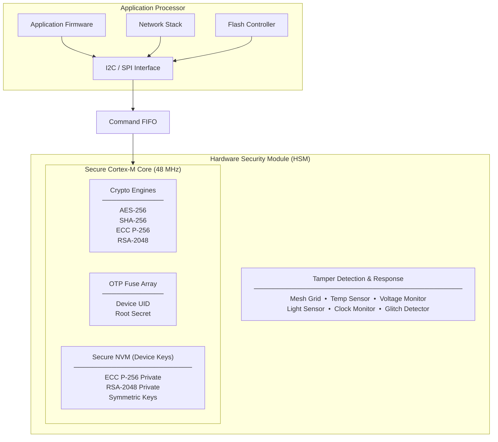
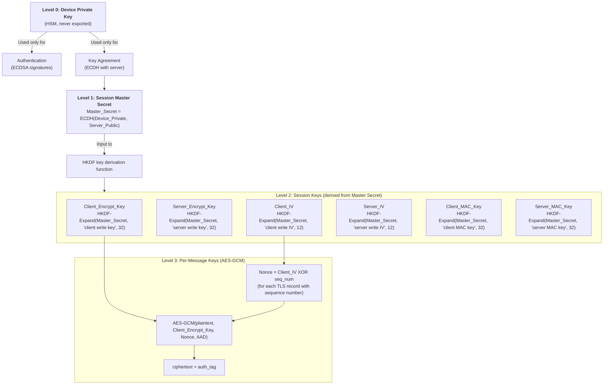
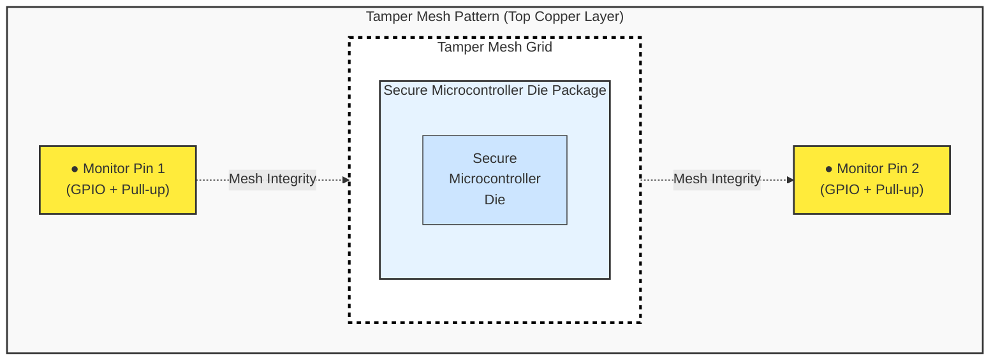

# Lesson 5: IoT Security Architectures

## 1. First-Principles Intuition & Invariants

The security architecture of an Internet of Things deployment differs fundamentally from enterprise IT security in one critical dimension: physical accessibility. While a datacenter server rack sits behind badge readers, reinforced doors, and armed guards, an IoT sensor node monitoring soil moisture in a remote agricultural field becomes a physical attack vector the moment an adversary drives to the installation site with a screwdriver and a logic analyzer. This accessibility gap forces embedded security architects to operate under the assumption that every device will eventually fall into hostile hands, where voltage glitching attacks, firmware extraction via JTAG, and side-channel analysis become trivial weekend projects for motivated attackers.

The security invariants that emerge from this threat model revolve around defense-in-depth layering across three physical domains: the silicon itself through hardware security modules and trusted execution environments, the firmware through cryptographic boot chains and authenticated update mechanisms, and the network transport through end-to-end encryption with forward secrecy. Each layer must operate under the paranoid assumption that every other layer has already been compromised, creating redundant security boundaries that force attackers to chain multiple sophisticated exploits rather than relying on a single vulnerability.

At the silicon level, the root of trust begins with immutable boot ROM burned into one-time programmable fuses during chip fabrication. This boot ROM contains the manufacturer's public key hash and the first-stage bootloader verification logic, creating a cryptographic anchor that cannot be modified even by attackers with physical access and unlimited time. When the microcontroller powers on, the CPU's reset vector jumps immediately into this immutable ROM, which computes a SHA-256 hash of the second-stage bootloader stored in flash memory and verifies an RSA-2048 or ECDSA P-256 signature against the burned-in public key. If signature verification fails, the boot process halts immediately, rendering the device inoperable but preventing execution of attacker-modified firmware.

This secure boot chain extends through multiple stages: the second-stage bootloader verifies the application firmware signature, the application firmware verifies dynamically loaded modules, and the runtime system verifies over-the-air update packages before committing them to flash. Each verification step uses cryptographic keys stored in hardware security modules that expose signing operations through restricted APIs but never allow direct key extraction. The HSM itself typically consists of a separate secure microcontroller with its own CPU, RAM, and non-volatile storage, communicating with the application processor only through a tightly constrained command interface that performs signature generation, verification, and key derivation operations while maintaining key material in isolated memory that cannot be accessed even by the main processor's DMA controllers.

Device authentication in large-scale IoT deployments cannot rely on shared secrets or password-based schemes, because a single compromised device would immediately compromise the credentials protecting thousands of peer devices. Instead, modern IoT architectures leverage asymmetric cryptography with per-device unique key pairs generated during manufacturing and provisioned into hardware security modules before devices leave the factory floor. The private key never leaves the HSM, while the corresponding public key gets uploaded to the device management backend and associated with the device's unique identifier in a certificate authority database. When the device first connects to the cloud infrastructure, it proves identity by signing a random challenge nonce with its private key; the backend verifies this signature using the registered public key, establishing mutual authentication without ever transmitting secret key material across the network.

The public key infrastructure supporting this authentication model mirrors the X.509 certificate hierarchies used in web browsers, but with critical modifications for the resource constraints and operational realities of embedded systems. A typical IoT PKI consists of a root certificate authority that operates entirely offline in a hardware security module stored in a bank vault, an intermediate CA that signs device certificates and operates in the secure manufacturing facility, and millions of leaf certificates burned into individual devices during production. The root CA's private key signs the intermediate CA's certificate once during initial deployment, then gets locked away and never connected to any network; the intermediate CA signs device certificates continuously during manufacturing but operates in an air-gapped facility with strict physical access controls. This layered trust model ensures that even if the intermediate CA gets compromised, the attacker cannot issue fraudulent certificates for arbitrary device identities without also compromising the offline root CA.

Certificate revocation in IoT systems presents unique challenges compared to traditional PKI deployments, because battery-powered sensors in remote locations cannot maintain continuous network connectivity to check Certificate Revocation Lists or query OCSP responders before every connection attempt. Instead, IoT certificate architectures typically use short certificate lifetimes measured in days or weeks rather than years, combined with aggressive certificate rotation during regular firmware update cycles. When a device connects to the backend, the server checks the certificate's expiration timestamp and the device's revocation status in its local database, rejecting connections from devices whose certificates have expired or been explicitly revoked. The device receives a fresh certificate during the authenticated session, extending its operational lifetime for another rotation period. This approach trades increased certificate management complexity for elimination of the real-time revocation checking problem that plagues traditional PKI deployments.

Encryption protecting data in transit must account for the asymmetric resource constraints between IoT devices and cloud backends: a sensor node with a 48 MHz ARM Cortex-M0+ processor and 32 KB of RAM cannot afford the computational overhead of RSA handshakes and AES-GCM encryption at the same throughput rates as a datacenter server with 64-core Xeon processors and terabytes of memory. Modern IoT protocols therefore leverage elliptic curve cryptography for key exchange, because ECC provides equivalent security to RSA at much smaller key sizes—a 256-bit ECC key offers approximately the same security as a 3072-bit RSA key, reducing both the computational cost of cryptographic operations and the bandwidth overhead of transmitting keys and signatures over constrained wireless links.

The TLS 1.3 handshake adapted for IoT environments typically uses ECDHE (Elliptic Curve Diffie-Hellman Ephemeral) key exchange with the P-256 curve, establishing a shared secret between device and server without ever transmitting the secret across the network. The device generates an ephemeral private key scalar, multiplies it by the curve's generator point to compute the corresponding public key point, and transmits this public key to the server. The server performs the same operation with its own ephemeral private key, transmits its public key to the device, then multiplies the received device public key by its private scalar to compute the shared secret point. The device performs the reciprocal multiplication—server public key times device private scalar—arriving at the identical shared secret point due to the commutative property of elliptic curve point multiplication. Both parties then derive symmetric encryption keys from this shared secret using a key derivation function like HKDF, establishing a secure channel for bulk data encryption using AES-128 in GCM mode.

Forward secrecy emerges naturally from this ephemeral key exchange pattern: because both device and server generate fresh random private keys for each new connection and immediately discard them after deriving session keys, an attacker who compromises a device's long-term authentication private key cannot retroactively decrypt previously captured network traffic. The ephemeral keys that actually protected past sessions no longer exist, having been securely erased from volatile RAM when the sessions terminated. This property proves critical for IoT deployments in hostile environments, where attackers can capture months of encrypted network traffic and later gain physical access to devices, extracting authentication keys through voltage glitching or firmware extraction attacks. Without forward secrecy, this single key compromise would immediately decrypt the entire historical traffic capture; with forward secrecy, the attacker gains only the ability to impersonate the device in future connections, not to decrypt past communications.

Encryption at rest protects data stored in non-volatile memory against extraction attacks when adversaries gain physical access to devices. A naive approach might use AES-256 to encrypt the entire flash memory contents with a key stored in the same flash, but this provides zero security because the attacker simply reads both the encrypted data and the encryption key from flash during the same extraction operation. Proper encryption at rest architectures instead derive storage encryption keys from secrets that exist only in hardware security modules and cannot be directly read even by attackers with full control over the main application processor.

The key derivation pattern typically starts with a device-unique secret burned into one-time programmable fuses during manufacturing, combined with a key derivation function like HKDF to generate filesystem encryption keys. The HSM exposes an API that accepts a context identifier and returns the corresponding derived key, but critically, it never allows direct readout of the root secret used as the HKDF input keying material. When the application firmware needs to encrypt a flash sector, it calls the HSM with a context identifier computed from the sector number, receives back a sector-specific encryption key, uses that key to encrypt the sector contents with AES-XTS, then immediately erases the encryption key from volatile RAM. Reading the sector later repeats the derivation process, calling the HSM with the same context identifier to regenerate the identical encryption key.

This architecture ensures that even if an attacker extracts the entire contents of flash memory and the complete application firmware image, they cannot decrypt the stored data without also extracting the OTP fuse values from the HSM—an operation that typically requires decapsulating the chip, exposing the silicon die, and using a focused ion beam workstation to physically read individual transistor states. Such attacks cost tens of thousands of dollars and consume days of lab time, placing them beyond the capability threshold of most adversaries and forcing attackers to target higher-value devices rather than commodity IoT sensors.

Zero-trust architecture principles, originally developed for enterprise cloud security, translate into IoT environments as the axiom that no device trusts any other device or backend service by default, regardless of network topology or prior authentication history. Traditional IoT security models often create implicit trust boundaries: devices on the same local network trust each other, devices that successfully authenticated once remain trusted for extended periods, and backend services implicitly trust devices that present valid certificates. Zero-trust architectures systematically eliminate these trust assumptions, requiring continuous verification of identity and authorization for every network transaction.

In a zero-trust IoT deployment, a temperature sensor attempting to publish a reading to an MQTT broker must authenticate the broker's identity by verifying its X.509 certificate chain back to a trusted root CA, encrypt the message payload end-to-end so that not even the MQTT broker can read the plaintext sensor data, and prove its own identity by signing the message with its device private key. The backend service receiving the temperature reading verifies the device signature, checks the device's authorization scope to ensure it has permission to publish temperature data for its registered location, validates that the reading's timestamp falls within acceptable clock skew bounds, and only then processes the measurement into the time-series database. This verification happens on every single message, not just during initial connection establishment, because zero-trust assumes that even previously authenticated devices may have been compromised between messages.

Attack surface analysis for IoT systems requires enumerating every possible interaction point between the device and its environment, treating each interface as a potential avenue for adversary exploitation. The physical attack surface includes debug ports like JTAG and UART, external flash memory chips that can be desoldered and read offline, power supply pins that enable voltage glitching attacks, and even electromagnetic emanations that leak cryptographic key bits during AES computations. The network attack surface encompasses every protocol the device implements: TCP/IP network stacks vulnerable to malformed packet injection, TLS implementations susceptible to timing side-channels in RSA padding verification, and application protocols like MQTT or CoAP that may process attacker-controlled message payloads without sufficient input validation.

Threat modeling transforms this attack surface enumeration into a structured analysis of adversary capabilities, motivations, and likely attack paths. The STRIDE methodology provides a systematic framework for IoT threat modeling by categorizing threats into six classes: Spoofing attacks that impersonate legitimate devices, Tampering attacks that modify firmware or data in transit, Repudiation attacks that allow devices to deny their actions, Information Disclosure attacks that leak sensitive data through side-channels, Denial of Service attacks that prevent devices from performing their intended functions, and Elevation of Privilege attacks that allow unprivileged code to execute with kernel or secure monitor privileges.

For a concrete example, consider a smart door lock deployed in a residential building. Spoofing threats include an attacker cloning the lock's identity certificates to create a rogue device that appears legitimate to the building management system, or an attacker capturing the RFID badge credentials transmitted during unlock operations and replaying them later. Tampering threats include physically opening the lock case to connect a JTAG debugger and extract the firmware, modifying the firmware to bypass authentication checks, and reflashing the modified firmware back to the device. Information disclosure threats include side-channel attacks that observe power consumption patterns during cryptographic operations to extract encryption keys, and network sniffing attacks that capture encrypted unlock commands and attempt to break the encryption offline.

Denial of service threats against the smart lock span both physical and network domains: an attacker could jam the 2.4 GHz ISM band to prevent the lock from communicating with the backend authentication service, physically damage the lock mechanism with a hammer, or flood the lock with malformed unlock requests that crash the embedded firmware and require a manual reboot. Elevation of privilege threats focus on exploiting software vulnerabilities to gain unauthorized capabilities, such as finding a buffer overflow in the unlock command parser that allows arbitrary code execution, or exploiting a race condition in the secure boot process that allows unsigned firmware to execute before signature verification completes.

## 2. Core Architecture & Mechanics

The hardware security module at the foundation of IoT security architectures typically implements a complete secure microcontroller system with its own CPU core, SRAM, non-volatile key storage, and cryptographic accelerators, all integrated into a single tamper-resistant package that actively detects and responds to physical attacks. The architecture diagram for a representative HSM like the NXP EdgeLock SE050 illustrates the isolation boundaries:



The application processor communicates with the HSM exclusively through a narrow command interface, typically implemented as an I2C or SPI serial bus running at a few megahertz. The application sends command APDUs (Application Protocol Data Units) that specify cryptographic operations like "generate ECDSA signature over this SHA-256 digest using key slot 0x42" or "derive AES key using HKDF with this context string." The HSM validates the command structure, performs access control checks to verify the requesting application has permission to use the specified key slot, executes the cryptographic operation using its internal accelerators, and returns the result. Critically, the HSM never returns the private key itself—only the outputs of operations performed with that key.

The secure boot implementation leverages this HSM architecture to create an immutable root of trust. When the microcontroller powers on, the CPU reset vector points to boot ROM physically located in the HSM itself, not in the application processor's flash memory. This first-stage bootloader code executes entirely within the HSM's isolated environment:

```
First-Stage Bootloader (Immutable ROM in HSM):

1. Initialize HSM hardware: configure clock trees, enable crypto engines
2. Read Device UID from OTP fuses → device_uid
3. Compute Boot Measurement: SHA-256 hash of entire flash contents → measurement
4. Load Second-Stage Bootloader from flash offset 0x0000 → bootloader_image
5. Load Bootloader Signature from flash offset 0x8000 → signature
6. Verify Signature:
   ECDSA_Verify(signature, measurement, PUBLIC_KEY_FUSE) → valid/invalid
7. If valid:
   - Set Secure Boot Success Flag
   - Transfer execution to bootloader_entry_point
8. If invalid:
   - Set Secure Boot Failure Flag
   - Halt CPU (infinite loop, refuse to execute)
   - Optionally: Increment tamper counter in NVM
```

The public key used for signature verification lives in OTP fuses programmed during chip manufacturing, creating a trust anchor that cannot be modified without physically destroying the chip. The signature itself covers a SHA-256 hash of the entire bootloader image, not just a header or metadata section, ensuring that even single-bit modifications to the bootloader code will cause signature verification to fail.

The second-stage bootloader follows an identical verification pattern before loading the application firmware, creating a chain of trust that extends through every software layer:

```
Second-Stage Bootloader (Verified by First-Stage):

1. Initialize application peripherals: UART, GPIO, flash controller
2. Compute Application Firmware Measurement: SHA-256 of firmware partition
3. Load firmware signature from dedicated flash sector
4. Request HSM to verify signature using device-specific key:
   HSM_Command(VERIFY_SIGNATURE, firmware_hash, signature, KEY_SLOT_APP)
5. If HSM returns SUCCESS:
   - Configure MPU: mark boot sectors read-only, enable NX stack
   - Set up interrupt vector table
   - Zero out unused RAM regions
   - Jump to application_main()
6. If HSM returns FAILURE:
   - Log boot failure with timestamp
   - Attempt to load backup firmware from redundant partition
   - If backup also fails: enter recovery mode (listen for UART update)
```

The memory protection unit configuration deserves careful attention, because secure boot means nothing if the application can later overwrite the bootloader or jump back into bootloader code to bypass signature checks. The MPU establishes three distinct memory regions with different access permissions:

```
Memory Protection Unit Configuration:

Region 0: Boot ROM (0x0000_0000 - 0x0000_FFFF)
  Permissions: Read + Execute (RX--)
  Privileged: Yes
  User Mode: No Access
  Rationale: Bootloader code must never be writable by application

Region 1: Application Code (0x0001_0000 - 0x0007_FFFF)
  Permissions: Read + Execute (RX--)
  Privileged: Yes
  User Mode: Yes
  Rationale: Firmware runs in user mode, cannot modify itself

Region 2: Application Data (0x2000_0000 - 0x2000_7FFF)
  Permissions: Read + Write (RW--)
  Privileged: Yes
  User Mode: Yes
  Rationale: Normal RAM access, but code execution disabled (NX)

Region 3: Stack (0x2000_8000 - 0x2000_FFFF)
  Permissions: Read + Write (RW--)
  Privileged: Yes
  User Mode: Yes
  Rationale: Stack cannot contain executable code (NX protection)

Region 4: HSM Interface (0x4000_0000 - 0x4000_0FFF)
  Permissions: Read + Write (RW--)
  Privileged: Yes
  User Mode: No Access
  Rationale: Only privileged code can send commands to HSM
```

The key insight is that application code runs in unprivileged user mode and cannot reconfigure the MPU itself, because MPU register writes require privileged mode access. Even if an attacker exploits a buffer overflow to hijack the instruction pointer, the MPU prevents jumping back into bootloader code or directly accessing HSM command registers.

Firmware update mechanisms must maintain these security properties while allowing legitimate updates signed by the device manufacturer. The update protocol implements a challenge-response authentication flow combined with incremental signature verification to handle updates that exceed available RAM:

```
Secure Firmware Update Protocol:

Phase 1: Authentication
  Device → Server: UPDATE_REQUEST {device_uid, current_version, nonce_d}
  Server → Device: UPDATE_CHALLENGE {nonce_s, signature_server}
  Device: Verify signature_server using server's public key
  Device → Server: CHALLENGE_RESPONSE {HMAC(nonce_s, device_key)}
  Server: Verify HMAC using stored device key
  
Phase 2: Firmware Transfer
  Server → Device: UPDATE_METADATA {
    version: "2.3.1",
    size_bytes: 245760,
    chunk_size: 4096,
    hash_algorithm: "SHA-256",
    signature_algorithm: "ECDSA-P256",
    signature: <sig_over_metadata>
  }
  Device: Verify metadata signature, allocate staging partition
  
  For each chunk (i = 0; i < total_chunks; i++):
    Server → Device: CHUNK {index: i, data: chunk[i], hash: H(chunk[i])}
    Device: Verify H(chunk[i]) matches received chunk
    Device: Write chunk to staging_partition[i * chunk_size]
    Device → Server: CHUNK_ACK {index: i}
    
Phase 3: Verification & Commit
  Device: Compute SHA-256 of entire staging partition → firmware_hash
  Device: Request HSM to verify signature:
    HSM_Verify(UPDATE_METADATA.signature, firmware_hash, MANUFACTURER_KEY)
  If VERIFY_SUCCESS:
    Device: Set boot flag to point to staging partition
    Device: Reboot into new firmware
    New Firmware: Run first-boot diagnostics
    If diagnostics pass:
      New Firmware: Commit update (mark staging as primary)
      New Firmware → Server: UPDATE_SUCCESS
    If diagnostics fail:
      New Firmware: Rollback (revert boot flag to old partition)
      Old Firmware boots: UPDATE_ROLLBACK
```

The staging partition approach allows atomic updates: the device never overwrites the running firmware until the new firmware has been fully transferred and cryptographically verified. If power fails during transfer, the device simply reboots into the existing working firmware and can retry the update later. The rollback mechanism protects against updates that pass signature verification but fail functional tests—for example, a firmware build that works in the lab but crashes when interfacing with a specific hardware revision deployed in the field.

Encryption key management for data in transit follows a hierarchical derivation pattern that separates long-term identity keys from ephemeral session keys. The device's private key stored in the HSM serves as the root of this hierarchy but never directly encrypts application data:



The HKDF key derivation function takes a single master secret and expands it into multiple independent session keys using different context strings, ensuring that compromise of one session key (for example, through a side-channel attack during encryption) does not compromise the other session keys. The per-message nonce construction prevents nonce reuse even across billions of messages by XORing a counter with the base IV, a technique that remains secure as long as the same session keys never encrypt more than 2^32 messages—well beyond the practical session lifetime for IoT devices.

Hardware security modules implement tamper detection through multiple physical sensors that monitor environmental conditions and trigger defensive responses when they detect attack attempts. A typical tamper mesh consists of a serpentine conductive trace etched onto the PCB directly above the secure microcontroller die, forming a continuous electrical path that carries a integrity-check signal:



The HSM continuously drives one mesh pin with a high-frequency square wave (typically 1-10 MHz) and monitors the signal at the other end using a comparator. The mesh trace routes across the entire surface of the secure die, ensuring that any attempt to drill through the PCB, probe internal signals, or physically access the chip die will necessarily cut or short-circuit the mesh trace. When the comparator detects that the mesh signal has deviated from expected waveform characteristics—signal amplitude dropped, rise time increased, or duty cycle changed—the HSM triggers a tamper response.

Temperature sensors provide another layer of tamper detection by monitoring die temperature with ±2°C accuracy. Attackers attempting voltage glitching attacks typically inject high-voltage pulses that momentarily violate setup/hold timing constraints in the CPU pipeline, causing it to skip signature verification instructions or misread key values from OTP fuses. These glitching pulses inevitably cause localized heating due to I^2*R losses in the chip's power distribution network. The HSM samples the temperature sensor every millisecond and maintains a rolling average; when instantaneous temperature exceeds the rolling average by more than a calibrated threshold (typically 5-10°C), the tamper response activates.

The tamper response itself depends on the severity of the detected attack. For momentary anomalies that might represent environmental noise rather than deliberate attacks, the HSM logs the event to secure NVM and increments a tamper attempt counter but continues operating. If the counter exceeds a configured threshold (typically 10-100 events depending on deployment environment), or if the tamper detection indicates an unambiguous physical attack (mesh circuit open, temperature spike >20°C), the HSM executes an emergency response sequence:

```
Tamper Emergency Response Sequence:

1. Disable all crypto engines (AES, ECC, RSA accelerators)
2. Zero out all SRAM contents (overwrite with 0x00, then 0xFF, then random)
3. Invalidate cached key material in CPU registers
4. Set tamper flag in non-volatile status register
5. Increment persistent tamper counter (cannot be reset without manufacturer key)
6. Optional: Burn e-fuses to permanently disable device (irreversible)
7. Halt CPU in infinite loop
8. Disable all external interfaces (I2C, SPI, UART)
```

The key derivation for filesystem encryption uses HKDF with multiple input parameters to ensure that different data contexts receive cryptographically independent keys:

```
Storage Encryption Key Derivation:

Inputs:
  - Device Root Secret (stored in HSM OTP fuses, 256 bits)
  - Flash Sector Number (0 to N, where N = flash_size / sector_size)
  - Data Type Context ("user_data", "config_data", "log_data", etc.)
  - Firmware Version (e.g., "2.3.1")

Derivation:
  Context_String = Sector_Number || ":" || Data_Type || ":" || FW_Version
  Sector_Key = HKDF-Expand(Device_Root_Secret, Context_String, 32)
  
Example for sector 42, user data, firmware 2.3.1:
  Context_String = "42:user_data:2.3.1"
  Sector_Key_42 = HKDF-Expand(Root_Secret, "42:user_data:2.3.1", 32)
  
Encryption:
  Plaintext → AES-256-XTS(Plaintext, Sector_Key_42, Sector_Number_as_IV)
  → Ciphertext stored to flash sector 42
```

The inclusion of firmware version in the context string provides crypto-agility: if a vulnerability is discovered in the encryption implementation, deploying a new firmware version automatically derives new encryption keys even for previously encrypted sectors. The application reads the old ciphertext using keys derived with the old firmware version string, decrypts the data, then re-encrypts it with keys derived using the new firmware version string before writing it back to flash.

Zero-trust network architecture for IoT requires mutual authentication on every connection, not just device-to-cloud but also device-to-device for peer communication. The protocol flow establishes a secure channel before any application data flows:

```
Zero-Trust Mutual Authentication Flow:

Device A (Temperature Sensor) wants to send data to Device B (Gateway):

1. A → B: CLIENT_HELLO {
     protocol_version: "1.3",
     cipher_suites: [ECDHE-ECDSA-AES128-GCM, ECDHE-ECDSA-CHACHA20-POLY1305],
     device_cert: Certificate_A,
     signature: ECDSA(CLIENT_HELLO_hash, Device_A_Private_Key)
   }

2. B validates A's certificate:
   - Parse Certificate_A, extract Device_A_Public_Key
   - Verify certificate signature chains to trusted root CA
   - Check certificate revocation status (local cache, not expired)
   - Verify ECDSA signature over CLIENT_HELLO_hash
   - If any check fails → abort connection, log security event

3. B → A: SERVER_HELLO {
     selected_cipher: ECDHE-ECDSA-AES128-GCM,
     device_cert: Certificate_B,
     ecdh_public_key: B_ECDH_Public,
     signature: ECDSA(SERVER_HELLO_hash, Device_B_Private_Key)
   }

4. A validates B's certificate (same checks as step 2)

5. A generates ephemeral ECDH key pair:
   A_ECDH_Private = random(256 bits)
   A_ECDH_Public = Scalar_Mult(A_ECDH_Private, Generator_Point)

6. A → B: KEY_EXCHANGE {
     ecdh_public_key: A_ECDH_Public,
     signature: ECDSA(KEY_EXCHANGE_hash, Device_A_Private_Key)
   }

7. Both A and B compute shared secret:
   A: Shared_Secret = Scalar_Mult(A_ECDH_Private, B_ECDH_Public)
   B: Shared_Secret = Scalar_Mult(B_ECDH_Private, A_ECDH_Public)
   (Both arrive at same point due to ECDH math)

8. Derive session keys using HKDF (as shown earlier)

9. A → B: FINISHED {
     verify_data: HMAC(session_transcript, Client_MAC_Key)
   } encrypted with Client_Encrypt_Key

10. B → A: FINISHED {
      verify_data: HMAC(session_transcript, Server_MAC_Key)
    } encrypted with Server_Encrypt_Key

11. Application data flows over encrypted, authenticated channel
    Every message includes:
    - Sequence number (prevents replay attacks)
    - GCM authentication tag (detects tampering)
    - Encrypted payload
```

This mutual authentication ensures that neither device trusts the other based solely on network proximity or prior connection history. Even if Device A successfully authenticated to Device B yesterday, it must repeat the full authentication exchange today, because zero-trust assumes the device might have been compromised overnight.

## 3. High-Performance Optimization & Failure Modes

The computational overhead of cryptographic operations dominates CPU time in security-constrained IoT devices, making optimization of signature verification and encryption critical for maintaining acceptable power budgets and response latencies. ECDSA signature verification over the P-256 curve requires approximately 200,000 CPU cycles on a typical ARM Cortex-M4 running at 80 MHz without hardware acceleration, translating to 2.5 milliseconds of compute time. For a battery-powered sensor that wakes every 60 seconds to publish a measurement, verifying the server's signature on every message would consume roughly 0.4% of active time just for signature validation—a small but non-negligible power draw.

Hardware cryptographic accelerators reduce this overhead by a factor of 10-50x through dedicated state machines that parallelize field arithmetic operations. An ECC accelerator implements Montgomery multiplication in hardware, allowing it to compute modular multiplication over the 256-bit prime field in 10-20 clock cycles instead of the 500+ cycles required by software bignum libraries. The accelerator exposes a memory-mapped register interface that allows the CPU to offload signature verification:

```assembly
@ ARM Cortex-M4 ECC accelerator interface for ECDSA verification
@ Assumes accelerator base address = 0x4001_0000

@ Load signature components into accelerator input registers
LDR   r0, =signature_r_buffer    @ Address of signature r component (32 bytes)
LDR   r1, =0x40010000            @ ECC_INPUT_R register address
MOV   r2, #32                    @ Byte count
BL    memcpy_to_accelerator      @ Copy r to accelerator

LDR   r0, =signature_s_buffer    @ Address of signature s component (32 bytes)
LDR   r1, =0x40010020            @ ECC_INPUT_S register address
MOV   r2, #32
BL    memcpy_to_accelerator      @ Copy s to accelerator

@ Load message hash
LDR   r0, =message_hash_buffer   @ SHA-256 hash of message (32 bytes)
LDR   r1, =0x40010040            @ ECC_INPUT_HASH register address
MOV   r2, #32
BL    memcpy_to_accelerator

@ Load public key point coordinates
LDR   r0, =public_key_x_buffer   @ X coordinate of public key (32 bytes)
LDR   r1, =0x40010060            @ ECC_INPUT_PK_X register address
MOV   r2, #32
BL    memcpy_to_accelerator

LDR   r0, =public_key_y_buffer   @ Y coordinate of public key (32 bytes)
LDR   r1, =0x40010080            @ ECC_INPUT_PK_Y register address
MOV   r2, #32
BL    memcpy_to_accelerator

@ Configure operation: ECDSA verify on P-256 curve
LDR   r0, =0x400100A0            @ ECC_CONTROL register
MOV   r1, #0x01                  @ Operation code: VERIFY
ORR   r1, r1, #0x10              @ Curve: P-256
STR   r1, [r0]                   @ Write control register

@ Start operation
LDR   r0, =0x400100A4            @ ECC_START register
MOV   r1, #0x01
STR   r1, [r0]                   @ Trigger hardware operation

@ Poll for completion (or configure interrupt)
wait_loop:
  LDR   r0, =0x400100A8          @ ECC_STATUS register
  LDR   r1, [r0]
  TST   r1, #0x01                @ Check OPERATION_COMPLETE bit
  BEQ   wait_loop                @ Loop until complete

@ Read result
LDR   r0, =0x400100AC            @ ECC_RESULT register
LDR   r1, [r0]
TST   r1, #0x01                  @ Check SIGNATURE_VALID bit
BNE   signature_valid            @ Branch if valid
B     signature_invalid          @ Otherwise invalid
```

The accelerator approach reduces signature verification time from 2.5 milliseconds to approximately 100 microseconds, cutting power consumption by 96% and enabling the device to verify server signatures on every message without meaningful battery impact. The tradeoff is silicon area: an ECC accelerator typically occupies 20,000-50,000 logic gates, increasing chip cost by a few cents per unit—an acceptable compromise for devices that will execute millions of signature verifications over their operational lifetime.

AES encryption optimization follows a similar pattern. Software AES-128 on a Cortex-M4 processes approximately 1 MB/s, adequate for encrypting small sensor readings but insufficient for devices streaming audio or video. Hardware AES engines using T-table lookups achieve 10-20 MB/s throughput while consuming only 10-20% of the CPU cycles required by software implementations. The key optimization insight is that AES encryption in GCM mode can be pipelined: while the AES core encrypts block N, the GCM multiplication logic computes the authentication tag contribution from block N-1, and the DMA controller transfers block N+1 from flash memory to the staging buffer. This three-stage pipeline keeps all hardware units busy simultaneously, maximizing throughput.

Certificate validation performance critically impacts connection establishment latency, because validating a three-level certificate chain (leaf device certificate → intermediate CA → root CA) requires verifying two RSA or ECDSA signatures sequentially. The standard optimization caches validated certificates in RAM, trading memory for repeated CPU work. When Device A first connects to Device B, it sends its full certificate chain (typically 2-3 KB total). Device B verifies each signature in the chain, then caches Device A's certificate along with a timestamp and a validation flag. On subsequent connections, Device B checks whether the cached certificate exists, whether its timestamp indicates it's still fresh (typically 24-hour validity window), and whether the device's identity matches the certificate subject. If all checks pass, Device B skips signature verification entirely, accepting the cached validation result.

The security tradeoff here is that cached certificates remain trusted even if they've been revoked on the backend CA, until the cache entry expires and forces re-validation. This creates a revocation window where a compromised device whose certificate has been revoked can still authenticate to peers until their caches expire. The mitigation is to tune cache expiration times based on threat model: high-security deployments use 1-4 hour cache lifetimes, accepting higher computational overhead in exchange for faster revocation propagation; low-security deployments tolerate 24-48 hour cache lifetimes to minimize crypto overhead.

Firmware update performance over constrained wireless links becomes critical when deploying security patches to thousands of devices with limited upload bandwidth. A naive update protocol would transfer the complete new firmware image (typically 128 KB - 2 MB) even when only a small security patch changed a few hundred bytes. Binary delta updates optimize this by computing the difference between old and new firmware images during the build process, then transmitting only the delta:

```
Binary Delta Update Protocol:

Server-side preparation:
  Old_Firmware = read("firmware-v2.3.0.bin")  @ 245760 bytes
  New_Firmware = read("firmware-v2.3.1.bin")  @ 245760 bytes
  Delta = bsdiff(Old_Firmware, New_Firmware)  @ 8192 bytes (typical)
  Delta_Signature = ECDSA_Sign(SHA256(Delta), Manufacturer_Private_Key)
  
Device-side application:
  Receive Delta and Delta_Signature from server
  Verify Delta_Signature using Manufacturer_Public_Key
  Current_Firmware = read(PRIMARY_PARTITION)  @ 245760 bytes
  New_Firmware = bspatch(Current_Firmware, Delta)  @ Reconstruct new image
  New_Firmware_Hash = SHA256(New_Firmware)
  Verify New_Firmware_Hash matches Expected_Hash from metadata
  Write New_Firmware to STAGING_PARTITION
  Set boot flag, reboot
```

The bsdiff algorithm computes longest common subsequences between old and new firmware images, generating a compact delta that consists of only the changed regions plus copy instructions to preserve unchanged regions. For security patches that modify only a few functions, delta sizes typically range from 2-20 KB compared to full firmware images of 128 KB - 2 MB, reducing update bandwidth by 90-98%. The signature verification step ensures that adversaries cannot inject malicious deltas that reconstruct backdoored firmware, because any modification to the delta would invalidate the signature.

The RAM constraint during delta application creates a subtle failure mode: the bspatch algorithm requires holding both the old firmware image and the delta in memory simultaneously while reconstructing the new firmware. For a 256 KB firmware image and a 16 KB delta, this consumes 272 KB of RAM—exceeding the total SRAM capacity of many embedded microcontrollers. The solution is streaming patch application: read the delta in chunks, applying each chunk to the corresponding region of old firmware, writing the resulting new firmware fragment directly to the staging partition, then discarding both the delta chunk and the old firmware region from RAM before processing the next chunk. This increases update time due to additional flash read/write cycles but keeps peak RAM usage constant regardless of firmware size.

Power analysis side-channel attacks against cryptographic implementations exploit the fact that CMOS logic gates consume different amounts of power when switching from 0→1 versus maintaining a stable state. An attacker with physical access can connect a low-noise current probe to the device's power supply pins, capture power consumption traces while the device performs cryptographic operations, then apply statistical analysis to extract secret key bits from the correlation between power consumption and intermediate computation values. A typical AES key extraction attack captures 10,000-100,000 power traces while the device encrypts known plaintexts with the target key, then uses Differential Power Analysis to correlate measured power samples with hypothesized key values for each byte of the key.

Countermeasures against power analysis operate at multiple levels. Algorithmic countermeasures randomize execution order and intermediate values to decorrelate power consumption from secret data: AES implementations use random masks to blind the input and output of each S-box lookup, performing the actual table lookup on masked values then algebraically removing the mask from the result. This masking ensures that the S-box input value—which would normally correlate strongly with key bytes—appears random from the power trace perspective, requiring millions of traces to extract sufficient signal through the noise.

Hardware countermeasures include parallel execution of dummy operations during cryptographic routines, ensuring constant power consumption regardless of data values. A simple example encrypts both the real plaintext and a random dummy plaintext in parallel using separate AES engines, discarding the dummy result but ensuring that power consumption from both engines sums to a constant total. More sophisticated approaches use dual-rail logic where every signal is represented as a complementary pair: when signal A transitions 0→1, signal A_bar transitions 1→0, ensuring that the total number of switching gates remains constant regardless of data patterns.

Fault injection attacks attempt to induce computational errors during security-critical operations by manipulating environmental conditions: voltage glitching drops the power supply voltage for a few nanoseconds, violating setup/hold timing constraints and causing flip-flops to latch incorrect values; clock glitching injects extra clock edges or skips clock cycles, causing the CPU to skip instructions or misexecute multi-cycle operations; optical fault injection uses a high-power laser to deposit charge directly into transistor junctions, flipping bits in SRAM or processor registers. A successful fault attack against signature verification might skip the final comparison instruction that checks whether the computed signature matches the received signature, causing the verification function to return success even when the signature is invalid.

Defense against fault injection requires redundancy at multiple abstraction layers. The signature verification code executes the verification algorithm twice using independent implementations—for example, once using the hardware ECC accelerator and once using a software verification routine—then compares the results. Any discrepancy indicates a possible fault injection attempt and triggers the tamper response. The comparison itself executes in a loop that iterates multiple times with random delays between iterations, making it difficult for the attacker to glitch the comparison instruction at a predictable time.

```c
// Fault-resistant signature verification implementation
bool verify_signature_secure(const uint8_t *message, size_t msg_len,
                            const uint8_t *signature, size_t sig_len,
                            const ecc_public_key_t *pubkey) {
    
    // Compute message hash
    uint8_t hash[32];
    sha256(message, msg_len, hash);
    
    // Verification attempt 1: Hardware accelerator
    bool hw_result = ecc_accelerator_verify(hash, signature, pubkey);
    
    // Verification attempt 2: Software implementation (different algorithm)
    bool sw_result = ecc_software_verify(hash, signature, pubkey);
    
    // Verification attempt 3: Alternative software implementation
    bool sw2_result = ecc_software_verify_alt(hash, signature, pubkey);
    
    // Compare results with redundant checking and random delays
    uint32_t match_count = 0;
    for (int i = 0; i < 5; i++) {  // Multiple comparison rounds
        // Random delay to frustrate timing-based glitch attacks
        random_delay_cycles(get_true_random() & 0xFF);
        
        // Bitwise comparison (can't be optimized away by compiler)
        volatile bool round_match = 
            ((hw_result & sw_result & sw2_result) == 0x01) ||
            ((!hw_result & !sw_result & !sw2_result) == 0x01);
        
        if (round_match) {
            match_count++;
        }
    }
    
    // Require majority of comparison rounds to agree
    if (match_count < 3) {
        // Possible fault injection detected
        trigger_tamper_response("signature_verify_fault");
        return false;
    }
    
    // All checks passed, return result (but check redundantly)
    bool final_result = hw_result && sw_result && sw2_result;
    
    // Final paranoia check: ensure result makes sense
    if (final_result != (hw_result & sw_result & sw2_result)) {
        trigger_tamper_response("signature_verify_logic_fault");
        return false;
    }
    
    return final_result;
}
```

This defense-in-depth approach makes fault injection attacks dramatically more expensive: the attacker must inject faults into all three verification implementations plus the comparison logic plus the final return path, requiring precise timing control over multiple glitch pulses within a sub-microsecond window. While not impossible, this raises the attack cost from a few hundred dollars for basic voltage glitching equipment to tens of thousands of dollars for laser fault injection stations with sub-nanosecond timing control.

Network partition scenarios create a challenging failure mode for IoT security architectures that depend on real-time communication with backend certificate authorities or key distribution centers. A fleet of agricultural sensors deployed across remote farmland may lose cellular connectivity for days during severe weather, yet must continue operating and collecting data during the outage. If the security architecture requires online certificate validation for every peer-to-peer communication, the sensors become unable to forward data to local gateway nodes during the network partition.

The solution is pre-provisioned trust with graceful degradation: each device maintains a local cache of peer certificates and a local revocation list that it updates opportunistically when backend connectivity exists. During normal operation, the device queries the backend CA for certificate status before trusting a peer; during network partitions, the device falls back to cached certificates and cached revocation lists, accepting the risk that a compromised peer certificate might have been revoked on the backend but not yet propagated to the local cache. The system logs all authentication decisions made in degraded mode, allowing post-partition security audits to identify whether any connections involved recently-revoked certificates.

Clock synchronization failures create subtle security vulnerabilities in timestamp-dependent authentication protocols. If an attacker can manipulate a device's real-time clock—either by radio jamming GPS time synchronization or by exploiting NTP vulnerabilities during network attacks—they can cause the device to accept expired certificates or reject valid certificates that haven't reached their valid-from timestamp yet. The mitigation uses monotonic time counters that cannot be reset even if the attacker gains full control over the RTC:

```c
// Secure time validation using monotonic counters
typedef struct {
    uint64_t monotonic_seconds;  // Seconds since device first boot (never resets)
    uint64_t wall_clock_seconds; // UTC time from RTC (can be manipulated)
    uint64_t last_sync_mono;     // Monotonic time of last successful NTP sync
    uint64_t last_sync_wall;     // Wall clock time of last successful NTP sync
} secure_time_t;

bool is_certificate_valid(const cert_t *cert, secure_time_t *now) {
    // Calculate estimated current wall clock time using monotonic offset
    uint64_t mono_delta = now->monotonic_seconds - now->last_sync_mono;
    uint64_t estimated_wall = now->last_sync_wall + mono_delta;
    
    // Allow wall clock time only if it's consistent with monotonic estimate
    uint64_t wall_clock_to_use;
    if (abs(now->wall_clock_seconds - estimated_wall) < 300) {
        // Wall clock within 5 minutes of monotonic estimate: probably legitimate
        wall_clock_to_use = now->wall_clock_seconds;
    } else {
        // Wall clock suspiciously different: use monotonic estimate instead
        wall_clock_to_use = estimated_wall;
        log_security_event("clock_manipulation_suspected");
    }
    
    // Now perform standard certificate validity checks
    if (wall_clock_to_use < cert->valid_from) {
        return false;  // Certificate not yet valid
    }
    if (wall_clock_to_use > cert->valid_until) {
        return false;  // Certificate expired
    }
    
    return true;
}
```

This approach prevents an attacker from rolling back the system clock to make the device accept an expired certificate, because the monotonic counter continues advancing regardless of RTC manipulation. The worst case scenario is that the attacker can advance the wall clock into the future, potentially causing the device to reject valid certificates that haven't reached their valid-from timestamp yet—a denial of service, but not a security compromise that allows authentication bypass.

Key compromise scenarios require careful consideration of blast radius: if an attacker extracts a device's private key, how many other devices or backend services does that compromise affect? Architectures that use shared secrets or master keys create catastrophic failure modes where a single compromised device leaks credentials protecting the entire deployment. The per-device unique key architecture described earlier limits blast radius to the individual compromised device plus any data specifically encrypted for that device.

The recovery procedure after detecting a key compromise involves certificate revocation, firmware update to rotate keys, and forensic analysis to determine whether the attacker exploited a systematic vulnerability that affects other devices. The backend CA immediately revokes the compromised device's certificate and pushes the revocation to all devices' local CRLs. The device receives a firmware update that generates a fresh key pair, provisions the new private key into the HSM, uploads the new public key to the CA for certification, and receives a new signed certificate. The old compromised private key gets securely erased by overwriting the HSM's NVM multiple times before deallocating the key slot.

Forensic analysis of the compromised device attempts to reconstruct the attack path: Did the attacker exploit a vulnerability in the update protocol to flash malicious firmware that extracted the key? Did they physically decapsulate the chip and read OTP fuses using a microscope? Did they use power analysis to extract the key through side-channels during normal operation? Each attack vector has different implications for fleet-wide security: a software vulnerability might affect all devices running the same firmware version and requires an emergency security patch; a physical attack on a single device in a remote location suggests targeted espionage rather than a scalable threat to the entire deployment.

The ultimate failure mode is total compromise of the root certificate authority private key, which would allow attackers to issue fraudulent certificates for arbitrary device identities. This scenario justifies the extreme measures taken to protect the root CA: offline storage, hardware security modules with tamper detection, multi-party key ceremonies requiring physical presence of multiple trusted officers, and comprehensive audit logging of every signature operation. If despite these precautions the root CA private key leaks, the only recovery path is a complete PKI redeployment: generate a new root key pair, sign new intermediate CA certificates, push firmware updates to all devices that replace the trusted root public key, and reissue certificates for every device in the fleet. This operation can take weeks to months for large deployments and essentially constitutes a security reset of the entire system—an acceptable cost given that root CA compromise represents a catastrophic failure requiring extraordinary remediation.
