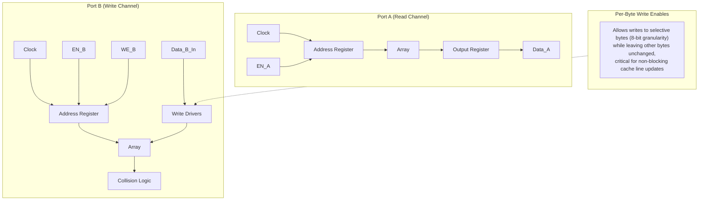
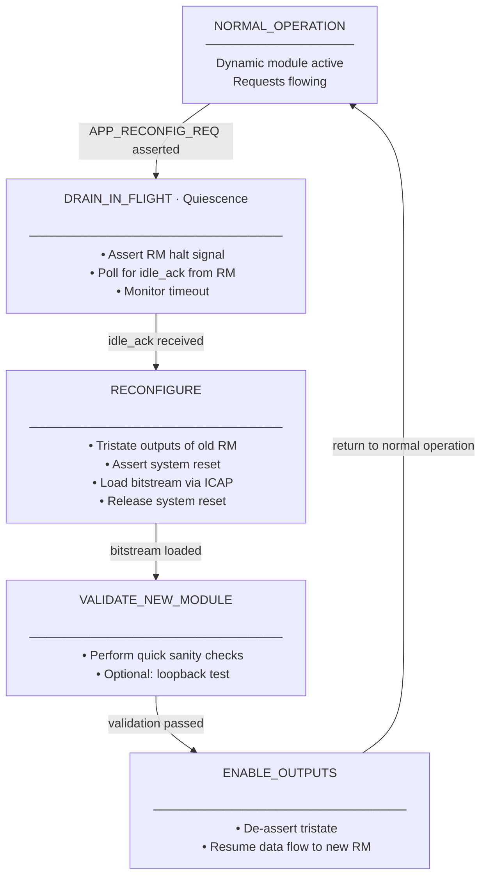

# Lesson 4: Specialized Blocks, Design Patterns for Reconfigurable Systems

## 1. First-Principles Intuition & Invariants

Modern FPGAs are not monolithic seas of lookup tables and interconnect fabric. They are heterogeneous architectures—assemblies of specialized computational and storage primitives optimized for specific workload patterns. Understanding these specialized blocks and the design patterns that harness them is the difference between building fragile prototypes and deploying systems that scale to production deployment windows with predictable timing, power efficiency, and silicon utilization.

The fundamental tension in FPGA design stems from generality versus specialization. Fabric LUTs and routing offer flexibility but consume power, silicon area, and incur routing delays that compound as designs scale. Conversely, hardened IP blocks—DSP slices, block RAM, PCI Express SerDes transceivers—trade configurability for performance, area efficiency, and deterministic latency. The architect's task is to identify where in the dataflow each computational pattern maps optimally: DSP slices for arithmetic-heavy signal processing, block RAM for bandwidth-critical buffering, SerDes transceivers for off-chip communication, and fabric logic for irregular, low-frequency control or glue logic.

Partial reconfiguration (PR) layers an additional dimension: the ability to swap functional modules at runtime without interrupting other system components. This capability unlocks a new class of system architectures—dynamic pipelines, context-switching accelerators, and adaptive DSP chains—but introduces complexity in verification, synchronization boundaries, and resource fragmentation that must be managed rigorously from design inception.

The core invariant is this: **specialized blocks are not free lunch; they impose hard constraints on interface standards, placement, and timing closure.** A DSP slice cannot perform arbitrary permutations of its input signals without consuming fabric logic. SerDes transceivers lock to specific GT (transceiver) sites. Block RAM has fixed aspect ratios and port widths. Partial reconfiguration partitions require static isolation and carefully synchronized handoffs. Successful FPGA architects work *with* these constraints, not around them, by deeply understanding the mechanical limits and designing dataflow topologies that align with silicon capabilities.

## 2. Core Architecture & Mechanics

### 2.1 DSP Slice Architectures: Arithmetic Efficiency at Silicon Scale

DSP slices (or DSP blocks, depending on vendor terminology) are the workhorses of high-throughput signal processing on FPGAs. A single DSP slice typically integrates a 25×18-bit or 27×24-bit multiplier, a 48-bit or 96-bit accumulator, pre-adders, post-adders, and optional input/output registers, all hardened in silicon and tightly coupled to preserve throughput and minimize power dissipation.

Consider the baseline DSP slice on a modern Xilinx UltraScale+ device. Each slice contains a multiplier stage (`M`), an accumulator stage (`P`), and flexible input routing (`A`, `B`, `D` buses). The multiplier accepts up to 27-bit `A` and 18-bit `B operands (or variants with smaller bit widths for higher throughput at reduced range). The product feeds into the accumulator, which can add, subtract, or pass through data from a second `D` multiplier or the output of the post-adder. Input registers (`AREG`, `BREG`, `DREG`) stage the operands, and output registers (`CREG`, `PREG`) buffer the result, enabling pipelining without consuming fabric registers.

The arithmetic-pipeline structure looks like this:

```text
┌─────────────────────────────────────────────────────────────┐
│  Cycle N: Input Registers (AREG, BREG, DREG, CREG)         │
│  A[26:0] ──┐                                               │
│            ├─→ [27×18 Multiplier] ──→ M_out[44:0]        │
│  B[17:0] ──┘                                               │
│  D[26:0] ──→ [Pre-Adder] ──→ [Multiplier B input]         │
│  C[47:0] ──→ [Post-Adder Input]                            │
├─────────────────────────────────────────────────────────────┤
│  Cycle N+1: Product + Accumulation (P register)            │
│  M_out[44:0] ──┐                                           │
│                ├─→ [48-bit Accumulator] ──→ P[47:0]       │
│  C[47:0]    ──┘      (add, sub, pass-through)              │
└─────────────────────────────────────────────────────────────┘
```

This pipelined structure enables **one multiply-accumulate (MAC) operation per clock cycle** with minimal latency penalty. For a 25×18-bit multiplier running at 400 MHz on modern FinFET nodes, that yields 10 billion MACs per second per slice—and modern SoCs integrate dozens to hundreds of DSP slices, permitting teraflop-scale signal processing in a few milliwatts.

The key insight is **synchronous pipelining with optional bypass pathways**. Each register stage can be independently enabled or disabled via the configuration interface, allowing designers to trade latency for throughput or to match external data arrival rates. A slow external sensor running at 1 MHz does not need four pipeline stages; one or two suffice. Conversely, a high-throughput FFT engine running at 300 MHz benefits from deep pipelining (four to six stages) to avoid timing violations and maximize Fmax.

Cascading DSP slices horizontally (chain the P output of one slice to the D input of the next) creates deeply pipelined, wide accumulators without consuming fabric logic. A 64-tap FIR filter, for instance, maps naturally to 32 DSP slices in a cascade, each performing two taps per cycle (using the pre-adder and main multiplier pathways), delivering 64 filtered samples per clock with latency proportional to the number of slices, not the number of taps.

### 2.2 Block RAM Organization: Bandwidth, Aspect Ratios, and Dual-Port Semantics

Block RAM (BRAM) primitives are the FPGA's on-chip storage backbone. Unlike fabric-based distributed RAM (which uses LUT RAMs), block RAM offers superior bandwidth, lower power dissipation, and larger capacity per unit area. A typical UltraScale+ BRAM36 provides 36 Kbits of storage (or two independent 18-bit blocks, BRAM18), with dual independent ports capable of simultaneous reads and writes.

The critical parameter is **aspect ratio**—the configurable trade-off between word width and address depth. A BRAM36 can be configured as 32K×1, 16K×2, 8K×4, 4K×9, 2K×18, or 1K×36, depending on the application's memory hierarchy requirements. Wider words (1K×36) minimize address decoding and port arbitration overhead but reduce addressable locations; narrower words (32K×1) maximize depth for thin datapaths or index arrays.

The dual-port architecture deserves careful attention. Each port (A and B) can operate independently: port A writing to address X while port B reads from address Y in the same cycle incurs no contention. However, **simultaneous access to the same address by both ports introduces collision semantics** that vary by configuration and write-enable patterns. In "write-first" mode (the typical default), if both ports access the same address and write-enable is asserted on port A, port B reads the newly written data. In "read-first" mode, port B captures the stale data before the write. In "no-change" mode, port B's output latches unchanged if a write collision occurs. These semantics are not mere implementation details—they directly affect correctness in dual-ported FIFO designs, coherent cache structures, or scratchpad memories shared between a processor core and a hardware accelerator.

The port interface is synchronous: write operations latch data on the rising clock edge and complete within one cycle (plus optional output register latency). Read operations assert address and read-enable, and data appears on the output after one or two cycles (depending on whether the output register is enabled). Critical to high-throughput designs is **pipelining the address and read-enable signals independently from the data output**, allowing designers to decouple address generation from data consumption.

Consider a dual-port block RAM configured as 512×32 (512 addresses, 32-bit words), clocked at 250 MHz:



A practical pattern is **ping-pong buffering for streaming data**: port A continuously writes incoming data to address 0–255 while port B reads from addresses 256–511. On a buffer-full interrupt, the ports swap ranges, avoiding data loss during CPU reads. This pattern scales naturally to multi-block BRAM hierarchies and is the foundation of high-throughput image processing, audio DSP, and network packet buffering.

### 2.3 Gigabit Transceivers (SerDes) and PCIe Hard IP Integration

SerDes (serializer-deserializer) transceivers are the FPGA's gateway to high-speed off-chip communication: PCIe lanes (Gen3 at 8 Gbps, Gen4 at 16 Gbps), custom multi-gigabit protocols, or optical transceivers (via parallel CMOS-to-optical drivers). Each GT transceiver lane is a hardened silicon block integrating a phase-locked loop (PLL), serialization/deserialization logic, clock data recovery (CDR), and line-rate equalization.

The transceiver is fundamentally a **clock-domain crossing (CDC) primitive** that bridges the FPGA's logic clock domain (typically 100–400 MHz) to an external line-rate clock domain (multi-gigahertz). On the transmit (TX) side, parallel data (typically 16 or 20 bits per cycle at the reference clock) is clocked into shift registers and serialized at line rate. On the receive (RX) side, high-speed serial data is deserialized into parallel words and presented to the logic fabric, along with a recovered clock (or a stable reference clock derived from phase-locked PLLs).

A PCIe hard IP block, found on high-end Xilinx UltraScale+ and similar devices, integrates the full PCIe protocol stack—link training, flow control, transaction layer packet (TLP) framing—in hardware. This eliminates the need for fabric-based implementations, freeing silicon for application logic while guaranteeing compliance with PCIe specifications and enabling direct peer-to-peer DMA between FPGA and external devices (GPUs, switches, storage controllers).

The architecture of a PCIe Gen3 x4 interface (four lanes, 8 Gbps each, 32 Gbps aggregate bandwidth) looks conceptually like this:

```text
┌──────────────────────────────────┐
│  PCIe Hard IP Block              │
│  ┌────────────────────────────┐  │
│  │ Physical Layer (PHY)       │  │
│  │ ├─ PLL / Clock Recovery   │  │
│  │ ├─ Serializers (4× lanes) │  │
│  │ └─ Deserializers (4× lanes)│ │
├──────────────────────────────────┤
│  Data Link Layer                  │
│  ├─ CRC / DLLP generation       │
│  └─ Flow control state machine   │
├──────────────────────────────────┤
│  Transaction Layer (TLP Processor)│
│  ├─ Memory read/write requests   │
│  ├─ Configuration transactions   │
│  └─ Message routing              │
├──────────────────────────────────┤
│  User Interface (AXI or similar)  │
│  ├─ RX data interface (TLP decap) │
│  ├─ TX data interface (TLP wrap)  │
│  └─ Completion/status signals    │
└──────────────────────────────────┘
        ↓
    [Fabric Logic]
    (DMA engines, bridge logic, etc.)
```

The user-facing interface is typically AXI4 or a PCIe core-specific protocol, abstracting away the physical serialization and link-layer mechanics. A typical flow: application logic prepares a memory read request (address, byte count), writes it to a TX request queue, the PCIe hard IP wraps it into a TLP, serializes it across the lanes, and the remote device responds with a completion TLP carrying the requested data. The hard IP deserializes the completion, buffers it, and presents it to application logic via an AXI4 read-data channel—all transparent to the user's RTL.

The critical challenge in integrating SerDes hard IP is **impedance-matched PCB layout and signal integrity**. Each lane requires differential pairs (TX+ and TX−, RX+ and RX−) routed with controlled impedance (~85 Ω differential, depending on the protocol), length-matched to nanosecond precision, and isolated from switching noise via ground planes and via stitching. A single via stub or reflective impedance discontinuity cascades into inter-symbol interference (ISI), bit errors, and link training failure. PCIe x4 Gen3 at 8 Gbps demands layer stackups with careful dielectric selection (Dk and Df), controlled routing rules, and pre-layout simulation using tools like HyperLynx or ADS.

### 2.4 Partial Reconfiguration: Isolation, Synchronization, and Dataflow Contracts

Partial reconfiguration (PR) is the ability to reconfigure a subset of the FPGA while the remainder operates uninterrupted. This unlocks dynamic workload swapping, context switching, and adaptive pipelines—but introduces architectural complexity that must be managed from the first design cycle.

The FPGA's configuration memory is row-addressed; reconfiguring one column (vertical slice spanning all LUTs and routing in that region) requires scanning the entire configuration bitstream, even if only a fraction differs. Xilinx FPGAs divide the reconfigurable region into frame-addressed tiles; a single reconfigurable module (RM) might span 50 frames (width) × 100 rows (height), corresponding to ~50 KB of configuration data per module at 7-series density.

The architectural pattern is a **static shell** (unchanging infrastructure: memory controllers, I/O, PLLs, top-level arbitration) and **dynamic islands** (reconfigurable modules that swap in and out). The shell provides a well-defined interface contract: a fixed set of AXI or custom ports through which the dynamic module communicates. At runtime, when reconfiguration is triggered, the dynamic module is severed (inputs held at safe states, outputs disconnected), the FPGA is partially reconfigured via ICAP (Internal Configuration Access Port), and the new module is brought online.

The key mechanical invariant is **isolation without deadlock**. A naive approach—simply disconnecting the dynamic module and reconfiguring—risks data loss, stuck transactions, and incoherent state. Instead, production designs implement a **quiescence protocol**: before reconfiguration, application logic signals the dynamic module to drain all in-flight transactions, halt state machines, and reach a well-defined idle state. A timeout watchdog ensures deadlock is detected. Only after quiescence verification does the shell command ICAP to load the new bitstream.

Here is a practical state machine for reconfiguration orchestration:



The interface between static and dynamic regions must be **CDC-safe**: data crossing the boundary between clock domains (or going tristate during reconfiguration) must be synchronized using proper gray-coded handshakes, FIFOs with dual-port RAMs, or pipelined synchronizers. A naive direct connection of RM outputs to fabric logic invites metastability violations and intermittent glitches when reconfiguration is triggered.

Floorplanning and placement constraints are rigorous. Each RM must be assigned to a rectangular bounding box (RM_LOC pragma in Vivado RTL) that encompasses sufficient resources (DSP slices, BRAMs, LUTs) for all possible implementations of that module. The constraint file (UCF or XDC) locks placement to ensure FPGA tool chains don't inadvertently relocate logic during synthesis or place routing that blocks reconfigurable boundaries. Violation of floorplan constraints causes cryptic build failures or, worse, silent logic corruption at runtime.

### 2.5 Dataflow vs. Control-Dominant Mapping Strategies

The fundamental design decision in FPGA architecture is whether the application exhibits **dataflow dominance** (throughput-driven, pipelined, minimal control) or **control dominance** (irregular branching, state machines, frequent stalls).

**Dataflow-dominant designs** are the FPGA's sweet spot. Data streams continuously through pipelines with predictable latency and throughput. Examples include image processing (video frame → filters → output), signal processing (ADC sample stream → DSP chain → DAC), or packet processing (Ethernet frames → classification → forwarding). These designs map naturally to pipelined DSP slices, streaming BRAM buffers, and systolic arrays. Clock frequency (Fmax) is determined by the longest combinatorial path between pipeline registers; throughput is one output per cycle (or one per K cycles, depending on pipeline depth). Power is minimized because data is flowing useful computation every cycle—no wasted switching.

The architecture for a dataflow system is a **directed acyclic graph (DAG)** of computation stages:

```text
Input Stream → [Stage 0] → [Stage 1] → [Stage 2] → [Stage 3] → Output Stream
(LUT filter)   (DSP mult)   (BRAM accu)  (DSP div)
   Latency = 4 cycles
   Throughput = 1 result per cycle (after pipelining fills)
   Power ∝ data activity (switching only on non-stall cycles)
```

Contrast this with **control-dominant designs**, which are riddled with conditional branches, state-dependent data routing, and irregular memory access patterns. Microcontroller-style sequencers, algorithm accelerators with variable iteration counts, or adaptive filter controllers exemplify this category. These designs suffer in FPGA fabric because each branch point requires wide multiplexers (consuming LUTs), conditional register writes stall pipelines (reducing throughput), and irregular memory patterns defeat cache locality. Fmax often collapses below 100 MHz even on modern nodes because the datapath spans many LUT levels and the critical path loops through memory and back.

A prudent architecture strategy is **hybrid**: identify the dataflow-dominant inner loop (the "hot path" responsible for 90% of throughput or power dissipation) and map it to hardened blocks (DSP, BRAM, SerDes). Wrap it with a lighter-weight fabric-based control layer that handles rare events, reconfigurations, or administrative tasks. For example, an image processing pipeline might pipeline convolution in hardened DSP slices (inner loop), while a fabric state machine manages frame boundaries, mode switching, or error handling (outer control).

The metric for this decision is **utilization balance**: if DSP slices run at 70% utilization (underutilized, leaving computation on the table), the dataflow bottleneck is elsewhere—memory bandwidth, interconnect congestion, or fabric logic on the critical path. Conversely, if fabric LUTs exceed 80% and Fmax drops below target, you've tried to cram too much irregular logic into fabric; consider offloading to DSP slices or splitting into sub-functions with their own control layers.

## 3. High-Performance Optimization & Failure Modes

### 3.1 DSP Slice Cascading and Systolic Arrays

Maximizing DSP throughput requires understanding the cascading rules. When multiple DSP slices are chained (the P output of one feeds the D input of the next), they form a **systolic pipeline** in which data propagates monotonically through stages. The key constraint is **clock-to-clock setup and hold time**: the P register's output must meet setup time at the receiving slice's D input, and the receiving slice's clock must arrive before the Q output violates hold time.

In modern UltraScale+ silicon, cascaded paths have sub-nanosecond delays, allowing designs to chain 20+ DSP slices at 500+ MHz without slack violations. However, this requires the routing engine to recognize the cascade and avoid introducing buffer delays.

**Explicit cascade constraints** are enforced by setting the `USE_PATTERN_DETECT` and `USE_SIMD` attributes and ensuring the placer collocates adjacent slices within the same clock region. Failure to meet these constraints manifests as **timing violations on cascaded paths** (slack < 0 ns on P→D arcs) or **functional errors** where intermediate products are corrupted by clock skew. The diagnostic is to inspect the timing report for critical paths labeled `DSP48E2/P[47:0] → DSP48E2/D[26:0]` and verify that all cascaded slices share the same `CLOCK_REGION` in the utilization report. If slices are scattered across regions, the placer has failed to honor the cascade; the solution is to add `RLOC` or `BEL` constraints to force adjacency, or reduce the cascade depth and insert pipeline registers at region boundaries.

The second failure mode is **arithmetic overflow in fixed-point systolic arrays**. When accumulating products over N cycles, the accumulator width must be `log₂(N) + input_width + coeff_width` to prevent wraparound. Underprovisioning by even one bit causes silent data corruption (the MSB alias wraps to the LSB), visible only as statistical noise in output histograms or unexpected discontinuities in frequency-domain plots. The verification is to instrument the accumulator's MSB with an overflow flag (`P[47]` XOR `P[46]` for signed arithmetic) and assert in simulation or on-chip with an ILA trigger. If overflow occurs, widen the accumulator or scale inputs, but never mask the flag—overflow in production is a requirements failure, not a signal processing decision.

---

## Summary & Verification Matrix

| **Invariant/Mechanism** | **Governing Rule** | **Diagnostic Criterion** | **Failure Mode & Recovery** |
|-------------------------|-------------------|-------------------------|----------------------------|
| **DSP Slice Cascading** | P→D paths must be in same clock region; setup/hold < 1 ns | Timing report shows slack ≥ 0 ns on `P[47:0] → D[26:0]` arcs; `CLOCK_REGION` matches in utilization | Timing violation or data corruption; add `RLOC`/`BEL` constraints to enforce adjacency or insert pipeline registers at region boundaries |
| **BRAM True Dual-Port Collision** | Read/write to same address in same cycle is undefined; must enforce read-after-write or write-after-read protocol | Functional simulation with simultaneous R/W to same address must show deterministic priority or error flag | Non-deterministic read data; insert arbitration logic or use READ_FIRST/WRITE_FIRST modes with explicit address comparison |
| **Partial Reconfiguration Timing Closure** | Static region must meet timing independently; reconfigurable region must meet worst-case slack across all personas | WNS ≥ 0 ns for static logic in all configurations; reconfigurable partition has no negative slack in any bitstream variant | Timing failure in specific persona; repartition to move critical paths to static region or reduce reconfigurable region clock frequency |
| **Fixed-Point Accumulator Width** | Width = `log₂(N) + input_width + coeff_width` for N accumulations | MSB overflow flag (`P[47] XOR P[46]`) never asserts in simulation or ILA capture; output histogram shows no aliasing artifacts | Silent wraparound corruption; widen accumulator or scale inputs; never mask overflow without requirements justification |
| **Hardened-vs-Fabric Partitioning** | DSP/BRAM utilization 60–80%; fabric LUT utilization < 75%; Fmax meets target with margin | Resource utilization report shows balanced usage; timing summary shows positive slack on all clock domains | DSP underutilization or fabric congestion; move irregular control to fabric, move regular dataflow to hardened blocks; verify with profiling |
| **Clock Domain Crossing in Systolic Arrays** | All DSP slices in cascade share single clock; cross-domain only at array boundaries with async FIFOs | Clock report shows single clock domain for cascaded DSPs; no `ASYNC_REG` warnings on intra-cascade signals | Metastability or data corruption; consolidate cascade to single clock domain or insert proper CDC synchronizers with constraint exceptions at boundaries |
