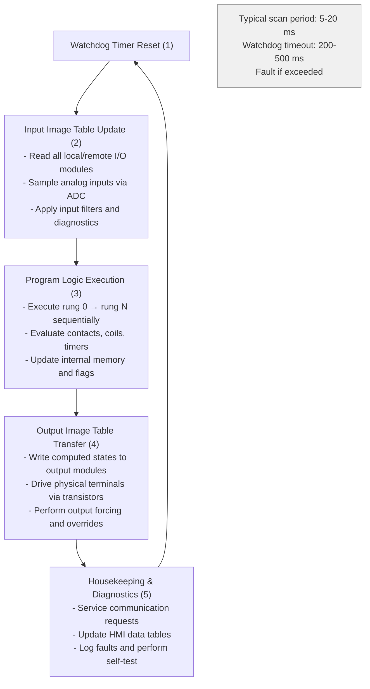

# Lesson 3: PLC Architecture, Ladder Logic, Sequential Control

## 1. First-Principles Intuition & Invariants

The programmable logic controller arose from a simple industrial need: replace thousands of physical relays, timers, and mechanical switches in manufacturing control panels with a single reprogrammable device that could withstand the electromagnetic noise, vibration, and temperature extremes of factory floors. When General Motors issued a design specification in 1968 demanding a solid-state replacement for relay-based control systems, the engineers who responded created not merely a computer, but a specialized architecture optimized for deterministic, real-time discrete event control. Understanding this historical context reveals why PLCs operate fundamentally differently from general-purpose computers, embedded microcontrollers, or distributed control systems.

At the heart of PLC architecture lies the scan cycle, a deterministic execution loop that defines temporal behavior and imposes hard real-time constraints on all ladder logic programs. Unlike event-driven architectures or interrupt-based embedded systems, the PLC scan cycle executes as a fixed-period sequential process: read all physical inputs, execute the user program from first rung to last rung in strict sequential order, write all outputs, perform housekeeping diagnostics, and repeat. This architectural decision sacrifices the flexibility of asynchronous event handling to guarantee that every input change will be observed, every rung will execute, and every output will update within a bounded, predictable timeframe. The scan cycle period—typically ranging from 1 millisecond to 50 milliseconds depending on program complexity and processor speed—becomes the fundamental quantum of time resolution for industrial control logic.

The relay ladder diagram notation that dominates PLC programming did not emerge from computer science or control theory, but from the graphical conventions of electrical relay schematics drawn by electricians in the 1950s and 1960s. When factory maintenance personnel opened control cabinets, they encountered vertical bus bars representing power rails with horizontal rungs of relay contacts and coils wired between them. Current flowed from left to right; normally-open contacts closed when their associated relay coils energized; normally-closed contacts opened when energized; and the rightmost element in each rung was typically an output coil or motor contactor. This one-to-one visual correspondence between relay cabinet wiring diagrams and ladder logic rungs allowed electricians to program PLCs using familiar graphical semantics, eliminating the cognitive burden of learning textual programming languages. The genius of ladder logic lies not in computational elegance but in its preservation of domain-specific knowledge: an electrician who understood relay control could immediately comprehend and troubleshoot ladder diagrams without formal computer science training.

The IEC 61131-3 standard codified five programming languages for industrial controllers, recognizing that different control problems demand different representational tools. Ladder Diagram (LD) excels at combinatorial logic and interlocking sequences. Function Block Diagram (FBD) suits continuous process control and signal processing chains. Sequential Function Chart (SFC) models state machines and batch processes with explicit state transitions. Structured Text (ST) provides Pascal-like procedural syntax for complex mathematical algorithms. Instruction List (IL) offers assembly-language mnemonics for low-level optimization. Yet despite this standardization, the overwhelming majority of industrial PLC programs remain written in ladder logic, not because it is computationally superior, but because it aligns with the cognitive models, training pipelines, and maintenance workflows of the existing electrical workforce.

The deterministic nature of scan-based execution imposes strict invariants on PLC program behavior. Every input image table must be frozen at the start of each scan cycle; no input can change state mid-scan, preventing race conditions where different rungs observe inconsistent input snapshots. Every output image table must be written atomically at the end of the scan cycle; no output can toggle multiple times within a single scan, ensuring that external contactors and solenoids receive clean, debounced control signals. Every rung must execute in the same order every scan; no branch prediction, speculative execution, or out-of-order processing can occur, guaranteeing that rung N always observes the output states computed by rungs 1 through N-1. These constraints sacrifice computational efficiency to achieve temporal predictability, the paramount requirement for safety-critical industrial control.

Memory organization in PLCs reflects the historical evolution from relay replacement to modern programmable automation. The most fundamental memory region is the input image table, a contiguous bit array mapping physical input terminals to addressable memory locations. When the scan cycle begins, the PLC's input modules sample all terminal voltages, convert them to logic levels through optoisolated input circuits with typical thresholds at 15 VDC for 24V inputs or 80 VAC for 120V inputs, and write the resulting binary states into the input image table. This snapshot remains frozen throughout program execution, preventing glitches or contact bounce from corrupting logic evaluation. Similarly, the output image table holds computed output states in memory until the scan cycle completes, at which point output modules drive physical terminals through power transistors, triacs, or electromechanical relays capable of switching inductive loads rated at fractional to several amperes.

Internal memory regions include bit memory for intermediate logic states, word memory for integer and floating-point data, timer structures holding preset values and accumulated counts, counter structures tracking up/down pulses, and retentive memory regions that survive power loss through battery-backed SRAM or EEPROM. Advanced PLCs provide data blocks for structured data types, recipe storage, and process parameters. The address notation varies by manufacturer: Siemens S7 uses `I0.0` for input bit zero of byte zero, `Q1.5` for output bit five of byte one, `M10.2` for memory bit two of byte ten, and `DB5.DBW20` for word twenty in data block five. Allen-Bradley CompactLogix employs tag-based addressing like `LocalInput:0.Data.3` for input point three and `ConveyorMotor` for a symbolic output tag. Modicon uses `%I0.0.1` for input module zero, channel one, and `%MW100` for memory word one hundred. Understanding manufacturer-specific addressing schemes remains essential because IEC 61131-3 standardized syntax but not address mapping conventions.

## 2. Core Architecture & Mechanics

The physical architecture of a modular PLC system consists of a power supply unit providing isolated 24 VDC rails for logic and field device power, a CPU module containing the scan engine processor and program memory, discrete I/O modules converting field signals to logic levels, analog I/O modules performing 12-bit to 16-bit ADC and DAC conversions, specialty modules for high-speed counting, motion control, or communication protocols, and a backplane bus interconnecting all modules with deterministic cycle times. The backplane may implement proprietary protocols like Siemens PROFINET IRT with sub-millisecond update rates, Allen-Bradley ControlNet with scheduled and unscheduled messaging, or open standards like EtherCAT with distributed clock synchronization achieving sub-100-microsecond jitter.

Within the CPU module, the scan engine executes as a firmware loop managing distinct phases. The input scan reads all local and remote I/O modules, transferring digital input states via high-speed parallel backplane transactions and analog values via serial ADC interfaces. Input modules typically feature optical isolation using LED-phototransistor pairs to protect CPU circuitry from ground loops, transient spikes, and miswiring faults. A 24 VDC discrete input circuit charges a filter capacitor through a series resistor, with the optocoupler LED conducting when terminal voltage exceeds threshold. Input filters range from 0.2 milliseconds for high-speed sensing to 20 milliseconds for contact debouncing, introducing phase lag that must be accounted for in timing-critical applications.

The program scan executes ladder logic from rung zero to the final rung, evaluating each contact and coil sequentially. Ladder logic rungs compile to Boolean algebra operations stored as bytecode or native machine instructions. A simple rung with two normally-open contacts in series driving an output coil compiles to load input A, AND input B, store to output C. Contacts in parallel compile to OR operations. Nesting branches require temporary stack storage for intermediate Boolean results. Timers and counters invoke firmware subroutines that increment accumulated values, compare against preset thresholds, and set done bits. The scan engine maintains internal flags for edge detection: one-shot rising pulses trigger on false-to-true transitions, one-shot falling pulses trigger on true-to-false transitions, implemented by comparing current scan Boolean state against previous scan state stored in shadow registers.

Ladder logic syntax follows strict conventions that preserve relay schematic semantics. Each rung begins at the left power rail, proceeds through a series or parallel combination of contacts, and terminates at an output coil or other output instruction adjacent to the right power rail. Contacts represent input conditions: normally-open contacts close when their associated memory bit is true, allowing logic flow; normally-closed contacts open when true, blocking flow. Output coils write to memory locations, setting the bit true when logic flow reaches the coil or leaving it false when flow is blocked. A single rung can drive multiple coils by placing them in parallel at the right side, but contacts cannot appear to the right of coils due to power flow semantics. Vertical connections represent parallel branches, allowing OR logic where any path conducts.

The translation from relay ladder diagrams to Boolean expressions follows straightforward rules. Contacts in series form AND operations: `A AND B AND C` requires all three contacts closed. Contacts in parallel form OR operations: `A OR B OR C` conducts if any contact closes. Mixed series-parallel networks require parenthetical grouping: `(A AND B) OR (C AND D)` represents two series branches in parallel. Negation occurs through normally-closed contacts: `NOT A` opens when A energizes. De Morgan's laws apply when simplifying complex rungs: `NOT (A OR B)` equals `(NOT A) AND (NOT B)`. Experienced programmers recognize canonical forms and factor common sub-expressions to minimize scan time, though modern PLC compilers perform automatic optimization.

Timer instructions extend ladder logic with time-dependent behavior essential for industrial sequencing. The TON (Timer On-Delay) instruction begins counting when its input rung goes true, incrementing an accumulated value each scan cycle by the scan period duration until reaching a preset time value, at which point the done bit energizes. If the input rung goes false before timeout, the accumulated value resets to zero. This implements delayed activation: a motor starter coil can be energized three seconds after a start button press, allowing time for pre-lubrication pumps. The TOF (Timer Off-Delay) instruction mirrors this behavior, energizing its done bit immediately when the input goes true and holding it true for the preset duration after the input goes false, implementing delayed deactivation for cooling fans that must run after a heater shuts down.

The retentive timer RTO accumulates time across multiple true periods of its input rung, preserving the accumulated value when the input goes false. This measures cumulative run time: a pump's total operating hours accumulate whether the pump runs continuously or intermittently. A separate reset instruction clears the accumulated value. Counter instructions CTU (count up) and CTD (count down) increment or decrement an accumulated value on each false-to-true transition of the input rung, setting the done bit when the accumulated count equals the preset value. Retentive counters maintain their accumulated values through power loss if stored in retentive memory regions backed by supercapacitors or lithium batteries.

Sequential Function Chart (SFC) programming models state machines explicitly, representing batch processes, machine sequences, and recipe-driven operations more clearly than ladder logic. An SFC consists of steps connected by transitions with associated actions. Each step represents a stable state where specific outputs are energized or control loops execute; the system remains in a step until its exit transition condition becomes true. Transitions encode Boolean conditions evaluated each scan; when true, the SFC engine deactivates the current step, activates the successor step, and executes any transition actions. Steps may branch into parallel sequences for concurrent operations or diverge into alternative paths based on conditional branches.

The SFC execution model integrates with ladder logic through step flags that can be tested as contacts. When step 5 is active, the Boolean flag `S5.X` (Siemens notation) or `Step[5].Active` (tag-based systems) reads true, allowing ladder rungs to execute step-specific logic. Actions associated with steps may be qualifiers: non-stored actions execute only while the step is active, stored actions latch true when the step activates and remain true until explicitly reset, time-limited actions execute for a preset duration, and pulse actions execute for one scan cycle. This hybrid approach combines the explicit state representation of SFC with the detailed logic expressiveness of ladder diagrams.

Real-world PLC programs layer multiple control strategies. Low-level interlocking logic ensures safety: conveyor motor contactors cannot energize unless emergency stops are inactive and guard doors are closed, implemented as series contacts in the motor coil rung. Mid-level sequencing coordinates startup and shutdown procedures: a burner ignition sequence might purge the combustion chamber for 30 seconds, open the gas valve, energize the ignition transformer, confirm flame presence via UV sensor within 5 seconds, or fault and close the gas valve if no flame detected. High-level state machines manage batch recipes: a reactor fill-mix-heat-cool-discharge cycle programmed as an SFC with recipe parameters stored in data blocks, allowing different product formulations without reprogramming.

## 3. High-Performance Optimization & Failure Modes

Scan time optimization becomes critical when program complexity approaches the microsecond-scale response requirements of high-speed manufacturing processes. Every rung execution consumes CPU cycles proportional to the number of contacts, coils, and function blocks. A naive ladder program evaluating the same complex Boolean expression in dozens of rungs wastes scan time recomputing identical logic. The solution is factoring: compute the complex expression once in an intermediate coil, then use that coil as a contact wherever the expression is needed. Modern PLCs compile ladder logic to optimized bytecode or native machine code, but the sequential rung evaluation model prevents the compiler from automatically hoisting repeated sub-expressions across rungs.

Excessive timer and counter instructions degrade scan performance because each timer requires firmware subroutine calls to update accumulated values and test thresholds. High-speed counting applications that need microsecond resolution should use dedicated hardware counter modules with field-programmable gate arrays (FPGAs) capturing encoder edges asynchronously rather than timer instructions updated at millisecond scan rates. Similarly, PID control loops benefit from analog modules performing ADC conversions and control calculations autonomously, reporting results to the CPU via backplane DMA rather than executing PID function blocks in the main scan.

Input filtering introduces phase lag that can destabilize closed-loop control or miss transient events. A photoelectric sensor detecting parts on a high-speed conveyor moving at 2 meters per second with 10-millimeter part spacing generates pulses every 5 milliseconds. If the PLC input filter is set to 20 milliseconds for noise immunity, pulses will be missed or merged. The solution requires fast input modules with sub-millisecond filtering or high-speed counter modules capturing edges with 10-microsecond resolution. For critical timing, interrupt-driven inputs bypass the scan cycle, executing interrupt service routine rungs immediately when edges occur, though this violates scan-based determinism and must be used sparingly.

Communication overhead can dominate scan time in distributed I/O systems. Remote I/O racks connected via industrial Ethernet add network latency and packet processing overhead to input and output updates. A PLC controlling twenty remote racks over standard Ethernet may spend 80% of its scan time servicing network communications, leaving only 20% for logic execution. The solution employs real-time industrial Ethernet protocols: PROFINET IRT (Isochronous Real-Time) reserves dedicated bandwidth with hardware-based switching, achieving deterministic 1-millisecond update cycles. EtherCAT implements summation frame topology where a single Ethernet packet traverses all slaves sequentially, each inserting or extracting its data on-the-fly via FPGA-based processing, achieving 100-microsecond cycle times over dozens of nodes.

Fault diagnostics and recovery strategies distinguish production-grade PLC programs from naive implementations. Input modules provide diagnostic bits for wire break, short circuit, and under-range/over-range conditions on analog inputs. Output modules report overload, overcurrent, and short-to-ground faults. Ladder logic should test these diagnostic bits and trigger alarm rungs, disable affected zones, or transition to safe states. A motor starter output detecting overcurrent should latch off, set a fault flag visible to the HMI, and prevent restart until an operator acknowledges the fault and verifies that the mechanical jam or bearing failure has been corrected.

Watchdog timers enforce real-time constraints by forcing the PLC into fault mode if scan time exceeds a preset threshold. If a program takes 150 milliseconds to complete when the watchdog is set to 100 milliseconds, the watchdog trips, halts program execution, de-energizes all outputs, and illuminates fault indicators. Watchdog faults indicate scan time pathology: infinite loops in structured text, excessive communication blocking, or runaway counter logic. Troubleshooting requires profiling tools that measure per-rung execution time, identifying bottleneck sections for refactoring.

Retentive memory behavior during power loss determines whether a process can resume safely or must restart. Non-retentive memory zeroes on power-up; retentive memory preserves values through battery backup or EEPROM writes. Critical interlocks, valve positions, and process step indices should be retentive to allow safe resumption. However, retentive outputs pose hazards: if a heater output is retentive and the PLC loses power while heating, restoration would immediately re-energize the heater without verifying that process conditions remain valid. Best practice marks only data variables retentive, not output coils, and implements a controlled restart sequence in ladder logic that verifies safety conditions before restoring output states.

Race conditions emerge when ladder logic depends on execution order without explicit sequencing. Consider two rungs: rung 10 sets coil A true based on input X, and rung 20 sets coil B true based on coil A. During the first scan after input X goes true, rung 10 energizes coil A, and rung 20 immediately sees coil A true and energizes coil B—both occur within the same scan. However, if these rungs appear in reverse order, rung 20 executes before rung 10, observing coil A false from the previous scan, and coil B does not energize until the following scan, introducing a one-scan delay. Programmers must consciously arrange rungs in dependency order or use latching logic to create explicit state transitions immune to rung ordering.

Edge detection failures occur when inputs change faster than the scan rate. A 5-millisecond scan cycle can reliably detect input pulses longer than 10 milliseconds (per Nyquist criterion), but pulses shorter than 5 milliseconds may be missed if they occur between input scans. High-speed inputs with hardware latching capture transient pulses in module registers until the CPU reads them, guaranteeing no missed events. For critical event counting, dedicated counter modules with FPGA-based edge capture operating at megahertz rates ensure no pulses are lost regardless of scan time jitter.

Analog scaling and linearization require careful attention to signal conditioning and numerical precision. A 4-20 mA analog input representing 0-100% scales linearly, but thermocouples exhibit nonlinear voltage-temperature curves requiring lookup tables or polynomial approximations. PLCs typically perform analog-to-digital conversion at 12-bit to 16-bit resolution: a 16-bit ADC over 4-20 mA yields 65536 counts over 16 mA, approximately 0.24 microamps per count. Sensor accuracy, wiring resistance, and ADC noise limit practical resolution to perhaps 14 effective bits. Scaling calculations in structured text should use floating-point arithmetic to preserve precision, avoiding integer truncation errors that corrupt control loops.

Structured text programming enables complex algorithms unsuitable for ladder logic: floating-point PID calculations, array manipulations for recipe data, string parsing for barcode scanners, and conditional logic spanning dozens of clauses. However, structured text lacks the graphical intuitiveness of ladder diagrams, making troubleshooting less accessible to electricians. Hybrid programs partition logic: ladder rungs implement interlocking safety logic visible to maintenance personnel, while structured text subroutines execute computational tasks called from ladder function block rungs. This division preserves the strengths of both paradigms.

Simulation and virtual commissioning accelerate development by testing PLC programs against software models of machinery before hardware integration. Tools like Siemens PLCSIM Advanced or Rockwell Studio 5000 Emulate execute ladder logic on a PC, interfacing with physics-based simulations of conveyors, actuators, and sensors. Engineers validate interlocking sequences, timing constraints, and fault recovery logic in a virtual environment, detecting programming errors before costly on-site debugging. However, simulation cannot replicate all real-world phenomena: electromagnetic interference, ground loop currents, mechanical vibration causing intermittent connections, and the chaotic timing of multiple asynchronous field devices interacting. On-site commissioning remains indispensable, but simulation reduces the risk that fundamental logic flaws halt production lines.

Cybersecurity concerns for PLCs intensified after the Stuxnet worm demonstrated that industrial controllers could be exploited to sabotage physical processes. Modern PLCs require defense-in-depth strategies: isolating control networks from enterprise IT via unidirectional data diodes or firewalls, disabling unused communication ports and protocols, enforcing role-based access controls for programming and monitoring, and validating firmware integrity through cryptographic signatures. Yet many legacy systems remain vulnerable due to embedded credentials, unencrypted protocols, and reliance on security-through-obscurity. The IEC 62443 standard defines security levels for industrial automation, mandating authentication, authorization, and encrypted communication for critical applications, but retrofitting these protections onto decades-old installed systems presents formidable technical and economic challenges.

The deterministic scan cycle architecture that defines PLC operation imposes fundamental limits on responsiveness and complexity, yet within those constraints, PLCs have proven remarkably adaptable. From the relay-replacement controllers of the 1970s to the multi-core, gigahertz-class processors of contemporary safety PLCs, the scan-based execution model persists because it provides the temporal predictability, diagnostic transparency, and maintenance simplicity that factory automation demands. Mastery of ladder logic, sequential function charts, and the underlying scan cycle mechanics empowers control engineers to design, debug, and optimize the logic that governs the vast majority of industrial manufacturing, water treatment, power generation, and material handling processes worldwide.
