# Lesson 2: Component Selection Strategies for Layout Optimization

## 1. First-Principles Intuition & Invariants

The selection of electronic components for printed circuit board assemblies represents one of the most consequential design decisions a hardware engineer makes, yet it remains chronically underestimated in complexity. Unlike software where refactoring costs developer time but little else, a poorly chosen component package cascades through every subsequent phase: layout topology becomes constrained, thermal management grows intractable, manufacturing yields plummet, and rework costs spiral into five figures before the first production lot ships. Component selection exists at the critical intersection of electrical performance, mechanical integration, thermal physics, and manufacturing economics. The engineer who masters this discipline transforms abstract schematics into manufacturable, reliable hardware that survives temperature cycling, mechanical shock, and decade-long field deployments.

At its foundation, component selection for layout optimization demands understanding that every package type embodies a specific set of compromises between electrical parasitics, thermal resistance, mechanical robustness, and assembly cost. Through-hole technology, the dominant paradigm from the 1960s through the early 1990s, provides exceptional mechanical strength through plated copper barrels that traverse the entire board thickness, establishing robust solder joints with high pull-strength and excellent thermal dissipation into the PCB substrate. The physical geometry of axial and radial leaded components creates predictable inductance and capacitance, but the large hole diameters consume board real estate voraciously, force single-sided or limited double-sided automated assembly, and introduce parasitic inductance in the leads that degrades high-frequency performance. A quarter-watt through-hole resistor occupies approximately 100 square millimeters of board area when accounting for lead spacing and keepout zones, whereas an 0805 surface-mount equivalent consumes merely 2.5 square millimeters—a forty-fold density advantage that revolutionized portable electronics.

Surface-mount device technology emerged from the aerospace and military sectors in the 1960s but achieved commercial dominance only in the 1990s as reflow soldering processes matured and component miniaturization became economically viable. SMD packages eliminate through-hole barrels entirely, instead relying on solder fillets formed between component terminations and surface pads. This topology enables double-sided population, dramatically reduces parasitic inductance by shortening current paths, and permits automated pick-and-place assembly at rates exceeding 80,000 components per hour on modern lines. The electrical advantages prove equally compelling: a 0402 ceramic capacitor exhibits series inductance below 400 picohenries, whereas a radial through-hole equivalent approaches 5 nanohenries—more than an order of magnitude higher, rendering it unsuitable for decoupling above 100 MHz.

Yet surface-mount technology introduces its own constellation of challenges. Solder joint reliability depends entirely on pad geometry, solder paste volume, and reflow thermal profiles, with insufficient or excessive solder creating opens or bridging respectively. The absence of through-hole mechanical anchoring makes SMD assemblies vulnerable to mechanical shock and vibration, particularly for large components like electrolytic capacitors or transformers where mass concentrations generate high g-forces during drop events. Thermal management grows more complex because heat must conduct laterally through thin copper pads into thermal vias rather than directly through lead wires into plated barrels. An SOT-23 package dissipating 500 milliwatts on a standard two-layer board with minimal copper pour can reach junction temperatures exceeding 125°C in still air, triggering thermal derating and reliability degradation.

Ball grid array and quad flat no-lead packages represent the apex of miniaturization and electrical performance but demand advanced layout techniques and manufacturing capabilities. BGA packages arrange solder spheres in a grid across the component's underside, creating the highest pin density achievable in production technology—modern processors integrate over 2000 balls on 35×35 millimeter substrates at 0.8 millimeter pitch. The short electrical path from die pad to solder ball minimizes parasitic inductance to tens of picohenries, enabling multi-gigahertz signaling with controlled impedance and minimal ground bounce. QFN packages achieve similar density along the perimeter with exposed thermal pads on the bottom, combining excellent thermal performance with compact footprints. A 48-pin QFN occupies 49 square millimeters compared to 400 square millimeters for an equivalent TQFP, while providing junction-to-ambient thermal resistance 30% lower due to the large exposed pad's direct thermal conduction path.

These advanced packages extract penalties in manufacturing complexity and inspection difficulty. BGA solder joints hide beneath the component body, invisible to optical inspection and requiring X-ray imaging or functional testing to verify. Coplanarity tolerances tighten to 100 micrometers across the ball array; exceeding this specification creates voided joints that fail intermittently under thermal cycling. QFN assemblies suffer from solder wicking along component sidewalls rather than forming proper fillets, demanding precise solder paste stencil aperture design and sometimes nitrogen reflow atmospheres to prevent oxidation. The exposed thermal pad requires either via-in-pad construction or thermal vias immediately adjacent to the pad, both introducing solder voiding risks if paste wicks down via barrels during reflow.

The physics of thermal management in component packages derives from Fourier's law of heat conduction, which states that thermal power flow equals thermal conductivity multiplied by cross-sectional area and temperature gradient. Junction-to-ambient thermal resistance chains multiple thermal interfaces in series: silicon die to package substrate through die attach material, package substrate to printed circuit board through solder joints and thermal vias, and printed circuit board to ambient air through convection and radiation. Each interface contributes thermal resistance measured in degrees Celsius per watt, with total junction temperature rise calculated as the sum of all resistances multiplied by power dissipation. A typical small-outline integrated circuit on minimal copper exhibits 150°C/W junction-to-ambient resistance; at 500 milliwatt dissipation, junction temperature rises 75°C above ambient, pushing a component in 50°C environments to 125°C junction temperature—the absolute maximum rating for most commercial silicon.

Thermal package selection therefore directly impacts achievable power densities and maximum operating frequencies. Enhanced packages modify standard footprints with exposed thermal pads, thickened copper lead frames, or integrated heat spreaders that dramatically reduce thermal resistance. An exposed-pad TSSOP reduces junction-to-ambient resistance to 65°C/W compared to 150°C/W for standard packaging, enabling double the power dissipation before thermal limits constrain operation. High-power applications demand dedicated thermal packages: TO-220 through-hole packages provide mounting holes for bolted heatsink attachment, DPAK and D2PAK surface-mount power packages offer large tabs for soldering to copper pours, and advanced clip-bonded packages like TOLL and LFPAK integrate copper clips replacing bond wires to minimize electrical and thermal resistance simultaneously.

Pin assignment analysis represents the critical bridge between component selection and layout topology. Integrated circuits with hundreds of pins offer substantial flexibility in assigning signals to specific balls or leads during die design, but once manufactured, the pinout becomes immutable and the layout engineer must accommodate it. Optimal pin assignments cluster related signals—data buses, address lines, differential pairs—on adjacent pins to minimize routing congestion and trace length. Power and ground pins distributed throughout the package rather than concentrated on one side reduce simultaneous switching noise by lowering current loop inductances and distributing return current paths. Modern microprocessors and FPGAs utilize automated pin assignment algorithms that optimize for routing density, signal integrity, and thermal considerations simultaneously, but legacy components often exhibit arbitrary or poorly optimized pinouts that torture layout engineers.

The component orientation decision, seemingly trivial, profoundly impacts routing efficiency and manufacturing yield. Standard practice aligns all integrated circuits with pin one in the upper-left corner when viewed from the component side, creating consistent orientation that reduces assembly errors and enables visual inspection patterns. Passive components—resistors, capacitors, inductors—follow orientation rules that facilitate automated optical inspection: two-terminal devices align with their silkscreen designators, and polarized components place their cathode or negative terminals consistently. Violating these conventions invites assembly defects where components install backwards, upside-down, or rotated 180 degrees, creating shorts, opens, or reversed polarity that damage circuits during power-on.

Manufacturing design rules codified in IPC standards impose hard constraints on component selection and placement. IPC-2221 defines generic PCB design requirements including conductor spacing, hole sizes, and annular rings, while IPC-7351 specifically addresses land pattern geometry for surface-mount components. These standards derive from statistical analysis of billions of solder joints, identifying pad dimensions that maximize yield across process variations in paste deposit volume, component placement accuracy, and reflow thermal profiles. A typical 0805 resistor land pattern specifies 1.4 millimeter pad length and 1.0 millimeter width with 2.2 millimeter pad spacing, creating solder fillet geometry that tolerates ±0.1 millimeter placement error and ±10% paste volume variation while maintaining >99.7% yield—three-sigma process capability.

## 2. Core Architecture & Mechanics

Package taxonomy begins with the fundamental distinction between through-hole and surface-mount technologies, but within each category exists a rich hierarchy of specialized variants optimized for specific applications. Through-hole packages subdivide into axial lead components where terminations emerge from opposite ends along a single axis, radial lead components with terminations emerging from one end, and pin grid arrays where pins arrange in a rectangular grid. Axial packages suit resistors, diodes, and cylindrical capacitors; radial configurations serve electrolytic capacitors, inductors, and transformers; pin grid arrays accommodate high-pin-count integrated circuits requiring mechanical robustness.

The electrical model of a through-hole component includes parasitic elements that dominate behavior at radio frequencies. Lead inductance arises from the magnetic field energy stored around current-carrying wires, calculated approximately as 1 nanohenry per millimeter of straight wire length. A typical through-hole resistor with 25-millimeter lead length exhibits 25 nanohenries of series inductance, creating a 1.6-ohm inductive reactance at 10 MHz that equals the DC resistance of many common values. The plated through-hole barrel adds parallel capacitance to ground planes, typically 2-5 picofarads depending on barrel diameter and board thickness, forming an unintentional LC filter that resonates in the VHF range. At frequencies approaching this resonance, the component's impedance behavior deviates dramatically from the ideal lumped-element model, rendering through-hole technology unsuitable for decoupling or impedance matching above 30 MHz.

Surface-mount device packages evolved through multiple generations of miniaturization, each step reducing footprint while tightening manufacturing tolerances. The imperial size code system designates passive component dimensions in hundredths of an inch: an 0805 package measures 0.08 inches by 0.05 inches (2.0×1.25 millimeters), while 0603 measures 1.6×0.8 millimeters and 0402 measures 1.0×0.5 millimeters. Contemporary designs push toward 0201 packages at 0.6×0.3 millimeters and even 01005 at 0.4×0.2 millimeters, approaching the limits of pick-and-place vision system resolution and human visual inspection capability. Each size reduction delivers density gains but penalizes power handling: an 0805 resistor safely dissipates 125 milliwatts, 0603 manages 100 milliwatts, 0402 limits to 63 milliwatts, and 0201 restricts to 31 milliwatts due to reduced surface area for convective heat transfer.

Active component packages for surface-mount integrated circuits span an even broader range of specialized geometries. Small-outline integrated circuit packages extend plastic bodies over gull-wing leads that bend outward from the package sides, with lead pitches ranging from 1.27 millimeters (standard SOIC) down to 0.5 millimeters (SSOP and TSSOP). Thin small-outline packages reduce body thickness from 2.65 millimeters to 1.2 millimeters, enabling stacking in space-constrained applications. Quad flat packages arrange leads on all four sides rather than just two, quadrupling pin density for a given footprint; LQFP variants offer pitches down to 0.4 millimeters, packing 144 leads into a 20×20 millimeter body. Each pitch reduction tightens manufacturing tolerances: 0.5-millimeter pitch demands ±0.05-millimeter placement accuracy, while 0.4-millimeter pitch requires ±0.03 millimeters and specialized vision systems to achieve acceptable yield.

Ball grid array architecture revolutionized high-density packaging by exploiting area-array topology rather than perimeter-only connections. Where a quad flat package wastes the central footprint area, a BGA populates the entire underside with solder balls arranged in a regular grid, achieving pin counts exceeding 2000 on packages smaller than 40 millimeters square. The electrical advantages prove equally dramatic: ball inductance remains below 1 nanohenry due to the sub-millimeter height, and the short die-to-ball path minimizes on-package routing. Power distribution improves because hundreds of power and ground balls can parallel, reducing effective impedance through massive redundancy. Contemporary microprocessors dedicate 40% of balls to power and ground connections, creating power delivery networks with sub-milliohm impedance that support ampere-per-nanosecond current slew rates without excessive voltage droop.

The internal structure of a typical BGA package reveals the mechanical complexity hidden beneath the component. The silicon die mounts face-up on a multilayer organic substrate, typically four to eight layers of copper-clad epoxy laminate similar to printed circuit boards. Gold or copper wire bonds connect die pads to substrate traces, which route through blind and buried vias to solder ball pads on the package underside. Solder balls—typically 90% tin and 10% lead in older packages, or pure tin with trace silver and copper in lead-free variants—attach through reflow soldering and provide both electrical connection and mechanical standoff. The substrate acts as a miniature circuit board, often including integrated decoupling capacitors, termination resistors, and even active voltage regulators in advanced power management packages.

Quad flat no-lead packages achieve BGA-like density along the package perimeter by replacing leads with metalized pads on the package bottom edge. A 48-pin QFN arranges 12 pads per side on a 7×7 millimeter body at 0.5-millimeter pitch, with a large exposed thermal pad occupying the central area. The absence of leads eliminates the fragile gull-wing bends that plague QFP packages during handling, improving mechanical robustness while reducing package height to 0.9 millimeters or less. The thermal pad directly connects to the die paddle inside the package, providing a low-resistance thermal conduction path that reduces junction-to-ambient thermal resistance by 30-50% compared to lead-only packages. This thermal advantage makes QFN the preferred choice for power management ICs, motor drivers, and RF power amplifiers where thermal performance directly limits achievable power levels.

Land pattern design translates component package dimensions into copper pad geometry on the printed circuit board, balancing competing objectives of solder joint strength, assembly yield, and electrical performance. IPC-7351 provides three pattern density levels: maximum (smallest pads, tightest spacing, highest density), nominal (recommended for most applications), and minimum (largest pads, loosest spacing, highest yield). The nominal pattern for an 0805 resistor specifies pads measuring 1.4 millimeters long by 1.0 millimeters wide, spaced 2.2 millimeters center-to-center. This geometry positions pad edges 0.4 millimeters beyond the component termination edges, creating a solder fillet toe that extends onto the pad surface while leaving a visible fillet heel where excess solder climbs the component body—the classic indicator of a properly formed joint.

Pad geometry calculations derive from the component package dimensions plus tolerances, then adjust for solder mask registration and paste stencil aperture variations. The calculation begins with component body length plus terminal extension, adds component manufacturing tolerance (typically ±0.1 millimeters for passives), adds placement machine accuracy (±0.05 millimeters for modern systems), and incorporates a solder fillet extension typically 0.2-0.3 millimeters per side. For an 0805 resistor measuring 2.0 millimeters body length with 0.25-millimeter terminal extensions, the pad spacing calculation proceeds: 2.0 millimeters body plus 2×0.25 millimeters terminals equals 2.5 millimeters nominal, plus 0.1-millimeter component tolerance and 0.05-millimeter placement tolerance yields 2.65 millimeters, minus pad width of 1.4 millimeters leaves 1.25 millimeters gap, which accommodates expected process variations while ensuring adequate solder volume.

The solder paste stencil aperture design represents another critical dimension in the assembly process chain. Stencil apertures define the volume of solder paste deposited onto each pad, directly controlling final solder joint size after reflow. Standard practice creates apertures slightly smaller than the copper pads—typically 90-95% of pad dimensions—preventing paste from spreading beyond pad boundaries where it would cause bridging between adjacent pads. For fine-pitch components with 0.5-millimeter spacing, aperture reduction to 80% combined with stencil thickness reduction from 125 micrometers to 100 micrometers limits paste volume, preventing solder bridges while maintaining sufficient material for reliable joint formation. Home-plate and window-pane aperture geometries reduce paste volume for large thermal pads, preventing voiding from trapped volatiles during reflow while ensuring adequate coverage.

Via-in-pad construction places plated through-holes directly within component land patterns, enabling thermal and electrical connections through board layers without consuming additional routing space. This technique proves essential for BGA fanout where ball density exceeds the board's ability to route traces between pads, and for QFN thermal pad connections where peripheral vias would compromise thermal performance. The challenge arises during assembly: solder paste deposited on unfilled vias wicks down the barrel during reflow, creating voids in the joint and insufficient solder volume for reliable mechanical attachment. Three solutions address this: via tenting places solder mask over vias to prevent wicking but requires reliable mask registration and limits via size to 0.3 millimeters; via plugging fills barrels with non-conductive epoxy then caps with copper, creating a planar surface indistinguishable from solid pads; and copper-filled vias completely fill barrels with electroplated copper, providing the most robust solution at highest cost.

The mechanical stress analysis of solder joints reveals why package selection and land pattern design profoundly impact long-term reliability. Solder joints experience cyclic thermal stress as the assembly undergoes power cycling, environmental temperature variation, and self-heating. The mismatch in thermal expansion coefficients between silicon (3 ppm/°C), package substrate (15-17 ppm/°C), and PCB laminate (18-20 ppm/°C) generates shear stress in solder joints as temperature changes. A 100°C temperature swing on a 20-millimeter BGA produces 30 micrometers of differential expansion between package and board, concentrating stress at corner balls farthest from the neutral point. Solder alloys exhibit viscoelastic behavior where cyclic stress accumulates fatigue damage following Coffin-Manson relationships, predicting failure after 1000-5000 thermal cycles depending on stress magnitude and solder alloy properties.

Component spacing rules derive from electrical isolation requirements, thermal management needs, and assembly process constraints. IPC-2221 specifies minimum conductor spacing based on voltage differential and operating environment, ranging from 0.13 millimeters for 0-30V in controlled environments to several millimeters for mains voltage in uncoated boards. Component body clearances typically demand 0.5 millimeters minimum between adjacent parts for visual inspection access and to prevent solder bridging from paste slump during reflow. High-power components require larger keepouts to prevent thermal coupling: a 5-watt regulator creates a thermal field extending 10-15 millimeters at elevated temperatures, necessitating clearance from temperature-sensitive components like electrolytic capacitors whose lifetime halves for every 10°C temperature increase.

Thermal relief patterns address the challenge of soldering ground and power plane connections without requiring excessive heating. A direct connection between a plated through-hole and an internal copper plane creates a massive thermal mass that conducts heat away from the joint faster than the soldering iron supplies it, preventing sufficient temperature rise for solder flow. Thermal relief patterns interrupt the plane with a narrow gap, connecting the pad to the plane through two to four thin spokes typically 0.3-0.4 millimeters wide. These spokes carry full current during operation—their resistance contribution remains negligible—but limit thermal conduction during soldering to rates compatible with hand and wave soldering processes. Surface-mount pads generally omit thermal reliefs because reflow soldering heats the entire assembly uniformly, though high-power QFN thermal pads sometimes employ spoke patterns to control reflow thermal gradients and reduce voiding.

```mermaid
flowchart TD
    subgraph through_hole["Through-Hole Package Electrical Model"]
        TH_A["Terminal A"]
        TH_L1["Llead<br/>~25nH"]
        TH_Node["Node"]
        TH_L2["Llead<br/>~25nH"]
        TH_B["Terminal B"]
        TH_C["Cbarrel<br/>~3pF"]
        TH_GND["GND"]
        
        TH_A --> TH_L1 --> TH_Node --> TH_L2 --> TH_B
        TH_Node --> TH_C --> TH_GND
    end
    
    subgraph surface_mount["Surface-Mount Package Electrical Model 0402"]
        SM_A["Terminal A"]
        SM_L1["Llead<br/>~0.4nH"]
        SM_Node["Node"]
        SM_L2["Llead<br/>~0.4nH"]
        SM_B["Terminal B"]
        SM_C["Cpad<br/>~0.2pF"]
        SM_GND["GND"]
        
        SM_A --> SM_L1 --> SM_Node --> SM_L2 --> SM_B
        SM_Node --> SM_C --> SM_GND
    end
    
    subgraph bga["BGA Ball Electrical Model"]
        BGA_A["Die Pad"]
        BGA_L1["Lball<br/>~0.5nH"]
        BGA_Node["Node"]
        BGA_L2["~0.5nH"]
        BGA_B["PCB Pad"]
        BGA_C["Csubstrate<br/>~1pF"]
        BGA_GND["GND"]
        
        BGA_A --> BGA_L1 --> BGA_Node --> BGA_L2 --> BGA_B
        BGA_Node --> BGA_C --> BGA_GND
    end
```

Manufacturing design-for-manufacturability rules impose additional constraints that component selection must accommodate. Pick-and-place machines demand minimum component sizes for reliable vacuum nozzle pickup—0201 packages approach the practical limit for high-speed lines and suffer significantly higher placement error rates than 0402 and larger. Mixed technology assemblies with both through-hole and surface-mount components require either two-stage reflow (placing SMD on both sides with an intermediate bake) or wave soldering fixtures for selective through-hole population, increasing process complexity and cost. Component height variations create shadowing effects in reflow ovens where tall components block infrared radiation from reaching adjacent shorter parts, causing non-uniform heating and potential cold joints. Assembly houses typically mandate maximum height ratios of 3:1 between adjacent components to ensure adequate thermal uniformity.

The tombstoning phenomenon illustrates the subtle interactions between component package selection, pad geometry, and reflow thermal profiles. Small passive components like 0402 and 0201 resistors and capacitors occasionally stand vertically on one end during reflow rather than remaining flat—a condition called tombstoning, Manhattan effect, or drawbridging. This defect occurs when one pad reaches reflow temperature before the other, causing its solder paste to liquefy first and exert surface tension force on the component end. If the thermal imbalance exceeds a critical threshold, typically 5°C difference or 2-second timing offset, the surface tension torque overcomes component mass and the part rotates upright. Mitigation strategies include matched copper pours on both pads to balance thermal mass, optimized reflow profiles with slower ramp rates, and preferring larger package sizes where mass provides greater rotational inertia.

## 3. High-Performance Optimization & Failure Modes

Advanced component selection for high-performance designs demands analysis extending beyond basic electrical specifications into second-order effects that dominate at gigahertz frequencies and elevated power densities. The self-resonant frequency of ceramic capacitors, often buried in datasheets or omitted entirely, determines the frequency range where the component actually behaves capacitively rather than inductively. A typical 0805 package 10-microfarad X7R ceramic capacitor exhibits self-resonance near 5 MHz due to the combination of capacitance and package parasitic inductance forming a series LC tank. Below resonance the impedance follows the expected capacitive slope of decreasing impedance with increasing frequency, but above resonance the inductance dominates and impedance begins rising with frequency—exactly the opposite of desired decoupling behavior. High-frequency decoupling therefore demands smaller capacitance values in smaller packages: 100-nanofarad 0402 capacitors self-resonate near 100 MHz, 10-nanofarad 0201 packages reach 500 MHz, and specialized low-inductance packages extend effective range beyond 1 GHz.

The parallel combination of multiple capacitor values creates a broadband decoupling network spanning decades of frequency. A typical microprocessor power delivery network combines bulk capacitance (100-1000 microfarads aluminum electrolytic or polymer tantalum), mid-frequency decoupling (1-10 microfarads ceramic in 0805 or 1206 packages), high-frequency decoupling (100 nanofarads in 0402 or 0603), and ultra-high-frequency decoupling (1-10 nanofarads in 0201 packages). Each capacitor value targets a specific frequency decade where its self-resonance occurs, creating overlapping impedance curves that maintain low impedance across the entire spectrum from kilohertz to gigahertz. The physical placement of these capacitors follows a strict hierarchy: bulk capacitors locate anywhere within a centimeter of the power input, mid-frequency capacitors place within 5 millimeters of the load, high-frequency capacitors position immediately adjacent to power pins, and ultra-high-frequency capacitors mount directly on power pins when possible using via-in-pad construction.

Thermal package selection for power management applications requires quantitative analysis of heat flow paths and thermal resistance networks. A buck converter switching at 500 kHz and converting 12V input to 3.3V output at 5A delivers 16.5W to the load while dissipating approximately 2W in the switching FET and inductor losses. The FET in a standard SOIC-8 package exhibits 150°C/W junction-to-ambient thermal resistance in still air, producing a 300°C junction temperature rise—far exceeding absolute maximum ratings and certain to destroy the device in milliseconds. Upgrading to an SO-8 with exposed pad reduces thermal resistance to 40°C/W, yielding an 80°C rise that maintains junction temperature below 110°C in 25°C ambient—marginal but functional. A dedicated power package like DPAK drops thermal resistance to 20°C/W when soldered to 1 square inch of 2-ounce copper pour, producing 40°C rise and 65°C junction temperature with substantial margin for elevated ambient temperatures and aging.

The thermal via array design under power components critically impacts achievable thermal resistance. Thermal vias conduct heat from the top copper layer through the board thickness to bottom copper planes where larger surface area enables convective heat transfer to ambient air. Via thermal resistance depends on barrel diameter, copper plating thickness, and via depth following the cylindrical conductor heat flow equation. A standard 0.3-millimeter diameter via with 25-micrometer copper plating and 1.6-millimeter length exhibits approximately 70°C/W thermal resistance. Ten vias in parallel reduce equivalent resistance to 7°C/W, while fifty vias achieve 1.4°C/W. Optimal via placement forms a dense array immediately under the component thermal pad with 0.7-1.0 millimeter pitch, maximizing heat spreading into the via field while maintaining adequate copper web for mechanical strength. Board stack-up selection significantly impacts via effectiveness: thermal vias terminating on isolated bottom pads prove nearly useless, while vias connecting to large ground planes with maximal copper area provide the lowest thermal resistance.

High-frequency RF component selection introduces unique constraints from electromagnetic considerations that override conventional layout priorities. Inductors for impedance matching networks require air-core or thin-film construction rather than ferrite cores because ferrite losses increase dramatically above 1 GHz. Capacitors must employ C0G/NP0 temperature-stable dielectrics despite their limited capacitance-per-volume because X7R and other high-K ferroelectric materials exhibit dielectric losses that attenuate RF signals. Package parasitics that prove negligible at megahertz frequencies dominate RF behavior: even a 0201 capacitor's 400-femtohenry inductance creates 2.5-ohm inductive reactance at 1 GHz, enough to ruin a 50-ohm impedance match. Specialized RF packages minimize parasitics through ultra-thin substrates, integrated ground planes, and backside metallization that enables direct solder bonding to PCB ground planes.

The via-in-pad technique for BGA fanout reveals the delicate balance between electrical performance and manufacturing reliability. Dense BGA packages with 0.5-millimeter ball pitch leave insufficient space between pads for traditional dog-bone fanout patterns where short traces route balls to vias offset from the pad centers. Via-in-pad eliminates the dog-bone trace, connecting balls directly to buried or blind vias that route to inner layers, saving routing channels and reducing parasitic inductance. The manufacturing challenge arises because standard unfilled vias create solder paste wicking paths during reflow, forming voids in the ball joints that compromise reliability. The filled-via solution plugs barrels with epoxy ink then plates additional copper over the plug, creating a planar surface that prevents wicking. Process control becomes critical: incomplete fill leaves air pockets that expand during reflow and rupture the copper cap, while overfill creates bumps that interfere with ball placement. Proper execution demands specialized via fill equipment, precise copper plating control, and chemical-mechanical polishing to guarantee planarity within 15 micrometers.

Component orientation standards codified in IPC-7351 and industry practice guide consistent placement that enables automated optical inspection and reduces assembly errors. Integrated circuits orient with pin one indicator (dot, chamfer, or notch) in the upper-left corner when viewed from the component side with the board designator readable left-to-right. Polarized passive components—electrolytic capacitors, tantalum capacitors, diodes, LEDs—place their cathode or negative terminal toward either the bottom or right edge depending on orientation, with the polarity marking clearly visible. Two-terminal passive components orient with their designator reading left-to-right or bottom-to-top, ensuring consistent inspection patterns. Violating these conventions invites catastrophic assembly errors: a reversed tantalum capacitor explodes during power-on as reverse voltage breakdown generates gas faster than the package can vent, while a backwards microprocessor presents power voltage to ground pins and ground potential to power pins, conducting hundreds of amperes through internal ESD protection diodes until the silicon substrate melts.

The failure mode analysis of solder joints under mechanical shock reveals why component package selection profoundly impacts product reliability in portable applications. Drop testing of handheld devices generates accelerations exceeding 1000g during the first few milliseconds of impact, creating enormous inertial loads on components. A 10-gram BGA experiencing 1000g acceleration subjects its solder balls to 10 newtons of force distributed across hundreds of balls—seemingly manageable. However, the force concentrates at corner balls farthest from the package center, where mechanical leverage magnifies stress by factors of three to five. Package size dominates reliability: a 35-millimeter BGA experiences corner ball stresses triple those of a 20-millimeter package at identical acceleration because the moment arm length increases proportionally with package dimension. Mobile device designs therefore favor smaller packages and incorporate underfill adhesive that encapsulates the solder ball array, dramatically improving drop reliability by bonding the entire package to the PCB rather than relying solely on solder ball mechanical strength.

Pad geometry optimization for fine-pitch QFP and QFN packages navigates conflicting requirements between solder joint reliability and bridging prevention. Wider pads capture more solder, increasing joint fillet area and mechanical strength, but narrow the gap between adjacent pads, raising bridging risk from paste slump or placement skew. IPC-7351 nominal patterns balance these factors through statistical optimization based on million-unit production data, but specific applications may warrant deviation. High-reliability aerospace and automotive applications often employ minimum density patterns with maximum pad size to prioritize joint strength over board density, accepting the yield reduction from increased bridging rates because rework costs remain negligible compared to field failure costs. Consumer electronics favor maximum density patterns with minimal pads, prioritizing board area savings and accepting marginal joint strength because warranty costs remain low and product lifecycles rarely exceed three years.

The electromagnetic interference implications of component package selection emerge most visibly in high-speed digital designs where clock rates exceed 100 MHz and edge rates fall below 1 nanosecond. Long through-hole component leads function as efficient monopole antennas radiating harmonic energy, with radiation resistance approaching 10 ohms for quarter-wave resonant lengths. A 2.4 GHz harmonic on a 30-millimeter through-hole lead—precisely quarter-wavelength—couples efficiently to free space, creating radiated emissions that violate FCC Part 15 and CISPR 22 limits by 20-40 dB unless expensive shielding encloses the assembly. Surface-mount packages with sub-millimeter lead lengths remain far below resonance at typical harmonic frequencies, reducing radiation efficiency by 30-40 dB and often enabling EMC compliance without shielding. BGA packages provide superior EMC performance because the ball array presents a distributed ground structure that surrounds signal pins with ground balls, creating intrinsic shielding that suppresses common-mode radiation before it escapes the package footprint.

Component derating analysis transforms absolute maximum ratings into conservative operating limits that ensure long-term reliability. Semiconductor manufacturers specify absolute maximum ratings—the conditions that if exceeded momentarily may damage the device—but prudent design operates well below these limits. Military and aerospace standards mandate 50% voltage derating and 70% power derating for semiconductors, meaning a device rated for 30V operation sees no more than 15V in application, while a 1W thermal rating limits actual dissipation to 700 milliwatts. This conservative approach accounts for manufacturing tolerance variations, unexpected operating condition excursions, and long-term aging effects that degrade performance over decades. Capacitor voltage derating proves especially critical: ceramic capacitors lose 50-80% of nominal capacitance when operated near rated voltage due to dielectric saturation in high-K formulations, while electrolytic capacitors suffer accelerated electrolyte loss when operated above 80% rated voltage at elevated temperatures.

The routing congestion analysis resulting from component pin assignment directly impacts board layer count and manufacturing cost. A microcontroller with 100 I/O pins arranged optimally with related functions grouped and power pins distributed reduces routing to three signal layers plus power and ground planes. The same die with arbitrary pin assignment—perhaps grouping all port A pins on one corner despite their logical independence—might require five signal layers to escape the pin field and route to destination components. The cost difference proves substantial: a six-layer board costs approximately 40% more than a four-layer board of equivalent dimensions, adding $5-10 per unit in production volumes. Component vendors increasingly offer pin-compatible packages with alternative pin assignments optimized for specific applications, enabling layout optimization without custom silicon. Modern FPGAs and CPLDs provide user-configurable I/O assignment, allowing the layout engineer to optimize pin functions during design rather than accepting fixed manufacturer assignments.

The land pattern verification procedure using IPC-7351 calculators and dimensional inspection prevents costly errors that emerge only during assembly. The process begins with obtaining accurate package dimensions from component datasheets or physical measurements using precision calipers—manufacturer nominal dimensions often omit critical tolerances. These dimensions feed into land pattern calculation tools that implement IPC-7351 formulas, generating pad geometry for the selected density level. Critical inspection compares calculated patterns against layout database geometry using design rule check tools that measure pad dimensions and spacing, flagging discrepancies exceeding 0.05 millimeters. Physical prototype verification through paste printing and manual component placement confirms that actual parts fit properly and that solder paste deposits adequately cover pads without spreading between adjacent features. This verification catches errors like incorrect footprint rotation, mirrored geometries, or metric-to-imperial conversion mistakes before committing to production tooling.

Moisture sensitivity level ratings impose handling and storage constraints that impact component selection for high-volume manufacturing. Plastic-packaged components absorb atmospheric moisture into the polymer package material over time, with absorption rate depending on package volume and surface area. During reflow soldering, absorbed moisture rapidly converts to steam and expands, generating internal pressure that can delaminate the interface between die and package compound—a failure mode called popcorning because the package visibly bulges or cracks like popcorn kernels. Moisture sensitivity levels range from MSL-1 (unlimited floor life) through MSL-6 (mandatory bake before use); MSL-3 and above require dry storage in sealed moisture-barrier bags with desiccant and limit air exposure to 168 hours before reflow. High-volume manufacturing prefers MSL-1 or MSL-2 components that impose no handling restrictions, avoiding the complexity and cost of dry storage cabinets, humidity indicators, and time tracking systems. Package selection can influence MSL rating: smaller packages with lower volume-to-surface ratios absorb less moisture and often achieve better MSL ratings than larger packages of identical die and construction.

The long-term reliability prediction for solder joints employs Coffin-Manson and Engelmaier models that correlate accelerated testing data with field use conditions. These models express cycles-to-failure as a power-law function of cyclic shear strain, with exponents determined empirically from thermal cycling chamber tests. A typical prediction calculates shear strain from component distance-to-neutral-point times board and package thermal expansion mismatch times temperature delta, then applies the model to predict failure cycles. A BGA package 15 millimeters from neutral point experiencing 100°C thermal cycles on FR-4 substrate predicts failure near 2000 cycles using tin-lead solder, or 1200 cycles using SAC305 lead-free solder due to its higher stiffness and lower ductility. Converting to field conditions requires estimating duty cycles: a telecom board power cycling once daily for 20 years accumulates 7300 cycles, demanding packages remain within stress limits that exceed 7300-cycle life with adequate margin. Package size reduction, underfill application, or controlled-collapse chip connection (C4) bumps rather than conventional balls all improve predicted life by reducing shear strain magnitude.
