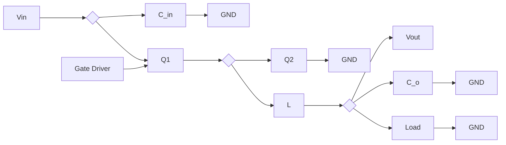
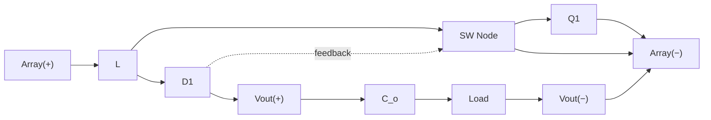

# Lesson 4: Power Electronics & Conversion

## 1. First-Principles Intuition & Invariants

The conversion of electrical power between voltage and current domains lies at the foundation of renewable energy integration. Solar photovoltaic arrays generate DC voltages that fluctuate wildly with irradiance and temperature; wind turbines produce variable-frequency AC that must be rectified, conditioned, and re-synthesized; battery storage systems demand bidirectional DC-DC conversion with millisecond-scale response to grid transients. Every renewable energy installation—from a 300-watt rooftop microinverter to a 100-megawatt utility-scale solar farm—depends on power electronic converters that switch semiconductor devices at frequencies between 10 kilohertz and several megahertz to reshape electrical waveforms while minimizing conduction and switching losses.

At the heart of power conversion lies a singular invariant: **energy storage in reactive components enables voltage transformation without resistive dissipation**. Unlike a resistive voltage divider that wastes power as heat proportional to the square of the current, an ideal inductor or capacitor stores energy in magnetic or electric fields and returns that energy to the circuit during complementary phases of a switching cycle. A buck converter steps down voltage by alternately connecting an input source to an inductor through a controlled switch, then allowing the inductor's collapsing magnetic field to drive current through a freewheeling diode into the load. The duty cycle—defined as the fraction of the switching period during which the main switch conducts—directly determines the output-to-input voltage ratio. For a buck converter operating in continuous conduction mode (CCM), the steady-state relationship simplifies to $V_{\text{out}} = D \cdot V_{\text{in}}$, where $D$ ranges from zero to unity. This equation, derived from volt-second balance on the inductor, represents the most fundamental law of switched-mode power conversion: the time-averaged voltage across an inductor in steady state must equal zero, forcing the integral of voltage over the on-time to equal the integral over the off-time.

The buck converter's complementary topology, the boost converter, inverts this switching sequence. Here, the inductor connects directly to the input during the on-time, storing energy as current ramps upward, then transfers that energy through a diode to the output capacitor and load during the off-time when the switch opens. The voltage transformation obeys $V_{\text{out}} = V_{\text{in}} / (1 - D)$, revealing that as the duty cycle approaches unity, the output voltage theoretically climbs toward infinity—though in practice, parasitic resistances, finite switching speeds, and thermal limits constrain the achievable boost ratio to perhaps five or six. A buck-boost topology cascades these operations, first storing energy in an inductor during the on-time with both input and output isolated, then transferring that energy to the output during the off-time, yielding $V_{\text{out}} = -D \cdot V_{\text{in}} / (1 - D)$ with polarity inversion.

These fundamental topologies share a common mathematical framework rooted in state-space averaging. Each switching cycle divides into discrete topological states—typically two for basic converters—defined by the on or off condition of each semiconductor switch. During the on-time interval $DT_s$, the circuit obeys one set of differential equations governing inductor currents and capacitor voltages; during the off-time $(1-D)T_s$, a different set applies. Averaging these equations over a complete period and linearizing around an operating point yields small-signal transfer functions that predict how the output voltage responds to duty cycle perturbations, input voltage disturbances, and load current variations. The right-half-plane zero that appears in the boost and buck-boost converter transfer functions—a peculiarity arising from the fact that increasing the duty cycle initially decreases the output voltage before the inductor current builds up—imposes severe bandwidth limitations on feedback control loops and demands careful compensation network design.

Renewable energy applications impose unique constraints that distinguish power converter design from traditional offline power supplies. Photovoltaic arrays exhibit a strongly nonlinear current-voltage characteristic, delivering maximum power at a single operating point that shifts continuously with irradiance, temperature, and partial shading conditions. A maximum power point tracking algorithm must perturb the converter's operating point and observe whether the extracted power increases or decreases, implementing a hill-climbing search across the IV curve. The classical Perturb and Observe (P&O) method increments or decrements the duty cycle at regular intervals, measuring array voltage and current to compute instantaneous power, then stepping in the direction of increasing power. This simple algorithm suffers from oscillatory steady-state behavior and slow convergence during rapid irradiance transients, prompting the development of Incremental Conductance methods that algebraically determine the direction toward the maximum power point by comparing instantaneous conductance $I/V$ to incremental conductance $\Delta I / \Delta V$. At the maximum power point, these quantities are equal in magnitude but opposite in sign.

The transformation from DC to AC introduces a second layer of complexity. Inverters synthesize sinusoidal output voltages by rapidly switching DC bus voltage across the load through an H-bridge or three-phase bridge topology, modulating the switch duty cycles to approximate the desired sinusoidal waveform. Pulse-width modulation generates switching patterns by comparing a low-frequency sinusoidal reference signal to a high-frequency triangular carrier, closing the appropriate switches whenever the reference exceeds the carrier. The ratio of carrier frequency to fundamental frequency—the modulation index—directly affects the harmonic content of the output voltage, which appears as sidebands centered around the switching frequency and its harmonics. Total harmonic distortion, defined as the RMS sum of all harmonic voltage components divided by the fundamental component, quantifies waveform purity and must typically remain below three to five percent to meet grid interconnection standards such as IEEE 1547 or IEC 61727.

Grid synchronization demands that the inverter's output voltage phase-lock to the utility voltage with sub-degree accuracy to prevent destructive circulating currents during the instant of interconnection. A phase-locked loop achieves this by multiplying the measured grid voltage by orthogonal sine and cosine reference signals at the estimated grid frequency, low-pass filtering the products to extract DC components proportional to sine and cosine of the phase error, then integrating the phase error through a loop filter to generate a voltage-controlled oscillator frequency command. The synchronous reference frame PLL transforms three-phase voltages into a rotating dq coordinate system where the grid voltage appears as a DC quantity, enabling simple PI control to drive the quadrature component to zero while tracking the direct component's phase. Under unbalanced or distorted grid conditions, advanced PLLs incorporate decoupling networks, notch filters, or dual second-order generalized integrators to suppress the double-frequency oscillations that corrupt phase estimates.

The semiconductor devices that execute these switching operations—MOSFETs for low-voltage, high-frequency applications below 100 volts and IGBTs for medium-voltage, moderate-frequency applications up to several kilovolts—exhibit switching characteristics that fundamentally limit converter performance. A MOSFET behaves as a voltage-controlled resistor in the on-state, with drain-source resistance $R_{DS(on)}$ ranging from milliohms to hundreds of milliohms depending on voltage rating and die area, producing conduction losses $I_{RMS}^2 R_{DS(on)}$. The gate capacitance, typically several nanofarads for medium-power devices, must be charged and discharged every switching cycle, consuming energy $Q_g V_{GS} f_s$ where $Q_g$ represents the total gate charge. During the switching transition, the device simultaneously supports voltage and conducts current, dissipating power in proportion to the transition time. The interplay between gate drive current, Miller capacitance $C_{GD}$, and load current determines this transition interval, creating a three-way tradeoff between switching loss, electromagnetic interference, and shoot-through risk in half-bridge topologies.

IGBTs trade the MOSFET's low on-resistance for superior voltage blocking capability by inserting a bipolar PNP transistor in series with the MOSFET channel. This structure produces a forward voltage drop consisting of a threshold voltage around one volt plus a resistive component, yielding lower conduction losses than an equivalently rated MOSFET at high voltages but introducing a current tail during turn-off as minority carriers recombine in the wide N− drift region. The tail current extends the turn-off switching interval and increases switching losses, particularly at elevated junction temperatures where carrier lifetime lengthens. Modern field-stop IGBT designs thin the wafer and insert a heavily doped N-buffer layer to accelerate carrier extraction, reducing tail current at the expense of higher on-state voltage drop.

The choice between string inverters, central inverters, and microinverters embodies a fundamental architectural tradeoff between cost, efficiency, modularity, and system reliability. A central inverter processes power from an entire array through a single large conversion stage, achieving peak efficiencies exceeding 98 percent through reduced switching and magnetic losses at multi-kilowatt power levels, but suffers from single-point-of-failure vulnerability and requires high-voltage DC wiring that poses arc-flash hazards. String inverters segment the array into parallel strings, each feeding a dedicated MPPT input channel within a shared inverter enclosure, balancing cost and mismatch mitigation while maintaining relatively high efficiency. Microinverters distribute the conversion function to the module level, eliminating high-voltage DC entirely and enabling per-panel monitoring and optimization, but multiply component count, reduce individual converter efficiency due to higher switching losses at fractional-kilowatt power levels, and increase installation complexity.

## 2. Core Architecture & Mechanics

The synchronous buck converter represents the canonical DC-DC topology for photovoltaic applications, replacing the freewheeling diode with a second MOSFET to eliminate diode forward voltage drop losses and enable bidirectional power flow for battery charging systems. The power stage comprises two switches $Q_1$ and $Q_2$ arranged in a half-bridge configuration with the switch node connecting to an inductor $L$, which filters the pulsed switch-node voltage into a continuous output current. An output capacitor $C_o$ attenuates the inductor current ripple, maintaining a stable output voltage against load transients.

During the on-time, the controller's gate driver charges $Q_1$'s gate capacitance to 10 or 12 volts above its source potential, closing the channel and connecting the input voltage to the switch node. Current flows through $Q_1$'s channel resistance, through the inductor, to the load and output capacitor. The inductor voltage equals $V_{in} - V_{out} - I_L R_{Q1}$, causing inductor current to ramp upward with slope $(V_{in} - V_{out})/L$. After the on-time $DT_s$ elapses, the controller discharges $Q_1$'s gate and charges $Q_2$'s gate, connecting the switch node to ground. The inductor current continues flowing through $Q_2$ into the output, now decreasing with slope $-V_{out}/L$ as the magnetic field collapses. The ripple current magnitude, defined as half the peak-to-peak inductor current swing, equals $(V_{in} - V_{out})DT_s / (2L)$, directly informing inductor selection.

Inductor design trades current ripple against core loss, winding loss, and physical volume. Smaller inductance permits smaller, lighter magnetic components but increases ripple current, which elevates RMS currents through the switches and capacitors, raising their conduction losses and thermal stress. A typical design targets 20 to 40 percent ripple ratio $\Delta I_L / I_{out}$, yielding $L = (V_{in} - V_{out})D / (0.3 I_{out} f_s)$ for a 30 percent ripple example. The inductor must store energy $\frac{1}{2}LI_{pk}^2$ without saturating, requiring an air gap in ferrite cores to linearize the BH curve and increase the saturation current. The gap introduces fringing flux that increases AC resistance by inducing eddy currents in adjacent winding turns, forcing careful layer-to-layer interleaving or litz wire construction for switching frequencies above 100 kilohertz.

Output capacitor selection hinges on ESR (equivalent series resistance), ESL (equivalent series inductance), and bulk capacitance requirements. The voltage ripple comprises two components: a resistive term $\Delta I_L \cdot ESR$ from ripple current flowing through the capacitor's internal resistance, and a capacitive term $\Delta I_L / (8 f_s C_o)$ from the charge transferred during one quarter of the ripple cycle. Ceramic capacitors offer exceptionally low ESR, often below 10 milliohms, and low ESL, making them ideal for high-frequency decoupling, but their capacitance decreases significantly with applied DC bias due to ferroelectric polarization saturation. A 10-microfarad X7R ceramic rated at 25 volts may exhibit only 3 microfarads when biased to 12 volts. Aluminum electrolytic capacitors provide large bulk capacitance at lower cost but suffer from high ESR exceeding 100 milliohms and limited ripple current ratings, typically necessitating parallel combinations of ceramic and electrolytic types to satisfy both ESR and bulk capacitance constraints simultaneously.

The control loop that regulates output voltage comprises an error amplifier, pulse-width modulator, and gate driver. A type-II or type-III compensation network shapes the loop transfer function to achieve high DC gain for accurate regulation, a crossover frequency below one-fifth to one-tenth the switching frequency to avoid subharmonic oscillation, and sufficient phase margin—typically 45 to 60 degrees—to prevent ringing during load transients. The power stage itself introduces a double pole at the LC filter resonant frequency $f_{LC} = 1/(2\pi\sqrt{LC})$ and a zero at $f_{ESR} = 1/(2\pi ESR \cdot C_o)$, plus additional poles from load capacitance and circuit parasitics. Peak current mode control simplifies compensation by moving the dominant LC double-pole to a single pole set by the output capacitance and load resistance, at the cost of requiring a current sense resistor or inductor DCR sensing network.

Boost converter operation for MPPT inverts the switching sequence, storing energy in the inductor during the on-time when the switch connects the inductor to ground, then releasing energy to the output during the off-time through the catch diode. The inductor sits between the PV array and the switch node, experiencing the full array voltage during the off-time and zero voltage minus the switch drop during the on-time. This arrangement forces continuous inductor current even at light loads when the buck converter would enter discontinuous conduction mode, eliminating the DCM-related subharmonic oscillation that plagues current-mode controlled buck converters but introducing the right-half-plane zero that limits control bandwidth.

The boost converter's output voltage capability enables direct grid-tie inverter architectures without a bulky line-frequency transformer. A single-stage boost inverter elevates the PV array voltage to 400 or 450 volts DC, providing sufficient headroom above the 240-volt RMS grid voltage to synthesize sinusoidal current waveforms through PWM. The DC bus capacitor—typically several hundred microfarads of film or electrolytic capacitance—absorbs the double-line-frequency power pulsation inherent in single-phase systems, where instantaneous power varies as $P = V_{grid} I_{grid} \cos \phi (1 - \cos 2\omega t)$. This 120-hertz component stresses the capacitor with RMS ripple current equal to the output power divided by the DC bus voltage, demanding careful derating and thermal management to achieve 20-year design lifetimes.

Three-phase inverter topologies eliminate the double-line-frequency power pulsation when loads are balanced, permitting far smaller DC bus capacitors. The six-switch three-phase bridge generates three independent PWM output voltages, each capable of swinging from zero to the full DC bus voltage. Space vector modulation optimally selects switching states to synthesize arbitrary voltage vectors in the αβ stationary reference frame or dq rotating reference frame, maximizing DC bus utilization and minimizing switching losses compared to naive sinusoidal PWM. The modulator partitions each 60-degree sector of the hexagonal voltage space into four regions, calculates the dwell times for adjacent active vectors plus the zero vector to average to the commanded voltage, then sequences the switching states to minimize transitions per switching period.

Consider a 5-kilowatt single-phase string inverter operating from a 300-volt PV array with a target DC bus voltage of 400 volts and a switching frequency of 20 kilohertz. The boost inductor must support the full input current, roughly 17 amperes at rated power, with perhaps 30 percent ripple current. Solving $L = (V_{in}D)/(0.3 I_{in} f_s)$ with $D = 1 - V_{in}/V_{bus} = 0.25$ yields $L \approx 73$ microhenries. A powder iron core toroid with distributed air gap, wound with 18 turns of 14 AWG magnet wire, achieves this inductance with saturation current exceeding 25 amperes. The DC bus capacitor must absorb 5000 watts at 60 hertz double-line-frequency ripple at 400 volts DC bus, implying $I_{RMS} = P/(V_{bus}\sqrt{2}) \approx 8.8$ amperes RMS of 120-hertz ripple current. Three parallel 220-microfarad 450-volt aluminum electrolytic capacitors, each rated for 3 amperes RMS ripple, satisfy this requirement with margin.

The H-bridge output stage employs four IGBTs or MOSFETs arranged as two half-bridges. Modulating the duty cycles of the high-side and low-side switches in each leg synthesizes a differential output voltage across the load. Unipolar PWM switches both legs synchronously, producing a three-level switch-node voltage (+Vbus, 0, −Vbus) that reduces harmonic content but increases switching losses. Bipolar PWM modulates the two legs in complementary fashion, generating only +Vbus and −Vbus, halving the switching frequency seen by the load but producing higher harmonic distortion. Dead-time insertion prevents shoot-through by inserting a brief interval during which both switches in a half-bridge are off during transitions, relying on body diodes to conduct load current, but this introduces output voltage error proportional to load current that distorts the zero crossings of sinusoidal waveforms unless compensated.

## 3. High-Performance Optimization & Failure Modes

Achieving 98 percent efficiency in a grid-tie inverter demands meticulous attention to loss mechanisms across the entire power path. Conduction losses dominate at low switching frequencies and high currents, favoring devices with low on-resistance or forward voltage drop. Switching losses scale linearly with frequency and the product of voltage and current during the transition interval, favoring fast-switching devices with low gate charge and minimal reverse recovery in freewheeling diodes. Magnetic core losses increase with frequency and flux density according to the Steinmetz equation $P_v = k f^\alpha B^\beta$, favoring low-loss ferrite materials and conservative flux density operation below 200 millitesla. Gate drive losses, though often small in absolute terms, become significant at megahertz frequencies, consuming $Q_g V_{GS} f_s$ per device.

Thermal management couples directly to reliability through the Arrhenius equation, which predicts that semiconductor failure rates double for every 10-degree Celsius increase in junction temperature. A 100-watt inverter with 2 percent loss dissipates 2 kilowatts as heat, roughly the output of a consumer space heater, demanding forced-air or liquid cooling to maintain junction temperatures below 125 degrees Celsius. Heat spreads from the semiconductor die through a thermal interface material into a heatsink with thermal resistance $R_{th}$ measured in degrees Celsius per watt. The junction temperature equals ambient temperature plus the product of power dissipation and the sum of junction-to-case, case-to-sink, and sink-to-ambient thermal resistances. Minimizing this sum drives heatsink selection: extruded aluminum profiles with anodized fins achieve 0.5 to 1.5 °C/W in natural convection; forced-air convection reduces this to 0.1 to 0.3 °C/W; liquid cold plates reach 0.01 to 0.05 °C/W.

Dead-time distortion manifests as crossover distortion near zero crossings when the load current freewheels through body diodes rather than channel resistances. The body diode's forward voltage, typically 0.7 to 1.2 volts for silicon or 1.5 to 2 volts for IGBTs with anti-parallel diodes, subtracts from or adds to the commanded output voltage depending on current polarity. This error flattens the sinusoidal waveform and injects low-order harmonics, particularly third and fifth, that degrade power factor and increase total harmonic distortion. Adaptive dead-time compensation measures or estimates the output current polarity and adjusts the duty cycle to cancel the voltage error, using either direct current sensing or observer-based estimation. Synchronous rectification, where the controller actively drives the low-side MOSFET during freewheeling intervals, eliminates the body diode drop entirely but requires precise current polarity detection to avoid shoot-through.

Partial shading of photovoltaic arrays introduces multiple local maxima in the power-voltage characteristic, defeating simple P&O algorithms that converge to the nearest peak rather than the global maximum. A substring shaded by a tree branch or bird dropping forces bypass diodes to conduct, rerouting current around the affected cells but clamping the string voltage to approximately two-thirds of its open-circuit value. The resulting power curve exhibits a dominant peak corresponding to the unshaded modules plus one or more smaller peaks from the shaded substrings operating independently. Global MPPT algorithms sweep the entire voltage range periodically to rediscover the global maximum, trading steady-state tracking efficiency for robustness against moving shadows. Distributed MPPT, implemented through module-level DC optimizers or microinverters, eliminates string-level mismatch entirely by allowing each panel to operate at its individual maximum power point, improving energy harvest by 5 to 25 percent in partially shaded installations at the cost of increased component count and installation labor.

Phase-locked loop stability under grid disturbances presents a critical challenge for utility-scale inverters that must ride through voltage sags, phase jumps, and harmonic distortion while maintaining synchronization. A sudden voltage sag appears as a frequency transient to the PLL, causing the loop to accelerate or decelerate the internal oscillator as it attempts to reacquire phase lock. Insufficient phase margin or excessive loop gain precipitates oscillatory behavior that couples back into the current control loop, potentially triggering overcurrent protection and disconnecting the inverter during transients that it should legally ride through per IEEE 1547-2018. Adaptive PLL bandwidth adjustment reduces loop gain during detected disturbances, sacrificing transient response to preserve stability, while frequency-locked loops provide an alternative architecture that tracks frequency independently of amplitude variations.

Resonance between inverter output filter capacitors and grid inductance introduces oscillatory modes that can destabilize current control loops or amplify harmonic distortion. An LCL filter topology, which inserts a second inductor between the inverter and the grid with a shunt capacitor forming an LC tank, attenuates high-frequency switching harmonics far more effectively than a simple L filter but introduces a resonant peak with quality factor $Q = R\sqrt{C/L}$ where $R$ represents the total series resistance. Passive damping dissipates energy through a resistor in series with the capacitor, reducing the resonant peak at the cost of fundamental frequency losses and reduced harmonic attenuation. Active damping injects a feedback signal proportional to capacitor current into the current control loop, synthesizing a virtual resistance that damps the resonance without resistive losses, but requires additional sensing and increases controller computational burden.

Electromagnetic interference from high-frequency switching currents couples into adjacent circuits through radiated fields, conducted common-mode currents on DC input cables, and differential-mode currents on AC output lines. Common-mode currents flow through parasitic capacitance between heatsinks and Earth ground, returning through the grid neutral or DC array ground, producing radio-frequency emissions that violate FCC Part 15 or CISPR 11 limits. A common-mode choke wound on a high-permeability nanocrystalline core impedes these currents with high impedance at radio frequencies while presenting negligible impedance to differential-mode power currents. The choke comprises two windings wound in the same direction so that differential currents produce opposing magnetic fields that cancel, yielding low differential-mode inductance, while common-mode currents produce additive fields that saturate the core at much higher current levels. Y-capacitors from each power rail to chassis ground shunt high-frequency common-mode noise, but their capacitance is limited to 2 to 10 nanofarads to limit leakage current below safety thresholds, typically 0.5 milliamperes for portable equipment or 3.5 milliamperes for fixed installations.

Gate drive circuit design trades switching speed against electromagnetic interference and shoot-through risk. A high-current gate driver sourcing 2 to 5 amperes can charge a typical MOSFET gate capacitance in tens of nanoseconds, minimizing switching losses, but the resulting high di/dt in the gate loop induces voltage transients across parasitic inductances that can false-trigger adjacent devices or radiate interfering fields. Series gate resistance slows the transition, reducing EMI and ringing, but increases switching losses proportionally to the lengthened transition time. Split gate resistors—one for turn-on and a smaller one for turn-off—optimize this tradeoff by accelerating turn-off to minimize voltage-current overlap while slowing turn-on to reduce inrush current and Miller-plateau dv/dt that couples through the gate-drain capacitance to create displacement currents in the gate drive circuit.

Reliability prediction for power electronics follows the Mil-HDBK-217 or IEC 61709 frameworks, which decompose system-level failure rates into component contributions modified by stress factors including temperature, voltage derating, cycling frequency, and environmental conditions. Electrolytic capacitors dominate the failure rate of most inverter designs due to electrolyte evaporation that accelerates exponentially with core temperature, motivating the shift toward film capacitors or ceramic DC-link capacitors despite their higher cost per microfarad. IGBT modules experience bond wire liftoff and solder delamination from repeated thermomechanical stress as power cycling heats and cools the silicon die relative to the copper baseplate. The number of cycles to failure follows a Coffin-Manson relationship $N_f = A (\Delta T_j)^{-n}$ where $\Delta T_j$ represents junction temperature swing and the exponent $n$ typically ranges from 4 to 9 depending on bond wire construction and sintering process. Mission-profile-based lifetime estimation convolves the expected distribution of environmental and operating conditions—ambient temperature profiles, irradiance statistics, load transients—with the device's physics-of-failure models to predict mean time to failure, informing warranty periods and maintenance schedules.

Practical commissioning of an MPPT controller on a 1-kilowatt rooftop system begins with open-circuit voltage and short-circuit current measurements to validate array configuration and identify miswiring or damaged modules. With the inverter disconnected, the array open-circuit voltage should measure within 5 percent of the sum of individual module $V_{OC}$ specifications derated for measured cell temperature using the manufacturer's temperature coefficient, typically −0.3 percent per degree Celsius. Short-circuit current, measured through a calibrated shunt ammeter at the combiner box, should equal the sum of parallel string currents under known irradiance, verifiable against module $I_{SC}$ ratings scaled by the ratio of measured to standard-test-condition irradiance. Discrepancies indicate shading, soiling, or internal cell failures that degrade performance.

With the array under load at open sky conditions, the MPPT algorithm's convergence is observable by monitoring array voltage and current with a dual-trace oscilloscope or data logger at one-second intervals. The controller should settle to a steady-state operating point within 5 to 10 perturbation cycles, exhibiting small oscillations around the maximum power point with amplitude proportional to the perturbation step size. Introducing a temporary partial shade—a cardboard panel over one module—creates a dual-peak power curve; a properly functioning global MPPT algorithm should periodically sweep the voltage range and relocate to the new global maximum within 10 to 30 seconds, while a simple P&O tracker may become trapped at a local maximum yielding 20 to 40 percent less power. Efficiency measurement requires simultaneous logging of input power from the PV array and output power delivered to the grid or load, accounting for reactive power and harmonic content in the AC output through true RMS measurements and power factor calculations. California Energy Commission efficiency, the industry-standard weighted metric, averages efficiencies at 10, 20, 30, 50, 75, and 100 percent of rated power with weighting 0.04, 0.05, 0.12, 0.21, 0.53, and 0.05 respectively, reflecting typical irradiance distributions.
