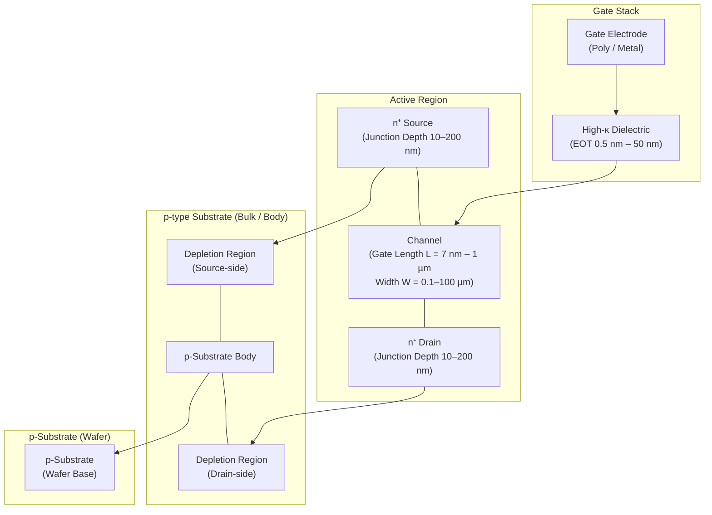
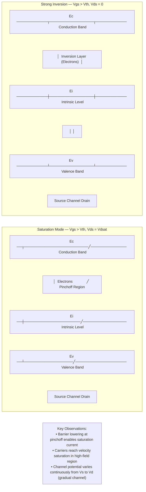

# Lesson 5: MOS Capacitor Physics, MOSFET Device Theory, Scaling Laws

## 1. First-Principles Intuition & Invariants

The metal-oxide-semiconductor field-effect transistor stands as the fundamental building block of modern integrated circuits, and its operation emerges from the exquisite control of charge carriers at the silicon-oxide interface through electric field modulation. To understand the MOSFET at a device physics level, we must first examine the simpler MOS capacitor structure, where a metal gate electrode sits atop a thin insulating oxide layer, which in turn covers a semiconductor substrate. This three-layer stack creates a voltage-controlled capacitor whose capacitance varies dramatically depending on the electrostatic conditions at the semiconductor surface.

The MOS capacitor reveals its behavior through band diagram analysis. When we apply a voltage to the metal gate relative to the grounded semiconductor substrate, we perturb the electronic band structure within the silicon. The oxide acts as a perfect insulator with a wide bandgap of approximately 9 eV for silicon dioxide, preventing any direct current flow between gate and substrate under normal operating conditions. However, the electric field penetrates through the oxide and into the semiconductor, bending the energy bands near the surface. This band bending determines whether the surface region accumulates majority carriers, depletes of mobile charge, or inverts to contain minority carriers.

Consider a p-type silicon substrate where holes constitute the majority carriers and electrons the minority carriers. When we apply a negative gate voltage, we attract holes toward the surface, creating an accumulation layer where the hole concentration exceeds the bulk doping level. The bands bend upward at the surface, and the entire structure behaves as two capacitors in series: the oxide capacitance and the semiconductor capacitance. However, because the accumulation layer forms immediately adjacent to the oxide with negligible spatial extent, the semiconductor capacitance becomes enormous, and the total capacitance approaches the oxide capacitance as its limiting value.

As we sweep the gate voltage toward positive values, we reach the flatband condition where no band bending occurs and the surface potential equals the bulk potential. Continuing to more positive voltages repels holes from the surface region, creating a depletion layer devoid of mobile carriers but containing fixed ionized acceptor atoms. The width of this depletion region increases with applied voltage following the Poisson equation, and the total capacitance now reflects two series capacitors: the fixed oxide capacitance and the voltage-dependent depletion capacitance. Because the depletion width grows as the square root of the surface potential, the total capacitance decreases monotonically in this regime.

At sufficiently positive gate voltage, we reach the threshold of strong inversion. The surface potential has bent downward by approximately twice the Fermi potential relative to the intrinsic level, creating an energy landscape where electrons from the conduction band become thermodynamically favorable at the surface despite the p-type bulk doping. Minority carrier electrons accumulate at the silicon-oxide interface, forming an inversion layer that screens further penetration of the electric field into the bulk. The inversion layer density increases exponentially with additional gate voltage beyond threshold, but the depletion width ceases to grow significantly. Under low-frequency AC measurement where carriers can respond to the AC signal, the inversion layer contributes capacitively and the total capacitance returns toward the oxide capacitance value. Under high-frequency measurement where thermal generation cannot supply enough minority carriers to follow the AC signal, the inversion layer cannot respond and the capacitance remains at its minimum depletion value.

The oxide capacitance per unit area emerges from the parallel-plate capacitor formula modified by the dielectric constant of silicon dioxide. We write $C_{ox} = \epsilon_{ox} / t_{ox}$, where $\epsilon_{ox} = \epsilon_0 \epsilon_{r,ox}$ combines the vacuum permittivity with the relative permittivity of silicon dioxide, typically 3.9, and $t_{ox}$ represents the physical oxide thickness. For a 10 nm oxide, this yields approximately 3.45 × 10⁻³ F/m² or 3.45 fF/μm². Modern process nodes have pushed equivalent oxide thickness well below 1 nm through the introduction of high-κ dielectrics like hafnium oxide, which provide greater capacitance per unit physical thickness by virtue of their higher dielectric constants.

The threshold voltage represents the gate voltage required to achieve strong inversion, and its derivation from first principles requires careful accounting of multiple energy contributions. We begin with the work function difference between the gate material and the semiconductor, which creates an initial built-in potential even at zero applied voltage. For a heavily doped n-type polysilicon gate on p-type silicon, this work function difference typically amounts to approximately 1 V. Next, we must account for the voltage dropped across the oxide to establish the depletion charge, which scales with the square root of the substrate doping density through the depletion approximation. The surface potential at threshold equals $2\phi_F$, where $\phi_F = (kT/q) \ln(N_A/n_i)$ represents the Fermi potential, approximately 0.3 V for typical substrate doping of 10¹⁶ cm⁻³. The depletion charge per unit area follows $Q_{dep} = -q N_A W_d$, where the depletion width at threshold satisfies $W_d = \sqrt{4 \epsilon_s \phi_F / (q N_A)}$.

Assembling these contributions yields the threshold voltage expression: $V_{th} = V_{FB} + 2\phi_F + Q_{dep}/C_{ox}$, where $V_{FB}$ captures the flatband voltage including work function difference and any fixed oxide charge. Interface trap states at the silicon-oxide boundary further modify this expression through charge trapping that depends on surface potential. Modern CMOS processes employ threshold voltage adjustment implants—shallow, high-dose dopant profiles near the channel surface—to tune $V_{th}$ independently of bulk doping, enabling optimization of on-current versus off-current tradeoffs.

The transition from MOS capacitor to MOSFET occurs when we introduce source and drain regions—heavily doped n-type regions in a p-type substrate for an NMOS device—separated by the channel region controlled by the gate. When we apply a positive gate voltage exceeding threshold, we induce an inversion layer that forms a conductive path between source and drain. A small drain voltage relative to the source creates a lateral electric field that drifts electrons from source to drain, producing drain current proportional to the channel conductance. This linear region operation persists until the drain voltage increases sufficiently to pinch off the inversion layer at the drain end of the channel, beyond which the device enters saturation where drain current becomes relatively independent of drain voltage.

The long-channel MOSFET model, valid when the channel length substantially exceeds both the depletion width and the source-drain junction depths, allows us to apply the gradual channel approximation. We assume the inversion charge density varies smoothly along the channel in response to the local channel potential, which transitions from zero at the source to $V_{ds}$ at the drain. The drift current density follows $J = q n(y) \mu_n E(y)$, where $n(y)$ represents the local electron density, $\mu_n$ the electron mobility, and $E(y)$ the lateral electric field. Integrating this current continuity equation from source to drain while accounting for the voltage-dependent inversion charge yields the canonical square-law model for drain current in saturation: $I_{d,sat} = (\mu_n C_{ox} / 2) (W/L) (V_{gs} - V_{th})^2$, where $W$ and $L$ denote channel width and length respectively.

This quadratic dependence on gate overdrive voltage $(V_{gs} - V_{th})$ emerges from the combination of two linear dependencies: the inversion charge density increases linearly with gate overdrive, and the average lateral electric field also scales linearly with the effective voltage across the channel. The device transconductance in saturation, obtained by differentiating drain current with respect to gate voltage, therefore scales linearly with gate overdrive: $g_m = \mu_n C_{ox} (W/L) (V_{gs} - V_{th})$. This linear transconductance relationship makes long-channel MOSFETs excellent for analog amplifier design, where linearity and predictability trump raw performance.

## 2. Core Architecture & Mechanics

The physical structure of a modern MOSFET extends far beyond the idealized long-channel picture, incorporating numerous geometric and material innovations to combat short-channel effects while maximizing current drive capability. The canonical planar MOSFET features a gate stack consisting of polysilicon or metal gate electrode atop a high-κ dielectric, with source and drain regions formed through ion implantation and thermal activation. The lateral dimension between source and drain metallurgical junctions defines the mask channel length, while diffusion and implant straggle cause the actual electrical channel length to deviate from this nominal value. Lightly doped drain extensions improve reliability by reducing the peak electric field at the drain junction, at the cost of increased series resistance that degrades drive current.

Short-channel effects manifest when the channel length approaches the characteristic depletion widths associated with source and drain junctions. The two-dimensional electrostatics of the structure no longer permit the gradual channel approximation, as charge sharing between the gate and the source-drain junctions modifies the threshold voltage. Drain-induced barrier lowering represents the most pernicious short-channel effect: as drain voltage increases, the drain depletion region extends laterally toward the source, effectively lowering the potential barrier that prevents carrier injection from source to channel. This barrier lowering translates directly to a reduction in threshold voltage that increases with drain voltage, causing the drain current in saturation to continue rising rather than saturating to a constant value.

We quantify DIBL through the metric $\text{DIBL} = -(V_{th,low} - V_{th,high})/(V_{dd,high} - V_{dd,low})$, typically measured between a low drain voltage of 0.05 V and the nominal supply voltage. Well-designed long-channel devices exhibit DIBL below 10 mV/V, while aggressively scaled short-channel transistors may suffer DIBL exceeding 100 mV/V, severely degrading the output resistance and voltage gain of analog circuits. The subthreshold swing, defined as the gate voltage change required to alter drain current by one decade when operating below threshold, suffers similar degradation in short-channel devices. The theoretical minimum subthreshold swing at room temperature equals $(kT/q) \ln(10) = 60$ mV/decade, achieved only when the gate fully controls the channel potential. Short-channel effects cause drain-controlled barrier lowering that increases the subthreshold swing to 80-120 mV/decade, increasing off-state leakage current exponentially.

Velocity saturation emerges as a fundamental limitation when the lateral electric field exceeds approximately 10⁴ V/cm in silicon. At this field strength, energetic carriers begin to emit optical phonons at the same rate they gain energy from the electric field, capping their drift velocity near 10⁷ cm/s regardless of further field increases. For a 100 nm channel length device operating with 1 V drain voltage, the average lateral field reaches 10⁵ V/cm, deep into the velocity saturation regime. The drain current therefore transitions from the long-channel quadratic dependence to a linear dependence on gate overdrive: $I_{d,sat} \approx W v_{sat} C_{ox} (V_{gs} - V_{th})$, where $v_{sat}$ represents the saturated carrier velocity. This velocity saturation degrades transconductance by a factor roughly equal to the ratio of channel length to saturation velocity transit time, typically 2-4× in deep submicron nodes.

Channel length modulation, even in the absence of DIBL, causes finite output conductance in saturation through geometric effects. Once the channel pinches off at the drain end, increasing drain voltage pushes the pinchoff point toward the source, effectively shortening the channel length and increasing drain current. The Early voltage $V_A$ parameterizes this effect through the relationship $I_d = I_{d,sat} (1 + V_{ds}/V_A)$, where larger Early voltage indicates better current saturation. Long-channel devices achieve Early voltages of 50-100 V, providing excellent intrinsic gain $g_m r_o$ for analog circuits. Short-channel devices suffering from DIBL and channel length modulation exhibit Early voltages below 5 V, necessitating cascode configurations and gain-boosting techniques to recover acceptable voltage gain.

Hot carrier effects plague short-channel devices operating at high drain voltages, where carriers gain sufficient kinetic energy to impact-ionize electron-hole pairs or inject over the 3.1 eV barrier into the oxide. Hot electrons trapped in the oxide create positive charge that shifts threshold voltage and degrades transconductance over device lifetime. The damage rate scales exponentially with lateral field, making hot carrier degradation particularly severe for devices operating near velocity saturation. Modern devices employ graded channel doping profiles and optimized source-drain extension geometries to smooth the lateral field distribution, trading some peak performance for improved reliability.

Gate leakage current limited the scaling of silicon dioxide thickness to approximately 1.2 nm equivalent oxide thickness, beyond which direct tunneling current through the oxide became unacceptable for low-power applications. The tunneling probability through a rectangular barrier scales exponentially with the quantity $t_{ox} \sqrt{2 m^* \phi_B}$, where $m^*$ represents the effective mass in the oxide and $\phi_B$ the barrier height. For silicon dioxide with its 3.1 eV barrier, gate leakage exceeds 1 A/cm² at 0.8 nm physical thickness, consuming unacceptable static power. The transition to high-κ dielectrics beginning around the 45 nm process node enabled continued capacitance scaling while maintaining thicker physical oxide to suppress tunneling. Hafnium dioxide with dielectric constant near 25 provides equivalent oxide thickness below 1 nm at physical thickness of 2-3 nm, reducing gate leakage by 100-1000× compared to silicon dioxide at the same capacitance.

The subthreshold region, where gate voltage remains below threshold but nonzero current flows, follows exponential current-voltage characteristics dictated by diffusion transport. Writing the surface potential as $\psi_s = (kT/q) \ln(n_s/n_i)$ for the surface electron concentration $n_s$, and noting that drain current depends exponentially on surface potential, we obtain $I_d \propto \exp(q V_{gs} / (n kT))$, where the ideality factor $n$ accounts for the division of gate voltage between surface potential and depletion charge. The subthreshold swing follows directly as $S = (n kT/q) \ln(10)$, reaching its minimum of 60 mV/decade when $n = 1$, meaning the gate perfectly controls surface potential without loss to depletion charge modulation. Real devices exhibit $n$ between 1.1 and 1.5, increasing the subthreshold swing proportionally and exponentially degrading the off-current versus on-current ratio.

Quantum mechanical effects become significant when device dimensions approach the electron wavelength, typically below 10 nm gate length. Carrier confinement in the vertical direction quantizes energy levels, splitting the conduction band into discrete subbands separated by approximately 50-100 meV. This quantization increases the effective threshold voltage by forcing carriers into higher energy states and reduces the inversion layer capacitance by displacing the centroid of carrier distribution away from the oxide interface. Direct source-to-drain tunneling through the potential barrier becomes measurable below 5 nm gate length, creating an irreducible off-state leakage path that cannot be eliminated through threshold voltage adjustment. These quantum effects, combined with statistical dopant fluctuations and line-edge roughness, set fundamental limits on MOSFET scaling that necessitated the transition to three-dimensional device architectures like FinFETs and gate-all-around nanowire transistors.

The body effect modifies threshold voltage when source-to-body voltage deviates from zero, a condition frequently encountered in stacked transistor configurations and analog source followers. Increasing the source voltage relative to the body reduces the surface-to-bulk potential difference, requiring additional gate voltage to achieve threshold. The threshold voltage shift follows $\Delta V_{th} = \gamma (\sqrt{2\phi_F + V_{sb}} - \sqrt{2\phi_F})$, where the body effect coefficient $\gamma = \sqrt{2 q \epsilon_s N_A} / C_{ox}$ depends on substrate doping and oxide capacitance. Typical values of $\gamma$ range from 0.3 to 0.5 V^(1/2), causing substantial threshold voltage increases of 200-400 mV when the source rises 1 V above the body. This body effect degrades transconductance and switching speed in circuits where source terminals operate at variable potentials.

Temperature dependence affects MOSFET characteristics through multiple competing mechanisms. Carrier mobility decreases with temperature following approximately $\mu \propto T^{-1.5}$ due to increased phonon scattering, reducing drain current by roughly 0.3%/°C. Threshold voltage decreases with temperature at approximately -1 to -2 mV/°C as the Fermi potential shifts and the depletion charge reduces with intrinsic carrier concentration increases. These competing effects create a zero-temperature-coefficient bias point where drain current remains constant with temperature, exploited in bandgap reference circuits and temperature-compensated current sources. Subthreshold current increases dramatically with temperature, roughly doubling every 10°C due to the exponential dependence on thermal voltage, making leakage management increasingly difficult at elevated temperatures.

## 3. High-Performance Optimization & Failure Modes

The breakdown of Dennard scaling around 2005 marked a fundamental inflection point in semiconductor technology, ending three decades of simultaneous improvements in speed, power, and density. Dennard's original scaling theory, published in 1974, proposed that electric fields remain constant while dimensions shrink, requiring voltage and current to scale proportionally with dimension. Under ideal Dennard scaling, reducing all dimensions by a factor $\alpha$ while scaling voltage by the same factor maintains constant electric field, reduces gate delay by $\alpha$, decreases active power per transistor by $\alpha^2$ due to quadratic capacitance reduction and linear current reduction, and increases transistor density by $\alpha^2$. The net result delivered a remarkable constant power density with exponentially increasing performance per chip.

This scaling paradise relied on several assumptions that failed in deep submicron regimes. Threshold voltage cannot scale proportionally with supply voltage because subthreshold swing remains fixed at 60 mV/decade minimum by fundamental thermodynamics. Reducing $V_{dd}$ from 5 V to 1 V requires reducing $V_{th}$ from perhaps 0.8 V to 0.2 V to maintain adequate on-current, but this threshold voltage reduction increases off-state leakage current exponentially by roughly $10^{(0.6/0.06)} = 10^{10}$. Static power dissipation, negligible in early CMOS generations, exploded to dominate total power consumption in nanometer-scale nodes. The semiconductor industry maintained Moore's Law density scaling by accepting that power density would increase rather than remain constant, necessitating sophisticated power management, multi-threshold voltage libraries, and eventually the complete redesign of processor microarchitectures around power-limited rather than speed-limited operation.

Velocity saturation breaks the assumption that delay scales linearly with dimension. In long-channel devices, transit time follows $t_d = L^2 / (\mu V_{dd})$, scaling quadratically with length for fixed field. Once carriers saturate, transit time becomes $t_d \approx L / v_{sat}$, exhibiting only linear improvement with scaling. The saturated drain current density approaches the quantum limit $I_d / W \approx v_{sat} C_{ox} V_{dd}$, requiring oxide capacitance increases through high-κ dielectrics and supply voltage maintenance to continue performance scaling. Modern devices at 5 nm nodes operate deep in velocity saturation across most of their operating range, making further speed improvements dependent on reducing parasitic capacitances and resistances rather than improving intrinsic device transconductance.

Series resistance from source and drain regions increasingly dominates total resistance in scaled transistors. The source resistance adds directly to the channel resistance, reducing effective gate overdrive through voltage division and degrading transconductance by the factor $(1 + g_m R_s)^{-1}$. For a device with intrinsic transconductance 1 mS/μm and source resistance 200 Ω·μm, this degradation exceeds 20%. Silicide formation on source-drain regions provides low contact resistance, but the junction depth scaling required to control short-channel effects limits the cross-sectional area available for current flow, increasing sheet resistance. Advanced nodes employ raised source-drain geometries, selective epitaxial growth of silicon-germanium or silicon-carbide with higher dopant solubility, and self-aligned contacts to minimize series resistance while maintaining tight dimensional control.

Process variation emerges as a critical yield and performance limiter in nanometer-scale devices. Random dopant fluctuation causes threshold voltage variation proportional to $1/\sqrt{W L}$, reaching 30-50 mV standard deviation in minimum-geometry transistors. Line-edge roughness from lithography and etch processes introduces channel length variation of 1-2 nm RMS, translating to 5-10% current variation through exponential short-channel effects. These statistical variations force designers to add substantial guardbands, operating circuits at higher voltages and lower speeds than the nominal transistor capability would suggest. Larger transistors exhibit reduced variation but sacrifice density and increase capacitance, creating a fundamental tradeoff between matching requirements and performance density.

The transition to FinFET technology around the 22 nm node addressed short-channel effects through geometric rather than material innovation. By forming the channel as a thin vertical fin surrounded by the gate electrode on three sides, the FinFET achieves superior electrostatic control that suppresses DIBL and improves subthreshold swing even at sub-10 nm gate lengths. The three-dimensional gate wrapping reduces the effective electrical channel length for a given lithographic channel length, improving short-channel immunity by a factor of 2-3×. This improvement enabled threshold voltage reduction while maintaining acceptable off-state leakage, partially recovering Dennard-like scaling for several more process generations. However, FinFETs introduce new challenges including discrete width quantization, increased parasitic capacitance from the three-dimensional geometry, and more complex fabrication requiring extreme ultraviolet lithography and multi-patterning techniques.

Gate-all-around nanowire and nanosheet transistors represent the current scaling frontier, maximizing gate control by surrounding the channel completely with gate electrode. These structures achieve the theoretical optimum of subthreshold swing and DIBL for a given gate length, enabling continued scaling to 3 nm and below. The nanosheet variant stacks multiple horizontal nanosheets vertically, increasing current drive per footprint while maintaining excellent electrostatic control. However, these devices push semiconductor manufacturing to its practical limits, requiring atomic-layer deposition for gate dielectric uniformity, sub-nanometer interface roughness control, and thermal budgets low enough to prevent dopant diffusion in the few-nanometer-scale source-drain extensions.

Reliability physics presents increasingly stringent constraints on supply voltage and operating temperature. Negative bias temperature instability degrades PMOS threshold voltage when the gate is held negative relative to the source, particularly at elevated temperatures. The degradation follows a power-law time dependence, typically $\Delta V_{th} \propto t^{0.15}$, accumulating to 50-100 mV threshold shift over ten years of operation. Hot carrier injection at the drain creates interface states that degrade transconductance and increase subthreshold swing, with damage rates scaling exponentially with the maximum lateral field. Time-dependent dielectric breakdown, where the oxide develops a conductive filament after prolonged voltage stress, imposes hard limits on maximum electric field, currently around 5 MV/cm for high-κ dielectrics. These reliability constraints force supply voltage reductions below the performance-optimal value, further exacerbating the power-performance tradeoff.

Analog and mixed-signal design faces particular challenges in scaled CMOS processes optimized for digital logic. The low output resistance caused by DIBL and channel length modulation degrades intrinsic gain to 10-15 dB, compared to 40-60 dB in older long-channel processes. Threshold voltage mismatch increases with scaling, degrading the precision of current mirrors and differential pairs. The reduced supply voltage headroom leaves little margin for stacking transistors in cascode configurations or accommodating common-mode input range in operational amplifiers. Designers respond through circuit innovation including bulk-driven and floating-gate techniques, calibration and trimming to compensate for mismatch, and hybrid integration where analog functions remain in a mature process node while digital logic scales aggressively.

Power delivery networks must supply extremely high transient currents—exceeding 100 A for a modern high-performance processor—while maintaining supply voltage regulation within ±5% despite parasitic resistance and inductance. The on-chip power distribution grid consumes 15-20% of total chip area in advanced nodes, with multiple metal layers dedicated exclusively to power routing. Decoupling capacitors placed throughout the die provide local charge storage to supply switching current without voltage droop, but their effectiveness decreases as switching frequencies rise into the gigahertz range where inductance dominates impedance. Off-chip voltage regulation employing multi-phase buck converters provides fast load regulation, but the package inductance of 1-2 nH limits transient response to the nanosecond timescale, requiring substantial on-die capacitance to bridge faster transients.

The transition from planar to three-dimensional device structures, from silicon dioxide to high-κ dielectrics, from polysilicon to metal gates, and from uniform channel doping to highly engineered profiles illustrates the extraordinary innovation required to sustain Moore's Law against fundamental physical limits. Each generation of semiconductor technology represents thousands of person-years of research development optimizing dozens of materials, processes, and device structures in concert. The MOSFET remains the fundamental building block, but its physical implementation in a 3 nm process node bears little resemblance to the idealized long-channel device from which we derived its basic operating principles. Understanding both the first-principles device physics and the complex reality of modern nanometer-scale transistors equips the hardware engineer to make informed tradeoffs between performance, power, area, and reliability across the full hierarchy of integrated circuit design.
