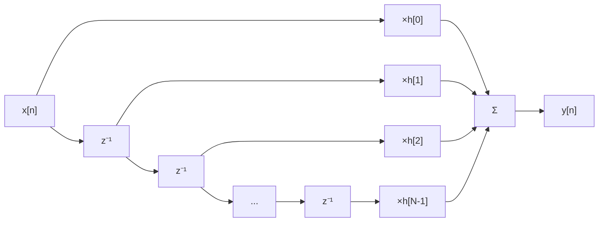
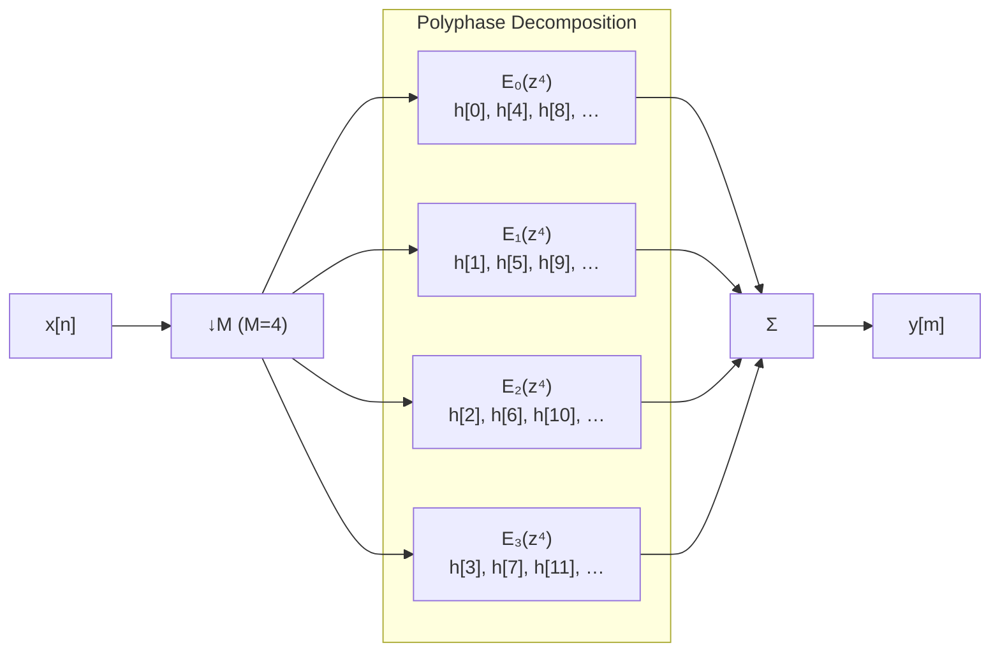
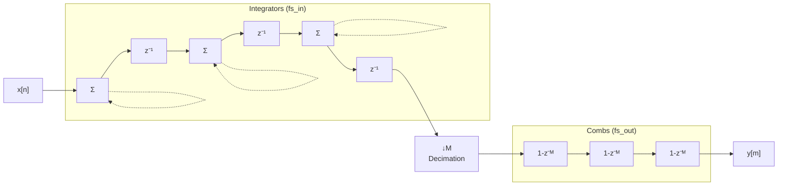

# Lesson 3: DSP Architectures, Filtering, Frequency Translation

## 1. First-Principles Intuition & Invariants

Digital signal processing in software-defined radio systems rests on a fundamental transformation: converting continuous analog electromagnetic phenomena into discrete numerical sequences that can be manipulated, filtered, and translated in the digital domain. This conversion, governed by the Nyquist-Shannon sampling theorem, establishes the first critical invariant: a continuous-time signal with bandwidth B can be perfectly reconstructed from samples taken at a rate exceeding 2B samples per second. This sampling rate, termed the Nyquist rate, forms the theoretical foundation upon which all subsequent DSP operations depend.

When an analog-to-digital converter captures an RF signal, it produces a stream of discrete samples at some fixed rate fs. Each sample represents the instantaneous amplitude of the signal at a specific moment in time, quantized to a finite precision determined by the ADC's bit depth. A 12-bit ADC, for instance, divides the analog voltage range into 4096 discrete levels, introducing quantization noise that manifests as a noise floor distributed across the Nyquist bandwidth from DC to fs/2. This quantization noise power is inversely proportional to the square of the number of quantization levels, yielding approximately 6.02 dB of signal-to-noise ratio per bit of resolution—a fundamental limit that no amount of downstream processing can overcome.

The discrete-time samples entering the DSP chain carry spectral content across the entire Nyquist band, but rarely does the desired signal occupy this entire bandwidth. A narrowband FM broadcast at 100 MHz, sampled at 10 MSPS after downconversion to baseband, produces a signal centered near DC with perhaps 200 kHz of occupied bandwidth. The remaining 4.8 MHz of spectrum on either side contains noise, interference from adjacent channels, and unwanted harmonics or intermodulation products generated in the analog front-end. Extracting the desired signal from this crowded spectrum demands filtering—a mathematical operation that selectively attenuates frequency components based on predetermined criteria.

Digital filters operate by computing weighted sums of input samples and, in some architectures, weighted sums of previous output samples. This fundamental operation, convolution in the time domain, corresponds to multiplication in the frequency domain—a duality exploited throughout DSP theory. The weights, or coefficients, of the filter determine its frequency response: which frequencies pass through with minimal attenuation (the passband), which frequencies are heavily suppressed (the stopband), and the sharpness of the transition between these regions (the transition band). The design of these coefficients constitutes one of the central challenges in SDR architecture, balancing computational efficiency against spectral selectivity.

Two broad categories of digital filters dominate SDR implementations: finite impulse response (FIR) filters and infinite impulse response (IIR) filters. FIR filters compute each output sample solely from a finite window of input samples, with no feedback from previous outputs. This feed-forward architecture guarantees unconditional stability and exact linear phase response—properties critical for maintaining signal fidelity in communication systems where phase distortion causes intersymbol interference. The output y[n] of an N-tap FIR filter follows the discrete convolution sum: y[n] = Σ(k=0 to N-1) h[k] · x[n-k], where h[k] represents the filter coefficients and x[n-k] denotes input samples delayed by k time steps.

IIR filters, in contrast, incorporate feedback by including weighted previous output samples in the computation of each new output. This recursive structure allows IIR filters to achieve sharper frequency transitions with fewer coefficients than equivalent FIR designs, reducing computational load at the cost of potential instability and nonlinear phase response. The output of a second-order IIR section, or biquad, takes the form: y[n] = b0·x[n] + b1·x[n-1] + b2·x[n-2] - a1·y[n-1] - a2·y[n-2]. Higher-order IIR filters cascade multiple biquad sections, each contributing poles and zeros to the overall transfer function. The placement of these poles in the z-plane determines stability: all poles must lie strictly inside the unit circle to prevent exponential growth of the output.

The computational burden of filtering grows with coefficient count, and for wideband SDR systems processing tens of megasamples per second, brute-force convolution quickly exhausts available processing resources. A 128-tap FIR filter operating at 10 MSPS requires 1.28 billion multiply-accumulate operations per second—a substantial load even for modern multi-core processors. This computational reality drives the adoption of multirate signal processing techniques, where sample rate conversion interleaves with filtering to reduce the number of operations per unit time.

Decimation, the process of reducing sample rate by an integer factor M, discards M-1 out of every M samples after low-pass filtering to prevent aliasing. Critically, the anti-aliasing filter operates at the high input rate, but subsequent processing stages run at the reduced rate fs/M, proportionally decreasing computational cost. A decimation-by-eight stage following a 40 MSPS ADC reduces the sample rate to 5 MSPS, cutting the computational load of all downstream filters by a factor of eight. Interpolation, the inverse operation, increases sample rate by inserting L-1 zero-valued samples between each input sample and then low-pass filtering to remove spectral images introduced by the zero-stuffing. Both operations exploit the polyphase decomposition of FIR filters, a restructuring that eliminates computation on samples destined for discard or on inserted zeros.

Frequency translation, the second pillar of SDR DSP architecture, shifts signals in the frequency domain without altering their shape or bandwidth. This operation, essential for channelization and demodulation, proceeds from Euler's formula: e^(jωt) = cos(ωt) + j·sin(ωt). Multiplying a real or complex input signal by a complex exponential rotates each spectral component by the exponential's frequency. A digital down-converter (DDC) multiplies the input stream by e^(-j2πfct/fs), where fc represents the center frequency of the desired channel and fs the sample rate, shifting the channel from its original position to DC (zero frequency). This frequency shift, followed by decimating low-pass filtration, isolates a single channel from a wideband spectrum, reducing sample rate and computational load while centering the signal for subsequent demodulation.

The complex exponential required for frequency translation emerges from a numerically controlled oscillator (NCO), a digital circuit that generates sinusoidal signals at precisely controlled frequencies. An NCO maintains a phase accumulator that increments by a fixed frequency control word (FCW) on each clock cycle. The accumulated phase, typically a 32-bit or 48-bit integer, addresses a lookup table storing precomputed sine and cosine values, or alternatively feeds a polynomial approximation like CORDIC (Coordinate Rotation Digital Computer) that iteratively converges to the desired trigonometric function. The frequency resolution of an NCO equals fs / 2^N, where N is the accumulator bit width, allowing sub-Hertz tuning precision even at megahertz sample rates.

Spectral leakage, a phenomenon arising from finite observation time, complicates frequency-domain analysis in SDR systems. Computing the discrete Fourier transform (DFT) of N samples assumes the signal is periodic with period N, an assumption rarely satisfied in practice. When the signal frequency does not correspond to an integer multiple of the DFT bin spacing fs/N, energy from a single spectral component spreads across multiple bins, obscuring nearby signals and introducing measurement error. This leakage stems from the implicit rectangular windowing of the input data: multiplying the infinite-duration signal by a rectangular window of width N samples, which in the frequency domain convolves the signal spectrum with a sinc function whose sidelobes decay slowly at -13 dB per octave.

Windowing functions, applied by multiplying the input samples by carefully designed weighting functions, trade main lobe width against sidelobe level, suppressing spectral leakage at the expense of frequency resolution. The Hamming window, defined as w[n] = 0.54 - 0.46·cos(2πn/N), reduces peak sidelobe level to -43 dB but widens the main lobe by a factor of approximately 1.3. The Blackman-Harris window achieves -92 dB sidelobes with a main lobe widening factor near 1.9, while the Kaiser window provides parameterized control over the tradeoff through a shape parameter β. The choice of window depends on the application: spectral surveillance systems prioritize low sidelobes to detect weak signals near strong interferers, while narrowband communication receivers tolerate higher sidelobes to maximize frequency resolution.

These core mechanisms—filtering to isolate desired spectral content, multirate processing to manage computational load, frequency translation to shift signals for demodulation, and windowing to mitigate spectral artifacts—form the algorithmic foundation of software-defined radio. Their implementation in hardware or software determines system performance, power consumption, and architectural flexibility. Understanding the first-principles physics underlying these operations, from Nyquist sampling limits to the z-transform representation of discrete-time systems, equips the SDR engineer to navigate tradeoffs between conflicting requirements and to diagnose pathologies when measured performance deviates from theoretical predictions.

## 2. Core Architecture & Mechanics

The internal architecture of a digital filter determines both its frequency response characteristics and its computational efficiency. For FIR filters, the direct-form implementation instantiates the convolution sum directly: a tapped delay line stores the most recent N input samples, multipliers scale each delayed sample by its corresponding coefficient, and an accumulator sums the products. This structure, conceptually simple, maps naturally to hardware implementations using shift registers, multiplier arrays, and adder trees. In software implementations on general-purpose processors, the direct form exploits single-instruction-multiple-data (SIMD) vector units, computing four or eight multiply-accumulate operations in parallel per clock cycle.



The symmetry property of linear-phase FIR filters, where h[k] = h[N-1-k] for even-symmetric or h[k] = -h[N-1-k] for odd-symmetric coefficients, permits computational optimization. Pairing symmetric samples before multiplication halves the number of multipliers required. For a 64-tap symmetric FIR filter, this optimization reduces the multiplier count from 64 to 32, proportionally decreasing hardware area or software execution time. The polyphase decomposition further exploits this structure in multirate systems, partitioning the filter coefficients into M interleaved subsequences for decimation-by-M or L subsequences for interpolation-by-L.

In polyphase decimation, the input signal x[n] feeds M parallel subfilters, each operating at the reduced output rate fs/M. The k-th subfilter processes every M-th input sample starting at offset k, using coefficients h[k], h[k+M], h[k+2M], and so forth. A commutator selects the subfilter outputs in rotation, producing the decimated output stream. This architecture eliminates computation on samples ultimately discarded, reducing the multiply-accumulate rate by the decimation factor. For an N-tap prototype filter and decimation factor M, the polyphase implementation requires N/M multiplications per output sample compared to N multiplications in the naive approach of filtering before downsampling.



IIR filter architectures balance computational efficiency against numerical stability and dynamic range. The direct-form I structure implements the difference equation explicitly, computing the feed-forward (FIR) portion first, then recursively applying the feedback (IIR) portion. Direct-form II rearranges the computation, sharing a single delay line between feed-forward and feedback paths, halving memory requirements. However, internal node signal levels in direct-form structures can grow large even when input and output remain bounded, causing overflow in fixed-point arithmetic or precision loss in floating-point. Cascaded biquad sections, each implemented in direct-form II transposed structure with carefully scaled intermediate signals, provide superior numerical behavior.

For a second-order biquad section with transfer function H(z) = (b0 + b1·z⁻¹ + b2·z⁻²) / (1 + a1·z⁻¹ + a2·z⁻²), the direct-form II transposed structure computes:

```
w[n] = x[n] - a1·w[n-1] - a2·w[n-2]
y[n] = b0·w[n] + b1·w[n-1] + b2·w[n-2]
```

This formulation minimizes quantization noise accumulation and maintains numerical stability across a wide range of coefficient values. Higher-order IIR filters decompose into cascaded biquads, with section ordering chosen to minimize intermediate signal levels. Pairing poles near the unit circle with zeros also near the unit circle in the same biquad reduces internal gain, preventing overflow. State-space representations offer even greater control over numerical properties but incur higher computational cost.

The digital down-converter architecture exemplifies the integration of frequency translation and multirate filtering. A typical DDC chain begins with an NCO generating complex exponential e^(-j2πfct/fs), which multiplies the input signal to shift the desired channel to baseband. This mixing operation preserves the input sample rate but positions the channel of interest near DC, allowing subsequent low-pass filtering to isolate it. A cascade of decimating filters, often structured as a computationally efficient CIC (cascaded integrator-comb) filter followed by a high-quality FIR compensation filter, progressively reduces sample rate while sharpening frequency selectivity.

The CIC filter, invented by Hogenauer, implements a recursive moving-average structure requiring no multipliers—only additions and subtractions. A K-stage CIC decimator consists of K integrator sections operating at the high input rate, a downsampler reducing the rate by factor M, and K differentiator sections (comb filters) operating at the low output rate. The frequency response exhibits a sinc^K characteristic with deep nulls at multiples of the output sample rate, providing substantial alias rejection despite the absence of coefficients. However, the passband droop, approximately 0.5 dB per stage at the band edge for decimation factors typical in SDR, necessitates compensation with a subsequent FIR filter designed with inverse droop characteristics.



The NCO phase accumulator requires careful attention to word width and phase quantization effects. A 32-bit accumulator clocked at 100 MHz sample rate provides frequency resolution of approximately 0.023 Hz, sufficient for most communication applications. However, truncating the phase accumulator output to address a sine/cosine lookup table introduces phase quantization noise, which manifests as spurious tones in the output spectrum. These spurs, located at frequencies determined by the rational approximation to the desired frequency divided by the accumulator modulus, degrade signal-to-noise ratio and can mask weak signals. Dithering the phase accumulator by adding a pseudo-random sequence before truncation spreads phase quantization energy across the spectrum, trading discrete spurs for a slightly elevated noise floor.

CORDIC algorithms offer an alternative to lookup tables for trigonometric function generation, computing sine and cosine through a sequence of conditional add-shift operations. Each CORDIC iteration rotates the input vector by a fixed angle, with the rotation direction determined by the sign of the remaining phase error. After N iterations, the x and y components of the rotated vector converge to cos(θ) and sin(θ) with N bits of precision. CORDIC implementations consume minimal memory—only the table of rotation angles—but require N clock cycles per output sample, limiting throughput unless pipelined. For high-rate NCOs in FPGA implementations, lookup tables generally outperform CORDIC in throughput-per-area metrics, while for moderate-rate software implementations, CORDIC avoids cache pollution from large tables.

Windowing function application precedes Fourier transform computation in spectral analysis engines. The discrete Fourier transform (DFT), implemented efficiently via the fast Fourier transform (FFT) algorithm, decomposes N time-domain samples into N frequency-domain bins spanning DC to fs. For a radix-2 FFT, N must equal a power of two, and the computation requires (N/2)log₂(N) complex multiplications—a dramatic reduction from the N² operations of the direct DFT. The FFT algorithm recursively decomposes the transform into smaller sub-transforms, exploiting the periodicity and symmetry of the complex exponential kernel W_N^k = e^(-j2πk/N).

Each FFT stage consists of butterfly operations, which combine pairs of samples with complex multiplication by twiddle factors. For a decimation-in-time radix-2 FFT:

```
Stage 0 (butterfly span = 1):
X[k] = x[k] + W_N^0 · x[k+1]
X[k+N/2] = x[k] - W_N^0 · x[k+1]

Stage log₂(N)-1 (butterfly span = N/2):
X[k] = X[k] + W_N^k · X[k+N/2]
X[k+N/2] = X[k] - W_N^k · X[k+N/2]
```

The bit-reversal permutation required at the input or output of the FFT, depending on whether decimation-in-time or decimation-in-frequency ordering is used, reorders samples such that the index binary representation is reversed. For N=8, index 1 (binary 001) swaps with index 4 (binary 100), index 3 (binary 011) swaps with index 6 (binary 110), and so forth. This permutation arises naturally from the recursive decomposition and can be performed in-place with careful indexing.

Window function selection depends on the spectral characteristics of the signal under analysis and the presence of nearby interferers. The rectangular window, equivalent to no windowing, offers the narrowest main lobe (4π/N radians, or 2 bins) but suffers from high sidelobes (-13 dB peak). The Hann window, w[n] = 0.5(1 - cos(2πn/N)), widens the main lobe to approximately 8π/N radians (4 bins) while suppressing sidelobes to -31 dB. The Hamming window, differing from Hann only in the leading coefficient (0.54 versus 0.5), achieves -43 dB sidelobes with similar main lobe width. These moderate-performance windows suit general-purpose spectrum analysis where a balance between resolution and dynamic range suffices.

Applications demanding extreme dynamic range, such as detecting weak satellite telemetry in the presence of strong adjacent radar signals, employ more aggressive windows. The Blackman window, a three-term cosine sum, achieves -58 dB sidelobes at the cost of a main lobe width near 12π/N radians (6 bins). The four-term Blackman-Harris window extends this to -92 dB sidelobes and 16π/N main lobe width. The Kaiser window, parameterized by shape factor β, allows continuous tradeoff adjustment: β=0 yields the rectangular window, β≈5 approximates the Hamming window, and β≈8.6 approximates the Blackman window. The modified Bessel function of the first kind, required to compute Kaiser window coefficients, typically relies on polynomial or series approximations in embedded implementations.

The overlap-add and overlap-save methods extend FFT-based processing to arbitrarily long input streams, enabling efficient implementation of long FIR filters in the frequency domain. Both methods segment the input into blocks, apply the FFT, multiply by the frequency-domain filter response, and inverse-FFT to obtain filtered output segments. Overlap-add zero-pads each input block, computes full convolution, and sums overlapping output regions. Overlap-save discards edge samples contaminated by circular convolution artifacts. For FIR filters with hundreds or thousands of taps, frequency-domain processing via FFT can outperform time-domain convolution, with the crossover point typically occurring around 64 to 128 taps depending on hardware architecture and FFT library optimization.

Channelizers, specialized DSP structures that partition a wideband input into multiple narrowband channels simultaneously, combine polyphase filtering with FFT processing. A polyphase channelizer demultiplexes the input into M parallel streams, applies a prototype low-pass filter partitioned into M polyphase branches, and FFT-processes the filtered branches to produce M frequency-shifted output channels. This architecture achieves the same result as M parallel DDC chains but with computational cost proportional to M·log₂(M) rather than M², making it essential for wideband monitoring receivers and multichannel communication systems. The prototype filter, typically a few hundred taps, determines the channel selectivity and adjacent-channel rejection, while the FFT size M sets the number of channels and the frequency spacing.

## 3. High-Performance Optimization & Failure Modes

Optimizing DSP performance in software-defined radio systems demands attention to computational efficiency, numerical precision, and real-time latency constraints. The computational load imposed by filtering, frequency translation, and spectral analysis scales directly with sample rate and inversely with channel bandwidth, driving architectural decisions that trade hardware complexity against flexibility. Understanding these tradeoffs and recognizing the failure modes that arise from improper implementation separates functional SDR systems from high-performance production-grade receivers.

Fixed-point arithmetic dominates embedded DSP implementations and FPGA designs due to its deterministic timing, low power consumption, and compact hardware. However, fixed-point processing requires explicit management of dynamic range and quantization noise. The bit width of each processing stage must accommodate the maximum signal swing without overflow while providing sufficient fractional precision to keep quantization noise below the system noise floor. For FIR filters, input bit width Win and coefficient bit width Wcoef combine to produce an output bit width approaching Win + Wcoef + log₂(N), where N represents the number of taps. Simply allocating this full width throughout the processing chain wastes resources; instead, carefully placed rounding or truncation operations after accumulators maintain manageable word lengths while controlling noise accumulation.

The location and method of quantization critically affect performance. Truncation, which simply discards least-significant bits, introduces a DC bias equal to half the quantization step size. Rounding, which adds 0.5 LSB before truncation, centers the quantization error around zero, eliminating the bias at the cost of a slightly wider noise distribution. Saturation arithmetic, which clamps overflows to the maximum representable value rather than wrapping, prevents catastrophic errors when signal excursions exceed the dynamic range, trading graceful degradation for occasional clipping distortion. Modern DSP processors and FPGA arithmetic units provide saturating add and multiply-accumulate instructions specifically to handle these boundary conditions.

Coefficient quantization in IIR filters poses particular challenges, as small errors in pole locations can move poles outside the unit circle, causing instability. Second-order sections exhibit better coefficient sensitivity than higher-order direct forms, but even biquads require careful attention to pole-zero pairing and section ordering. Fixed-point IIR implementations typically allocate at least 16 bits for coefficients, with 24 or 32 bits preferred for high-order filters. Stability testing via pole location verification after quantization ensures the filter remains stable before deployment, and limit-cycle oscillations—low-level persistent oscillations that arise from nonlinear quantization effects in feedback paths—can be detected through long-duration zero-input tests.

SIMD vectorization accelerates FIR filtering on modern CPUs by processing multiple samples in parallel. Intel AVX-512 instructions, for example, perform eight single-precision multiply-accumulate operations per instruction, while ARM NEON achieves four operations per instruction. Efficient vectorization requires memory alignment: loading 256-bit AVX registers from unaligned addresses incurs performance penalties or crashes, so input buffers and coefficient arrays must align to 32-byte boundaries. Loop unrolling complements vectorization by reducing branch overhead and exposing additional instruction-level parallelism, allowing the CPU to overlap memory loads, arithmetic operations, and cache fetches.

Cache behavior profoundly affects software DSP performance. Tapped delay lines for FIR filters exhibit poor spatial locality: successive iterations access memory locations separated by the delay line length, often spanning multiple cache lines. Transposing the filter structure to iterate over coefficients in the inner loop improves cache hit rates, as does blocking the input data into chunks that fit within L1 cache. For polyphase filters, the natural decomposition into subfilters aligns with cache architecture, as each subfilter processes a contiguous subset of samples with a fraction of the coefficient array.

Real-time SDR applications impose strict latency bounds, requiring that each processing stage completes within the sample period. At 10 MSPS sample rate, each sample period lasts 100 nanoseconds—barely enough time for a modern CPU to execute a few hundred instructions. Meeting this deadline demands pipeline parallelism, where multiple processing stages execute concurrently on different data, and task parallelism, where independent channels process on separate CPU cores or hardware accelerators. Producer-consumer queues with non-blocking ring buffers decouple stages, allowing upstream processing to continue while downstream stages consume data at their own pace, provided queue depth suffices to absorb transient load imbalances.

Overflows in NCO phase accumulators manifest as frequency discontinuities when the accumulator wraps from maximum to zero. For two's complement arithmetic, this wrapping is mathematically correct and causes no error, as the modulo-2^N arithmetic of the accumulator naturally implements the phase modulo-2π behavior required for circular phase. However, if the accumulator output feeds a table lookup or CORDIC stage expecting unsigned phase, explicit modulo reduction may be necessary. Alternatively, formatting the table with entries spanning the full 0 to 2^N range eliminates the need for phase wrapping logic.

Spurious tones in NCO outputs arise from several sources beyond phase truncation. Finite word length effects in the phase accumulator itself cause no spurs—only phase truncation to address the sine/cosine table introduces quantization. The largest spurs occur when the frequency control word FCW and the accumulator size 2^N share common factors, causing the truncated phase sequence to repeat with a short period. Choosing an FCW that is relatively prime to 2^N minimizes this effect, spreading the spur energy across more frequencies. Dithering, achieved by adding a pseudo-random sequence to the phase before truncation, converts discrete spurs into a continuous noise floor elevated by approximately 10·log₁₀(2^Ndither) dB, where Ndither is the dither word width.

Spectral leakage mitigation through windowing trades frequency resolution for dynamic range, but the tradeoff becomes problematic when two signals of vastly different amplitudes occupy nearby frequency bins. A strong signal 60 dB above a weak signal, separated by 10 bins, will leak energy into the weak signal's bin even with a Blackman-Harris window if the main lobes overlap. The only recourse in such scenarios is longer FFT lengths, which narrow the main lobe and reduce bin spacing, or adaptive notch filtering to suppress the strong signal before spectral analysis. Time-domain pre-filtering to remove known interferers before FFT processing prevents the interferer's sidelobes from masking signals of interest.

Aliasing in decimation systems occurs when the anti-aliasing filter fails to suppress spectral content above fs_out/2 before downsampling. A cascaded decimation architecture, where each stage reduces the sample rate by a modest factor like 2 or 4, allows each anti-aliasing filter to operate with a wider transition band, easing filter design. A single-stage decimation by 256 would require a brick-wall filter with transition band spanning perhaps 0.5% of the sample rate—an impractically long FIR filter. Cascading four decimation-by-4 stages, each with a transition band of 20% or more of its input rate, achieves the same overall decimation with far fewer total taps.

Conversely, interpolation systems require anti-imaging filters after zero-stuffing to remove spectral images at multiples of the original sample rate. The images arise because zero-stuffing replicates the input spectrum at intervals of fs_in throughout the new Nyquist band extending to fs_out/2. A polyphase interpolator integrates the zero-stuffing, filtering, and upsampling into a single efficient structure, where each polyphase branch computes one output sample per input sample, operating at the input rate rather than the elevated output rate. The coefficient memory requirement remains unchanged—simply the access pattern differs—but computational efficiency improves by the interpolation factor L.

Coefficient calculation for FIR filters relies on window-based design, frequency sampling, or optimization algorithms like Parks-McClellan. Window-based design begins with the ideal infinite-impulse response (sinc function for a low-pass filter), truncates it to N samples, and applies a window function to taper the edges, reducing Gibbs phenomenon ringing. The resulting filter exhibits monotonic passband and stopband but does not optimally use the available taps. Frequency sampling, where desired frequency response values are inverse-FFTed to obtain time-domain coefficients, offers direct control over response shape but suffers from poor stopband rejection unless transition-band samples are carefully optimized.

The Parks-McClellan algorithm, based on the Remez exchange theorem, designs equiripple FIR filters that minimize the maximum error between the desired and actual frequency response. This optimality criterion, termed minimax or Chebyshev approximation, produces filters with the sharpest transitions and deepest stopbands for a given tap count. The algorithm iteratively adjusts coefficient values to equalize the ripple peaks across the passband and stopband, converging to the optimal solution in typically a few dozen iterations. Most modern filter design tools, including MATLAB's firpm and GNU Radio's gr_filter_design, implement Parks-McClellan as the default algorithm for high-performance FIR filters.

IIR filter design proceeds from analog prototypes—Butterworth, Chebyshev, elliptic, or Bessel—transformed to the digital domain via bilinear transformation or impulse invariance. The bilinear transformation maps the entire s-plane (continuous-time frequency domain) onto the unit circle in the z-plane (discrete-time frequency domain) via the substitution s = (2/T) · (1-z⁻¹)/(1+z⁻¹), where T represents the sample period. This mapping warps the frequency axis, compressing higher frequencies, which must be pre-compensated by pre-warping the analog design frequencies: ω_digital = (2/T) · tan(ω_analog · T/2). The resulting digital filter exactly matches the analog prototype at DC and at the pre-warped critical frequencies, with smooth interpolation in between.

Elliptic (Cauer) filters offer the steepest transitions for a given filter order, achieving this through equiripple behavior in both passband and stopband, with finite transmission zeros that create deep notches in the stopband. However, the highly peaked frequency response and nonlinear phase distortion make elliptic filters unsuitable for communications applications demanding phase linearity. Butterworth filters, with maximally flat passband and monotonic stopband, provide the smoothest amplitude response at the cost of gradual roll-off. Chebyshev filters trade passband ripple for sharper transitions, while inverse Chebyshev filters exhibit passband smoothness with stopband ripple. The choice depends on whether amplitude flatness, phase linearity, or transition sharpness dominates system requirements.

Digital down-converter performance optimization focuses on reducing computational load while meeting selectivity and spurious-free dynamic range requirements. A multi-stage DDC begins with a wideband CIC decimator that quickly reduces sample rate by factors of 16 to 256 with minimal computation, followed by a compensating FIR halfband filter that corrects CIC passband droop and provides additional decimation by 2, and finally a narrow transition-band FIR filter that delivers the final selectivity at the lowest sample rate. Halfband filters, with approximately half of their coefficients identically zero, require only half the multiplications of a generic FIR filter, making them ideal for intermediate decimation stages.

Frequency-domain filtering via overlap-add/overlap-save becomes advantageous when filter lengths exceed a few hundred taps, but the FFT size must be chosen carefully. For an L-tap filter and FFT size N, the overlap-save method processes N-L+1 valid output samples per FFT, yielding computational efficiency proportional to (N-L+1)/(N·log₂N). This efficiency peaks when N is several times L, typically around N = 4L to 8L, balancing FFT overhead against the number of useful output samples. However, larger FFTs increase latency, as the entire block must be buffered before processing begins. Applications with tight latency budgets may prefer time-domain convolution despite higher computational cost.

Catastrophic failure modes in SDR DSP chains include overflow-induced signal dropouts, aliasing from insufficient anti-aliasing filtering, instability in IIR filters, and NCO spur interference. Overflow in fixed-point arithmetic, particularly in early processing stages where signals are strongest, causes sudden clipping and intermodulation distortion that no downstream processing can remove. Automatic gain control (AGC) or careful front-end attenuation prevents overload, but the AGC time constants must be slow enough to avoid distorting amplitude modulation while fast enough to track fading or interference. Digital AGC implementations measure signal power via moving-average filters and adjust a multiplier in the signal path, with logarithmic gain steps to cover wide dynamic range.

Aliasing diagnostics involve spectral inspection at each stage of a decimation chain, verifying that no energy above the Nyquist boundary of the next stage survives the anti-aliasing filter. Sweeping a test tone across the input frequency range while observing the output spectrum reveals aliased components as spurious tones that appear at unexpected frequencies. Multi-tone tests, using two or more widely spaced input tones, expose intermodulation products that arise from nonlinear distortion in analog stages or digital overflow, distinguishing them from linear aliasing effects.

IIR filter instability manifests as exponential output growth even with bounded inputs, caused by poles outside the unit circle. Real-time monitoring of filter state variables detects instability before output amplitude saturates, allowing graceful shutdown or coefficient recalculation. Limit cycles, low-amplitude oscillations that persist after the input signal ceases, indicate insufficient internal word width or poor coefficient quantization. Increasing the accumulator bit width or redesigning the filter with reduced pole Q generally eliminates limit cycles, though at the cost of additional hardware resources.

Spectral purity in NCO outputs is validated through FFT analysis with long observation windows and high-performance windowing. A 2048-point FFT with Blackman-Harris window can reveal spurs down to -100 dBc, provided the input signal amplitude is stable and no external interference contaminates the measurement. Comparing measured spur spectra against theoretical predictions, based on the FCW, accumulator width, and phase truncation depth, identifies whether observed spurs arise from the NCO architecture or from external sources like clock jitter, power supply noise, or ADC nonlinearity.

Performance benchmarking of DSP implementations requires representative test signals that exercise worst-case computational paths. For FIR filters, white noise inputs stress memory bandwidth and arithmetic throughput more than coherent tones. For DDCs, multi-carrier signals with realistic peak-to-average power ratios test dynamic range and AGC response. Profiling tools that measure cycle counts, cache miss rates, and instruction throughput per processing block identify bottlenecks, guiding optimization efforts toward the highest-impact changes. Comparing measured throughput against theoretical maxima—such as the peak multiply-accumulate rate of the processor or the memory bandwidth ceiling—determines whether the implementation approaches hardware limits or whether further optimization remains possible.

The integration of these DSP primitives—filtering, multirate processing, frequency translation, and spectral analysis—into a cohesive SDR receiver architecture demands careful attention to signal flow, dynamic range management, and computational resource allocation. Each stage must operate with margin for transient signals, provide sufficient stopband rejection to prevent interference leakage, and execute within the available processing budget. The result, when properly architected and optimized, is a flexible receiver capable of adapting to diverse modulation schemes, bandwidths, and signal environments—a testament to the power of software-defined radio as a platform for communication and signal intelligence.
