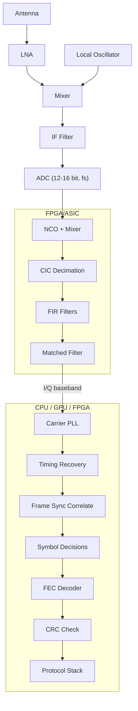

# Lesson 4: SDR Hardware Constraints, Protocol Stack Implementation, Timing Recovery

## 1. First-Principles Intuition & Invariants

The software-defined radio occupies a unique position in the spectrum of communication systems engineering: it transforms the deterministic, fixed-function logic of traditional superheterodyne receivers into a reconfigurable, general-purpose computational problem. This transformation, however, does not liberate the designer from the immutable constraints of analog electronics and information theory. Instead, it relocates these constraints to new boundaries—analog-to-digital converter wordlength, computational throughput measured in multiply-accumulate operations per second, and the finite precision arithmetic of fixed-point digital signal processors.

Every radio link begins with an antenna converting electromagnetic radiation into a time-varying voltage. This voltage enters an analog front-end comprising filters, low-noise amplifiers, mixers, and variable-gain amplifiers that translate the carrier frequency downward toward baseband. At the threshold between the analog and digital domains sits the analog-to-digital converter, a device that samples the continuous voltage waveform at discrete time intervals and quantizes each sample to the nearest representable level in a finite wordlength register. The ADC introduces two irreversible distortions: aliasing, which folds spectral content above the Nyquist frequency back into the baseband, and quantization noise, which arises from rounding each analog voltage to the nearest digital code.

Quantization noise possesses a power proportional to the square of the least significant bit voltage, and for a well-designed converter with a uniform quantizer and sufficiently complex input signal, this noise spreads uniformly across the Nyquist bandwidth with a power spectral density that appears white. The signal-to-quantization-noise ratio scales exponentially with bit depth: approximately 6.02 dB per bit for an ideal converter, plus 1.76 dB for the peak-to-RMS conversion factor in sinusoidal signals. A 12-bit ADC thus provides roughly 74 dB of dynamic range, while a 16-bit device reaches 98 dB. These figures represent theoretical limits; real converters suffer additional degradation from differential nonlinearity, integral nonlinearity, aperture jitter in the sample clock, and thermal noise in the analog circuitry.

Dynamic range in the SDR context must account not only for the ADC quantization floor but also for the presence of strong interfering signals that compress the analog front-end gain stages or generate intermodulation products in nonlinear mixer circuits. The spurious-free dynamic range (SFDR) quantifies the ratio between the desired signal power and the strongest spurious tone, whether that tone arises from quantization, harmonic distortion, or intermodulation. A practical SDR receiver operating in a dense electromagnetic environment must balance sensitivity—the minimum detectable signal level—against linearity, which determines how well the receiver can reject a powerful adjacent-channel interferer while demodulating a weak desired signal.

The digital signal processor downstream from the ADC must execute a cascade of operations: channelization to isolate the desired signal from the sampled spectrum, matched filtering to maximize signal-to-noise ratio, carrier frequency and phase recovery to align the local oscillator with the received carrier, symbol timing recovery to sample the baseband waveform at the optimal decision instants, and frame synchronization to identify packet boundaries and remove the ambiguity in data alignment. Each of these operations imposes computational demands measured in floating-point operations per second or fixed-point multiply-accumulate cycles, and the choice of processing platform—FPGA, GPU, or general-purpose CPU—fundamentally shapes the latency, throughput, and power consumption profile of the radio.

Field-programmable gate arrays excel at streaming architectures where data flows through deeply pipelined arithmetic units with deterministic, cycle-accurate timing. A single FPGA can implement dozens of parallel finite-impulse-response filters, each consuming a multiply-accumulate operation per tap per clock cycle, with aggregate throughput exceeding hundreds of gigasamples per second. The FPGA's strength lies in its ability to express fine-grained parallelism and to guarantee worst-case latency bounds independent of operating system scheduling or memory hierarchy contention. Its weakness appears in flexibility: reconfiguring the logic fabric requires recompilation and bitstream generation, a process measured in minutes or hours, and the programming model demands intimate knowledge of register-transfer-level design and clock domain crossing.

Graphics processing units, by contrast, offer massive parallelism through single-instruction multiple-data architectures with thousands of arithmetic units organized into streaming multiprocessors. The GPU thrives on data-parallel workloads where the same operation applies to large arrays of independent samples—convolution, FFT butterflies, vector dot products, and element-wise complex multiplication. CUDA and OpenCL provide high-level programming abstractions that resemble conventional C with extensions for thread indexing and memory hierarchy control, enabling rapid prototyping and algorithm exploration. However, the GPU introduces latency from memory transfers across the PCIe bus, from kernel launch overhead, and from thread synchronization barriers. Real-time constraints in packet-switched protocols with tight turnaround times may exceed the GPU's ability to guarantee deterministic response.

Between these extremes lie heterogeneous architectures that partition the signal processing chain according to each platform's strengths: FPGA front-ends perform high-rate channelization, decimation, and matched filtering with hard real-time guarantees, while CPUs or GPUs handle adaptive equalization, forward error correction decoding, and protocol state machines that benefit from branching logic and dynamic memory allocation. The interface between these domains becomes a critical design point, requiring careful attention to buffer management, flow control, and clock domain synchronization.

Timing recovery and carrier synchronization constitute the feedback control systems that bridge the asynchronous, unsynchronized physical layer with the discrete, symbol-oriented abstraction required by the protocol stack. The transmitter and receiver operate from independent oscillators with unknown frequency offsets arising from manufacturing tolerances, temperature drift, and Doppler shifts. The receiver must estimate and track both the carrier frequency offset and the symbol timing epoch using only the received waveform, which contains no explicit clock signal. This estimation occurs in the presence of noise, multipath fading, and intersymbol interference, requiring loop filters that balance acquisition speed against tracking jitter and noise bandwidth.

The protocol stack maps the continuous-time waveform abstraction into discrete layers: the physical layer delivers symbols with soft or hard decision metrics, the data link layer performs framing and error detection, and higher layers interpret the payload according to application semantics. Each boundary between layers introduces latency, buffering, and potential synchronization hazards. The SDR designer must understand not only the signal processing algorithms within each layer but also the control flow and state machine interactions that govern transitions between idle, acquisition, tracking, and data transfer modes.

## 2. Core Architecture & Mechanics

The analog-to-digital converter operates as a sampler followed by a quantizer. The sampling process, governed by a clock signal at frequency $f_s$, captures instantaneous voltage values at integer multiples of the sample period $T_s = 1/f_s$. The sampled signal $x[n] = x_a(nT_s)$ represents a discrete-time sequence derived from the continuous-time analog waveform $x_a(t)$. Sampling creates spectral replicas at integer multiples of $f_s$, which necessitates an anti-aliasing filter preceding the ADC with a stopband that begins before $f_s/2$ to prevent higher-frequency content from folding into the baseband.

The quantizer maps each sampled voltage to one of $2^N$ discrete levels, where $N$ denotes the converter bit depth. For a full-scale range spanning $V_{ref}$ volts, the quantization step size equals $\Delta = V_{ref}/2^N$, and the quantization error $e[n] = x_q[n] - x[n]$ remains bounded by $\pm \Delta/2$. Modeling this error as an additive white noise source uniformly distributed over the quantization interval yields a quantization noise power of $\sigma_q^2 = \Delta^2/12$. The signal-to-quantization-noise ratio for a full-scale sinusoid becomes

$$\text{SQNR} = 10 \log_{10} \left( \frac{V_{ref}^2/8}{\Delta^2/12} \right) = 6.02N + 1.76 \text{ dB}$$

This expression reveals the exponential scaling of dynamic range with bit depth and explains why high-performance SDR systems demand 14-bit or 16-bit converters despite the increased cost and power consumption.

Real ADCs exhibit deviations from this ideal model. Differential nonlinearity (DNL) measures the deviation of each code width from the ideal $\Delta$, while integral nonlinearity (INL) quantifies the cumulative error in the transfer function. Aperture jitter in the sampling clock introduces uncertainty in the sample instant, which translates to amplitude noise that increases with signal frequency. For a jitter standard deviation $\sigma_t$ and a sinusoidal input at frequency $f_{in}$, the jitter-induced signal-to-noise ratio degrades as

$$\text{SNR}_{\text{jitter}} = -20 \log_{10}(2 \pi f_{in} \sigma_t)$$

A 100 MHz input signal sampled with 1 ps RMS jitter yields an SNR of approximately 64 dB, establishing a performance floor independent of the ADC bit depth. High-speed converters therefore require ultra-low-jitter clock sources, often derived from low-phase-noise voltage-controlled oscillators phase-locked to stable references.

The digital downconversion stage that follows the ADC performs frequency translation and sample rate reduction. A numerically controlled oscillator (NCO) generates complex exponential $e^{-j 2 \pi f_0 n / f_s}$, which multiplies the real-valued ADC samples to shift the spectrum such that the carrier frequency $f_0$ moves to DC. This complex multiplication requires four real multiplications per sample:

$$y[n] = x[n] \cdot e^{-j 2 \pi f_0 n / f_s} = x[n](\cos(\theta[n]) - j\sin(\theta[n]))$$

where $\theta[n] = 2 \pi f_0 n / f_s$ represents the NCO phase accumulator. Efficient FPGA implementations use CORDIC (Coordinate Rotation Digital Computer) algorithms or precomputed lookup tables with linear interpolation to generate the sine and cosine values. The phase accumulator width determines frequency resolution: a 32-bit accumulator clocked at 100 MHz provides frequency steps of approximately 0.023 Hz.

Following downconversion, a cascade of low-pass finite-impulse-response filters removes out-of-band noise and interference while decimating the sample rate to match the signal bandwidth. A typical multistage decimation filter chain begins with a computationally efficient CIC (Cascaded Integrator-Comb) filter that achieves large rate reductions with only additions and subtractions, followed by compensating FIR filters that flatten the passband droop introduced by the CIC's sinc response. The CIC filter transfer function in the z-domain takes the form

$$H(z) = \left[ \frac{1 - z^{-RM}}{1 - z^{-1}} \right]^N$$

where $R$ denotes the decimation ratio, $M$ the differential delay, and $N$ the number of cascaded stages. Increasing $N$ sharpens the transition band at the cost of increased passband droop, which the subsequent FIR stages must correct.

Carrier recovery algorithms estimate and track the unknown frequency and phase offset between the transmitter and receiver local oscillators. The phase-locked loop (PLL) represents the canonical feedback control system for this task, comprising a phase detector, loop filter, and voltage-controlled oscillator. In the digital domain, the phase detector computes an error metric from the complex baseband samples, the loop filter integrates this error with specified bandwidth and damping characteristics, and the NCO adjusts its frequency and phase to minimize the error.

For QPSK and higher-order modulations, the Costas loop provides a decision-directed phase detector that multiplies the in-phase component by the sign of the quadrature component and vice versa, producing an error signal proportional to $\sin(4\Delta\phi)$ for QPSK, where $\Delta\phi$ represents the phase error. The second-order loop filter combines proportional and integral paths:

$$\theta[n+1] = \theta[n] + K_p \cdot e[n] + K_i \sum_{k=0}^{n} e[k]$$

The proportional gain $K_p$ and integral gain $K_i$ determine the loop natural frequency $\omega_n$ and damping factor $\zeta$, which govern acquisition speed and tracking jitter. A critically damped loop with $\zeta = 1/\sqrt{2}$ offers a balance between fast acquisition and minimal overshoot. The loop noise bandwidth $B_L \approx \omega_n / 4$ for a second-order loop controls the amount of phase jitter that propagates into symbol decisions: narrower bandwidth reduces jitter but slows tracking of oscillator drift and Doppler shifts.

Symbol timing recovery confronts a distinct challenge: the receiver must determine the optimal sampling instants for the matched filter output when the transmitter symbol clock and receiver sample clock derive from independent oscillators. The Gardner timing error detector operates on pairs of samples per symbol, computing

$$e[n] = \text{Re}\{(y[n] - y[n-2]) \cdot y^*[n-1]\}$$

where $y[n]$ represents the matched filter output interpolated to the desired timing phase. This error metric produces a correction signal proportional to the timing offset, which drives a numerically controlled oscillator that advances or retards the interpolation phase. The interpolator, typically a polyphase FIR filter bank or cubic spline approximation, generates samples at arbitrary fractional delays between the fixed-rate input samples.

The timing loop filter structure mirrors the carrier PLL: a proportional-plus-integral controller adjusts the NCO frequency and phase to center the sampling instants at the eye diagram opening. The loop bandwidth must remain significantly narrower than the symbol rate to avoid tracking modulation-induced timing jitter while remaining wide enough to accommodate oscillator drift, which might reach tens of parts per million in low-cost crystal oscillators.

Frame synchronization identifies packet boundaries in the received symbol stream. Most protocols insert a known preamble or synchronization word at the start of each frame, and the receiver correlates the incoming symbols against this known pattern. A matched filter correlator computes

$$c[n] = \sum_{k=0}^{L-1} r[n-k] \cdot s^*[k]$$

where $r[n]$ denotes the received symbols and $s[k]$ the conjugate of the known synchronization sequence of length $L$. The correlator output peaks when the received sequence aligns with the reference, producing a detection statistic that exceeds a threshold only when the frame preamble appears. The threshold setting trades false alarm probability against detection probability: too low, and noise generates spurious detections; too high, and weak signals fail to trigger acquisition.

Ambiguity in the correlation peak position arises from noise and multipath propagation. Post-detection processing typically searches for the correlation maximum within a window of several symbols and applies parabolic interpolation or centroid estimation to refine the timing estimate to a fraction of a symbol period. Once the frame boundary is established, the receiver transitions from acquisition to tracking mode, where the symbol timing loop maintains synchronization for the packet duration.

Protocol layer mapping transforms the continuous stream of symbol decisions into structured data units with headers, payload, and error detection codes. The physical layer delivers soft decision metrics—log-likelihood ratios or correlation amplitudes—to the forward error correction decoder, which applies Viterbi, turbo, or low-density parity-check decoding algorithms to correct bit errors. The decoder output feeds the data link layer, which performs cyclic redundancy check validation, removes framing overhead, and presents payload bytes to higher-layer protocol handlers.

Latency through this pipeline accumulates from multiple sources: analog filter group delay, ADC pipeline stages, digital decimation filter transients, carrier and timing loop acquisition time, FEC decoder constraint length or block size, and software interrupt or DMA transfer overhead. A typical SDR receiver processing a burst transmission might require hundreds of symbols for preamble detection and synchronization, followed by tens to hundreds of microseconds for FEC decoding, resulting in total latency spanning milliseconds. Protocols with tight turnaround requirements, such as automatic repeat request acknowledgments in time-division duplex systems, demand careful budget allocation and may necessitate hybrid FPGA-CPU architectures to meet real-time deadlines.

The partitioning decision between FPGA, GPU, and CPU processing hinges on throughput requirements, latency constraints, and algorithm characteristics. FPGA implementations achieve deterministic latency and high throughput for streaming operations: channelization banks processing 100 MHz instantaneous bandwidth with sub-microsecond group delay, polyphase decimators achieving 1000:1 rate reductions with hundreds of filter taps, and matched filters with dozens of samples per symbol updated at megasample rates. The fixed-point arithmetic typical in FPGA designs requires careful wordlength analysis to prevent overflow and maintain sufficient signal-to-noise ratio through the processing chain. Internal accumulator widths often exceed the input data width by the logarithm base-two of the number of accumulations to prevent loss of precision.

GPU implementations leverage parallel compute units to accelerate block-oriented transforms. A 4096-point complex FFT on a modern GPU executes in tens of microseconds, enabling real-time spectrogram computation and channelization of wideband signals. Convolution operations map naturally to CUDA kernel launches where each thread computes one output sample, and shared memory provides low-latency access to filter coefficient tables. However, the GPU memory model introduces complexity: input samples must transfer from the ADC interface card across PCIe into GPU device memory, results must copy back to host memory, and synchronization between kernel launches incurs overhead. Achieving sustained throughput requires double or triple buffering strategies where the GPU processes one data block while the next block transfers and the host software interprets the previous block's results.

CPU-based processing remains competitive for moderate sample rates below a few megasamples per second, particularly when leveraging SIMD instruction sets. AVX2 and AVX-512 extensions on x86-64 processors provide 256-bit and 512-bit vector registers capable of executing eight or sixteen single-precision complex multiplications per instruction. Hand-optimized assembly routines or compiler intrinsics achieve computational densities approaching one complex multiply-accumulate per clock cycle per core, sufficient for many narrowband applications. The CPU excels at protocol state machine logic, dynamic memory allocation for variable-length packets, and integration with operating system networking stacks.

## 3. High-Performance Optimization & Failure Modes

Maximizing SDR throughput and minimizing latency requires optimization across the entire signal chain, from analog component selection through digital algorithm tuning to software scheduling and memory management. The analog front-end establishes the noise figure and linearity that bound all subsequent processing. A low-noise amplifier with 1 dB noise figure and 20 dB gain followed by a passive mixer and 8 dB insertion loss yields a cascaded noise figure of approximately 2 dB using Friis's formula. Replacing the passive mixer with an active device having 10 dB conversion gain reduces the cascaded noise figure to 1.5 dB, improving sensitivity by 0.5 dB at the cost of increased DC power consumption and potential reduction in third-order intercept point.

Third-order intermodulation distortion limits the ability to receive weak signals in the presence of strong interferers. Two large signals at frequencies $f_1$ and $f_2$ generate spurious products at $2f_1 - f_2$ and $2f_2 - f_1$, which may fall within the desired channel bandwidth. The output-referred third-order intercept point (OIP3) quantifies this nonlinearity: a receiver with +10 dBm OIP3 receiving two +0 dBm interferers generates intermodulation products at approximately -20 dBm. Cascaded systems combine intercept points through the relation

$$\frac{1}{IP3_{cascade}} = \frac{1}{G_1 \cdot IP3_2} + \frac{1}{G_1 \cdot G_2 \cdot IP3_3} + \cdots$$

where $G_i$ denotes the power gain of the $i$-th stage. The first nonlinear element dominates the cascade performance, motivating high-linearity front-end amplifiers and filters that attenuate out-of-band interferers before they reach sensitive mixer stages.

ADC clock jitter mitigation demands careful attention to the sampling clock distribution network. A low-phase-noise voltage-controlled oscillator or oven-controlled crystal oscillator generates the reference frequency, which a low-jitter PLL multiplies to the ADC sample rate. The clock trace on the printed circuit board must maintain controlled impedance with minimal stub lengths, and differential signaling with LVDS or LVPECL logic levels reduces susceptibility to common-mode noise. Placing a high-Q bandpass filter or SAW resonator in series with the clock input further attenuates broadband phase noise. Measuring clock jitter requires a low-phase-noise signal source and a high-bandwidth oscilloscope or phase noise analyzer; integrated jitter below 500 femtoseconds RMS from 12 kHz to the Nyquist frequency becomes necessary for 14-bit ENOB (effective number of bits) at RF frequencies above 100 MHz.

Digital downconversion spurious performance depends critically on NCO phase truncation and multiplier wordlength. A 32-bit phase accumulator truncated to 12 bits for the sine/cosine lookup table introduces phase quantization spurs at offsets corresponding to the accumulator overflow frequency divided by $2^{12}$. Phase dithering techniques add pseudorandom noise to the truncated phase bits, spreading the spur energy into a raised noise floor and improving spurious-free dynamic range by 10 to 15 dB. The complex multiplier wordlength must preserve the ADC signal-to-noise ratio through the mixing operation: a 14-bit ADC signal mixed with 12-bit NCO outputs requires at least 26-bit internal accumulator width, rounded to 16 bits for the output to maintain 14 ENOB.

Decimation filter design trades passband flatness, stopband attenuation, and computational cost. A five-stage CIC filter with decimation ratio $R = 1024$ achieves 90 dB stopband rejection but exhibits 1.5 dB passband droop at 0.4 times the output sample rate. Compensating this droop requires a half-band FIR filter with coefficients inverted from the CIC frequency response, typically 21 to 31 taps for less than 0.1 dB residual ripple. Polyphase implementations reduce computational load by exploiting the decimation factor: only one of every $R$ output samples is computed, so the filter state machine advances through the coefficient set without calculating the discarded intermediate values. A 128-tap FIR filter decimating by 8 requires only 16 multiply-accumulate operations per output sample when implemented in polyphase form.

Carrier recovery loop bandwidth selection balances phase noise tracking against symbol decision jitter. A second-order PLL with natural frequency $\omega_n = 2 \pi \times 1000$ rad/s and damping factor $\zeta = 0.707$ achieves 90% lock-in time of approximately 3 milliseconds, suitable for burst transmissions with preambles spanning 1000 symbols at 300 kbaud. Narrowing the loop bandwidth to 100 Hz improves tracking jitter but extends acquisition time to tens of milliseconds, appropriate for continuous transmissions with stable oscillators. Adaptive bandwidth algorithms start with wide bandwidth for fast acquisition, then reduce bandwidth once phase lock is established to minimize tracking noise.

Frequency offset acquisition range remains limited by the phase detector characteristic: a Costas loop for QPSK exhibits a linear phase detector range of $\pm \pi / 4$ radians per symbol, corresponding to $\pm 1/8$ of the symbol rate. Larger offsets cause the loop to false-lock at $\pi/2$ radian intervals, producing constellation rotation and data inversion. Frequency acquisition aids include coarse FFT-based estimation, where the receiver computes a periodogram of the preamble symbols and identifies the spectral peak corresponding to the carrier offset. Squaring or fourth-power operations remove QPSK modulation, concentrating energy at four times the carrier offset, which the FFT-based estimator detects and corrects before engaging the tracking loop.

Symbol timing recovery faces similar acquisition range limitations. The Gardner detector operates over approximately $\pm 0.25$ symbol intervals before the error characteristic becomes nonlinear. Coarse timing acquisition correlates the received preamble against the known sequence with subsample interpolation, producing an initial timing estimate within a fraction of a symbol period. The subsequent fine timing loop refines this estimate and tracks oscillator drift throughout the packet. Interpolation filter quality directly affects timing jitter: linear interpolation introduces 0.01 symbol-period RMS jitter, cubic splines reduce this to 0.001 symbol periods, and 8-tap polyphase Farrow filters achieve sub-0.0001 symbol-period precision at the cost of increased computational complexity.

Frame synchronization threshold selection requires characterizing false alarm and missed detection probabilities as functions of signal-to-noise ratio. For a preamble length $L$ symbols and a correlation threshold $T$, the false alarm probability in additive white Gaussian noise follows a chi-squared distribution with $2L$ degrees of freedom. Setting the threshold to $T = \sqrt{L \cdot \text{SNR}}$ yields detection probability exceeding 0.99 for SNR above 6 dB while maintaining false alarm rates below $10^{-6}$ per hypothesis test. Implementations often employ a two-stage detector: a coarse energy detector flags regions of elevated power, and a fine correlator processes only these candidate intervals, reducing computational load by factors of 100 or more in sparse traffic scenarios.

Failure modes in SDR receivers manifest across multiple abstraction layers. ADC clipping from excessive input signal amplitude produces hard nonlinearity that generates harmonics and intermodulation products across the entire Nyquist band, degrading dynamic range by 20 to 40 dB until the overload condition clears. Automatic gain control mitigates clipping by measuring received signal power and adjusting analog front-end gain to maintain the ADC input within the linear range. A typical AGC loop integrates power estimates over millisecond timescales and updates gain in 1 to 3 dB steps, preventing loop instability while tracking signal fades up to 60 dB dynamic range.

Carrier and timing loop instabilities arise from insufficient loop damping or excessive loop bandwidth relative to signal-to-noise ratio. An underdamped loop with $\zeta < 0.5$ oscillates around the correct phase, producing cyclical constellation rotation at the loop natural frequency. Overdamped loops with $\zeta > 1$ respond sluggishly to frequency steps, failing to track Doppler transients in mobile channels. Loop bandwidth exceeding the symbol rate allows modulation-induced jitter to enter the tracking loop, creating decision feedback instability. Conservative designs limit loop bandwidth to 1/100 of the symbol rate for timing recovery and 1/50 of the symbol rate for carrier tracking.

Multipath propagation introduces frequency-selective fading that cannot be mitigated by carrier or timing recovery alone. A two-ray channel with delay spread comparable to the symbol period causes intersymbol interference that manifests as irreducible bit error rate floors. Equalization algorithms, either linear feed-forward filters or decision-feedback structures, estimate and invert the channel impulse response. Adaptive equalizers update their coefficients using least-mean-squares or recursive least-squares algorithms driven by training sequences or decision-directed error signals. The computational cost scales as $N \cdot M$ multiply-accumulate operations per symbol, where $N$ denotes the equalizer tap count and $M$ the number of symbols updated per coefficient adaptation.

FPGA resource utilization optimization requires careful partitioning of DSP blocks, block RAM, and logic fabric. A modern FPGA contains hundreds to thousands of DSP48 slices, each capable of executing an 18-bit by 25-bit multiply followed by a 48-bit accumulate every clock cycle. Mapping FIR filter taps to DSP blocks achieves maximum throughput but exhausts DSP resources for filters exceeding several hundred taps. Hybrid architectures use DSP blocks for high-rate inner loops and logic fabric for lower-rate outer loops, balancing resource consumption against timing closure at the target clock frequency of 200 to 400 MHz.

Block RAM serves as coefficient storage for frequency-domain filters and as sample buffers for rate conversion and deinterleaving. A 4096-point FFT requires two block RAM instances: one for input samples in bit-reversed order and one for twiddle factor coefficients. Packing 16-bit I/Q samples into 36-bit block RAM words with appropriate byte enables reduces memory resource consumption by a factor of two. Timing closure at high clock rates requires registering block RAM outputs and carefully managing combinatorial logic depth in the datapath.

GPU optimization demands attention to memory coalescing, occupancy, and kernel launch overhead. Coalesced memory access occurs when threads in a warp access contiguous 128-byte aligned memory regions, achieving peak bandwidth of 600 to 900 GB/s on modern devices. Non-coalesced access patterns, such as strided reads with stride greater than 32 bytes, reduce effective bandwidth by an order of magnitude. Transposing data layouts from array-of-structures to structure-of-arrays often transforms non-coalesced patterns into coalesced patterns at the cost of additional kernel launches for the transpose operation.

Occupancy measures the ratio of active warps to maximum supportable warps per streaming multiprocessor. Low occupancy, caused by excessive register usage or shared memory allocation per thread block, limits the GPU's ability to hide memory latency with arithmetic operations. Profiling tools such as Nsight Compute report occupancy and suggest optimizations: reducing register pressure by partitioning large kernels, decreasing shared memory allocation, or increasing thread block size. Achieving 50% or higher occupancy typically saturates arithmetic pipelines for compute-bound kernels.

Kernel launch overhead, spanning 5 to 20 microseconds per launch, becomes significant for small workloads processing fewer than 10,000 samples per call. Batching multiple processing stages into a single fused kernel amortizes launch overhead and reduces intermediate memory traffic. CUDA streams enable concurrent kernel execution and overlap of compute with memory transfers: while the GPU processes block $N$, DMA engines transfer block $N+1$ from host to device and block $N-1$ from device to host. Sustaining this pipeline requires careful synchronization with events and stream callbacks to avoid race conditions and ensure data consistency.

CPU-based implementations benefit from cache-aware data layouts and SIMD vectorization. Arranging sample buffers to align on 64-byte cache line boundaries prevents false sharing and minimizes cache line splits. Interleaving I/Q samples as $[I_0, Q_0, I_1, Q_1, \ldots]$ rather than separating them into distinct arrays enables AVX2 complex multiply intrinsics to load operands in a single instruction. Loop unrolling by factors of 4 to 8 exposes instruction-level parallelism and reduces branch misprediction penalties. Prefetching with `_mm_prefetch` intrinsics overlaps memory latency with arithmetic operations for working sets exceeding L1 cache capacity.

Protocol stack integration introduces failure modes related to buffer overflows, flow control backpressure, and timing deadline misses. A high-rate physical layer delivering 10 Mbps of decoded data must match the data link layer's consumption rate, or packets accumulate in intermediate queues until memory exhausts. Implementing a credit-based flow control mechanism where the data link layer signals available buffer space to the physical layer prevents overflow while maintaining full throughput. Ring buffers with separate read and write pointers updated atomically via compare-and-swap operations provide lock-free inter-thread communication between the real-time SDR processing context and the protocol stack's deferred processing context.

Timing deadline misses occur when interrupt latency or scheduling jitter causes the processor to miss a sample block deadline. Hard real-time constraints require deterministic operating system configurations: isolating CPU cores from kernel scheduling via `isolcpus` or `nohz_full`, setting thread priorities to `SCHED_FIFO` with elevated realtime priority, and preallocating memory to avoid page faults in the critical path. Measuring worst-case latency involves running stress tests that inject cache pressure, TLB flushes, and interrupt storms while monitoring deadline miss counters and latency histograms. Acceptable worst-case latency budgets depend on the protocol: a 1 millisecond deadline suffices for voice codecs, while LTE uplink scheduling requires sub-100-microsecond response.

Power consumption in SDR systems scales with sample rate, computational complexity, and platform choice. An FPGA processing 100 MSPS with 16-bit wordlengths through channelization, matched filtering, and carrier recovery consumes 5 to 15 watts depending on utilization and clock frequency. GPU-based processing adds 50 to 200 watts for the graphics card and requires active cooling. CPU-only implementations at moderate sample rates consume 10 to 30 watts per core when fully utilized with SIMD instructions. Battery-powered portable SDRs demand aggressive clock gating, dynamic voltage and frequency scaling, and algorithm simplifications such as reduced filter lengths or lower-order modulations to achieve multi-hour operational lifetimes from lithium-ion cells.

Verification and validation of SDR implementations combines simulation, hardware-in-the-loop testing, and over-the-air measurements. Simulation environments model ADC quantization, phase noise, multipath channels, and Doppler shifts to stress-test carrier and timing recovery loops across the expected operating range. Hardware-in-the-loop setups inject RF signals through vector signal generators and capture outputs with vector signal analyzers, measuring error-vector magnitude, spectral mask compliance, and bit error rate as functions of signal-to-noise ratio. Over-the-air testing in realistic environments exposes unforeseen interference sources, regulatory compliance issues, and interoperability failures with legacy equipment. Iterative refinement of loop bandwidths, thresholds, and equalizer parameters based on field data transforms a laboratory prototype into a production-ready communication system.
