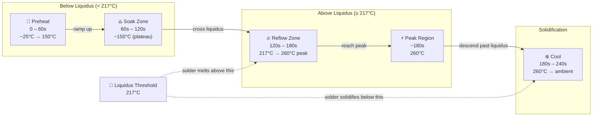

# Lesson 2: Thermal Dynamics in Soldering

## 1. First-Principles Intuition & Invariants

Soldering is fundamentally a thermal process, yet most practitioners operate with incomplete mental models of the heat transfer mechanics that govern joint formation. The journey from cold copper pad to molten solder to solid metallurgical bond is not instantaneous; it is a carefully choreographed sequence of thermal events that determine whether your finished joint will be reliable or catastrophic. Understanding thermal dynamics separates the craftsperson from the technician who merely follows a recipe.

Heat flows through three distinct mechanisms: conduction, convection, and radiation. Each mechanism operates simultaneously during soldering, but they dominate at different scales and temperatures. Conduction—the direct transfer of thermal energy through a material via phonon vibrations and electron motion—is the dominant heat transfer mode in modern soldering. When you touch a preheater block to a PCB, heat flows into the board through direct contact. Convection, the bulk motion of heated fluid (air or solder flux vapor), plays a secondary role in atmospheric soldering but becomes critical in reflow ovens where forced convection circulates hot air around components. Radiation, the emission of electromagnetic energy from heated surfaces, remains negligible until you approach temperatures above 350°C—well within the range of modern lead-free processes, so it cannot be entirely ignored.

The thermal mass of a joint is the product of its material density, volume, and specific heat capacity. A large copper pad on a multilayer board has enormous thermal mass compared to a tiny wire lead. This mass differential creates a thermal time constant—the characteristic time required for heat to flow from the soldering iron tip through the joint and into the surrounding PCB. For a 0.5 mm diameter wire on a simple single-layer board, thermal equilibrium may be reached in 3–5 seconds. For a 2 oz copper pad on a 6-layer board with ground and power planes acting as heat sinks, you may require 15–30 seconds or more. Fail to respect thermal mass, and you will either reflow the joint before it reaches adequate wetting temperature, or apply destructive thermal stress to sensitive components.

Temperature profiles—the time-evolution of temperature at critical points in the assembly—encode the entire story of joint formation. A well-executed solder joint passes through distinct thermal phases: ramp, soak, reflow, and cool. The ramp phase brings the joint from ambient temperature toward the solder's liquidus temperature (around 217°C for SAC305 lead-free alloy, or 183°C for legacy 60/40 tin-lead). The soak phase holds the joint in a narrow temperature window—typically 150–200°C—where flux becomes active, oxides dissolve, and the joint surface prepares for wetting. Reflow occurs when the joint temperature exceeds the liquidus, solder becomes fluid, and surface tension draws the molten metal into crevices and around component leads. Finally, the cool phase allows the solder to solidify into a metallurgical bond while residual thermal stress remains manageable.

Thermal shock—the rapid temperature transient when cold components or large thermal masses absorb or release heat—is the hidden failure mechanism that ruins boards hours or days after assembly. When a component with a large thermal mass (such as an electrolytic capacitor or a large connector) is suddenly exposed to reflow temperatures, the outer surfaces may reach 260°C while the interior remains near 100°C. The coefficient of thermal expansion differs between the component body, the lead material, and the solder, creating mechanical strain at the interface. If the ramp rate exceeds the material's ability to accommodate this strain through stress relaxation or elastic deformation, cracking occurs—either within the component itself or at the solder joint interface. This is why reflow profiles specify maximum ramp rates (typically 3°C/second maximum, with recommended values around 1–2°C/second) and why thermal stratification across the PCB must be minimized through careful oven design and airflow management.

Wetting—the intimate contact between molten solder and the substrate material—is the phenomenological signature of a successful joint. When molten solder meets a properly prepared copper surface, the liquid metal spreads across the substrate, forming a contact angle (measured through the liquid phase from substrate to meniscus) of roughly 10–30 degrees for lead-free alloys on clean copper. A poor wetting angle, approaching or exceeding 90 degrees, indicates that the oxide layer has not been properly cleared by flux, or that intermetallic compound formation is inhibited by temperature or time constraints. The wetting process is not instantaneous; it takes measurable time for the flux to chemically reduce oxides, for intermetallic compounds (Cu-Sn, Ni-Sn, etc.) to form at the substrate-solder interface, and for the solder surface energy to reach thermodynamic equilibrium. Rushing this phase by applying excessive temperature produces a grainy, dull solder joint that looks visually poor and exhibits reduced mechanical strength because the intermetallic layer remains thin and discontinuous.

## 2. Core Architecture & Mechanics

### Heat Transfer Modes: Mathematical Foundations and Practical Implications

Conduction follows Fourier's law, which states that heat flux (power per unit area) is proportional to the thermal conductivity of the material and the temperature gradient across it:

$$Q = -k \cdot A \cdot \frac{dT}{dx}$$

where Q is heat power in watts, k is thermal conductivity in W/(m·K), A is the cross-sectional area through which heat flows, and dT/dx is the temperature gradient. For copper at room temperature, k ≈ 400 W/(m·K), making it an excellent thermal conductor. For a PCB substrate material like FR-4, k ≈ 0.3 W/(m·K) in the plane of the board and even lower (≈ 0.1 W/(m·K)) perpendicular to the layers. This massive difference means that heat spreads rapidly through copper traces and planes but is bottlenecked by the epoxy-fiberglass composite substrate itself.

In the context of hand soldering with a temperature-controlled iron, conduction is the primary heat delivery mechanism. The iron's tip, typically maintained at 350–380°C for lead-free work, contacts the joint and transfers heat into the copper pad and component lead. The rate of heat transfer depends on three factors: the temperature difference between the tip and the joint (ΔT), the contact area between tip and joint, and the thermal conductivity path from tip to joint. A sharp, pointed tip with minimal contact area will transfer heat slowly even at high absolute temperature; a broad, chisel-shaped tip or a solder sucker equipped with a thermal transfer block will move heat far more efficiently. This is why experienced practitioners use iron tips matched to the joint size: small tips for delicate work on fine-pitch components, broad tips for power connectors and large thermal masses.

The thermal resistance concept, borrowed from electrical circuit theory, provides powerful intuition. Thermal resistance (measured in K/W) is analogous to electrical resistance; temperature differences drive heat flow across resistances just as voltage differences drive current flow. For conductive heat transfer, the thermal resistance is:

$$R_{thermal} = \frac{L}{k \cdot A}$$

where L is the thickness of the material. A 1 mm copper path has negligible thermal resistance; a 10 mm air gap has enormous thermal resistance. In practice, thermal interface materials—solder, flux residue, oxide layers—create unwanted resistances that slow heat transfer. Cleaning the joint area and ensuring good mechanical contact between iron tip and component lead minimizes these parasitic resistances.

Convection plays a different role. Natural convection from a heated PCB to ambient air is weak; the heat transfer coefficient h (in W/(m²·K)) for still air is only about 5–10 W/(m²·K). Forced convection in a reflow oven, with fans circulating air at high velocity, increases h to 50–150 W/(m²·K) or higher. The heat transferred by convection is:

$$Q = h \cdot A \cdot (T_{surface} - T_{ambient})$$

This is why reflow ovens are more thermally efficient and controllable than hand soldering for high-volume assemblies: forced convection enables uniform heating across the entire board, reducing thermal stratification and component-to-component temperature variance.

Radiation becomes measurable above roughly 300°C. The Stefan-Boltzmann law governs radiative heat transfer:

$$Q = \epsilon \cdot \sigma \cdot A \cdot (T_1^4 - T_2^4)$$

where ε is the emissivity of the surface (ranging from near 0 for polished metals to close to 1 for oxidized or dark surfaces), σ is the Stefan-Boltzmann constant (5.67 × 10⁻⁸ W/(m²·K⁴)), and T₁ and T₂ are absolute temperatures in Kelvin. At soldering temperatures, radiation is weak compared to conduction and convection, but it contributes measurably to the overall thermal environment, particularly near the peak reflow temperature. In reflow oven design, infrared heaters exploit radiation to deliver rapid, uniform heating to PCBs, and the oven's thermal modeling must account for radiation from walls and heating elements to the assembly.

### Thermal Mass and Time Constants

The thermal time constant τ (tau) for a uniform object being heated is related to its thermal capacity and the heat transfer rate from the object:

$$\tau = \frac{\rho \cdot c \cdot V}{h \cdot A}$$

where ρ is material density, c is specific heat capacity, V is volume, h is convective heat transfer coefficient, and A is surface area. For a small component like a 0603 surface-mount resistor (approximately 1.6 mm × 0.8 mm × 0.5 mm, mass ≈ 5–10 mg), the time constant during hand soldering is roughly 2–4 seconds. For a 1206 resistor (3.2 mm × 1.6 mm × 1 mm, mass ≈ 15–25 mg), it increases to 5–8 seconds. For large components like electrolytic capacitors (10 mm diameter, 15 mm height, mass ≈ 2–5 grams), the time constant can exceed 30 seconds if the component body is poorly coupled to the PCB and only the leads are being heated.

This time constant is crucial because it determines how quickly the joint reaches the solder's liquidus temperature. If you apply heat to a large thermal mass and measure the temperature rise at the joint with a thermocouple, you will observe an exponential approach toward thermal equilibrium:

$$T(t) = T_{ambient} + (T_{iron} - T_{ambient}) \cdot (1 - e^{-t/\tau})$$

After time τ, the joint has reached 63% of the final temperature rise. After 3τ, it has reached 95%. After 5τ, it is essentially at equilibrium. For a joint with τ = 10 seconds, full thermal equilibrium requires roughly 50 seconds of iron contact. Experienced technicians develop an intuitive feel for this: they know when to add solder (typically around 2–3τ, when the joint is hot enough to melt solder immediately but before thermal equilibrium), and they know when to remove the iron (at roughly 4τ, after sufficient intermetallic compound formation but before residual thermal mass causes joint overheat).

### Temperature Profiles and Reflow Dynamics

The IPC (Association Connecting Electronics Industries) standard for reflow profiles, IPC-9213, specifies limits for the thermal journey of surface-mount components during reflow. A typical lead-free profile includes:

- **Preheat phase:** Temperature rises from ambient to roughly 150°C over 60–120 seconds. The ramp rate is kept low (1–2°C/second) to avoid thermal shock. During this phase, flux begins to activate, and residual moisture in the assembly begins to desorb from component bodies and PCB material.

- **Thermal Soak phase:** Temperature is held in the 150–200°C window for 60–120 seconds. This is where flux chemistry performs its primary work: chloride-based flux activators dissolve copper and tin oxides, and organics in the flux volatilize. The long soak time allows intermetallic compounds to nucleate at the substrate-solder interface, creating a strong metallurgical bond.

- **Reflow phase:** Temperature ramps rapidly (5–10°C/second typical) through the liquidus (217°C for SAC305). The peak temperature should reach 240–260°C and be maintained at that peak for 10–40 seconds, depending on component size and board thermal mass. During this window, solder flows, wetting occurs, and large intermetallic compounds form.

- **Cool phase:** Temperature decreases at a controlled rate (1–3°C/second typical) back to ambient. Rapid cooling induces mechanical stress; excessively slow cooling promotes coarse grain growth and embrittlement in the solder joint.

To measure and validate these profiles in production, reflow ovens are instrumented with thermocouples placed at critical locations on the PCB: on large thermal masses (such as connector pads), on small components, in the bulk PCB, and in areas expected to be coldest or hottest. A time-temperature data logger captures these profiles in real time and records them for compliance verification. In the laboratory, practitioners build their own profiles by instrument testing: placing a thermocouple on a test pad and running the oven with data logging enabled, then iteratively adjusting conveyor speed, zone temperatures, and airflow to achieve the target profile.

The following ASCII diagram illustrates a typical lead-free reflow profile:

In hand soldering, you do not have explicit control over all these phases—the iron temperature is fixed, and you must manually control contact time and iron movement. However, the principles remain identical. By understanding that you need a "preheat" phase (touching the iron to the joint without adding solder, heating both the pad and lead), then a "soak" phase (continuing to heat while the joint temperature rises toward the solder's melting point), and finally a "reflow" phase (adding solder at the moment wetting begins), you execute the same thermal sequence, just compressed into 10–30 seconds instead of 240 seconds.

### Thermal Shock and Coefficient of Thermal Expansion Mismatch

Thermal shock arises from the differential expansion and contraction of materials with different coefficients of thermal expansion (CTE). Copper has a CTE of approximately 17 ppm/K. FR-4 PCB substrate has a CTE of about 15–18 ppm/K in the plane of the board and 30–60 ppm/K perpendicular to the board (z-direction), due to the anisotropic nature of the fiberglass-epoxy composite. Ceramic chip components have CTEs ranging from 5–7 ppm/K (alumina) to 8–10 ppm/K (various dielectrics). When a ceramic capacitor (CTE ≈ 7 ppm/K) on an FR-4 board (z-CTE ≈ 50 ppm/K) is rapidly heated during reflow, the outer surfaces of the component and the PCB expand at different rates, creating shear stress at the solder joint interface.

The strain induced by a temperature change ΔT is ε = CTE × ΔT. For a 200°C temperature rise (from 20°C to 220°C during reflow), a ceramic component experiences a linear strain of roughly 7 × 10⁻⁶ × 200 = 0.14%, while the PCB substrate experiences a z-direction strain of roughly 50 × 10⁻⁶ × 200 = 1%. This 7× difference in strain must be accommodated by elastic deformation or plastic flow in the solder joint. Lead-free solder (SAC305) can accommodate strain through elastic deformation and dislocation motion, but if the strain rate is too high (thermal ramp rate exceeds ~3°C/s), the material cannot relax stress quickly enough, and cracking occurs.

This is why reflow profiles mandate low ramp rates during the preheat phase. A ramp rate of 1°C/second gives material time to thermally equilibrate throughout the component body. A ramp rate of 5°C/second or higher creates steep internal temperature gradients: the outer surfaces reach high temperature before interior material has warmed significantly, causing extreme localized stress.

In practice, this manifests as cracked component pads or fractured solder joints appearing hours or days after assembly, particularly in components with high thermal mass and large dimensions (such as ball grid array (BGA) packages, large connectors, or electrolytic capacitors). The crack initiates as a micro-void under tensile stress during reflow, then propagates slowly through thermal cycling or mechanical vibration during board operation.

### Wetting Phenomena and Intermetallic Compound Formation

Wetting is a surface chemistry phenomenon governed by surface tensions and contact angles. When molten solder meets a clean copper surface, the solder "wets" the substrate if the interfacial energy is favorable. The contact angle θ is defined as the angle measured through the liquid phase from the substrate surface to the solder-air interface at the meniscus. A contact angle of 0° represents perfect wetting (the solder spreads completely across the substrate); an angle of 180° represents complete non-wetting (the solder beads up like water on wax).

For lead-free solder on clean copper, the equilibrium contact angle is typically 10–30°. This favorable wetting occurs because molten tin (the primary component of lead-free solder) has high surface tension and forms strong metallic bonds with copper at the interface. However, achieving this requires that the copper surface be chemically clean—free of oxides, residual flux, and other contaminants.

Copper oxide (Cu₂O and CuO) forms rapidly on exposed copper surfaces, especially at elevated temperature. At room temperature, an oxide layer grows slowly; after exposure to air for hours or days, a thin, invisible oxide layer (10–50 nm) covers the copper. At reflow temperature (250°C+), oxide formation accelerates dramatically, and the oxide layer thickens to 100–500 nm or more within seconds. This oxide layer prevents wetting: molten solder cannot displace the oxide and form the intimate metal-to-metal contact necessary for bonding.

Flux chemistry solves this problem. Flux is a chemical mixture, typically consisting of a resin base (rosin for traditional flux, or water-soluble organics for modern flux), an activator (chloride salts, or organic acids like citric acid), and a solvent. The activator chemically reduces copper oxide at elevated temperature. For chloride-based flux, the reaction mechanism is:

$$2\text{Cu}_{2}\text{O} + 4\text{RCl} \rightarrow 4\text{CuCl} + \text{Cl}_2 + 2\text{R-O}$$

The copper(I) chloride (CuCl) is soluble in the molten solder, effectively removing the oxide layer and exposing bare copper beneath. Once the oxide is cleared, molten solder wets the copper surface, and the intermetallic compound formation begins.

Intermetallic compounds are the actual metallurgical bond. When molten tin (from the solder) meets bare copper, they form Cu₆Sn₅ and Cu₃Sn compounds at the interface. These are hard, brittle phases with poor ductility but very high melting point (well above typical service temperatures). A well-formed solder joint exhibits a thin, continuous layer of Cu₆Sn₅ (scallop or needle-like morphology under scanning electron microscopy) at the solder-copper interface, typically 1–5 μm thick.

The rate of intermetallic compound growth is temperature-dependent. At reflow temperature (250°C+), the intermetallic layer grows to several micrometers over seconds to minutes. If the joint is held at this temperature too long, the intermetallic layer can thicken excessively (10+ μm), producing a brittle joint prone to cracking under thermal cycling. Conversely, if the joint cools too rapidly before adequate intermetallic formation, the layer remains discontinuous and thin, reducing joint strength.

This is why the reflow profile's peak temperature and dwell time (time spent above the liquidus) are so tightly controlled. A typical lead-free profile specifies 217°C liquidus with 10–40 seconds dwell time (depending on component mass). Hand soldering must approximate this timing: bringing the joint to the solder melt point, holding for 3–5 seconds while solder wets and flows, then removing the iron promptly. Rush this step and the joint lacks bonding strength; dawdle, and you risk component damage and brittle intermetallic overgrowth.

## 3. High-Performance Optimization & Failure Modes

### Hand Soldering Technique Optimization

Mastering hand soldering requires internalizing the thermal dynamics outlined above and translating them into repeatable technique. The most common failure mode—cold solder joints—arises from insufficient thermal energy delivered to the joint. A "cold" joint exhibits a dull, grainy appearance under magnification and lacks mechanical strength because intermetallic compound formation was incomplete.

To optimize for reliable joints, consider three variables: iron temperature, contact time, and tip geometry. Iron temperature is typically set to 350–380°C for lead-free work. This is hot enough to rapidly heat large thermal masses (copper pads, component leads) but not so hot as to damage heat-sensitive components (such as the plastic bodies of surface-mount parts). At 350°C, a well-designed tip with good contact area can deliver sufficient energy to a 0603 component in 3–5 seconds and to a larger component or connector pad in 10–20 seconds.

Contact time is determined by thermal mass and the rate of heat transfer. For a small wire lead (thermal time constant ~3 seconds), 2–3 seconds of iron contact at the joint is typically sufficient; add solder at the 2-second mark and remove the iron at the 4-second mark. For a large connector pad with significant copper area (thermal time constant ~15 seconds), maintain iron contact for 12–18 seconds, adding solder at the 8-second mark to allow flux activation and initial oxide reduction before peak reflow.

Tip geometry directly affects heat transfer rate. A pointed, narrow tip concentrates heat at a small point and has low thermal mass, making it suitable for fine-pitch work but poor for large joints. A broad, flat (chisel-shaped) tip has larger contact area and higher thermal mass, allowing rapid heat delivery to large joints. The chisel-shaped tip should be oriented so its broad face makes full contact with the joint; even partial contact degradation (tip oxidation, gap from solder surface curvature) dramatically reduces heat transfer efficiency.

Tip temperature measurement and control is critical. A thermocouple-equipped thermometer placed against the tip while the iron idles (without touching the joint) provides the true tip temperature. Many soldering irons advertise "350°C" set temperature but deliver only 250–280°C at the tip under load (i.e., when soldering), due to thermal mass and power delivery limitations. A quality temperature-controlled iron uses a feedback thermistor or thermocouple embedded in the tip itself to maintain setpoint even under load.

Flux selection influences wetting time and joint quality. Rosin-based flux (traditional) provides good wetting characteristics but leaves sticky residue that must be cleaned with isopropyl alcohol or flux cleaner. Water-soluble flux cleans with deionized water but may absorb moisture in humid environments, requiring rapid processing after soldering.

No-clean flux is a third category that leaves minimal, non-conductive residue and requires no cleaning, but provides weaker wetting action than rosin flux and is unsuitable for high-reliability applications (aerospace, medical devices). The flux core in solder wire typically contains 2–3% flux by weight; this is sufficient for small joints but inadequate for large or oxidized surfaces, where additional flux applied via syringe or brush before soldering is necessary. Over-fluxing causes spattering and voids; under-fluxing causes cold joints with incomplete wetting. The optimal flux quantity creates a thin, continuous film across the joint surfaces that vaporizes completely during the solder's liquid phase, leaving only the intended residue type.

Thermal profiling across joint types enables systematic process control. For through-hole components in FR-4 PCB (copper plating ~35 µm, board thickness 1.6 mm), the thermal time constant of the plated-through hole is approximately 8–12 seconds. Preheat the pad and lead simultaneously for 6 seconds, introduce solder wire at the junction (not on the iron tip), and allow capillary action to draw molten solder into the barrel. Remove the iron only after observing a smooth concave fillet around the lead, indicating complete wetting and proper intermetallic formation. For surface-mount devices, the thermal mass is dominated by the pad geometry: a 0805 resistor pad reaches thermal equilibrium in 2–3 seconds, while a QFN package with exposed thermal pad may require 10–15 seconds and auxiliary hot-air assist to prevent thermal gradient stress. Bridging (solder spanning adjacent pins) results from excess solder volume combined with insufficient flux to control surface tension; tombstoning (component standing on one end) results from asymmetric heating where one pad reaches reflow temperature significantly before the other, creating unbalanced surface tension forces. Both failure modes are correctable through deliberate iron placement and dwell time adjustment informed by thermal time constant analysis.

## Summary & Verification Matrix

| **Governing Principle** | **Mechanism** | **Observable Indicator** | **Failure Mode if Violated** |
|------------------------|---------------|-------------------------|------------------------------|
| **Thermal time constant τ = (mC)/h** | Heat capacity of joint mass vs. thermal conductivity to iron determines equilibrium time | Joint reaches solder liquidus (217°C for 63/37) in time ≈ 3τ | Cold joint (insufficient heat/time), lifted pads (excessive heat/time), intermetallic voids |
| **Heat transfer via conduction dominates** | Contact area × thermal conductivity × ΔT governs power delivery; convection/radiation negligible | Chisel tip full-face contact yields 5–10× faster heating than point contact | Slow heating promotes oxidation; uneven heating causes bridging or tombstoning |
| **Flux activation precedes wetting** | Flux reduces surface oxides and lowers surface tension in 150–180°C range before solder melts | Solder flows smoothly toward heat source; bright, reflective fillet forms | Dewetting (solder balls up), rosin joint (dull, granular surface), incomplete barrel fill |
| **Intermetallic layer formation requires 217–260°C sustained contact** | Cu₆Sn₅ and Cu₃Sn phases grow at solder/copper interface; optimal thickness 1–3 µm forms in 2–4 seconds at temperature | Concave fillet with smooth transition; solder "wets" into copper texture | Cold joint (grainy appearance, low mechanical strength), excessive intermetallic (brittle, purple hue) |
| **Thermal mass ratio joint:tip determines control authority** | High-mass tip maintains temperature under load; low-mass tip drops 50–100°C when contacting joint | Temperature-controlled iron recovers to setpoint within 1–2 seconds of contact | Temperature undershoot causes incomplete reflow; overshoot damages components or burns flux |
| **Capillary action drives solder flow in confined geometries** | Surface tension and wetting angle create pressure gradient; solder flows toward smallest gap and heat source | Through-hole solder climbs barrel against gravity; SMD solder spreads evenly under component | Insufficient flux prevents capillary fill; excess solder volume causes bridging; voids form in shadowed regions |
