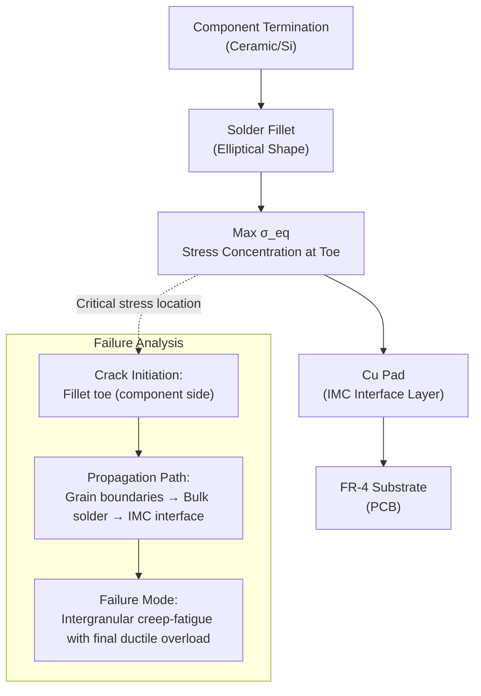

# Lesson 3: Joint Mechanics for Reliability

## 1. First-Principles Intuition & Invariants

The solder joint exists at the intersection of metallurgy, thermodynamics, and solid mechanics. Unlike adhesives that bond through van der Waals forces or mechanical fasteners that clamp through compression, the solder joint achieves permanence through intermetallic compound (IMC) formation—a diffusion-driven reaction where atoms from the solder alloy migrate into the base metal substrate and vice versa. This atomic interpenetration creates a metallurgical bond whose mechanical integrity depends not on the bulk properties of the solder alone, but on the microstructural evolution occurring within a nanometer-scale interfacial region.

When molten solder wets a copper pad, tin atoms diffuse into the copper lattice, forming Cu₆Sn₅ (eta phase) and Cu₃Sn (epsilon phase) intermetallics. The eta phase grows rapidly during reflow, typically reaching 1–3 micrometers in thickness within seconds at peak temperature. This IMC layer provides the mechanical anchor for the joint, but it introduces a fundamental trade-off: while intermetallics are essential for bonding, they are inherently brittle. Excessive IMC growth—driven by prolonged thermal exposure or repeated thermal cycling—degrades ductility and introduces preferential fracture planes. The solder joint thus embodies a materials science paradox: the same diffusion process that creates the bond also plants the seeds of its eventual failure.

The mechanical performance of a solder joint derives from its ability to absorb and redistribute stress without fracturing. Solder alloys, particularly tin-lead (SnPb) and lead-free alternatives like SAC305 (96.5% Sn, 3.0% Ag, 0.5% Cu), exhibit viscoelastic behavior—they respond elastically to short-duration loads but creep under sustained stress. At room temperature, tin-based solders operate at approximately 0.6 to 0.7 of their absolute melting temperature (homologous temperature), placing them well within the creep regime. This means that even modest mechanical loads or coefficient of thermal expansion (CTE) mismatches between the PCB substrate (typically 17 ppm/°C for FR-4) and component body (2.6 ppm/°C for silicon die) generate time-dependent plastic deformation. The solder joint is not a rigid mechanical link; it is a compliant stress-relief element whose deformation absorbs differential expansion and contraction during thermal excursions.

The invariant governing solder joint reliability is the strain energy density accumulated per thermal cycle. Each power-on event, each reflow repair, and each environmental temperature swing drives the joint through a hysteresis loop in stress-strain space. The area enclosed by this loop represents dissipated energy—energy that manifests as microstructural damage. Grain boundaries slide, voids nucleate at IMC interfaces, and microcracks propagate along the weakest crystallographic planes. Over hundreds or thousands of cycles, this cumulative damage exhausts the joint's ductility reserve, culminating in catastrophic fracture. The Coffin-Manson relationship quantifies this phenomenon, predicting cycles to failure as a power-law function of plastic strain range:

**N_f = C × (Δε_p)^(-m)**

where **N_f** is the number of cycles to failure, **Δε_p** is the plastic strain range per cycle, **C** is a material-dependent constant, and **m** is the fatigue exponent (typically 1.9 to 2.0 for SnPb, and 2.5 to 3.0 for SAC alloys). This equation encodes the brutal arithmetic of fatigue: doubling the strain range reduces lifetime by a factor of four to eight. For the reliability engineer, this relationship transforms abstract thermal cycling specifications into concrete joint geometry and alloy selection constraints.

The geometry of the solder joint determines how applied loads translate into local strains. A well-formed fillet distributes stress over a large cross-sectional area, while a concave or starved joint concentrates stress at the toe—the critical radius where solder, IMC, and copper pad converge. Stress concentration factors (K_t) at sharp transitions can reach 3 to 5, meaning that local stresses exceed the nominal applied stress by this multiple. This geometric amplification explains why solder joints with identical bulk composition and thermal history exhibit wildly divergent reliability: microstructural soundness matters, but geometry governs failure location. The fillet radius, standoff height, and pad metallization thickness collectively determine the joint's ability to redistribute CTE-induced shear without nucleating cracks.

The second invariant is the rate-dependence of deformation. At high strain rates—such as those experienced during mechanical shock or vibration—solder behaves elastically and fails through brittle fracture along grain boundaries or IMC planes. At low strain rates characteristic of thermal cycling (strain rates on the order of 10⁻⁴ to 10⁻⁶ per second), creep dominates, and failure occurs through transgranular void coalescence. This dual-mode failure landscape requires reliability testing protocols that span both extremes: drop testing to evaluate high-rate fracture toughness, and accelerated thermal cycling to evaluate low-rate creep-fatigue interaction. A joint that survives 1500 cycles of -40°C to +125°C may still fracture under a single 1500G mechanical shock if the microstructure lacks ductility or if IMC layers are excessively thick.

The third invariant governs phase transformations within the solder microstructure. Tin undergoes an allotropic transformation at 13.2°C, transitioning from the ductile beta phase (body-centered tetragonal) to the brittle alpha phase (diamond cubic, also called gray tin). This transformation, known as tin pest, proceeds autocatalytically and can cause complete disintegration of pure tin components in cold environments. Modern solder alloys suppress this transition through alloying additions, but joints subjected to extended subzero storage can still exhibit embrittlement. Additionally, SAC alloys develop coarse Ag₃Sn intermetallic precipitates during prolonged thermal aging, reducing ductility and accelerating creep rates. The microstructure is not static; it evolves continuously during service, driven by thermodynamic forces toward equilibrium states that may be mechanically detrimental.

## 2. Core Architecture & Mechanics

The mechanical architecture of a solder joint begins with its geometry. A through-hole joint differs fundamentally from a surface-mount joint in how it distributes load. For a plated through-hole (PTH) assembly, the solder fills the annular gap between the component lead and the barrel wall, creating a cylindrical stress distribution. Axial loads on the lead generate tensile hoop stresses in the solder, while radial CTE mismatches induce shear at the barrel-solder interface. The critical stress concentration occurs at the knee—the transition from the vertical barrel to the horizontal pad—where the solder fillet forms a small-radius concave meniscus. This geometric discontinuity elevates local stress by a factor of 2 to 4 depending on fillet profile.

For surface-mount technology (SMT), the joint geometry resembles a mechanical spring. The solder forms a fillet connecting the component termination to the PCB pad, with a standoff height (typically 50–100 micrometers for chip resistors, 200–500 micrometers for BGAs) that allows the joint to flex under shear. The cross-sectional shape is approximately elliptical, with the minor axis perpendicular to the board and the major axis parallel to the pad length. During thermal cycling, CTE mismatch between component and board generates a shear displacement Δx:

**Δx = L × (α_component - α_board) × ΔT**

where **L** is the distance from the component's neutral point to the joint, **α** represents CTE, and **ΔT** is the temperature excursion. For a 10mm-long ceramic capacitor with α = 8 ppm/°C mounted on FR-4 with α = 17 ppm/°C, a 100°C temperature swing generates 90 micrometers of differential displacement. This displacement must be accommodated entirely by solder joint deformation.

The shear strain γ in the joint is:

**γ = Δx / h**

where **h** is the standoff height. For our capacitor example with h = 75 micrometers, the shear strain reaches 120%, which exceeds the elastic limit of all common solder alloys by an order of magnitude. The joint survives because solder creeps, redistributing stress through time-dependent plastic flow. The creep rate follows a power-law relationship:

**dε/dt = A × σ^n × exp(-Q / RT)**

where **A** is a material constant, **σ** is applied stress, **n** is the stress exponent (typically 4–7 for solder), **Q** is activation energy (approximately 60 kJ/mol for SAC305), **R** is the gas constant, and **T** is absolute temperature. This equation reveals why elevated-temperature reliability testing accelerates failure: doubling the temperature from 25°C to 125°C increases creep rate by a factor of 20–50, compressing years of service life into weeks of test time.

The internal microstructure of the joint dictates how creep damage accumulates. A freshly reflowed SAC305 joint contains fine-grained tin dendrites, small Ag₃Sn precipitates (1–2 micrometers), and Cu₆Sn₅ needles. Grain boundaries act as barriers to dislocation motion, so fine-grained structures exhibit higher yield strength but lower creep resistance. As the joint ages, grain coarsening proceeds through grain boundary migration, driven by the reduction in total interfacial energy. Grains grow from 10–20 micrometers immediately after reflow to 50–100 micrometers after 1000 hours at 150°C. This coarsening reduces grain boundary area, lowering the energy required for grain boundary sliding—the dominant creep mechanism in tin-based solders.

Simultaneously, Ag₃Sn precipitates coarsen through Ostwald ripening, where small particles dissolve and large particles grow to minimize total interfacial energy. The average particle radius increases with time according to:

**r³ - r₀³ = k × t**

where **r** is particle radius, **r₀** is initial radius, **k** is a rate constant, and **t** is time. Coarse precipitates lose their effectiveness as dislocation obstacles, softening the alloy and accelerating creep. The interplay between grain growth and precipitate coarsening determines the time evolution of joint mechanical properties.

The IMC layer at the solder-copper interface grows continuously during thermal aging. The IMC thickness increases parabolically with time:

**X² = D × t**

where **X** is IMC thickness and **D** is the effective diffusion coefficient (temperature-dependent via an Arrhenius relationship). At 150°C, Cu₆Sn₅ grows at approximately 0.01 micrometers per square root of hours. After 1000 hours, IMC thickness reaches 3–5 micrometers. Beneath the Cu₆Sn₅ layer, a thinner Cu₃Sn layer forms, growing more slowly. The Cu₃Sn layer is more brittle than Cu₆Sn₅, with a fracture toughness approximately 30% lower. Excessive IMC growth, particularly of Cu₃Sn, creates a preferential crack path along the IMC-copper interface during thermal cycling.

The stress state within the joint is triaxial. At the fillet toe, the principal stresses include tensile stress perpendicular to the pad (σ_normal), shear stress parallel to the pad (τ_shear), and hydrostatic pressure in the bulk. The von Mises equivalent stress, which combines these components into a scalar failure criterion, reaches maximum values at the outer edges of the fillet:

**σ_eq = √(σ_x² - σ_x σ_y + σ_y² + 3τ_xy²)**

Finite element analysis (FEA) of a typical 0805 resistor joint under 100°C thermal cycle reveals σ_eq peaks of 40–60 MPa at the fillet toe, exceeding the yield strength of SAC305 (approximately 25 MPa at 125°C). This plastic yielding is intentional; the joint is designed to sacrifice itself, plastically deforming to protect the brittle ceramic component and the PCB trace.

The crack initiation site is almost invariably the fillet toe on the component side, where stress concentration, IMC brittleness, and maximum creep strain converge. Cracks nucleate along grain boundaries oriented perpendicular to the maximum principal stress direction. Initial microcracks are typically 5–10 micrometers in length, visible only under high-magnification SEM inspection. Once nucleated, the crack propagates through the joint cross-section via a combination of creep-driven void coalescence and fatigue-driven striation growth. The crack path follows either the grain boundaries (intergranular fracture, characteristic of creep-dominated failure) or cleaves through grains (transgranular fracture, more common in high-rate loading). Mixed-mode fracture, exhibiting both intergranular and transgranular features, is typical in thermal cycling tests.

The crack propagation rate da/dN (crack growth per cycle) follows the Paris law:

**da/dN = C × (ΔK)^m**

where **ΔK** is the stress intensity factor range, **C** is a material constant, and **m** is the Paris exponent (typically 2–4 for solder). The stress intensity factor accounts for both applied stress and crack length:

**ΔK = Y × Δσ × √(πa)**

where **Y** is a geometric factor, **Δσ** is stress range, and **a** is crack length. This equation captures the accelerating nature of fatigue failure: as the crack lengthens, stress intensity increases, which accelerates crack growth, which further increases stress intensity. The final 20% of joint life often consumes less than 5% of total cycles.

Complete fracture occurs when the remaining ligament can no longer support the applied load, leading to fast fracture through the final uncracked cross-section. The fracture surface exhibits a characteristic appearance: a smooth, creep-dominated region near the initiation site (fine, equiaxed dimples), transitioning to a rougher, fatigue-striated region in the propagation zone, and culminating in a rough, ductile overload region where final separation occurred. Cross-sectional metallography reveals the crack path: typically initiating at the IMC interface, propagating through the bulk solder along grain boundaries, and occasionally diverting into the IMC layer itself if IMC thickness exceeds 5–7 micrometers.

## 3. High-Performance Optimization & Failure Modes

Optimizing solder joint reliability begins with geometric design. Increasing standoff height reduces shear strain by providing greater compliance, but excessively tall joints introduce bending moments and increase vulnerability to mechanical shock. The optimal standoff height for SMT joints ranges from 25% to 50% of the component length. For a 3.2mm-long 1206 resistor, this translates to 0.8–1.6mm standoff. Achieving this requires controlled solder paste volume deposition: too little paste yields starved joints with inadequate fillet area, while too much paste creates excessive standoff and risks bridging adjacent pads.

The solder paste stencil aperture dimensions dictate deposited volume. For a 1206 footprint with 1.6mm × 3.2mm pads, a typical aperture measures 1.4mm × 2.8mm with 0.125mm thickness, yielding approximately 0.5 mm³ of paste per pad. After reflow, accounting for approximately 50% void volume in the paste and solder density of 7.4 g/cm³, this produces a joint mass of 2.7 mg. The fillet profile depends on the ratio of solder volume to pad area; empirical data suggest that volume-to-area ratios of 0.06–0.08 mm³/mm² produce optimal concave fillets with minimal voiding.

Pad metallization influences IMC growth kinetics and wetting behavior. Electroless nickel immersion gold (ENIG) surfaces suppress IMC growth compared to bare copper by inserting a nickel diffusion barrier. The Ni₃Sn₄ IMC that forms at the solder-nickel interface grows more slowly than Cu₆Sn₅ and exhibits superior fracture toughness. However, ENIG introduces a failure mode called black pad, where phosphorus-rich nickel layers become brittle and fracture at the nickel-gold interface. Immersion silver (ImAg) and organic solderability preservative (OSP) coatings offer alternatives: ImAg forms thin Ag₃Sn IMC layers with excellent ductility, while OSP provides a minimal organic barrier that burns off during reflow, exposing fresh copper for direct solder-copper bonding.

Alloy selection trades ductility against creep resistance. SAC305 exhibits superior creep resistance compared to SnPb (63/37), extending thermal cycling life by 1.5–2× under identical conditions. However, SAC alloys are more brittle at room temperature, with elongation to fracture of 20–30% compared to 40–50% for SnPb. This brittleness makes SAC joints more vulnerable to mechanical shock and drop testing. Alloying additions modify this trade-off: adding 0.05–0.1% nickel to SAC (creating SAC305-Ni) refines grain structure and improves drop shock performance by 30–50% while maintaining thermal cycling reliability. Bismuth additions (3–4% Bi) increase strength but reduce ductility and lower melting temperature, enabling lower reflow peak temperatures at the cost of reduced high-temperature reliability.

Reflow profile optimization controls grain structure and IMC thickness. A fast ramp rate (2–3°C/s) and short time above liquidus (60–90 seconds) minimize grain growth and IMC formation, producing fine-grained microstructures with thin IMC layers. However, insufficient time above liquidus prevents complete flux activation and solder spreading, leading to poor wetting and voiding. The optimal peak temperature for SAC305 is 235–245°C, measured at the board surface; package body temperatures typically lag by 10–20°C. Exceeding 250°C risks component damage and excessive IMC growth, while staying below 230°C produces incomplete reflow and cold joints.

Voiding degrades joint reliability by reducing effective cross-sectional area and introducing stress concentrations. Voids form when flux volatiles become trapped in the molten solder during reflow. Void content should remain below 25% of joint area for most applications; automotive and aerospace standards mandate < 15% for critical joints. Reducing voiding requires optimizing flux chemistry (minimizing residue-forming activators), controlling paste deposit thickness (thinner deposits enable easier outgassing), and adjusting reflow atmosphere (nitrogen reflow reduces oxidation and promotes flux spreading, lowering void nucleation).

Inspection criteria for solder joint quality derive from IPC-A-610 workmanship standards, which define three acceptability classes. Class 1 (general electronics) permits incomplete fillet coverage provided electrical continuity exists. Class 2 (dedicated service) requires 270° fillet coverage around the component termination with minimal voiding. Class 3 (high-reliability) mandates 360° fillet coverage, < 25% voiding, and no evidence of disturbed solder (grainy appearance indicating movement during solidification). Visual inspection identifies gross defects like insufficient solder, bridging, and component misalignment. X-ray inspection reveals internal voiding, cracks, and IMC layer thickness. Cross-sectional metallography provides definitive microstructural analysis but is destructive and limited to sample-based assessment.

Failure analysis proceeds systematically from visual inspection to destructive physical analysis. External visual inspection identifies obvious fractures, discoloration (evidence of overheating), or lifted components. Dye penetrant testing highlights crack openings invisible to the naked eye by capillary action drawing fluorescent dye into microcracks. X-ray imaging in 2D or 3D computed tomography mode maps internal crack propagation and void distribution. Once the failure location is identified, cross-sectional metallography exposes the fracture surface for SEM imaging. Energy-dispersive X-ray spectroscopy (EDS) maps elemental distribution, revealing IMC composition and identifying contaminants. Fractography—detailed analysis of fracture surface morphology—distinguishes failure modes: smooth facets indicate brittle fracture, dimpled surfaces indicate ductile overload, and striations indicate fatigue propagation.

Creep behavior at elevated temperatures accelerates in proportion to temperature according to the Arrhenius equation. Testing at 150°C accelerates creep by a factor of approximately 20 compared to 85°C operation. This acceleration enables reliability validation within practical test durations: 1000 hours at 150°C simulates roughly 20,000 hours (2.3 years) at 85°C. However, this extrapolation assumes that no new failure mechanisms activate at elevated temperature. Intermetallic coarsening, phase transformations, and polymer substrate degradation may introduce failure modes absent at lower temperatures, invalidating the acceleration model. Conservative reliability engineers supplement accelerated testing with extended-duration testing at actual operating temperatures.

Thermal cycling testing subjects assemblies to repeated temperature excursions, typically -40°C to +125°C with 15-minute dwells and 10-minute ramps. The number of cycles to failure depends on component size, standoff height, and CTE mismatch. Small components (0402 resistors) exhibit lifetimes exceeding 5000 cycles, while large components (20mm BGAs) may fail below 1000 cycles. The Modified Engelmaier model predicts cycles to failure based on accumulated plastic work:

**N_f = (1 / 2Δγ_p)^(1/c)**

where **Δγ_p** is plastic shear strain range per cycle and **c** is the fatigue ductility exponent (temperature-dependent, approximately 0.65–0.85 for solder). This model incorporates material properties, joint geometry, and CTE mismatch into a single predictive equation, enabling design-stage reliability assessment before hardware fabrication.

Mechanical shock testing evaluates brittle fracture resistance. A typical drop test specification requires the assembly to survive drops from 1.5 meters onto concrete, generating peak accelerations of 1500G with a 0.5-millisecond pulse duration. During this event, inertial forces generate tensile stresses in solder joints supporting massive components (inductors, transformers, electrolytic capacitors). The peel stress at the joint interface can reach 100–200 MPa, exceeding the ultimate tensile strength of solder. Joints survive through plastic energy absorption rather than elastic load-bearing; the solder deforms permanently during each shock, accumulating damage. After 50–100 drops, cumulative plastic strain exhausts ductility and brittle fracture occurs. Component placement—preferably locating heavy components near board supports and away from edges—minimizes shock-induced loading.

Vibration testing exposes assemblies to sinusoidal or random vibration across frequencies from 10 Hz to 2000 Hz. Resonant frequencies of the PCB and components amplify input acceleration by factors of 5–20 (quality factor Q), concentrating stress at solder joints. The most destructive frequency range for typical PCBs is 100–500 Hz, where fundamental flexural modes dominate. Joints fail through high-cycle fatigue (10⁶–10⁷ cycles) rather than low-cycle thermal fatigue. The S-N curve (stress versus cycles to failure) for solder joints in vibration exhibits a fatigue limit around 10–15 MPa at 10⁷ cycles; stresses below this threshold produce indefinite life. Vibration isolation mounts, component underfill, and board stiffening ribs mitigate vibration-induced failures.

Underfill—a capillary-flowing epoxy applied between a component body and PCB—transforms the mechanical load path, reducing solder joint strain by distributing stress across the entire component footprint. For BGA packages, underfill can extend thermal cycling life by 5–10× by constraining package warpage and limiting shear displacement at the solder joints. The underfill must exhibit a CTE intermediate between silicon (2.6 ppm/°C) and FR-4 (17 ppm/°C) to avoid introducing new CTE mismatch stresses. Typical underfills have CTE of 25–35 ppm/°C, glass transition temperatures above 150°C to maintain stiffness during operation, and low viscosity (0.1–1 Pa·s) to enable complete flow under the component via capillary action. Application occurs after reflow by dispensing a fillet of underfill along the component perimeter and allowing it to wick underneath, followed by thermal cure at 150°C for 30–60 minutes.

Advanced reliability modeling employs finite element simulation to predict stress distributions and damage accumulation. A typical FEA workflow begins with CAD geometry import, followed by material property assignment (including temperature-dependent Young's modulus, Poisson's ratio, CTE, and creep parameters for each material). Meshing subdivides the geometry into tetrahedral elements with element sizes of 5–10 micrometers in the solder joint region to capture stress gradients. Boundary conditions include fixed constraints at board edges and thermal loading as a time-dependent temperature function. The solver performs coupled thermal-structural analysis, computing temperature distribution via thermal conduction equations and mechanical response via constitutive equations incorporating creep. Post-processing extracts equivalent plastic strain per cycle, which feeds into fatigue life prediction models.

The critical insight from decades of solder joint reliability research is that joints are sacrificial mechanical fuses designed to absorb CTE-induced stress through permanent deformation. They protect brittle components and PCB traces by yielding preferentially. Reliability optimization is not about making joints stronger—a rigid joint would simply transfer stress to adjacent structures, causing fractures elsewhere—but about making joints more compliant, more ductile, and more resistant to accumulated damage. The designer's objective is to maximize the number of plastic deformation cycles the joint can endure before crack nucleation, then slow crack propagation once initiated. This is achieved through geometry (maximizing fillet area and standoff height within mechanical constraints), microstructure (controlling grain size and IMC thickness through reflow profile), and materials selection (choosing alloys with optimal creep-fatigue properties for the application's thermal and mechanical environment). The solder joint reliability problem is ultimately a thermomechanical design problem, requiring interdisciplinary fluency in metallurgy, solid mechanics, and manufacturing process control.
