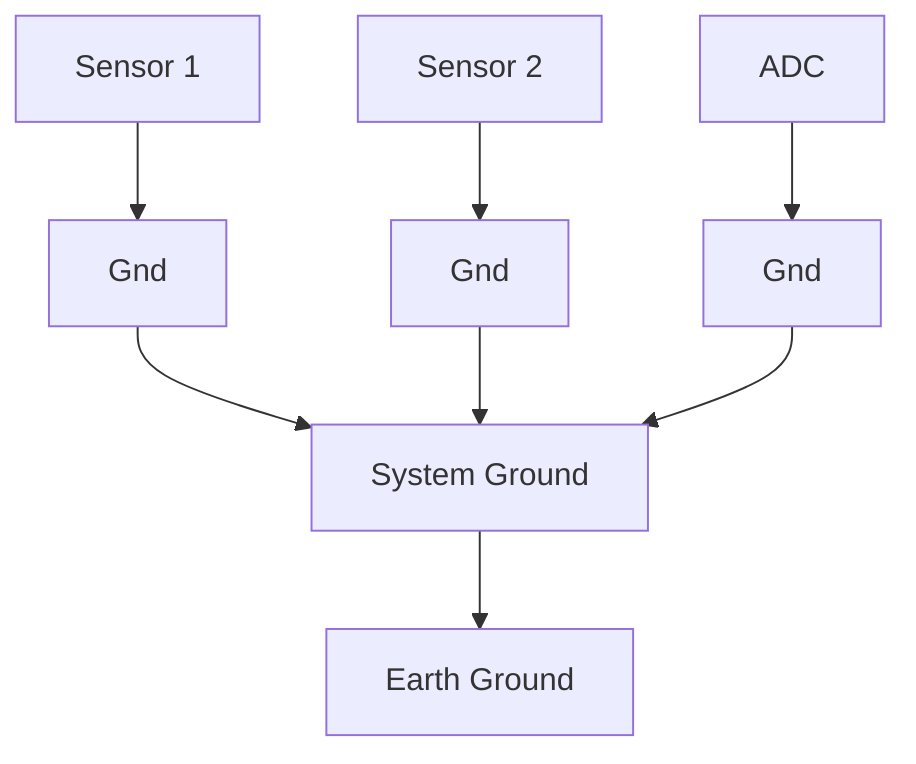

# Lesson 2: Instrumentation Signal Conditioning

## 1. First-Principles Intuition & Invariants

The raw electrical signal emerging from a physical sensor is rarely suited for direct digitization or analysis. A thermocouple junction generates microvolts across hundreds of ohms of source impedance. A piezoelectric accelerometer produces picocoulombs of charge that decay within milliseconds. A strain gauge bridge drifts with temperature and delivers millivolt differentials contaminated by 60 Hz power-line interference and radio-frequency pickup from adjacent switching regulators. The central challenge of instrumentation signal conditioning is to shepherd these fragile, low-amplitude, high-impedance signals from the transducer to the analog-to-digital converter without corrupting the measurement with noise, distortion, or systematic error.

Signal conditioning bridges the chasm between the physics of the sensor and the requirements of the data acquisition system. Every conditioning chain must satisfy several invariant constraints. First, the input impedance of the conditioning circuit must be sufficiently high relative to the sensor's output impedance to avoid loading the transducer and attenuating the signal. A thermocouple with 200 Ω source impedance feeding into a 10 kΩ input resistance forms a voltage divider that introduces a 2% measurement error before any amplification occurs. Second, the noise floor of the conditioning amplifier must remain below the intrinsic noise of the sensor itself; otherwise, the electronics become the limiting factor in measurement resolution. Third, the bandwidth of the conditioning chain must encompass the signal's spectral content while rejecting out-of-band interference, a task that requires careful filter design and an understanding of aliasing phenomena when the conditioned signal is ultimately sampled.

The transduction mechanism of the sensor dictates the topology of the conditioning architecture. Sensors fall into several canonical categories based on their electrical output characteristics. Voltage-output sensors like thermocouples and Hall-effect devices present a voltage signal but typically with high output impedance, necessitating high-input-impedance buffer amplifiers. Current-output sensors such as photodiodes operated in photovoltaic mode or ionization chambers generate currents proportional to the measured quantity, requiring transimpedance amplifiers that convert current to voltage while maintaining low input voltage noise. Charge-output sensors including piezoelectric accelerometers and capacitive microphones produce transient charge packets that demand charge amplifiers with extremely high input impedance and careful attention to leakage currents. Resistive sensors like resistance temperature detectors (RTDs) and strain gauges require excitation current or voltage and bridge configurations to linearize the output and provide temperature compensation. Each transduction mechanism presents unique conditioning challenges rooted in the physics of the sensing element.

The signal-to-noise ratio (SNR) available at the output of the conditioning chain ultimately determines the quality of the measurement. Noise arises from fundamental physical processes and circuit imperfections. Thermal noise, or Johnson-Nyquist noise, originates from the random motion of charge carriers in resistive elements and manifests as a voltage spectral density proportional to the square root of resistance and temperature. A 1 kΩ resistor at 300 K exhibits a noise voltage of approximately 4 nV/√Hz, which integrated over a 10 kHz bandwidth yields an RMS noise voltage of 400 nV. Shot noise arises in semiconductor junctions due to the quantized nature of charge flow and becomes significant in photodiodes and precision current sources. Flicker noise, or 1/f noise, dominates at low frequencies in semiconductors and resistive films, corrupting DC and sub-Hertz measurements with drift and excess noise. External interference from electromagnetic fields, ground loops, and digital switching transients can dwarf intrinsic noise sources, making grounding, shielding, and filtering essential components of any precision conditioning architecture.

Impedance matching governs the efficient transfer of signal power from source to load and minimizes reflections in transmission-line scenarios. In low-frequency instrumentation, impedance matching primarily concerns voltage transfer efficiency and noise optimization. A sensor with output impedance $Z_s$ driving an amplifier with input impedance $Z_{in}$ transfers maximum voltage when $Z_{in} \gg Z_s$, ensuring the full sensor voltage appears at the amplifier input. For current-mode measurements, the transimpedance amplifier maintains a virtual ground at its input, presenting near-zero input impedance to the sensor and forcing all sensor current through the feedback resistor. At radio frequencies and in high-speed digital interfaces, transmission-line effects dominate, and conjugate impedance matching ($Z_{load} = Z_{source}^*$) becomes necessary to prevent standing waves and signal reflections that corrupt waveform integrity.

The bandwidth of the conditioning chain must be carefully tailored to the signal's spectral characteristics. Insufficient bandwidth attenuates high-frequency components and distorts transient waveforms, manifesting as slew-rate limiting and ringing in step responses. Excessive bandwidth admits out-of-band noise and aliasing artifacts, degrading SNR without improving measurement fidelity. The Nyquist-Shannon sampling theorem dictates that to faithfully reconstruct a bandlimited signal, the sampling rate must exceed twice the highest frequency component. However, any signal energy above the Nyquist frequency (half the sampling rate) aliases into the baseband, masquerading as valid signal content and corrupting the measurement. Anti-aliasing filters, steep lowpass filters preceding the ADC, suppress out-of-band content to levels below the quantization noise floor, ensuring clean digitization.

The invariants of signal conditioning form a hierarchy of constraints. Input impedance must be high enough to avoid loading the sensor. Noise must be minimized through proper amplifier selection, filtering, and shielding. Bandwidth must encompass the signal while rejecting interference and preventing aliasing. Gain must scale the conditioned signal to match the ADC's input range without saturating or introducing nonlinearity. Common-mode rejection must be sufficient to suppress ground potential differences and interference that appears identically on both signal conductors. Offset voltage and drift must be nulled or compensated to prevent measurement bias. These constraints interact in complex ways, and optimizing one parameter often degrades another, requiring careful tradeoffs informed by a deep understanding of the sensor physics and the measurement requirements.

## 2. Core Architecture & Mechanics

The architecture of a signal conditioning chain is a cascade of functional blocks, each addressing a specific aspect of the signal transformation from sensor to ADC. The canonical conditioning chain begins with an input protection network to guard against overvoltage transients and electrostatic discharge, followed by an input buffer or instrumentation amplifier to present high input impedance and provide initial gain, then filtering stages to shape bandwidth and reject interference, and finally an output driver to interface with the ADC. Variations on this topology arise depending on the sensor type and application requirements, but the fundamental flow remains consistent.

Input protection is the first line of defense against electrical overstress. Transient voltage suppressors (TVSs) or zener diodes clamp input voltages to safe levels, shunting excess current to ground or a supply rail. Series resistors limit fault currents and prevent damage to downstream circuitry. For high-speed signals, the protection network must exhibit low capacitance to avoid bandwidth degradation; Schottky diodes with their lower junction capacitance are preferable to standard PN junctions. In precision low-level measurements, leakage currents through protection diodes can introduce offset errors, necessitating ultra-low-leakage protection schemes or high-impedance input stages that tolerate the leakage.

The input amplifier topology depends critically on the sensor's output characteristics. For high-impedance voltage sources like thermocouples and pH electrodes, a unity-gain buffer or voltage follower built around a JFET-input or CMOS operational amplifier provides input impedances exceeding 10^12 Ω while presenting low output impedance to drive subsequent stages. The voltage follower configuration connects the op-amp output directly to the inverting input, establishing unity voltage gain and transforming the impedance from the sensor's high-impedance output to the amplifier's low-impedance output. The transfer function is simply $V_{out} = V_{in}$, but the buffering action isolates the sensor from loading effects and cable capacitance.

For differential voltage sources like strain gauge bridges and RTD bridges, the instrumentation amplifier (in-amp) is the topology of choice. The three-op-amp instrumentation amplifier architecture consists of two non-inverting input buffers followed by a difference amplifier stage. The two input buffers present high, balanced input impedances to the differential source, while a gain-setting resistor $R_g$ connected between the two buffers establishes the differential gain according to $G = 1 + \frac{2R_1}{R_g}$, where $R_1$ is the internal feedback resistor of the input stage. The difference amplifier output stage rejects common-mode signals—voltages that appear identically on both inputs—and amplifies only the differential voltage. Common-mode rejection ratio (CMRR) quantifies this rejection, typically exceeding 80 dB in precision in-amps. High CMRR is essential in rejecting ground potential differences and interference that couples equally to both signal conductors.

A representative instrumentation amplifier schematic for a strain gauge bridge conditioning circuit might employ the AD8221 or INA128, both precision in-amps with CMRR exceeding 100 dB. The strain gauge bridge, configured as a Wheatstone bridge with four resistive strain gauges in a full-bridge arrangement, receives a 5 V excitation voltage. At zero strain, the bridge is balanced and outputs zero differential voltage. Applied strain unbalances the bridge, generating a differential output proportional to the strain-induced resistance change, typically 2 mV/V of excitation per 1000 microstrain. With 5 V excitation, 1000 microstrain yields 10 mV differential. Setting $R_g = 1 \text{ kΩ}$ in the AD8221 achieves a gain of 100, amplifying the 10 mV bridge output to 1 V, a suitable level for a 5 V ADC with 1 V full-scale range.

Current-output sensors demand transimpedance amplifiers (TIAs), which convert the sensor's output current to a proportional voltage. A photodiode operating in photovoltaic mode generates a current proportional to incident light intensity but delivers this current into near-zero load impedance to maintain linearity. The TIA configuration places the photodiode between ground and the inverting input of an operational amplifier, with a feedback resistor $R_f$ from output to inverting input. The op-amp's feedback action maintains the inverting input at virtual ground (the same potential as the non-inverting input, which is grounded), forcing all photodiode current through $R_f$. The output voltage is $V_{out} = -I_{sensor} \cdot R_f$, with the negative sign indicating inversion. The transimpedance gain $R_f$ is selected to scale the maximum sensor current to the ADC's input range. A photodiode generating 0 to 10 µA driving a 100 kΩ feedback resistor produces 0 to 1 V output.

The TIA's bandwidth is limited by the feedback resistor and the input capacitance, which includes the photodiode's junction capacitance and the op-amp's input capacitance. The closed-loop bandwidth is approximately $f_{-3dB} = \frac{1}{2\pi R_f C_{in}}$. Increasing $R_f$ to boost transimpedance gain reduces bandwidth, a fundamental tradeoff. To extend bandwidth while maintaining high gain, a feedback capacitor $C_f$ is placed in parallel with $R_f$, introducing a zero in the frequency response that stabilizes the loop and prevents oscillation. The optimal value of $C_f$ is typically chosen to equal or slightly exceed $C_{in}$, ensuring a phase margin of 45° or greater.

Charge amplifiers address the unique requirements of piezoelectric sensors and capacitive transducers that generate transient charge packets. A piezoelectric accelerometer modeled as a charge source $Q$ in series with a capacitance $C_p$ drives the inverting input of an op-amp with a feedback capacitor $C_f$. The charge $Q$ flows into $C_f$, and the output voltage is $V_{out} = -\frac{Q}{C_f}$. Unlike the TIA where feedback resistance sets the gain, the charge amplifier uses feedback capacitance, yielding a gain in volts per coulomb. The input impedance must be extraordinarily high to prevent charge leakage; JFET-input or CMOS op-amps with input bias currents below 1 pA are required. A 1 pA bias current leaking from a 10 nF sensor capacitance causes a voltage decay time constant $\tau = \frac{C_p}{I_{bias}} = \frac{10 \times 10^{-9}}{1 \times 10^{-12}} = 10^4 \text{ s}$, or nearly 3 hours, which is acceptable for transient measurements but insufficient for DC or ultra-low-frequency applications.

Filtering is the mechanism by which the conditioning chain shapes the signal spectrum to maximize SNR and prevent aliasing. Passive RC filters constructed from resistors and capacitors provide simple, low-cost solutions for non-critical applications but suffer from limited roll-off steepness and sensitivity to component tolerances. Active filters built around operational amplifiers offer sharper roll-off, lower output impedance, and adjustable gain. The Butterworth, Chebyshev, and Bessel filter families represent different design tradeoffs between passband flatness, roll-off steepness, and time-domain response. Butterworth filters exhibit maximally flat passband response but moderate roll-off. Chebyshev filters achieve steeper roll-off at the expense of passband ripple. Bessel filters preserve time-domain waveform fidelity with linear phase response but sacrifice roll-off steepness.

A second-order Sallen-Key lowpass filter topology, one of the most common active filter configurations, employs a single op-amp in a non-inverting configuration with two resistors and two capacitors defining the cutoff frequency and filter characteristics. The transfer function of a second-order lowpass filter is $H(s) = \frac{\omega_0^2}{s^2 + \frac{\omega_0}{Q}s + \omega_0^2}$, where $\omega_0 = 2\pi f_0$ is the cutoff frequency and $Q$ is the quality factor determining the shape of the response. For a Butterworth response, $Q = 0.707$. For a Bessel response, $Q = 0.577$. The component values are selected to realize the desired $f_0$ and $Q$. A typical design for a 1 kHz Butterworth lowpass filter might use $R_1 = R_2 = 16 \text{ kΩ}$ and $C_1 = C_2 = 10 \text{ nF}$, yielding $f_0 = \frac{1}{2\pi R C} \approx 1 \text{ kHz}$.

Anti-aliasing filters preceding the ADC must suppress out-of-band content to levels below the least significant bit (LSB) of the digitizer. A 12-bit ADC has a quantization noise floor at approximately -74 dBFS (dB relative to full scale). If the sampling rate is 100 kHz (Nyquist frequency 50 kHz), the anti-aliasing filter must attenuate signals above 50 kHz to below -74 dB to prevent aliasing artifacts. A second-order filter rolls off at 40 dB/decade, so achieving 74 dB attenuation at 100 kHz (one octave above Nyquist) requires a cutoff frequency of approximately 50 kHz / 10^(74/40) ≈ 10 kHz. Higher-order filters with steeper roll-off (60 dB/decade for third-order, 80 dB/decade for fourth-order) allow cutoff frequencies closer to the Nyquist limit, preserving more signal bandwidth.

Grounding architecture is foundational to noise mitigation in instrumentation systems. Ground is not a universal zero-potential reference but rather a collection of interconnected conductors carrying return currents and exhibiting finite impedance. When multiple circuits share a common ground conductor, return currents from one circuit induce voltage drops across the ground impedance, which appear as noise voltages in other circuits—a phenomenon known as ground loop interference. Single-point grounding establishes one location as the system ground reference, with all circuit returns connected to this single node, minimizing ground loop area. Star grounding extends this concept by connecting each subsystem's ground return directly to the central ground point via individual conductors, preventing shared return paths. Multi-point grounding connects each subsystem's ground to the nearest low-impedance ground plane, reducing ground inductance at high frequencies but potentially creating multiple current paths and ground loops.

In this topology, all ground return currents flow back to a single system ground node, preventing return currents from one circuit from affecting another. The system ground is then connected to earth ground at a single point to establish a safety ground and reference potential without creating ground loops.

Shielding protects signal conductors from capacitive and inductive coupling of electromagnetic interference. A Faraday shield, a grounded conductive enclosure surrounding the signal conductors, intercepts electric fields and shunts displacement currents to ground before they can couple to the signal. The shield should be connected to ground at one end only to prevent ground loops; a shield grounded at both ends forms a loop through which magnetic fields can induce circulating currents, which in turn create voltage drops along the shield resistance that appear as noise at the signal terminals. For balanced differential signals carried on twisted-pair conductors, the shield is typically grounded at the receiver end, while the twisted-pair conductors themselves provide common-mode rejection of magnetically coupled interference. The twisting ensures that each conductor experiences nearly identical magnetic flux, causing induced voltages to appear as common-mode signals that the differential receiver rejects.

Driven shields and guarding extend shielding concepts to ultra-low-current measurements where leakage currents through cable insulation resistance and capacitance can corrupt the measurement. The guard is a conductive layer surrounding the signal conductor, driven to the same potential as the signal by a unity-gain buffer. Because the guard and signal conductor are at the same potential, no voltage exists across the cable insulation resistance, and leakage current is eliminated. The outer shield, connected to ground, intercepts external interference. This three-conductor configuration—signal, guard, and shield—is standard in electrometers and high-impedance instrumentation.

Noise mitigation strategies encompass circuit design choices, layout techniques, and system architecture. Low-noise amplifier selection prioritizes devices with input voltage noise spectral density below the sensor's intrinsic noise. A thermocouple with 100 Ω source resistance generates 1.3 nV/√Hz of thermal noise, so the amplifier's input noise should be 1 nV/√Hz or lower to avoid degrading SNR. For low source impedances, voltage noise dominates, and JFET-input or precision bipolar op-amps with sub-nV/√Hz voltage noise excel. For high source impedances, current noise flowing through the source resistance generates voltage noise that can dominate; CMOS and JFET amplifiers with femtoampere input bias currents minimize this contribution.

Filtering reduces noise bandwidth, lowering the integrated RMS noise. A 1 nV/√Hz noise spectral density integrated over a 10 kHz bandwidth yields 100 nV RMS. Reducing bandwidth to 1 kHz reduces noise to 32 nV RMS, a 10 dB improvement. Oversampling and digital filtering exploit this principle by sampling at rates much higher than the signal bandwidth and applying digital lowpass filters to reduce noise bandwidth without analog filter complexity. A 16-bit ADC oversampled by a factor of 16 (sampling at 16 times the Nyquist rate) and digitally decimated gains 2 bits of effective resolution, yielding 18-bit performance.

Chopper stabilization and auto-zeroing techniques eliminate offset voltage and 1/f noise in precision DC measurements. Chopper amplifiers modulate the input signal to a higher frequency above the 1/f corner, amplify it, and then demodulate back to DC, effectively translating DC and low-frequency components above the amplifier's 1/f noise region. Auto-zero amplifiers periodically disconnect from the input, short their inputs together, measure and store the offset, then reconnect and subtract the stored offset from the signal. Both techniques reduce offset voltage to microvolts and 1/f noise to sub-100 nV/√Hz, enabling millivolt-level measurements with microvolt accuracy.

Layout and PCB design exert profound influence on noise performance. Signal traces should be short, direct, and routed over a continuous ground plane to minimize loop area and inductive pickup. High-impedance nodes must be guarded with driven guard traces or surrounded by grounded guard rings to prevent leakage and capacitive coupling. Analog and digital circuits should occupy separate regions of the PCB with dedicated ground planes connected at a single point to prevent digital switching currents from contaminating analog grounds. Decoupling capacitors placed immediately adjacent to IC power pins suppress supply noise and provide local charge reservoirs for transient current demands. High-frequency bypass capacitors (0.1 µF ceramic) in parallel with bulk capacitors (10 µF tantalum or electrolytic) address both high-frequency switching noise and low-frequency supply droop.

## 3. High-Performance Optimization & Failure Modes

Optimizing signal conditioning for high-performance applications demands rigorous attention to noise budgeting, bandwidth allocation, and dynamic range management. The noise budget enumerates all noise sources in the measurement chain and calculates their combined contribution at the ADC input. Each noise source—sensor thermal noise, amplifier voltage and current noise, resistor thermal noise, interference—adds in quadrature (root-sum-square) to yield the total RMS noise. The goal is to ensure that the total noise remains below the ADC's quantization noise floor, typically one-half to one LSB. If sensor noise dominates, the conditioning electronics contribute negligibly to measurement uncertainty, representing an optimal design. If amplifier noise exceeds sensor noise, the electronics degrade SNR and must be redesigned with lower-noise components.

Consider a precision thermocouple measurement system. A K-type thermocouple with 100 Ω source resistance generates 1.3 nV/√Hz thermal noise. An instrumentation amplifier with 5 nV/√Hz input voltage noise and 1 pA/√Hz input current noise contributes $\sqrt{(5 \text{ nV/√Hz})^2 + (1 \text{ pA/√Hz} \times 100 \text{ Ω})^2} = \sqrt{25 + 0.01} \approx 5 \text{ nV/√Hz}$ of input-referred noise, dominated by voltage noise. The total input-referred noise is $\sqrt{(1.3)^2 + (5)^2} \approx 5.2 \text{ nV/√Hz}$. With a measurement bandwidth of 10 Hz (adequate for the slow thermal response of thermocouples), the total RMS noise is $5.2 \text{ nV/√Hz} \times \sqrt{10 \text{ Hz}} \approx 16 \text{ nV}$. A gain of 1000 amplifies this to 16 µV at the ADC input. A 16-bit ADC with a 5 V range has an LSB of 76 µV, so the noise occupies 0.2 LSB, indicating excellent design margin. However, had a noisier amplifier with 20 nV/√Hz been selected, the noise would have escalated to 63 µV at the ADC input, approaching one LSB and degrading measurement resolution.

Bandwidth optimization balances signal fidelity against noise and aliasing rejection. Excessive bandwidth admits wideband noise and high-frequency interference, degrading SNR without capturing additional signal information. Insufficient bandwidth attenuates high-frequency signal components, distorting transient waveforms and reducing measurement accuracy. The optimal bandwidth equals the signal's spectral extent plus a margin for filter roll-off. A load cell measuring slowly varying forces exhibits bandwidth below 10 Hz, so a 100 Hz lowpass filter provides ample margin. A piezoelectric accelerometer measuring mechanical vibrations up to 10 kHz requires bandwidth exceeding 15 kHz to preserve waveform fidelity and a sampling rate above 30 kHz to satisfy Nyquist with margin for the anti-aliasing filter transition band.

Dynamic range defines the ratio between the largest signal the conditioning chain can process without distortion and the smallest signal distinguishable from noise. A conditioning amplifier with a ±10 V output swing and 100 µV RMS noise exhibits a dynamic range of 100 dB. Dynamic range is consumed by sensor signal range, so if the sensor produces a 1 V signal span, only 80 dB of dynamic range remains available for resolving small signal variations. High dynamic range demands low noise (which sets the noise floor) and high linearity (which determines the distortion-limited maximum signal level). Operational amplifiers with rail-to-rail output stages maximize output swing, preserving dynamic range, while precision amplifiers with total harmonic distortion (THD) below -100 dB ensure linearity.

Offset voltage and drift introduce systematic measurement errors that accumulate over time and temperature. Offset voltage is the DC voltage appearing at the amplifier output when the input is zero. Input-referred offset for precision op-amps ranges from 10 µV to 1 mV. Temperature drift, specified in µV/°C, describes the rate at which offset changes with temperature. An amplifier with 50 µV offset and 1 µV/°C drift operating over a 0 to 50°C temperature range experiences a 50 µV drift, comparable to the initial offset. In precision measurement systems, offset and drift must be calibrated or compensated. Single-point calibration measures the output with zero input and subtracts this offset from subsequent measurements. Two-point calibration applies known input levels and fits a linear correction curve, compensating for both offset and gain error. Chopper-stabilized and auto-zero amplifiers eliminate offset and drift through continuous internal calibration, achieving sub-microvolt offset and sub-10 nV/°C drift.

Common-mode rejection failure manifests when the instrumentation amplifier cannot adequately suppress voltages common to both inputs. Ground loops, where the sensor ground and ADC ground differ by several hundred millivolts due to shared return current paths, introduce common-mode voltages that can saturate the amplifier or create nonlinearity if CMRR is insufficient. A 100 mV ground potential difference with 80 dB CMRR appears as a 10 µV differential error, which may be acceptable. But if CMRR degrades at high frequencies (CMRR typically decreases with frequency in real amplifiers), high-frequency interference on the common-mode path can couple through as differential noise. Ensuring high CMRR across the signal bandwidth requires selecting instrumentation amplifiers with specified CMRR at the frequencies of interest and minimizing common-mode voltage through proper grounding.

Impedance mismatch in high-frequency signal conditioning introduces reflections and standing waves that distort waveforms. A 50 Ω source driving a high-impedance oscilloscope input through a coaxial cable creates a transmission line where the cable's characteristic impedance (typically 50 Ω) interacts with the source and load impedances. If the load impedance does not match the cable impedance, a reflection coefficient $\Gamma = \frac{Z_L - Z_0}{Z_L + Z_0}$ defines the fraction of the incident wave reflected back toward the source. A high-impedance oscilloscope input ($Z_L \gg Z_0$) yields $\Gamma \approx 1$, doubling the voltage at the load through constructive interference—a desired outcome for voltage measurements but problematic for power transfer. For RF signal conditioning and high-speed digital interfaces, resistive termination at both source and load ($Z_s = Z_L = Z_0$) eliminates reflections, ensuring clean signal transmission at the cost of power dissipation.

Aliasing artifacts arise when the anti-aliasing filter insufficiently attenuates out-of-band content. A 10 kHz signal sampled at 16 kHz aliases to 6 kHz, masquerading as a valid baseband component. If the sensor or its environment generates signals at multiples of the sampling frequency, these alias into the measurement band and cannot be distinguished from genuine signal. The remedy is a steep anti-aliasing filter with stopband attenuation exceeding the ADC's dynamic range. Oversampling relaxes anti-aliasing filter requirements by pushing the Nyquist frequency far above the signal bandwidth, allowing shallower analog filters while relying on digital decimation filters for final bandwidth shaping.

Saturation and clipping occur when signal excursions exceed the conditioning amplifier's output voltage range, driving the output into the supply rails and introducing severe nonlinearity. Saturation clips waveform peaks, generating harmonic distortion and losing information. Recovery from saturation can be slow, particularly in amplifiers with limited slew rate or charge-pump output stages. Preventing saturation requires careful gain staging, where each amplifier stage operates with sufficient headroom below its output limits. If the sensor can produce a 10 mV signal and the ADC requires a 1 V input, a gain of 100 is needed. Distributing this gain across two stages—each with gain of 10—reduces the likelihood of intermediate stage saturation and improves linearity.

Oscillation and instability in conditioning amplifiers arise from excessive phase shift in the feedback loop, particularly when driving capacitive loads. An operational amplifier configured as a unity-gain buffer driving a long cable (which appears capacitive) can oscillate if the cable capacitance interacts with the op-amp's output impedance to introduce additional phase lag. The Barkhausen stability criterion states that oscillation occurs when the loop gain magnitude equals unity and the phase shift equals 180° (or equivalently, 0° in a negative feedback system). Preventing oscillation requires ensuring adequate phase margin—typically 45° or greater—through compensation techniques. Adding a small series resistor (10 to 100 Ω) between the op-amp output and the load isolates the capacitive load, reducing the capacitance seen directly by the output stage and improving stability. Alternatively, selecting op-amps rated for capacitive load drive, such as those with unity-gain-stable compensation, ensures robust operation.

Thermal effects introduce both drift and noise. Power dissipation in conditioning circuitry generates heat, which elevates component temperatures and induces offset drift, gain drift, and thermal noise. High-power resistors in bridge excitation circuits or feedback networks act as localized heat sources, warming nearby amplifiers and causing thermal gradients across the PCB. Thermal time constants, ranging from milliseconds for small ICs to seconds for larger components and assemblies, determine how quickly temperatures stabilize after power-on. Thermal stabilization delays can corrupt initial measurements, necessitating warm-up periods before acquiring data. Minimizing power dissipation through low-quiescent-current amplifiers, efficient bridge excitation, and heat-sinking of power-dissipating components reduces thermal drift and improves measurement stability.

Electrostatic discharge (ESD) events can permanently damage sensitive input stages or introduce transient errors. Human body model (HBM) ESD strikes deliver kilovolts across nanoseconds, overwhelming input protection diodes and punching through gate oxides in CMOS amplifiers. Robust ESD protection employs series resistors to limit current, transient voltage suppressors to clamp voltages, and multiple stages of protection to absorb energy without allowing it to reach sensitive nodes. However, excessive protection capacitance degrades high-frequency performance, necessitating a tradeoff between protection robustness and bandwidth.

Calibration and traceability close the loop on instrumentation accuracy. Single-point calibration nulls offset by applying a known zero input and recording the output, then subtracting this offset from all subsequent measurements. Two-point calibration applies two known input levels, fits a linear transfer function, and corrects for both offset and gain error. Multi-point calibration over the full input range characterizes and compensates nonlinearity. Traceable calibration references signals to national standards through a chain of comparisons, ensuring that measurements are accurate and reproducible across laboratories and over time. Precision voltage references like the LTZ1000 buried-zener reference provide sub-ppm stability and form the foundation of calibration standards, while precision resistors with 0.01% tolerance and low temperature coefficients ensure accurate gain and bridge resistor matching.

The failure modes of signal conditioning are as diverse as the applications. Input overvoltage, whether from sensor faults, ESD, or wiring errors, can destroy input stages. Incorrect grounding creates ground loops that inject interference and corrupt measurements. Insufficient CMRR allows common-mode voltages to swamp differential signals. Aliasing turns high-frequency noise into low-frequency artifacts. Thermal drift causes measurements to wander. Oscillation turns amplifiers into RF generators. Each failure mode has a root cause in the physics of circuits and transducers, and each has a remedy grounded in careful design, component selection, layout, and testing. High-performance signal conditioning is not merely a matter of selecting high-spec parts but rather a discipline demanding holistic understanding of transduction, noise, impedance, grounding, shielding, filtering, and the invariants that govern the fidelity of measurements from the physical world to the digital domain.
