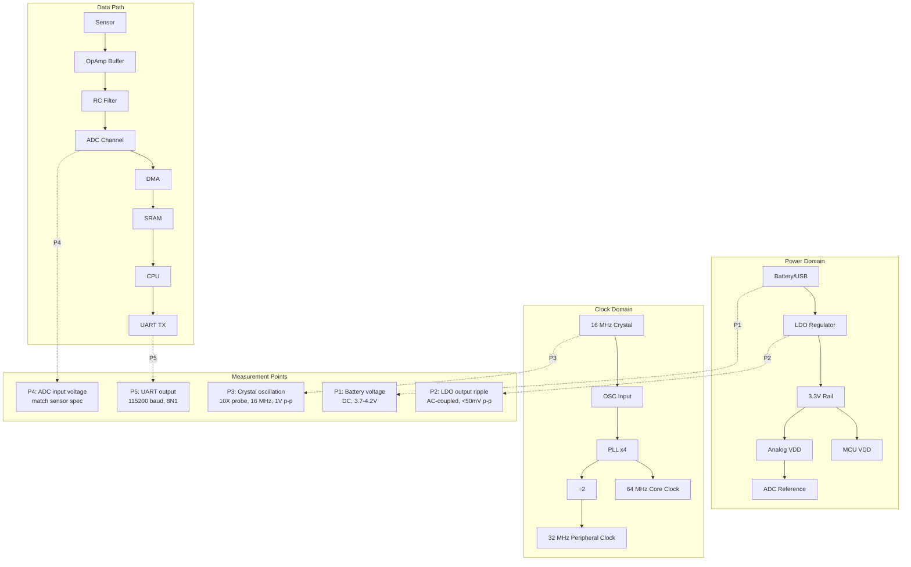

# Lesson 1: Diagnostic Methodology

## 1. First-Principles Intuition & Invariants

Hardware troubleshooting distinguishes itself from abstract software debugging through the immutable constraint of physical causality. When a digital system fails, the root cause exists in one of three fundamental domains: electrical discontinuity, logical state corruption, or timing violation. Unlike software, where a function call either executes or throws an exception, hardware failures cascade through multiple layers—a degraded power rail causes intermittent SRAM bit flips, which manifest as sporadic firmware crashes, which appear to the end user as "random lockups." The diagnostic methodology we develop here rests on a single invariant: every observable symptom traces back to a measurable, repeatable physical phenomenon.

The systematic fault isolation framework begins with the recognition that modern digital hardware operates as a series of nested state machines. A microcontroller system comprises clock distribution networks feeding synchronous logic blocks, memory subsystems with specific access timing requirements, and peripheral interfaces governed by protocol state machines. Each layer imposes constraints on the layer above it. When troubleshooting, we must mentally construct the complete signal flow graph—from power supply rails through voltage regulators, across PCB traces with parasitic inductance and capacitance, into silicon bond wires, through CMOS gate oxide layers, and finally into the functional logic that processes data. This mental model is not academic abstraction; it directly informs where we place oscilloscope probes, which register bitfields we interrogate, and how we construct minimal reproducible test cases.

Hypothesis-driven testing emerges as the natural consequence of understanding this layered causality. The novice engineer randomly swaps components or reflashes firmware, hoping for accidental success. The expert formulates a falsifiable hypothesis—"the SPI MISO line has insufficient slew rate due to excessive trace capacitance"—then designs a targeted measurement to confirm or refute it. This requires deep knowledge of the expected behavior at each layer. For instance, if a UART receives corrupted data, the hypothesis space includes: incorrect baud rate crystal tolerance, ground potential differences between devices, insufficient RS-232 voltage swing, or interrupt latency causing FIFO overflow. Each hypothesis predicts specific oscilloscope waveform characteristics or logic analyzer bit patterns. We methodically test each prediction, eliminating hypotheses until only one remains consistent with all observations.

The concept of boundary condition testing derives from the reality that digital circuits are analog systems forced into binary operation. Every CMOS gate has a metastability window where the output voltage hovers between logic high and logic low, potentially causing downstream circuits to interpret the signal inconsistently. Every ADC has a quantization noise floor below which meaningful signal cannot be distinguished from thermal noise. Every bus protocol has setup and hold time requirements that, when violated, produce intermittent bit errors. Boundary testing deliberately stresses these transition regions—sweeping supply voltage from minimum to maximum rated values, varying clock frequencies across the specified range, heating the device to maximum junction temperature, and injecting noise onto critical signal paths. Failures that appear only at boundary conditions reveal inadequate design margin, often the result of parasitic effects or second-order temperature coefficients that standard validation testing overlooks.

Reproducibility stands as the cornerstone of effective diagnostics. A fault that occurs once in ten thousand power cycles cannot be debugged through direct observation—the statistical sample size required exceeds practical limits. The diagnostic process must therefore transform intermittent faults into deterministic, repeatable failures. This demands understanding the environmental conditions, input stimuli, and device state that trigger the fault. For example, a microcontroller that crashes sporadically may exhibit deterministic failure when the watchdog timer is disabled, specific peripherals are active simultaneously, and the instruction fetch path crosses a 1KB memory boundary during a DMA transfer. Identifying these preconditions requires systematic variation of a single parameter while holding all others constant, coupled with instrumentation that captures transient events—deep memory oscilloscopes set to trigger on glitches, logic analyzers capturing extended pre-trigger state, or on-chip trace buffers recording instruction execution history.

The diagnostic methodology also recognizes that modern hardware systems exhibit emergent behaviors arising from the interaction of nominally independent subsystems. A switching power supply generates electromagnetic interference (EMI) at its fundamental frequency and harmonics. If one of these harmonics falls within the bandwidth of a nearby analog signal chain, the system experiences periodic noise injection that corrupts measurements. The fault appears to be "random" because the phase relationship between the switching frequency and the sampling clock drifts over time, causing the interference to alias into different frequency bins. Diagnosing such cross-domain interactions requires spectrum analysis, understanding Fourier decomposition of non-sinusoidal waveforms, and recognizing that PCB layout directly influences signal integrity through controlled impedance traces, ground plane continuity, and return path inductance.

Throughout this lesson, we develop a structured approach that begins with observable symptoms, constructs a signal flow model of the system, formulates testable hypotheses about failure mechanisms, implements targeted measurements with appropriate instrumentation, and iteratively refines our understanding until we isolate the root cause to a single replaceable component, correctable firmware bug, or improvable design parameter. This methodology applies universally—whether troubleshooting a multi-gigahertz SerDes link on a server motherboard, debugging intermittent sensor glitches in an automotive ECU, or isolating noise sources in a precision analog front-end.

## 2. Core Architecture & Mechanics

The signal flow analysis framework partitions the hardware system into hierarchical domains, each with defined inputs, outputs, and internal state. At the highest level, we distinguish power delivery, clock distribution, digital logic, analog signal conditioning, and inter-chip communication. Each domain operates according to specific physical laws and exhibits characteristic failure modes. Power delivery obeys Ohm's law and behaves as a distributed RLC network; failures manifest as voltage droop under load, oscillation from inadequate loop compensation, or thermal shutdown from excessive dissipation. Clock distribution follows transmission line theory on high-speed nets and operates as a synchronization fabric; failures produce timing violations, meta-stability, or frequency drift from temperature-dependent crystal characteristics. Digital logic implements Boolean functions with finite propagation delay and non-zero switching energy; failures arise from setup/hold violations, stuck-at faults in CMOS gates, or single-event upsets in SRAM cells. Analog conditioning amplifies, filters, and converts continuous signals according to transfer functions defined by component tolerances; failures stem from operational amplifier saturation, insufficient bandwidth, or noise coupling from adjacent circuitry. Inter-chip communication serializes data according to protocol specifications with defined voltage levels, timing parameters, and error detection mechanisms; failures occur from impedance mismatch, crosstalk between differential pairs, or protocol violation from incorrect state machine implementation.

When approaching an unfamiliar system, the first task involves constructing a complete signal flow diagram from available documentation—schematics, datasheets, and firmware source code. Begin at the primary inputs: AC mains or battery voltage, external sensors, communication interfaces. Trace power through linear regulators or switching converters, noting dropout voltages, quiescent currents, and enable sequencing requirements. Identify the master clock source—crystal oscillator, MEMS resonator, or external reference—and map its distribution through clock buffers, PLLs, and clock domain crossings. Document digital data paths from peripherals through DMA controllers or interrupt service routines into CPU register files and out to external interfaces. Chart analog signals from transducers through instrumentation amplifiers, anti-aliasing filters, and ADC inputs, noting gain stages and reference voltage dependencies. For each signal path, annotate expected voltage levels, frequency ranges, impedance characteristics, and protocol timing.

The diagnostic process leverages this signal flow model to implement divide-and-conquer fault localization. When a system exhibits incorrect output, we bisect the signal path, measuring the midpoint to determine whether the upstream or downstream section contains the fault. For example, if a sensor readout displays incorrect values, we measure the analog voltage at the ADC input pins. If this voltage is correct but the digital readout is wrong, the fault lies in the ADC configuration, reference voltage, or digital processing. If the analog voltage itself is incorrect, we move upstream to the sensor output, checking for proper excitation voltage, bias current, or bridge completion. This binary search through the signal chain rapidly narrows the fault domain from "entire system" to "specific subcircuit" within a handful of measurements.

Effective signal probing requires understanding the measurement's impact on the circuit under test. Oscilloscope probes present capacitive loading—typically 10-15 picofarads for 10X passive probes, less for active FET probes. On high-impedance nodes or high-frequency signals, this capacitance loads the circuit, reducing signal amplitude and increasing rise time. The troubleshooter must account for this by using higher-impedance probes, reducing probe tip length to minimize inductance, or designing test points directly into the PCB. Logic analyzers sample digital signals at discrete time intervals, requiring that the sample rate exceeds twice the maximum signal frequency (Nyquist criterion) to avoid aliasing. When debugging high-speed buses like PCIe or DDR, dedicated protocol analyzers with equalization and de-embedding capabilities become necessary to accurately capture signals suffering from inter-symbol interference and channel loss.

The concept of boundary scan provides a structured approach to testing interconnections between integrated circuits without physical probing. Chips implementing the IEEE 1149.1 JTAG standard contain boundary scan registers—shift register chains connecting every chip I/O pin. By shifting test patterns into these registers and capturing the resulting outputs, we verify PCB trace continuity, detect solder bridges between adjacent pins, and confirm that each chip correctly drives and receives logic levels. The JTAG Test Access Port (TAP) controller operates as a finite state machine with sixteen states, navigating between Test-Logic-Reset, Run-Test/Idle, and various Shift/Capture/Update states according to the sequence of TMS (Test Mode Select) control signals. Understanding this state machine is essential when implementing boundary scan diagnostics, as incorrect TMS sequencing can leave the TAP controller in an undefined state, preventing further debug access.

Modern microcontrollers integrate on-chip debug modules providing real-time access to CPU state and peripheral registers without halting program execution. ARM Cortex-M processors implement the Serial Wire Debug (SWD) protocol, a two-wire alternative to JTAG's four-wire interface, achieving similar functionality with reduced pin count. The SWD protocol communicates through a bidirectional data line (SWDIO) and clock (SWCLK), accessing an internal Debug Access Port (DAP) that bridges to the Advanced High-performance Bus (AHB) or Advanced Peripheral Bus (APB). Through this interface, external debuggers read memory contents, set hardware breakpoints, enable data watchpoints, and trace instruction execution through the Instrumentation Trace Macrocell (ITM) or Embedded Trace Macrocell (ETM). When troubleshooting firmware-related hardware issues—such as peripheral misconfiguration causing unexpected GPIO states or DMA transfers corrupting memory—these debug features provide visibility into the system's internal state without requiring invasive probing.

The instrumentation strategy depends on the failure's temporal characteristics. Persistent faults—those present whenever the system powers on—allow leisurely measurements with manual probe placement and single-shot oscilloscope captures. Intermittent faults demand triggered acquisition, where the oscilloscope or logic analyzer continuously monitors the signal and captures data only when a specified condition occurs. Common trigger types include edge triggers (capturing when a signal crosses a threshold with positive or negative slope), pulse width triggers (detecting glitches shorter or longer than a specified duration), and pattern triggers (activating when a multi-bit bus matches a specific hexadecimal value). Deep memory oscilloscopes, storing millions of samples, capture extended time windows before and after the trigger event, revealing the sequence of events leading to the fault.

For faults occurring at microsecond to millisecond timescales—such as power supply transients during load steps or signal integrity violations during burst data transfers—mixed-signal oscilloscopes with sufficient bandwidth and sample rate serve as the primary diagnostic tool. For faults manifesting over seconds to minutes—thermal drift, charge pump leakage, or slow control loop oscillations—data loggers continuously recording voltage, current, or temperature provide the necessary temporal resolution. For faults appearing only after hours or days of operation—electromigration failures, dielectric breakdown, or memory retention loss—accelerated life testing combines elevated temperature, increased voltage stress, and extended operational duty cycles to compress the failure timeline into practical test durations.

## 3. High-Performance Optimization & Failure Modes

The reproducibility criteria for hardware faults demand environmental control and systematic parameter variation. Temperature stands as the most influential environmental factor, affecting semiconductor carrier mobility, crystal oscillator frequency, resistor values through temperature coefficients, and capacitor dielectric constants. A fault appearing only at elevated temperature suggests thermal expansion causing intermittent mechanical connections, increased leakage current in reverse-biased junctions, or marginal timing that degrades as transistor switching speed decreases. To establish temperature-dependent reproducibility, we employ thermal chambers for controlled heating, thermal couples for precise temperature measurement at critical components, and thermal imaging cameras to identify localized hot spots indicating excessive power dissipation. When a component exceeds its maximum rated junction temperature, immediate symptoms include reduced output drive strength, increased propagation delay, or complete functional failure with automatic thermal shutdown.

Supply voltage variation provides another critical dimension for reproducibility testing. Digital logic rated for operation across a voltage range—such as 2.7V to 3.6V for many microcontrollers—must maintain functionality throughout this entire range. Yet marginal designs that work reliably at nominal 3.3V may exhibit intermittent failures at 2.8V due to insufficient noise margin, slower logic transitions increasing susceptibility to crosstalk, or brownout detection thresholds triggering spurious resets. The diagnostic process sweeps supply voltage from minimum to maximum rated values while monitoring system behavior, using programmable power supplies with millivolt resolution and current-limited output to prevent destructive failures. Observing the voltage at which faults appear or disappear provides insight into whether the root cause involves inadequate voltage regulation, excessive IR drop across PCB power distribution networks, or marginal component specifications.

Clock frequency scaling reveals timing-related faults through deliberate violation of setup and hold time requirements. Synchronous digital systems require that data signals arrive at flip-flop inputs and remain stable for a minimum duration (setup time) before the clock edge, then continue holding stable for a minimum duration (hold time) after the clock edge. Violations cause meta-stability, where the flip-flop output voltage hovers in the undefined region between logic high and low, potentially propagating as either value through subsequent logic stages. To diagnose timing violations, we reduce clock frequency until the fault disappears, confirming that the system operates correctly given sufficient time for signal propagation and settling. We then incrementally increase frequency, identifying the maximum reliable operating frequency and comparing it to the design specification. If the empirical maximum falls below the specified frequency, timing closure has failed—propagation delays through combinational logic exceed the available clock period, requiring either slower operation, additional pipeline stages, or redesigned logic paths with reduced delay.

The failure mode taxonomy for hardware systems categorizes faults according to their physical mechanism and observable behavior. Catastrophic failures result in complete loss of function—shorted power rails causing immediate current limiting, open circuit traces preventing signal propagation, or destroyed silicon from electrostatic discharge or latch-up. These faults are typically easy to diagnose because the failure mode is obvious and persistent. Parametric failures involve degraded performance within functional limits—increased power consumption indicating leakage current, reduced output voltage swing from resistor drift, or decreased signal-to-noise ratio from amplifier aging. These require quantitative measurements comparing actual performance against datasheet specifications. Intermittent failures appear and disappear based on environmental conditions or operational state—cold solder joints opening at thermal expansion mismatches, whisker growth shorting adjacent PCB traces under mechanical vibration, or software race conditions manifesting only during specific interrupt timing scenarios.

When diagnosing power supply issues, we apply the concept of load line analysis, plotting the relationship between output voltage and load current. An ideal voltage regulator maintains constant output voltage regardless of load current. Real regulators exhibit finite output impedance, causing voltage droop under heavy load. Excessive droop indicates inadequate output capacitance, insufficient feedback loop bandwidth, or current limit activation. Oscillation—visible as high-frequency ripple on the output voltage—stems from inadequate phase margin in the feedback compensation network, typically caused by incorrect capacitor ESR (Equivalent Series Resistance), insufficient output capacitance, or layout parasitics introducing additional poles in the transfer function. The diagnostic approach measures output voltage ripple using AC-coupled oscilloscope settings with sufficient bandwidth to capture the oscillation frequency, then adjusts compensation components (typically adding or changing output capacitors) while monitoring the effect on loop stability.

Signal integrity faults arise from electromagnetic effects on high-speed digital signals. Transmission line theory governs signal propagation on PCB traces longer than one-sixth the signal rise time multiplied by the propagation velocity. For a 1 nanosecond rise time signal propagating at 15 cm/ns (typical for FR-4 dielectric), traces longer than 2.5 cm must be treated as transmission lines with characteristic impedance determined by trace width, copper thickness, dielectric height, and dielectric constant. Impedance mismatches between the driver output impedance, trace characteristic impedance, and receiver input impedance cause reflections, visible on oscilloscopes as staircase waveforms with multiple transitions as the reflection bounces back and forth. Diagnosing signal integrity issues requires measuring the signal at both the driver output and receiver input, comparing waveform quality to determine whether reflections, ringing, or excessive attenuation degrade the signal. Solutions involve adjusting trace geometry for impedance control, adding series termination resistors at the driver to match source impedance, or implementing parallel termination resistors at the receiver to absorb reflections.

Electromagnetic interference (EMI) diagnostics identify noise coupling mechanisms between aggressor sources and victim receivers. Conducted EMI propagates through shared power rails or ground connections—a noisy digital circuit modulates the ground potential, which appears as common-mode noise on adjacent analog circuits referenced to the same ground. Radiated EMI couples through electric or magnetic fields—high di/dt current loops generate magnetic fields proportional to loop area and current rate of change, inducing voltages in nearby circuits through transformer action. The diagnostic process uses near-field probes (small loop antennas for magnetic field detection or short monopoles for electric field detection) positioned near suspected noise sources while monitoring victim circuits for correlated interference. Mitigation strategies include reducing current loop areas, adding local decoupling capacitors to shunt high-frequency currents, implementing ground planes to provide low-impedance return paths, and shielding sensitive circuits with grounded metal enclosures.

The concept of design margin quantifies the difference between actual operating conditions and the limits at which the system fails. A robust design maintains substantial margin across all parameters—operating at 60% of maximum clock frequency, 70% of maximum junction temperature, and 80% of maximum supply voltage, ensuring that component tolerances, aging, and environmental variation do not push the system into failure. Marginal designs operate near specification limits, exhibiting intermittent faults when any parameter drifts unfavorably. The diagnostic process deliberately reduces design margin through environmental stress—increasing temperature, lowering supply voltage, or accelerating clock frequency—to verify that the system fails gracefully and predictably rather than exhibiting undefined behavior. This stress testing also reveals the root cause of intermittent field failures by reproducing them deterministically in the lab under controlled worst-case conditions.

When troubleshooting systems with embedded firmware, we must distinguish between hardware faults and software bugs through systematic isolation. A hardware fault produces incorrect behavior regardless of software execution—wrong voltage levels, missing clock signals, or corrupted data on communication buses. A software bug manifests only during specific code execution paths—incorrect peripheral initialization, race conditions in interrupt handlers, or buffer overflows corrupting memory. The isolation technique involves running minimal test firmware that exercises only the suspected hardware subsystem without complex control flow. For example, to verify ADC functionality, we write bare-metal code that configures the ADC, triggers a single conversion, reads the result register, and outputs the value through a known-good UART. If this minimal test succeeds while the full application fails, the root cause lies in software complexity—perhaps DMA misconfiguration, interrupt priority conflicts, or incorrect timing assumptions in the application code. If the minimal test also fails, the fault is hardware-related—wrong ADC reference voltage, incorrect pin configuration, or damaged silicon.

The ultimate validation of any diagnostic methodology is its ability to predict system behavior across the entire operational envelope. After isolating a fault to a specific component or mechanism, we formulate a quantitative model explaining the failure. For a power supply with voltage droop, the model includes output capacitor ESR and load transient di/dt to predict the droop magnitude. For timing violations, the model sums propagation delays through each combinational logic stage and compares the total to the available clock period minus setup time. For signal integrity faults, the model applies transmission line reflection equations to predict waveform distortion based on impedance mismatches. We then vary the system parameters and verify that the observed behavior matches the model predictions. Only when the model successfully predicts all observed symptoms—including the boundary conditions where the fault appears and disappears—can we claim confident understanding of the root cause and implement a permanent corrective action.
