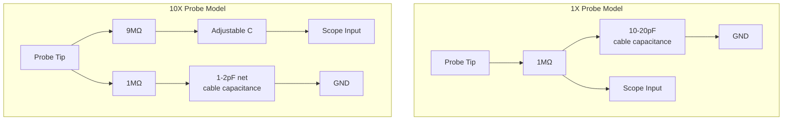

# Lesson 3: Measurement Instrumentation

## 1. First-Principles Intuition & Invariants

The essence of hardware troubleshooting begins not with observation but with measurement—the quantitative capture of electrical phenomena that transform abstract circuit theory into empirical reality. When a prototype fails to boot, when a production board exhibits intermittent faults, or when a high-speed digital bus corrupts data unpredictably, the engineer's first recourse is not speculation but instrumentation. Measurement bridges the gap between schematic intent and silicon reality, revealing the true electrical behavior of circuits under operating conditions.

At the foundation of all electronic measurement lies Ohm's Law, the immutable relationship between voltage, current, and resistance expressed as V = IR. This deceptively simple equation governs every electrical phenomenon from millivolt-level sensor readings to kilowatt power distribution systems. Voltage represents electrical potential difference—the "pressure" that drives charge carriers through conductive paths. Current quantifies the rate of charge flow, measured in amperes, while resistance characterizes a material's opposition to that flow. These three quantities form an inseparable trinity: measure any two, and the third follows inevitably from their relationship.

Yet raw voltage and current values reveal only static snapshots. Real-world circuits operate dynamically, with signals transitioning between logic states, analog waveforms oscillating at radio frequencies, and power consumption varying with computational load. Time-domain behavior becomes critical when diagnosing setup and hold time violations in synchronous digital logic, when analyzing PWM duty cycles in motor controllers, or when characterizing the startup transient of a switching regulator. The oscilloscope emerges as the primary instrument for capturing voltage as a function of time, rendering invisible electrical events visible through phosphor persistence or digital sample memory.

Beyond voltage and time, modern electronics demands analysis in the frequency domain. A clean-looking square wave on a time-domain oscilloscope may harbor catastrophic high-frequency harmonics that radiate electromagnetic interference or violate signal integrity budgets on high-speed differential pairs. Fourier analysis decomposes arbitrary time-domain signals into constituent sinusoidal components, revealing spectral content that determines antenna efficiency, filter performance, and compliance with regulatory emission limits. Spectrum analyzers and oscilloscopes with FFT capabilities expose this hidden frequency dimension, transforming troubleshooting from symptom observation to root-cause identification.

Thermal dynamics introduce another measurement axis often overlooked until catastrophic failure occurs. Semiconductor junction temperatures govern transistor beta, forward voltage drops across diodes, and oscillator frequency stability. Electrolytic capacitors age exponentially with temperature, and solder joints develop fatigue cracks under thermal cycling stress. Infrared thermal imaging cameras visualize temperature distributions across assembled boards, identifying hotspots that indicate excessive current flow, inadequate heatsinking, or defective component placement. Unlike contact-based thermocouples that measure single points, thermal imaging provides spatial resolution across entire assemblies, revealing thermal gradients that point directly to failing power regulation circuits or shorted planes.

The digital abstraction—where signals exist as discrete logic HIGH or LOW states—imposes its own measurement requirements. While oscilloscopes excel at analog voltage capture, logic analyzers specialize in decoding multi-bit parallel or serial protocols. A 32-bit address bus clocked at hundreds of megahertz generates billions of state transitions per second, far exceeding human comprehension without automated protocol decoding. Logic analyzers capture these digital events with deep sample memory, trigger on complex multi-signal patterns, and decode industry-standard protocols like SPI, I2C, UART, and PCIe into human-readable transactions. When a microcontroller's SPI peripheral fails to communicate with an external flash memory, the logic analyzer reveals whether clock polarity mismatches, chip-select timing violations, or data corruption causes the fault.

Signal integrity emerges as the unifying concern across all measurement domains. At low frequencies, wires behave as ideal conductors with negligible parasitic impedance. Above tens of megahertz, however, transmission line effects dominate: PCB traces exhibit characteristic impedance determined by geometry and dielectric properties, high-frequency signals reflect from impedance discontinuities, and improper termination causes ringing, overshoot, and intersymbol interference. Eye diagrams quantify signal integrity by overlaying thousands of bit transitions, revealing closure penalties from jitter and noise. Time-domain reflectometry (TDR) probes transmission lines with fast-edge pulses, mapping impedance variations along trace lengths to locate opens, shorts, and stub discontinuities invisible to DC resistance measurements.

Measurement accuracy depends fundamentally on instrument loading effects and probe impedance. A voltmeter with finite input resistance draws current from the circuit under test, disturbing the very voltage it attempts to measure. Oscilloscope probes introduce capacitive loading that attenuates high-frequency content and shifts resonant frequencies. Current measurement through series shunt resistors injects voltage drop that may alter bias points or trigger undervoltage lockouts. Skilled engineers select probes and measurement techniques that minimize these perturbations: 10X passive oscilloscope probes reduce capacitive loading to 10-15 pF, Hall-effect current probes sense magnetic fields without breaking circuit continuity, and high-impedance active voltage probes approach gigaohm input resistance for minimal circuit disruption.

Grounding and shielding constitute the invisible foundation upon which all meaningful measurements rest. Ground loops form when measurement equipment and device-under-test share multiple earth return paths, injecting noise currents that manifest as ripple on supposedly clean DC rails or spurious triggers on digital logic. Differential probing eliminates ground loop sensitivity by measuring voltage differences between two points without referencing chassis ground. Shielded cables prevent electromagnetic interference pickup, but shield termination requires care: grounding shields at both ends creates ground loops, while floating shields at both ends fails to provide rejection. The correct approach—grounding shields at a single reference point—demands understanding of current return paths and common-mode rejection principles.

Calibration ensures that measurements reflect physical reality rather than instrument drift. Oscilloscope vertical gains shift with temperature and age, requiring periodic compensation against traceable voltage standards. Logic analyzer threshold voltages must align with target system logic families: TTL, CMOS, LVCMOS, and LVDS operate at different voltage ranges. Current probes develop offset errors from remanent magnetization, necessitating degaussing procedures before critical measurements. Thermal cameras require emissivity correction factors because surfaces with identical temperatures but different materials radiate infrared energy at vastly different intensities. The engineer who neglects calibration measures fiction with false precision.

## 2. Core Architecture & Mechanics

The digital multimeter represents the foundational measurement instrument, available in handheld portable forms and benchtop laboratory variants with six-digit resolution. At its core, the DMM employs an analog-to-digital converter that quantizes input voltages into discrete numerical readings. For DC voltage measurement, the input signal passes through a precision voltage divider that scales high voltages into the ADC's input range, typically 0-10V or bipolar ±10V. High-quality meters incorporate auto-ranging capability, selecting appropriate input divider ratios to maximize resolution without manual range switching.

AC voltage measurement introduces additional complexity because alternating signals exhibit both magnitude and frequency dependence. True RMS (root-mean-square) meters compute the effective heating power of arbitrary waveforms through analog squaring circuits or digital sample processing. Cheaper average-responding meters assume sinusoidal waveforms and apply a correction factor to rectified AC signals, producing erroneous readings when measuring non-sinusoidal power supply ripple or distorted mains voltage. The distinction becomes critical when troubleshooting switching power supplies, where rectified waveforms contain significant harmonic content that average-responding meters systematically underestimate.

Current measurement forces electrons through a precision shunt resistor internal to the meter, measuring the resulting voltage drop via Ohm's law. This series insertion introduces two practical constraints: first, the shunt resistance contributes burden voltage that reduces available circuit voltage, potentially causing dropout in tightly-regulated systems; second, shunt power dissipation imposes absolute current limits, with fuses protecting the meter from overcurrent damage. High-current measurements exceeding 10A often require external current shunt resistors or clamp-on Hall-effect probes that sense magnetic fields around conductors without breaking circuit continuity. These non-invasive probes sacrifice accuracy for convenience, exhibiting several percent error compared to direct shunt measurements but eliminating the need to disconnect wiring.

Resistance measurement injects a known current through the component under test and measures resulting voltage, computing resistance via Ohm's law. The two-wire measurement technique suffers from lead resistance errors: connecting test leads to a 1Ω resistor adds perhaps 0.1Ω of lead resistance to each side, producing 20% measurement error. Four-wire Kelvin measurement eliminates this error by using separate current-injection and voltage-sensing leads. High current flows through heavy-gauge current leads, while negligible current flows through voltage-sensing leads, making their resistance contribution insignificant. Kelvin measurement becomes mandatory for sub-ohm resistance verification of power plane connections, ground strap integrity, and high-current PCB trace resistance.

Oscilloscope architecture centers on analog-to-digital signal acquisition followed by digital storage and display processing. The input signal first encounters a high-impedance front-end amplifier and variable attenuator that conditions amplitude to the ADC's input range. Unlike DMMs that measure quasi-static voltages, oscilloscopes sample signals at rates from megasamples per second to tens of gigasamples per second, capturing transient events lasting mere nanoseconds. Sample rate determines maximum observable frequency via the Nyquist criterion: signals must be sampled at greater than twice their highest frequency component to avoid aliasing artifacts that fold high-frequency content back into the observable spectrum.

The oscilloscope's triggering system determines when waveform acquisition begins, stabilizing repetitive signals for human interpretation. Edge triggering captures waveforms when voltage crosses a threshold with specified slope—rising or falling. Pulse width triggering isolates narrow glitches that indicate setup time violations or metastability events. Pattern triggering on multi-channel scopes captures events when specific combinations of digital signals occur simultaneously, essential for debugging state machine behavior. Advanced triggering on serial protocol decoders initiates capture when specific I2C addresses appear on the bus or when UART characters match programmed patterns, transforming oscilloscopes into protocol-aware debugging tools.

Oscilloscope probes dramatically affect measurement fidelity through their frequency-dependent impedance characteristics. A standard 1X probe provides the oscilloscope's native input impedance, typically 1MΩ in parallel with 10-20 pF of capacitance. At low frequencies, the 1MΩ resistance dominates, presenting minimal circuit loading. As frequency increases, capacitive reactance decreases according to Xc = 1/(2πfC), eventually shorting high-frequency content to ground and limiting usable bandwidth to 5-10 MHz. The 10X passive probe introduces a 9MΩ series resistor and compensates for cable capacitance through an adjustable parallel capacitor at the probe tip, extending bandwidth to hundreds of megahertz. This compensation requires adjustment against the oscilloscope's calibration output, a procedure often neglected but critical for accurate rise-time measurement.

Active probes abandon passive resistor-capacitor networks for integrated amplifier circuits powered by external sources, achieving input capacitances below 1 pF and bandwidths exceeding 1 GHz. High-impedance active probes maintain multi-megaohm input resistance across their bandwidth, making them ideal for probing sensitive analog circuits, crystal oscillator circuits, and high-impedance sensor outputs. Differential active probes measure voltage differences between two arbitrary points without chassis ground reference, essential for measuring voltage drops across current-sense resistors in noisy environments or for probing signals riding on substantial common-mode voltages like motor drive outputs.

Logic analyzers sacrifice voltage resolution for channel count and sample depth. Where oscilloscopes typically provide 2-4 analog channels sampled at 8-12 bit resolution, logic analyzers offer 16-128 digital channels sampled at single-bit resolution—HIGH or LOW relative to programmable threshold voltages. This architecture enables simultaneous capture of wide parallel buses like address and data lines on microprocessor interfaces, or synchronous capture of multi-signal protocols like SPI where chip-select, clock, and data lines must be analyzed together.

The logic analyzer's threshold voltage determines logic family compatibility. TTL logic defines HIGH as greater than 2.0V and LOW as less than 0.8V, with undefined behavior between these thresholds. CMOS 3.3V logic uses different thresholds, and LVDS differential signaling requires completely different termination and threshold settings. Modern logic analyzers provide per-channel or per-bank threshold programming, allowing mixed-voltage system analysis without level-shifting circuits. Incorrect threshold settings manifest as spurious transitions when noise crosses the threshold or missed transitions when valid signals fail to exceed it.

Sample memory depth determines capture duration at a given sample rate. A logic analyzer with 1 Mbit per channel sampling at 100 MHz captures only 10 milliseconds of activity—often insufficient for debugging intermittent faults that occur seconds apart. Compression techniques extend effective memory by storing only signal transitions rather than every sample, but this assumes relatively static signals rather than continuous high-frequency activity. Sophisticated triggering reduces required memory depth by capturing only events of interest: trigger on a specific SPI command byte, then record the subsequent transaction without wasting memory on idle bus periods.

Protocol decoding transforms raw logic transitions into human-readable bus transactions. An I2C analyzer recognizes START and STOP conditions defined by SDA transitions while SCL remains HIGH, extracts 7-bit or 10-bit address fields, distinguishes read from write operations via the R/W bit, and validates ACK/NACK responses. SPI decoders require configuration of clock polarity (CPOL), clock phase (CPHA), and bit ordering (MSB or LSB first) to correctly interpret MOSI and MISO data lines. UART decoding needs baud rate, parity mode, and stop bit count. These protocol-specific settings encode the electrical-to-logical translation rules that allow engineers to debug communication failures at the transaction level rather than the voltage transition level.

Spectrum analyzers complement time-domain oscilloscopes by measuring signal power versus frequency. The superheterodyne architecture mixes the input signal with a local oscillator to generate an intermediate frequency (IF), then filters and digitizes this IF signal while sweeping the local oscillator across the frequency range of interest. Resolution bandwidth (RBW) determines the analyzer's ability to distinguish closely-spaced frequency components: narrow RBW provides fine frequency discrimination but requires longer sweep times, while wide RBW enables fast sweeps at the cost of merging nearby spectral lines.

Dynamic range and noise floor govern the spectrum analyzer's ability to detect weak signals in the presence of strong ones. Displayed average noise level (DANL) specifies minimum detectable signal power, typically -150 dBm or lower in high-performance instruments. Third-order intercept point (IP3) quantifies nonlinear distortion: strong signals generate intermodulation products at sum and difference frequencies that can obscure genuine spectral content. When measuring spurious emissions from a microcontroller's clock output, the analyzer must possess sufficient dynamic range to reveal low-level harmonics riding 60-80 dB below the fundamental frequency.

Tracking generators paired with spectrum analyzers create scalar network analyzers for swept-frequency response measurements. The tracking generator outputs a sinusoidal signal that sweeps in frequency synchronization with the spectrum analyzer's receiver, allowing measurement of filter insertion loss, cable attenuation, and antenna return loss across wide frequency ranges. The device-under-test sits between tracking generator output and spectrum analyzer input; displayed power versus frequency reveals frequency-dependent transmission characteristics. This technique verifies LC filter pole frequencies, identifies resonances in power distribution networks, and validates RF matching networks without expensive vector network analyzers.

Thermal imaging cameras detect infrared radiation emitted by all objects above absolute zero temperature. The camera's microbolometer array—a grid of temperature-sensitive resistors—absorbs incident infrared photons, changing resistance proportionally to absorbed power. Readout electronics convert resistance changes to voltage, which digital processing maps to false-color temperature displays. Thermal resolution of 0.1°C allows detection of subtle temperature differences that indicate failing components or uneven thermal management.

Emissivity correction proves critical for accurate thermal measurements because materials emit infrared radiation with vastly different efficiency at identical temperatures. Polished metals exhibit emissivity near 0.1, reflecting most incident radiation and emitting weakly, while matte black surfaces approach emissivity 0.95. Without correction, a thermal camera may display a shiny aluminum heatsink at 40°C while adjacent black conformal coating measures 80°C, despite both surfaces sharing identical physical temperature. Most thermal cameras allow per-measurement emissivity adjustment, but determining correct values requires reference measurements with contact thermocouples or knowledge of surface properties.

Time-domain reflectometry exploits transmission line theory to locate faults in cables and PCB traces. A TDR instrument injects a fast-rising voltage step into the transmission line under test and monitors reflected signals. Impedance discontinuities—opens, shorts, or impedance changes—partially reflect the incident pulse with polarity and amplitude determined by the reflection coefficient Γ = (Z₂ - Z₀)/(Z₂ + Z₀). An open circuit (Z₂ → ∞) produces Γ = +1, reflecting the incident wave with the same polarity and doubling voltage at the fault. A short circuit (Z₂ = 0) yields Γ = -1, reflecting an inverted wave. Time delay between transmitted and reflected pulses, combined with propagation velocity knowledge, pinpoints fault distance with meter-level resolution on cables spanning kilometers.

Vector network analyzers extend scalar measurements by capturing phase in addition to magnitude, enabling complete S-parameter characterization of two-port networks. S₁₁ (input reflection coefficient) and S₂₂ (output reflection coefficient) quantify impedance matching, while S₂₁ (forward transmission) and S₁₂ (reverse transmission) characterize gain or insertion loss and isolation. VNA calibration eliminates systematic errors from cables and connectors through SOLT (Short-Open-Load-Thru) procedures, measuring known standards to mathematically remove their effects from subsequent measurements. This calibration transforms VNAs into metrology-grade instruments for designing and verifying impedance-controlled transmission lines, RF matching networks, and multi-GHz signal paths.

## 3. High-Performance Optimization & Failure Modes

Measurement optimization begins with probe selection and connection technique. When debugging high-speed digital circuits, probe ground lead length dominates measurement fidelity. A 10 cm ground lead forms an inductive loop with impedance Z = jωL, where inductance L approaches 10-20 nH per centimeter. At 100 MHz, this inductance presents 63-126Ω of reactance, forming a resonant tank circuit with probe capacitance that rings violently during signal transitions. The resulting overshoot and undershoot artifacts appear as genuine signal integrity problems but arise purely from measurement technique. Proper high-frequency probing demands ground springs—sub-centimeter spring contacts that connect probe ground directly adjacent to the probe tip, minimizing loop area and parasitic inductance to fractions of a nanohenry.

Oscilloscope bandwidth and sample rate trade-offs require understanding of the target signal's spectral content. The rule of thumb specifies oscilloscope bandwidth five times the signal's fundamental frequency for accurate rise-time capture. A 100 MHz clock exhibits a 10 ns period, but if its edges transition in 2 ns, harmonic content extends beyond 500 MHz—the reciprocal of the edge time. An oscilloscope with 200 MHz bandwidth would display slowed, filtered transitions that mask signal integrity issues like ringing or reflections. Similarly, sample rate must exceed bandwidth by at least 2.5X to avoid aliasing: a 1 GHz bandwidth oscilloscope requires 2.5 Gsps minimum sample rate, though 5-10 Gsps proves safer for capturing infrequent glitches.

Trigger holdoff eliminates false triggering on complex waveforms containing multiple edges per cycle. Switching power supplies generate pulse-width modulated waveforms where each cycle contains a rising edge (power FET turn-on) and falling edge (turn-off), potentially triggering twice per cycle and creating unstable displays. Holdoff forces the oscilloscope to ignore subsequent triggers for a specified time after valid trigger events, allowing the waveform to complete one full cycle before re-arming the trigger. Adjusting holdoff duration to just exceed the fundamental period stabilizes displays of PWM, burst-mode, and multi-pulse signals.

Logic analyzer probing introduces characteristic impedance mismatches that corrupt high-speed signals. Flying lead probes—simple wires connecting to circuit test points—exhibit poorly controlled impedance and significant capacitive loading, limiting usable bandwidth to 50-100 MHz. At these frequencies, probe wires act as unterminated transmission line stubs that reflect signal energy, creating standing waves visible on oscilloscopes as stair-step transitions. Proper logic analyzer probing employs controlled-impedance probe pods with ground connections adjacent to every signal, or socketed interposers that maintain 50Ω transmission line continuity. When debugging PCIe or DDR memory interfaces exceeding 1 GHz, signal integrity demands mid-bus probing with active buffer probes or dedicated test access points routed as impedance-controlled traces.

Differential probing technique prevents ground loop corruption when measuring floating signals or voltage drops across small resistances. Consider measuring voltage across a 10 mΩ current-sense resistor carrying 10A—producing only 100 mV of true signal. A single-ended oscilloscope probe referenced to chassis ground captures this 100 mV plus any noise voltage between circuit ground and instrument ground, potentially swamping the measurement with 60 Hz pickup or switching noise. Differential probes subtract the voltage sensed at two probe tips, rejecting common-mode signals while preserving the differential voltage of interest. Common-mode rejection ratios (CMRR) exceeding 60 dB allow measurement of millivolt differential signals riding atop tens of volts of common-mode noise.

Spectrum analyzer dynamic range optimization requires careful management of input power levels and reference level settings. Excessive input power drives the mixer into compression, generating spurious intermodulation products that appear as false signals. Conversely, insufficient input power buries the signal in the noise floor, limiting measurement sensitivity. The optimal approach attenuates strong signals with external attenuators to prevent mixer compression, then reduces internal attenuation to maximize sensitivity when measuring weak signals. Most analyzers provide "Auto Couple" modes that adjust reference level and attenuation automatically, but manual control prevents misinterpretation of compression-induced artifacts.

Pre-amplifiers extend spectrum analyzer sensitivity for measuring extremely weak signals near or below the noise floor. A low-noise amplifier placed before the analyzer's input boosts signal power while contributing minimal additional noise, effectively lowering the system noise floor by the amplifier's gain minus its noise figure. When measuring spurious emissions from digital circuits—radiated noise that must comply with FCC Part 15 Class B limits as low as -140 dBm—pre-amplification becomes mandatory. Amplifier bandwidth must encompass all frequencies of interest, and input protection prevents damage from accidental connection to strong signals: an RF switch bypassing the amplifier when signal strength exceeds safe thresholds.

Thermal imaging best practices account for reflected temperature sources that corrupt measurements. When imaging a PCB populated with shiny integrated circuits and connectors, the camera captures not only emitted infrared radiation but also reflections of ambient temperature sources—room lights, the operator's body heat, and the camera itself. These reflections combine with genuine emission, producing false hotspot indications. The solution involves measuring ambient temperature and programming it as the reflected temperature parameter, allowing the camera's processing algorithms to subtract reflection contributions. Alternatively, coating reflective surfaces with matte black paint or thermal compound increases emissivity toward 0.95, eliminating most reflections at the cost of altering the assembly.

Spatial resolution limits thermal camera utility for fine-pitch surface-mount debugging. Consumer-grade thermal cameras provide 80×60 pixel arrays yielding resolution of several millimeters at typical working distances—insufficient for isolating faults on 0.4 mm pitch BGAs or 0201 surface-mount components. Macro lenses reduce working distance and improve spatial resolution to approximately 100 microns per pixel, enabling component-level hotspot identification. For even finer resolution, thermal mapping via rastered contact thermocouple proves more effective: a motorized stage moves the thermocouple tip across the PCB surface in a grid pattern while logging temperature versus position, generating sub-millimeter thermal maps at the cost of extended measurement time.

Time-domain reflectometry limitations emerge when measuring loss-dominant transmission lines versus reactive discontinuities. TDR excels at locating impedance discontinuities—connector transitions, via stubs, and breaks—that reflect significant energy. However, gradual impedance changes over electrical lengths comparable to the TDR's rise time produce reflections that merge with the incident pulse, obscuring fault location. Lossy cables attenuate and disperse the TDR pulse through skin effect resistance and dielectric absorption, limiting maximum testable length to several hundred meters at nanosecond rise times. For longer cables or loss-dominated systems, frequency-domain techniques using VNAs provide superior sensitivity through coherent averaging and narrow resolution bandwidths.

Current measurement accuracy depends critically on shunt resistor placement in high-frequency switching circuits. A current-sense resistor placed in the drain of a switching power FET measures instantaneous switching current, but parasitic inductance between FET and resistor causes voltage drop during current slew that adds to genuine resistive drop. The oscilloscope displays exaggerated voltage spikes during transitions, suggesting higher peak current than physically flows. Proper current sensing places the shunt in low di/dt paths—the source return of low-side FETs or the output capacitor ground return—where current slew rates remain modest. Alternatively, wide-bandwidth current probes with nano-henries of insertion inductance capture switching current without injecting inductive voltage errors.

Calibration and verification procedures guard against instrument drift and systematic errors that accumulate with age and temperature cycles. Oscilloscope vertical gain calibration against traceable voltage references should occur annually at minimum, with user-initiated "self-cal" procedures run monthly. Current probe degaussing—applying decaying AC magnetic fields to erase remanent magnetization—must occur before each measurement session after exposure to strong magnetic fields. Thermal cameras require NUC (non-uniformity correction) cycles performed periodically to compensate for detector sensitivity drift and eliminate fixed-pattern noise. Logic analyzer threshold calibration against known-good signal levels validates comparator accuracy and prevents misdetection of weak signals.

Inter-instrument correlation provides confidence that measurements reflect reality rather than instrument artifacts. When troubleshooting a suspected signal integrity issue, capture the waveform with two different oscilloscopes from different manufacturers. Agreement between instruments validates the measurement; disagreement indicates probe loading effects or bandwidth limitations. Similarly, verify thermal hotspots with contact thermocouples or thermistors, comparing non-contact thermal imaging results against contact measurements to expose emissivity correction errors. Current measured via shunt resistor voltage drop should agree with Hall-effect clamp probe readings within specified accuracy tolerances—discrepancies reveal common-mode pickup, inadequate shunt placement, or probe calibration drift.

Measurement-induced failures occur when instruments inject power, current, or noise into sensitive circuits. DMMs measuring resistance through forward-biased diodes or transistor junctions inject several milliamperes during measurement, potentially forward-biasing protection diodes and back-powering circuits through I/O pins. Oscilloscope probes inject pA-level bias currents through their input protection diodes, normally negligible but problematic when probing ultra-high-impedance circuits like piezoelectric sensors or electrometer amplifiers where bias current generates measurable voltage drops. Logic analyzers drawing probe power from target circuits overload weak 3.3V regulators designed for microcontroller loads, causing brownouts that appear as intermittent faults. Awareness of instrument loading characteristics—input impedance, bias currents, and power consumption—prevents measurement technique from creating the failures it attempts to diagnose.
