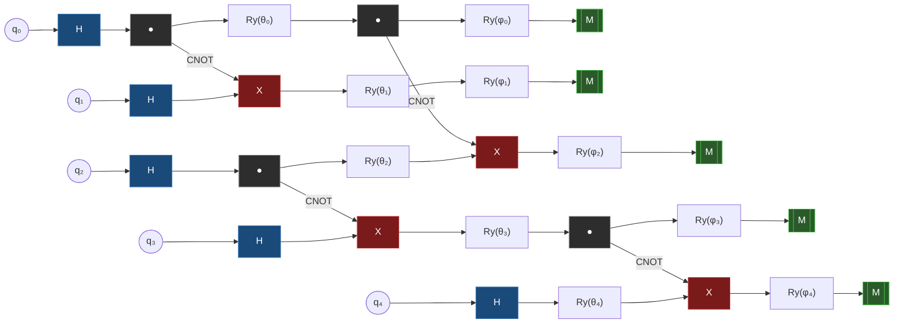

# Lesson 1: Quantum Foundations for Robotics

## 1. First-Principles Intuition & Invariants

The computational demands of modern robotics have reached an inflection point where classical optimization algorithms struggle against combinatorial explosion. Consider a mobile manipulator tasked with grasping objects in a cluttered warehouse: the robot must simultaneously solve inverse kinematics across seven degrees of freedom, plan collision-free trajectories through a dynamic obstacle field, coordinate multi-agent task allocation with dozens of peer robots, and optimize energy consumption across actuators operating under real-time constraints. The solution space scales exponentially with problem dimensionality, and traditional branch-and-bound or gradient descent methods exhaust computational budgets long before convergence.

Quantum computing emerges not as a panacea but as a specialized computational substrate capable of exploring exponentially large solution spaces through superposition and exploiting correlations via entanglement. Where a classical register of $n$ bits represents exactly one configuration from $2^n$ possibilities at any instant, a quantum register of $n$ qubits exists in a coherent superposition spanning all $2^n$ basis states simultaneously until measurement forces collapse into a single observable outcome. This fundamental departure from Boolean determinism enables quantum algorithms to evaluate objective functions across massive search spaces in parallel, extracting global optima for NP-hard robotics problems—motion planning through configuration space lattices, multi-robot task assignment, sensor fusion under uncertainty—that would require prohibitive classical compute.

The qubit itself represents the foundational departure from classical information theory. Physically realized through superconducting Josephson junctions biased near their critical current, trapped ions confined in radio-frequency Paul traps, nitrogen-vacancy centers in diamond lattices, or topological anyons in exotic condensed matter systems, the qubit encodes quantum information in a two-level Hilbert space. Mathematically, we describe the qubit state as a unit vector in $\mathbb{C}^2$, the complex projective space, conventionally written in Dirac bra-ket notation as:

$$
|\psi\rangle = \alpha|0\rangle + \beta|1\rangle
$$

where $\alpha, \beta \in \mathbb{C}$ are complex probability amplitudes satisfying the normalization constraint $|\alpha|^2 + |\beta|^2 = 1$. The computational basis states $|0\rangle$ and $|1\rangle$ correspond to the classical bit values zero and one, but the qubit occupies a continuous manifold between these poles until measurement projects it onto the computational basis with probabilities $P(0) = |\alpha|^2$ and $P(1) = |\beta|^2$. This projection is irreversible and destroys the superposition, a phenomenon known as wavefunction collapse that imposes strict constraints on quantum algorithm design.

Geometric intuition emerges through the Bloch sphere representation, where any single-qubit pure state maps onto the surface of a unit sphere in three-dimensional space. The north pole corresponds to $|0\rangle$, the south pole to $|1\rangle$, and superpositions occupy intermediate latitudes and longitudes parameterized by angles $\theta$ and $\phi$ such that:

$$
|\psi\rangle = \cos(\theta/2)|0\rangle + e^{i\phi}\sin(\theta/2)|1\rangle
$$

This geometric picture reveals that quantum state space is vastly richer than the binary vertices accessible to classical bits. Where a classical three-bit register occupies exactly eight corner points of a Boolean hypercube, a three-qubit register spans a continuous eight-dimensional manifold, providing exponentially greater representational capacity for encoding robotics configuration spaces, belief distributions, and control policies.

Entanglement introduces non-local correlations between qubits that have no classical analog and serve as the essential resource for quantum computational advantage. When two qubits become entangled through interactions mediated by two-qubit gates, their joint state cannot be factored into independent single-qubit descriptions. The canonical maximally entangled state, the Bell state $|\Phi^+\rangle$, demonstrates this property:

$$
|\Phi^+\rangle = \frac{1}{\sqrt{2}}(|00\rangle + |11\rangle)
$$

Measuring the first qubit yields outcome zero or one with equal probability, but crucially, this measurement instantaneously determines the second qubit's outcome with perfect correlation regardless of spatial separation. This correlation is stronger than any classical statistical dependence—it violates Bell inequalities, confirming that entangled qubits share quantum information that does not exist in either subsystem independently. For robotics applications, entanglement enables quantum algorithms to encode complex constraint relationships across optimization variables, allowing simultaneous exploration of correlated solution subspaces that classical parallelism cannot access.

The measurement postulate of quantum mechanics dictates that extracting classical information from quantum states necessarily disturbs those states through projection onto an observable's eigenbasis. This imposes the single-shot readout constraint: each quantum circuit execution yields only one classical bitstring sampled from the probability distribution $P(x) = |\langle x|\psi\rangle|^2$ over all $2^n$ basis states. Robotics practitioners must therefore design quantum algorithms to amplify the probability amplitude of optimal solutions—for instance, using Grover's amplitude amplification to quadratically enhance the likelihood of measuring collision-free trajectories in motion planning—while suppressing amplitudes of invalid configurations. The requirement to repeat circuit execution thousands of times to reconstruct probability distributions imposes latency overheads that current noisy intermediate-scale quantum (NISQ) hardware cannot yet amortize for real-time control loops, confining near-term quantum robotics to offline optimization and planning phases.

Decoherence represents the ultimate physical constraint on quantum computation, arising from uncontrolled interactions between qubits and their electromagnetic, thermal, and vibrational environments. Every quantum state accumulates phase errors and amplitude damping on timescales characterized by the coherence time $T_2$, typically ranging from microseconds in superconducting qubits to milliseconds in trapped ions. Gate operations must execute within coherence windows, bounding circuit depth to roughly $T_2/T_{\text{gate}}$ layers before accumulated noise renders computation meaningless. For robotics optimization problems requiring deep circuits—such as variational quantum eigensolver (VQE) approaches to optimal control—practitioners must employ error mitigation techniques like zero-noise extrapolation and probabilistic error cancellation, accepting modest overhead in circuit repetitions to extract reliable expectation values from noisy hardware.

The gate model of quantum computation provides the operational framework for manipulating qubit states through sequences of unitary transformations. Single-qubit gates rotate states on the Bloch sphere, implementing arbitrary $\text{SU}(2)$ transformations through compositions of fundamental rotations around the $x$, $y$, and $z$ axes. The Hadamard gate $H$ creates equal superposition from computational basis states, mapping $|0\rangle$ to $(|0\rangle + |1\rangle)/\sqrt{2}$ and serving as the essential mechanism for initializing quantum parallelism. Phase gates $S$ and $T$ apply relative phase shifts, critical for encoding problem structure into interference patterns that quantum algorithms exploit.

Two-qubit gates generate entanglement and encode problem constraints. The controlled-NOT (CNOT) gate flips a target qubit conditional on a control qubit's state, implementing the transformation $|a,b\rangle \mapsto |a, b \oplus a\rangle$ where $\oplus$ denotes XOR. CNOT universality combined with single-qubit rotations forms a universal gate set capable of approximating any unitary transformation to arbitrary precision, providing the primitive operations from which all quantum algorithms compile. For robotics applications, CNOT gates encode coupling constraints—a manipulator's joint angle limits, collision avoidance inequalities between robot links, task precedence relationships in multi-agent coordination—into entangled states that quantum optimization explores coherently.

The quantum circuit model expresses algorithms as directed acyclic graphs where horizontal wires represent qubits evolving through time and vertical gates apply transformations. Unlike classical circuits, quantum circuits must be reversible—every gate implements a unitary matrix with an inverse—because quantum mechanics permits only norm-preserving evolution except during measurement. This reversibility constraint prohibits direct implementation of irreversible classical logic, requiring quantum algorithms to adopt alternative computational paradigms such as quantum annealing's adiabatic evolution or variational quantum algorithms' hybrid classical-quantum optimization loops.

Quantum computational advantage manifests when quantum algorithms achieve asymptotic speedups over the best-known classical algorithms for specific problem classes. Grover's algorithm searches unsorted databases in $O(\sqrt{N})$ evaluations versus classical $O(N)$ linear search, offering quadratic speedup for robotics tasks like nearest-neighbor queries in configuration space or collision detection against obstacle databases. Shor's algorithm factors integers in polynomial time, exponentially faster than classical number field sieve methods, with implications for secure robot-to-robot cryptographic protocols. The quantum approximate optimization algorithm (QAOA) targets combinatorial optimization problems—maximum cut, traveling salesman, vehicle routing—that underlie multi-robot task allocation and trajectory planning, promising polynomial speedup through quantum interference though rigorous advantage proofs remain elusive for NISQ-era implementations.

Robotics optimization problems naturally encode into quantum Hamiltonians whose ground states represent optimal solutions. Consider a mobile robot fleet tasked with visiting customer locations while minimizing total travel distance and balancing workload across vehicles—a capacitated vehicle routing problem (CVRP) with exponential classical complexity. Encoding this problem into a quantum Hamiltonian requires mapping decision variables (binary indicators for whether robot $i$ visits customer $j$ at timestep $k$) onto qubit states and expressing objective function (total distance) plus constraints (vehicle capacity, customer visitation requirements) as weighted sums of Pauli operators. The QAOA then evolves an initial superposition state under alternating applications of the problem Hamiltonian and mixer Hamiltonian, leveraging quantum interference to concentrate probability amplitude onto low-energy states corresponding to high-quality solutions. Measurement yields candidate solutions that classical post-processing refines into feasible routes.

The variational principle underpins hybrid quantum-classical algorithms that dominate NISQ-era robotics applications. These algorithms parameterize quantum circuits with adjustable gate angles, execute circuits on quantum hardware to measure expectation values of cost functions, then invoke classical optimizers—gradient descent, COBYLA, evolutionary strategies—to update parameters and iteratively minimize cost. This closed-loop architecture circumvents deep circuit requirements by performing optimization in the classical domain while outsourcing exponentially expensive objective function evaluations to quantum hardware. For robotics motion planning, variational algorithms encode trajectory waypoints and control inputs as circuit parameters, measure collision penalties and energy consumption as Hamiltonian expectations, and converge toward dynamically feasible, obstacle-free paths through iterative refinement.

Quantum machine learning introduces additional computational primitives for robotics perception and control. Quantum kernel methods embed classical data into exponentially high-dimensional Hilbert spaces through quantum feature maps, enabling support vector machines to discover nonlinear decision boundaries that classical kernels cannot efficiently represent. Quantum neural networks implement parameterized quantum circuits as trainable models, leveraging backpropagation on expectation value gradients to learn policies for reinforcement learning agents navigating partially observable environments. Whether these approaches achieve practical advantage over classical deep learning remains contested, with recent theoretical results suggesting that barren plateaus—regions where gradients vanish exponentially in system size—may fundamentally limit trainability of deep quantum circuits, confining quantum machine learning to niche applications where problem structure guarantees favorable optimization landscapes.

The relevance of quantum computing to robotics hinges on matching problem structure to quantum algorithmic primitives. Problems exhibiting exponential solution spaces with exploitable symmetry, locality, or constraint structure admit efficient quantum encodings. Robotics motion planning in high-dimensional configuration spaces, sensor fusion over exponentially large hypothesis spaces, and multi-agent task allocation under complex precedence constraints exemplify such domains. Conversely, problems requiring dense classical data preprocessing, high-bandwidth real-time sensor integration, or frequent measurement-feedback loops remain classically bounded regardless of quantum resources. Practitioners must rigorously analyze where quantum advantage plausibly emerges, resisting hype while identifying authentic opportunities for computational leverage.

## 2. Core Architecture & Mechanics

The physical realization of quantum computers imposes architectural constraints that robotics engineers must navigate when designing quantum-accelerated workflows. Contemporary quantum processors implement qubits through superconducting transmon circuits cooled to millikelvin temperatures in dilution refrigerators, trapped ions confined in linear Paul traps and manipulated by focused laser beams, or neutral atom arrays organized in optical tweezer lattices. Each platform exhibits distinct qubit connectivity topologies, gate fidelities, coherence times, and measurement characteristics that fundamentally shape algorithm performance and compilation strategies.

Superconducting quantum processors, exemplified by IBM Quantum and Google Sycamore systems, fabricate transmon qubits as nonlinear LC oscillators patterned onto silicon or sapphire substrates through electron-beam lithography and thin-film deposition. Each transmon comprises a Josephson junction—two superconducting aluminum electrodes separated by a nanometer-scale aluminum oxide barrier—shunted by a large capacitance that renders the junction's anharmonic energy spectrum suitable for two-level qubit encoding. The qubit transition frequency, typically $\omega_{01}/2\pi \approx 5$ GHz, lies in the microwave regime, enabling control through coaxial transmission lines delivering shaped pulses synthesized by arbitrary waveform generators. Single-qubit gates execute in tens of nanoseconds via resonant microwave drives implementing rotations $R_x(\theta) = \exp(-i\theta X/2)$ and $R_y(\theta) = \exp(-i\theta Y/2)$ where $X$ and $Y$ denote Pauli matrices. Two-qubit gates, typically cross-resonance CNOT or parametric iSWAP gates, couple neighboring qubits through fixed capacitive or inductive links, executing in $100-500$ nanoseconds with contemporary fidelities approaching $99\%$ on leading devices.

The connectivity topology of superconducting processors—heavy-hex lattices on IBM systems, grid topologies on Google devices—restricts which qubit pairs directly interact through two-qubit gates. Implementing gates between non-adjacent qubits requires SWAP gate insertions to route quantum information across the processor, inflating circuit depth and accumulating decoherence errors. Robotics practitioners compiling optimization circuits must perform qubit mapping and routing, algorithmically assigning logical problem variables to physical qubits while minimizing SWAP overhead. Graph coloring heuristics, A* search through permutation spaces, and reinforcement learning policies trained on historical compilation instances represent state-of-art approaches, yet optimal routing remains NP-hard and compiler decisions significantly impact algorithm performance.

Trapped-ion quantum computers, developed by IonQ, Quantinuum, and academic groups, confine chains of ytterbium or calcium ions within linear radio-frequency Paul traps where oscillating electric fields create effective potential wells. Each ion's hyperfine ground state sublevels encode a qubit, with transitions driven by tightly focused laser beams at wavelengths determined by atomic resonances—typically $369$ nm for ytterbium $^{171}\text{Yb}^+$ ions. Single-qubit gates execute through Rabi oscillations induced by resonant laser pulses, achieving nanosecond-scale operation with fidelities exceeding $99.9\%$. Two-qubit entangling gates exploit the shared motional modes of the ion chain: laser pulses at specific detunings from motional sidebands implement Mølmer-Sørensen gates that generate entanglement between arbitrary ion pairs regardless of position in the chain. This all-to-all connectivity eliminates routing overhead but introduces slower gate times—typically $100-500$ microseconds—and crosstalk challenges as chain length scales.

Neutral atom quantum processors organize arrays of rubidium or cesium atoms trapped in optical tweezers—tightly focused laser beams forming microscopic potential wells in two-dimensional or three-dimensional lattices. Hyperfine ground states encode qubits, with single-qubit gates implemented through microwave or Raman laser pulses. Two-qubit gates leverage the Rydberg blockade: exciting one atom to a high-lying Rydberg state shifts nearby atoms' transition frequencies through strong dipole-dipole interactions, preventing simultaneous excitation and creating controlled-phase gates between atom pairs within blockade radius. Neutral atom systems offer reconfigurable connectivity—optical tweezers dynamically rearrange atoms between gate operations—enabling adaptive topology optimization during circuit execution, though current gate fidelities ($\approx 97-99\%$) lag ion trap and superconducting platforms.

Quantum error correction protocols will ultimately enable fault-tolerant computation by encoding logical qubits into entangled states distributed across many physical qubits, with syndrome measurements detecting and correcting errors faster than they accumulate. The surface code, requiring roughly $1000$ physical qubits per logical qubit with contemporary error rates, represents the leading candidate for near-term implementation. However, NISQ hardware operates in the pre-error-correction regime where decoherence, gate errors, and measurement infidelities corrupt computation unmitigated. Robotics algorithms targeting NISQ devices must adopt error mitigation techniques—zero-noise extrapolation fits observable expectation values measured at varying noise levels and extrapolates to the zero-noise limit; probabilistic error cancellation inverts noisy gate channels using quasi-probability representations; measurement error mitigation applies Bayesian inversion of confusion matrices characterizing readout bitflip probabilities.

The quantum-classical interface architecture determines how robotics software interacts with quantum processors. Quantum cloud platforms—IBM Quantum, AWS Braket, Azure Quantum—expose REST APIs accepting OpenQASM circuit descriptions and returning measurement histograms after execution. A typical workflow begins with problem formulation in high-level frameworks like Qiskit, Cirq, or PennyLane, translating robotics optimization problems into parameterized quantum circuits. The framework's compiler transpiles abstract circuits into native gate sets and optimizes circuit depth through commutativity analysis, template matching, and numerical synthesis. Submitted circuits queue on classical job schedulers before executing on quantum hardware, with latencies ranging from seconds for priority access to hours during peak demand. Returned measurement statistics undergo classical post-processing—histogram aggregation, error mitigation, objective function evaluation—with results feeding back into classical optimizers for variational algorithms.

For robotics motion planning via variational quantum algorithms, the quantum circuit architecture encodes trajectory waypoints as qubit states and evaluates collision penalties as Pauli expectation values. Consider a planar manipulator with $n$ joints navigating through a cluttered workspace represented as a grid discretization. Each joint angle $\theta_i$ quantizes into $k$ discrete values, requiring $\lceil \log_2(k) \rceil$ qubits per joint for a total register size of $n\lceil \log_2(k) \rceil$ qubits. The circuit structure typically follows an ansatz pattern: initial Hadamard layers create superposition, followed by alternating entangling layers (CNOT chains, all-to-all controlled gates, or hardware-efficient brick patterns) and parameterized rotation layers $R_y(\vec{\theta})$ where the angles $\vec{\theta}$ encode trajectory parameters subject to classical optimization.

This schematic represents a five-qubit variational circuit for a two-joint manipulator with four discretization levels per joint ($2^2 = 4$ configurations). The Hadamard gates initialize uniform superposition over all joint configurations. CNOT gates in a ladder topology generate entanglement, encoding kinematic coupling constraints between adjacent joints. Parameterized $R_y$ rotation layers twice repeated allow the circuit to explore configuration space, with angles $\{\theta_i, \phi_i\}$ serving as classical optimization variables. Final measurements project onto computational basis states, each bitstring decoding to a specific joint configuration whose collision status the classical optimizer evaluates.

The cost Hamiltonian $\hat{H}_C$ encodes optimization objectives and constraints as weighted sums of Pauli operators. For collision avoidance, penalties accumulate when trajectory configurations intersect obstacles. Representing obstacles as forbidden basis states $\{|s_{\text{invalid}}\rangle\}$, the collision Hamiltonian becomes:

$$
\hat{H}_{\text{collision}} = \sum_{s \in S_{\text{invalid}}} w_s |s\rangle\langle s| = \sum_{s \in S_{\text{invalid}}} w_s \prod_{i=1}^n \frac{I + (-1)^{s_i}Z_i}{2}
$$

where $s_i$ denotes the $i$-th bit of bitstring $s$, $Z_i$ is the Pauli-Z operator on qubit $i$, and $w_s$ weights the penalty severity. Measuring this Hamiltonian's expectation value $\langle\psi(\vec{\theta})|\hat{H}_{\text{collision}}|\psi(\vec{\theta})\rangle$ quantifies how much probability amplitude the parameterized state $|\psi(\vec{\theta})\rangle$ places on collision configurations, with classical optimization seeking parameter values minimizing this expectation.

Additional Hamiltonian terms encode smoothness objectives penalizing large joint velocity changes between waypoints, workspace coverage requirements rewarding diverse configurations, and energy minimization favoring low-torque trajectories. The total cost function becomes a weighted sum $\hat{H}_{\text{total}} = \alpha\hat{H}_{\text{collision}} + \beta\hat{H}_{\text{smoothness}} + \gamma\hat{H}_{\text{energy}}$ where coefficients $\{\alpha, \beta, \gamma\}$ reflect problem priorities. Variational optimization iteratively adjusts circuit parameters to minimize $\langle\hat{H}_{\text{total}}\rangle$, converging toward collision-free, dynamically feasible trajectories.

The quantum approximate optimization algorithm (QAOA) provides an alternative circuit structure particularly suited to combinatorial problems in multi-robot task allocation. QAOA alternates between problem Hamiltonian evolution $e^{-i\gamma\hat{H}_C}$ and mixer Hamiltonian evolution $e^{-i\beta\hat{H}_M}$ repeated for $p$ layers:

$$
|\psi(\vec{\gamma}, \vec{\beta})\rangle = e^{-i\beta_p\hat{H}_M}e^{-i\gamma_p\hat{H}_C} \cdots e^{-i\beta_1\hat{H}_M}e^{-i\gamma_1\hat{H}_C}|+\rangle^{\otimes n}
$$

where $|+\rangle = (|0\rangle + |1\rangle)/\sqrt{2}$ denotes the equal superposition initial state. The problem Hamiltonian $\hat{H}_C$ encodes task assignment costs—if robot $i$ assigned to task $j$ incurs cost $c_{ij}$, the Hamiltonian accumulates diagonal terms proportional to $c_{ij}$ for basis states where qubit representing assignment $(i,j)$ is active. The mixer Hamiltonian $\hat{H}_M = \sum_i X_i$ drives transitions between computational basis states, exploring the solution space. Evolution angles $\{\gamma_k, \beta_k\}$ undergo classical optimization to minimize the expected cost $\langle\psi|\hat{H}_C|\psi\rangle$.

Implementing QAOA for a four-robot, six-task assignment problem requires $24$ qubits under one-hot encoding where qubit $(i,j)$ indicates robot $i$ assigned to task $j$. Constraint Hamiltonians enforce exactly one task per robot and at most one robot per task through penalty terms:

$$
\hat{H}_{\text{constraints}} = A\sum_{i=1}^4\left(\sum_{j=1}^6 Z_{ij} - 1\right)^2 + B\sum_{j=1}^6\left(\sum_{i=1}^4 Z_{ij} - 1\right)^2
$$

where $Z_{ij}$ acts on qubit $(i,j)$, and penalty weights $A, B \gg \max c_{ij}$ ensure constraint violations dominate cost. Circuit compilation expands Hamiltonian exponentials into sequences of single- and two-qubit gates through Trotterization or Lie-Trotter-Suzuki decompositions, breaking continuous-time evolution into discrete gate layers approximating the exact unitary to controlled precision.

Measurement strategies critically impact algorithm performance. Naïve approaches measure all qubits simultaneously in the computational basis, reconstructing the full probability distribution from repeated shots. However, estimating expectation values of $k$-local Hamiltonians (operators acting on at most $k$ qubits) requires measuring in different Pauli bases, achievable through basis rotations before readout. For a Hamiltonian $\hat{H} = \sum_i w_i P_i$ where each $P_i$ is a tensor product of Pauli operators, measuring term $P_i$ requires applying basis-change circuits—Hadamard for X-basis, $S^\dagger H$ for Y-basis, identity for Z-basis—to corresponding qubits before measurement. Estimating $\langle P_i\rangle$ to precision $\epsilon$ demands $O(1/\epsilon^2)$ samples via Hoeffding bounds, and estimating $\langle\hat{H}\rangle$ requires measuring each term independently unless commuting terms group into simultaneously measurable sets through qubit-wise commutativity analysis.

Adaptive measurement protocols reduce sampling overhead by dynamically selecting measurement bases based on prior outcomes. For robotics state estimation problems where quantum circuits encode belief distributions over configuration space, adaptive protocols implement approximate Bayesian inference by measuring subsets of qubits, conditioning subsequent measurements on observed values, and reconstructing marginal distributions with reduced shot budgets. Shadow tomography techniques further compress measurement requirements by proving that $O(\log n)$ classical shadows—randomized measurements in random Pauli bases—suffice to estimate expectation values of all $k$-local observables, enabling efficient characterization of quantum states encoding high-dimensional robotics belief states.

## 3. High-Performance Optimization & Failure Modes

Achieving quantum computational advantage for robotics applications demands meticulous optimization across algorithm design, circuit compilation, and hardware utilization. The interplay between problem structure, quantum resource constraints, and classical post-processing determines whether quantum approaches outperform classical baselines, and practitioners must rigorously benchmark against state-of-art classical solvers rather than assuming quantum superiority.

Circuit depth minimization represents the paramount optimization objective, as accumulated gate errors scale exponentially with depth on NISQ hardware. For variational circuits, practitioners must balance expressivity—the diversity of quantum states the ansatz accesses—against depth overhead. Hardware-efficient ansätze employing native two-qubit gates (cross-resonance CNOTs on IBM superconducting devices, Mølmer-Sørensen gates on trapped ions) minimize depth but sacrifice problem-specific structure. Problem-inspired ansätze encoding domain knowledge—manipulator kinematic chains motivating nearest-neighbor entanglement, task precedence graphs dictating qubit coupling topologies—reduce optimization landscape barrenness at the cost of additional SWAP routing for non-native connectivity.

Gate synthesis techniques compress circuit depth through numerical optimization of single-qubit gate decompositions. Arbitrary SU(2) rotations decompose into sequences of at most three axis-aligned rotations via Euler angle parameterizations, but hardware gate sets often provide only discrete rotations (Clifford gates $H, S$ plus non-Clifford $T$-gates). Solovay-Kitaev theorem guarantees poly-logarithmic length approximations, yet practical implementations employ numerical search over product decompositions targeting precision $\epsilon \approx 10^{-3}$ sufficient for NISQ circuits, avoiding asymptotic worst-case depths.

Template matching identifies subcircuits equivalent to simpler gate sequences, opportunistically substituting optimized implementations. For example, consecutive CNOT gates between the same qubit pair cancel: $\text{CNOT}_{i,j}\text{CNOT}_{i,j} = I$. Recognizing such patterns through rewrite rule libraries reduces depth in variational optimization loops where circuit structure evolves across iterations. Peephole optimization applies local rewriting within sliding windows, while global optimization formulates circuit minimization as constraint satisfaction problems solved via SAT solvers or integer linear programming, though exponential search complexity confines these approaches to subcircuits of tens of gates.

Qubit mapping and routing algorithms assign logical problem qubits to physical device qubits respecting connectivity constraints. Initial placement heuristics maximize overlap between problem graph edges (qubit pairs requiring two-qubit gates) and device graph edges (physical qubit pairs supporting native gates). Subgraph isomorphism yields optimal placements for small problems but scales intractably; practical heuristics employ graph partitioning, spectral embedding, or greedy matching maximizing weighted edge alignment. Dynamic routing then inserts SWAP gates to shuttle quantum information during execution, with A* search balancing SWAP count against projected circuit depth increase.

For robotics motion planning circuits where qubit interactions follow manipulator topology, practitioners exploit spatial locality by mapping adjacent joints to neighboring physical qubits. A seven-degree-of-freedom arm with serial kinematic chain requires entangling gates only between consecutive joints, naturally aligning with linear or grid device topologies. Conversely, multi-agent task allocation problems with all-to-all agent interactions generate complete problem graphs demanding extensive routing on planar superconducting lattices, favoring ion trap or neutral atom platforms offering native all-to-all connectivity.

Parameterized circuit training for variational algorithms confronts barren plateau phenomena where cost function gradients vanish exponentially with qubit count. Theoretical analysis reveals that randomly initialized deep circuits concentrate gradient magnitudes near zero with overwhelming probability, stalling gradient-based optimizers. Mitigation strategies include problem-inspired initialization seeding parameter values near known classical solutions, layer-wise training progressively increasing circuit depth, and correlation-aware ansätze restricting entanglement to problem-relevant qubit subsets. Hardware-efficient circuits paradoxically worsen barren plateaus by maximizing expressivity without structure, while chemically inspired ansätze preserving symmetries demonstrate favorable gradient scaling.

Shot noise dominates variational algorithm convergence rates, as finite sampling introduces stochasticity into measured expectation values. Estimating cost function gradients via parameter-shift rules requires evaluating circuits at perturbed parameter values, with each evaluation demanding thousands of shots for acceptable precision. Simultaneous perturbation stochastic approximation (SPSA) and other gradient-free optimizers reduce shot requirements by approximating gradients from fewer measurements, accepting slower asymptotic convergence for improved sample efficiency on near-term hardware.

Error mitigation techniques extract accurate expectation values from noisy measurements without full quantum error correction overhead. Zero-noise extrapolation (ZNE) artificially amplifies noise by pulse stretching or gate repetition, measures observables at multiple noise levels, and fits extrapolation models (linear, exponential, polynomial) to infer zero-noise values. Probabilistic error cancellation (PEC) represents noisy quantum channels as linear combinations of ideal operations with quasi-probability coefficients, executing ideal operations weighted by quasi-probabilities and post-processing to recover ideal expectation values. PEC's sampling overhead scales exponentially with circuit depth, confining applicability to shallow circuits, while ZNE maintains polynomial overhead but assumes smooth noise scaling.

Measurement error mitigation calibrates readout confusion matrices quantifying bitflip probabilities $P(m|s)$ where $m$ denotes measured bitstring and $s$ true bitstring. Applying Bayesian inversion $P(s|m) = P(m|s)P(s)/P(m)$ corrects observed histograms, dramatically improving accuracy when readout errors dominate gate errors. Tensor product decompositions assume independent qubit readouts, enabling efficient calibration through $2n$ experiments measuring each qubit's $|0\rangle$ and $|1\rangle$ states individually. Correlated readout errors require full $2^n$ state calibration, practical only for small registers or when error locality permits factorization.

Failure modes in quantum-accelerated robotics workflows trace to mismatch between problem structure and quantum primitives. Dense optimization problems lacking sparse structure or symmetry resist efficient quantum encoding, as Hamiltonian terms proliferate exponentially with problem size. Robotics perception tasks processing high-resolution sensor data encounter quantum memory bottlenecks—loading $n$ classical data points into quantum states requires $O(n)$ gate operations, often negating any downstream quantum speedup. Real-time control applications demanding microsecond-scale feedback latencies exceed quantum circuit execution and readout timescales even on fastest ion trap systems, confining quantum acceleration to offline planning phases.

Benchmarking rigor remains paramount to validate quantum advantage claims. Robotics practitioners must compare quantum algorithm performance against optimized classical solvers—mixed-integer linear programming (MILP) for task allocation, rapidly-exploring random trees (RRT*) for motion planning, particle filters for state estimation—using identical problem instances and wall-clock time budgets. Many early quantum robotics demonstrations report solution quality improvements while ignoring orders-of-magnitude slowdowns from circuit execution, queueing latencies, and measurement overheads, yielding misleading conclusions. Transparent reporting of total time-to-solution, including classical pre- and post-processing, enables honest assessment of quantum utility.

The hybrid quantum-classical optimization loop architecture itself introduces failure modes when classical optimizers poorly navigate the quantum cost landscape. Non-convexity, gradient noise, and local minima plague variational training, with classical optimizers often converging to suboptimal parameters far from global minima. Multi-start strategies initializing from diverse parameter seeds, basin-hopping methods escaping local minima through stochastic perturbations, and meta-learning approaches training optimizers on families of related problems improve robustness but increase computational budgets.

Scaling quantum robotics algorithms from laboratory demonstrations to industrially relevant problem sizes confronts qubit count limitations. Contemporary quantum processors provide $50-1000$ qubits with varying connectivity and fidelity, insufficient for direct representation of complex robotics problems. A warehouse logistics scenario coordinating $100$ mobile robots across $500$ locations under battery, payload, and traffic constraints would require tens of thousands of qubits under naive encodings. Problem decomposition techniques—spatial partitioning dividing the warehouse into sectors solved independently, temporal decomposition planning in receding horizons, hierarchical abstractions clustering tasks at multiple resolutions—reduce quantum resource requirements at the expense of solution optimality, introducing approximation errors that practitioners must quantify.

Ultimately, the path to practical quantum advantage in robotics traverses the interplay between hardware evolution and algorithm innovation. As quantum processors scale to thousands of logical qubits through surface code error correction and gate fidelities improve via enhanced fabrication and calibration, algorithmic techniques will mature to exploit these resources effectively. Robotics applications with verified quantum advantage—perhaps multi-robot coordination in disaster response scenarios, optimal control of soft robots with continuous deformation spaces, or simultaneous localization and mapping in exponentially large belief spaces—will emerge through disciplined engineering integrating quantum and classical computation within cohesive system architectures. The foundations established here—superposition, entanglement, measurement, gates, circuits—provide the bedrock upon which that future rests, demanding robotics practitioners cultivate quantum literacy alongside classical algorithmic expertise to navigate the computational landscape ahead.
