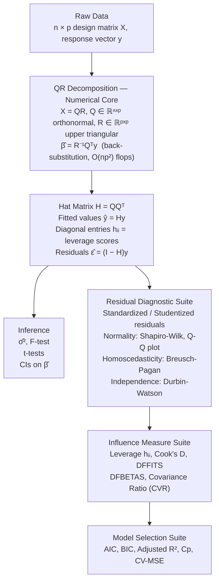

# Lesson 3: Linear Models with Regression Diagnostics

## 1. First-Principles Intuition & Invariants

The ambition of regression analysis is deceptively simple: given a set of observations, find the function that best explains the variation in one quantity as a linear combination of others. Yet this modest description conceals one of the most mathematically fertile structures in all of applied mathematics. The machinery of linear regression, grounded in the geometry of Hilbert spaces, the spectral theory of symmetric matrices, and the probability theory of multivariate distributions, produces estimators whose optimality properties are sharp, whose failure modes are precisely characterizable, and whose extensions reach into generalized linear models, robust statistics, and modern high-dimensional inference. This lesson dismantles that machinery from first principles.

### The Geometry of Least Squares

Suppose we observe $n$ response values assembled into a vector $\mathbf{y} \in \mathbb{R}^n$, and we believe these responses are generated by a linear mechanism involving $p$ predictors. We collect the predictor values into a design matrix $\mathbf{X} \in \mathbb{R}^{n \times p}$, where the $i$-th row $\mathbf{x}_i^\top$ contains the predictor values for the $i$-th observation, and the first column is typically the constant vector $\mathbf{1}$ to accommodate an intercept. The statistical model asserts

$$\mathbf{y} = \mathbf{X}\boldsymbol{\beta} + \boldsymbol{\varepsilon},$$

where $\boldsymbol{\beta} \in \mathbb{R}^p$ is the unknown coefficient vector and $\boldsymbol{\varepsilon} \in \mathbb{R}^n$ is a vector of random errors.

The ordinary least squares (OLS) estimator $\hat{\boldsymbol{\beta}}$ is defined as the minimizer of the residual sum of squares:

$$\hat{\boldsymbol{\beta}} = \underset{\boldsymbol{\beta} \in \mathbb{R}^p}{\arg\min} \|\mathbf{y} - \mathbf{X}\boldsymbol{\beta}\|^2 = \underset{\boldsymbol{\beta} \in \mathbb{R}^p}{\arg\min} \sum_{i=1}^n (y_i - \mathbf{x}_i^\top \boldsymbol{\beta})^2.$$

The geometric content of this minimization is immediate: $\mathbf{X}\boldsymbol{\beta}$ ranges over the column space $\mathcal{C}(\mathbf{X}) \subseteq \mathbb{R}^n$ as $\boldsymbol{\beta}$ varies over $\mathbb{R}^p$. The least squares problem therefore asks for the point in $\mathcal{C}(\mathbf{X})$ nearest to $\mathbf{y}$ under the Euclidean norm. By the projection theorem in $\mathbb{R}^n$, that nearest point is unique (when $\mathbf{X}$ has full column rank) and equals the orthogonal projection of $\mathbf{y}$ onto $\mathcal{C}(\mathbf{X})$.

**Derivation of the Normal Equations.** To find this minimizer analytically, expand the objective:

$$Q(\boldsymbol{\beta}) = (\mathbf{y} - \mathbf{X}\boldsymbol{\beta})^\top(\mathbf{y} - \mathbf{X}\boldsymbol{\beta}) = \mathbf{y}^\top\mathbf{y} - 2\boldsymbol{\beta}^\top\mathbf{X}^\top\mathbf{y} + \boldsymbol{\beta}^\top\mathbf{X}^\top\mathbf{X}\boldsymbol{\beta}.$$

Taking the gradient with respect to $\boldsymbol{\beta}$ and setting it to zero:

$$\frac{\partial Q}{\partial \boldsymbol{\beta}} = -2\mathbf{X}^\top\mathbf{y} + 2\mathbf{X}^\top\mathbf{X}\boldsymbol{\beta} = \mathbf{0}.$$

This yields the **normal equations**:

$$\mathbf{X}^\top\mathbf{X}\hat{\boldsymbol{\beta}} = \mathbf{X}^\top\mathbf{y}.$$

When $\mathbf{X}$ has full column rank $p$, the Gram matrix $\mathbf{X}^\top\mathbf{X}$ is symmetric positive definite and hence invertible, giving the closed-form solution

$$\hat{\boldsymbol{\beta}} = (\mathbf{X}^\top\mathbf{X})^{-1}\mathbf{X}^\top\mathbf{y}.$$

The fitted values $\hat{\mathbf{y}} = \mathbf{X}\hat{\boldsymbol{\beta}} = \mathbf{X}(\mathbf{X}^\top\mathbf{X})^{-1}\mathbf{X}^\top\mathbf{y}$ are obtained by applying the **hat matrix** (projection matrix)

$$\mathbf{H} = \mathbf{X}(\mathbf{X}^\top\mathbf{X})^{-1}\mathbf{X}^\top,$$

so that $\hat{\mathbf{y}} = \mathbf{H}\mathbf{y}$. The matrix $\mathbf{H}$ is the orthogonal projector onto $\mathcal{C}(\mathbf{X})$: it is symmetric ($\mathbf{H}^\top = \mathbf{H}$) and idempotent ($\mathbf{H}^2 = \mathbf{H}$). These two properties follow directly from the definition. Symmetry is obvious. For idempotency:

$$\mathbf{H}^2 = \mathbf{X}(\mathbf{X}^\top\mathbf{X})^{-1}\mathbf{X}^\top \cdot \mathbf{X}(\mathbf{X}^\top\mathbf{X})^{-1}\mathbf{X}^\top = \mathbf{X}(\mathbf{X}^\top\mathbf{X})^{-1}(\mathbf{X}^\top\mathbf{X})(\mathbf{X}^\top\mathbf{X})^{-1}\mathbf{X}^\top = \mathbf{X}(\mathbf{X}^\top\mathbf{X})^{-1}\mathbf{X}^\top = \mathbf{H}.$$

The residual vector $\hat{\boldsymbol{\varepsilon}} = \mathbf{y} - \hat{\mathbf{y}} = (\mathbf{I} - \mathbf{H})\mathbf{y}$ lies in the orthogonal complement of $\mathcal{C}(\mathbf{X})$, satisfying $\mathbf{X}^\top\hat{\boldsymbol{\varepsilon}} = \mathbf{0}$. This orthogonality condition is the algebraic restatement of the geometric projection picture.

### The Gauss-Markov Theorem

Knowing that $\hat{\boldsymbol{\beta}}$ solves the normal equations says nothing about its quality as an estimator without probabilistic assumptions. The classical assumption set, which we will call the **Gauss-Markov conditions**, requires: (GM1) $\mathbb{E}[\boldsymbol{\varepsilon}] = \mathbf{0}$, so the model is correctly specified on average; (GM2) $\text{Cov}(\boldsymbol{\varepsilon}) = \sigma^2 \mathbf{I}$, so errors are homoscedastic and uncorrelated; and (GM3) $\mathbf{X}$ is non-stochastic and full column rank. Under these conditions, the OLS estimator is unbiased:

$$\mathbb{E}[\hat{\boldsymbol{\beta}}] = (\mathbf{X}^\top\mathbf{X})^{-1}\mathbf{X}^\top\mathbb{E}[\mathbf{y}] = (\mathbf{X}^\top\mathbf{X})^{-1}\mathbf{X}^\top\mathbf{X}\boldsymbol{\beta} = \boldsymbol{\beta},$$

and its covariance matrix is

$$\text{Cov}(\hat{\boldsymbol{\beta}}) = (\mathbf{X}^\top\mathbf{X})^{-1}\mathbf{X}^\top \cdot \sigma^2\mathbf{I} \cdot \mathbf{X}(\mathbf{X}^\top\mathbf{X})^{-1} = \sigma^2(\mathbf{X}^\top\mathbf{X})^{-1}.$$

The **Gauss-Markov theorem** elevates OLS from a computational convenience to a provably optimal procedure. It states that among all linear unbiased estimators of $\boldsymbol{\beta}$, the OLS estimator $\hat{\boldsymbol{\beta}}$ achieves the minimum variance for every linear combination $\mathbf{c}^\top\boldsymbol{\beta}$. The acronym BLUE — Best Linear Unbiased Estimator — encodes this result.

**Proof.** Let $\tilde{\boldsymbol{\beta}} = \mathbf{C}\mathbf{y}$ be any linear unbiased estimator of $\boldsymbol{\beta}$, where $\mathbf{C} \in \mathbb{R}^{p \times n}$. Unbiasedness requires $\mathbb{E}[\tilde{\boldsymbol{\beta}}] = \mathbf{C}\mathbf{X}\boldsymbol{\beta} = \boldsymbol{\beta}$ for all $\boldsymbol{\beta}$, which forces $\mathbf{C}\mathbf{X} = \mathbf{I}_p$. Write $\mathbf{C} = (\mathbf{X}^\top\mathbf{X})^{-1}\mathbf{X}^\top + \mathbf{D}$ for some matrix $\mathbf{D}$. The constraint $\mathbf{C}\mathbf{X} = \mathbf{I}_p$ then requires $\mathbf{D}\mathbf{X} = \mathbf{0}$. The covariance of $\tilde{\boldsymbol{\beta}}$ is

$$\text{Cov}(\tilde{\boldsymbol{\beta}}) = \sigma^2 \mathbf{C}\mathbf{C}^\top = \sigma^2\left[(\mathbf{X}^\top\mathbf{X})^{-1} + \mathbf{D}\mathbf{D}^\top\right],$$

where the cross-term vanishes because $\mathbf{D}\mathbf{X} = \mathbf{0}$ implies $\mathbf{D}\mathbf{X}(\mathbf{X}^\top\mathbf{X})^{-1} = \mathbf{0}$. Since $\mathbf{D}\mathbf{D}^\top$ is positive semidefinite, we conclude

$$\text{Cov}(\tilde{\boldsymbol{\beta}}) - \text{Cov}(\hat{\boldsymbol{\beta}}) = \sigma^2\mathbf{D}\mathbf{D}^\top \succeq 0,$$

which proves that $\text{Var}(\mathbf{c}^\top\hat{\boldsymbol{\beta}}) \le \text{Var}(\mathbf{c}^\top\tilde{\boldsymbol{\beta}})$ for every fixed vector $\mathbf{c}$. $\square$

An unbiased estimator of $\sigma^2$ is the residual mean square

$$\hat{\sigma}^2 = \frac{\hat{\boldsymbol{\varepsilon}}^\top\hat{\boldsymbol{\varepsilon}}}{n - p} = \frac{\|\mathbf{y} - \mathbf{X}\hat{\boldsymbol{\beta}}\|^2}{n - p},$$

where the denominator $n - p$ reflects the $p$ degrees of freedom consumed in estimating $\boldsymbol{\beta}$. The unbiasedness of $\hat{\sigma}^2$ follows from $\mathbb{E}[\hat{\boldsymbol{\varepsilon}}^\top\hat{\boldsymbol{\varepsilon}}] = \sigma^2 \text{tr}(\mathbf{I} - \mathbf{H}) = \sigma^2(n - p)$, since the idempotent matrix $\mathbf{I} - \mathbf{H}$ has trace equal to its rank, which is $n - p$.

### Generalized Least Squares and the Weighted Case

The Gauss-Markov assumption of spherical errors is frequently violated in practice. If $\text{Cov}(\boldsymbol{\varepsilon}) = \sigma^2\boldsymbol{\Omega}$ where $\boldsymbol{\Omega}$ is a known positive definite matrix, OLS remains unbiased but is no longer BLUE. The generalized least squares (GLS) estimator restores efficiency by transforming the problem to one with spherical errors. Since $\boldsymbol{\Omega}$ is positive definite, it admits a Cholesky factorization $\boldsymbol{\Omega} = \mathbf{L}\mathbf{L}^\top$, so $\boldsymbol{\Omega}^{-1} = \mathbf{L}^{-\top}\mathbf{L}^{-1}$. Pre-multiplying the model by $\mathbf{L}^{-1}$ yields a transformed system $\mathbf{L}^{-1}\mathbf{y} = \mathbf{L}^{-1}\mathbf{X}\boldsymbol{\beta} + \mathbf{L}^{-1}\boldsymbol{\varepsilon}$ where the transformed errors have covariance $\sigma^2\mathbf{I}$. Applying OLS to this transformed system gives the GLS estimator

$$\hat{\boldsymbol{\beta}}_{\text{GLS}} = (\mathbf{X}^\top\boldsymbol{\Omega}^{-1}\mathbf{X})^{-1}\mathbf{X}^\top\boldsymbol{\Omega}^{-1}\mathbf{y},$$

which is BLUE under the generalized Gauss-Markov conditions. When $\boldsymbol{\Omega} = \text{diag}(w_1^{-1}, \ldots, w_n^{-1})$ for positive weights $w_i$, GLS reduces to weighted least squares (WLS), minimizing $\sum_{i=1}^n w_i(y_i - \mathbf{x}_i^\top\boldsymbol{\beta})^2$. This is the natural formulation when observation $i$ is itself the average of $w_i$ replicates, or when residual variance is known to decrease with $w_i$.

---

## 2. Core Architecture & Mechanics

Understanding linear regression as a practitioner means understanding the full computational and analytical pipeline: from the raw data matrix to fitted values, through the diagnostic statistics that reveal violations of the model's assumptions, to the influence measures that identify observations distorting the entire fit. The following diagram traces this pipeline.

### Numerical Solution via QR Decomposition

A practitioner should never form $(\mathbf{X}^\top\mathbf{X})^{-1}$ explicitly. The condition number of $\mathbf{X}^\top\mathbf{X}$ is the square of the condition number of $\mathbf{X}$, so explicit inversion amplifies numerical error catastrophically when predictors are even mildly collinear. The numerically stable path is the QR decomposition of $\mathbf{X}$.

Write $\mathbf{X} = \mathbf{Q}\mathbf{R}$ where $\mathbf{Q} \in \mathbb{R}^{n \times p}$ has orthonormal columns ($\mathbf{Q}^\top\mathbf{Q} = \mathbf{I}_p$) and $\mathbf{R} \in \mathbb{R}^{p \times p}$ is upper triangular with positive diagonal entries (by convention). Then:

$$\hat{\boldsymbol{\beta}} = (\mathbf{X}^\top\mathbf{X})^{-1}\mathbf{X}^\top\mathbf{y} = (\mathbf{R}^\top\mathbf{Q}^\top\mathbf{Q}\mathbf{R})^{-1}\mathbf{R}^\top\mathbf{Q}^\top\mathbf{y} = \mathbf{R}^{-1}\mathbf{Q}^\top\mathbf{y}.$$

The final expression requires only a single triangular back-substitution to solve $\mathbf{R}\hat{\boldsymbol{\beta}} = \mathbf{Q}^\top\mathbf{y}$. The hat matrix simplifies to $\mathbf{H} = \mathbf{Q}\mathbf{Q}^\top$, and the leverage scores $h_{ii} = \|\mathbf{Q}_{i\cdot}\|^2$ are simply the squared Euclidean norms of the rows of $\mathbf{Q}$. This representation is both computationally efficient at $O(np^2)$ floating-point operations and numerically stable because orthogonal transformations preserve the Euclidean norm.

### Residual Analysis: Reading the Diagnostic Signals

The residuals $\hat{\varepsilon}_i = y_i - \hat{y}_i$ are the primary diagnostic instrument for assessing whether the Gauss-Markov assumptions hold. Raw residuals, however, are not identically distributed even under the ideal model: the variance of $\hat{\varepsilon}_i$ is $\sigma^2(1 - h_{ii})$, where $h_{ii}$ is the $i$-th diagonal of $\mathbf{H}$. High-leverage points have $h_{ii}$ close to 1, so their residuals are forcibly small regardless of whether they fit the model well. This is precisely why raw residuals can be misleading. Proper diagnostics require standardization.

The **internally studentized residual** divides by the estimated standard deviation of $\hat{\varepsilon}_i$:

$$r_i = \frac{\hat{\varepsilon}_i}{\hat{\sigma}\sqrt{1 - h_{ii}}}.$$

Under the normality assumption $\boldsymbol{\varepsilon} \sim \mathcal{N}(\mathbf{0}, \sigma^2\mathbf{I})$, one can show that $r_i$ approximately follows a standard normal distribution when the model is correctly specified. The residuals $r_i$ should be plotted against the fitted values $\hat{y}_i$ to check homoscedasticity: a fan-shaped spread as $\hat{y}_i$ increases signals variance proportional to the mean, a classic indication that a log or square-root transformation of the response is warranted.

The **externally studentized residual** (also called the studentized deleted residual) is more sensitive to individual outliers. Define $\hat{\sigma}_{(i)}^2$ as the residual variance estimated from the model fitted without observation $i$. Then

$$t_i = \frac{\hat{\varepsilon}_i}{\hat{\sigma}_{(i)}\sqrt{1 - h_{ii}}}.$$

Under the null hypothesis that observation $i$ is not an outlier, $t_i$ follows a $t$-distribution with $n - p - 1$ degrees of freedom. Computing $\hat{\sigma}_{(i)}^2$ for each $i$ by literally refitting $n$ regression models would be prohibitive; the Sherman-Morrison-Woodbury identity yields the equivalent closed form

$$\hat{\sigma}_{(i)}^2 = \frac{(n-p)\hat{\sigma}^2 - \hat{\varepsilon}_i^2/(1-h_{ii})}{n - p - 1},$$

reducing all $n$ deletion residuals to a single matrix computation.

**Normality diagnostics** proceed through quantile-quantile (Q-Q) plots of the internally studentized residuals against the theoretical quantiles of the standard normal. Systematic curvature in the Q-Q plot identifies asymmetry or heavy-tailed distributions; point departures in the tails identify outliers. The Shapiro-Wilk test formalizes this graphical check with a statistic

$$W = \frac{\left(\sum_{i=1}^n a_i r_{(i)}\right)^2}{\sum_{i=1}^n (r_i - \bar{r})^2},$$

where $r_{(i)}$ are the order statistics of the residuals and $a_i$ are the expected normal order statistic coefficients. Values of $W$ close to 1 support normality; small $p$-values reject it.

**Homoscedasticity** is formally tested by the Breusch-Pagan procedure, which regresses the squared residuals $\hat{\varepsilon}_i^2$ on the original predictors $\mathbf{x}_i$ and uses the coefficient of determination from that auxiliary regression to form a Lagrange multiplier statistic $\text{LM} = nR^2_{\text{aux}}$, distributed as $\chi^2(p-1)$ under the null of constant variance. When heteroscedasticity is detected, the practitioner has three responses: transform the response to stabilize variance, switch to WLS with weights $w_i = 1/\hat{\sigma}_i^2$ estimated from a pilot fit, or retain OLS but replace the standard errors with the Huber-White heteroscedasticity-consistent estimator $\hat{\text{Cov}}_{\text{HC}}(\hat{\boldsymbol{\beta}}) = (\mathbf{X}^\top\mathbf{X})^{-1}\mathbf{X}^\top\hat{\mathbf{D}}\mathbf{X}(\mathbf{X}^\top\mathbf{X})^{-1}$, where $\hat{\mathbf{D}} = \text{diag}(\hat{\varepsilon}_1^2, \ldots, \hat{\varepsilon}_n^2)$.

**Serial correlation** in time-series regression is diagnosed through the Durbin-Watson statistic

$$DW = \frac{\sum_{i=2}^n (\hat{\varepsilon}_i - \hat{\varepsilon}_{i-1})^2}{\sum_{i=1}^n \hat{\varepsilon}_i^2} \approx 2(1 - \hat{\rho}),$$

where $\hat{\rho}$ is the lag-1 autocorrelation of residuals. Values near 2 indicate no serial correlation; values near 0 indicate strong positive autocorrelation. When $DW$ is small, OLS standard errors understate true uncertainty and the GLS estimator with an AR(1) error structure should be used.

### Influence Measures: Leverage, Cook's Distance, and DFBETAS

An observation can distort a regression fit through two independent mechanisms: it may be a **high-leverage point** (unusual in the predictor space, so the regression hyperplane is anchored to it regardless of its response value) or an **outlier** (unusual in the response direction, sitting far from the fitted hyperplane). Influence is the product of these two effects.

**Leverage** is measured by $h_{ii}$, the $i$-th diagonal of $\mathbf{H}$. Because $\mathbf{H}$ is an orthogonal projector of rank $p$, its trace is $p$, so the average leverage is $p/n$. A common threshold flags observation $i$ as high leverage when $h_{ii} > 2p/n$. Geometrically, $h_{ii}$ measures how far $\mathbf{x}_i$ lies from the centroid of the predictor cloud: in simple linear regression, $h_{ii} = 1/n + (x_i - \bar{x})^2 / \sum_j(x_j - \bar{x})^2$, which is plainly large for $x_i$ far from $\bar{x}$.

**Cook's distance** synthesizes leverage and outlyingness into a single measure of how much the coefficient vector $\hat{\boldsymbol{\beta}}$ shifts when observation $i$ is deleted:

$$D_i = \frac{(\hat{\boldsymbol{\beta}} - \hat{\boldsymbol{\beta}}_{(i)})^\top(\mathbf{X}^\top\mathbf{X})(\hat{\boldsymbol{\beta}} - \hat{\boldsymbol{\beta}}_{(i)})}{p\hat{\sigma}^2}.$$

Again, the Sherman-Morrison-Woodbury identity yields a closed form avoiding $n$ refits:

$$D_i = \frac{r_i^2}{p} \cdot \frac{h_{ii}}{1 - h_{ii}}.$$

This decomposition is analytically instructive: Cook's distance is the product of the squared internally studentized residual (measuring outlyingness) and the ratio $h_{ii}/(1-h_{ii})$ (measuring leverage). A data point that is both an outlier and high-leverage will have large $D_i$ even if neither component alone would trigger concern. Conventional practice treats $D_i > 1$ as a threshold warranting investigation, though the more principled approach compares $D_i$ to quantiles of the $F(p, n-p)$ distribution: $D_i$ is approximately the $D_i \cdot 100$-th percentile of this $F$ distribution, so $D_i = 0.5$ corresponds roughly to the 50th percentile, and anything above the 10th-to-20th percentile of $F(p, n-p)$ merits examination.

**DFBETAS** provides coefficient-level resolution by measuring how much each individual coefficient estimate changes in units of its standard error when observation $i$ is removed:

$$\text{DFBETAS}_{j,i} = \frac{\hat{\beta}_j - \hat{\beta}_{j,(i)}}{\hat{\sigma}_{(i)}\sqrt{[(\mathbf{X}^\top\mathbf{X})^{-1}]_{jj}}}.$$

Large $|\text{DFBETAS}_{j,i}|$ means observation $i$ has strong idiosyncratic leverage on the $j$-th coefficient. The threshold $2/\sqrt{n}$ is standard for small-to-moderate sample sizes. When an observation has large Cook's distance but small DFBETAS for all coefficients, the deletion shifts the entire coefficient vector by roughly the same amount in all directions, suggesting a problem with the model's overall precision rather than a single coefficient distortion.

The **covariance ratio** (CVR) complements Cook's distance by measuring the effect of deletion on estimation precision rather than the point estimate location:

$$\text{CVR}_i = \frac{\det[\hat{\sigma}^2_{(i)}(\mathbf{X}_{(i)}^\top\mathbf{X}_{(i)})^{-1}]}{\det[\hat{\sigma}^2(\mathbf{X}^\top\mathbf{X})^{-1}]}.$$

A value $\text{CVR}_i > 1$ means that precision decreases when observation $i$ is included (the observation inflates the covariance ellipsoid), while $\text{CVR}_i < 1$ means its inclusion sharpens all estimates simultaneously. High-leverage observations near the design boundary typically have $\text{CVR}_i > 1$, contributing little information and enlarging confidence regions; observations near the centroid of the predictor distribution often have $\text{CVR}_i < 1$.

---

## 3. High-Performance Optimization & Failure Modes

### Generalized Linear Models: Extending the Architecture

The linear model $\mathbb{E}[\mathbf{y}] = \mathbf{X}\boldsymbol{\beta}$ with normal errors is the special case of a vastly more general framework. Generalized linear models (GLMs), introduced by Nelder and Wedderburn in 1972, replace the normality assumption with any distribution from the exponential family and allow the conditional mean to be related to the linear predictor through a nonlinear link function. The exponential family of distributions has density of the form

$$f(y; \theta, \phi) = \exp\left\{\frac{y\theta - b(\theta)}{a(\phi)} + c(y, \phi)\right\},$$

where $\theta$ is the natural parameter, $\phi$ is a dispersion parameter, and $b(\theta)$, $a(\phi)$, $c(y,\phi)$ are functions that determine the specific family member. The critical properties are $\mathbb{E}[Y] = \mu = b'(\theta)$ and $\text{Var}(Y) = b''(\theta) a(\phi)$. The variance is therefore a function of the mean, $V(\mu) = b''(\theta(\mu))$, which captures the fundamental heteroscedastic structure of non-normal outcomes.

A GLM is specified by three components: the random component (the exponential family distribution), the systematic component (the linear predictor $\eta = \mathbf{X}\boldsymbol{\beta}$), and the link function $g$ such that $g(\mu) = \eta$. The logistic regression model for binary outcomes uses the Bernoulli distribution with $b(\theta) = \log(1 + e^\theta)$ and the canonical logit link $g(\mu) = \log(\mu/(1-\mu))$. Poisson regression for count data uses $b(\theta) = e^\theta$ and the log link $g(\mu) = \log\mu$.

**Estimation via Iteratively Reweighted Least Squares (IRLS).** Because the log-likelihood of a GLM is not quadratic in $\boldsymbol{\beta}$, the normal equations do not yield a closed form. Instead, maximum likelihood estimation proceeds through the Newton-Raphson algorithm, which at each step solves a weighted least squares problem. At iteration $t$, one computes the working response

$$z_i^{(t)} = \hat{\eta}_i^{(t)} + (y_i - \hat{\mu}_i^{(t)}) \cdot g'(\hat{\mu}_i^{(t)})$$

and the working weights

$$w_i^{(t)} = \frac{1}{V(\hat{\mu}_i^{(t)}) [g'(\hat{\mu}_i^{(t)})]^2},$$

then updates $\boldsymbol{\beta}$ by solving the weighted normal equations

$$(\mathbf{X}^\top\mathbf{W}^{(t)}\mathbf{X})\boldsymbol{\beta}^{(t+1)} = \mathbf{X}^\top\mathbf{W}^{(t)}\mathbf{z}^{(t)},$$

where $\mathbf{W}^{(t)} = \text{diag}(w_1^{(t)}, \ldots, w_n^{(t)})$. This IRLS algorithm converges for most well-posed GLMs; the convergence rate is quadratic near the solution (inheriting Newton's property) and the fixed point solves the score equations $\mathbf{X}^\top\mathbf{W}(\mathbf{y} - \hat{\boldsymbol{\mu}}) = \mathbf{0}$, which are the GLM analog of the OLS normal equations. Each IRLS iteration requires a QR decomposition of $\mathbf{W}^{1/2}\mathbf{X}$, so the total cost is $O(k \cdot np^2)$ where $k$ is the number of iterations to convergence, typically $5$ to $20$ for well-conditioned problems.

The deviance replaces the residual sum of squares as the measure of model fit. It is defined as twice the log-likelihood ratio of the saturated model (one parameter per observation) versus the fitted model:

$$D(\mathbf{y}, \hat{\boldsymbol{\mu}}) = 2\sum_{i=1}^n \left[y_i(\tilde{\theta}_i - \hat{\theta}_i) - b(\tilde{\theta}_i) + b(\hat{\theta}_i)\right],$$

where $\tilde{\theta}_i$ is the natural parameter of the saturated model (with $\tilde{\mu}_i = y_i$) and $\hat{\theta}_i$ corresponds to $\hat{\mu}_i = g^{-1}(\mathbf{x}_i^\top\hat{\boldsymbol{\beta}})$. The deviance residuals, defined as $d_i = \text{sign}(y_i - \hat{\mu}_i)\sqrt{D_i}$ where $D_i$ is the contribution of observation $i$ to the total deviance, play the role of residuals for GLM diagnostics and should exhibit no systematic pattern against the fitted values $\hat{\eta}_i$ or against any predictor.

### Model Selection: AIC, BIC, and Cross-Validation

A model that explains all observed variation by using as many parameters as observations perfectly interpolates the data but predicts new observations poorly. The bias-variance tradeoff formalized by model selection criteria governs how complexity is penalized.

The **Akaike Information Criterion** is derived from an asymptotic estimate of the Kullback-Leibler divergence between the true data-generating distribution and the fitted model. For a model with $p$ parameters and log-likelihood $\ell(\hat{\boldsymbol{\beta}})$, it is

$$\text{AIC} = -2\ell(\hat{\boldsymbol{\beta}}) + 2p.$$

Smaller AIC values indicate better models. The derivation shows that for the linear model with normal errors, $-2\ell(\hat{\boldsymbol{\beta}}) \propto n\log(\hat{\sigma}^2)$, so AIC trades a decrease in $\hat{\sigma}^2$ (goodness of fit) against the complexity penalty $2p$. For small samples, the corrected version AICc adds an additional term $2p(p+1)/(n-p-1)$ to prevent AIC from being too liberal in selecting large models.

The **Bayesian Information Criterion** places a heavier penalty on model complexity:

$$\text{BIC} = -2\ell(\hat{\boldsymbol{\beta}}) + p\log n.$$

BIC is derived as a Laplace approximation to the marginal likelihood under a specific class of priors, and it is consistent in the sense that as $n \to \infty$, BIC selects the true model with probability 1 (when the true model is among the candidates). AIC, in contrast, is not consistent but achieves minimax-optimal prediction error rates when the true model is of infinite or very high complexity. The choice between them depends on the analyst's objective: AIC for predictive performance, BIC for identifying the data-generating mechanism when one believes a parsimonious true model exists.

**Mallow's $C_p$** is a linear-model-specific criterion that estimates total squared prediction error. For a candidate model with $p'$ parameters and residual sum of squares $\text{RSS}_{p'}$, it is

$$C_p = \frac{\text{RSS}_{p'}}{\hat{\sigma}^2} - n + 2p',$$

where $\hat{\sigma}^2$ is estimated from the full model. When the candidate model contains the true model, $\mathbb{E}[C_p] \approx p'$, so models with $C_p \approx p'$ indicate low bias; models with $C_p \gg p'$ are biased.

**$k$-fold cross-validation** provides a direct empirical estimate of prediction error that does not rely on any distributional asymptotics. The observations are partitioned into $k$ roughly equal folds $\mathcal{F}_1, \ldots, \mathcal{F}_k$. For each fold $j$, the model is fitted on the remaining $n(1 - 1/k)$ observations and evaluated on $\mathcal{F}_j$, giving prediction errors $\hat{\varepsilon}_i^{(-j)}$ for $i \in \mathcal{F}_j$. The CV-MSE is

$$\text{CV-MSE} = \frac{1}{n}\sum_{i=1}^n (\hat{\varepsilon}_i^{(-j(i))})^2,$$

where $j(i)$ denotes the fold containing observation $i$. For linear models, the leave-one-out CV-MSE (the special case $k = n$) has the remarkable closed form

$$\text{LOOCV-MSE} = \frac{1}{n}\sum_{i=1}^n \left(\frac{\hat{\varepsilon}_i}{1 - h_{ii}}\right)^2,$$

which requires only a single model fit because the deletion residuals are expressible through the hat-matrix diagonals. This identity follows from the Sherman-Morrison formula applied to the rank-one update of $(\mathbf{X}^\top\mathbf{X})^{-1}$ when observation $i$ is removed. For non-linear models where no such shortcut exists, $k = 5$ or $k = 10$ folds are standard.

### Collinearity: Detection and Mitigation

Multicollinearity — approximate linear dependence among the columns of $\mathbf{X}$ — is the most common pathology encountered in practice. When $\mathbf{X}^\top\mathbf{X}$ is nearly singular, $(\mathbf{X}^\top\mathbf{X})^{-1}$ has enormous entries, inflating the variance of $\hat{\boldsymbol{\beta}}$ catastrophically without any violation of the Gauss-Markov assumptions. The estimator remains BLUE, but BLUE is cold comfort when every coefficient has a 95% confidence interval spanning an order of magnitude.

The **variance inflation factor** for predictor $j$ is

$$\text{VIF}_j = \frac{1}{1 - R_j^2},$$

where $R_j^2$ is the coefficient of determination from regressing $x_j$ on all other predictors. If $x_j$ can be nearly perfectly predicted from the remaining predictors, $R_j^2 \to 1$ and $\text{VIF}_j \to \infty$. As a rule of thumb, $\text{VIF}_j > 10$ suggests serious collinearity for predictor $j$; $\text{VIF}_j > 30$ makes inference on $\hat{\beta}_j$ essentially meaningless.

A more principled diagnostic uses the singular value decomposition $\mathbf{X} = \mathbf{U}\mathbf{S}\mathbf{V}^\top$. The **condition number** $\kappa = s_{\max}/s_{\min}$ of $\mathbf{X}$ (the ratio of largest to smallest singular value) directly controls the numerical amplification of perturbations: an error of size $\delta$ in $\mathbf{y}$ can produce an error of size $\kappa\delta$ in $\hat{\boldsymbol{\beta}}$. When $\kappa > 30$, coefficient estimates are sensitive to minor data perturbations; when $\kappa > 100$, the regression is effectively numerically unstable. The **condition indices** $\kappa_j = s_{\max}/s_j$ and their associated variance decomposition proportions identify which singular components are responsible for the inflation of which coefficient variances.

Mitigation strategies form a hierarchy. The first option is substantive: eliminate redundant predictors through stepwise selection or domain knowledge. The second is **ridge regression**, which augments the normal equations with a penalty on coefficient magnitude:

$$\hat{\boldsymbol{\beta}}_\lambda = (\mathbf{X}^\top\mathbf{X} + \lambda\mathbf{I})^{-1}\mathbf{X}^\top\mathbf{y}, \quad \lambda \ge 0.$$

Adding $\lambda\mathbf{I}$ pushes all eigenvalues of $\mathbf{X}^\top\mathbf{X}$ away from zero, reducing the condition number to $(s_{\max}^2 + \lambda)/(s_{\min}^2 + \lambda)$. The estimator $\hat{\boldsymbol{\beta}}_\lambda$ is biased for $\boldsymbol{\beta}$ but achieves lower mean squared error than OLS when $\lambda$ is chosen appropriately. The optimal $\lambda$ can be derived by minimizing the trace of the MSE matrix $\text{tr}[\text{MSE}(\hat{\boldsymbol{\beta}}_\lambda)] = \sigma^2 \sum_j s_j^2/(s_j^2+\lambda)^2 + \lambda^2\boldsymbol{\beta}^\top(\mathbf{X}^\top\mathbf{X}+\lambda\mathbf{I})^{-2}\boldsymbol{\beta}$; in practice, $\lambda$ is selected by cross-validation or by examination of the ridge trace (a plot of $\hat{\boldsymbol{\beta}}_\lambda$ against $\lambda$, where coefficients stabilizing at a particular $\lambda$ suggest that value is appropriate).

The third option is **principal component regression** (PCR), which projects $\mathbf{X}$ onto its top $m$ principal components (the columns of $\mathbf{V}$ corresponding to the $m$ largest singular values), fits OLS in the reduced space, and back-transforms. PCR discards the directions of smallest variance in the predictor space, trading bias for substantially reduced variance when those directions carry little signal about $\mathbf{y}$.

### Boundary Cases and Separation Failure in GLMs

For logistic regression, a failure mode with no analog in OLS is **complete or quasi-complete separation**: a configuration where the predictors perfectly or nearly perfectly classify the binary response. When complete separation occurs, the maximum likelihood estimator does not exist — the log-likelihood is unbounded above as $\|\boldsymbol{\beta}\| \to \infty$ along a ray in coefficient space that drives all fitted probabilities to 0 or 1. IRLS diverges, with fitted probabilities converging to 0 or 1 and working weights $w_i \to 0$, so the weighted normal equations become singular. Standard software will report suspiciously large coefficients, inflated standard errors, and convergence warnings. Diagnosis proceeds by examining the data for linear or near-linear separability in the predictor space. Remediation uses Firth's penalized likelihood, which adds Jeffrey's prior $p(\boldsymbol{\beta}) \propto |\mathcal{I}(\boldsymbol{\beta})|^{1/2}$ as a penalty on the log-likelihood:

$$\ell_F(\boldsymbol{\beta}) = \ell(\boldsymbol{\beta}) + \frac{1}{2}\log|\mathcal{I}(\boldsymbol{\beta})|,$$

where $\mathcal{I}(\boldsymbol{\beta}) = \mathbf{X}^\top\mathbf{W}\mathbf{X}$ is the Fisher information matrix. Firth's approach introduces a small bias in exchange for finite estimates and is equivalent to adding a half-unit pseudo-observation to each cell of the contingency table. The practical effect is to shrink extreme probabilities away from 0 and 1, stabilizing the estimation.

For count data modeled with Poisson regression, the dual failure mode is **overdispersion**: the empirical variance of counts substantially exceeds the fitted mean, violating the Poisson constraint $\text{Var}(Y) = \mathbb{E}[Y]$. The Pearson chi-squared statistic $X^2 = \sum_i (y_i - \hat{\mu}_i)^2/\hat{\mu}_i$ estimates $(n-p)\phi$ where $\phi$ is the true dispersion parameter; for a well-fitting Poisson model, $X^2/(n-p) \approx 1$. When this ratio substantially exceeds 1, standard errors from the Poisson model are too small and all inference is anti-conservative. The two standard remedies are the quasi-Poisson model, which scales the variance-covariance matrix by $\hat{\phi} = X^2/(n-p)$ while retaining the same point estimates, and the negative binomial model, which introduces an explicit overdispersion parameter $\alpha$ such that $\text{Var}(Y) = \mu + \alpha\mu^2$ and estimates $\alpha$ by maximum likelihood.

The practitioner who masters these diagnostics, influence measures, and model selection principles is not merely fitting lines to data. They are conducting a structured interrogation of a mathematical model's assumptions, with each diagnostic tool targeting a specific invariant whose violation implies a specific failure mode. The discipline of regression analysis is ultimately the discipline of reasoning precisely about what a model can and cannot certifiably claim.
