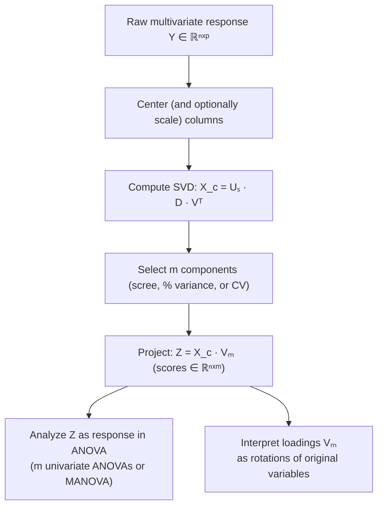

# Lesson 4: Experimental Design with Multivariate Methods

## 1. First-Principles Intuition & Invariants

### The Fundamental Problem of Causal Inference

The central challenge of experimental design is not computational but epistemological: how do we isolate the effect of a treatment from the ambient noise of an uncontrolled world? The naive approach, varying one factor while holding all others fixed, is seductive in its simplicity but catastrophically wasteful in its information yield. A rigorously designed experiment is not merely a data-collection procedure; it is a formal argument structure, whose validity rests on three invariants that Ronald Fisher codified in the 1920s: **randomization**, **replication**, and **local control**. Each invariant corresponds to a distinct threat to causal inference, and understanding why they work requires grounding them in the mathematics of variance decomposition.

Consider an experiment with $n$ observations and a single treatment factor at $k$ levels. The total variation in the response variable $y$ can be written as a sum of squared deviations from the grand mean $\bar{y}$:

$$SS_{\text{total}} = \sum_{i=1}^{k} \sum_{j=1}^{n_i} (y_{ij} - \bar{y})^2$$

The genius of ANOVA is that this single quantity can be algebraically partitioned into components attributable to identifiable sources. Each partition corresponds to a testable scientific question. Without randomization, the assignment of experimental units to treatments is confounded with pre-existing differences among units, and no algebraic partition can recover a clean signal from that contamination. Randomization is therefore not a convenience; it is the mechanism that makes the expected value of the error term zero, transforming a correlational observation into a valid causal estimate.

Replication provides the second invariant. Without multiple observations per treatment level, there is no internal estimate of experimental error, and therefore no denominator for any test statistic. The error mean square $MS_E$ quantifies the variation among experimental units treated identically. If this quantity is not estimable from the design itself, then no inference is possible, regardless of how sophisticated the analysis becomes downstream. This is why a single replicate of an unreplicated factorial design forces the analyst to assume certain high-order interactions are negligible in order to recover an error estimate—a substantive scientific claim embedded in what looks like a statistical choice.

Local control, the third invariant, addresses the fact that experimental units are rarely homogeneous. A set of biological subjects varies in baseline health; a batch of silicon wafers varies in purity; a cohort of algorithm runs varies in memory pressure. Blocking groups units that are similar to one another into homogeneous clusters, ensuring that treatment comparisons occur within blocks rather than across them. The variation attributable to block differences is then removed from the error term, sharpening the precision of treatment comparisons. Mathematically, blocking extends the ANOVA decomposition by one additional component:

$$SS_{\text{total}} = SS_{\text{treatment}} + SS_{\text{blocks}} + SS_E$$

The reduction in $SS_E$ is the quantitative payoff for having grouped units carefully. If the blocks were irrelevant—if units within blocks were no more similar than units between blocks—then $SS_{\text{blocks}}$ would be negligible, and no precision would be lost. If blocks capture real heterogeneity, the reduction in $SS_E$ can be dramatic, transforming a statistically inconclusive experiment into one with high power.

### Linear Model Foundations and the Geometry of Variance

Every ANOVA model is a linear model, and the partition of sum of squares is a partition of the squared norm of a vector in $\mathbb{R}^n$ into orthogonal subspaces. This geometric view is not merely aesthetic; it is the foundation for understanding what happens when designs become unbalanced and why certain estimators break down.

For the one-way ANOVA model, write each observation as:

$$y_{ij} = \mu + \tau_i + \varepsilon_{ij}$$

where $\mu$ is the grand mean, $\tau_i$ is the effect of the $i$-th treatment level subject to the constraint $\sum_{i=1}^k \tau_i = 0$, and $\varepsilon_{ij} \overset{\text{iid}}{\sim} \mathcal{N}(0, \sigma^2)$. The constraint on $\tau_i$ is a identifiability constraint: without it, the model matrix $\mathbf{X}$ is rank-deficient, and the system $\mathbf{X}^\top \mathbf{X} \boldsymbol{\beta} = \mathbf{X}^\top \mathbf{y}$ has infinitely many solutions. Imposing the sum-to-zero constraint projects the parameter space onto a subspace where the solution is unique.

In matrix form, the model is $\mathbf{y} = \mathbf{X}\boldsymbol{\beta} + \boldsymbol{\varepsilon}$, and the least-squares estimate is $\hat{\boldsymbol{\beta}} = (\mathbf{X}^\top \mathbf{X})^{-1} \mathbf{X}^\top \mathbf{y}$, which exists when $\mathbf{X}$ is full column rank. The fitted values $\hat{\mathbf{y}} = \mathbf{X}\hat{\boldsymbol{\beta}} = \mathbf{H}\mathbf{y}$ are the orthogonal projection of $\mathbf{y}$ onto the column space of $\mathbf{X}$, where $\mathbf{H} = \mathbf{X}(\mathbf{X}^\top \mathbf{X})^{-1}\mathbf{X}^\top$ is the hat matrix. The residual $\mathbf{y} - \hat{\mathbf{y}} = (\mathbf{I} - \mathbf{H})\mathbf{y}$ is orthogonal to the column space by construction, since $\mathbf{H}(\mathbf{I} - \mathbf{H}) = \mathbf{0}$. This orthogonality is the algebraic statement of the variance partition:

$$\|\mathbf{y} - \bar{y}\mathbf{1}\|^2 = \|\hat{\mathbf{y}} - \bar{y}\mathbf{1}\|^2 + \|\mathbf{y} - \hat{\mathbf{y}}\|^2$$

which is exactly $SS_{\text{total}} = SS_{\text{model}} + SS_E$. The degrees of freedom attached to each term count the dimension of the corresponding subspace: $k-1$ for the treatment space, $n - k$ for the error space, and $n - 1$ for the total space. The dimensions must add correctly, and they do precisely because the subspaces are orthogonal—a consequence of balanced design that becomes fragile under imbalance.

### The Factorial Principle and Interaction as Synergy

A one-way design answers one question: does the treatment level affect the response? But most phenomena of theoretical interest in applied mathematics are governed by multiple factors simultaneously, and the effect of one factor frequently depends on the level of another. The factorial design is the structural answer to this reality, and its information-theoretic advantage over one-factor-at-a-time (OFAT) designs is profound.

A $k$-factor factorial experiment at two levels each—the $2^k$ design—assigns experimental units to every combination of factor levels. For two factors $A$ and $B$, each at two levels coded as $-1$ and $+1$, the four treatment combinations are $(-, -), (+, -), (-, +), (+, +)$. The main effect of $A$ is the average change in response when $A$ moves from $-1$ to $+1$, averaged over both levels of $B$:

$$\text{ME}_A = \frac{1}{2}\left[(y_{+,-} - y_{-,-}) + (y_{+,+} - y_{-,+})\right]$$

The interaction $AB$ measures whether the effect of $A$ changes when $B$ changes:

$$AB = \frac{1}{2}\left[(y_{+,+} - y_{-,+}) - (y_{+,-} - y_{-,-})\right]$$

When $AB \neq 0$, the two factors are not additively separable: the response surface is not a sum of individual factor contributions but a coupled function of their joint levels. For a theorist, this is not a complication to be explained away but the actual structure of the phenomenon. Many optimization problems in algorithm design, cryptographic parameter selection, and numerical analysis exhibit precisely this coupled sensitivity. A factorial design detects and quantifies interaction; an OFAT design is structurally incapable of doing so, because it never simultaneously varies the factors whose joint variation produces the interaction.

The information efficiency gain is concrete. A $2^2$ factorial design with $n$ replicates uses $4n$ experimental runs to estimate two main effects and one interaction with full precision. An OFAT design that varies $A$ while fixing $B$, then varies $B$ while fixing $A$, uses $2n + 1$ runs to estimate the two main effects but cannot estimate the interaction at all. As $k$ grows, the factorial advantage compounds, because the $2^k$ design estimates all $2^k - 1$ estimable effects, including all two-factor, three-factor, and higher-order interactions, using the same $2^k$ runs.

For large $k$, the full $2^k$ factorial becomes prohibitively expensive: a $2^{10}$ experiment requires 1024 runs. The resolution of this tension is the **fractional factorial design**, which runs only $2^{k-p}$ of the full $2^k$ treatment combinations, chosen so that the aliasing structure—the mapping between effects that the reduced design cannot distinguish—is controlled. A $2^{k-p}$ design of resolution $R$ ensures that no effect involving fewer than $r$ factors is aliased with any other effect involving fewer than $R - r$ factors. Resolution III designs confound main effects with two-factor interactions; resolution IV designs confound two-factor interactions with each other but protect main effects; resolution V designs protect both main effects and two-factor interactions.

The aliasing structure is determined by the **defining relation**: the set of effects whose contrast vectors are identical to the identity under multiplication in $\mathbb{Z}_2^k$. For a $2^{4-1}$ design with defining relation $I = ABCD$, the alias of any effect $E$ is $E \cdot ABCD \pmod{2}$. The main effect $A$ is aliased with $BCD$; the interaction $AB$ is aliased with $CD$. If three-factor and higher interactions are assumed negligible—a scientifically defensible assumption in many domains—then the main effects and two-factor interactions are estimable from half the runs of the full factorial. This is the foundational trade-off of fractional factorial theory: sparsity of effects in exchange for a reduced run count.

### Eigendecomposition and the Geometry of Multivariate Observations

When experimental responses are multivariate—when each experimental unit yields a vector $\mathbf{y} \in \mathbb{R}^p$ rather than a scalar—the analysis shifts from the algebra of scalar variance to the spectral theory of covariance matrices. The covariance matrix $\boldsymbol{\Sigma} \in \mathbb{R}^{p \times p}$ is symmetric positive semidefinite, and its eigendecomposition $\boldsymbol{\Sigma} = \mathbf{U}\boldsymbol{\Lambda}\mathbf{U}^\top$ defines a canonical coordinate system in which the variables are uncorrelated and ordered by their contribution to total variance.

The total variance is $\text{tr}(\boldsymbol{\Sigma}) = \sum_{j=1}^p \lambda_j$, the sum of eigenvalues. The proportion of total variance explained by the first $m$ principal components is $\sum_{j=1}^m \lambda_j / \sum_{j=1}^p \lambda_j$. This quantity is the precise, formal definition of what it means to "retain most of the variance" in a dimensionality reduction—a phrase that is used carelessly in applied work but has a clean linear-algebraic meaning.

The first principal component is the direction $\mathbf{u}_1 = \arg\max_{\|\mathbf{u}\|=1} \mathbf{u}^\top \boldsymbol{\Sigma} \mathbf{u}$, whose solution is the eigenvector corresponding to $\lambda_1$. The second principal component is the direction of maximum variance in the orthogonal complement of $\mathbf{u}_1$, which is the eigenvector corresponding to $\lambda_2$. The entire sequence of principal components is exactly the eigenvector basis of $\boldsymbol{\Sigma}$, ordered by decreasing eigenvalue. This is not merely a summary: it is the unique linear transformation that simultaneously maximizes variance retention and achieves decorrelation, two objectives that happen to have the same solution.

---

## 2. Core Architecture & Mechanics

### ANOVA Decomposition: The Full Mechanics

A complete ANOVA workflow operates in four distinct stages that must be executed in order: design specification, model matrix construction, sum-of-squares computation, and distributional testing. Skipping or conflating any stage produces results that are numerically correct but inferentially meaningless.

**Stage 1: Design Specification.** Before any data is collected, the analyst must specify the factor structure (fixed versus random effects), the blocking structure, the treatment assignment mechanism, and the number of replicates per cell. The choice between fixed and random effects is not a modeling preference; it determines the expected mean squares and therefore the correct denominator for each F-ratio. A fixed effect is one whose levels are the specific levels of interest; a random effect is one whose levels are a sample from a population of possible levels. For a fixed-effects one-way ANOVA with $k$ levels and $n$ replications per level, the expected mean squares are:

$$E[MS_{\text{treatment}}] = \sigma^2 + n \cdot \frac{\sum_{i=1}^k \tau_i^2}{k-1}, \qquad E[MS_E] = \sigma^2$$

For a random-effects model with treatment variance $\sigma_\tau^2$:

$$E[MS_{\text{treatment}}] = \sigma^2 + n\sigma_\tau^2, \qquad E[MS_E] = \sigma^2$$

The F-ratio $F = MS_{\text{treatment}} / MS_E$ has expectation one under the null hypothesis in both cases, but the interpretation of a significant result differs: in the fixed-effects case, it is evidence that the specific treatment levels differ; in the random-effects case, it is evidence that the population of treatment levels has nonzero variance.

**Stage 2: Model Matrix Construction.** For a two-way crossed factorial design with factors $A$ (at $a$ levels) and $B$ (at $b$ levels) and $n$ replicates per cell, the model is:

$$y_{ijk} = \mu + \alpha_i + \beta_j + (\alpha\beta)_{ij} + \varepsilon_{ijk}$$

with constraints $\sum_i \alpha_i = 0$, $\sum_j \beta_j = 0$, $\sum_i (\alpha\beta)_{ij} = 0$ for all $j$, and $\sum_j (\alpha\beta)_{ij} = 0$ for all $i$. The model matrix $\mathbf{X}$ has $abn$ rows and $1 + (a-1) + (b-1) + (a-1)(b-1) = ab$ columns (after imposing constraints). The column space of $\mathbf{X}$ is the direct sum of four orthogonal subspaces: the grand mean subspace (dimension 1), the $A$ main effect subspace (dimension $a-1$), the $B$ main effect subspace (dimension $b-1$), and the interaction subspace (dimension $(a-1)(b-1)$).

**Stage 3: Sum-of-Squares Computation.** The sequential computation proceeds as follows. Let $\bar{y}_{i \cdot \cdot}$, $\bar{y}_{\cdot j \cdot}$, $\bar{y}_{ij\cdot}$, and $\bar{y}_{\cdot\cdot\cdot}$ denote the marginal and cell means. The sums of squares are:

$$SS_A = bn\sum_{i=1}^a (\bar{y}_{i\cdot\cdot} - \bar{y}_{\cdot\cdot\cdot})^2$$

$$SS_B = an\sum_{j=1}^b (\bar{y}_{\cdot j\cdot} - \bar{y}_{\cdot\cdot\cdot})^2$$

$$SS_{AB} = n\sum_{i=1}^a \sum_{j=1}^b (\bar{y}_{ij\cdot} - \bar{y}_{i\cdot\cdot} - \bar{y}_{\cdot j\cdot} + \bar{y}_{\cdot\cdot\cdot})^2$$

$$SS_E = \sum_{i=1}^a \sum_{j=1}^b \sum_{k=1}^n (y_{ijk} - \bar{y}_{ij\cdot})^2$$

The last quantity, $SS_E$, is computed purely from the within-cell variation—the spread of replicates around their cell mean—and is entirely free of any treatment or block effects. This is what makes it a valid estimate of pure experimental error.

**Stage 4: Distributional Testing.** Under the null hypothesis that $\alpha_i = 0$ for all $i$, the F-ratio:

$$F_A = \frac{SS_A / (a-1)}{SS_E / (ab(n-1))}$$

follows an $F(a-1, ab(n-1))$ distribution exactly when the normality and constant-variance assumptions hold. The proof requires two facts: (1) under the null, $SS_A / \sigma^2 \sim \chi^2(a-1)$, which follows from the fact that $SS_A$ is a quadratic form in a $\mathcal{N}(\mathbf{0}, \sigma^2 \mathbf{I})$ vector with rank $a-1$; and (2) $SS_E / \sigma^2 \sim \chi^2(ab(n-1))$ independently of $SS_A$, which follows from the orthogonality of the subspaces. The ratio of two independent chi-squared variables, each divided by its degrees of freedom, defines the F distribution.

The two-way ANOVA table organizes these computations with explicit degrees of freedom, mean squares, and F-ratios:

```
Source        | SS       | df             | MS                         | F
--------------|----------|----------------|----------------------------|---------
A             | SS_A     | a - 1          | SS_A / (a-1)               | MS_A / MS_E
B             | SS_B     | b - 1          | SS_B / (b-1)               | MS_B / MS_E
A × B         | SS_AB    | (a-1)(b-1)     | SS_AB / ((a-1)(b-1))       | MS_AB / MS_E
Error         | SS_E     | ab(n-1)        | SS_E / (ab(n-1))           |
Total         | SS_T     | abn - 1        |                            |
```

The interaction row is tested before interpreting main effects. When the $A \times B$ interaction is significant, the main effects $A$ and $B$ have no clean marginal interpretation: the effect of $A$ differs across levels of $B$, so a marginal average is a mixture over incomparable conditions. The correct analysis in that case is a **simple effects** analysis: test the effect of $A$ at each fixed level of $B$ separately.

### Blocking Structures and the Randomized Complete Block Design

The randomized complete block design (RCBD) assigns all $k$ treatments to each of $b$ blocks in a randomized order within each block. The model is:

$$y_{ij} = \mu + \tau_i + \beta_j + \varepsilon_{ij}$$

where $\tau_i$ is the treatment effect and $\beta_j$ is the block effect, with both sets of effects summing to zero. The critical structural difference from the two-factor factorial is that there is no interaction term: the RCBD assumes that treatments act additively with blocks—that the difference between any two treatments is the same in every block. This is the additivity assumption, and its validity must be assessed rather than assumed.

Tukey's one-degree-of-freedom test for non-additivity fits an augmented model that includes a multiplicative interaction term $\lambda \tau_i \beta_j$:

$$y_{ij} = \mu + \tau_i + \beta_j + \lambda\tau_i\beta_j + \varepsilon_{ij}$$

The test statistic is obtained by regressing the residuals $\hat{\varepsilon}_{ij}$ from the additive model onto the products $\hat{\tau}_i \hat{\beta}_j$. The resulting regression sum of squares has one degree of freedom and is compared to the error mean square. A significant result indicates that the block-by-treatment interaction is not negligible and that a transformation of the response (often a logarithm) or a more elaborate model is required.

The Latin square design extends blocking to two simultaneous nuisance factors, organizing $k^2$ experimental units into a $k \times k$ grid where each row represents one level of the first blocking factor, each column represents one level of the second, and each treatment appears exactly once in every row and every column. The variance partition becomes:

$$SS_{\text{total}} = SS_{\text{rows}} + SS_{\text{columns}} + SS_{\text{treatment}} + SS_E$$

with degrees of freedom $k^2 - 1 = (k-1) + (k-1) + (k-1) + (k-1)(k-2)$. The error degrees of freedom $(k-1)(k-2)$ can be uncomfortably small for modest $k$: a $4 \times 4$ Latin square has only 6 error degrees of freedom, making the design sensitive to violations of normality and limiting power. For $k \geq 5$, the design becomes practical; for $k < 4$, it is rarely appropriate.

### Principal Component Analysis: Algorithmic Mechanics

The PCA workflow begins with a data matrix $\mathbf{X} \in \mathbb{R}^{n \times p}$ where $n$ observations are rows and $p$ variables are columns. The first step—centering and optionally scaling—is a consequential decision, not a preprocessing formality. When variables are measured in incommensurable units or have vastly different variances, the unscaled covariance matrix is dominated by the high-variance variables, and the principal components simply recover the marginal variances rather than any genuine multivariate structure. Standardizing to unit variance before analysis works with the correlation matrix $\mathbf{R}$ rather than the covariance matrix $\boldsymbol{\Sigma}$; the principal components are then dimensionless and reflect the correlation structure of the data.

After centering each column to zero mean, form the sample covariance matrix:

$$\hat{\boldsymbol{\Sigma}} = \frac{1}{n-1} \mathbf{X}_c^\top \mathbf{X}_c$$

where $\mathbf{X}_c$ is the mean-centered data matrix. The eigendecomposition $\hat{\boldsymbol{\Sigma}} = \mathbf{U}\boldsymbol{\Lambda}\mathbf{U}^\top$ produces eigenvectors $\mathbf{u}_1, \ldots, \mathbf{u}_p$ (the loadings) and eigenvalues $\lambda_1 \geq \lambda_2 \geq \cdots \geq \lambda_p \geq 0$. The projection of the data onto the first $m$ principal components is:

$$\mathbf{Z} = \mathbf{X}_c \mathbf{U}_m$$

where $\mathbf{U}_m \in \mathbb{R}^{p \times m}$ contains the first $m$ eigenvectors as columns. The rows of $\mathbf{Z} \in \mathbb{R}^{n \times m}$ are the principal component scores: the coordinates of each observation in the reduced-dimensional space.

In computational practice, the eigendecomposition of $\hat{\boldsymbol{\Sigma}}$ is replaced by the singular value decomposition of $\mathbf{X}_c$. Writing $\mathbf{X}_c = \mathbf{U}_s \mathbf{D} \mathbf{V}^\top$ (the economy SVD, with $\mathbf{U}_s \in \mathbb{R}^{n \times p}$, $\mathbf{D} = \text{diag}(d_1, \ldots, d_p)$, $\mathbf{V} \in \mathbb{R}^{p \times p}$), the connection to PCA is exact: the columns of $\mathbf{V}$ are the eigenvectors of $\hat{\boldsymbol{\Sigma}}$, and $\lambda_j = d_j^2 / (n-1)$. The SVD is preferred numerically because it is computed directly from $\mathbf{X}_c$ without forming the potentially ill-conditioned $\mathbf{X}_c^\top \mathbf{X}_c$ explicitly.

The architecture of a PCA-augmented experiment flows as follows:



The scree plot—eigenvalues plotted in decreasing order against their index—provides a visual heuristic for selecting $m$: look for an "elbow" where the eigenvalue curve flattens. The Kaiser criterion retains components with eigenvalue exceeding one (when working with the correlation matrix). Both are heuristics; the most principled approach is cross-validation, which repeatedly holds out subsets of rows and measures the reconstruction error $\|\mathbf{X}_c - \hat{\mathbf{X}}_c\|_F^2$ as a function of $m$. The minimizer of prediction error over held-out data is the $m$ that generalizes.

### Linear Discriminant Analysis: The Mechanics of Separability

Where PCA maximizes total variance without reference to group membership, Linear Discriminant Analysis (LDA) maximizes the ratio of between-group to within-group variance. The setup requires labeled observations: $n_i$ observations from group $i$, for $i = 1, \ldots, g$, with group mean vectors $\bar{\mathbf{x}}_i \in \mathbb{R}^p$ and grand mean $\bar{\mathbf{x}}$.

The between-groups scatter matrix and within-groups scatter matrix are:

$$\mathbf{B} = \sum_{i=1}^g n_i (\bar{\mathbf{x}}_i - \bar{\mathbf{x}})(\bar{\mathbf{x}}_i - \bar{\mathbf{x}})^\top$$

$$\mathbf{W} = \sum_{i=1}^g \sum_{j=1}^{n_i} (\mathbf{x}_{ij} - \bar{\mathbf{x}}_i)(\mathbf{x}_{ij} - \bar{\mathbf{x}}_i)^\top$$

The first linear discriminant $\mathbf{a}_1$ is the direction that maximizes Fisher's criterion:

$$J(\mathbf{a}) = \frac{\mathbf{a}^\top \mathbf{B} \mathbf{a}}{\mathbf{a}^\top \mathbf{W} \mathbf{a}}$$

Differentiating and setting the derivative to zero yields the generalized eigenvalue problem $\mathbf{B}\mathbf{a} = \lambda \mathbf{W}\mathbf{a}$, equivalently $\mathbf{W}^{-1}\mathbf{B}\mathbf{a} = \lambda \mathbf{a}$. The eigenvectors of $\mathbf{W}^{-1}\mathbf{B}$ are the discriminant directions, and their eigenvalues measure the separability achieved in each direction. Because $\mathbf{B}$ has rank at most $g-1$, there are at most $g-1$ nonzero eigenvalues and therefore at most $g-1$ nontrivial discriminant functions.

The discriminant scores $z_{ij} = \mathbf{a}_k^\top \mathbf{x}_{ij}$ can be used for classification: assign an unclassified observation $\mathbf{x}$ to the group whose centroid $\mathbf{a}_k^\top \bar{\mathbf{x}}_i$ is closest in discriminant space (under the assumption of equal prior probabilities and equal covariance matrices, this is equivalent to minimum Mahalanobis distance classification). When covariances are unequal across groups, the linear boundaries become quadratic, and the analysis extends to Quadratic Discriminant Analysis, where each group has its own scatter matrix $\mathbf{W}_i$ and the classification boundary is the quadric $\{\mathbf{x} : (\mathbf{x} - \bar{\mathbf{x}}_i)^\top \mathbf{W}_i^{-1}(\mathbf{x} - \bar{\mathbf{x}}_i) = (\mathbf{x} - \bar{\mathbf{x}}_j)^\top \mathbf{W}_j^{-1}(\mathbf{x} - \bar{\mathbf{x}}_j)\}$.

### Cluster Validation: Internal and External Criteria

Clustering algorithms—$k$-means, hierarchical agglomerative clustering, model-based clustering under mixture models—produce partitions, but no algorithm produces a valid partition from arbitrary data. Validating whether a clustering structure is genuine, as opposed to an artifact of the algorithm applied to structureless data, requires formal criteria.

The silhouette coefficient for observation $i$ is:

$$s(i) = \frac{b(i) - a(i)}{\max(a(i), b(i))}$$

where $a(i)$ is the mean dissimilarity of $i$ to all other observations in its cluster, and $b(i)$ is the mean dissimilarity of $i$ to observations in the nearest neighboring cluster. The value $s(i)$ ranges from $-1$ to $1$; values near $1$ indicate that $i$ is well-matched to its own cluster and poorly matched to neighboring clusters. The mean silhouette over all observations is an overall measure of clustering quality. The number of clusters $k$ that maximizes the mean silhouette is the data-driven recommendation for the cluster count.

The Calinski-Harabasz index (also called the variance ratio criterion) formalizes the ratio of between-cluster to within-cluster dispersion:

$$CH(k) = \frac{SS_B / (k-1)}{SS_W / (n-k)}$$

where $SS_B = \sum_{c=1}^k n_c \|\bar{\mathbf{x}}_c - \bar{\mathbf{x}}\|^2$ is the between-cluster sum of squares and $SS_W = \sum_{c=1}^k \sum_{i \in C_c} \|\mathbf{x}_i - \bar{\mathbf{x}}_c\|^2$ is the within-cluster sum of squares. This is structurally identical to the ANOVA F-ratio, with clusters playing the role of treatment groups. A higher $CH(k)$ indicates more compact, well-separated clusters. This index has an inherent bias toward convex clusters of roughly equal size, which limits its applicability to datasets where these assumptions are violated.

---

## 3. High-Performance Optimization & Failure Modes

### Optimal Design Construction for Non-Standard Experiments

Classical factorial and RCBD designs assume equal replication, continuous factor levels, and unconstrained run counts. When experiments are expensive, factor levels are constrained to a region, or the response surface is known to be polynomial rather than purely factorial, optimal design theory replaces combinatorial design construction with a continuous optimization problem.

The D-optimal design criterion minimizes the volume of the confidence ellipsoid for the parameter vector $\hat{\boldsymbol{\beta}}$, which is equivalent to maximizing $\det(\mathbf{X}^\top \mathbf{X})$. The connection is direct: the covariance matrix of $\hat{\boldsymbol{\beta}}$ is $\sigma^2 (\mathbf{X}^\top \mathbf{X})^{-1}$, so the volume of the joint confidence ellipsoid for $\boldsymbol{\beta}$ is proportional to $[\det(\mathbf{X}^\top \mathbf{X})]^{-1/2}$. Maximizing $\det(\mathbf{X}^\top \mathbf{X})$ over the set of all candidate design matrices with at most $n$ rows is a combinatorial optimization, typically solved with coordinate-exchange algorithms that swap individual design points one at a time, accepting swaps that increase the determinant.

The G-optimal criterion minimizes the maximum prediction variance over the design region:

$$d^* = \max_{\mathbf{x} \in \mathcal{X}} \mathbf{f}(\mathbf{x})^\top (\mathbf{X}^\top \mathbf{X})^{-1} \mathbf{f}(\mathbf{x})$$

where $\mathbf{f}(\mathbf{x})$ is the vector of model terms evaluated at $\mathbf{x}$. The Kiefer-Wolfowitz equivalence theorem establishes that for continuous designs, the D-optimal and G-optimal criteria yield the same design: the design that maximizes $\det(\mathbf{X}^\top \mathbf{X})$ also minimizes the maximum prediction variance, and that maximum variance equals $p / n$, where $p$ is the number of model parameters. This theoretical result provides both a practical stopping criterion for coordinate-exchange algorithms (stop when the maximum prediction variance achieves $p/n$) and a deep structural insight: optimizing average estimation precision and worst-case prediction precision are, in the limit, the same problem.

### Power Analysis and Sample Size Determination

The connection between ANOVA and power analysis is mediated by the noncentral F distribution. Under the alternative hypothesis that the treatment effects $\tau_i$ are not all zero, the F statistic for the main effect follows a noncentral F distribution $F'(\nu_1, \nu_2, \lambda)$ where $\nu_1 = k - 1$, $\nu_2 = k(n-1)$ are the degrees of freedom and the noncentrality parameter is:

$$\lambda = \frac{n \sum_{i=1}^k \tau_i^2}{\sigma^2}$$

Power is the probability that the F statistic exceeds the critical value $F_\alpha(\nu_1, \nu_2)$ under this noncentral distribution. For a fixed effect size (quantified by $\sum \tau_i^2 / \sigma^2$), power increases with $n$ because $\lambda$ grows linearly with $n$ while the critical value does not change. Setting a target power (typically $1 - \beta = 0.80$ or $0.90$) and solving for $n$ requires inverting the noncentral F CDF, which has no closed form but is numerically straightforward. The key insight for the practitioner is that the noncentrality parameter $\lambda$ is a function of the signal-to-noise ratio $\sum \tau_i^2 / \sigma^2$, so an accurate estimate of the error variance $\sigma^2$ from a pilot study or historical data is a prerequisite for meaningful power calculations. Assuming $\sigma^2$ without empirical grounding produces power estimates that are as likely to be wrong as right.

### Collinearity and the Failure of Classical PCA Assumptions

PCA is a linear method and inherits linear algebra's sensitivity to collinearity. When the covariance matrix $\hat{\boldsymbol{\Sigma}}$ has eigenvalues near zero—as occurs when variables are nearly perfectly linearly related—the corresponding eigenvectors are poorly determined: small changes in the data matrix produce large rotations of the eigenvectors in the near-null subspace. The condition number $\kappa(\hat{\boldsymbol{\Sigma}}) = \lambda_1 / \lambda_p$ measures this sensitivity; when $\kappa$ is large, the minor principal components are dominated by numerical noise.

This failure mode matters in experimental design when PCA is used to construct composite response variables for downstream ANOVA. If the last few principal components reflect measurement noise rather than genuine low-variance signal dimensions, projecting the ANOVA onto those components introduces noise rather than clarity. The practical mitigation is to screen components by cross-validated reconstruction error rather than by eigenvalue magnitude alone, and to report sensitivity of conclusions to the choice of $m$.

A second failure mode arises from the assumption that principal components have substantive interpretability through their loadings. A loading $v_{jp}$ is the correlation between the original variable $X_j$ and the $p$-th principal component, interpretable when one or two loadings dominate a component. When all loadings are roughly equal in magnitude, the component is a generalized average with no clean scientific interpretation. **Varimax rotation** addresses this: it maximizes $\sum_p \sum_j (v_{jp}^2 - \bar{v}_p^2)^2$, rotating the PC axes within the $m$-dimensional subspace to produce loadings that are as close to $0$ or $\pm 1$ as possible, without changing the total variance explained. The rotation sacrifices the orthogonality of the principal axes (unless oblique rotation is explicitly disallowed) in exchange for interpretability. For theoretical scientists, this trade-off should be explicit: rotated components are no longer eigenvectors of anything and should not be described as such.

### Distributional Assumption Failures and Robust Alternatives

ANOVA's exact F-test results depend on normality and homoskedasticity. In practice, neither assumption is guaranteed. The consequences of their violation depend on the nature of the violation and the balance of the design.

For mild, symmetric non-normality, ANOVA is robust by the central limit theorem: the sample cell means $\bar{y}_{ij\cdot}$ are approximately normal for moderate $n$, regardless of the marginal distribution of $y_{ijk}$. The minimum $n$ for this approximation to be adequate depends on the skewness and kurtosis of the error distribution and must be evaluated case by case. For heavy-tailed distributions—common in algorithm benchmark data, where runtime distributions often have Pareto-like tails—the normality approximation fails at modest sample sizes, and the F-test loses Type I error control.

The Welch correction for unequal variances adjusts the degrees of freedom of the F distribution to account for heteroskedasticity. For one-way ANOVA with unequal variances $\sigma_i^2$, the Welch statistic is:

$$F_W = \frac{\sum_{i=1}^k w_i (\bar{y}_{i\cdot} - \tilde{y})^2 / (k-1)}{1 + \frac{2(k-2)}{k^2 - 1}\sum_{i=1}^k \frac{(1 - w_i/\sum w_j)^2}{n_i - 1}}$$

where $w_i = n_i / s_i^2$ and $\tilde{y} = \sum w_i \bar{y}_{i\cdot} / \sum w_i$. This statistic follows an approximate F distribution with modified denominator degrees of freedom $\nu = (k^2 - 1) / (3 \sum_{i=1}^k (1 - w_i/\sum w_j)^2 / (n_i - 1))$. The correction is sharp when variances differ by factors of two to four; for more extreme heteroskedasticity, permutation-based tests or variance-stabilizing transformations are more appropriate.

The Kruskal-Wallis test is the rank-based nonparametric analog of one-way ANOVA. It replaces observations with their ranks within the pooled sample and computes a test statistic based on the between-group variability of these ranks:

$$H = \frac{12}{n(n+1)} \sum_{i=1}^k \frac{R_i^2}{n_i} - 3(n+1)$$

where $R_i = \sum_{j} r_{ij}$ is the sum of ranks in group $i$. Under the null hypothesis of identical distributions, $H \sim \chi^2(k-1)$ approximately. The Kruskal-Wallis test has power approaching that of the F-test for normal data (asymptotic relative efficiency 0.955) and can substantially exceed it for heavy-tailed distributions. For block designs, the Friedman test extends the same principle to two-way layouts, replacing parametric analysis with rank comparisons within each block.

### Validation Instability in Cluster Analysis and High-Dimensional PCA

A failure mode that is specific to unsupervised multivariate methods—clustering and PCA alike—is the **instability of solutions under data perturbation**. A clustering of $n$ observations into $k$ groups that changes substantially when 5% of observations are resampled is not a stable discovery; it reflects the algorithm's sensitivity to initialization or to boundary cases rather than any genuine structure in the data.

The formal diagnostic is bootstrap stability analysis. For $B$ bootstrap resamples of the data, apply the clustering algorithm to each resample, then measure the similarity between the resulting partition and the original partition using the adjusted Rand index (ARI):

$$\text{ARI} = \frac{\binom{n}{2} \cdot \text{agreements} - \sum_i \binom{a_i}{2}\sum_j \binom{b_j}{2} / \binom{n}{2}}{\frac{1}{2}\left[\sum_i \binom{a_i}{2} + \sum_j \binom{b_j}{2}\right] - \sum_i \binom{a_i}{2}\sum_j \binom{b_j}{2} / \binom{n}{2}}$$

where $a_i$ and $b_j$ are the sizes of clusters in the original and bootstrap partitions, respectively. The ARI is 1 for identical partitions and has expected value 0 under random assignment. A mean ARI above $0.75$ across $B = 200$ bootstrap resamples indicates a stable clustering; values below $0.5$ suggest that the algorithm is finding different structures in different resamples, and the number of clusters $k$ should be reconsidered.

For high-dimensional PCA in experimental contexts—where $p$ approaches or exceeds $n$—the sample covariance matrix $\hat{\boldsymbol{\Sigma}}$ is rank-deficient and its eigenvalues are severely biased estimates of the population eigenvalues. The Marchenko-Pastur law from random matrix theory provides the null distribution of eigenvalues when the data matrix is a pure noise matrix ($\mathbf{X}$ with i.i.d. entries). The limiting spectral distribution of $\hat{\boldsymbol{\Sigma}}$ has support $[\sigma^2(1 - \sqrt{p/n})^2, \sigma^2(1 + \sqrt{p/n})^2]$. Any observed eigenvalue falling within this support is consistent with pure noise and should not be interpreted as a genuine signal dimension. Only eigenvalues exceeding the upper edge of the Marchenko-Pastur bulk, $\sigma^2(1 + \sqrt{p/n})^2$, correspond to genuine signal components. For practitioners working with high-dimensional experimental data—genomic readouts, spectral measurements, or large-scale simulation outputs—this threshold provides a principled, theoretically grounded criterion for component selection that supersedes both the Kaiser criterion and the visual scree elbow, both of which were derived for low-dimensional settings and are systematically biased in the $p/n \to 1$ regime.
