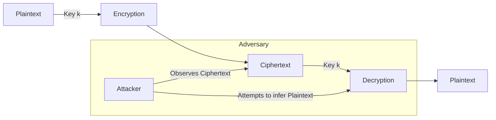

# Foundation: Cryptography

## 1. Conceptual Mental Model (Core intuition, analogies, and first principles)

Cryptography is fundamentally the **mathematical art of secure communication in the presence of adversaries**. At its core, it addresses the problem: *How can we ensure that information remains confidential, authentic, and unaltered when transmitted across potentially hostile channels?*  

**First principles**:  
- **Information as a mathematical object**: Messages are treated as strings over a finite alphabet (e.g., binary strings).  
- **Adversarial interaction**: An attacker observes encrypted messages and attempts to infer plaintexts, keys, or other secrets.  
- **Computational security**: Security is defined by *computational hardness*—not mathematical impossibility. An adversary must require *more computational resources than feasible* to break the system.  

**Intuitive analogy**:  
Imagine a secure mailbox (cryptography) that:  
1. **Generates a unique key** (like a physical lock combination)  
2. **Transforms messages** (mail) into a form only the key-holder can reverse  
3. **Guarantees that even with full knowledge of the transformation rules**, the attacker cannot reconstruct the original message without the key.  

**Why this matters**:  
Cryptography solves the *information-theoretic problem* of secure communication in a world where adversaries have *unbounded computational power*—a critical distinction from physical security (e.g., locks). Its foundation lies in **computational complexity theory** and **information theory**, not just "scrambling text."

---

## 2. Essential Terminology & Taxonomy

| Term                | Formal Definition                                                                 | Foundational Role                                  |
|---------------------|--------------------------------------------------------------------------------|----------------------------------------------------|
| **Plaintext**       | Original message before encryption (e.g., `message = "Hello"`).                  | Input to encryption process.                       |
| **Ciphertext**      | Output of encryption (e.g., `ciphertext = "Xj9kZ"`).                             | Output of encryption process.                      |
| **Key**             | Secret parameter used for encryption/decryption (e.g., `k = 12345`).             | *Critical* for defining security boundaries.        |
| **One-way Function**| A function `f` such that `f(x)` is easy to compute, but `x` is hard to recover from `f(x)` (with high probability). | Basis for asymmetric cryptography.                |
| **Computational Hardness** | The assumption that no efficient algorithm exists to invert a one-way function (e.g., factoring large integers). | Core security assumption in modern crypto.         |
| **Adversary**       | An entity attempting to compromise security (e.g., eavesdropper, attacker).      | Defines the security model (e.g., *chosen-plaintext attack*). |
| **Key Space**       | Set of all possible keys (e.g., `K = {0, 1}^n` for `n`-bit keys).               | Determines key strength and security margin.        |
| **Semantic Security**| A message remains statistically indistinguishable from random noise after encryption. | *Gold standard* for modern cryptographic security. |

> **Key insight**: Cryptography does *not* guarantee absolute secrecy (e.g., *perfect secrecy* requires key size = message size). Instead, it provides *computational security*—a practical guarantee against adversaries with bounded computational resources.

---

## 3. Architecture & Core Workflow

**Workflow breakdown**:  
1. **Key Generation**: Securely produce a key `k` from a key space `K`.  
2. **Encryption**: Transform plaintext `m` into ciphertext `c = E_k(m)` using a deterministic function `E_k`.  
3. **Transmission**: Send `c` across a channel (attacker may observe `c`).  
4. **Decryption**: Recover `m = D_k(c)` using the same key `k`.  
5. **Adversarial Challenge**: Attacker attempts to derive `m` or `k` from `c` (or other inputs) without `k`.  

**Critical constraint**: The encryption function `E_k` must satisfy *computational indistinguishability*—no efficient algorithm can distinguish `E_k(m)` from random noise.

---

## 4. Common Misconceptions & Mental Traps

| Misconception                          | Why it’s dangerous (and why it’s false)                                                                 |
|----------------------------------------|-------------------------------------------------------------------------------------------------------|
| "Cryptography guarantees *absolute* secrecy" | **Reality**: Security is *computational*, not information-theoretic. Even with perfect keys, adversaries with sufficient resources can break systems (e.g., via quantum computing). |
| "Encryption = scrambling text"         | **Reality**: Encryption is a *mathematical transformation* preserving structure (e.g., ciphertext must be decodable). Scrambling without mathematical guarantees is *not* cryptography. |
| "Stronger keys = unbreakable security" | **Reality**: Key size alone doesn’t define security. The *algorithm* (e.g., RSA vs. AES) and *computational hardness assumptions* (e.g., factoring) are equally critical. |
| "All cryptographic systems are symmetric" | **Reality**: Asymmetric cryptography (e.g., RSA) uses *different* keys for encryption/decryption—essential for digital signatures and key exchange. |

**Mental trap to avoid**: Confusing *computational hardness* (a probabilistic, resource-bound guarantee) with *mathematical impossibility* (e.g., "this problem is unsolvable").

---

## 5. Socratic Discussion Starters

1. **Why does computational hardness imply security without requiring unbreakable mathematics?**  
   *(Probe the distinction between theoretical impossibility and practical feasibility in cryptographic security.)*

2. **If an adversary has unlimited computational resources, what would break modern cryptography?**  
   *(Challenge assumptions about the role of computational complexity in defining security boundaries.)*

3. **How does the concept of *semantic security* resolve the tension between information theory and computational security?**  
   *(Explore why perfect secrecy (e.g., one-time pads) is impractical for large-scale systems despite being information-theoretically secure.)*
