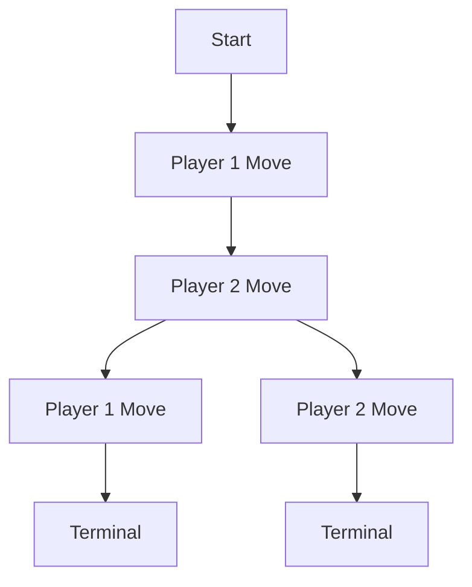
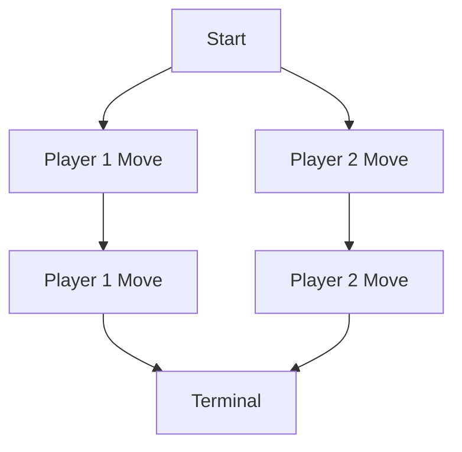

# Advanced Foundation: Game Theory 03 Extensive Form And Subgame Perfection

## 1. Theoretical Invariants & Formal Frameworks (Formal proofs, kernel or physical invariants)

### Extensive Form Games
An extensive form game is a representation of a game where the sequence of moves is explicitly laid out. It is defined by a tuple \((N, H, A, P, u)\), where:
- \(N\) is the set of players.
- \(H\) is the set of histories, which are sequences of actions taken by players.
- \(A\) is the set of actions available at each history.
- \(P: H \to N \cup \{\emptyset\}\) is the player function, which specifies which player is to move at each history.
- \(u: H_f \to \mathbb{R}^N\) is the payoff function, which assigns a payoff to each player for each terminal history \(h_f \in H_f\).

### Subgame Perfection
A subgame is a part of the game that starts at a single decision node and includes all the subsequent decision nodes and terminal nodes. A strategy profile is a subgame perfect equilibrium if it is a Nash equilibrium in every subgame of the game.

**Theorem (Kuhn's Theorem):** Every finite extensive form game with perfect recall has at least one subgame perfect equilibrium.

**Proof Sketch:**
Consider a finite extensive form game with perfect recall. By Zermelo's theorem, every finite two-player game with perfect information has a subgame perfect equilibrium. For games with more than two players, we can use induction and the concept of Nash equilibria in subgames to establish the existence of a subgame perfect equilibrium.

## 2. Low-Level Invariant Taxonomy (Deep registers, memory models, hardware constraints, or axiomatic definitions)

### Axiomatic Definitions
- **Perfect Recall:** A player has perfect recall if they remember all the actions they have taken and the actions taken by other players in the past.
- **Information Set:** An information set is a set of histories that a player cannot distinguish between at the time they make a decision.

### Invariant Properties
- **Consistency:** A strategy profile is consistent if it specifies a unique action for each information set.
- **Sequential Rationality:** A strategy profile is sequentially rational if it is optimal at every information set, given the strategies of other players.

## 3. Micro-Architecture & Concurrency Dynamics (Mermaid and ASCII state machines / cache / race condition diagrams)

### State Machines
We can represent extensive form games using state machines. Each state represents a history, and transitions represent actions taken by players.

**Example:**

### Concurrency Dynamics
In games with concurrent moves, we can use race condition diagrams to analyze the interaction of actions.

**Example:**

## 4. Subtle Failure Modes & Boundary Conditions

### Failure Modes
- **Incomplete Information:** If players do not have perfect information about the game, they may not be able to form a subgame perfect equilibrium.
- **Non-Stationary Strategies:** Strategies that change over time can lead to inconsistencies and failures in achieving subgame perfection.

### Boundary Conditions
- **Zero-Sum Games:** In zero-sum games, the sum of payoffs is always zero, which can lead to specific boundary conditions in the strategy space.
- **Infinite Games:** Infinite games may not have subgame perfect equilibria due to the lack of finite histories.

## 5. Master Socratic Inquiries (Research-grade discussion questions)

1. **How does the concept of perfect recall affect the existence of subgame perfect equilibria in extensive form games?**
2. **Can you provide an example of a game where the subgame perfect equilibrium is not the same as the Nash equilibrium?**
3. **How do state machines and race condition diagrams help in analyzing extensive form games with concurrent moves?**
4. **What are the implications of incomplete information on the formation of subgame perfect equilibria?**
5. **How do boundary conditions in zero-sum and infinite games affect the analysis of subgame perfection?**

---

This guide provides a deep dive into the theoretical foundations of extensive form games and subgame perfection, essential for staff engineers, security researchers, and theoretical specialists working in the domain of formal sciences and applied mathematics.
