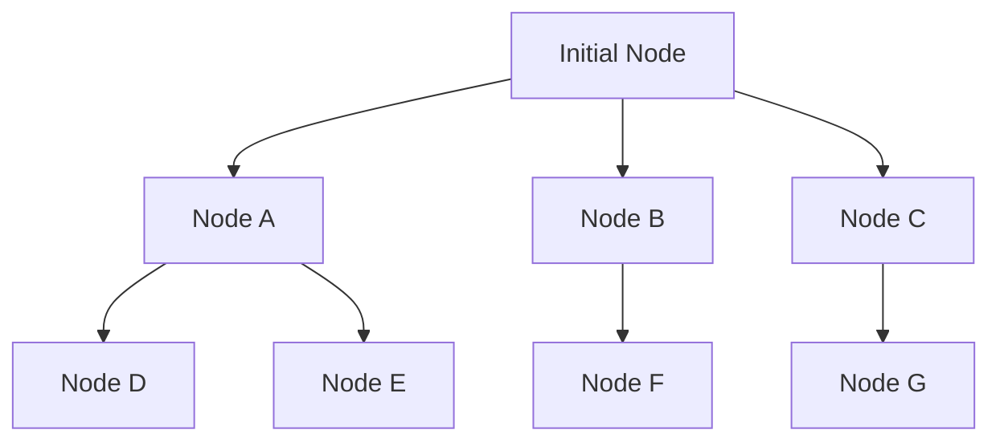

# Beginner Foundation: Game Theory 03 Extensive Form And Subgame Perfection

## 1. Everyday Intuition & First Principles

Imagine you're playing a game of chess. You make a move, and then your opponent makes a move. The game continues with each player making decisions based on the previous moves. This sequential decision-making process is what game theory calls the "extensive form." It's like a tree of possible moves and counter-moves, where each branch represents a different path the game could take. Now, imagine you're playing a game where you have to make a decision after your opponent has already made a move, but you don't know what move they made. This introduces the concept of "subgame perfection," which helps us understand the best strategies in such situations.

## 2. Foundational Vocabulary & Glossary

- **Extensive Form Game:** A representation of a game where the sequence of moves is explicitly laid out. It is often visualized as a tree where each node represents a decision point for a player.
- **Node:** A point in the game tree where a player makes a decision. Nodes can be initial (starting points), decision (points where a player chooses an action), or terminal (end points of the game).
- **Action:** A choice available to a player at a decision node. Actions lead to different branches in the game tree.
- **Path:** A sequence of actions from the initial node to a terminal node, representing a complete play of the game.
- **Strategy:** A complete plan of actions for a player, specifying what action to take at every decision node.
- **Subgame:** A part of the game tree that starts at a single node and includes all the nodes and branches that follow it. A subgame is a smaller game within the larger game.
- **Subgame Perfect Equilibrium:** A strategy profile that represents the best response for each player in every subgame of the game. It ensures that players' strategies are optimal not just at the start of the game but also at every decision point they might reach.

## 3. Visual System Flow

### ASCII Diagram

```
         Initial Node
           /     |     \
      Node A  Node B  Node C
       / \       |       / \
  Node D Node E  Node F  Node G
```

### Mermaid Flowchart



## 4. Common Beginner Misconceptions & Mental Traps

- **Misconception:** Thinking that the extensive form is only useful for games with perfect information. In fact, it is equally useful for games with imperfect information, where players do not know the full state of the game.
- **Misconception:** Believing that the subgame perfect equilibrium is always the same as the Nash equilibrium. While every subgame perfect equilibrium is a Nash equilibrium, not every Nash equilibrium is subgame perfect.
- **Misconception:** Assuming that players always know the entire game tree. In reality, players often have incomplete information about the game, and this affects their strategies.

## 5. Socratic Discussion Starters

- What is the difference between the extensive form and the normal form of a game?
- Can you explain the concept of a subgame with an example?
- Why is subgame perfection important in games with sequential moves?
- How does the concept of subgame perfection relate to real-world decision-making processes?
