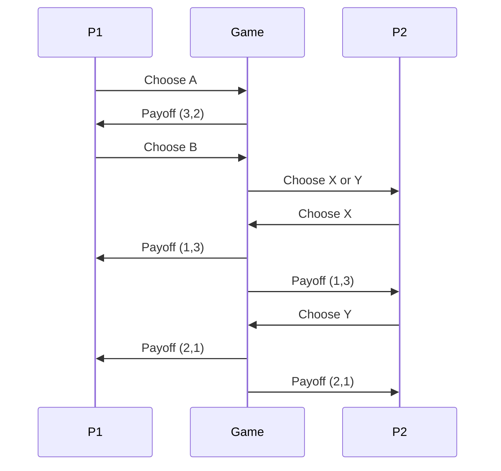

# Intermediate Foundation: Game Theory 03 Extensive Form And Subgame Perfection

## 1. Architectural Mental Model

In game theory, the extensive form representation is a tree structure where each node represents a decision point for a player. This model is particularly useful in sequential games where the order of actions is crucial. The extensive form captures the strategic interactions over time, allowing us to analyze how players make decisions given the information they have at each decision point.

### Key Concepts:
- **Nodes**: Represent decision points for players.
- **Edges**: Represent actions taken by players.
- **Terminal Nodes**: Represent the end of the game and the payoffs to each player.
- **Information Sets**: A collection of nodes where a player cannot distinguish between them at the time of decision.

### Example:
Consider a simple sequential game where Player 1 (P1) can choose between actions \(A\) and \(B\). If P1 chooses \(A\), the game ends with payoffs \((3, 2)\). If P1 chooses \(B\), Player 2 (P2) then chooses between actions \(X\) and \(Y\). If P2 chooses \(X\), the payoffs are \((1, 3)\), and if P2 chooses \(Y\), the payoffs are \((2, 1)\).

The extensive form of this game can be represented as follows:

```
          P1
         /  \
        A    B
       /      \
     (3,2)   P2
              /  \
             X    Y
            /      \
         (1,3)    (2,1)
```

## 2. Systems Taxonomy & Component Protocols

### Standard Interfaces and Protocols:
In the context of game theory, the extensive form can be seen as a system where each player interacts with the game environment through a well-defined interface. The interface allows players to make decisions based on the current state of the game and the information available to them.

### Data Models:
- **Game Tree**: A tree structure representing the game.
- **State**: The current state of the game, including the history of actions taken.
- **Action**: A decision made by a player at a decision node.
- **Payoff**: The outcome of the game, represented as a tuple of utilities for each player.

### Protocols:
- **Decision Protocol**: Defines how players make decisions at each node.
- **Information Protocol**: Defines the information available to players at each decision node.

## 3. Multi-Component Interaction Flow

### ASCII Sequence Diagram:
```
P1 -> Game: Choose A
Game -> P1: Payoff (3,2)
P1 -> Game: Choose B
Game -> P2: Choose X or Y
P2 -> Game: Choose X
Game -> P1: Payoff (1,3)
Game -> P2: Payoff (1,3)
P2 -> Game: Choose Y
Game -> P1: Payoff (2,1)
Game -> P2: Payoff (2,1)
```

### Mermaid Sequence Diagram:


## 4. Architectural Trade-offs & Production Pitfalls

### Trade-offs:
- **Complexity vs. Simplicity**: More complex games require more sophisticated models, which can be computationally expensive.
- **Scalability**: As the number of players and actions increases, the size of the game tree grows exponentially.
- **Information Sets**: Handling imperfect information requires careful design of information sets, which can complicate the model.

### Pitfalls:
- **Incorrect Information Sets**: Misdefining information sets can lead to incorrect analysis of the game.
- **Inefficient Algorithms**: Using inefficient algorithms to solve the game can lead to performance issues.
- **Overfitting**: Overcomplicating the model to fit specific scenarios can lead to a model that does not generalize well.

## 5. Socratic Discussion Starters

1. **How does the extensive form representation differ from the normal form representation in terms of computational complexity?**
2. **What are the implications of having imperfect information in a game, and how does it affect the design of the game tree?**
3. **How can we optimize the decision-making process in games with large state spaces?**
4. **What are the challenges in implementing subgame perfect equilibrium in real-world applications, and how can they be addressed?**
5. **How does the choice of decision protocol affect the strategic interactions in a game?**

By understanding these intermediate concepts, engineers and practitioners can design more robust and efficient systems that leverage game theory principles to model and analyze strategic interactions.
