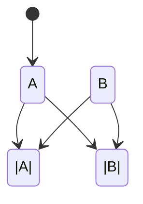
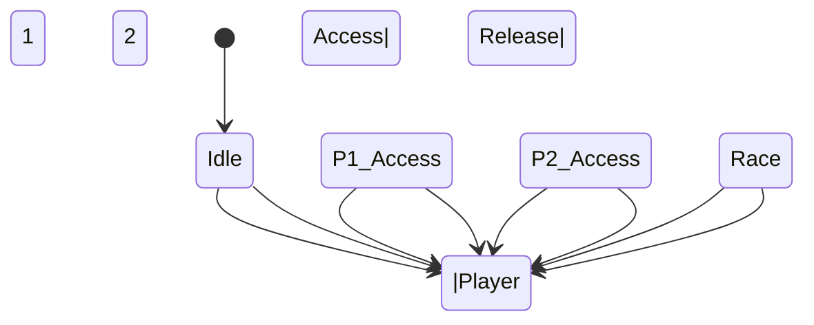

# Advanced Foundation: Game Theory 04 Repeated Games And Folk Theorem

## 1. Theoretical Invariants & Formal Frameworks (Formal proofs, kernel or physical invariants)

### 1.1 Repeated Games
In game theory, a repeated game is an extensive form game that consists of a finite or infinite sequence of identical base games. The key invariant in repeated games is the **stage game**—the game played in each iteration. The strategy space of a repeated game includes not only the strategies of the stage game but also the strategies for each player to respond to the history of play.

**Formal Definition:**
Let \( G = (N, \{A_i\}_{i \in N}, \{u_i\}_{i \in N}) \) be a stage game, where \( N \) is the set of players, \( A_i \) is the action set of player \( i \), and \( u_i \) is the utility function of player \( i \). A repeated game \( G^T \) is played over \( T \) stages, where \( T \) can be finite or infinite.

**Strategy Space:**
A strategy for player \( i \) in a repeated game is a function \( \sigma_i: H \to A_i \), where \( H \) is the set of all possible histories of play up to the current stage.

### 1.2 Folk Theorem
The Folk Theorem is a fundamental result in the theory of repeated games. It states that, in infinitely repeated games, any feasible and individually rational payoff vector can be achieved as a Nash equilibrium payoff vector.

**Formal Statement:**
Let \( G = (N, \{A_i\}_{i \in N}, \{u_i\}_{i \in N}) \) be a stage game. For any payoff vector \( \mathbf{v} = (v_1, v_2, \ldots, v_n) \) such that \( v_i \geq v_i^* \) for all \( i \in N \) (where \( v_i^* \) is the minmax payoff of player \( i \)), there exists a Nash equilibrium of the infinitely repeated game \( G^\infty \) in which the average payoff to player \( i \) is at least \( v_i \).

**Proof Sketch:**
The proof of the Folk Theorem involves constructing a strategy profile that ensures that any deviation from the prescribed payoff vector results in a lower payoff for the deviating player. This can be achieved using a combination of trigger strategies and punishment mechanisms.

## 2. Low-Level Invariant Taxonomy (Deep registers, memory models, hardware constraints, or axiomatic definitions)

### 2.1 Axiomatic Definitions
In the context of repeated games, the axiomatic definitions of rationality and feasibility are crucial. Rationality implies that players choose strategies that maximize their expected utility, while feasibility means that the payoff vector can be achieved through some strategy profile.

**Rationality:**
A strategy profile \( \sigma = (\sigma_1, \sigma_2, \ldots, \sigma_n) \) is rational if for each player \( i \),
\[ u_i(\sigma) \geq u_i(\sigma_i', \sigma_{-i}) \]
for all \( \sigma_i' \in A_i \).

**Feasibility:**
A payoff vector \( \mathbf{v} = (v_1, v_2, \ldots, v_n) \) is feasible if there exists a strategy profile \( \sigma \) such that
\[ \lim_{T \to \infty} \frac{1}{T} \sum_{t=1}^T u_i(\sigma^t) \geq v_i \]
for all \( i \in N \).

### 2.2 Hardware Constraints
In practical applications, the computational resources and memory constraints of the players can affect the strategies they can implement. For example, in security research, the computational power of an attacker and the defender can influence the effectiveness of their strategies in a repeated game.

**Memory Models:**
Players in a repeated game may have limited memory, which restricts the strategies they can use. A common model is the finite automaton, where the state space represents the memory of the player.

## 3. Micro-Architecture & Concurrency Dynamics (Mermaid and ASCII state machines / cache / race condition diagrams)

### 3.1 State Machines
State machines can be used to model the strategies of players in repeated games. Each state represents a possible history of play, and the transitions between states represent the actions taken by the players.

**Example:**
Consider a simple repeated game with two players, each choosing between actions \( A \) and \( B \). The state machine can be represented as follows:

### 3.2 Concurrency Dynamics
In concurrent systems, the order of actions can affect the outcome of the game. Race conditions can arise if the actions of the players are not synchronized properly.

**Example:**
Consider a repeated game where two players are trying to access a shared resource. The state machine can be represented as follows:

## 4. Subtle Failure Modes & Boundary Conditions

### 4.1 Subtle Failure Modes
In repeated games, subtle failure modes can arise due to the complexity of the strategies and the interactions between players. For example, a player may have a strategy that works well in most cases but fails in certain edge cases.

**Example:**
Consider a repeated game where a player uses a trigger strategy to punish deviations. If the punishment is too severe, it may lead to a spiral of retaliation that harms both players.

### 4.2 Boundary Conditions
Boundary conditions can affect the behavior of repeated games, especially in finite games. For example, the number of stages \( T \) can influence the strategies that are optimal.

**Example:**
In a finite repeated game, a player may choose to defect in the last stage because there is no future punishment. This can lead to a breakdown of cooperation.

## 5. Master Socratic Inquiries (Research-grade discussion questions)

### 5.1 Research-grade Discussion Questions
1. **Infinite vs. Finite Repeated Games:** How do the strategies and outcomes differ between infinite and finite repeated games? Can you provide examples where the difference is significant?
2. **Folk Theorem Extensions:** The Folk Theorem assumes that players have perfect monitoring and discounting. How do relaxations of these assumptions affect the set of feasible and individually rational payoff vectors?
3. **Computational Complexity:** What is the computational complexity of finding a Nash equilibrium in a repeated game? Are there any special cases where the problem is tractable?
4. **Concurrency and Synchronization:** How can concurrency and synchronization issues be addressed in repeated games? Can you provide examples of strategies that are robust to race conditions?
5. **Adaptive Strategies:** How can players adapt their strategies in response to changes in the game environment or the strategies of other players? Can you provide examples of adaptive strategies in repeated games?
