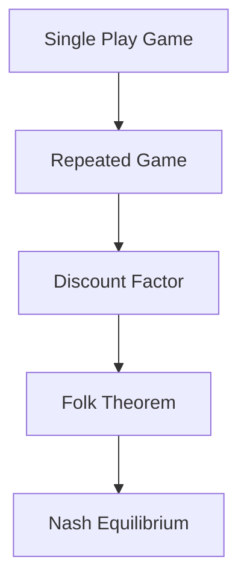

# Beginner Foundation: Game Theory 04 Repeated Games And Folk Theorem

## 1. Everyday Intuition & First Principles

Imagine you and a friend are playing a game where you can either cooperate or defect. If you both cooperate, you both get a reward. If one defects while the other cooperates, the defector gets a bigger reward, but the cooperator gets nothing. If both defect, you both get a small reward. Now, if you play this game just once, the best strategy might be to defect. However, if you play this game repeatedly, the dynamics change. You might decide to cooperate because you expect your friend to cooperate in the future, and vice versa. This is the essence of repeated games in game theory. The Folk Theorem tells us that in repeated games, there are many possible outcomes that can be sustained as equilibria, depending on the players' strategies and the discount factor.

## 2. Foundational Vocabulary & Glossary

- **Repeated Game:** A game that is played multiple times by the same players. The outcome of each play can affect the strategies of future plays.
- **Discount Factor:** A number between 0 and 1 that represents the weight of future rewards compared to immediate rewards. A higher discount factor means that future rewards are more valuable.
- **Folk Theorem:** A result in game theory that states that in infinitely repeated games, any feasible and individually rational payoff vector can be sustained as a Nash equilibrium.
- **Nash Equilibrium:** A situation in a game where no player has an incentive to change their strategy, given the strategies of the other players.
- **Cooperation:** A strategy where players choose actions that benefit both parties.
- **Defection:** A strategy where a player chooses an action that benefits them at the expense of the other player.

## 3. Visual System Flow

### ASCII Diagram

```
+-------------------+
| Single Play Game  |
+-------------------+
          |
          v
+-------------------+
| Repeated Game     |
+-------------------+
          |
          v
+-------------------+
| Discount Factor   |
+-------------------+
          |
          v
+-------------------+
| Folk Theorem      |
+-------------------+
          |
          v
+-------------------+
| Nash Equilibrium  |
+-------------------+
```

### Mermaid Flowchart



## 4. Common Beginner Misconceptions & Mental Traps

- **Misconception:** In repeated games, players will always defect because they are rational and want to maximize their immediate payoff.
  - **Trap:** This ignores the long-term benefits of cooperation and the impact of future rewards.
- **Misconception:** The Folk Theorem applies to all games, regardless of the number of players or the complexity of the game.
  - **Trap:** The Folk Theorem is specifically about infinitely repeated games and may not hold in finite games or games with more complex structures.
- **Misconception:** The discount factor is always 1, meaning future rewards are just as valuable as immediate rewards.
  - **Trap:** The discount factor can vary, and its value significantly affects the strategies players might choose in repeated games.

## 5. Socratic Discussion Starters

- How does the concept of a discount factor influence the strategies players might choose in a repeated game?
- Can you think of a real-world scenario where the Folk Theorem might apply, and how the discount factor could affect the outcome?
- Why might players choose to cooperate in a repeated game even if defecting seems like the better immediate strategy?
- How does the number of players in a repeated game affect the possible outcomes and the strategies players might use?
